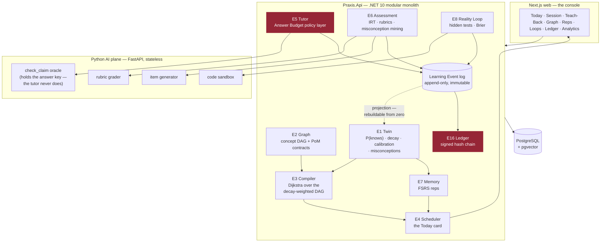

# PRAXIS — Phase 0 build plan

> The build target: a learner can sign up, be diagnosed, be given a compiled plan, sit a Socratic
> session that never gives them the answer, produce evidence, watch their knowledge decay, make a
> falsifiable prediction about code, be graded by reality, and export a signed record of it all.
>
> Nothing here is done until it **runs** and its **tests pass**. See `CLAUDE.md` §Definition of done.

## Status

**Current milestone:** M0
**Last completed task:** M0.2 — shared building blocks (29 tests green)

---

## How the loop works

Each iteration: read this file → take the **first unchecked task** → implement it with tests →
run `scripts/verify.ps1` → tick the box with a one-line note → commit → stop.
One task per iteration. Do not batch. Do not skip ahead. If a task turns out to be bigger than it
looked, split it in place and do the first half.

---

## The shape of the system

---

## M0 — Foundations

- [x] **M0.1** Solution scaffold: `src/Praxis.Api`, `src/Praxis.Shared`, `src/Praxis.Infrastructure`, `tests/`, `Praxis.sln`. .NET 10, nullable + warnings-as-errors on.
      → `Praxis.slnx` (.NET 10's new solution format), 4 projects, settings centralised in `Directory.Build.props`. Warnings-as-errors immediately caught a real high-severity CVE in the template's transitive `Microsoft.OpenApi` 2.0.0 — pinned to 2.10.0. Build clean, 4 tests green.
- [x] **M0.2** `Praxis.Shared`: `Result`/`Result<T>`, `ApiResponse<T>`, `ResultExtensions`, `BaseEntity`, `PagedResult<T>`, `IUserContext`. (Single-tenant for Phase 0 — no `ITenantContext` yet, but `BaseEntity` keeps the shape.)
      → All six, plus `IClock` (decay and scheduling make time the domain — it has to be fakeable). `Result<T>.Value` throws on a failure rather than handing back a null. 29 tests green.
- [ ] **M0.3** `docker-compose.yml`: PostgreSQL 17 + pgvector, one volume, one healthcheck. Nothing else.
- [ ] **M0.4** `Praxis.Api` host: Program.cs, DI, Scrutor handler scanning, FluentValidation filter, global exception handler, Serilog, `/health`.
- [ ] **M0.5** `scripts/verify.ps1` — builds .NET, runs .NET tests, lints + tests Python, builds + lints web. **This is the gate every later task must pass.** Also `scripts/dev.ps1` to bring the whole stack up.
- [ ] **M0.6** `README.md`: how to run it from a cold clone in under five minutes.

## M1 — The event kernel

- [ ] **M1.1** `LearningEvent` entity + `EventsDbContext`: append-only table (`id`, `learner_id`, `type`, `concept_id?`, `payload jsonb`, `occurred_at`, `sequence`). No update path. No delete path.
- [ ] **M1.2** `IEventStore` + `AppendAsync` / `ReadStreamAsync` / `ReadAllFromAsync`. Optimistic append by sequence.
- [ ] **M1.3** The event catalogue as a closed discriminated set: `ConceptTaught`, `AnswerGiven`, `ExplanationRecorded`, `HintTaken`, `RepDue`, `RepAnswered`, `PredictionMade`, `PredictionResolved`, `ArtifactSubmitted`, `SessionStarted`, `SessionAbandoned`, `SessionCompleted`, `EvidenceAccepted`, `EvidenceRejected`. **There is no `ConceptCompleted`. There never will be.**
- [ ] **M1.4** Projection framework: `IProjection`, a checkpointed replay runner, and a `rebuild-projections` CLI command that drops every projection and replays the log from zero.
- [ ] **M1.5** Identity module: `Learner`, register/login, JWT, `IUserContext` wired from the token. Deliberately minimal — this is not the interesting part.
- [ ] **M1.6** Integration test: append 50 events → rebuild projections from zero → state is byte-identical. **If this test is ever red, the kernel is broken and nothing else matters.**

## M2 — E2 Graph

- [ ] **M2.1** Domain: `Concept` (id, slug, title, summary, difficulty prior, domain), `ConceptEdge` (`REQUIRES` | `RELATES` | `CONTRASTS` | `APPLIES_TO`), `GraphVersion`.
- [ ] **M2.2** `PoMContract` per concept: which of the six evidence types are accepted, thresholds, and the MC weight of each. Enforces I-2.
- [ ] **M2.3** Domain-pack format (`packs/{name}/pack.yaml`) + loader + validator: rejects cycles in `REQUIRES`, rejects a concept with no PoM contract, rejects an orphan.
- [ ] **M2.4** Graph queries via recursive CTE: prerequisites-of, dependents-of, topological order, **the learner's frontier** (concepts whose prereqs are all HELD but which are not).
- [ ] **M2.5** Seed pack v0: **30 concepts** for the Objective *"Ship a RAG system that beats BM25 on your own corpus"* — hand-authored, real prerequisites. (Grows to 180 in M13.)
- [ ] **M2.6** `GraphController` + handler tests + a cycle-rejection test.

## M3 — E1 The Cognitive Twin

- [ ] **M3.1** `ConceptState` projection: `p_knows`, `stability`, `difficulty`, `last_seen`, `next_due`, `confidence_gap`, `assurance`.
- [ ] **M3.2** **BKT** update on each graded response (`p_transit`, `p_slip`, `p_guess` per concept, seeded from the pack's difficulty prior).
- [ ] **M3.3** **FSRS-class decay**: retrievability as a function of elapsed time and stability; `p_knows` bleeds continuously. The Graph must be able to show rot in real time.
- [ ] **M3.4** **Calibration**: learner states confidence before every graded item; Brier score accumulates per concept and globally. Confidence-vs-competence gap (Dunning–Kruger delta) is a first-class field.
- [ ] **M3.5** **The Evidence Ceiling (C-4)** — the single most important function in the Twin. `EXPLAIN`/LLM-graded evidence updates `p_knows` but is **hard-capped below the HOLD threshold**. Only `APPLY` (never-seen item), `BUILD` (it ran), or `PREDICT` (reality resolved it) can cross it. Property-test it: *no sequence of EXPLAIN evidence, of any length, at any score, can ever produce a HELD concept.*
- [ ] **M3.6** Misconception set: named, specific wrong models attached to the learner, mined in M7.
- [ ] **M3.7** `TwinController`: get twin, get concept state, get the decay forecast. Handler tests + the Evidence Ceiling property test.

## M4 — E3 Compiler + E4 Scheduler

- [ ] **M4.1** Edge cost function over the decay-weighted DAG: cost of a concept = f(estimated minutes, current `p_knows`, decay pressure on its prerequisites, PoM contract strictness).
- [ ] **M4.2** **Dijkstra** shortest-path-to-competence: Objective + Graph + Twin + constraints → ordered `Plan`. **A solver, not a prompt.** No LLM anywhere in this path.
- [ ] **M4.3** **The Decay Wall (C-1)**: forward-simulate the plan at the learner's stated minutes/day. If mastery decays faster than it accrues, the Objective is **structurally unreachable** — return `Unreachable` with the largest sub-Objective that *is* reachable, and the minutes/day that would make the original reachable. Test: 20 min/day on a 180-concept objective must return `Unreachable`.
- [ ] **M4.4** Nightly recompile job + recompile-on-significant-event.
- [ ] **M4.5** E4 Scheduler: given a session length (5/10/15/25 min), merge new-learning vs. due reps vs. open Loops into **one Today card** — one card, one action.
- [ ] **M4.6** `CompilerController` + `SchedulerController` + tests, including the Decay Wall test.

## M5 — The AI plane

- [ ] **M5.1** FastAPI scaffold: `ai/`, uv/pip, pytest, ruff, `/health`, structured logging, `.env.example`.
- [ ] **M5.2** Claude client + model router: Opus-class for grading/synthesis, Sonnet-class for tutor turns and item generation. Every call is cost-attributed and logged to a learner-minute.
- [ ] **M5.3** **The `check_claim` oracle** — the architectural heart of I-5. Holds the answer key. Takes the learner's claim + the item id, returns `{correct, partial, wrong}` + which misconception it matches. **The tutor calls this. The tutor never sees the answer.**
- [ ] **M5.4** Rubric grader with **abstention as a first-class output** (R-1): borderline scores escalate to an Opus-class grader, then to a human queue, and are written as `pending` — never as `passed`.
- [ ] **M5.5** Item generator: given a concept + evidence type + difficulty target, produce a never-seen item with a hidden answer key. The key goes to the oracle's store, not into any tutor-visible table.
- [ ] **M5.6** Golden-set eval harness: per-concept human-double-graded sets, a `pytest` regression that fails the build if grader agreement (Cohen's κ) drops below **0.75**. **A grader that regresses does not ship, even if it is cheaper.**
- [ ] **M5.7** Typed contract between Core and the AI plane (OpenAPI → generated C# client). The AI plane is stateless.

## M6 — E5 Tutor + the Answer Budget

- [ ] **M6.1** `AnswerBudget` domain: per-concept budget, spent, remaining. Persisted, event-sourced.
- [ ] **M6.2** The **hint ladder** as a policy layer: `orient → probe → analogy → partial → full`. Each rung costs from the budget. The final rung is **not** "the answer" — it is the smallest scaffold that still requires the learner to produce it.
- [ ] **M6.3** **Structural enforcement (C-5)**: the tutor's context is assembled by a server-side builder that *cannot* include the answer key — it is not in the tutor's database, not in its prompt, not in its retrieval index. Write the test that proves it: prompt-inject the tutor with every jailbreak we can think of and assert the answer never appears.
- [ ] **M6.4** Session loop: turn-by-turn Socratic dialogue, budget shown to the learner in the UI, and **every session ends with the learner having said or built something**.
- [ ] **M6.5** `SessionsController`, streaming responses, handler tests + the jailbreak test suite.

## M7 — E6 Assessment

- [ ] **M7.1** The six evidence types as first-class domain: `RECALL`, `APPLY`, `EXPLAIN`, `BUILD`, `CRITIQUE`, `PREDICT`. Each with its own intake, grading path, and MC weight.
- [ ] **M7.2** **Adaptive diagnostic (IRT)**: 2PL model, seeded from an LLM difficulty prior, converging after ~200 responses. 12 minutes, and it produces a rich Twin on day one — this is the cold-start weapon (R-7).
- [ ] **M7.3** The **"here's what you think you know but don't"** result screen — confidence vs. competence, per concept. The wow moment with zero accumulated data.
- [ ] **M7.4** **Failure-seeking item selection** (I-6): hunt the boundary of knowledge, not the comfortable middle.
- [ ] **M7.5** **Misconception mining**: cluster wrong answers into named misconceptions, write them to the Twin, then **generate new items that specifically target this learner's misconceptions**.
- [ ] **M7.6** Teach-back (`EXPLAIN`): capture, transcribe, rubric-grade, and record — subject to the Evidence Ceiling.
- [ ] **M7.7** Controllers + tests, including "a wrong answer produces a named misconception, and the next item targets it."

## M8 — E7 Memory

- [ ] **M8.1** FSRS scheduler: stability, difficulty, retrievability; next-review intervals per concept.
- [ ] **M8.2** Rep queue: what is due now, what is overdue, what is about to rot.
- [ ] **M8.3** Reps feed the Twin and the event log like any other evidence. A rep is not special.
- [ ] **M8.4** Tests: a concept left alone for 90 days must fall below threshold and reappear in the queue.

## M9 — E8 The Reality Loop (code)

- [ ] **M9.1** Sandboxed execution: Docker-isolated, no network, CPU + memory + wall-clock capped. This runs untrusted learner code — treat it as hostile.
- [ ] **M9.2** `BUILD` evidence: learner's artifact runs against **hidden tests**. It passes or it does not. No LLM in the verdict.
- [ ] **M9.3** `PREDICT` items on program behaviour: *"what will this print / what will fail / what is the complexity"* — the learner commits to a falsifiable prediction **with a stated confidence**.
- [ ] **M9.4** Resolution + **Brier scoring** → Calibration, a first-class metric next to Mastery.
- [ ] **M9.5** **Decouple thesis-grading from outcome-grading (R-4)**: the reasoning is graded in seconds; the outcome grades when it resolves. *You can be right for the wrong reason, and we tell you so the same day.*
- [ ] **M9.6** The Loops board: open loops, their horizons, what resolves today.
- [ ] **M9.7** Tests, including a hostile-code sandbox-escape suite.

## M10 — E16 The Ledger

- [ ] **M10.1** `Evidence` record: immutable, typed, scored, with the assurance level stated honestly (C-6).
- [ ] **M10.2** Append-only **hash chain**: each record commits to the previous. Tamper-evident.
- [ ] **M10.3** **Ed25519 signing** + published Merkle roots. **No blockchain** — see doc 25 §7; the answer is no, permanently.
- [ ] **M10.4** Verifiable Competency Record export (JSON + a human-readable page) and a **public, free-forever verification endpoint** — the cold-start weapon for the network (R-7).
- [ ] **M10.5** Tests: mutate one byte of one record → verification fails and names the broken link.

## M11 — The web console

Built with the `ui-ux-pro-max` skill. `prototype/praxis-prototype.html` is the visual reference —
match it, don't reinvent it.

- [ ] **M11.1** Next.js scaffold, Tailwind, design tokens lifted from the prototype, typed API client.
- [ ] **M11.2** Onboarding + the Objective. Says out loud what this is: *"PRAXIS will tell you when you are failing."* Self-select hard, on purpose (R-3).
- [ ] **M11.3** The Diagnostic — adaptive, 12 minutes, ending in the "what you think you know but don't" screen.
- [ ] **M11.4** The Contract: minutes/day, cadence, deadline. **Shows the Decay Wall when it hits one** — and offers the narrower Objective it does believe in.
- [ ] **M11.5** **Today** — one card, one action, "what do I do in the next 15 minutes."
- [ ] **M11.6** Session — the Socratic dialogue with the **answer budget visible and ticking down**.
- [ ] **M11.7** Teach-Back — record, transcribe, get graded, see the rubric.
- [ ] **M11.8** The Graph — the learner's own mind, with the decay showing. **The one dopamine we permit is the frontier advancing.**
- [ ] **M11.9** Reps.
- [ ] **M11.10** Loops — the board, the prediction capture with a confidence slider, the resolution.
- [ ] **M11.11** The Ledger — everything you have ever proved, and the export button.
- [ ] **M11.12** Analytics — **Mastery-per-Minute**, calibration, consistency. Willing to say *"you gained nothing this week"* — and then immediately name the single smallest next step (R-3).

## M12 — E15 Analytics

- [ ] **M12.1** Mastery-per-Minute (I-10), computed from the event log, per learner and per cohort.
- [ ] **M12.2** Calibration trend, consistency, decay debt.
- [ ] **M12.3** The honest dashboard: it reports MPM **including when it is low, and why**.

## M13 — The pack, and the end-to-end proof

- [ ] **M13.1** Grow the AI-engineering pack to **180 concepts** with prerequisites, PoM contracts, and a seeded item bank (~900 items).
- [ ] **M13.2** Seed the misconception library from the item bank's distractors.
- [ ] **M13.3** **The end-to-end run**: a scripted learner goes register → diagnostic → contract → compile → 12 sessions → reps → 3 Loops → Ledger export, and every assertion holds. This is the proof that Phase 0 works.
- [ ] **M13.4** The instrumented event log the RCT depends on (doc 25 §1.2) — verified complete and replayable.

---

## Deliberately not in this plan

Mobile · offline · i18n · payments · institutions · the News engine · the Project engine · the
Career engine · markets / medicine / law Loops · counterfactual Twin queries · the self-healing
Graph · the Verifier product · any form of chatbot mode.

Every one of these will be asked for. In Phase 0, the answer is no.
