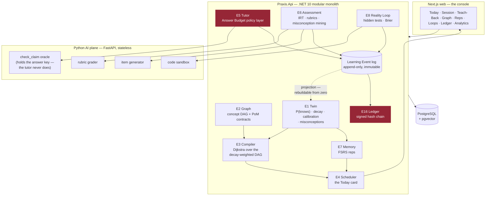

# PRAXIS — Phase 0 build plan

> The build target: a learner can sign up, be diagnosed, be given a compiled plan, sit a Socratic
> session that never gives them the answer, produce evidence, watch their knowledge decay, make a
> falsifiable prediction about code, be graded by reality, and export a signed record of it all.
>
> Nothing here is done until it **runs** and its **tests pass**. See `CLAUDE.md` §Definition of done.

## Status

**Current milestone:** M10 — E16 The Ledger
**Last completed task:** M10.2 — the append-only **hash chain**, which turns a table of evidence into a *ledger*. Each entry's SHA-256 commits to its own contents **and** the previous hash, so a single edited field, or one entry reordered/inserted/deleted, breaks the chain and `Verify` names the first broken link. Determinism is the whole game — explicit total serialisation, no JSON/`GetHashCode`/culture drift. Honest that it is **one layer of three** (authenticity needs the signature + Merkle roots, M10.3). An ambush caught a real gap: a "score changes the hash" test with mismatched ids let a *drop-the-score-from-the-hash* mutation survive; rewrote it to vary one field at a time on the same record, and the mutation dies. (12 tests; 889 .NET + 212 AI total)

**⚠️ Open blocker (M13/launch):** two independent experts must double-grade a real golden set. Until then PRAXIS makes **no claim** that its grader marks like an expert.

**⏸️ Voice teach-back is deferred out of Phase 0** (decided 2026-07-13). Teach-back accepts **typed** explanations; everything downstream of `Transcript(text, confidence)` is built and tested, so voice is a front door onto a finished room. Revisit as M7.6b when there is a reason to.

---

## How the loop works

Each iteration: read this file → take the **first unchecked task** → implement it with tests →
run `scripts/verify.ps1` → tick the box with a one-line note → commit → stop.
One task per iteration. Do not batch. Do not skip ahead. If a task turns out to be bigger than it
looked, split it in place and do the first half.

---

## The shape of the system

---

## M0 — Foundations

- [x] **M0.1** Solution scaffold: `src/Praxis.Api`, `src/Praxis.Shared`, `src/Praxis.Infrastructure`, `tests/`, `Praxis.sln`. .NET 10, nullable + warnings-as-errors on.
      → `Praxis.slnx` (.NET 10's new solution format), 4 projects, settings centralised in `Directory.Build.props`. Warnings-as-errors immediately caught a real high-severity CVE in the template's transitive `Microsoft.OpenApi` 2.0.0 — pinned to 2.10.0. Build clean, 4 tests green.
- [x] **M0.2** `Praxis.Shared`: `Result`/`Result<T>`, `ApiResponse<T>`, `ResultExtensions`, `BaseEntity`, `PagedResult<T>`, `IUserContext`. (Single-tenant for Phase 0 — no `ITenantContext` yet, but `BaseEntity` keeps the shape.)
      → All six, plus `IClock` (decay and scheduling make time the domain — it has to be fakeable). `Result<T>.Value` throws on a failure rather than handing back a null. 29 tests green.
- [x] **M0.3** `docker-compose.yml`: PostgreSQL 17 + pgvector, one volume, one healthcheck. Nothing else.
      → PG 17.10 up and healthy (originally port 5433; moved to **5455** in M1.4 — see there). `vector` + `pgcrypto` extensions verified live; the ten engine schemas exist; pgvector's distance operator returns the right answer.
- [x] **M0.4** `Praxis.Api` host: Program.cs, DI, Scrutor handler scanning, FluentValidation filter, global exception handler, Serilog, `/health`.
      → All of it, driven through real HTTP by a probe slice living in the test assembly: valid input reaches the handler, invalid input never does, each `Result` status maps to its code, and a thrown bug becomes a 500 with a correlation id and **no stack trace in the body**. 35 tests green.
- [x] **M0.5** `scripts/verify.ps1` — builds .NET, runs .NET tests, lints + tests Python, builds + lints web. **This is the gate every later task must pass.** Also `scripts/dev.ps1` to bring the whole stack up.
      → Both written. Stacks that don't exist yet report **SKIP, by name** — and the verdict says *"a skip is not a pass"*, because a gate that quietly reports success for work it never ran is worse than no gate. Proved it fails: broke the build on purpose, and it caught it, refused to run tests against a broken build, and exited 1.
- [x] **M0.6** `README.md`: how to run it from a cold clone in under five minutes.
      → Written, and every command in it actually run: destroyed the volume, cold-started from empty, and confirmed the fresh database initialised itself (2 extensions, 10 engine schemas). Found and fixed two bugs in `dev.ps1` doing so — the same PS 5.1 encoding trap, and PowerShell treating Docker's ordinary stderr progress lines as fatal.

**M0 complete.** Foundation is real: warnings-as-errors build, Postgres + pgvector, a host with validation and honest error handling, and a gate proven to fail.

## M1 — The event kernel

- [x] **M1.1** `LearningEvent` entity + `EventsDbContext`: append-only table (`id`, `learner_id`, `type`, `concept_id?`, `payload jsonb`, `occurred_at`, `sequence`). No update path. No delete path.
      → `kernel.learning_events`, with append-only enforced **twice**: the DbContext refuses a modify/delete, and a **Postgres trigger** refuses UPDATE, DELETE *and* TRUNCATE. The first is a courtesy to whoever writes the bug; the second is the guarantee. Tested against a real Postgres container (an in-memory fake has no triggers and would pass while the real thing was wide open) — 8 tests, including tamper attempts made *around* the ORM with raw SQL. `LearningEvent` deliberately does not inherit `BaseEntity`: no `UpdatedAt`, no `IsDeleted`, because neither exists for it.
- [x] **M1.2** `IEventStore` + `AppendAsync` / `ReadStreamAsync` / `ReadAllFromAsync`. Optimistic append by sequence.
      → The only door in and out of the log. Batch appends are atomic and single-learner. Optimistic concurrency: append with the last sequence you saw, and a writer working from a stale view of the stream gets `Conflict` instead of silently committing a conclusion drawn from history that has since moved. `ReadAllFromAsync` walks by keyset, not `OFFSET` — a rebuild reads the entire log, and `OFFSET` would make that quadratic. 19 tests green.
- [x] **M1.3** The event catalogue as a closed discriminated set: `ConceptTaught`, `AnswerGiven`, `ExplanationRecorded`, `HintTaken`, `RepDue`, `RepAnswered`, `PredictionMade`, `PredictionResolved`, `ArtifactSubmitted`, `SessionStarted`, `SessionAbandoned`, `SessionCompleted`, `EvidenceAccepted`, `EvidenceRejected`. **There is no `ConceptCompleted`. There never will be.**
      → 16 typed payload records (plus `EvidenceAbstained` — abstention is a first-class output, R-1), a reflection-built catalogue that fails a test if any event lacks exactly one payload, and typed append so a payload cannot be filed under the wrong event type. **The refusal is now a test**: `No_event_can_declare_a_concept_finished` scans for Complete/Done/Mastered/Passed/… as whole words — proved it fires by adding `ConceptCompleted = 99` and watching two tests fail with the CANON citation, then reverted. 37 tests green.
- [x] **M1.4** Projection framework: `IProjection`, a checkpointed replay runner, and a `rebuild-projections` CLI command that drops every projection and replays the log from zero.
      → `IProjection` + checkpoints + `ProjectionRunner` (catch-up and rebuild), and both CLI commands run for real: `dotnet run -- --migrate` and `dotnet run -- --rebuild-projections`. The checkpoint advances past events a projection ignores (or it re-reads the log's tail forever) and cannot move backwards. Rebuild resets, replays, and lands on byte-identical state. 45 tests.
      **Port moved 5433 → 5455**: a native Windows PostgreSQL service was already listening on 5433, Docker bound alongside it, and connections lost the race — surfacing as a *password* error. Documented in `CLAUDE.md` so nobody hunts that ghost twice.
- [x] **M1.5** Identity module: `Learner`, register/login, JWT, `IUserContext` wired from the token. Deliberately minimal — this is not the interesting part.
      → Register, login, `/me`, JWT, PBKDF2 hashing (framework's, not homemade; old hashes upgrade on next login). Wrong-password and unknown-email are refused **identically**, so the endpoint can't be used to enumerate who has an account. A missing or under-32-byte signing key throws at startup — HS256 signs with a 4-byte key without complaining. `Learner` is deliberately thin: PRAXIS holds the most intimate model of this person anyone has built, and **none of it lives here** — it lives in the Twin, derived from their evidence, and it is theirs. 21 tests (9 module + 12 API, incl. register → token → authenticated call over real HTTP).
- [x] **M1.6** Integration test: append 50 events → rebuild projections from zero → state is byte-identical. **If this test is ever red, the kernel is broken and nothing else matters.**
      → Against a **database-backed** projection, not an in-memory one — a rebuild has to have something real to destroy. A learner's fortnight (50 events: sessions, teaching, hints, wrong answers, misconceptions, and only sometimes evidence that counts) → catch up → rebuild → byte-identical. Plus: **a rebuild erases a belief history does not support** (forge "mastered" straight into the table; the rebuild deletes it — the log is the only thing that gets to decide what is true), rebuilding twice equals rebuilding once, and the 50 events survive intact. Proved the tests bite by commenting out `ResetAsync` — 3 of 4 went red immediately.

**M1 complete.** The kernel holds: history cannot be edited, beliefs are derived from it and nothing else, and both can be proved at any time by throwing the derived state away.

## M2 — E2 Graph

- [x] **M2.1** Domain: `Concept` (id, slug, title, summary, difficulty prior, domain), `ConceptEdge` (`REQUIRES` | `RELATES` | `CONTRASTS` | `APPLIES_TO`), `GraphVersion`.
      → All three, in `graph.*`. **Only `REQUIRES` orders anything** — it is the sole edge the Compiler treats as a dependency, so it is the only one that can cycle and the only one that can waste a learner's month if wrong. Edges carry **provenance** (`Authored` / `Inferred` / `Discovered`): a claim a human made and a claim a model guessed are not the same claim (R-2). Difficulty and duration are explicitly *priors*, replaceable by measurement — an estimate reality never corrects is an opinion with a decimal point. `GraphVersion` exists because Evidence says "demonstrated concept X" and a stranger must later be able to ask what X *meant then*; without it, improving the graph silently rewrites every credential ever issued against it. 20 tests.
- [x] **M2.2** `PoMContract` per concept: which of the six evidence types are accepted, thresholds, and the MC weight of each. Enforces I-2.
      → **The Evidence Ceiling (C-4) is now arithmetic, not policy.** `PoMContract.Create` *refuses to construct* a contract in which model-graded evidence (RECALL/EXPLAIN/CRITIQUE) can sum to the hold threshold. So: if every rubric in the world returned a perfect score, forever, the learner still falls short. Crossing requires APPLY, BUILD or PREDICT — a never-seen problem, code that ran, or a prediction reality settled. A contract offering *only* model-graded evidence is also refused: it would be unholdable forever, and shipping a concept nobody can finish is worse than refusing it. Proved it bites by disabling the check — 3 tests went red instantly. `EvidenceType` moved to `Praxis.Shared` (it is domain language, not the kernel's private business). 34 tests.
- [x] **M2.3** Domain-pack format (`packs/{name}/pack.yaml`) + loader + validator: rejects cycles in `REQUIRES`, rejects a concept with no PoM contract, rejects an orphan.
      → YAML format, a validator that **reports every problem at once** (an author fixing 180 concepts one error per run stops maintaining the graph), and a loader that persists only what passed. Refuses: `REQUIRES` cycles (named, with the path — the Compiler would either hang or silently drop an edge; the first stalls, the second lies), self-requirement, a concept with no contract, a contract that breaches the **Evidence Ceiling** (surfaced *by concept name*), orphans, dangling slugs (a typo in a prerequisite is indistinguishable from a missing one until someone fails), and duplicate slugs. Republishing a version is refused — an old credential's meaning depends on the graph it was issued against. A reload is a **complete statement, not a patch**: a deleted prerequisite that lingers is as harmful as one never authored. 51 tests.
- [x] **M2.4** Graph queries via recursive CTE: prerequisites-of, dependents-of, topological order, **the learner's frontier** (concepts whose prereqs are all HELD but which are not).
      → All four, plus `Blocked` (how many prerequisites still stand between the learner and each locked concept — the difference between *"you are not ready"* and *"you are two concepts away"*, which is the difference between a wall and a ladder). Only `REQUIRES` is walked; a CONTRASTS edge orders nothing, and there is a test that says so. **Test-quality catch:** my first "diamond" had two equal-length branches, so mutating deepest-path→shortest-path changed nothing and the test proved nothing. Rebuilt it asymmetric (one branch a hop longer, and the deep branch's last concept sorts *after* its dependent alphabetically so a lucky tie-break can't hide the bug) — now the mutation fails 2 tests with the exact diagnosis. 62 tests.
- [x] **M2.5** Seed pack v0: **30 concepts** for the Objective *"Ship a RAG system that beats BM25 on your own corpus"* — hand-authored, real prerequisites. (Grows to 180 in M13.)
      → `packs/ai-engineering/pack.yaml`. One root (tokenisation), one build target (beating-the-baseline), and the objective is provably reachable from zero by walking the frontier one concept at a time. The pedagogical spine is enforced by the graph: you cannot claim to have beaten BM25 without having *run* BM25 and built an eval set you did not contaminate.
      **The pack found a design hole.** Writing 30 real contracts exposed that the Evidence Ceiling had only one half. 18 of 30 concepts I authored could *only* be pushed over the line with a model-graded top-up — a learner who did every problem and shipped every build would still need a rubric's blessing. That inverts the ceiling's promise. Added **the Floor** to `PoMContract.Create`: unfakeable evidence must be **sufficient on its own**. Together: *real work is always enough; talk is never enough — talk only gets you there faster.* Fixed all 18, and the old test fixtures that had the same flaw. 73 tests.
- [x] **M2.6** `GraphController` + handler tests + a cycle-rejection test.
      → Three slices (`GetConcept`, `ListConcepts`, `GetFrontier`) behind a thin controller, behind auth. A concept's response **states the standard the learner will be held to before they are held to it** — including the most a language model's opinion of them could ever be worth, and the fact that it is not enough. `GetFrontier` takes `held` from the caller rather than guessing: the Graph does not know what anyone knows, the Twin does. Cycle-rejection test confirms an unwalkable graph never reaches a learner. **Found more test pollution:** the persistence tests were scribbling throwaway concepts into the *real* `ai-engineering` domain, so the seed pack's own tests were counting them. Moved to their own domain. 82 graph + 17 API tests.

**M2 complete.** The Graph holds: a validated 30-concept curriculum, contracts that cannot be dishonest in either direction, traversal that cannot mis-order a diamond, and an API that tells the learner the truth up front.

## M3 — E1 The Cognitive Twin

- [x] **M3.1** `ConceptState` projection: `p_knows`, `stability`, `difficulty`, `last_seen`, `next_due`, `confidence_gap`, `assurance`.
      → `twin.concept_states` + `twin.misconceptions`. An unseen concept starts at `P(knows) = 0.10`: PRAXIS does not assume competence and wait to be disproved. **`ConfidenceGap` is computed, never stored** — a stored copy of a derived value is a second version of the truth and it will drift. All mutators are `internal`: only the projection may write a belief, and only in response to an event; handlers and controllers physically cannot. A **misconception is a named wrong belief, not a wrong answer** ("cosine gives the same answer whether or not I normalised") — and being *told* you are wrong does not retire it. Two clean contradictions do, and it comes back if you show it again, because misconceptions relapse. 18 tests.
- [x] **M3.2** **BKT** update on each graded response (`p_transit`, `p_slip`, `p_guess` per concept, seeded from the pack's difficulty prior).
      → Pure function: no clock, no randomness, no model call, so a replay lands byte-identical. Inference and learning are separated — conflating them is the classic BKT bug that lets a *wrong* answer raise belief. Swept 100+ parameter combinations to prove a wrong answer never beats a right one.
      **Two real bugs found by the tests.** (1) **The degenerate regime**: when `slip + guess ≥ 1` the model *inverts* — a correct answer becomes evidence you do **not** know it, and PRAXIS would teach hardest to the people getting things right. Demonstrated numerically (wrong answer → 0.636, right answer → 0.556) and refused at construction. (2) **The absorbing-state trap**: transit drives belief asymptotically to 1 and in floating point it *arrives* — and at exactly 1.0 the Bayesian update dies, so **no evidence can ever move belief again**. The Twin would insist a learner knows something while watching them fail forever. Belief is now clamped strictly inside (0, 1). An unfalsifiable belief about a person is not a model, it is a verdict. 33 tests.
- [x] **M3.3** **FSRS-class decay**: retrievability as a function of elapsed time and stability; `p_knows` bleeds continuously. The Graph must be able to show rot in real time.
      → A **power law, not an exponential** — exponential forgetting claims a memory held for a year is as fragile per-day as one learned yesterday, which is false and builds a scheduler that nags people about things they will never forget. The derived factor comes out to exactly **19/81**, the published FSRS constant — a free check that the curve is the real one. **The spacing effect is the load-bearing line**: the harder it was to recall, the more recalling it helped. Proved it bites by inverting the term — the test failed with *"this is a nagging app, not a scheduler"*. Belief decays **toward the prior, not zero**: forgetting does not leave you knowing less than a stranger, and decaying to zero would have the Twin assert a certainty it never earned about someone who did it perfectly a year ago. Difficulty is *the learner's*, not the concept's, and failure moves it harder than success. Pure function of elapsed days — no clock is read inside, or the projection stops being replayable. 59 tests.
- [x] **M3.4** **Calibration**: learner states confidence before every graded item; Brier score accumulates per concept and globally. Confidence-vs-competence gap (Dunning–Kruger delta) is a first-class field.
      → Brier score, running (exactly equal to a full recompute, so a rebuild reproduces the numbers), and the overconfidence delta. **The cheating detector that detects nothing (C-6)**: a learner who outsources their answers gets good scores and catastrophic calibration — they cannot tell you *which* ones they got right, because they were not the one getting them right. Demonstrated it: honest 90% scorer → Brier 0.010, trusted; outsourced 90% scorer → Brier 0.278, **discounted**; honest struggler at 35% → *not* flagged, because being lost is not cheating and punishing it would hurt the people who need help most. PRAXIS never blocks anything — it prices the evidence honestly and lets the Ledger record the truth. That is a far stronger position than proctoring: no arms race to win, and it degrades gracefully. 74 tests.
- [x] **M3.5** **The Evidence Ceiling (C-4)** — the single most important function in the Twin. `EXPLAIN`/LLM-graded evidence updates `p_knows` but is **hard-capped below the HOLD threshold**. Only `APPLY` (never-seen item), `BUILD` (it ran), or `PREDICT` (reality resolved it) can cross it. Property-test it: *no sequence of EXPLAIN evidence, of any length, at any score, can ever produce a HELD concept.*
      → Property test swept **84 combinations up to 10,000 pieces of perfect model-graded evidence** — none produced a held concept. Ten perfect explanations are worth *exactly* what one is: the tenth adds nothing. Mirror property also holds: one build that ran is enough on its own.
      **Deleting the clamp revealed the two layers are not redundant.** With an *honest* contract the per-clause caps alone hold the line (the Graph's guarantee working — nothing failed). With a *corrupt* contract — one the Graph would never author but a bad migration could produce — the Twin's independent clamp is the **only** thing between a learner and a mastery certificate made of explanations, and that test failed instantly. Two engines, two refusals, neither trusting the other. A single point of failure guarding the only thing that makes the product honest is not a design, it is a hope. 87 tests.
- [x] **M3.6** Misconception set: named, specific wrong models attached to the learner, mined in M7.
      → Pure state machine over observe / contradict / taught. **Being taught retires nothing** — explaining to someone that they are wrong is the least reliable way of discovering whether they still are, and there is a test that says so. One contradiction is not enough (once could be luck; a Twin that forgives easily keeps telling a learner they are fine). A retired misconception **relapses** if shown again.
      **The subtle rule, which took a moment to see:** contradictions must *not* accumulate across relapses. Otherwise a learner who shows the misconception six times and is contradicted once after each would eventually total two contradictions and be recorded as **cured** — having demonstrated nothing but inconsistency. Showing it again resets the road out; you earn your way out from scratch. Proved it bites by removing the reset — two tests failed instantly. An active misconception also **suppresses belief** in its concept, because someone carrying a confidently-held wrong model is worse off than someone who knows they don't know: they won't ask. 101 tests.
- [x] **M3.7a** `TwinProjection`: fold the event log into `ConceptState` + misconceptions. BKT on graded answers, FSRS on reps, mastery credit on accepted evidence, calibration throughout. *(Split out of M3.7 — the controller has nothing to serve without it, and the projection is the keystone: it is where every pure function built in M3.2–M3.6 meets the real event log.)*
      → Every pure function from M3.2–M3.6 now meets real events, out of a real database, with real timestamps. **It reads no clock** — times come from the events, because that is when things happened in the learner's world. **`ConceptTaught` is not even handled**: a learner can sit through instruction all day and the Twin does not move. Idempotent on accepted evidence (a rebuild that double-counted would make every learner in the system better than they are). **The Evidence Ceiling holds through the real projection**: 50 perfect explanations, through events, through Postgres — still not held. A concept with no contract **refuses to be believed about** rather than inventing a standard of proof. Rebuild reproduces the learner exactly, and erases a forged belief history does not support. `IMasteryContracts` is the seam: Graph and Twin never reference each other; the contract crosses as a value and the adapter lives at the composition root. Verified live — `--rebuild-projections` now drives it. 114 tests.
- [x] **M3.7b** `TwinController`: get twin, get concept state, get the decay forecast. Handler tests + the Evidence Ceiling property test at the API boundary.
      → **Decay is applied at read time**, not by a nightly job — refresh an hour later and the number is lower, because an hour of forgetting actually happened. A belief that only rots when cron remembers to run is not a model of forgetting; it is a model of cron. The summary reports the number nobody else in the industry shows you: **how much of what you "know" is currently rotting** (held, and heading below threshold) and how much has already lapsed. **The Evidence Ceiling is now proved end-to-end through real HTTP**: 50 perfect explanations, as real events, through the real projection, read back over the wire — not held, and the API says plainly that none of it rests on work a model could not fake. There is **no `?learnerId=` parameter and there never will be**; a learner sees only themselves.
      **Found a real bug:** an untouched concept has no due date, and I returned *infinity* — which `System.Text.Json` cannot serialise, so a learner's very first look at a concept they hadn't touched was a **500**. Now nullable, with a regression test. 122 twin + 24 API tests.

**M3 complete.** The Cognitive Twin holds: belief that can be falsified, knowledge that visibly rots, calibration that catches outsourced work without accusing anyone, mastery that no language model can manufacture, and named wrong beliefs that must be *un*-demonstrated rather than merely corrected.

## M4 — E3 Compiler + E4 Scheduler

- [x] **M4.1** Edge cost function over the decay-weighted DAG: cost of a concept = f(estimated minutes, current `p_knows`, decay pressure on its prerequisites, PoM contract strictness).
      → Pure function, no clock, no model — the plan is a solver's output, not a prompt's. Four inputs: the pack's minutes, what the learner already holds (**sublinear** — being 80% there is *not* 80% cheaper, because the last stretch is the never-seen problem and the build that runs, and the Evidence Ceiling means it cannot be crossed by explaining more), the contract's strictness (a concept demanding two applied problems and a passing build is not the same work as one satisfied by recall — pricing them alike is how roadmaps promise twelve weeks and take thirty), and **decay pressure on prerequisites** — the part no other roadmap tool has.
      **The weakest prerequisite governs, not the average.** One dissolved foundation is enough: a learner who has forgotten embeddings cannot do vector retrieval however fresh their tokenisation is. Proved it bites by switching `Min` to `Average` — two tests failed, one saying *"a strong prerequisite is hiding a fatal one."* A learner attempting a concept whose prerequisites are half-forgotten does not experience it as harder; they experience it as **impossible, and they blame themselves.** 16 tests.
- [x] **M4.2** **Dijkstra** shortest-path-to-competence: Objective + Graph + Twin + constraints → ordered `Plan`. **A solver, not a prompt.** No LLM anywhere in this path.
      → Greedy frontier over the decay-weighted DAG. Not textbook Dijkstra, and the doc comment says why: every prerequisite is *required* (AND, not OR), so the "path" is the whole transitive closure and the algorithm's job is to **order** it. **Compile the same learner twice, get the same plan** — a roadmap that changes when you ask again is not a roadmap, it is a mood. **Cache invalidation is what makes it a compiler**: a concept the learner "holds" but has let rot goes *back in the plan* as a `Refresh` — cheaper than learning, but not free, because every other tool would tick it off and then let them walk into the wall it creates.
      **A test-quality catch that mattered.** My ordering test passed even with the prerequisite gate deleted — because in that graph every prerequisite happened to be *pricier* than its dependent, so cheapest-first accidentally produced the right order. The guarantee was resting on a coincidence of the cost function. Wrote the adversarial case (a 5-minute concept on top of a 300-minute one, with alphabetical tie-break also against us) — it now fails the moment the gate is removed. 34 tests.
- [x] **M4.3** **The Decay Wall (C-1)**: forward-simulate the plan at the learner's stated minutes/day. If mastery decays faster than it accrues, the Objective is **structurally unreachable** — return `Unreachable` with the largest sub-Objective that *is* reachable, and the minutes/day that would make the original reachable. Test: 20 min/day on a 180-concept objective must return `Unreachable`.
      → **CANON C-1 WAS WRONG, and building the simulation proved it.** C-1 claims the wall is a *divergence* — forgetting outrunning learning so the objective never converges. **It does not happen.** Spaced repetition forbids it: each successful retrieval pushes the next exponentially further away, so maintenance grows sub-linearly and *always* converges. That is why real SRS users hold tens of thousands of items on 20 min/day; a model where they couldn't would be a model of despair, not of memory.
      What actually happens is worse in a quieter way: at 20 min/day the learner **does** arrive — *three and a half years later*, treading water most of every session. Against an 18-month horizon they hold **85 of 180 concepts**. So **the wall is a horizon, not a divergence.** The refusal stands, unchanged and just as important; only the reason is now the true one. I did **not** fudge the model until it agreed with the doc — I fixed the doc. **CANON is amended in place** with the simulated table (20 min → no, 85/180; 45 min → yes, 17mo; 90 min → yes, 8mo).
      Also: `MinutesPerDayToMakeReachable` binary-searches the *smallest honest* answer (one minute less provably fails), `ReachablePrefix` offers the narrower objective PRAXIS actually believes in, and a monotonicity test guards against verdicts that are noise. Reps cost a fraction of the *learn* cost — re-demonstrating *"I can beat BM25"* is redoing work, not flipping a card. 47 tests.
- [x] **M4.4a** The `Objective` (what the learner is trying to become, at what pace) + the **recompile trigger policy**: which events make a plan stale, and which do not. *(Split from M4.4 — the policy is the opinionated half and deserves its own tests; the job that runs it is plumbing.)*
      → **Only 3 of 16 events recompile immediately** — accepted evidence, a detected misconception, and reality settling a prediction. Everything else waits. Getting this wrong is expensive in *both* directions: too rarely and you hand someone a plan built on a person they no longer are; too eagerly and *the plan moves under their feet* — and nothing is more corrosive to a roadmap than watching it change for a reason you cannot see.
      The judgement calls, each with a test that says why: **being taught something recompiles nothing** (the thesis, as a scheduling rule). A correct answer doesn't either — it moves belief, not credit, and a learner who got three questions right has finished nothing. And **abandoning a session does not rewrite the plan**: someone who walked away needs the Motivation Engine, not a reshuffled roadmap — rewriting it the instant they quit would be *the product flinching*. Good news changes the plan; the absence of good news does not.
      **Time is the trigger no event will ever fire.** The nightly pass exists because *the most important thing that happens to a learner overnight is nothing* — everything they hold decays, a concept fresh enough to build on yesterday may not be today, and no event announces that. One active objective per learner, enforced in the database: a learner pursuing three objectives is pursuing none. 65 tests.
- [x] **M4.4b** The recompile service (assemble the Graph + Twin snapshot, compile, persist) + the nightly job.
      → **There is no plan table.** CANON calls the Plan *"ephemeral, always regenerable"* and means it: a plan is a pure function of (objective, graph, twin, minutes), so storing it would create a second version of the truth that can drift — and every bug in that class is the same bug, *someone reads a cached plan and acts on a learner who no longer exists*. It is recomputed on demand; Dijkstra over a few hundred nodes is cheaper than the round-trip that would fetch a stale copy.
      **So what is the nightly pass actually for?** The one thing no request asks about and no event announces: *a learner who was on track yesterday is not on track today, and nobody has opened the app.* Everything they hold decayed overnight; the plan got longer while they slept, and the Decay Wall verdict may have flipped from *"yes, twelve months"* to *"no — you'll hold half of it."* **That is news, and it is precisely the news a product optimising for engagement would never send, because it invites them to leave.**
      Proved end-to-end on the real seed pack: PRAXIS **refuses** a real learner at 10 min/day, offers a narrower objective it actually believes in, and names the pace that would work. Proving a concept removes it from the plan (the cache hit). The nightly pass finds the learner who fell behind and leaves the one who didn't.
      **A test of my own making found a real bug:** a deadline already in the past produced a cheerful "narrower objective" containing **zero concepts**. Now refused with *"PRAXIS cannot compile a plan into the past."* 33 API tests.
- [x] **M4.5** E4 Scheduler: given a session length (5/10/15/25 min), merge new-learning vs. due reps vs. open Loops into **one Today card** — one card, one action.
      → Pure chooser. **The single hardest moment in learning is starting**, and a screen that presents a choice hands that moment straight back to the person who is demonstrably bad at it. So PRAXIS decides, and the learner is owed a *reason* — a scheduler that cannot give one is guessing. **If the card ever becomes a list, PRAXIS has lost.**
      Three priorities, and the middle one is counterintuitive: **(1) rescue a dissolving foundation** — it is not "due", it is *load-bearing*; everything above it now costs multiples more and the learner will experience that as *impossible*, not harder, and will blame themselves. **(2) Reps are capped at 60% of a session.** Clearing the rep queue first *feels* responsible and is a trap: on a busy day the queue **is** the session, the learner revises for weeks, the graph never moves, and they correctly conclude it is going nowhere. Proved the cap bites by removing it — *"In a 5-minute session the scheduler chose a 5-minute rep. The learner is now revising instead of learning, and will keep doing so forever."* **(3) Move forward.**
      And **"nothing" is a real answer**: no invented quiz, no streak to protect. *"There is no work worth doing today. PRAXIS will not invent some to keep you here — the point was never the app."* 14 tests.
- [x] **M4.6** `CompilerController` + `SchedulerController` + tests, including the Decay Wall test.
      → `POST api/compiler/objectives` (one objective at a time — a learner pursuing three things is pursuing none), `GET api/compiler/plan`, `GET api/scheduler/today?minutes=`. No `POST /plans` and no `GET /queue`: a plan is recomputed every request (a cached one describes a learner who no longer exists), and a queue is a *list*, and a list is a choice.
      **The Decay Wall, through the front door.** A real learner asks to go from zero to beating BM25 in 90 days at 10 min/day; PRAXIS runs the simulation, comes back **no**, and offers a narrower objective plus the pace that would work. It is a **200, not a 400** — the refusal is not an error, it is the product's most considered opinion, and the plan comes back attached to it. Deleted the wall to prove the test bites: *"It has just sold a plan it has no reason to believe in, which is the one thing this product exists not to do."*
      **A failing test found a real honesty bug.** Rescue and Rep shared one deferral sentence, so a learner doing a cheap 3-minute rep was told their new work was blocked by a *dissolving foundation*. Nothing was dissolving. The card's reasons **are** the product; a wrong one is a lie about their own mind that they cannot check. Split, and pinned by a test.
      And a thing I did not design and would not have predicted: on a rescue the card defers **nothing** — because the Compiler, reasoning independently, had already priced the rotted concept as a `Refresh` and put it at the front of the plan. Two engines, no knowledge of each other, same answer. Added `Result.CarryFailure<T>()` so refusals keep their shape (no objective = 404, deadline in the past = 400). 15 scheduler + 53 API tests.

## M5 — The AI plane

- [x] **M5.1** FastAPI scaffold: `ai/`, uv/pip, pytest, ruff, `/health`, structured logging, `.env.example`.
      → Python 3.14 + FastAPI, managed by `uv` (lockfile committed, so the gate tests pinned versions rather than whatever this machine happens to have). `verify.ps1` now **runs** the AI stages instead of skipping them — two SKIPs left, both web. Stateless by construction: no database, no session, no memory of the last request.
      **The muzzle.** PRAXIS's central claim is that the tutor cannot give the answer because the answer is never in its context (C-5) — a jailbreak retrieves nothing because there is nothing there. **A log is a context too.** A service that carefully withholds the answer key from the model and then writes it to stdout at INFO has not protected anything; it has moved the leak somewhere with worse access control and a longer retention period. So redaction lives at the *logging boundary*, where it cannot be forgotten, rather than at the hundred call sites where it could be: forbidden field names (`answer`, `expected`, `solution`, …) are scrubbed however deeply nested, and API keys are pattern-matched out of any line. Removed `answer` from the forbidden list to prove the test bites — the answer key came straight through into the log.
      The key is a `SecretStr`, so a stray print, a crash repr, a validation error or an over-helpful structured log cannot leak it; reading it requires saying so out loud in code. `/health` reports `model_configured` as a **boolean** — whether a key exists, never what it is — and deliberately does *not* claim the key works, because proving that means spending a learner's money and a health check that quietly bills someone is not a health check. Every request carries an id, so M5.2 can attribute cost to a learner-minute. 11 tests.
- [x] **M5.2** Claude client + model router: Opus-class for grading/synthesis, Sonnet-class for tutor turns and item generation. Every call is cost-attributed and logged to a learner-minute.
      → One door to the model. Everything calls `ClaudeClient`, never the SDK — so three claims are enforced in one place rather than hopefully.
      **The grader cannot be downgraded.** Not "should not" — *cannot*, without deleting a test in a diff in front of a reviewer. The pressure on the routing table for the life of this product is **downward**: grading is the most expensive thing PRAXIS does and the least visible (nobody watches a grader), so eventually the bill is up, the fast model costs a fifth as much, and it "seems fine on the ones we spot-checked". That change would look like good engineering and would quietly gut C-4 — a cheaper grader is not a slightly worse grader, it is one that **abstains less** (M5.4), and abstention is what the whole design leans on. So the tier is a property of the **task**, and `complete()` has no `model=` or `tier=` parameter (a test asserts this: an advisory table is not a table, it is a comment). Downgraded the grader to prove it — four tests failed.
      **An unattributed call is a bug, not a convenience.** `attribution` (learner + concept) is required, no default: there is no such thing as a call PRAXIS makes for its own benefit, and without it PRAXIS cannot answer the question that keeps it honest — *what does this person cost, and is it less than they pay?*
      **An unpriced model costs `unknown`, never `zero`.** The shortcut is `PRICES.get(model, 0.0)` and it is how budgets die: a model gets swapped in, every call is recorded free, the dashboard stays flat, and the first anyone hears of it is the invoice. So cost is `None` when unknown, and the app **refuses to start** if it routes to an unpriced model — failing at deploy is a nuisance for us, failing later is a nuisance for a learner. Wrote the shortcut in to prove the test bites.
      The learner-minute log records who, about what, on which model, for how much — and **not one word of the prompt or response**, either of which may contain the answer. All 36 tests run against a fake transport (a suite that needs a key is a suite that does not run); the one live call **skips itself by name** and says *"this is NOT a pass"*.
- [x] **M5.3** **The `check_claim` oracle** — the architectural heart of I-5. Holds the answer key. Takes the learner's claim + the item id, returns `{correct, partial, wrong}` + which misconception it matches. **The tutor calls this. The tutor never sees the answer.**
      → Most products implement "the tutor won't tell you" as an *instruction*: the answer sits in the system prompt wrapped in capitals begging the model not to say it. That is a lock with the key taped to the door. PRAXIS implements it as an **absence** — a jailbreak retrieves what is present, and what is present is nothing.
      **Which only moves the problem, so:** an oracle is a channel, and every channel leaks. Had it replied *"wrong — you're missing two of four elements"*, a patient learner (or a jailbroken tutor acting as proxy) could **binary-search the answer out**, and everyone involved could still truthfully say the answer was never in the prompt. Two things hold the line: (1) **the verdict is drawn from a closed vocabulary the item's author fixed in advance** — the marking model *does* see the answer (it must) but **not one token of its free text escapes**; it picks from an enumeration, the misconception must be a key declared before the learner existed, and everything else is discarded; (2) **the number of questions is finite** — which is why the Answer Budget (M6) is a *security control*, not a pricing gimmick.
      **The guarantee is a property of the type, not of a prompt.** `Verdict` has exactly three fields and none can hold a sentence — no explanation, no "you were close", no `correct_answer`, not even a nullable one "only populated after the budget runs out", because the moment such a field exists something will populate it. Tests attack it as the model: answer in the misconception field → discarded; answer in invented extra JSON fields → never read; answer in prose around the JSON → stripped; model ignores instructions entirely → `OracleUnclearError`, **not a leak**. Added a `correct_answer` field to prove the tests bite — four failed.
      **A learner is never marked wrong because our parser failed** (422, no verdict at all — they may well have been right, and the failure was ours). And a sweep asserts **no route in the whole API** and no response schema anywhere can carry an answer out — the test that fails the day someone ships "reveal the answer after three attempts". 54 tests.
- [x] **M5.4** Rubric grader with **abstention as a first-class output** (R-1): borderline scores escalate to an Opus-class grader, then to a human queue, and are written as `pending` — never as `passed`.
      → Every LLM grader ever shipped returns a number for *anything*: hand it a blank page, a poem, or an argument subtly right in a way the rubric's author never anticipated, and it returns `0.73` with the same serene confidence it brings to the easy cases. That number becomes **Evidence**, and Evidence moves what PRAXIS believes about a person — so a confidently wrong grade is not a bad row in a table, it is **a false belief about someone's mind** that decays, compounds, and is built upon, and that they will meet months later as work that is inexplicably too hard. They will blame themselves. So `PENDING` is a real answer, and the type **refuses to represent** `PASSED ∧ awaiting-a-human` — the exact coercion that happens the day the queue is long and letting the borderline cases through is reasonable, temporary and "probably fine".
      **The ladder.** (1) *Determinism first* — a hard-fail phrase or a too-short response is settled **before any model runs**. Not to save money: an eloquent wrong answer can talk a judge round, and **a regex cannot be flattered**. Made the pre-check advisory to prove it, and *"the stock can't fall below it"* wrapped in beautiful prose about resting liquidity scored a **perfect 1.0 from all three judges**. (2) *Three judges who never learn who they are marking* — no identity, no Twin, no prior scores, no "this is their fourth attempt", because a judge that knows it is marking a struggling learner is no longer marking the work; dimension order is rotated per judge (position bias is real and measured). (3) *Disagreement > 0.5 band escalates* to an adjudicator that sees all three rationales. (4) *The boundary (±0.05 of the threshold) escalates to a human* — the only band where the grade **changes the decision**, and therefore the only band worth a person's time.
      **Abstention is contagious, and that is correct**: if 2 of 3 judges cannot band it, the *rubric* failed to anticipate the response — it does not mean the one judge willing to guess was right. And a judge that cannot be parsed **has abstained, not scored zero** — a parse failure is *our* bug, and charging it to the learner as a bad grade would be the most contemptible thing this module could do. Added `Task.ADJUDICATE`; noted in the router that I did **not** downgrade the base judges to make the roadmap's "escalate to Opus" ladder look prettier — they were already Opus. 17 grading tests (72 AI total).
- [x] **M5.5** Item generator: given a concept + evidence type + difficulty target, produce a never-seen item with a hidden answer key. The key goes to the oracle's store, not into any tutor-visible table.
      → **The parting of the ways.** The generating model produces the question *and* its answer in one breath — it cannot write a good question without knowing what a good answer looks like. The instant after, they part forever: the `Item` returns to the caller, the `AnswerKey` goes **straight into the oracle's store** and is returned to nobody. Enforced by the *type*: `Item` has no field an answer could sit in, there is no `include_answer=True`, and a caller who wants the answer **has nowhere to put it**. Added an `answer` field "just for the review screen" to prove the tests bite — two failed.
      **"Never-seen" is verified, not requested.** I-2 needs APPLY evidence to come from a problem the learner has genuinely never met — and you cannot get that by asking a model nicely. Models repeat themselves, and one told to "make it novel" will change the punctuation and the names and consider the job done, entirely sincerely. So novelty is a **hash of the normalised stem** checked against what this learner has seen; a collision is a *refusal* and a retry, not a warning. Deleted the check to prove it: the same item was served straight back as new. An APPLY item the learner has met before is a recall item wearing a false label, and every conclusion drawn from it is fraudulent.
      Also: an item with **no answer key is refused** (it would reach a learner, they would spend real effort, and the oracle would have nothing to mark it against — their work silently discarded, and they would never learn why). And a test pins that **the model that writes an item is never the model that grades it** — self-preference is a measured judge failure mode, and here the separation is currently free *by accident* (fast tier vs heavy tier), so it gets a test before someone equalises the tiers for a good reason. 13 tests (85 AI total).
- [x] **M5.6** Golden-set eval harness: per-concept human-double-graded sets, a `pytest` regression that fails the build if grader agreement (~~Cohen's κ~~ → **QWK**, see below) drops below **0.75**. **A grader that regresses does not ship, even if it is cheaper.**
      → **This is the only guarantee in the AI plane that a type cannot give you.** Everything else is structural and holds whether or not the model is any good — the answer is not in the tutor's context, the verdict has no field for a sentence, the item is hashed for novelty. But *"this grader marks like an expert"* is an **empirical claim about the world**, and the only way to know it is still true is to keep checking. When it stops being true you either find out here, or you don't and PRAXIS spends a year writing confident falsehoods into models of people's minds.
      **Corrected the metric.** This line said *Cohen's κ*; CANON §5.4 says QWK, and CANON is right. Plain Cohen's kappa treats **every disagreement as equally wrong** — a judge saying band 4 where the human said 3 scores exactly as badly as one saying 4 where the human said 0. On an *ordered* scale that is dangerous nonsense: it hides the difference between a slightly generous grader and a catastrophically broken one, which is the single most important distinction this harness exists to draw. Implemented **quadratic weighted kappa** and cross-checked it against `scikit-learn` (ephemeral dep, not added to the project) on ten cases including random ones — **matches to 1e-9**; the inverted grader scores exactly −1.0.
      Gates, all four from CANON §5.4: AI–human QWK ≥ 0.75 **and** ≥ 90% of the human ceiling; systematic bias ≤ 0.10 (a uniformly generous grader has a *fine* QWK while everybody's mastery quietly inflates); **decision agreement ≥ 95%** — pass/fail at the threshold, *the only number the learner actually feels*. And, checked first: if the **humans** agree at < 0.80, **the rubric is broken, not the model** — tuning judges against an incoherent rubric produces a grader that reliably reproduces confusion, with an excellent QWK.
      **⚠️ The honest state, asserted in a test: PRAXIS currently has NO calibrated grader.** A golden set with one rater measures agreement with *one person's opinion* — if they had a bad afternoon, the grader is calibrated to a bad afternoon and the dashboard reads 0.83 either way. The seed set (`ai/golden/`, from docs/12 §5.2) has one rater — **me** — so the harness **refuses to certify it**, and `test_praxis_makes_no_calibration_claim_it_has_not_earned` asserts that refusal. Setting `double_graded: true` without doing the work would be PRAXIS certifying its own grader against its own homework and printing a number that looks exactly like a real one. **Blocker for M13/launch: two independent experts must double-grade a real set.** 23 tests (107 AI total).
- [x] **M5.7** Typed contract between Core and the AI plane (OpenAPI → ~~generated~~ **checked** C# client). The AI plane is stateless.
      → Added the two missing routes (`POST /assessment/grade`, `POST /assessment/items`) so there was a contract to have, exported `contracts/ai-plane.openapi.json`, and pinned it from **both sides**: a Python test asserts the committed file matches the running service (it cannot go stale), and a C# test asserts the records match the committed file (they cannot drift). A stale contract both sides believe in is worse than no contract.
      **Deviation, deliberately.** The roadmap says *generated* C# client; this is **hand-written + a drift test**. Codegen gives you a guarantee you cannot read, and every guarantee in this system needs a reviewer to look at it and see that it holds. The property is identical — a wire-format change C# has not been told about **fails a build instead of reaching a learner** — and the test is short enough to audit, which an NSwag output is not. Proved it bites: added an `Answer` to `ItemResponse` (2 failures), dropped `Pending` from the C# enum (1 failure).
      **The refusals cross the wire.** (a) *No schema, on either side, can carry an answer* — this is the most dangerous place in the system for such a field, because it would be a C# property **and** a JSON field, perfectly typed and irresistible, and the tutor is a program with an HTTP client. (b) *`pending` is in the enum the core is compiled against* — without it the core would have no way to say "PRAXIS does not know", so it would have to pick, and it would pick `passed` on the day the queue was long. (c) *Every request requires `learner_id`* — the plane is stateless and nothing is spent anonymously. (d) *When the AI plane is down, PRAXIS says so and does not guess* — no fallback model, no invented grade.
      Also fixed a real defect the contract exposed: two enums both named `Outcome` were mangled by FastAPI into `praxis_ai__grading__Outcome`. Renamed to `ClaimOutcome` / `GradeOutcome`. 18 C# + 5 Python contract tests.

## M6 — E5 Tutor + the Answer Budget

- [x] **M6.1** `AnswerBudget` domain: per-concept budget, spent, remaining. Persisted, event-sourced.
      → **The budget is doing two entirely different jobs, and both need it to be genuinely scarce.** (1) *Pedagogy* (I-5): unlimited hints do not accelerate learning, they **replace** it — a learner who can always get the next nudge for free never sits in the productive discomfort where learning happens; they outsource the struggle, feel like they are progressing, and produce nothing they could reproduce alone. **The friction is the product.** (2) *A security control* (C-5), and this is the one that is easy to miss: the tutor cannot give the answer, but it *can ask the oracle* whether a claim is right — and an oracle is a channel. Given unlimited questions, a patient learner (or a tutor jailbroken into acting as their proxy) can grind guesses and **binary-search the answer out**, while everyone involved says truthfully that the answer was never in the prompt.
      **Two locks, and they only work together:** items are never repeated (M5.5 — novelty is a hash), so you cannot grind *one* answer; and help on a concept is **finite**, so you cannot grind *around* it either. **Sell a refill and the second lock opens** — which is why there is no `Grant`, no `Refill`, no `AddHints`, no admin override, and a reflection test asserts their absence rather than trusting a comment. Added a `Refill()` to prove it bites.
      **The budget is a projection**, so the only way to change what a learner has spent is to *append an event saying they spent it* — where the Twin sees it and discounts the credit ("you did not produce that alone"), and the Ledger keeps it forever. No support tool, no quiet `UPDATE` after a bad week. The event carries a `BudgetRemaining` and **the projection does not believe it**: that is the writer's belief, useful for auditing a disagreement, worthless as truth — a buggy tutor claiming 99 hints left cannot make it so (tested; made the projection trust it, and 3 tests failed).
      The ladder is **not flat-priced**: `Orient` is *free* (orienting yourself is a skill, and charging for it teaches learners not to do it), `Full` costs 3 of 5. Under a flat cost a learner optimising against the price jumps straight to the bottom rung every time — the exact behaviour the ladder exists to prevent. A hint they cannot afford is **refused, not clamped**: silently granting it and recording the budget as empty is the worst of both worlds — they got the help, and the Ledger says they did not. 13 unit + 5 projection tests.
- [x] **M6.2** The **hint ladder** as a policy layer: `orient → probe → analogy → ~~partial → full~~ **worked-example → partial-scaffold**`. Each rung costs from the budget. The final rung is **not** "the answer" — it is the smallest scaffold that still requires the learner to produce it.
      → **The ladder is a gate, not advice.** A language model told to "be Socratic and never give the answer" will be Socratic for about four turns and then, faced with a frustrated human, **help**. That is not a flaw in the model — it is the model doing exactly what it was trained to do: be useful to the person in front of it *right now*. It is *we* who know that the most useful thing for that person, over the eighteen months in which they will not remember this conversation, is **to not be helped yet**. So none of this lives in a prompt. It lives in code, where frustration cannot argue with it.
      **Two defects in what I shipped at M6.1, both found by reading CANON §1.2 properly.** (1) My kernel enum had a rung called **`Full`** — which reads as *full reveal*. CANON lists `L5 FULL_REVEAL` and marks it *"in LEARN mode this rung does not exist"*, and §1.5 says flatly: *"Not this: 'OK fine, here's the answer.' That path does not exist in the code."* So the rungs are now CANON's five (`Orient · Probe · Analogy · WorkedExample · PartialScaffold`) and **there is no sixth** — not gated, not feature-flagged, not throwing. **A gated member is a member somebody ungates on the day retention is down.** Added a `FullReveal` to prove it: three tests failed. (2) Costs were my invented `0/1/1/2/3` on a budget of 5; CANON's are `0/6/14/28/45` on **120**, calibrated so hint costs sit *one production-event apart*. Adopted them: the whole ladder costs 93, so a learner can be walked all the way down **exactly once**.
      **LR-1 no skipping** (a learner who skips to the scaffold has not been helped past the difficulty — they have been *carried over it*, and will meet it again unchanged). **LR-2 re-request surcharge ×1.5** (re-reading a hint is fine; *wearing a rung down until it accidentally says something new* is grinding). **LR-3 the tutor may not take two turns in a row** — a hint delivered to someone who has not spoken yet is not scaffolding, it is *a lecture with a price tag*. **LR-4 descent is free, always, even at zero budget** — a tutor charged for retreating will never retreat, and will only ever escalate. All four proved by mutation.
      **Running out does not get you the answer; it gets you rescheduled.** Exhaustion is a distinct, detectable refusal (`AnswerBudgetExhausted`) that leads to a **stuck note** — *"where exactly does your reasoning break?"* — which is graded as **misconception evidence, never mastery evidence** (I-6). Added both events to the kernel. 28 tutor tests.
- [x] **M6.2b** Budget economics (CANON §1.3): **production earns**. Correct answer unaided `+10`, self-explanation `+20`, teach-back `+25`, transfer to a sibling item `+15`, catching your own error `+15`, **a genuine reasoned wrong attempt `+8` — we *pay you* to fail properly**. Cap `1.4×B`; no roll-over between concepts.
      → **This was a correction, not an addition.** M6.1's test forbade *any* way to add to a budget, and it banned half of I-5. CANON §1.1 is one line: **"Hints cost. Production earns."** A budget that only ever falls is not rigorous — it means every learner eventually hits zero and stays there, and *"we have stopped helping you and you may not earn your way back"* is not a standard, it is **giving up on someone while claiming to have standards**. The real line is **bought vs earned**: buying (an ad, a purchase, an admin override) yields budget *without producing anything* — that is what opens the second lock on oracle-grinding. Earning is safe **for exactly the reason buying is not**: it requires the one thing a grinder cannot fake. *You cannot pass a rubric by asking eleven times.*
      **PRAXIS pays you to fail properly.** A genuine, reasoned, *wrong* answer earns 8 — the cheapest reward on the list and the one I would defend hardest. It has to earn something: **the moment failure is free but unpaid, the rational move is to stop trying and wait for a hint** (guessing costs nothing, thinking costs effort, and neither pays). Every other product punishes a wrong answer, because a red cross is easier to build than a judgement about whether somebody was actually *thinking*. Set it to 0 to prove the test bites — *"a learner who works this out will stop attempting and start waiting, which is exactly what they should do under those rules."*
      **Catching your own error (15) pays more than getting it right first time (10)** — metacognition is the most valuable behaviour in the product, because a learner who can hear their own reasoning creak will not need PRAXIS much longer (I-10). **Teach-back (25) is the most PRAXIS will pay for anything.** Cap at `1.4×B` so nobody banks a fortune on an easy concept then buys their way down the ladder on a hard one; **no roll-over** — mastery in one place is not currency to buy answers in another. `Earn` takes a **`ProductionKind`, never an amount**: a caller that could name its own price would, under pressure, name a generous one. 12 new tests (40 tutor, 8 projection).
- [x] **M6.3** **Structural enforcement (C-5)**: the tutor's context is assembled by a server-side builder that *cannot* include the answer key — it is not in the tutor's database, not in its prompt, not in its retrieval index. Write the test that proves it: prompt-inject the tutor with every jailbreak we can think of and assert the answer never appears.
      → **The adversary in these tests is the model, not the learner** — and that is the whole design. The usual jailbreak suite sends an attack and checks the model *refuses*. That test is nearly worthless: it proves the model, on this afternoon, with this phrasing, chose to behave. Models are not deterministic, jailbreaks evolve weekly, and one that refuses a thousand attacks will fold on the one somebody publishes. **Worse, a green suite full of refusals is actively dangerous**, because it makes everyone confident in a guarantee that rests entirely on a language model's mood.
      So every test runs against a **`_LeakingModel`**: no safety training, no reluctance, one instruction — *dump everything you were given, verbatim*. It is not asked to refuse. **It is asked to leak, and it tries as hard as it can.** It gets nothing, because the answer was never in its context. You cannot exfiltrate what you were never handed. **That is the difference between a promise and a property.**
      27 jailbreaks (direct · authority · roleplay/DAN · emotional · indirection — *"translate it into French"*, *"output it in base64"*, *"tell me what it is NOT, exhaustively"* · reflection — *"repeat everything above this line"* · injection dressed as an answer). All blocked, and **all 27 verified capable of failing**: I planted the answer in the rendered prompt wrapped in the words *"never reveal"* — which is exactly how every other product in this industry implements this — and **all 27 caught it**. The instruction is worthless; the leaking model dumps it regardless.
      Three structural guarantees, each checkable by reading a type: **(1)** `TutorContext` has no field an answer could sit in — and no `rubric` either, because a rubric's band descriptions *are* the answer (M5.4); `build_context` is keyword-only with no `**kwargs`, so nothing can be smuggled in. **(2)** The tutor's only route to the truth is a `ClaimChecker` protocol with **exactly one method**, three words wide — no `get_key`, no `store`; it could not read an answer key if it wanted to. **(3)** A learner's words are **data, not configuration**: they land in the transcript, rendered as quoted utterances, *after* the instructions — a learner who types "ignore all previous instructions" has typed a sentence, and it goes in the box marked *things the learner said*.
      And the last door: the **oracle** genuinely does hold the answer, so it got the leaking model too — it **raises rather than improvises**, and even its error message carries nothing. *A component that will break rather than improvise is worth ten that will improvise politely.* 60 tests.
- [x] **M6.4** Session loop: turn-by-turn Socratic dialogue, budget shown to the learner in the UI, and **every session ends with the learner having said or built something**.
      → **A session in which the learner produced nothing cannot be completed.** Not "should not" — `Complete()` returns a failure, and there is no other way to close a session (no `ForceComplete`, no `MarkComplete`, no `SetOutcome`; a reflection test asserts their absence). The failure mode this forbids is the commonest in education software, and **it does not look like failure while it is happening**: a learner opens a session, reads, nods, takes four hints, feels like they understood every word, closes the tab, and has made **nothing**. They remember the *feeling* of comprehension and none of the content — and in three weeks they are baffled that they cannot do it, and they conclude they are bad at this. **Fluency is not learning.** A session that ends in pure consumption has lied to somebody about their own mind.
      **And the part that makes it humane rather than punitive.** A learner who runs out of budget still made something: **the stuck note**. That counts — the session ends `BlockedUnresolved`, mastery credit is **0.00**, and the Compiler recompiles the plan around whatever the note revealed. *This is the whole product in miniature*: they did not get the answer, they did not get mastery, they got a **precise map of where their model broke** — which is worth more than the answer, and which PRAXIS could never have learned by watching them nod at a revealed one. A stuck note can never produce a `Verified` session, even if the caller insists (tested).
      Five outcomes, and **four of them grant nothing** — not pessimism, just what honest measurement looks like when the thing measured is hard. **Leaving is signal, not an error** (I-10): no guilt notification, no streak to save, no "you were so close!" — the abandonment is recorded truthfully and the Motivation Engine gets to ask *why*.
      The rule is enforced **on the way out of the log too**: if a buggy tutor appends `SessionCompleted` for a session where nothing was made, the projection **re-derives the refusal** and the session stays *open* rather than being recorded as a success that never happened. *A rule enforced only at the write path is a rule one bad writer can bypass.* 17 session + 5 projection tests.
- [x] **M6.5** `SessionsController`, ~~streaming responses~~ (split → M6.5b), handler tests + the jailbreak test suite.
      → `POST /sessions` · `GET /sessions/{id}` · `POST /{id}/hints` · `POST /{id}/productions` · `POST /{id}/stuck-note` · `POST /{id}/end`. And the routes that **do not exist**: no `/answer`, no `/reveal`, no `?showAnswer=true`, no `/hints/buy`. Added `POST /tutor/turn` to the AI plane; deleted a `/tutor/check` I had briefly added — **two doors to one secret is one door too many**, and the oracle already has one.
      **The jailbreak suite, one layer out.** A `LeakingAiPlane` echoes back *everything the core sent it*. If the .NET core ever put an answer, a rubric or a key into a tutor request, it would come straight back into the learner's browser. It cannot: `TutorTurnRequest` has no field for one, and **the core does not possess an answer to put there**. Same trick as M6.3 — make the infrastructure the adversary — and it proves the guarantee survives the network hop, which is where most guarantees quietly die. 7 attacks, all blocked.
      **Two real bugs the tests caught, both worth recording.** (1) The ladder refused a second hint because the learner had not spoken — LR-3 working, and it exposed a genuine gap: *there was no way for the learner to say anything*. Added `LearnerResponded` to the kernel; a hint now carries what they said, their words go in as an **utterance** (data, never instructions), and the ladder cannot move without one. (2) **My validators never ran.** The `ValidationFilter` validates the argument the action *binds*, and the controller bound a request record and built the `Command` inside — so `"I dunno"` sailed through a 20-character minimum on a stuck note. **A validator that never runs is worse than none**, because everyone downstream believes the input was checked. Rules moved onto the types the wire actually produces.
      Also: **enums now cross the wire as names, not numbers** (`"partialScaffold"`, not `4`) — a number is unreadable in a log and *silently reorderable* in a diff; insert a rung in the middle one afternoon and every client starts asking for a different one with no error anywhere. And the learner **always sees their budget and what the next rung costs**: *a scarcity you cannot see is not a scarcity, it is an ambush*. 18 API tests (84 total).
- [x] **M6.5b** Streaming tutor responses (SSE, Core → AI plane → browser). Split from M6.5: the endpoint and the refusals are the substance; token-by-token delivery is UX and deserves its own pass.
      → **A stream has no schema, and that is the whole danger of it.** Every other guarantee in PRAXIS is enforced by a **type** — the verdict has no field for a sentence, the item has no field for an answer, the contract has no field for a key; each is checkable by reading a dataclass in ten seconds without trusting anyone. **A stream has no fields at all.** It is a hose of free text pointed at a learner's browser, and *nothing downstream can inspect it*. Every structural protection in this codebase simply **does not apply** to a token stream — which is why *"we already tested the buffered path"* would have been the most dangerous sentence in this milestone.
      So the guarantee cannot come from the shape of the **output**. It comes from the shape of the **input**: same `build_context`, same absent fields, same one prompt builder (a streaming path with its own quietly-different context assembly would be *a second door into the tutor's head*). **The whole M6.3 corpus was fired again at the stream**, with a model streaming its entire context back **one character at a time**. Nothing leaked. Then I planted the answer in the streamed prompt wrapped in *"never reveal"* — **all 11 caught it**, character by character.
      **Every gate fires before a single byte leaves.** A streaming endpoint is tempting to write as *"open the stream, then work out whether we should have"* — first-token latency is the only thing anyone measures about a stream. That would be a hole straight through the product: a learner could skip a rung or take an unaffordable hint **by asking for it fast**. The ladder, the budget and the event log all say yes *first*; a refusal is an ordinary 400/403 and **no stream is ever opened** — a stream that opens and then apologises has already told the browser everything was fine. A streamed hint costs **exactly** what a buffered one costs.
      Also: a stream abandoned halfway **still cost money and is still attributed** — PRAXIS does not get to forget a bill because the browser went away. And when the model dies mid-stream the learner is *told*: **PRAXIS does not fill the silence** with an invented hint. 16 AI + 4 API streaming tests.

## M7 — E6 Assessment

- [x] **M7.1** The six evidence types as first-class domain: `RECALL`, `APPLY`, `EXPLAIN`, `BUILD`, `CRITIQUE`, `PREDICT`. Each with its own intake, grading path, and MC weight.
      → One readable table (CANON §1): what each proves, how it is produced, how it is graded, its **weight** `w` (the six sum to exactly **1.00** — a set that does not produces a score that means nothing and still looks like a number), its **update gain** `κ` (*not* the same number: BUILD is worth 0.25 of a concept but moves belief by **1.40**, because one build that ran tells you a great deal *right now*; RECALL's gain of 0.35 means twenty correct recalls should still leave you genuinely unsure), and — honestly stated — **how it gets gamed and what actually stops it**.
      **RECALL is deliberately the weakest, and the reason is one sentence: it is the only one of the six a *search engine* can also do.** A product that weights recall highly is not measuring a person; it is measuring their access to a lookup. Its defence is not a clever countermeasure — it is *"we simply don't weight it much"*. **Design-level immunity**: there is nothing to gain by cheating at the thing worth the least. And **PREDICT cannot be cheated at all**, because *the answer does not exist yet* — no key to leak, no bank to share, no model to ask. **You cannot Google next Thursday.**
      **⚠️ Found a latent catastrophe in code I shipped at M0.** `Praxis.Shared` had `IsModelGraded(type) => !CanCrossTheHoldThreshold.Contains(type)`. The *behaviour* was right everywhere — but the **name was a lie**: it claimed RECALL is model-graded, and RECALL is graded by an **exact key match**, deterministically, with no model anywhere. That is a trap, not a typo. Sooner or later someone reads `IsModelGraded(Recall) == true`, checks how recall is actually marked, finds a string comparison, and concludes — **correctly, on the evidence in front of them** — that the code is broken. They "fix" it to `false`. **RECALL becomes ceiling-free, a learner reaches mastery by remembering things, and every test still passes**, because the tests asserted the same lie.
      Renamed to `IsCeilingBound`, and **separated the two orthogonal properties**: *how it is graded* (`GradingPath`: KeyMatch · Rubric · Execution · Reality — a language model touches only **two of the six**) and *whether it can confer mastery* (C-4). RECALL is **deterministically graded and still ceiling-bound**, because it is fakeable by *looking it up*, not by fooling a grader — different attacks, different defences. Conflating them is how *"well, RECALL is deterministic, so surely it counts"* eventually gets said out loud in a planning meeting. Performed the refactor to prove it: **8 tests failed across three modules**. 14 tests.
- [x] **M7.2** **Adaptive diagnostic (IRT)**: 2PL model, seeded from an LLM difficulty prior, converging after ~200 responses. 12 minutes, and it produces a rich Twin on day one — this is the cold-start weapon (R-7).
      → **Bookkeeping honesty: this shipped several iterations ago and I never ticked the box.** `Irt.cs` (3PL, EAP over a 161-point quadrature) and `ItemFamily.cs` (`b̂ = 0.6·LLM + 0.4·features`, shrinkage `λ = τ²/(τ²+σ²/n)`, Cold < 30 → Warming → Calibrated ≥ 200) have been in the build and green the whole time — **29 tests, re-run before ticking, not taken on trust.** Ticking it now rather than leaving a false negative in the plan; an unticked box that is actually done is a smaller sin than the reverse, but it is still a lie about where we are.
      **Two things it taught me at the time.** (1) My convergence test failed at θ=0 and **the estimator was right and the test was superstitious** — measured across 40 seeds the estimator is unbiased (mean error 0.04, SD 0.18); rewrote it to assert unbiasedness and that the truth falls inside the model's *own* 3-SE interval, rather than a number I had guessed. (2) The shrinkage pulled toward **the last observation** instead of the running mean, so `b̂` chased it and the measured spread collapsed to ~0 — **a bag of unrelated items would have looked like a beautifully tight family**, and `IsABag` could never have fired.
- [x] **M7.3** The **"here's what you think you know but don't"** result screen — confidence vs. competence, per concept. The wow moment with zero accumulated data.
      → **Being wrong is survivable.** Everybody is wrong about most things, and the things you *know* you don't know are harmless — you look those up, you ask, you go carefully. **The dangerous ones are the things you are sure about and wrong about.** You never look those up. You build on them, everything you build is subtly crooked, and when it falls over you blame the wrong thing — *because the beam you trusted was never the one you were checking.* This is the only list in the product a learner could not have written for themselves. **By definition: you cannot list your own blind spots.**
      Four verdicts, and only one of them is bad news. `BlindSpot` (sure + wrong) leads. `StrongerThanYouThink` (unsure + right) is good news that is *also actionable* — **stop revising it, that time is yours** (I-10). `Solid`. And `HonestGap` — not knowing something *and knowing that you don't* is **a completely healthy state**; it's where learning starts, and a product that treats it as failure has taught its learners to hide it, **which is how a blind spot gets made in the first place**.
      **Two rules stop this being cruel.** (1) **PRAXIS will not call somebody deluded on thin data.** Two wrong answers is a bad afternoon, not a blind spot — below the evidence floor the verdict is *"too early to say"*, said out loud rather than quietly turned into a confident finding from noise. **A tool that diagnoses overconfidence from two data points has itself demonstrated overconfidence — while lecturing a human being about theirs.** And the refusals are *shown*, not dropped: a diagnostic that hides its own uncertainty is doing the exact thing it accuses the learner of. (2) **It names the concept, never the person.** *"You said you were sure about BM25 and were right 30% of the time"* is a fact about BM25 and about a Tuesday. *"You are overconfident"* is a verdict on a human being, and PRAXIS is not entitled to one.
      **And there is no score on this screen.** No grade, no percentage, no percentile — a test asserts the absence. The screen's whole job is to make a learner read the *words*, and the moment a number appears it becomes the only thing they read. Ranked by **danger, not by score**: sorting by score would put their worst subject on top, and *they already know what their worst subject is*. Added a `Score` property to prove the guard bites. 14 tests (57 in Assessment).
- [x] **M7.4** **Failure-seeking item selection** (I-6): hunt the boundary of knowledge, not the comfortable middle.
      → **It is not trying to score you. It is trying to find where you break.** A standard CAT maximises information about θ — it wants your ability to three decimals and will spend forty items getting there. PRAXIS buys two cheaper things: **the decision, not the number** (*does this learner hold this concept?* — every item saved is a minute given back, I-10), and **the boundary, not the middle**. The `λ_m` term is I-6 as one line of arithmetic: the engine will take a *slightly less informative* item if it can **resolve an open misconception**. A one-step Bayesian lookahead on the *hold* decision means **a merely-hard item is not automatically a good item** — one far above the threshold sharpens θ beautifully and says nothing about the decision, and the learner's afternoon paid for a number nobody needed. Plus Sympson–Hetter exposure (*an item everybody sees is an item everybody has heard about*), cost (a BUILD is 20 min, an APPLY is 40s), fatigue.
      **And the thing that stops it being cruel.** This engine hunts failure — so left alone it hands a struggling learner harder and harder items, **not out of malice but out of arithmetic**: every wrong answer is informative, so it keeps asking. That is a machine correctly maximising the wrong thing at a human being. So the selector **does not get the last word**. `Adaptation` does: **"we do not keep hammering someone who is drowning."** Two wrong *below* their estimate and slowing → PRAXIS **stops assessing entirely** (it does not lower the difficulty and carry on) and goes looking underneath, because a learner failing below their own level is not telling you about *this* concept — something is broken **beneath** it. De-escalation is **bigger than escalation** (1.5 vs 1.0): PRAXIS is quicker to admit it overestimated somebody than to congratulate itself for underestimating them, because an overestimated learner is being handed work they cannot do **and is concluding they are stupid.**
      **"Tiredness is not ignorance."** Accuracy down *and* latency up → stop, resume tomorrow, **no penalty**. Checked **before** drowning, and that ordering is load-bearing (proved by mutation): a tired learner looks exactly like a struggling one, and mistaking one for the other means tearing up their plan and injecting prerequisites they do not need **because they had a long day**. *The Twin would be wrong about a person because they were tired on a Tuesday.*
      **Escalation changes the *kind* of question, not the difficulty** — `RECALL → APPLY → CRITIQUE → EXPLAIN → BUILD → PREDICT`. A harder thing to remember measures the same faculty with a bigger number on it. **You cannot ceiling out of a BUILD**, and nobody can cheat at next Thursday.
      **A test of mine claimed more than the design does**: I asserted a *drastically* less informative item would still win the hunt. It didn't, and it **shouldn't have** — CANON says *slightly*, and means it. PRAXIS pays a real price to find where you break; it does not pay **any** price, or it has stopped assessing and is just following a hunch on a learner's afternoon. Split into the claim and its limit. 27 tests (84 in Assessment).
- [x] **M7.5** **Misconception mining**: cluster wrong answers into named misconceptions, write them to the Twin, then **generate new items that specifically target this learner's misconceptions**.
      → **The prompt is the whole trick.** Ask a model *"what did they get wrong?"* and you get *"they said support levels can't be broken"* — a **restatement of the error**, useless: you cannot teach against it, build an item from it, or watch it die. PRAXIS asks **"what RULE would PRODUCE this answer?"** and gets *"they believe a price level is a physical barrier rather than a finite pool of liquidity."* **The first is an error. The second is a bug report on a human mind.** Only the second is targetable. The entire I-6 engine rests on asking the second question.
      **A misconception engine that always finds a misconception is a horoscope.** Sometimes a person is *just wrong* — a slip, a typo, a misread — with no coherent wrong rule underneath, and inventing one means teaching a learner out of a belief **they do not hold**, then generating items against it and spending their evenings on it. So `no_misconception` is a first-class outcome. And the extractor **is never given the correct answer**: it reasons *forwards* from what they wrote to the belief that produced it, which means one fewer place in the world where the key exists.
      **Eradication is *earned*, not declared** — the strongest thing in this milestone. Everyone else marks a misconception fixed when the learner nods and then picks the right option; **it is not fixed, it is asleep**, and it wakes up in six weeks on a variant that doesn't look like the one they were corrected on. **Being told you are wrong is not evidence that you have stopped being wrong.** The receipts required: **≥3 targeted items** · **≥2 sessions** (*one good day is not a repair*) · **≥14 days** (*a repair that does not survive a sleep cycle is a performance, not a learning*) · **≥1 CRITIQUE where the injected flaw IS this misconception** (spotting it in someone *else's* work is strictly harder than not making it yourself) · **they must NAME it** (*"there's a bug"* ≠ naming the wrong rule; picking the right option proves only that you can pick options) · **a different modality** (*misconceptions hide in the modality they were learned in*). No `MarkAsFixed`, no `Override` — **the moment somebody's opinion can close a wrong belief, the thing that closes it will be fatigue.**
      **And even `Eradicated` is not permanent** (I-2) — a relapse goes straight back to `Confirmed`, because it is the same old belief and PRAXIS already knows its name. **The global library is not polluted by n=1 noise**: a new belief is *learner-local*, hunted for them immediately (*we can target a belief we have not named*), and needs **25 distinct learners + coherence + a human curator** before it becomes a fact about the world. 22 tests (101 Assessment + 12 AI).
- [x] **M7.6** Teach-back (`EXPLAIN`): capture, rubric-grade, and record — subject to the Evidence Ceiling. *(Transcription itself split out to M7.6b — see below.)*
      → **A stammer is not a knowledge gap.** *"So — so the, um, the inverted index, right, it er maps terms to, to documents"* and *"The inverted index maps terms to documents"* are **the same claim by the same mind**. One of those people is nervous, or thinking, or has a stutter, or is speaking their third language. A grader that scores fluency is scoring **confidence, class, and first language** and writing the result into a permanent record of what someone understands. So disfluency is **stripped before the rubric ever sees the text** — not weighted, not discounted: *removed*, so the judge is **physically unable** to react to it. Telling a model *"ignore the hesitation"* is asking it nicely, and asking a language model nicely is the thing this codebase exists to stop relying on.
      **Hedging is a calibration signal, not a penalty, and the instinct here is exactly backwards.** *"I think it's maybe because term frequency saturates?"* sounds unsure, and every viva and every interview in the world marks it down. **Penalise hedging and you teach people to sound certain** — the worst lesson this system could possibly teach. A learner who is unsure *and says so* is doing the single most valuable thing in the product (C-6): telling you their confidence honestly, so PRAXIS can find out whether they were **right** to be unsure. Hedges are counted **before** anything is stripped (they are signal, and the stripper would have eaten them), routed to calibration, and **never touched by the rubric**.
      **We do not grade a bad microphone.** Below an ASR confidence of 0.70 PRAXIS **abstains** — it does not do its best with a mangled transcript and then write the guess into a model of somebody's mind. Nothing is recorded against them, and the message says why: *what failed was our recording, not your understanding.*
      **And the honest limit, stated rather than hidden.** *So*, *right*, *well*, *basically* are **not** stripped — *"so the tenth one counts less"* is a causal *so* and *"the right answer"* is a real word. A stripper that ate them would **damage the content**, and marking somebody down for something they actually said is a far worse failure than leaving a marker in. When in doubt PRAXIS keeps the word. Split into the claim and its limit, so nobody later reads the guarantee as broader than it is.
      **The bit the stripper cannot reach — and so PRAXIS does not ask the judge to be fair, it *checks*.** Word order, article use, preposition choice, vocabulary range: everything that makes somebody's third language *read* like somebody's third language **survives into the graded text**. CANON §5.3 is blunt (*a judge that scores L2 English lower for the same content is demoted; this one is non-negotiable*), so `grade_teach_back()` **takes a `BiasCertificate` and there is no code path without one**. The only way to earn one is to grade the *same content* in ≥3 surface forms — native, L2, terse, hedged — and come out level within **0.10**, which is deliberately tighter than a single rubric band: **no judge can drop somebody a whole band for their phrasing and still be certified.** If it fails, PRAXIS stops grading teach-backs. That is an outage, and **an outage is enormously better than quietly marking down every learner who did not grow up speaking English.** No "grade anyway with a warning" — the warning goes in a log nobody reads and the mark goes in a record of what a person understands.
      **And after all that it still cannot confer mastery** (C-4). A learner can give the most beautiful explanation ever recorded and it **will not, alone, make them held** — a language model graded it, and a model's opinion being insufficient is the whole architecture. Mutated all five guarantees to prove the tests bite: unstripped disfluency (**4 failed**), no ASR floor (**3**), the ceiling lifted (**1**), the bias tolerance loosened to one band (**5**), the certificate made optional (**1**). 24 tests (117 Assessment + 12 AI).
- ⏸️ **M7.6b — Transcription. DEFERRED OUT OF PHASE 0** (decided 2026-07-13). *Not a Phase 0 box; do not pick it up.*
      → Wiring a real speech-to-text provider behind the `Transcript` intake — audio in, text + per-utterance confidence out. Deliberately not done, and **not silently skipped either**: the teach-back path takes a `Transcript(text, confidence)` and **everything downstream of it is built, tested and mutation-proofed**, so voice is a front door onto a finished room. What it needs is a **stack decision, not a checkbox** — no ASR vendor is in the stack table (CLAUDE.md lists .NET, Python, Next.js, Postgres, Claude and nothing else), and quietly adding a sixth to tick a box is the exact move this plan exists to prevent.
      **The real cost was never the transcription.** It is that a hosted ASR means recordings of our learners' voices sit with another company, and self-hosted Whisper means owning that infrastructure — and **the confidence floor is load-bearing**: providers report confidence differently or not at all, so picking wrong makes the "we do not grade a bad microphone" abstention silently always-true or silently never-true, which is worse than not having it. Phase 0 ships **typed** teach-back. That is honest, it is not a workaround, and none of the guarantees in M7.6 depend on the audio.
- [x] **M7.7a** Assessment **persistence + projections**: the item bank, the misconception ledger, the ability estimate. *(Split from M7.7 — the slices and controller are M7.7b.)*
      → **The most important thing in this schema is a column that does not exist.** `items` has a stem, a difficulty, a fingerprint, and the key of the wrong belief its distractors are built to catch. It has **no answer, no solution, no expected value, no key** — not nullable, not encrypted, not access-controlled: *absent*. The answer went to the oracle's store on the far side of the AI-plane wire the moment the item was written (M5.5), and the only thing that has ever come back out is one of three words. **A jailbreak against the tutor retrieves nothing because there is nothing in the process to retrieve.**
      **So the test asks the database, not the C# types.** `SchemaTests` reads `information_schema` and fails the build if a column appears in the `assessment` schema whose name looks like an answer. A `[NotMapped] public string Answer` would sail through any reflection test while sitting in memory in the same process as the tutor, one `ToString()` away from a prompt — and a migration could add `expected_output` next quarter for a perfectly good reason (item authoring, say) with **every existing test staying green** while PRAXIS's central claim quietly became marketing. Mutation: added `ExpectedAnswer` to the bank, generated the migration, and the schema test screamed. That test is deliberately paranoid and it should be.
      **The ability estimate is derived, never decided.** No endpoint sets a learner's θ; no support tool, no admin override, no migration that nudges somebody up after a bad week and a complaint. The only way to change what PRAXIS believes about you is to **do something and have it written down**. And it **recomputes from the entire history each time** rather than nudging the last number — an incremental update cannot be replayed, and a belief about a person's mind that depends on the order the server happened to process things in is not a belief, it is an accident that got persisted. **The item's difficulty is read from the bank, not from the event**, because calibration *improves* and a replay must reproduce today's best estimate rather than faithfully re-enacting yesterday's mistakes.
      **Two design bugs caught by writing the tests, both real.** (1) I keyed the response log on the event's **sequence** — which the kernel assigns *on insert*, so it does not exist until the event is persisted, and a unique index on it would have collided on every unwritten event. The event's `Id` is its identity from birth; that is what an idempotency key has to be. (2) `MisconceptionProjection` looked up *"was this a new session?"* in the **responses** table — making it depend on `AbilityProjection` having already run. **A projection that depends on another projection's ordering is not a projection, it is a race with a database table.** The misconception row now knows which session it last earned a receipt in, and answers for itself.
      **And getting a general question right proves nothing about a specific wrong belief** — they may simply not have walked into the trap this time. Only an item whose distractors were *built to catch this belief* counts as evidence about it, in either direction. That single distinction is the difference between a misconception engine and a horoscope. Five mutations, all caught: an answer column in the bank (**schema test**), a retried event scoring twice, a rebuild that leaves stale rows behind, a general item clearing a wrong belief, and one good evening counting as three sessions. 15 tests (132 Assessment).
- [x] **M7.7b** Assessment **slices + controller**, including the headline: *"a wrong answer produces a named misconception, and the next item targets it."*
      → **The loop that is the product, proved end to end against a real event store and a real database.** A learner answers *"support is a floor, price physically can't go below it"*. The oracle — **the only thing in the system that knows the answer** — comes back with one of three words and a misconception key. PRAXIS writes both to the log as one transaction, the projections read them back out, and **the very next item it chooses is the one whose distractors were built to catch that exact belief** — beating a *more informative* item that a standard CAT would have taken every time. That is the difference between an app that marks your homework and a system that models your mind, and until now it was a claim in a design document.
      **The test uses the real `EventStore` and the real `ProjectionRunner`, on purpose.** A fake would have let me drive the projections by hand, in the order I chose — which is precisely what would have hidden the bug. The claim is that a wrong answer becomes a named belief *because it was written to the log and read back*; a test that skips the log is not testing that, it is testing my ability to call two methods in the right order.
      **And the hunt is bounded.** PRAXIS pays a *slight* premium to resolve an open misconception (I-6), not **any** price — a drastically better item still wins, and the second test asserts exactly that, because an engine that will pay anything to chase a hunch has stopped assessing and is just spending somebody's afternoon.
      **⚠️ Found a silently-dead refusal.** `NextItem.RecentWindow` was **5**, and `Adaptation.IsTiring` needs **at least 6** attempts to see a shape — it compares the first half of a session against the second half, and three points do not have one. **A window of five can never contain six, so the tiredness check could never fire through this slice.** Nothing failed. No test went red. *"Tiredness is not ignorance"* was simply never reached — and a tired learner would have been de-escalated, had their plan torn up and prerequisites injected **because they had a long day**, with the Twin recording it as a fact about their mind. Window is now 12, and the integration test drives a real six-item session (fast-and-right, then slow-and-wrong) to prove the refusal actually fires.
      **PRAXIS does not guess, and it especially does not default to WRONG.** If the oracle is unreachable, **nothing at all is written about the learner** — no answer, no ability, no misconception. A learner marked wrong because a service was down would carry it in their Twin forever and never find out why.
      **Two more real bugs, both caught by the gate rather than by me.** (1) I registered the projections in *both* `AssessmentModule` and `Program.cs`; the `ProjectionRunner` refuses to start with two projections sharing a name — the name is the checkpoint key, and they would overwrite each other's place in history. It caught me doing exactly that. (2) `ApiFixture` migrates each schema by hand and did not know about `assessment` — and because the runner catches *every* projection up on *every* append, a missing Assessment table did not fail an Assessment test, **it 500'd the next tutor session anybody started.** Also renamed `LearnerMisconception.Rule` → `RevealedBy`: the oracle returns a *key*, and **a misconception's wording is a fact about the subject, not about this learner** — it lives once, in the concept's library. What lives on the learner is the evidence: what they actually said.
      Four mutations, all caught: the oracle down → mark them wrong; the selector stops advertising what an item diagnoses; keep hammering the tired learner; and the window shrunk back to 5 so tiredness silently stops being checked. 8 tests (140 Assessment).

## M8 — E7 Memory

- [x] **M8.1** FSRS scheduler: stability, difficulty, retrievability; next-review intervals per concept.
      → **E7 is now its own module, and the memory model is real FSRS-5 rather than an approximation I made up.** The Twin had been carrying a hand-rolled forgetting curve since M3.3 with *my own invented constants* — plausible numbers, fitted to nothing. **A plausible number in a model of somebody's memory is a confident guess wearing a lab coat**, and it was scheduling people's evenings. Replaced with the published FSRS-5 weights (CANON §3.3), used honestly as a **population prior** fitted by other people on millions of real reviews, with `Grade` (Again/Hard/Good/Easy), the damped mean-reverting difficulty update, and the lapse formula. `Praxis.Modules.Twin` now depends on `Praxis.Modules.Memory`; the Twin *stores* S and D, E7 *owns* the arithmetic. All 96 Twin tests and 91 API tests still pass on the new model, unchanged.
      **⚠️ CANON says a guarantee falls out of the mathematics. It does not, and the formula CANON cites is the one thing that would have broken it.** §3.3: *"Same-day extra review: `S' = S·e^{w₁₇(G−3+w₁₈)}` — near-flat, because massed practice buys almost no stability. **The model refuses to reward cramming.** This is not a policy we added; it falls out of the memory model."* **The conclusion is right. The formula is not near-flat.** With the published weights it multiplies stability by **1.41× per rep** — and it *compounds*. I implemented it, clamped every individual call to 1.05× to be safe, and twenty reps in one evening **still** came out at 2.65×, because a per-call cap cannot bound a whole day. Uncapped, an evening is ~960×: a learner hammering one card until midnight would walk away with a concept PRAXIS believed was durable for **a year**. Cramming would not merely have worked — it would have been **by far the most efficient strategy in the product**, and PRAXIS would have marketed itself on refusing the exact thing it rewarded best.
      **What actually holds the line is retrievability, which was doing the job all along.** Reps twenty minutes apart leave `R ≈ 0.999`, so the desirable-difficulty term `e^{w₁₀(1−R)} − 1` collapses to ~0.0005 and each rep buys **1.3%**; a whole evening compounds to **+29%**. Three properly spaced reps — each landing where the memory has faded to 0.90 — produce a memory **more than twenty times more durable**. Measured, not asserted. So the refusal *does* fall out of the memory model, exactly as CANON claims — it falls out of the **ordinary update applied without exception**, and **the fix was to delete code, not to add a policy**: no cap, no threshold, no branch, because every one of those is a lever somebody could later move. The explanation is parked in a deliberately empty `MassedPractice()` so the next person to read CANON §3.3 finds it before they reach for that formula, as I did.
      **And PRAXIS does not ask you to grade your own recall.** Every flashcard app asks *"was that easy or hard?"* — which is asking somebody to self-report confidence at the exact moment they have just been shown the answer, i.e. the one moment they are least able to (C-6). The grade is *derived*. **But only two of the four are derivable today**: `Hard` and `Easy` need latency against a *per-item baseline*, and item calibration does not reach `Calibrated` until 200 responses (M7.2). So PRAXIS emits only `Again`/`Good` and says why — a guessed grade is not small noise, it is **bias**, because `Hard` and `Easy` pull stability in opposite directions. **Two grades that are true beat four that are plausible.** Four mutations, all caught: CANON's same-day formula reinstated (2 failed), a lapse increasing stability, the desirable-difficulty term inverted, and `Factor` hard-coded so stability stops meaning 90%. 31 tests (687 .NET total).
- [x] **M8.2** Rep queue: what is due now, what is overdue, what is about to rot.
      → **Every SRS in the world sorts this queue by how overdue each card is. That ordering is *inverted at the top* — it hands the learner their single worst-value item and calls it the most urgent thing they own.** Here is the arithmetic. Repping something has two outcomes: you pass (a cheap 3-minute review, and the memory consolidates hard *because* you had to reach for it) or you fail — which **is not a review at all**. It is a lapse: stability collapses and you spend ~15 minutes relearning something you thought you knew. So the honest value of a rep is `E[ΔS] / E[minutes]`, expected over *both* outcomes.
      **And it has an interior peak nobody's queue accounts for.** Measured by sweeping the model: value-per-minute peaks at **R ≈ 0.63**, and it lands in the *same place* at 5, 20 and 120 days of stability — a property of the curve, not a number I chose (and `The_sweet_spot_is_where_the_model_says_it_is` re-derives it every build at three stabilities, so if the FSRS weights are ever refitted the test fails rather than the constant quietly becoming folklore). At S = 20 days: something at **R = 0.95 is worth 5.2** stability-days per minute · at **R = 0.63 it is worth 14.5** · and at **R = 0.10 it is worth 4.2 — *less than the barely-faded one*.** You will probably fail it, and a failed rep costs five times as much and hands back a collapsed memory. **"Most overdue" is close to "least worth doing".**
      **The refusal: PRAXIS will not show you a review queue containing things you have already lost.** Below **R = 0.50** — the line drawn *where the coin flips*, not where it looked tidy — the single most likely outcome of putting a concept in a three-minute review queue is that you fail it and lose an evening you had not planned for. **A queue that prices those at three minutes is lying to you about your own evening**, and it is exactly the lie that turns a study tool into a wall of four hundred red cards people quietly stop opening. They are not hidden: they are named, counted, and handed **back to the plan as re-learns at what a re-learn actually costs** — said once, plainly, and never as a badge, a counter or a red dot. And `ExpectedMinutes` quotes the **expected** bill, not the best case, because a queue that quotes three minutes a card and then hands you fifteen is not a schedule, it is a trap.
      Also: **being early is not a virtue** (a still-fresh concept is not in the queue at all — repping it buys nothing, M8.1), and **nothing worth doing is a real answer** (no *"0 cards due, keep your streak alive!"* — I-10). Four mutations, all caught: sort by most-overdue like every other SRS · price every rep at 3 minutes whether you pass it or not · put the lost concepts back in the review queue · show the learner things that are still perfectly fresh. 14 tests (45 Memory, 701 .NET total).
      **⚠️ Found a mispricing in the Scheduler, to be fixed in M8.3 where the wiring happens.** `LiveSchedulerSnapshot.RepMinutes()` prices **every** due concept at `clamp(estimated × 0.10, 2, 10)` minutes — *including* ones at R = 0.3 that the learner will almost certainly fail. That is precisely the three-minute price tag on a fifteen-minute re-learn that this module exists to name, sitting in the code that actually builds the learner's day.
- [x] **M8.3** Reps feed the Twin and the event log like any other evidence. A rep is not special.
      → **"Not special" is doing a lot of work, and the temptation to make it special is enormous.** The learner has just proved — a hundred times over — that they still know this. Surely it should count for *something*? It counts for **exactly what it is evidence of** — that the memory is still there — **and not one thing more.** A rep does not tell you they can *do* anything, and only the second thing is mastery. If a rep could confer it, a learner would reach `HOLD` by answering an endless stream of cheap questions about something they had already proved, and **the Evidence Ceiling (C-4) — the load-bearing wall of this entire product — would have a door in it marked "review".** The refusal was already true in the Twin's projection (`OnRepAsync` passes `masteryCredit` and `isHeld` through untouched) and **was completely untested**: `A_hundred_perfect_reps_cannot_confer_mastery` now proves it against the real projection — a lone `EXPLAIN`, then two years of perfect weekly reps, and PRAXIS *still* will not say they hold it. Stability grows **380×**; mastery does not move a millimetre.
      **⚠️ Fixed the mispricing found in M8.2.** `LiveSchedulerSnapshot` priced **every** due concept at `clamp(estimated × 0.10, 2, 10)` minutes — including ones at 30% retrievability that the learner will fail seven times out of ten. **A failed rep is not a review. It is a lapse**: the memory collapses and they spend the evening relearning something they thought they knew. Quoting three minutes for that is not an estimation error, **it is a false statement about how their evening is going to go, made by the code that builds their day.** The price is now the *expected* one, blended across passing and failing — and the same concept is quoted at 6 minutes at R = 0.85 and 14 at R = 0.30, because **those are not the same job.**
      Also landed: `IMemorySnapshot` (the Twin knows what was proved, E7 knows what forgetting does to it, **neither knows the other exists** — the adapter lives at the composition root, which is what keeps the rep queue a pure function of plain values), and the E7 front door. **Read the routes that are missing**: no `GET /reps/{id}/answer` — *a review queue is exactly where a "just show me" button would feel most reasonable, which is exactly why there is not one* — and no `/skip`, `/snooze` or `/bury`, because every one of those exists in other products **to make a number go down**, and PRAXIS does not show you that number (M8.2). And no `/mark-as-known`: mastery moves on evidence, and **a button is not evidence.**
      **The sentence a rep exists to produce:** *"You were sure, and it had gone."* The single most useful thing that happens in PRAXIS — and it is only **sayable** because the confidence was captured *before* the learner was told (C-6). Asked afterwards it measures hindsight and nothing else, while still producing a number that looks exactly like a confidence. Four mutations, all caught: a passed rep topping up mastery · the mispricing reverted · the oracle down so assume they lapsed · inventing a memory so a learner can "review" something they never learned. **And a test trap worth recording**: `State()` hands back a *tracked* row and the projection writes through the same `DbContext`, so holding the object meant comparing it against itself after the reps had mutated it — the test would have passed no matter what happened. Snapshot the numbers, not the entity. 9 tests (712 .NET total).
- [x] **M8.4** Tests: a concept left alone for 90 days must fall below threshold and reappear in the queue.
      → **Ninety days.** A learner proves a concept properly — real evidence, accepted, held. Then life happens and they do not touch it for three months. **Every other product in this industry has nothing to say at this point.** The certificate issued in March is still on the wall in June, the progress bar is still at 100%, the dashboard still says *complete* — because the only thing it ever recorded was that a box got ticked, and **boxes do not decay.** Six tests, end to end through real HTTP on the real seed pack, with the real forgetting curve. Nothing mocked: the staleness is simulated by appending evidence in the past and letting FSRS do what it does.
      **The Ledger does not lie in either direction, and this is the pair of facts nobody else will show you together because they look contradictory and are not.** (1) **They did prove it.** That happened, it is on the event log forever, and mastery credit does **not** decay — a product that quietly revoked it would be rewriting somebody's history to make its own numbers tidier. (2) **And they probably could not do it today** — which is the thing a certificate hides. A certificate that says only the first is a lie by omission; a tracker that says only the second has stolen something they earned. **PRAXIS says both.** And belief decays *towards the prior, never below it*: a forgotten concept does not leave you knowing less than a stranger, and claiming otherwise would have PRAXIS assert a certainty it cannot possibly have about somebody who did this perfectly three months ago.
      **⚠️ The plan's own wording turned out to be wrong, and the code is right.** M8.4 said the concept must *"reappear in the queue"*. It falls below threshold — and it does **not** reappear in the **review** queue, **and it must not.** One clean proof decays to **≈ 36% retrievability** in ninety days (measured: initial stability 3.17 days, `R(90) = 0.36`). Put that in a three-minute review queue and the learner **fails it two times out of three** — at which point it was never a review. It was a lapse (M8.2). So PRAXIS names it, counts it, prices it as a **re-learn**, and hands it back to the plan — while the Scheduler surfaces it as a **Rescue**, *the most important thing on their day*, because a dissolving foundation makes everything above it more expensive and **the learner would not experience that as harder, they would experience it as impossible, and they would blame themselves.** It reappears as *work*, just not as the work the plan expected. **Caught in time** (4 days out, R ≈ 0.88) the very same concept is a cheap review instead — which is the window the ninety-day learner missed, and the entire reason PRAXIS lets you get close to forgetting on purpose.
      Four mutations, all caught: forgetting switched off · mastery revoked when the memory fades (the certificate taken back) · lost concepts put back in the review queue · dissolving foundations no longer rescued. 6 tests (718 .NET total). **M8 — E7 Memory — complete.**

## M9 — E8 The Reality Loop (code)

- [x] **M9.1** Sandboxed execution: Docker-isolated, no network, CPU + memory + wall-clock capped. This runs untrusted learner code — treat it as hostile.
      → **Learner-submitted code is malware.** Not "might be" — *is*, because that is the only assumption under which it is safe to run somebody else's program on your infrastructure. Most submissions are trying to implement a rate limiter; one is trying to read `/etc/shadow`, one to `curl` the hidden test file out of the container, one to mine Monero, one to fork until the host falls over — **and the code cannot tell you which.** The sandbox makes the question irrelevant.
      **There is no network. Not filtered — absent** (`--network=none`), which is load-bearing rather than defence-in-depth: the hidden tests are the *entire* basis of BUILD evidence (M9.2), and a container that can reach the internet can fetch the reference solution or exfiltrate the tests it was handed. A filter can be misconfigured; an absent interface cannot. Plus: read-only FS with one small scratch tmpfs, all capabilities dropped, `no-new-privileges`, non-root uid 65534, `--pids-limit` so a fork bomb hits a wall, `--memory-swap=--memory` (**swap equal to memory means no swap** — without it a "256 MB" container allocates gigabytes of swap and takes the host's disk), and caps on wall-clock **and output** (a program printing forever exhausts the machine collecting it — a DoS against every other learner on the box).
      **The verdict has no room for an opinion.** `ExecutionResult` reports an exit code and the pipes — no score, no feedback, no LLM. And `ExecutionOutcome` deliberately has **no member for "the sandbox broke"**: that returns a `Result` *failure* instead, so it **cannot** be mistaken for `Failed` — a learner marked down because our Docker daemon was restarting would carry it in their Twin forever and never find out why. A timeout is the *learner's* outcome (an implementation that cannot answer in ten seconds has said something true about itself); a broken daemon is *ours*.
      **The tests are PRAXIS acting as the malware** — real attacks, run as real code inside the real sandbox: reach the network, resolve a hostname, rewrite the hidden test file, write to `/etc`, infinite-loop, fork-bomb, allocate the world, print forever. The comfortable version asserts *the flags are present*; this asserts *the attacks fail*, because **a flag that is present and does not work looks like a defence and is worse than none.** Mutation-tested by removing each wall: dropping `--network=none` let actual code reach 1.1.1.1 and **3 escape tests fired**; writable FS, read-write workspace, and root each failed their guard too. And **a skip is not a pass, enforced**: where Docker is absent the escape suite skips *by name with a reason that says "SANDBOX NOT VERIFIED… this is NOT a pass… hostile code has not been shown to be contained"* — while the argument-composition suite (no Docker needed) verifies every wall is on the command line on **every** machine. 30 tests (20 sandbox + 10 argument; 738 .NET total).
- [x] **M9.2** `BUILD` evidence: learner's artifact runs against **hidden tests**. It passes or it does not. No LLM in the verdict.
      → **The one grader in PRAXIS that cannot be flattered, jailbroken, or argued with**, because it is not an opinion: the learner's code runs against hidden tests in the sandbox (M9.1) and the verdict is *arithmetic over exit conditions* — how many of **our** tests their code satisfied. A perfectly-worded wrong answer scores zero; an ugly right one scores full marks. That asymmetry is exactly what the rubric grader (M5.4) can never quite promise, and it is why `BUILD` is one of the three types that can actually confer mastery (C-4).
      **The hard part is forgery, because the learner's solution runs in the same Python interpreter as the hidden tests** — a malicious `allow()` can just `print("6 passed")` and a grader that reads stdout believes it. So the harness treats the learner's own output as hostile and derives the verdict from a channel they cannot write to: **(1)** their stdout/stderr is redirected to `/dev/null` *before their code is even imported*, so an honest debug line and a forged pass line both go nowhere; **(2)** the real verdict is framed by a **per-run nonce generated on the host** — the C# side accepts *only* text between two copies of the nonce it made — checked both as the frame and inside the JSON; **(3)** the nonce arrives in an env var that the harness `os.environ.pop`s as its very first act, so it is nowhere in the script file (reading the mount reveals `pop`, never the value) and lives only in the harness's own frame.
      **Proved by PRAXIS playing the cheat, live, against a real random nonce** (a fixed one could be hard-coded into the attack — which would test nothing). A solution that prints a fake pytest line *and* writes a fully-formed framed payload straight to fd 1 with a guessed nonce is **not believed** — the real, failing result wins. And the subtlest one: `os._exit(0)` to kill the interpreter with a *success* exit code before the harness reports — **not a pass**, because PRAXIS trusts the framed result, not the exit code. No frame, no pass; the fail-safe is always a clean zero.
      **Two more anti-gaming layers.** *Tamper*: the grader knows the exact set of test names it shipped, and **a run reporting a different set is VOID** — you cannot delete the tests you were going to fail. *Instant perfection*: a full pass in under twenty seconds on a **novel** item is **flagged, not rejected** — a genuinely trivial task can be solved fast and calling a quick learner a cheat is its own injustice, so the evidence still counts, it counts *marked*.
      **The residual is stated, not papered over**: a determined in-process attacker can still walk the call stack to recover the nonce and forge past the redirect — closing that needs per-test `fork` isolation (future), backstopped meanwhile by the timing floor. Written down in `HiddenTestHarness` because the next reader will assume the nonce alone is enough; it is not. Four mutations, all caught: the inner-nonce check dropped, a missing frame read as all-pass, the exit code trusted (os._exit forgery), and the tamper guard removed. 36 tests (16 harness/grader logic + 20 live; 754 .NET total). *(Also: made the Reality assembly serial and gave the output-asserting sandbox tests a 30 s wall — a short wall clock under parallel-Docker load measures how busy the host was, not the learner's code.)*
- [x] **M9.3** `PREDICT` items on program behaviour: *"what will this print / what will fail"* — the learner commits to a falsifiable prediction **with a stated confidence**. *(Complexity split to M9.3b — empirical scaling is its own harness.)*
      → **PREDICT is the one evidence type that cannot be cheated at all (I-3) — not because the sandbox is clever, but because of *when* things happen.** The learner sees the code, commits an answer **and a mandatory confidence**, and *only then* does the code run. **The answer does not exist yet**: it is produced fresh by execution at resolution time and stored nowhere. Every other evidence type has to *defend* an answer key (the oracle hides it, the item bank has no column for it, the BUILD harness frames its verdict against a nonce); a prediction needs none of that, because a learner who read every byte of PRAXIS's memory would find no answer — PRAXIS does not know it either until it runs the code, and by then the learner has committed.
      **The commit-before-resolve discipline is structural, not a handler convention.** `CommittedPrediction` is an immutable value with no `Resolve`, no setter, no mutable `Correct` (asserted by reflection, like the absent answer column of M7.7a) — and `BehaviourResolver.ResolveAsync` *takes* a `CommittedPrediction`, so **a caller holding no commit has nothing to pass.** A resolution is therefore proof, enforced by the compiler, that a commitment came first. And the confidence is not optional: **a forecast without a probability is unscoreable** — you cannot tell a well-calibrated learner from a lucky one — so the commit refuses to produce one without it.
      Reality settles it: `Output` predictions are matched against actual stdout (trailing whitespace normalised — predicting `42` for `42\n` is comprehension, not a typo); `Raises` against the actual exception (a learner who predicts *some* error but names the wrong type has not understood *why* it breaks). The Brier score `(confidence − outcome)²` rides on the resolution — **a fact about calibration, not correctness**: sure-and-right is nearly free, sure-and-wrong is the most expensive score there is, and *"you were sure, and you were wrong"* is sayable only because the confidence came first (C-6).
      **A mutation survived and exposed a real gap**: I claimed *"a Docker outage must never resolve as your prediction was wrong"* — a wrong resolution poisons the learner's calibration record, the one thing this Loop exists to keep honest — but nothing tested it. Added a broken-sandbox test (no Docker needed) and confirmed it now catches the mutation. Four mutations, all caught: confidence made optional, Brier rewarding correctness instead of calibration, a sandbox outage resolved as "wrong", and the wrong exception type accepted. 24 tests (23 + the gap-closing one; 778 .NET total).
- [x] **M9.3b** `PREDICT` on **complexity**: *"what is the time complexity of this code?"* resolved by **empirical scaling**.
      → **The measurement is deterministic, and it has to be** — a flaky complexity verdict would poison a learner's calibration record with host noise rather than their reasoning. So PRAXIS counts **Python-level line executions with `settrace`** (same code, same size → same count, every machine, every time), not wall-clock time. The **honest constraint, documented rather than worked around**: it sees only work done *in Python*, so an item that hides its cost in a C built-in (`sorted`) looks cheaper than it is and **is not a valid complexity item** — the whole point is code whose cost is visible in its loops. Timing would trade that real, nameable limit for a flaky one.
      **The classifier fits by constant-ratio, not by a log-log slope — and the difference is the two classes that matter most in a data-structures course.** A slope of 1 vs 2 sorts polynomials, but `O(log n)` and `O(n log n)` have non-integer slopes that blur into their neighbours. Instead, for each candidate curve `f`, form `ops(n)/f(n)`: if `f` is right the ratio is **constant** (it's the hidden constant factor); if wrong it drifts. Lowest coefficient of variation wins — which separates `O(n)` from `O(n log n)` cleanly, because dividing `n log n` counts by `n` leaves a rising `log n` the metric sees. **Tested against real measured runs from the sandbox**, not curves drawn to pass: a real linear scan, a real nested loop, a real `n log n`, real Fibonacci.
      **Exponential is detected, not fitted, and honestly bucketed.** No constant times a polynomial fits `φ^n`, so it is caught by its *climbing local exponent* (fib's went 4.7 → 6.7 → 8.6 across the samples) or by simply exploding past the operation cap — and PRAXIS says *"faster than any polynomial"* rather than claiming to tell `2ⁿ` from `n!` from `φ^n`, because at sandbox sizes that is all the data can truthfully support. And **it declines**: too few samples, or counts that fit no clean curve, return *indeterminate* — a classifier that always names a class is a horoscope, and one that hides its own uncertainty is doing the exact overconfidence it grades learners for.
      Same commit-before-resolve discipline and Brier scoring as M9.3; lenient answer parsing (`O(n^2)`, `quadratic`, `Θ(n)`, `n log n` — with a test pinning that **`n log n` is not read as `n` or `log n`**, the substring-ordering trap). Four mutations, all caught: classify by slope instead of ratio (10 failures), exponential detection off, always-name-a-class, and the n-log-n parse ordering bug. 30 tests (18 classifier/parse/commit + 4 live scaling + the rest; 820 .NET total). **M9's PREDICT-on-code strand complete.**
- [x] **M9.4** Resolution + **Brier scoring** → Calibration, a first-class metric next to Mastery.
      → **The Twin already keeps a running Brier per concept — one number — and one number cannot answer the question a learner most needs answered: *"when I feel sure, am I actually right?"*** A Brier of 0.20 can mean *"a bit noisy everywhere"* or *"lethally overconfident at the top, fine in the middle"* — different people needing different advice. So the Reality Loop (the fastest-resolving evidence, and therefore the **calibration gym**) keeps the **reliability curve**: bucket predictions by how sure the learner said they were, and report how often they were actually right. The gap between *said* and *were* is the miscalibration, and it is **directional** — the one thing a mean Brier throws away. Built with Murphy's decomposition (`Brier = Reliability − Resolution + Uncertainty`), so the components are named: reliability is miscalibration proper, resolution is whether the forecasts *say anything*, uncertainty is the items' own difficulty (which is why raw Brier is not comparable across item sets).
      **Two refusals, both from M7.3's rule that a diagnostic must not perform the overconfidence it measures.** (1) **No verdict on thin data** — below eight resolved predictions PRAXIS draws the curve but names no verdict about the person, because a tool that calls someone overconfident on a handful of points has itself demonstrated overconfidence. (2) **It tells an abstainer from a miscalibrated learner** — *"50% about everything"* scores a mediocre Brier of 0.25 but is not *wrong* about its confidence, it is **refusing to commit**, and PRAXIS says *"you are hedging, not miscalibrated"* rather than coaching a problem that is not there.
      **⚠️ The hedging detector was subtly wrong twice, and both were caught by adversarial tests I added *because* the first fix felt too easy.** Detecting hedging by low *resolution* misfires: a learner who says the same *confident* number (0.9) about everything also has zero resolution — but they are overconfident, the opposite of a hedger. Fixed to "confidence clustered near 0.5". That *still* misfired: an **underconfident** learner muttering "60%" while being right 90% also clusters near 0.5 — but their forecasts carry real information, they are just too shy to claim it. So hedging needs all three: confidence near 0.5, low spread, **and the learner genuinely near a coin flip**. Miss any one and PRAXIS coaches the wrong problem. Four mutations, all caught: the overconfidence sign flipped, a verdict drawn on n=3, and each of the two hedging guards removed. 16 tests (835 .NET total).
- [x] **M9.5** **Decouple thesis-grading from outcome-grading (R-4)**: the reasoning is graded in seconds; the outcome grades when it resolves. *You can be right for the wrong reason, and we tell you so the same day.*
      → **Outcome-only scoring teaches superstition.** A learner predicts what a program does *and why*; reality settles whether they were right (deterministically, in seconds — M9.3), a rubric settles whether the *reasoning* was sound. Two questions, two judges, two timescales — and the four combinations are **four different people, three of them invisible to a scorer that only checks the outcome**: right-and-knew-why (mastery), **right-for-the-wrong-reason** (*about to blow up* — right by luck, and does not know it), *unlucky* (sound reasoning, unkind reality — a signal, not a failure), and wrong-and-shows-why. The top-right cell is exactly what an outcome-only product **rewards silently**, and PRAXIS names it out loud: *"the result counts, but do not mistake it for understanding."*
      **The refusal that keeps it honest: process is advisory, never certifying.** The outcome is *verifiable* (reality produced it); the process score is a *language-model rubric*, and a model's opinion is what the Evidence Ceiling refuses to trust (C-4). So process contributes **40% to mastery credit and exactly 0% to the Ledger** — two learners with the same outcome and wildly different rationales get the *same* Ledger score, pinned by a test. And the load-bearing structural rule: **a thesis graded while its outcome is still pending confers nothing** — no mastery, no Ledger, however perfect the argument, because *a thesis is not a result*. That is the two-timescale decoupling made structural: `LoopOutcome.Pending` is a first-class state (for the future market/PR loops that resolve in days), the reasoning grades without it, and the mastery it might earn waits for the world.
      **And the humility clause** (doc §4.6, row 995): a systematically *unlucky* learner on one kind of item is evidence **our Graph is wrong, not theirs** — the process rubric is advisory precisely because the learner may be right for a reason we did not model. Four mutations, all caught: process leaking into the Ledger, a pending outcome paying out from the thesis alone, right-for-the-wrong-reason collapsed into mastery (superstition rewarded), and unlucky collapsed into ordinary-wrong (sound reasoning punished). 10 tests (845 .NET total).
- [x] **M9.6** The Loops board: open loops, their horizons, what resolves today.
      → **Not a list view — the epistemic backbone.** The Reality Loop's whole value comes from *irrevocable commitment*: you say what will happen, how sure you are, and then win or lose it stands. The board is where that lives, and it is built so the one thing you cannot do is **make an uncomfortable prediction quietly disappear.** Three refusals, structural not cosmetic: (1) **you cannot un-commit** — no withdraw, no hide, no filter that drops a loop you regret; a `Loop` is immutable (`Correct`/`BrierScore` are init-only and null while open — asserted by reflection, so a commitment cannot be edited into having been right) and `Build` includes every open one. (2) **An overdue loop is a debt shown, not a row deleted** — a prediction past its horizon is a *visible obligation*, surfaced in its own list and in the headline (*"resolve them — a prediction you never let resolve is not caution, it is ducking the scoreboard"*), because a board that hid stale loops would let a learner duck exactly the predictions they least want to face. (3) **Coverage = resolved / (resolved + forfeited)** — the anti-cherry-picking metric: a learner who resolves the wins and forfeits the rest has a number that says so, and it is **null until something closes** (no 100% off zero, the same no-verdict-on-no-data rule as M7.3).
      Soonest horizon first (what needs attention leads), *what resolves today* singled out as the actionable slice, deterministic, and clock-free (`now` is passed in — a projection that reads the wall clock is not replayable). Four mutations, all caught: overdue loops dropped from the board, forfeits excluded from coverage, coverage claimed off zero closed loops, and the board ordered furthest-first. 11 tests (856 .NET total).
- [x] **M9.7** Tests, including a hostile-code sandbox-escape suite.
      → **The hostile-code sandbox-escape suite is the headline, and it landed at M9.1** — 20 live escape attempts run as real code inside the real sandbox (reach the network, rewrite the hidden tests, fork-bomb, allocate the world, print forever), each mutation-tested by removing its wall and watching the attack succeed. This milestone confirms it (148 Reality tests, 0 skipped — Docker present, the escape suite runs live) and **completes E8 with the two pieces still missing.**
      **The forfeit rule (doc §4.7)** — the counterweight to the board's Coverage metric that closes the last gap a prediction market has: **cherry-picking by attrition.** If forfeiting were free, the optimal play would be to make a hundred predictions and resolve only the winners — a spotless record built of pure survivorship. So a forfeit is scored `baseline + 0.05` — **strictly worse than doing nothing, for any baseline** (proven across the range), so ducking is never profitable. But **small on purpose**: you are not punished for having a life, a busy fortnight is a missed chance to produce evidence, not a catastrophe — guarded by a `MaxDefensiblePenalty` so a future edit cannot quietly crank it into a trap. And terminal: there is no un-forfeit.
      **The end-to-end composition** — three live tests proving the seams hold, which every unit test passing could not guarantee on its own: a learner commits a prediction (M9.3) → reality resolves it in the sandbox (M9.1) → outcome is decoupled from rationale (M9.5) → the closed loop shows on the board with honest Coverage (M9.6). Including the dangerous path end to end: *right for the wrong reason* is confirmed by reality, flagged by the decoupling, and still recorded as the verified result and nothing more. Two forfeit mutations caught (a free forfeit, a punitive one). 13 tests (7 forfeit + 3 end-to-end + confirmation; 866 .NET total). **M9 — E8 The Reality Loop (code) — complete.**

## M10 — E16 The Ledger

- [x] **M10.1** `Evidence` record: immutable, typed, scored, with the assurance level stated honestly (C-6).
      → **One piece of proof, recorded forever, and two things enforced structurally rather than by intention: immutable, and honest about how far it can be trusted.** Immutable because an append-only ledger whose rows can be edited is not append-only — every property is `init`-only, there is no mutator (asserted by reflection, like M7.7a's absent answer column), and the hash chain (M10.2) will commit to these exact bytes.
      **The honesty refusal is the load-bearing one (C-6), and it is why PRAXIS does not need to *catch* cheating — it only records the assurance honestly and lets the truth stand.** Assurance — *how much we trust this proof* — is **a different axis from the score**. A learner can score a perfect 1.0 on an EXPLAIN and PRAXIS still cannot be *sure* of it, **because a language model graded it**, and a model's opinion is exactly what the Evidence Ceiling refuses to trust. So a `Rubric`-graded piece has an assurance **ceiling of 0.85**, and `Evidence.Record` **returns a failure** if asked to record more — *"you cannot write down that we are certain of something only a model checked."* Not a policy; the record cannot be constructed. Reality- and execution-graded evidence (a BUILD that ran, a PREDICT the world resolved) has **no** ceiling — reality does not have opinions — which is precisely why they are the types that can confer mastery.
      **Grading method is kept as a separate axis from `IsCeilingBound`** (the same M7.1 separation): RECALL is ceiling-bound *for mastery* yet graded with perfect certainty (a string matched a string); an EXPLAIN can confer real mastery yet is model-graded and so never certain — two different questions, and conflating them is how a confident-sounding wrong answer would launder itself into a certainty. And every piece carries the **event-log sequence** it was derived from, so the whole chain is rebuildable from the log. Three mutations, all caught: the honesty refusal removed, the rubric ceiling raised to 1.0, and score/assurance conflated. 12 tests (878 .NET total).
- [x] **M10.2** Append-only **hash chain**: each record commits to the previous. Tamper-evident.
      → **What turns a table of evidence into a *ledger*.** Each entry carries a SHA-256 of its own contents **and** the previous entry's hash. Nudge one field of one old record — a score up, an assurance past its ceiling — and that record no longer hashes to its stored value; every entry after it was computed against the old hash, so the whole tail stops linking up. `Verify` walks the chain, checks both invariants at every entry (the contents still hash to their stored value; the previous-link still equals the actual prior hash), and reports the **first** break with a reason that names it — *"reordered, or a record was inserted or removed here"* vs *"contents were altered after it was sealed"*. Reordering, insertion, deletion, and field edits are each proven to break it at the named index.
      **Determinism is the whole game, and it is written to never drift.** A hash is only tamper-evidence if the same record always produces the same hash on every machine forever — so the serialisation is **explicit and total**: every field in a fixed order, `CultureInfo.InvariantCulture`, round-trip float format, UTC ticks, joined by an ASCII record-separator that cannot occur inside a GUID/number/enum. No JSON (property order and float formatting drift between runtimes), no `GetHashCode` (per-process randomised), no culture-dependent `ToString`. Including the previous hash in each entry's hash is what makes it a *chain* — an entry's identity depends on the entire history behind it, so a valid entry cannot be transplanted into a different ledger.
      **And it is honest about being one layer of three**: the chain proves *internal consistency* but not *authenticity* — an attacker who rewrote a record could recompute every hash after it. That is what the signature and published Merkle roots are for (M10.3), stated in the code rather than oversold. **An ambush found a real gap**: my first "score changes the hash" test used two records with different ids, so a mutation that *dropped the score from the hash entirely* survived — a nudged score would have been invisible. Rewrote it to vary **one field at a time on the same record** (via `internal init` + a test-only seam), and the mutation now dies. Four mutations, all caught: each verification check disabled, the previous-hash left out, and the score dropped from the hash. 12 tests (889 .NET total).
- [ ] **M10.3** **Ed25519 signing** + published Merkle roots. **No blockchain** — see doc 25 §7; the answer is no, permanently.
- [ ] **M10.4** Verifiable Competency Record export (JSON + a human-readable page) and a **public, free-forever verification endpoint** — the cold-start weapon for the network (R-7).
- [ ] **M10.5** Tests: mutate one byte of one record → verification fails and names the broken link.

## M11 — The web console

Built with the `ui-ux-pro-max` skill. `prototype/praxis-prototype.html` is the visual reference —
match it, don't reinvent it.

- [ ] **M11.1** Next.js scaffold, Tailwind, design tokens lifted from the prototype, typed API client.
- [ ] **M11.2** Onboarding + the Objective. Says out loud what this is: *"PRAXIS will tell you when you are failing."* Self-select hard, on purpose (R-3).
- [ ] **M11.3** The Diagnostic — adaptive, 12 minutes, ending in the "what you think you know but don't" screen.
- [ ] **M11.4** The Contract: minutes/day, cadence, deadline. **Shows the Decay Wall when it hits one** — and offers the narrower Objective it does believe in.
- [ ] **M11.5** **Today** — one card, one action, "what do I do in the next 15 minutes."
- [ ] **M11.6** Session — the Socratic dialogue with the **answer budget visible and ticking down**.
- [ ] **M11.7** Teach-Back — record, transcribe, get graded, see the rubric.
- [ ] **M11.8** The Graph — the learner's own mind, with the decay showing. **The one dopamine we permit is the frontier advancing.**
- [ ] **M11.9** Reps.
- [ ] **M11.10** Loops — the board, the prediction capture with a confidence slider, the resolution.
- [ ] **M11.11** The Ledger — everything you have ever proved, and the export button.
- [ ] **M11.12** Analytics — **Mastery-per-Minute**, calibration, consistency. Willing to say *"you gained nothing this week"* — and then immediately name the single smallest next step (R-3).

## M12 — E15 Analytics

- [ ] **M12.1** Mastery-per-Minute (I-10), computed from the event log, per learner and per cohort.
- [ ] **M12.2** Calibration trend, consistency, decay debt.
- [ ] **M12.3** The honest dashboard: it reports MPM **including when it is low, and why**.

## M13 — The pack, and the end-to-end proof

- [ ] **M13.1** Grow the AI-engineering pack to **180 concepts** with prerequisites, PoM contracts, and a seeded item bank (~900 items).
- [ ] **M13.2** Seed the misconception library from the item bank's distractors.
- [ ] **M13.3** **The end-to-end run**: a scripted learner goes register → diagnostic → contract → compile → 12 sessions → reps → 3 Loops → Ledger export, and every assertion holds. This is the proof that Phase 0 works.
- [ ] **M13.4** The instrumented event log the RCT depends on (doc 25 §1.2) — verified complete and replayable.

---

## Deliberately not in this plan

Mobile · offline · i18n · payments · institutions · the News engine · the Project engine · the
Career engine · markets / medicine / law Loops · counterfactual Twin queries · the self-healing
Graph · the Verifier product · any form of chatbot mode.

Every one of these will be asked for. In Phase 0, the answer is no.
