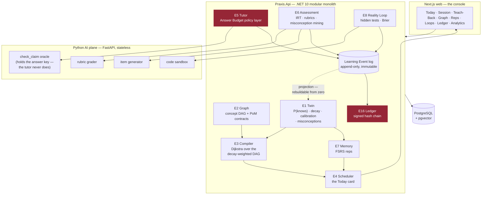

# PRAXIS — Phase 0 build plan

> The build target: a learner can sign up, be diagnosed, be given a compiled plan, sit a Socratic
> session that never gives them the answer, produce evidence, watch their knowledge decay, make a
> falsifiable prediction about code, be graded by reality, and export a signed record of it all.
>
> Nothing here is done until it **runs** and its **tests pass**. See `CLAUDE.md` §Definition of done.

## Status

**Current milestone:** M5 — the AI plane
**Last completed task:** M5.4 — the rubric grader whose most important output is *"I don't know"*. `PENDING` is a real answer, and the type refuses to let a long queue turn it into a `PASSED`. (72 AI tests, 1 skipped: the live call needs a key)

---

## How the loop works

Each iteration: read this file → take the **first unchecked task** → implement it with tests →
run `scripts/verify.ps1` → tick the box with a one-line note → commit → stop.
One task per iteration. Do not batch. Do not skip ahead. If a task turns out to be bigger than it
looked, split it in place and do the first half.

---

## The shape of the system

---

## M0 — Foundations

- [x] **M0.1** Solution scaffold: `src/Praxis.Api`, `src/Praxis.Shared`, `src/Praxis.Infrastructure`, `tests/`, `Praxis.sln`. .NET 10, nullable + warnings-as-errors on.
      → `Praxis.slnx` (.NET 10's new solution format), 4 projects, settings centralised in `Directory.Build.props`. Warnings-as-errors immediately caught a real high-severity CVE in the template's transitive `Microsoft.OpenApi` 2.0.0 — pinned to 2.10.0. Build clean, 4 tests green.
- [x] **M0.2** `Praxis.Shared`: `Result`/`Result<T>`, `ApiResponse<T>`, `ResultExtensions`, `BaseEntity`, `PagedResult<T>`, `IUserContext`. (Single-tenant for Phase 0 — no `ITenantContext` yet, but `BaseEntity` keeps the shape.)
      → All six, plus `IClock` (decay and scheduling make time the domain — it has to be fakeable). `Result<T>.Value` throws on a failure rather than handing back a null. 29 tests green.
- [x] **M0.3** `docker-compose.yml`: PostgreSQL 17 + pgvector, one volume, one healthcheck. Nothing else.
      → PG 17.10 up and healthy (originally port 5433; moved to **5455** in M1.4 — see there). `vector` + `pgcrypto` extensions verified live; the ten engine schemas exist; pgvector's distance operator returns the right answer.
- [x] **M0.4** `Praxis.Api` host: Program.cs, DI, Scrutor handler scanning, FluentValidation filter, global exception handler, Serilog, `/health`.
      → All of it, driven through real HTTP by a probe slice living in the test assembly: valid input reaches the handler, invalid input never does, each `Result` status maps to its code, and a thrown bug becomes a 500 with a correlation id and **no stack trace in the body**. 35 tests green.
- [x] **M0.5** `scripts/verify.ps1` — builds .NET, runs .NET tests, lints + tests Python, builds + lints web. **This is the gate every later task must pass.** Also `scripts/dev.ps1` to bring the whole stack up.
      → Both written. Stacks that don't exist yet report **SKIP, by name** — and the verdict says *"a skip is not a pass"*, because a gate that quietly reports success for work it never ran is worse than no gate. Proved it fails: broke the build on purpose, and it caught it, refused to run tests against a broken build, and exited 1.
- [x] **M0.6** `README.md`: how to run it from a cold clone in under five minutes.
      → Written, and every command in it actually run: destroyed the volume, cold-started from empty, and confirmed the fresh database initialised itself (2 extensions, 10 engine schemas). Found and fixed two bugs in `dev.ps1` doing so — the same PS 5.1 encoding trap, and PowerShell treating Docker's ordinary stderr progress lines as fatal.

**M0 complete.** Foundation is real: warnings-as-errors build, Postgres + pgvector, a host with validation and honest error handling, and a gate proven to fail.

## M1 — The event kernel

- [x] **M1.1** `LearningEvent` entity + `EventsDbContext`: append-only table (`id`, `learner_id`, `type`, `concept_id?`, `payload jsonb`, `occurred_at`, `sequence`). No update path. No delete path.
      → `kernel.learning_events`, with append-only enforced **twice**: the DbContext refuses a modify/delete, and a **Postgres trigger** refuses UPDATE, DELETE *and* TRUNCATE. The first is a courtesy to whoever writes the bug; the second is the guarantee. Tested against a real Postgres container (an in-memory fake has no triggers and would pass while the real thing was wide open) — 8 tests, including tamper attempts made *around* the ORM with raw SQL. `LearningEvent` deliberately does not inherit `BaseEntity`: no `UpdatedAt`, no `IsDeleted`, because neither exists for it.
- [x] **M1.2** `IEventStore` + `AppendAsync` / `ReadStreamAsync` / `ReadAllFromAsync`. Optimistic append by sequence.
      → The only door in and out of the log. Batch appends are atomic and single-learner. Optimistic concurrency: append with the last sequence you saw, and a writer working from a stale view of the stream gets `Conflict` instead of silently committing a conclusion drawn from history that has since moved. `ReadAllFromAsync` walks by keyset, not `OFFSET` — a rebuild reads the entire log, and `OFFSET` would make that quadratic. 19 tests green.
- [x] **M1.3** The event catalogue as a closed discriminated set: `ConceptTaught`, `AnswerGiven`, `ExplanationRecorded`, `HintTaken`, `RepDue`, `RepAnswered`, `PredictionMade`, `PredictionResolved`, `ArtifactSubmitted`, `SessionStarted`, `SessionAbandoned`, `SessionCompleted`, `EvidenceAccepted`, `EvidenceRejected`. **There is no `ConceptCompleted`. There never will be.**
      → 16 typed payload records (plus `EvidenceAbstained` — abstention is a first-class output, R-1), a reflection-built catalogue that fails a test if any event lacks exactly one payload, and typed append so a payload cannot be filed under the wrong event type. **The refusal is now a test**: `No_event_can_declare_a_concept_finished` scans for Complete/Done/Mastered/Passed/… as whole words — proved it fires by adding `ConceptCompleted = 99` and watching two tests fail with the CANON citation, then reverted. 37 tests green.
- [x] **M1.4** Projection framework: `IProjection`, a checkpointed replay runner, and a `rebuild-projections` CLI command that drops every projection and replays the log from zero.
      → `IProjection` + checkpoints + `ProjectionRunner` (catch-up and rebuild), and both CLI commands run for real: `dotnet run -- --migrate` and `dotnet run -- --rebuild-projections`. The checkpoint advances past events a projection ignores (or it re-reads the log's tail forever) and cannot move backwards. Rebuild resets, replays, and lands on byte-identical state. 45 tests.
      **Port moved 5433 → 5455**: a native Windows PostgreSQL service was already listening on 5433, Docker bound alongside it, and connections lost the race — surfacing as a *password* error. Documented in `CLAUDE.md` so nobody hunts that ghost twice.
- [x] **M1.5** Identity module: `Learner`, register/login, JWT, `IUserContext` wired from the token. Deliberately minimal — this is not the interesting part.
      → Register, login, `/me`, JWT, PBKDF2 hashing (framework's, not homemade; old hashes upgrade on next login). Wrong-password and unknown-email are refused **identically**, so the endpoint can't be used to enumerate who has an account. A missing or under-32-byte signing key throws at startup — HS256 signs with a 4-byte key without complaining. `Learner` is deliberately thin: PRAXIS holds the most intimate model of this person anyone has built, and **none of it lives here** — it lives in the Twin, derived from their evidence, and it is theirs. 21 tests (9 module + 12 API, incl. register → token → authenticated call over real HTTP).
- [x] **M1.6** Integration test: append 50 events → rebuild projections from zero → state is byte-identical. **If this test is ever red, the kernel is broken and nothing else matters.**
      → Against a **database-backed** projection, not an in-memory one — a rebuild has to have something real to destroy. A learner's fortnight (50 events: sessions, teaching, hints, wrong answers, misconceptions, and only sometimes evidence that counts) → catch up → rebuild → byte-identical. Plus: **a rebuild erases a belief history does not support** (forge "mastered" straight into the table; the rebuild deletes it — the log is the only thing that gets to decide what is true), rebuilding twice equals rebuilding once, and the 50 events survive intact. Proved the tests bite by commenting out `ResetAsync` — 3 of 4 went red immediately.

**M1 complete.** The kernel holds: history cannot be edited, beliefs are derived from it and nothing else, and both can be proved at any time by throwing the derived state away.

## M2 — E2 Graph

- [x] **M2.1** Domain: `Concept` (id, slug, title, summary, difficulty prior, domain), `ConceptEdge` (`REQUIRES` | `RELATES` | `CONTRASTS` | `APPLIES_TO`), `GraphVersion`.
      → All three, in `graph.*`. **Only `REQUIRES` orders anything** — it is the sole edge the Compiler treats as a dependency, so it is the only one that can cycle and the only one that can waste a learner's month if wrong. Edges carry **provenance** (`Authored` / `Inferred` / `Discovered`): a claim a human made and a claim a model guessed are not the same claim (R-2). Difficulty and duration are explicitly *priors*, replaceable by measurement — an estimate reality never corrects is an opinion with a decimal point. `GraphVersion` exists because Evidence says "demonstrated concept X" and a stranger must later be able to ask what X *meant then*; without it, improving the graph silently rewrites every credential ever issued against it. 20 tests.
- [x] **M2.2** `PoMContract` per concept: which of the six evidence types are accepted, thresholds, and the MC weight of each. Enforces I-2.
      → **The Evidence Ceiling (C-4) is now arithmetic, not policy.** `PoMContract.Create` *refuses to construct* a contract in which model-graded evidence (RECALL/EXPLAIN/CRITIQUE) can sum to the hold threshold. So: if every rubric in the world returned a perfect score, forever, the learner still falls short. Crossing requires APPLY, BUILD or PREDICT — a never-seen problem, code that ran, or a prediction reality settled. A contract offering *only* model-graded evidence is also refused: it would be unholdable forever, and shipping a concept nobody can finish is worse than refusing it. Proved it bites by disabling the check — 3 tests went red instantly. `EvidenceType` moved to `Praxis.Shared` (it is domain language, not the kernel's private business). 34 tests.
- [x] **M2.3** Domain-pack format (`packs/{name}/pack.yaml`) + loader + validator: rejects cycles in `REQUIRES`, rejects a concept with no PoM contract, rejects an orphan.
      → YAML format, a validator that **reports every problem at once** (an author fixing 180 concepts one error per run stops maintaining the graph), and a loader that persists only what passed. Refuses: `REQUIRES` cycles (named, with the path — the Compiler would either hang or silently drop an edge; the first stalls, the second lies), self-requirement, a concept with no contract, a contract that breaches the **Evidence Ceiling** (surfaced *by concept name*), orphans, dangling slugs (a typo in a prerequisite is indistinguishable from a missing one until someone fails), and duplicate slugs. Republishing a version is refused — an old credential's meaning depends on the graph it was issued against. A reload is a **complete statement, not a patch**: a deleted prerequisite that lingers is as harmful as one never authored. 51 tests.
- [x] **M2.4** Graph queries via recursive CTE: prerequisites-of, dependents-of, topological order, **the learner's frontier** (concepts whose prereqs are all HELD but which are not).
      → All four, plus `Blocked` (how many prerequisites still stand between the learner and each locked concept — the difference between *"you are not ready"* and *"you are two concepts away"*, which is the difference between a wall and a ladder). Only `REQUIRES` is walked; a CONTRASTS edge orders nothing, and there is a test that says so. **Test-quality catch:** my first "diamond" had two equal-length branches, so mutating deepest-path→shortest-path changed nothing and the test proved nothing. Rebuilt it asymmetric (one branch a hop longer, and the deep branch's last concept sorts *after* its dependent alphabetically so a lucky tie-break can't hide the bug) — now the mutation fails 2 tests with the exact diagnosis. 62 tests.
- [x] **M2.5** Seed pack v0: **30 concepts** for the Objective *"Ship a RAG system that beats BM25 on your own corpus"* — hand-authored, real prerequisites. (Grows to 180 in M13.)
      → `packs/ai-engineering/pack.yaml`. One root (tokenisation), one build target (beating-the-baseline), and the objective is provably reachable from zero by walking the frontier one concept at a time. The pedagogical spine is enforced by the graph: you cannot claim to have beaten BM25 without having *run* BM25 and built an eval set you did not contaminate.
      **The pack found a design hole.** Writing 30 real contracts exposed that the Evidence Ceiling had only one half. 18 of 30 concepts I authored could *only* be pushed over the line with a model-graded top-up — a learner who did every problem and shipped every build would still need a rubric's blessing. That inverts the ceiling's promise. Added **the Floor** to `PoMContract.Create`: unfakeable evidence must be **sufficient on its own**. Together: *real work is always enough; talk is never enough — talk only gets you there faster.* Fixed all 18, and the old test fixtures that had the same flaw. 73 tests.
- [x] **M2.6** `GraphController` + handler tests + a cycle-rejection test.
      → Three slices (`GetConcept`, `ListConcepts`, `GetFrontier`) behind a thin controller, behind auth. A concept's response **states the standard the learner will be held to before they are held to it** — including the most a language model's opinion of them could ever be worth, and the fact that it is not enough. `GetFrontier` takes `held` from the caller rather than guessing: the Graph does not know what anyone knows, the Twin does. Cycle-rejection test confirms an unwalkable graph never reaches a learner. **Found more test pollution:** the persistence tests were scribbling throwaway concepts into the *real* `ai-engineering` domain, so the seed pack's own tests were counting them. Moved to their own domain. 82 graph + 17 API tests.

**M2 complete.** The Graph holds: a validated 30-concept curriculum, contracts that cannot be dishonest in either direction, traversal that cannot mis-order a diamond, and an API that tells the learner the truth up front.

## M3 — E1 The Cognitive Twin

- [x] **M3.1** `ConceptState` projection: `p_knows`, `stability`, `difficulty`, `last_seen`, `next_due`, `confidence_gap`, `assurance`.
      → `twin.concept_states` + `twin.misconceptions`. An unseen concept starts at `P(knows) = 0.10`: PRAXIS does not assume competence and wait to be disproved. **`ConfidenceGap` is computed, never stored** — a stored copy of a derived value is a second version of the truth and it will drift. All mutators are `internal`: only the projection may write a belief, and only in response to an event; handlers and controllers physically cannot. A **misconception is a named wrong belief, not a wrong answer** ("cosine gives the same answer whether or not I normalised") — and being *told* you are wrong does not retire it. Two clean contradictions do, and it comes back if you show it again, because misconceptions relapse. 18 tests.
- [x] **M3.2** **BKT** update on each graded response (`p_transit`, `p_slip`, `p_guess` per concept, seeded from the pack's difficulty prior).
      → Pure function: no clock, no randomness, no model call, so a replay lands byte-identical. Inference and learning are separated — conflating them is the classic BKT bug that lets a *wrong* answer raise belief. Swept 100+ parameter combinations to prove a wrong answer never beats a right one.
      **Two real bugs found by the tests.** (1) **The degenerate regime**: when `slip + guess ≥ 1` the model *inverts* — a correct answer becomes evidence you do **not** know it, and PRAXIS would teach hardest to the people getting things right. Demonstrated numerically (wrong answer → 0.636, right answer → 0.556) and refused at construction. (2) **The absorbing-state trap**: transit drives belief asymptotically to 1 and in floating point it *arrives* — and at exactly 1.0 the Bayesian update dies, so **no evidence can ever move belief again**. The Twin would insist a learner knows something while watching them fail forever. Belief is now clamped strictly inside (0, 1). An unfalsifiable belief about a person is not a model, it is a verdict. 33 tests.
- [x] **M3.3** **FSRS-class decay**: retrievability as a function of elapsed time and stability; `p_knows` bleeds continuously. The Graph must be able to show rot in real time.
      → A **power law, not an exponential** — exponential forgetting claims a memory held for a year is as fragile per-day as one learned yesterday, which is false and builds a scheduler that nags people about things they will never forget. The derived factor comes out to exactly **19/81**, the published FSRS constant — a free check that the curve is the real one. **The spacing effect is the load-bearing line**: the harder it was to recall, the more recalling it helped. Proved it bites by inverting the term — the test failed with *"this is a nagging app, not a scheduler"*. Belief decays **toward the prior, not zero**: forgetting does not leave you knowing less than a stranger, and decaying to zero would have the Twin assert a certainty it never earned about someone who did it perfectly a year ago. Difficulty is *the learner's*, not the concept's, and failure moves it harder than success. Pure function of elapsed days — no clock is read inside, or the projection stops being replayable. 59 tests.
- [x] **M3.4** **Calibration**: learner states confidence before every graded item; Brier score accumulates per concept and globally. Confidence-vs-competence gap (Dunning–Kruger delta) is a first-class field.
      → Brier score, running (exactly equal to a full recompute, so a rebuild reproduces the numbers), and the overconfidence delta. **The cheating detector that detects nothing (C-6)**: a learner who outsources their answers gets good scores and catastrophic calibration — they cannot tell you *which* ones they got right, because they were not the one getting them right. Demonstrated it: honest 90% scorer → Brier 0.010, trusted; outsourced 90% scorer → Brier 0.278, **discounted**; honest struggler at 35% → *not* flagged, because being lost is not cheating and punishing it would hurt the people who need help most. PRAXIS never blocks anything — it prices the evidence honestly and lets the Ledger record the truth. That is a far stronger position than proctoring: no arms race to win, and it degrades gracefully. 74 tests.
- [x] **M3.5** **The Evidence Ceiling (C-4)** — the single most important function in the Twin. `EXPLAIN`/LLM-graded evidence updates `p_knows` but is **hard-capped below the HOLD threshold**. Only `APPLY` (never-seen item), `BUILD` (it ran), or `PREDICT` (reality resolved it) can cross it. Property-test it: *no sequence of EXPLAIN evidence, of any length, at any score, can ever produce a HELD concept.*
      → Property test swept **84 combinations up to 10,000 pieces of perfect model-graded evidence** — none produced a held concept. Ten perfect explanations are worth *exactly* what one is: the tenth adds nothing. Mirror property also holds: one build that ran is enough on its own.
      **Deleting the clamp revealed the two layers are not redundant.** With an *honest* contract the per-clause caps alone hold the line (the Graph's guarantee working — nothing failed). With a *corrupt* contract — one the Graph would never author but a bad migration could produce — the Twin's independent clamp is the **only** thing between a learner and a mastery certificate made of explanations, and that test failed instantly. Two engines, two refusals, neither trusting the other. A single point of failure guarding the only thing that makes the product honest is not a design, it is a hope. 87 tests.
- [x] **M3.6** Misconception set: named, specific wrong models attached to the learner, mined in M7.
      → Pure state machine over observe / contradict / taught. **Being taught retires nothing** — explaining to someone that they are wrong is the least reliable way of discovering whether they still are, and there is a test that says so. One contradiction is not enough (once could be luck; a Twin that forgives easily keeps telling a learner they are fine). A retired misconception **relapses** if shown again.
      **The subtle rule, which took a moment to see:** contradictions must *not* accumulate across relapses. Otherwise a learner who shows the misconception six times and is contradicted once after each would eventually total two contradictions and be recorded as **cured** — having demonstrated nothing but inconsistency. Showing it again resets the road out; you earn your way out from scratch. Proved it bites by removing the reset — two tests failed instantly. An active misconception also **suppresses belief** in its concept, because someone carrying a confidently-held wrong model is worse off than someone who knows they don't know: they won't ask. 101 tests.
- [x] **M3.7a** `TwinProjection`: fold the event log into `ConceptState` + misconceptions. BKT on graded answers, FSRS on reps, mastery credit on accepted evidence, calibration throughout. *(Split out of M3.7 — the controller has nothing to serve without it, and the projection is the keystone: it is where every pure function built in M3.2–M3.6 meets the real event log.)*
      → Every pure function from M3.2–M3.6 now meets real events, out of a real database, with real timestamps. **It reads no clock** — times come from the events, because that is when things happened in the learner's world. **`ConceptTaught` is not even handled**: a learner can sit through instruction all day and the Twin does not move. Idempotent on accepted evidence (a rebuild that double-counted would make every learner in the system better than they are). **The Evidence Ceiling holds through the real projection**: 50 perfect explanations, through events, through Postgres — still not held. A concept with no contract **refuses to be believed about** rather than inventing a standard of proof. Rebuild reproduces the learner exactly, and erases a forged belief history does not support. `IMasteryContracts` is the seam: Graph and Twin never reference each other; the contract crosses as a value and the adapter lives at the composition root. Verified live — `--rebuild-projections` now drives it. 114 tests.
- [x] **M3.7b** `TwinController`: get twin, get concept state, get the decay forecast. Handler tests + the Evidence Ceiling property test at the API boundary.
      → **Decay is applied at read time**, not by a nightly job — refresh an hour later and the number is lower, because an hour of forgetting actually happened. A belief that only rots when cron remembers to run is not a model of forgetting; it is a model of cron. The summary reports the number nobody else in the industry shows you: **how much of what you "know" is currently rotting** (held, and heading below threshold) and how much has already lapsed. **The Evidence Ceiling is now proved end-to-end through real HTTP**: 50 perfect explanations, as real events, through the real projection, read back over the wire — not held, and the API says plainly that none of it rests on work a model could not fake. There is **no `?learnerId=` parameter and there never will be**; a learner sees only themselves.
      **Found a real bug:** an untouched concept has no due date, and I returned *infinity* — which `System.Text.Json` cannot serialise, so a learner's very first look at a concept they hadn't touched was a **500**. Now nullable, with a regression test. 122 twin + 24 API tests.

**M3 complete.** The Cognitive Twin holds: belief that can be falsified, knowledge that visibly rots, calibration that catches outsourced work without accusing anyone, mastery that no language model can manufacture, and named wrong beliefs that must be *un*-demonstrated rather than merely corrected.

## M4 — E3 Compiler + E4 Scheduler

- [x] **M4.1** Edge cost function over the decay-weighted DAG: cost of a concept = f(estimated minutes, current `p_knows`, decay pressure on its prerequisites, PoM contract strictness).
      → Pure function, no clock, no model — the plan is a solver's output, not a prompt's. Four inputs: the pack's minutes, what the learner already holds (**sublinear** — being 80% there is *not* 80% cheaper, because the last stretch is the never-seen problem and the build that runs, and the Evidence Ceiling means it cannot be crossed by explaining more), the contract's strictness (a concept demanding two applied problems and a passing build is not the same work as one satisfied by recall — pricing them alike is how roadmaps promise twelve weeks and take thirty), and **decay pressure on prerequisites** — the part no other roadmap tool has.
      **The weakest prerequisite governs, not the average.** One dissolved foundation is enough: a learner who has forgotten embeddings cannot do vector retrieval however fresh their tokenisation is. Proved it bites by switching `Min` to `Average` — two tests failed, one saying *"a strong prerequisite is hiding a fatal one."* A learner attempting a concept whose prerequisites are half-forgotten does not experience it as harder; they experience it as **impossible, and they blame themselves.** 16 tests.
- [x] **M4.2** **Dijkstra** shortest-path-to-competence: Objective + Graph + Twin + constraints → ordered `Plan`. **A solver, not a prompt.** No LLM anywhere in this path.
      → Greedy frontier over the decay-weighted DAG. Not textbook Dijkstra, and the doc comment says why: every prerequisite is *required* (AND, not OR), so the "path" is the whole transitive closure and the algorithm's job is to **order** it. **Compile the same learner twice, get the same plan** — a roadmap that changes when you ask again is not a roadmap, it is a mood. **Cache invalidation is what makes it a compiler**: a concept the learner "holds" but has let rot goes *back in the plan* as a `Refresh` — cheaper than learning, but not free, because every other tool would tick it off and then let them walk into the wall it creates.
      **A test-quality catch that mattered.** My ordering test passed even with the prerequisite gate deleted — because in that graph every prerequisite happened to be *pricier* than its dependent, so cheapest-first accidentally produced the right order. The guarantee was resting on a coincidence of the cost function. Wrote the adversarial case (a 5-minute concept on top of a 300-minute one, with alphabetical tie-break also against us) — it now fails the moment the gate is removed. 34 tests.
- [x] **M4.3** **The Decay Wall (C-1)**: forward-simulate the plan at the learner's stated minutes/day. If mastery decays faster than it accrues, the Objective is **structurally unreachable** — return `Unreachable` with the largest sub-Objective that *is* reachable, and the minutes/day that would make the original reachable. Test: 20 min/day on a 180-concept objective must return `Unreachable`.
      → **CANON C-1 WAS WRONG, and building the simulation proved it.** C-1 claims the wall is a *divergence* — forgetting outrunning learning so the objective never converges. **It does not happen.** Spaced repetition forbids it: each successful retrieval pushes the next exponentially further away, so maintenance grows sub-linearly and *always* converges. That is why real SRS users hold tens of thousands of items on 20 min/day; a model where they couldn't would be a model of despair, not of memory.
      What actually happens is worse in a quieter way: at 20 min/day the learner **does** arrive — *three and a half years later*, treading water most of every session. Against an 18-month horizon they hold **85 of 180 concepts**. So **the wall is a horizon, not a divergence.** The refusal stands, unchanged and just as important; only the reason is now the true one. I did **not** fudge the model until it agreed with the doc — I fixed the doc. **CANON is amended in place** with the simulated table (20 min → no, 85/180; 45 min → yes, 17mo; 90 min → yes, 8mo).
      Also: `MinutesPerDayToMakeReachable` binary-searches the *smallest honest* answer (one minute less provably fails), `ReachablePrefix` offers the narrower objective PRAXIS actually believes in, and a monotonicity test guards against verdicts that are noise. Reps cost a fraction of the *learn* cost — re-demonstrating *"I can beat BM25"* is redoing work, not flipping a card. 47 tests.
- [x] **M4.4a** The `Objective` (what the learner is trying to become, at what pace) + the **recompile trigger policy**: which events make a plan stale, and which do not. *(Split from M4.4 — the policy is the opinionated half and deserves its own tests; the job that runs it is plumbing.)*
      → **Only 3 of 16 events recompile immediately** — accepted evidence, a detected misconception, and reality settling a prediction. Everything else waits. Getting this wrong is expensive in *both* directions: too rarely and you hand someone a plan built on a person they no longer are; too eagerly and *the plan moves under their feet* — and nothing is more corrosive to a roadmap than watching it change for a reason you cannot see.
      The judgement calls, each with a test that says why: **being taught something recompiles nothing** (the thesis, as a scheduling rule). A correct answer doesn't either — it moves belief, not credit, and a learner who got three questions right has finished nothing. And **abandoning a session does not rewrite the plan**: someone who walked away needs the Motivation Engine, not a reshuffled roadmap — rewriting it the instant they quit would be *the product flinching*. Good news changes the plan; the absence of good news does not.
      **Time is the trigger no event will ever fire.** The nightly pass exists because *the most important thing that happens to a learner overnight is nothing* — everything they hold decays, a concept fresh enough to build on yesterday may not be today, and no event announces that. One active objective per learner, enforced in the database: a learner pursuing three objectives is pursuing none. 65 tests.
- [x] **M4.4b** The recompile service (assemble the Graph + Twin snapshot, compile, persist) + the nightly job.
      → **There is no plan table.** CANON calls the Plan *"ephemeral, always regenerable"* and means it: a plan is a pure function of (objective, graph, twin, minutes), so storing it would create a second version of the truth that can drift — and every bug in that class is the same bug, *someone reads a cached plan and acts on a learner who no longer exists*. It is recomputed on demand; Dijkstra over a few hundred nodes is cheaper than the round-trip that would fetch a stale copy.
      **So what is the nightly pass actually for?** The one thing no request asks about and no event announces: *a learner who was on track yesterday is not on track today, and nobody has opened the app.* Everything they hold decayed overnight; the plan got longer while they slept, and the Decay Wall verdict may have flipped from *"yes, twelve months"* to *"no — you'll hold half of it."* **That is news, and it is precisely the news a product optimising for engagement would never send, because it invites them to leave.**
      Proved end-to-end on the real seed pack: PRAXIS **refuses** a real learner at 10 min/day, offers a narrower objective it actually believes in, and names the pace that would work. Proving a concept removes it from the plan (the cache hit). The nightly pass finds the learner who fell behind and leaves the one who didn't.
      **A test of my own making found a real bug:** a deadline already in the past produced a cheerful "narrower objective" containing **zero concepts**. Now refused with *"PRAXIS cannot compile a plan into the past."* 33 API tests.
- [x] **M4.5** E4 Scheduler: given a session length (5/10/15/25 min), merge new-learning vs. due reps vs. open Loops into **one Today card** — one card, one action.
      → Pure chooser. **The single hardest moment in learning is starting**, and a screen that presents a choice hands that moment straight back to the person who is demonstrably bad at it. So PRAXIS decides, and the learner is owed a *reason* — a scheduler that cannot give one is guessing. **If the card ever becomes a list, PRAXIS has lost.**
      Three priorities, and the middle one is counterintuitive: **(1) rescue a dissolving foundation** — it is not "due", it is *load-bearing*; everything above it now costs multiples more and the learner will experience that as *impossible*, not harder, and will blame themselves. **(2) Reps are capped at 60% of a session.** Clearing the rep queue first *feels* responsible and is a trap: on a busy day the queue **is** the session, the learner revises for weeks, the graph never moves, and they correctly conclude it is going nowhere. Proved the cap bites by removing it — *"In a 5-minute session the scheduler chose a 5-minute rep. The learner is now revising instead of learning, and will keep doing so forever."* **(3) Move forward.**
      And **"nothing" is a real answer**: no invented quiz, no streak to protect. *"There is no work worth doing today. PRAXIS will not invent some to keep you here — the point was never the app."* 14 tests.
- [x] **M4.6** `CompilerController` + `SchedulerController` + tests, including the Decay Wall test.
      → `POST api/compiler/objectives` (one objective at a time — a learner pursuing three things is pursuing none), `GET api/compiler/plan`, `GET api/scheduler/today?minutes=`. No `POST /plans` and no `GET /queue`: a plan is recomputed every request (a cached one describes a learner who no longer exists), and a queue is a *list*, and a list is a choice.
      **The Decay Wall, through the front door.** A real learner asks to go from zero to beating BM25 in 90 days at 10 min/day; PRAXIS runs the simulation, comes back **no**, and offers a narrower objective plus the pace that would work. It is a **200, not a 400** — the refusal is not an error, it is the product's most considered opinion, and the plan comes back attached to it. Deleted the wall to prove the test bites: *"It has just sold a plan it has no reason to believe in, which is the one thing this product exists not to do."*
      **A failing test found a real honesty bug.** Rescue and Rep shared one deferral sentence, so a learner doing a cheap 3-minute rep was told their new work was blocked by a *dissolving foundation*. Nothing was dissolving. The card's reasons **are** the product; a wrong one is a lie about their own mind that they cannot check. Split, and pinned by a test.
      And a thing I did not design and would not have predicted: on a rescue the card defers **nothing** — because the Compiler, reasoning independently, had already priced the rotted concept as a `Refresh` and put it at the front of the plan. Two engines, no knowledge of each other, same answer. Added `Result.CarryFailure<T>()` so refusals keep their shape (no objective = 404, deadline in the past = 400). 15 scheduler + 53 API tests.

## M5 — The AI plane

- [x] **M5.1** FastAPI scaffold: `ai/`, uv/pip, pytest, ruff, `/health`, structured logging, `.env.example`.
      → Python 3.14 + FastAPI, managed by `uv` (lockfile committed, so the gate tests pinned versions rather than whatever this machine happens to have). `verify.ps1` now **runs** the AI stages instead of skipping them — two SKIPs left, both web. Stateless by construction: no database, no session, no memory of the last request.
      **The muzzle.** PRAXIS's central claim is that the tutor cannot give the answer because the answer is never in its context (C-5) — a jailbreak retrieves nothing because there is nothing there. **A log is a context too.** A service that carefully withholds the answer key from the model and then writes it to stdout at INFO has not protected anything; it has moved the leak somewhere with worse access control and a longer retention period. So redaction lives at the *logging boundary*, where it cannot be forgotten, rather than at the hundred call sites where it could be: forbidden field names (`answer`, `expected`, `solution`, …) are scrubbed however deeply nested, and API keys are pattern-matched out of any line. Removed `answer` from the forbidden list to prove the test bites — the answer key came straight through into the log.
      The key is a `SecretStr`, so a stray print, a crash repr, a validation error or an over-helpful structured log cannot leak it; reading it requires saying so out loud in code. `/health` reports `model_configured` as a **boolean** — whether a key exists, never what it is — and deliberately does *not* claim the key works, because proving that means spending a learner's money and a health check that quietly bills someone is not a health check. Every request carries an id, so M5.2 can attribute cost to a learner-minute. 11 tests.
- [x] **M5.2** Claude client + model router: Opus-class for grading/synthesis, Sonnet-class for tutor turns and item generation. Every call is cost-attributed and logged to a learner-minute.
      → One door to the model. Everything calls `ClaudeClient`, never the SDK — so three claims are enforced in one place rather than hopefully.
      **The grader cannot be downgraded.** Not "should not" — *cannot*, without deleting a test in a diff in front of a reviewer. The pressure on the routing table for the life of this product is **downward**: grading is the most expensive thing PRAXIS does and the least visible (nobody watches a grader), so eventually the bill is up, the fast model costs a fifth as much, and it "seems fine on the ones we spot-checked". That change would look like good engineering and would quietly gut C-4 — a cheaper grader is not a slightly worse grader, it is one that **abstains less** (M5.4), and abstention is what the whole design leans on. So the tier is a property of the **task**, and `complete()` has no `model=` or `tier=` parameter (a test asserts this: an advisory table is not a table, it is a comment). Downgraded the grader to prove it — four tests failed.
      **An unattributed call is a bug, not a convenience.** `attribution` (learner + concept) is required, no default: there is no such thing as a call PRAXIS makes for its own benefit, and without it PRAXIS cannot answer the question that keeps it honest — *what does this person cost, and is it less than they pay?*
      **An unpriced model costs `unknown`, never `zero`.** The shortcut is `PRICES.get(model, 0.0)` and it is how budgets die: a model gets swapped in, every call is recorded free, the dashboard stays flat, and the first anyone hears of it is the invoice. So cost is `None` when unknown, and the app **refuses to start** if it routes to an unpriced model — failing at deploy is a nuisance for us, failing later is a nuisance for a learner. Wrote the shortcut in to prove the test bites.
      The learner-minute log records who, about what, on which model, for how much — and **not one word of the prompt or response**, either of which may contain the answer. All 36 tests run against a fake transport (a suite that needs a key is a suite that does not run); the one live call **skips itself by name** and says *"this is NOT a pass"*.
- [x] **M5.3** **The `check_claim` oracle** — the architectural heart of I-5. Holds the answer key. Takes the learner's claim + the item id, returns `{correct, partial, wrong}` + which misconception it matches. **The tutor calls this. The tutor never sees the answer.**
      → Most products implement "the tutor won't tell you" as an *instruction*: the answer sits in the system prompt wrapped in capitals begging the model not to say it. That is a lock with the key taped to the door. PRAXIS implements it as an **absence** — a jailbreak retrieves what is present, and what is present is nothing.
      **Which only moves the problem, so:** an oracle is a channel, and every channel leaks. Had it replied *"wrong — you're missing two of four elements"*, a patient learner (or a jailbroken tutor acting as proxy) could **binary-search the answer out**, and everyone involved could still truthfully say the answer was never in the prompt. Two things hold the line: (1) **the verdict is drawn from a closed vocabulary the item's author fixed in advance** — the marking model *does* see the answer (it must) but **not one token of its free text escapes**; it picks from an enumeration, the misconception must be a key declared before the learner existed, and everything else is discarded; (2) **the number of questions is finite** — which is why the Answer Budget (M6) is a *security control*, not a pricing gimmick.
      **The guarantee is a property of the type, not of a prompt.** `Verdict` has exactly three fields and none can hold a sentence — no explanation, no "you were close", no `correct_answer`, not even a nullable one "only populated after the budget runs out", because the moment such a field exists something will populate it. Tests attack it as the model: answer in the misconception field → discarded; answer in invented extra JSON fields → never read; answer in prose around the JSON → stripped; model ignores instructions entirely → `OracleUnclearError`, **not a leak**. Added a `correct_answer` field to prove the tests bite — four failed.
      **A learner is never marked wrong because our parser failed** (422, no verdict at all — they may well have been right, and the failure was ours). And a sweep asserts **no route in the whole API** and no response schema anywhere can carry an answer out — the test that fails the day someone ships "reveal the answer after three attempts". 54 tests.
- [x] **M5.4** Rubric grader with **abstention as a first-class output** (R-1): borderline scores escalate to an Opus-class grader, then to a human queue, and are written as `pending` — never as `passed`.
      → Every LLM grader ever shipped returns a number for *anything*: hand it a blank page, a poem, or an argument subtly right in a way the rubric's author never anticipated, and it returns `0.73` with the same serene confidence it brings to the easy cases. That number becomes **Evidence**, and Evidence moves what PRAXIS believes about a person — so a confidently wrong grade is not a bad row in a table, it is **a false belief about someone's mind** that decays, compounds, and is built upon, and that they will meet months later as work that is inexplicably too hard. They will blame themselves. So `PENDING` is a real answer, and the type **refuses to represent** `PASSED ∧ awaiting-a-human` — the exact coercion that happens the day the queue is long and letting the borderline cases through is reasonable, temporary and "probably fine".
      **The ladder.** (1) *Determinism first* — a hard-fail phrase or a too-short response is settled **before any model runs**. Not to save money: an eloquent wrong answer can talk a judge round, and **a regex cannot be flattered**. Made the pre-check advisory to prove it, and *"the stock can't fall below it"* wrapped in beautiful prose about resting liquidity scored a **perfect 1.0 from all three judges**. (2) *Three judges who never learn who they are marking* — no identity, no Twin, no prior scores, no "this is their fourth attempt", because a judge that knows it is marking a struggling learner is no longer marking the work; dimension order is rotated per judge (position bias is real and measured). (3) *Disagreement > 0.5 band escalates* to an adjudicator that sees all three rationales. (4) *The boundary (±0.05 of the threshold) escalates to a human* — the only band where the grade **changes the decision**, and therefore the only band worth a person's time.
      **Abstention is contagious, and that is correct**: if 2 of 3 judges cannot band it, the *rubric* failed to anticipate the response — it does not mean the one judge willing to guess was right. And a judge that cannot be parsed **has abstained, not scored zero** — a parse failure is *our* bug, and charging it to the learner as a bad grade would be the most contemptible thing this module could do. Added `Task.ADJUDICATE`; noted in the router that I did **not** downgrade the base judges to make the roadmap's "escalate to Opus" ladder look prettier — they were already Opus. 17 grading tests (72 AI total).
- [ ] **M5.5** Item generator: given a concept + evidence type + difficulty target, produce a never-seen item with a hidden answer key. The key goes to the oracle's store, not into any tutor-visible table.
- [ ] **M5.6** Golden-set eval harness: per-concept human-double-graded sets, a `pytest` regression that fails the build if grader agreement (Cohen's κ) drops below **0.75**. **A grader that regresses does not ship, even if it is cheaper.**
- [ ] **M5.7** Typed contract between Core and the AI plane (OpenAPI → generated C# client). The AI plane is stateless.

## M6 — E5 Tutor + the Answer Budget

- [ ] **M6.1** `AnswerBudget` domain: per-concept budget, spent, remaining. Persisted, event-sourced.
- [ ] **M6.2** The **hint ladder** as a policy layer: `orient → probe → analogy → partial → full`. Each rung costs from the budget. The final rung is **not** "the answer" — it is the smallest scaffold that still requires the learner to produce it.
- [ ] **M6.3** **Structural enforcement (C-5)**: the tutor's context is assembled by a server-side builder that *cannot* include the answer key — it is not in the tutor's database, not in its prompt, not in its retrieval index. Write the test that proves it: prompt-inject the tutor with every jailbreak we can think of and assert the answer never appears.
- [ ] **M6.4** Session loop: turn-by-turn Socratic dialogue, budget shown to the learner in the UI, and **every session ends with the learner having said or built something**.
- [ ] **M6.5** `SessionsController`, streaming responses, handler tests + the jailbreak test suite.

## M7 — E6 Assessment

- [ ] **M7.1** The six evidence types as first-class domain: `RECALL`, `APPLY`, `EXPLAIN`, `BUILD`, `CRITIQUE`, `PREDICT`. Each with its own intake, grading path, and MC weight.
- [ ] **M7.2** **Adaptive diagnostic (IRT)**: 2PL model, seeded from an LLM difficulty prior, converging after ~200 responses. 12 minutes, and it produces a rich Twin on day one — this is the cold-start weapon (R-7).
- [ ] **M7.3** The **"here's what you think you know but don't"** result screen — confidence vs. competence, per concept. The wow moment with zero accumulated data.
- [ ] **M7.4** **Failure-seeking item selection** (I-6): hunt the boundary of knowledge, not the comfortable middle.
- [ ] **M7.5** **Misconception mining**: cluster wrong answers into named misconceptions, write them to the Twin, then **generate new items that specifically target this learner's misconceptions**.
- [ ] **M7.6** Teach-back (`EXPLAIN`): capture, transcribe, rubric-grade, and record — subject to the Evidence Ceiling.
- [ ] **M7.7** Controllers + tests, including "a wrong answer produces a named misconception, and the next item targets it."

## M8 — E7 Memory

- [ ] **M8.1** FSRS scheduler: stability, difficulty, retrievability; next-review intervals per concept.
- [ ] **M8.2** Rep queue: what is due now, what is overdue, what is about to rot.
- [ ] **M8.3** Reps feed the Twin and the event log like any other evidence. A rep is not special.
- [ ] **M8.4** Tests: a concept left alone for 90 days must fall below threshold and reappear in the queue.

## M9 — E8 The Reality Loop (code)

- [ ] **M9.1** Sandboxed execution: Docker-isolated, no network, CPU + memory + wall-clock capped. This runs untrusted learner code — treat it as hostile.
- [ ] **M9.2** `BUILD` evidence: learner's artifact runs against **hidden tests**. It passes or it does not. No LLM in the verdict.
- [ ] **M9.3** `PREDICT` items on program behaviour: *"what will this print / what will fail / what is the complexity"* — the learner commits to a falsifiable prediction **with a stated confidence**.
- [ ] **M9.4** Resolution + **Brier scoring** → Calibration, a first-class metric next to Mastery.
- [ ] **M9.5** **Decouple thesis-grading from outcome-grading (R-4)**: the reasoning is graded in seconds; the outcome grades when it resolves. *You can be right for the wrong reason, and we tell you so the same day.*
- [ ] **M9.6** The Loops board: open loops, their horizons, what resolves today.
- [ ] **M9.7** Tests, including a hostile-code sandbox-escape suite.

## M10 — E16 The Ledger

- [ ] **M10.1** `Evidence` record: immutable, typed, scored, with the assurance level stated honestly (C-6).
- [ ] **M10.2** Append-only **hash chain**: each record commits to the previous. Tamper-evident.
- [ ] **M10.3** **Ed25519 signing** + published Merkle roots. **No blockchain** — see doc 25 §7; the answer is no, permanently.
- [ ] **M10.4** Verifiable Competency Record export (JSON + a human-readable page) and a **public, free-forever verification endpoint** — the cold-start weapon for the network (R-7).
- [ ] **M10.5** Tests: mutate one byte of one record → verification fails and names the broken link.

## M11 — The web console

Built with the `ui-ux-pro-max` skill. `prototype/praxis-prototype.html` is the visual reference —
match it, don't reinvent it.

- [ ] **M11.1** Next.js scaffold, Tailwind, design tokens lifted from the prototype, typed API client.
- [ ] **M11.2** Onboarding + the Objective. Says out loud what this is: *"PRAXIS will tell you when you are failing."* Self-select hard, on purpose (R-3).
- [ ] **M11.3** The Diagnostic — adaptive, 12 minutes, ending in the "what you think you know but don't" screen.
- [ ] **M11.4** The Contract: minutes/day, cadence, deadline. **Shows the Decay Wall when it hits one** — and offers the narrower Objective it does believe in.
- [ ] **M11.5** **Today** — one card, one action, "what do I do in the next 15 minutes."
- [ ] **M11.6** Session — the Socratic dialogue with the **answer budget visible and ticking down**.
- [ ] **M11.7** Teach-Back — record, transcribe, get graded, see the rubric.
- [ ] **M11.8** The Graph — the learner's own mind, with the decay showing. **The one dopamine we permit is the frontier advancing.**
- [ ] **M11.9** Reps.
- [ ] **M11.10** Loops — the board, the prediction capture with a confidence slider, the resolution.
- [ ] **M11.11** The Ledger — everything you have ever proved, and the export button.
- [ ] **M11.12** Analytics — **Mastery-per-Minute**, calibration, consistency. Willing to say *"you gained nothing this week"* — and then immediately name the single smallest next step (R-3).

## M12 — E15 Analytics

- [ ] **M12.1** Mastery-per-Minute (I-10), computed from the event log, per learner and per cohort.
- [ ] **M12.2** Calibration trend, consistency, decay debt.
- [ ] **M12.3** The honest dashboard: it reports MPM **including when it is low, and why**.

## M13 — The pack, and the end-to-end proof

- [ ] **M13.1** Grow the AI-engineering pack to **180 concepts** with prerequisites, PoM contracts, and a seeded item bank (~900 items).
- [ ] **M13.2** Seed the misconception library from the item bank's distractors.
- [ ] **M13.3** **The end-to-end run**: a scripted learner goes register → diagnostic → contract → compile → 12 sessions → reps → 3 Loops → Ledger export, and every assertion holds. This is the proof that Phase 0 works.
- [ ] **M13.4** The instrumented event log the RCT depends on (doc 25 §1.2) — verified complete and replayable.

---

## Deliberately not in this plan

Mobile · offline · i18n · payments · institutions · the News engine · the Project engine · the
Career engine · markets / medicine / law Loops · counterfactual Twin queries · the self-healing
Graph · the Verifier product · any form of chatbot mode.

Every one of these will be asked for. In Phase 0, the answer is no.
