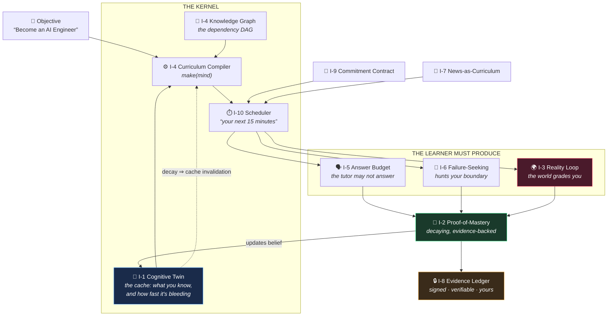
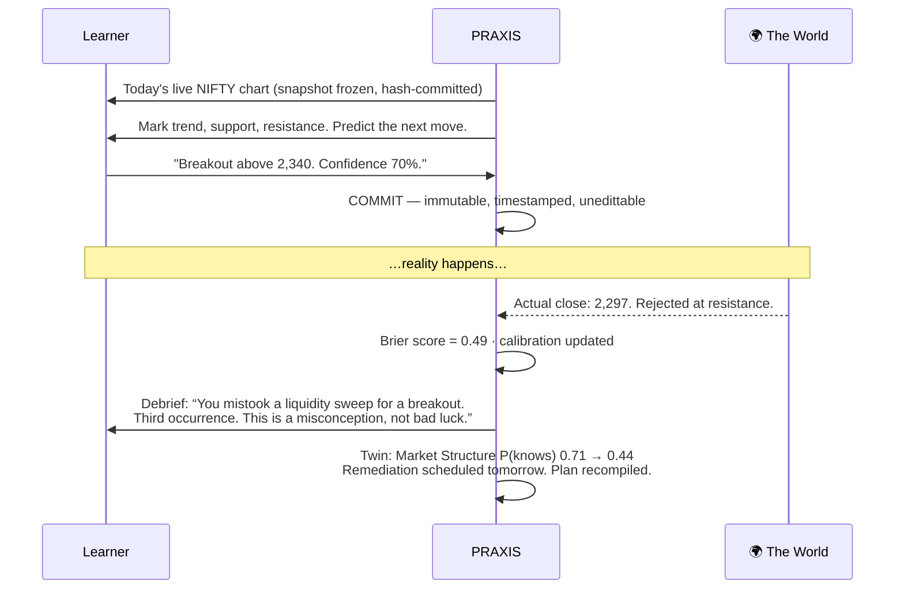
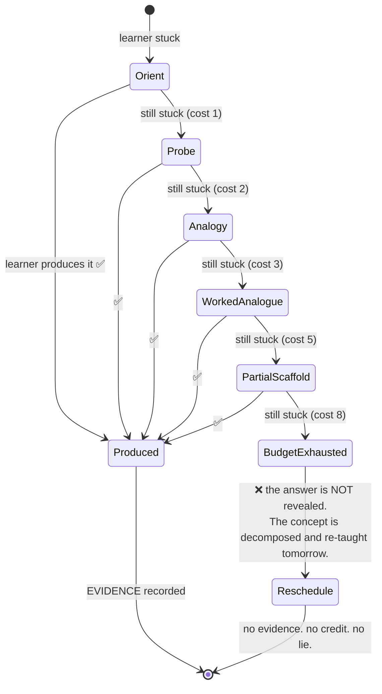
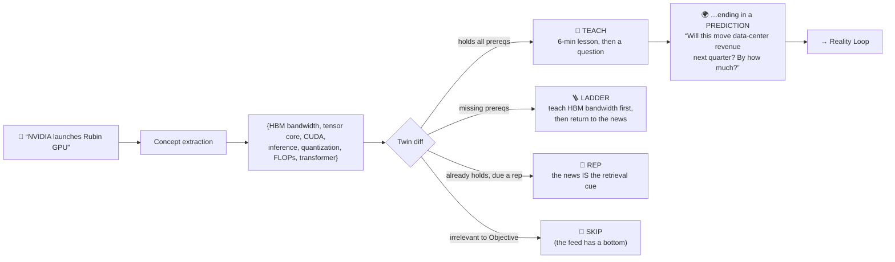

# 02 — The Ten Inventions

> This is the differentiation. Everything else in this blueprint is implementation detail.
> If a competitor copied all our features but none of these, they would have built an LMS.
>
> Each invention is stated as: **the mechanism**, **why nobody has done it**, **what it kills**,
> and **what it costs us**.

---

## The system in one diagram



---

## I-1 — The Cognitive Twin

**Mechanism.** A live, probabilistic **simulator of the learner's mind**, maintained as a
projection of every learning event they have ever produced. For each concept it holds
`P(knows)`, a decay curve, a confidence-vs-competence gap, the evidence chain that justifies the
belief, and the *named misconceptions* this specific person holds.

It is **counterfactually queryable**:
> *"If Aarav studies 45 min/day, when is he job-ready as an AI engineer?"* → **11 weeks, ±9 days.**
> *"What breaks if he skips linear algebra?"* → **Backprop drops to P=0.31; attention becomes unlearnable; deadline slips 4 weeks.**

**Why nobody has done it.** Every product stores *what you clicked*. Nobody stores *what you
know*, because knowing requires evidence, and evidence requires refusing the completion button
(I-2). The Twin is impossible without the refusal.

**What it kills.** The user profile. The "recommended for you" carousel. The idea that a
learning platform can be personalized by tracking preferences instead of ability.

**What it costs us.** Everything is downstream of Twin quality. If the Twin is wrong, the
compiler compiles garbage. This is the hardest engineering problem in the product.
→ `08-cognitive-twin.md`

---

## I-2 — Proof-of-Mastery contracts

**Mechanism.** Every concept ships with a **contract** naming the evidence that will be accepted
as proof. Six evidence types, in ascending order of strength:

| Type | The learner… | Fakeable? |
|---|---|---|
| `RECALL` | states it | easily |
| `APPLY` | solves a never-seen problem | with effort |
| `CRITIQUE` | finds the flaw in a wrong worked example | hard |
| `EXPLAIN` | teaches it back, aloud, rubric-graded | hard |
| `BUILD` | ships an artifact that actually runs / passes | very hard |
| `PREDICT` | forecasts reality and reality agrees | **essentially impossible** |

Mastery is **never binary and never permanent**. It is a **decaying credit**. You don't complete
a concept — you *hold* it, and it *bleeds*.

**Why nobody has done it.** Because it makes the product feel harder and the numbers look worse.
A course platform's growth metric is completions. Ours is evidence. Ours goes down when you stop.

**What it kills.** The completion certificate. The "100% complete" progress bar. The entire
credentialing industry's core product.

**What it costs us.** Users will find it demanding. Some will leave. Good — see `03-personas`,
"who we are NOT for."
→ `12-assessment-and-proof-of-mastery.md`

---

## I-3 — The Reality Loop 🏆

**Mechanism.** The learner is required to make **falsifiable predictions about the real world**,
timestamped and immutable, which are **scored against ground truth when reality resolves**.



Scored with **Brier score** and **calibration curves**, with **skill separated from luck**
(significance over *n* predictions, against a naive baseline).

**Why nobody has done it.** It is operationally hard (you need ground-truth adapters per domain
and a resolution delay), and it is *terrifying to a product manager* because the learner can be
publicly, unambiguously wrong. Every other product carefully avoids ever telling a paying
customer they were wrong about reality.

**What it kills.** The screenshot. The "here's a historical chart, spot the pattern" exercise —
which is hindsight cosplay. The idea that you can learn judgment without ever being judged.

**What it costs us.** Resolution delay (a day, a quarter, a year) weakens the feedback loop, so
we must run **short-horizon loops for learning and long-horizon loops for proof**. And in
medicine/law/finance we must be *ruthless* about the educational-only boundary.
→ `13-reality-loop.md` ← **the most important document in this blueprint**

---

## I-4 — The Curriculum Compiler

**Mechanism.** Roadmaps are **compiled, not authored**.

```
target      := Objective ("Become an AI Engineer")
dependencies:= backward closure over REQUIRES in the Graph
cache       := the Twin (what's already built, and at what confidence)
invalidation:= the forgetting curve  ← THIS IS THE NOVEL PART
constraints := 45 min/day · 6 days/week · deadline · learner velocity
optimize    := verified mastery per minute
emit        := Plan (today → deadline), recompiled nightly
```

> **Forgetting is cache invalidation.** A concept you mastered in March is *not* in the cache in
> July. The compiler knows this and rebuilds it *before* it becomes load-bearing for the next
> thing you need to learn — which is a scheduling problem no human teacher can solve for you,
> and no existing product even attempts.

**Why nobody has done it.** Because everyone else's "roadmap" is a static list authored once by
a content team and served to a million people who are not the same person.

**What it kills.** The curriculum. The syllabus. The course outline. The "learning path" PDF.

**What it costs us.** Plans must not *thrash* — a roadmap that changes wildly each day destroys
trust. Requires hysteresis and damping. → `10-curriculum-compiler.md`

---

## I-5 — The Answer Budget (anti-ChatGPT, enforced in architecture)

**Mechanism.** The tutor is **structurally forbidden from giving the answer** — not by a prompt
(prompts get jailbroken), but by a **deterministic policy layer outside the model** that
inspects every proposed turn before it reaches the learner and regenerates it if it leaks.



Every session ends with the learner having **said or built something**, never having merely
*read* something.

> **The AI's job is not to produce. It is to make the human produce.**

**Why nobody has done it.** Because it's the opposite of what users *ask* for, and every AI
product is racing to be more helpful. Being helpful is exactly how you prevent learning. The
generation effect is one of the most replicated findings in cognitive science, and the entire AI
industry is currently building a machine to defeat it.

**What it kills.** The ChatGPT wrapper. "Explain this to me." Homework help. The single most
popular use of AI in education today — which we believe is actively deskilling a generation.

**What it costs us.** Some learners will hate it. Our onboarding must make the refusal feel like
respect, not obstruction. This is a *design* problem, and if we fail at it we fail entirely.
→ `11-tutor-and-pedagogy.md`

---

## I-6 — Failure-Seeking Assessment

**Mechanism.** The assessment engine is **adversarial by design**. It does not sample your
knowledge — it **hunts the boundary of it** (adaptive, information-gain-maximizing item
selection), mines your wrong answers into a **named, personal Misconception Library**, and then
**generates new, never-seen items specifically engineered to trigger *your* misconceptions**.

It is not trying to give you a good score. It is trying to find where you break, so it can fix
you there.

> *Aarav's misconception #M-114: "Support becomes resistance" is applied to intraday noise as
> well as structural levels. Items generated: 6. Still triggering: yes. Escalating to a
> contrasting-cases lesson.*

**Why nobody has done it.** Because item banks are expensive to author, so everybody reuses
them, so every item is one Google search from being leaked. Generated-per-learner items are only
now economically possible.

**What it kills.** The static question bank. The leaked exam. Studying "past papers."

**What it costs us.** Generated items must be *calibrated* (IRT) and *validated* (unambiguous,
single-correct). A bad item is worse than no item — it corrupts the Twin.
→ `12-assessment-and-proof-of-mastery.md`

---

## I-7 — News-as-Curriculum

**Mechanism.** Every real-world event is decomposed into concept nodes, diffed against the Twin,
and routed:



> **Your feed is a spaced-repetition schedule wearing a news app's clothes.**

**Why nobody has done it.** Because a news product's business model requires an *infinite* feed
and a maximized session. Ours requires a **finite** feed with a visible bottom: *"That's
everything worth your time today. Four items."*

**What it kills.** Doomscrolling as a substitute for learning. The "I stay informed by reading
headlines" delusion.

**What it costs us.** Ingestion, licensing, and the discipline to show *less*.
→ `14-news-engine.md`

---

## I-8 — The Evidence Ledger

**Mechanism.** Append-only, hash-chained, **cryptographically signed** record of every piece of
evidence the learner ever produced. Exportable as a **Verified Competency Record** that a third
party can verify **without trusting PRAXIS** (public key + Merkle proof).

> *Verified: this human diagnosed 41 novel cases at 0.79 calibration; shipped 4 independently
> reviewed projects; holds 312 concepts, 287 of them refreshed within their decay window; and has
> a 14-month timestamped forecasting record against live markets.*

**Why nobody has done it.** Because their evidence is worthless — a completion certificate
attests to attendance, and everyone knows it. You can only build a verifiable credential on top
of evidence that was hard to produce (I-2, I-3). The Ledger is *only possible* because of the
refusals.

**What it kills.** The résumé line item nobody checks. The certificate mill. Eventually — and we
mean this — the degree as a proxy for capability.

**What it costs us.** The moment the Ledger has value, people will attack it. Anti-cheating
becomes an adversarial security problem, not a UX nicety. → `22-security-privacy-multitenancy.md`

---

## I-9 — Commitment Contracts

**Mechanism.** The learner **signs** a contract: minutes/day, cadence, deadline, optional
**stake** (money or social), optional **Witness** (parent, manager, mentor). PRAXIS then behaves
like a strict, warm teacher who *remembers*:

> *"You promised 45 minutes today. You've done 18. Continue now?"*
> *"You've missed three days. Market Structure has bled from 0.81 to 0.52. You are losing
> something you paid for with your own hours. Ten minutes stops the bleed."*

And when the learner is breaking, it does the *opposite* of what an engagement product does:

> *"You've studied 11 nights in a row past midnight and your accuracy is falling at constant
> difficulty. That's not discipline, that's decay. I'm cancelling tomorrow. Rest. The plan
> already accounts for it."*

**Why nobody has done it.** Because telling a customer they failed is off-brand. And because
protecting the user from over-use is *anti*-engagement — it directly harms the metrics every
edtech company is graded on.

**What it kills.** The guilt-free abandoned subscription. The streak that survives you learning
nothing.

**What it costs us.** Tone. Get this 5% wrong and we're a nagging app people delete.
→ `18-motivation-and-accountability.md`

---

## I-10 — Mastery-per-Minute

**Mechanism.** The **single north-star metric of the entire OS**:

```
Mastery-per-Minute  =  Δ(verified, decay-adjusted Mastery Credit)  /  minutes invested
```

The scheduler optimizes it. The dashboard reports it — **including when it is bad**, and why:

> *"You spent 6h 20m this week and gained 0.4 mastery. Here's why: you re-read your notes
> instead of retrieving them. Re-reading feels like learning and isn't. I'm switching you to
> retrieval practice. Expect it to feel worse and work better."*

**Anti-metrics** — things we explicitly refuse to optimize: DAU, session length, time-in-app,
notification open rate, content consumed, courses started.

> **We optimize for the learner leaving.** Competent, and sooner than they expected.

**Why nobody has done it.** Because every business model in edtech is paid for attention or
subscription-inertia. Ours must be paid for **outcomes** — which is why `24-monetization` puts
the *employer-verifiable Ledger* at the center of the model, not the seat licence.

**What it kills.** The entire engagement-optimization playbook.

**What it costs us.** It constrains our business model — permanently, and on purpose.
→ `19-analytics.md`

---

## Why this is defensible

| Moat | Why a competitor can't just copy it |
|---|---|
| **The Twin corpus** | Millions of evidence-linked learning events. Cannot be bought or scraped; only earned, one produced answer at a time. |
| **The self-healing Graph** | Prerequisite edges validated and repaired by *telemetry from real failure* — if learners who hold A still fail B, the edge is wrong. Every learner makes the graph truer. Compounding. |
| **Reality adapters** | Ground-truth pipelines per domain (markets, code, cases, filings). Operationally grinding to build; nobody with a content business will bother. |
| **The Ledger network effect** | Once employers verify PRAXIS records, learners must have one, so more learners come, so more employers verify. Classic two-sided flywheel — but built on *evidence*, which no incumbent has. |
| **The refusals** | An incumbent *cannot* copy the Answer Budget or delete the completion button. Their entire funnel, business model, and content investment depend on both. **Our constraints are our moat.** |
