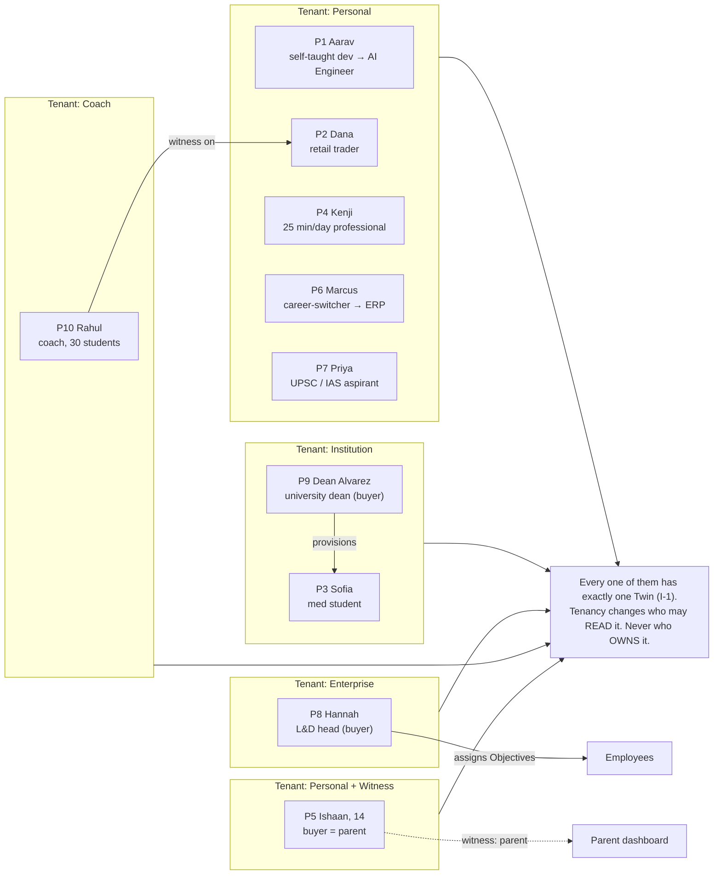
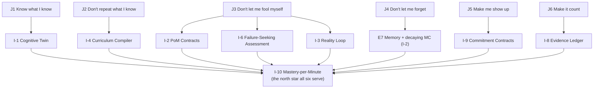

# 03 — Personas & Jobs-To-Be-Done

> Obeys `CANON.md`. Every persona need maps to an Invention (I-1..I-10) or it is not a need we serve.

---

## 0. How to read this document

PRAXIS is a **Mastery OS**, not a course app. So a persona is not defined by "what they want to
learn." It is defined by four things:

| Axis | Question | Why it matters to the OS |
|---|---|---|
| **Objective** | What do they want to *become*? | It is the build target for the Curriculum Compiler (I-4). |
| **Constraint** | Minutes/day, deadline, cognitive load, life chaos | It is the input the Compiler optimizes against (I-4, I-10). |
| **Evidence reality** | What does the real world accept as proof from them? | It sets the PoM contract mix (I-2) and the Reality Loop surface (I-3). |
| **Failure mode** | How have they failed at learning before? | It sets the Accountability + Motivation policy (I-9, I-13-engine). |

Ten personas below. Four are **learners** who are also the buyer. Two are **learners whose buyer
is someone else**. Three are **buyers who are not the learner**. One is a **multiplier** (teaches
others). This spread is deliberate: it forces the OS to be multi-tenant from day one
(CANON §5.8).

---

## 1. Persona index

| # | Name | Age | Objective (build target) | Tenant | Buyer | Primary Inventions |
|---|---|---|---|---|---|---|
| P1 | **Aarav Mehta** | 22 | Become an AI Engineer (employable in 7 months) | Personal | Self | I-4, I-2(BUILD), I-8, I-12-engine |
| P2 | **Dana Whitmore** | 34 | Stop losing money; become a *calibrated* trader | Personal | Self | **I-3**, I-1 (calibration), I-6 |
| P3 | **Sofia Okonkwo** | 23 | Pass Step 1 *and* be a competent clinician | Institution | University | I-7 (decay), I-2(EXPLAIN), I-3 (cases) |
| P4 | **Kenji Watanabe** | 41 | Understand ML deeply enough to lead an ML product | Personal | Self (or employer) | **I-10**, I-4, I-5 |
| P5 | **Ishaan Rao** | 14 | Actually understand physics + math, not memorize | Personal + Witness | **Parent** | I-5, I-9 (witness), I-6 |
| P6 | **Marcus Bell** | 38 | Career-switch into SAP S/4HANA FI consulting | Personal | Self | I-4, I-2(BUILD/CRITIQUE), **I-8** |
| P7 | **Priya Nair** | 26 | Clear UPSC Civil Services (IAS) | Personal | Self | I-6, I-7, I-9, I-3 (answer prediction) |
| P8 | **Hannah Lindqvist** | 45 | Prove her L&D budget produced *capability*, not hours | Enterprise | **She is the buyer** | **I-8**, I-15-engine, I-10 |
| P9 | **Dean Miguel Alvarez** | 58 | Graduate students whose transcripts mean something | Institution | **He is the buyer** | **I-8**, I-2, I-15-engine |
| P10 | **Rahul Desai** | 33 | Scale from 6 to 60 students without diluting quality | Coach | **He is the buyer** | I-1 (30 Twins), I-14-engine, I-5 |

---

## 2. The personas

---

### P1 — Aarav Mehta, 22 — the self-taught dev becoming an AI Engineer

| | |
|---|---|
| **Situation** | BCA graduate, Pune. Writes decent React. Has 11 months of savings. Wants an AI Engineer role at a product company by March. Can give 3 hours/day. Terrified he is "fake." |
| **Real quote** | *"I've watched 200 hours of ML content and I still can't explain why my loss goes to NaN."* |

**What he tried, and precisely why it failed**

| Tried | Why it failed |
|---|---|
| Andrew Ng + 3 YouTube playlists | Consumption ≠ production. He never once produced a novel artifact. **Passive-input illusion.** |
| ChatGPT as tutor | It gave him the answer every time. He shipped working code he could not defend in an interview. **Answer leakage.** |
| A ₹40k bootcamp | Fixed 24-week path. He already knew Python and Git; he sat through both. **Un-cached path.** |
| Kaggle | Copy-forked notebooks; leaderboard rank ≠ understanding. **No evidence of *why*.** |
| LeetCode grind | Solved 300; forgot 240. **No decay model, no reps.** |

**Jobs-To-Be-Done**

| Type | Job |
|---|---|
| Functional | *"Get me from where I actually am to hireable, on the shortest real path, and don't teach me what I already know."* |
| Functional | *"Make me able to defend every line I wrote in a live interview."* |
| Emotional | *"Kill the impostor feeling by replacing my *belief* that I know something with *proof* that I do."* |
| Social | *"Give me something I can send a hiring manager that beats a résumé."* |

| | |
|---|---|
| **The ONE thing that makes him stay** | The **Curriculum Compiler (I-4)** skipped 6 weeks of Python/Git because his Twin already had them — and then, when he bombed a backprop item, the Plan **recompiled that night** and inserted a chain-rule repair. Nothing else in his life has ever adapted to him. |
| **The ONE thing that makes him churn** | If the tutor ever just **gives him the code**. The moment PRAXIS behaves like ChatGPT, its entire premise dies for him and he will use the cheaper ChatGPT. The Answer Budget (I-5) is not a feature for Aarav — it is the product. |
| **Inventions served** | I-1 (Twin as cache), **I-4** (compile, don't author), I-2 `BUILD` + `EXPLAIN`, I-5, I-6, **I-8** (Verified Competency Record → job), I-12-engine (interview sim) |
| **Signature evidence** | `BUILD`: implement backprop from scratch, no autograd, passes hidden gradient-check tests. `EXPLAIN`: 90-second teach-back on *why* the NaN happened. |

---

### P2 — Dana Whitmore, 34 — the retail trader who keeps losing money

| | |
|---|---|
| **Situation** | Nurse in Ohio. $18k account, down $6.4k over 2 years. Trades SPY options in her lunch break. Reads r/wallstreetbets. Believes she "almost has it." |
| **Real quote** | *"I know what a head-and-shoulders is. I just keep entering too early."* |

**What she tried, and precisely why it failed**

| Tried | Why it failed |
|---|---|
| $997 "trading academy" | Sold certainty. Taught patterns with hindsight-selected charts. **Survivorship bias as pedagogy.** |
| Paper trading | No emotional cost, no calibration measurement, no feedback on *confidence*. **Ungraded confidence.** |
| Discord signal group | Outsourced the decision → learned nothing, and could not tell luck from skill. **No attribution.** |
| Backtesting | Overfit to the past; she still had no idea how *sure* she should be about tomorrow. |

**The diagnosis PRAXIS makes that no one else makes:** Dana's problem is **not knowledge. It is
calibration.** Her Twin will show `P(knows(support_resistance)) = 0.81` but **Brier = 0.34** — she is
confidently wrong. This is a Dunning–Kruger delta of +0.29, and it is measurable on day 3.

**Jobs-To-Be-Done**

| Type | Job |
|---|---|
| Functional | *"Tell me, with evidence, whether I am actually any good — before I lose more money."* |
| Functional | *"Fix the specific broken thing in my head, not 'trading' in general."* |
| Emotional | *"Stop the shame spiral. Let me be a beginner without being a fool."* |
| Social | *"Be able to tell my husband this is a skill I am building, with numbers, not a gambling habit."* |

| | |
|---|---|
| **The ONE thing that makes her stay** | **The Reality Loop (I-3).** She marks a live chart at 9:05 today; tomorrow **the actual market grades her**, and her Brier score moves. On week 3 PRAXIS tells her: *"Your directional accuracy is 0.54 — coin-flip. But your accuracy on *`no-trade`* calls is 0.81. Your edge is knowing when NOT to trade. We will build there."* Nothing on earth has ever told her that. |
| **The ONE thing that makes her churn** | If PRAXIS ever gives her a **signal or a price target**. The second it looks like it is telling her what to trade, it is a signal service, it will be wrong, and she will (correctly) blame it. PRAXIS grades her predictions; it never makes them. |
| **Inventions served** | **I-3**, I-1 (calibration + Dunning–Kruger delta), I-6 (misconception mining: *"you conflate volume confirmation with volume spike"*), I-9 (loss-limit stake), I-10 |
| **Signature evidence** | `PREDICT`: 20 marked charts, resolved by close. `CRITIQUE`: find the flaw in a hindsight-selected pattern chart. |
| **Compliance note** | PRAXIS is an education product. It captures predictions; it never routes orders, never recommends, never displays a "buy/sell." This is a hard product boundary, not a disclaimer. |

---

### P3 — Sofia Okonkwo, 23 — the second-year medical student

| | |
|---|---|
| **Situation** | MS2, US medical school. Step 1 in 14 months (pass/fail, but a fail ends her). Also: she will have humans' lives in her hands in 20 months. |
| **Real quote** | *"Anki keeps me from forgetting. It does not make me a doctor."* |

**What she tried, and precisely why it failed**

| Tried | Why it failed |
|---|---|
| Anki (12,000 cards) | Excellent retention engine, **zero understanding engine**. She can recall "malar rash → SLE" and cannot reason a differential. **Recall without APPLY.** |
| Sketchy / Pathoma / Boards&Beyond | Excellent content. Still passive. No one ever asked her to *produce*. |
| Practice Qbanks | 2,000 questions. She learned the *question bank's* patterns, not medicine. **Item overfitting.** |
| Study group | Only worked when it worked. Unreliable at 11pm. |

**Jobs-To-Be-Done**

| Type | Job |
|---|---|
| Functional | *"Hold 4,000 concepts against forgetting for 14 months without me managing a card deck."* |
| Functional | *"Make me reason, not retrieve — a real case, and grade my differential."* |
| Emotional | *"Let me sleep. Tell me honestly whether I'm on track, so I stop the 2am panic audits."* |
| Social | *"Be visibly competent on the wards, not just a good test-taker."* |

| | |
|---|---|
| **The ONE thing that makes her stay** | **I-2 `EXPLAIN` + I-3 clinical loops.** PRAXIS hands her a de-identified real case, takes her differential *with confidence weights*, and when the actual outcome resolves, grades her **reasoning path, not just the answer**. Then it mines the error: *"You anchored on the first abnormal lab in 6 of your last 9 cases. This is a named misconception in your Twin: `premature_closure`."* |
| **The ONE thing that makes her churn** | **Any hallucinated medical fact.** One wrong drug dose and she is gone forever, and she should be. Every clinical claim must be Research-Engine-grounded with a source and a trust score (E10), and unsourced generation in the medical domain pack is architecturally blocked. |
| **Inventions served** | I-7-engine (Memory / decay), I-2 (`EXPLAIN`, `APPLY`, `CRITIQUE`), **I-3** (case outcome as examiner), I-6, I-1 |
| **Signature evidence** | `APPLY`: novel vignette, never in any Qbank (generated, IRT-calibrated). `EXPLAIN`: teach-back the mechanism of a drug's side effect. |
| **Migration** | PRAXIS must **import her 12,000 Anki cards** and turn them into Twin priors on day 1. Refusing to honor her sunk cost is a churn event. |

---

### P4 — Kenji Watanabe, 41 — the working professional with 25 minutes a day

| | |
|---|---|
| **Situation** | Senior PM at a logistics company, Osaka. Two kids. His company is shipping an ML feature and he is nodding in meetings he does not understand. Real budget: **25 minutes, on the train, most days.** |
| **Real quote** | *"I don't have time to learn. I have time to *not* fall further behind."* |

**What he tried, and precisely why it failed**

| Tried | Why it failed |
|---|---|
| Coursera (3 courses, 0 finished) | Designed for a student with 10 hrs/week. He has 2.5. **Constraint mismatch — the fatal one.** |
| Podcasts | Ambient familiarity, zero retrievable knowledge. He *recognizes* "embedding." He cannot use it. |
| A book on his nightstand | 40 pages in, for 8 months. |
| Asking his engineers | Social cost. He stopped after the third time. |

**Jobs-To-Be-Done**

| Type | Job |
|---|---|
| Functional | *"Given 25 minutes, give me the single highest-yield 25 minutes available to me today."* |
| Functional | *"Be honest about what 25 min/day can and cannot buy me by Q3."* |
| Emotional | *"Let me stop faking it in meetings."* |
| Social | *"Ask one question in the next design review that makes my staff engineer raise an eyebrow."* |

| | |
|---|---|
| **The ONE thing that makes him stay** | **Mastery-per-Minute (I-10) shown honestly.** PRAXIS tells him: *"At 25 min/day you reach 'can interrogate an ML design doc' by 14 Sept. You do **not** reach 'can build' — ever, at this budget. Do you want to change the Objective or the budget?"* No product has ever told Kenji the truth about his own time. The counterfactual query on the Twin (I-1) — *"what if I did 40 minutes on weekends?"* → *"3 weeks earlier"* — is what converts him. |
| **The ONE thing that makes him churn** | A session that **overruns 25 minutes**, or a Plan that assumes he'll "catch up on the weekend." The Session (5/10/15/25 min) is a **hard contract**. If PRAXIS disrespects his clock once, he is out. |
| **Inventions served** | **I-10**, I-4 (compile against a brutal constraint), I-5 (25 min must end in *him* producing), I-1 (counterfactual), I-18-engine (nudge timed to the 07:42 train) |
| **Signature evidence** | `CRITIQUE`: given a real (redacted) ML design doc, find the three unstated assumptions. This *is* his job. |

---

### P5 — Ishaan Rao, 14 — the learner whose parent is the buyer

| | |
|---|---|
| **Situation** | Class 9, Bengaluru. Smart, bored, phone-native. Scores 72% in physics by memorizing. Mother, **Deepa (43)**, pays and is terrified he is "falling behind." |
| **Real quotes** | Ishaan: *"I know how to do the problem, I just don't know why."* Deepa: *"I don't want another app he opens twice."* |

**The two-sided job — this persona is really two personas**

| Person | Their actual job |
|---|---|
| **Ishaan (user)** | *"Don't be boring, don't be babyish, and don't catch me out in front of my mother."* |
| **Deepa (buyer)** | *"Show me — with evidence, not a streak badge — that he is actually understanding, and tell me the truth if he isn't."* |

**What they tried, and precisely why it failed**

| Tried | Why it failed |
|---|---|
| Tuition centre, 2 hrs, 3x/week | 1 teacher : 40 kids. Pace set by the median. Ishaan coasted. |
| BYJU'S-class app | Gamified consumption. Streaks measured *opening the app*. Deepa saw a 40-day streak and a 61% test score. **The streak lied.** |
| ChatGPT for homework | He got the answers. His marks went *up* and his understanding went *down*. Deepa found out. |

| | |
|---|---|
| **The ONE thing that makes Ishaan stay** | The tutor **refuses to give him the answer** (I-5) and he *beats it anyway*. The dopamine here is not a badge — it's the moment he says the right thing and PRAXIS says *"Yes. You just derived that. Nobody told you."* Fourteen-year-olds are addicted to competence, not confetti. |
| **The ONE thing that makes Deepa stay** | The **witness dashboard (I-9)** shows Evidence, not activity: *"Ishaan holds 34 of the 51 Class-9 mechanics concepts. He does **not** hold `torque` — he has a specific misconception (`treats torque as force`). He produced 4 explanations this week."* This is the first honest thing anyone has told her about her son's education. |
| **The ONE thing that makes them churn** | **Ishaan** churns if it feels like surveillance — if his mother sees his *failures* in real time and confronts him at dinner. **Deepa** churns if she sees vanity metrics. → **Design consequence:** the witness dashboard is **aggregate + evidence-level, on a 24h delay, and Ishaan can see exactly what his mother sees.** Never a live keystroke feed. This tension is a first-class product constraint. |
| **Inventions served** | I-5, **I-9** (witness), I-6, I-2 (`EXPLAIN` — a 14-year-old teaching back is the whole game), I-1 |

---

### P6 — Marcus Bell, 38 — the career-switcher into ERP (SAP S/4HANA) consulting

| | |
|---|---|
| **Situation** | 12 years in accounts payable at a mid-size manufacturer, Manchester. Wants to become an **SAP S/4HANA Finance functional consultant** (£65k → £95k). Has domain knowledge (he *is* the business process). Has zero SAP config experience. Has £3k and 12 months. |
| **Real quote** | *"Every job wants 3 years of implementation experience. How do I get experience to get experience?"* |

**What he tried, and precisely why it failed**

| Tried | Why it failed |
|---|---|
| SAP Learning Hub | Enormous. No path. He does not know what he does not know. **No compiler.** |
| A £2,400 "SAP certification" course | Taught the *certification exam*. He passed. **Nobody hired him** — the cert proves nothing about whether he can configure a company code. |
| Watching config videos | He watched someone else configure. He never configured. |
| Applying anyway | 90 applications, 2 replies. The credential gap is real and it is an **evidence gap**. |

**The insight PRAXIS acts on:** Marcus's obstacle is not learning. It is that **the market has no way
to verify him.** This is exactly the hole the Evidence Ledger (I-8) exists to fill.

**Jobs-To-Be-Done**

| Type | Job |
|---|---|
| Functional | *"Compile me a path from 'AP clerk who knows the business' to 'consultant who can configure', reusing the 12 years I already have."* |
| Functional | *"Give me artifacts a hiring partner can inspect — not a certificate."* |
| Emotional | *"Prove to myself I am not too old to change."* |
| Social | *"Walk into an interview with 23 verifiable configuration exercises and 6 documented resolutions of real integration errors."* |

| | |
|---|---|
| **The ONE thing that makes him stay** | The **Verified Competency Record (I-8)** — a signed, third-party-verifiable record: *"Configured 23 org structures in a sandboxed S/4HANA client; resolved 6 seeded integration defects; 0.83 calibration on 40 'will this posting fail?' predictions."* A recruiter can click and verify each line. That is the thing he has been unable to buy at any price. |
| **The ONE thing that makes him churn** | If the Ledger export is **not actually respected by employers**. I-8 is only real if PRAXIS does the unglamorous GTM work of getting the first 50 employers to accept it. A ledger nobody verifies is a PDF. |
| **Inventions served** | **I-8**, I-4 (his 12 years of process knowledge are *cache hits* — the Twin credits them), I-2 (`BUILD` in a sandboxed system, `CRITIQUE` of a broken config), I-12-engine |
| **Cache-hit moment** | Diagnostic day 1: PRAXIS asks him to explain the three-way match. He does — fluently. Twin marks 14 concepts held at high confidence. The Plan **drops 5 weeks**. He nearly cries. |

---

### P7 — Priya Nair, 26 — the UPSC Civil Services (IAS) aspirant

| | |
|---|---|
| **Situation** | Third attempt. Delhi, Old Rajinder Nagar. 10 hours/day. Syllabus is effectively *"everything."* Prelims 100:1, Mains 10:1. Her last attempt died in Mains — she *knew* the material and could not *produce* an answer in 7 minutes. (Direct analogue: a law aspirant facing the bar/CLAT — same shape: vast syllabus, decay, written production under time.) |
| **Real quote** | *"I have read Laxmikanth four times. I still wrote a bad answer on federalism."* |

**What she tried, and precisely why it failed**

| Tried | Why it failed |
|---|---|
| Coaching institute (₹1.8L) | Mass lectures. Zero individual model of her. She was one of 300. |
| Notes, re-read 4x | **Re-reading is the single most-used and least-effective study technique in existence.** Recognition ≠ retrieval. |
| Test series | Got a rank and a score. Got **no diagnosis**. "Improve your answer structure" is not actionable. |
| Current affairs monthly magazines | 60 pages of undifferentiated news, disconnected from the syllabus graph, forgotten in 3 weeks. |

**Jobs-To-Be-Done**

| Type | Job |
|---|---|
| Functional | *"Hold ~8,000 concepts across 4 GS papers against decay for 11 months."* |
| Functional | *"Grade my 250-word answer the way an actual examiner would, and tell me the specific structural flaw."* |
| Functional | *"Turn the news into revision instead of into more unread pages."* |
| Emotional | *"Third attempt. I need to know if I am improving or just busy."* |
| Social | *"Not have to explain a fourth attempt to my family."* |

| | |
|---|---|
| **The ONE thing that makes her stay** | **News-as-Curriculum (I-7).** The RBI announces a change to the monetary policy framework. PRAXIS decomposes it into concepts, diffs it against her Twin, sees she holds `MPC_composition` (due for a rep) but **does not** hold `inflation_targeting_amendment_2016`, teaches only the gap in 6 minutes, then makes her **write a 150-word answer linking it to `fiscal_dominance`** — a concept she last touched 41 days ago and is at MC 0.41. **One news item did three jobs.** Her magazine did none. |
| **The ONE thing that makes her churn** | **A bad grader.** If the rubric grading of her Mains answer is generic ("add more examples"), she will trust it once and never again. The rubric grader must hit ≥0.85 kappa vs. human examiners *on her paper* (see `06`), and must cite the rubric line it docked her on. |
| **Inventions served** | **I-7**, I-6 (adversarial: it hunts where she breaks), I-2 (`EXPLAIN` = the Mains answer itself), I-3 (`PREDICT`: *"will the SC uphold this?"* → graded when the judgment lands), I-9, I-1 |

---

### P8 — Hannah Lindqvist, 45 — Head of L&D, 4,000-person enterprise

| | |
|---|---|
| **Situation** | Global head of L&D at a Nordic industrial software firm. Budget: €2.1M/yr. The CFO has asked her, in writing, what the €2.1M bought. She currently cannot answer. **She is a buyer, not a learner.** |
| **Real quote** | *"I can tell you we completed 41,000 hours of training. I cannot tell you if anyone got better at anything."* |

**What she tried, and precisely why it failed**

| Tried | Why it failed |
|---|---|
| Cornerstone / Docebo LMS | Tracks **completions**. A completion is a click. **It measures the wrong noun.** |
| Udemy Business (4,000 seats) | 6% MAU. Content library ≠ capability. She bought a Netflix nobody watches. |
| Skills taxonomy project (18 months) | Produced a beautiful, static, immediately-stale spreadsheet of skills nobody verified. |
| "Learning culture" initiatives | Unfalsifiable. |

**Jobs-To-Be-Done**

| Type | Job |
|---|---|
| Functional | *"Tell me the verified capability inventory of my workforce, today, per skill, per person."* |
| Functional | *"When we adopt Kubernetes, tell me exactly which 340 of my 900 engineers have the prerequisites and which don't."* |
| Functional | *"Give me a defensible number for the CFO: capability gained per euro."* |
| Emotional | *"Stop being the department that runs pizza-and-learn sessions."* |
| Social | *"Present a board slide that survives the CFO."* |

| | |
|---|---|
| **The ONE thing that makes her stay** | The **org-level Twin roll-up (I-1 → I-15-engine)**: a live, evidence-backed capability map. She types *"Who can actually do incident response?"* and gets **17 people with evidence**, not 340 people with a completed course. Plus **I-10**: capability-per-euro, reported honestly, including where it was low. |
| **The ONE thing that makes her churn** | **Employee revolt over surveillance.** If engineers believe the Twin is a performance-management weapon, they will sandbag it and the data dies. → **Design consequence (hard):** enterprise dashboards see **skill-level aggregates + learner-consented Verified Competency Records only**. Never raw session data, never wrong answers, never struggle telemetry. The Twin is the learner's (CANON §5.9). This is a contractual guarantee, not a setting. |
| **Inventions served** | **I-8** (VCRs as the org's source of truth), I-15-engine, **I-10**, I-4 (org-level: compile a re-skilling plan for a 900-person migration), I-12-engine |

---

### P9 — Dean Miguel Alvarez, 58 — Dean of Engineering, a 21,000-student university

| | |
|---|---|
| **Situation** | Dean at a public university. Accreditation review in 19 months. Employers tell him privately that his graduates "have the degree but can't do the work." Generative AI has made his take-home assessments worthless overnight. **He is a buyer, not a learner.** |
| **Real quote** | *"My transcript says 'A in Data Structures.' I have no idea if that's true anymore."* |

**What he tried, and precisely why it failed**

| Tried | Why it failed |
|---|---|
| Proctoring software | Adversarial arms race, student backlash, and it only guards the exam — not the *learning*. |
| Banning AI | Unenforceable. Also pedagogically cowardly. |
| Outcome-based education (OBE) frameworks | Enormous paperwork; outcomes "assessed" by the same instructor who taught them, with no independent evidence. |
| Capstone projects | Excellent — for the 6% of students who do them well. Not assessable at scale. |

**Jobs-To-Be-Done**

| Type | Job |
|---|---|
| Functional | *"Give me an assessment substrate that AI cannot defeat."* |
| Functional | *"Produce accreditation evidence automatically, per learning outcome, per student, from real artifacts."* |
| Functional | *"Let my transcript mean something again."* |
| Emotional | *"Not preside over the decade the degree became worthless."* |
| Social | *"Be the university that solved this."* |

| | |
|---|---|
| **The ONE thing that makes him stay** | The **Evidence Ledger (I-8) + PoM contracts (I-2)** make his degree *verifiable*. A PRAXIS transcript is not a grade — it is a **signed chain of artifacts, teach-backs, novel-item performance, and calibration scores**. And because the evidence is `EXPLAIN` (spoken, live, adaptive follow-ups) and `PREDICT` (graded by reality later), **an LLM cannot produce it for the student.** This is the answer to the AI-cheating crisis, and it is the only structural one. |
| **The ONE thing that makes him churn** | Faculty revolt. If PRAXIS is positioned as replacing professors, 900 faculty kill it in one senate meeting. → **Positioning is load-bearing:** PRAXIS is the **assessment and memory substrate**; the professor is the *author of the Objective and the PoM contract*. It gives faculty back the thing they lost (knowing who actually understands) and takes away the thing they hate (grading 300 problem sets). |
| **Inventions served** | **I-8**, **I-2**, I-3 (in engineering: does the code run? does the bridge hold in sim?), I-15-engine (cohort mastery, per-outcome), I-6 |

---

### P10 — Rahul Desai, 33 — the coach/mentor with 30 students

| | |
|---|---|
| **Situation** | Ex-quant, runs a 30-person cohort teaching systematic trading. Charges ₹45k/head. His outcomes are genuinely good — because he personally reviews every student. That does not scale past ~30, and he is burning out. **He is a buyer *and* a multiplier.** |
| **Real quote** | *"My quality IS my personal attention. Scaling it kills it. That's my ceiling and my prison."* |

**What he tried, and precisely why it failed**

| Tried | Why it failed |
|---|---|
| Recorded course + community | Completion collapsed to 4%. Outcomes collapsed with it. His reputation is his asset; he pulled it. |
| Teaching assistants | TAs are not him. Quality variance destroyed the brand. |
| Cohort-based (Maven-style) | Better, but live sessions serve the median student; the top is bored and the bottom drowns. |
| Notion + Google Sheets tracker | He was manually maintaining a bad, stale, non-probabilistic Twin **by hand**. |

**Jobs-To-Be-Done**

| Type | Job |
|---|---|
| Functional | *"Give me 30 live Twins so I know, before our call, exactly who is stuck and on what."* |
| Functional | *"Let me author the PoM contracts and the graph overlay — my methodology is the product."* |
| Functional | *"Automate everything except the 10% that requires me."* |
| Emotional | *"Scale without becoming a fraud."* |
| Social | *"Publish cohort outcomes that are verifiable, and destroy my competitors who can't."* |

| | |
|---|---|
| **The ONE thing that makes him stay** | The **coach console: 30 Twins, ranked by intervention value.** *"Priyanka is 3 days from decaying below threshold on `position_sizing` — the concept her last two losing loops both trace to. Talk to her, not to Arjun (he's fine)."* PRAXIS turns his scarcest asset — attention — into a scheduled, targeted resource. He goes from 30 students to 90 without a quality drop, and his **cohort's aggregate Brier score is a marketing asset his competitors cannot fake** (I-8). |
| **The ONE thing that makes him churn** | If PRAXIS **disintermediates him** — if his students feel PRAXIS is the teacher and Rahul is a middleman. → **Design consequence:** in the Coach tenant, the graph overlay, the PoM contracts, and the tutor persona are **branded and authored by the coach**. PRAXIS is his OS. It is never his competitor. |
| **Inventions served** | I-1 (×30), I-14-engine (contracts + witness = him), I-2 (he authors the contracts), I-5, I-8 (cohort-level verified outcomes), I-15-engine |

---

## 3. Cross-persona: the Jobs, consolidated

The ten personas collapse into **six universal jobs**. Every one is an Invention.

| # | The Job (in the learner's words) | Invention that does it | What everyone else does instead |
|---|---|---|---|
| J1 | *"Know what I actually know."* | **I-1 Twin** | Ask you to self-report, or infer from videos watched. |
| J2 | *"Don't teach me what I already know."* | **I-4 Compiler** (Twin = cache) | Fixed syllabus for everyone. |
| J3 | *"Don't let me fool myself."* | **I-2 PoM** + **I-6 Failure-seeking** + **I-3 Reality** | "Mark as complete." |
| J4 | *"Don't let me forget it."* | **I-7-engine Memory** + decaying MC | Certificate, frozen forever, at 40% recall. |
| J5 | *"Make me show up."* | **I-9 Contracts** | Push notification. |
| J6 | *"Let it count for something."* | **I-8 Ledger** | A PDF certificate anyone can Photoshop. |

---

## 4. Persona × Invention matrix

`●` = primary, the reason they stay · `○` = secondary · blank = not material to them

| | I-1 Twin | I-2 PoM | I-3 Reality | I-4 Compiler | I-5 Answer Budget | I-6 Failure-Seek | I-7 News | I-8 Ledger | I-9 Contracts | I-10 MpM |
|---|---|---|---|---|---|---|---|---|---|---|
| P1 Aarav (AI eng) | ● | ● | ○ | **●** | **●** | ○ | ○ | ● | ○ | ○ |
| P2 Dana (trader) | ● | ○ | **●** | ○ | ○ | ● | ○ | | ● | ○ |
| P3 Sofia (med) | ● | **●** | ● | ○ | ○ | ● | ○ | ○ | ○ | ○ |
| P4 Kenji (25 min) | ● | ○ | | ● | ● | | ○ | | ○ | **●** |
| P5 Ishaan (14) | ○ | ● | | ○ | **●** | ● | | ○ | **●** | |
| P6 Marcus (ERP) | ● | ● | ○ | ● | ○ | ○ | | **●** | ○ | ○ |
| P7 Priya (IAS) | ● | ● | ○ | ● | ○ | **●** | **●** | | ● | ○ |
| P8 Hannah (L&D) | ● | ● | | ● | | | | **●** | ○ | **●** |
| P9 Dean Alvarez | ○ | **●** | ● | | | ● | | **●** | | ○ |
| P10 Rahul (coach) | **●** | ● | ● | ○ | ● | ○ | | ● | **●** | ● |

**Reading the matrix:** no Invention is dead weight. The two with the widest reach are **I-1** (every
persona) and **I-2** (nine of ten) — correctly, since they are the kernel. **I-3** is the sharpest
wedge (it is the *only* reason P2 and P9 exist as customers). **I-8** is where the money is: it is
primary for all three non-learner buyers (P6's employer, P8, P9).

---

## 5. Buyer vs. user vs. witness

A hard product truth: in **half** of our personas, the person who pays is not the person who learns.

| Persona | User | Buyer | Witness | The tension we must engineer around |
|---|---|---|---|---|
| P1, P2, P4, P6, P7 | Self | Self | Optional | None. Cleanest case. |
| P3 Sofia | Sofia | University | Faculty | Student must be able to keep a **personal Twin** the university cannot see. Twin is hers (CANON §5.9). |
| P5 Ishaan | Ishaan | **Parent** | Parent | Surveillance kills the learner; vanity metrics kill the buyer. → 24h-delayed, evidence-only, learner-visible witness view. |
| P8 Hannah's engineers | Employee | **Employer** | Manager (opt-in) | Employer sees **consented VCRs and aggregates only**. Never struggle telemetry. |
| P9 Dean's students | Student | **University** | Faculty | Evidence for accreditation must be exportable; *misconception data is the student's alone*. |
| P10 Rahul's cohort | Student | **Student pays Rahul; Rahul pays PRAXIS** | Coach | Coach sees full Twin **only with explicit learner grant**, revocable, and the learner sees exactly what the coach sees. |

**The rule, stated once and enforced everywhere:**
> The Twin is owned by the learner. A witness sees a **projection** of it, at a granularity the
> learner has consented to, and the learner can always see *exactly* the projection the witness
> sees. There is no hidden view. (CANON §5.9.)

---

## 6. Who we are NOT for

We will lose these people, on purpose, and it will improve the product.

| Not for | Why we refuse them | What they should use instead |
|---|---|---|
| **People who want to feel productive without producing.** | This is our largest addressable non-market, and rejecting it *is* the category. There is no "mark as complete." There is no passive video autoplay. Every session ends with you having said or built something (I-5). If your goal is the *feeling* of learning, PRAXIS will be unpleasant, and correctly so. | YouTube. A podcast. A course they will not finish. |
| **Certificate collectors.** | We do not sell credentials for attendance. The Evidence Ledger records what you *produced*; it cannot be farmed. A learner optimizing for the badge will find the badge is just a pointer to evidence anyone can inspect. | LinkedIn Learning. |
| **People who want the answer.** | The Answer Budget (I-5) is architectural. If you want the answer, we are a strictly worse, more expensive, slower ChatGPT — and we will tell you so, in onboarding, in writing. | ChatGPT. Genuinely. Use it. |
| **Cramming-for-Friday, done-forever learners.** | Mastery in PRAXIS is a *decaying credit* (I-2). We will keep scheduling reps. We are structurally unable to tell you that you are finished, because you are not. If you want to purge it after the exam, our whole model is friction. | A Qbank. |
| **"Learn 10x faster" seekers.** | We do not believe this and will not sell it. PRAXIS makes the *minutes* more efficient (I-10); it does not repeal the forgetting curve, the need for retrieval, or the cost of desirable difficulty. Our honest claim is *"fewer wasted minutes,"* not *"faster."* | Any speed-reading product. |
| **Organizations buying compliance theater.** | If the requirement is "everyone must complete the annual security module," we are the wrong tool — we will report, accurately, that 71% of your workforce cannot detect a phishing email, and that will be politically unwelcome. We are a truth instrument. Truth is our only feature. | An LMS. There are many. |
| **Learners who will not be measured.** | Everything in PRAXIS runs on evidence. A learner who refuses assessment has no Twin, so the Compiler has no cache, so the Plan is a generic syllabus, so we are a bad course app. We would rather they leave. | — |
| **Domains with no ground truth.** | The Reality Loop (I-3) requires reality to *resolve*. Where there is no falsifiable outcome (pure taste, pure aesthetics, unfalsifiable ideology), our crown jewel does not function, and we should not pretend otherwise. We ship domain packs only where a PoM contract is honestly definable. | — |
| **Anyone wanting a signal service, a homework-doer, or a ghostwriter.** | P2 wants a stock tip. P5 wants his homework done. P7 wants a model answer to memorize. **All three requests are the disease.** We decline all three, by architecture, and we say why. | — |

**The bravest line in this document:**
> A meaningful fraction of every existing edtech company's revenue comes from people who pay to
> *feel* like they are learning and never do. That revenue is not available to us. We are giving
> it up, and the giving-up is the moat: **you cannot copy PRAXIS without deleting the business
> model that funds you.**

---

## 7. Anti-personas → product guardrails (traceable)

| Anti-persona pressure | Guardrail we build | Invention protected |
|---|---|---|
| "Just tell me the answer" | Hint ladder with a hard per-concept budget; the full-answer rung is *architecturally* rate-limited and always logged as an answer-leak event | I-5 |
| "Let me mark this done" | No such API exists. Mastery Credit is only ever written by an Evidence record | I-2 |
| "Give me a streak" | Streaks exist but are bound to *evidence produced*, never to app-opens or minutes | I-9, I-10 |
| "Show my boss my daily activity" | Enterprise reads consented VCRs + aggregates. Raw session telemetry is not exposed, at any price | CANON §5.9 |
| "Give me a certificate" | Certificates are *pointers into the Ledger*. Revocable, decaying, inspectable | I-8 |
| "Optimize my time-on-app" | Not a metric in the system. `Mastery-per-Minute` rises when time falls. We optimize for the learner leaving | I-10 |

---

## 8. Open questions

| # | Question | Owner doc |
|---|---|---|
| Q1 | For P5 (minor), what is the legal floor on witness data by jurisdiction (COPPA / GDPR-K / India DPDP)? | `22` |
| Q2 | For P2, does capturing a market prediction constitute investment advice in any target jurisdiction? Legal review required *before* the trading domain pack ships. | `13`, `22` |
| Q3 | For P6/P8, what is the minimum viable employer-verification network (n=?) for I-8 to be credible? | `24` |
| Q4 | For P3/P9, which medical/engineering accreditation bodies will accept Ledger evidence, and what schema do they need? | `12`, `16` |
| Q5 | Does the Coach tenant (P10) get *authoring* rights on the global Graph, or only a private overlay? (CANON §5.8 says overlay — confirm it survives contact with a real coach.) | `09` |
