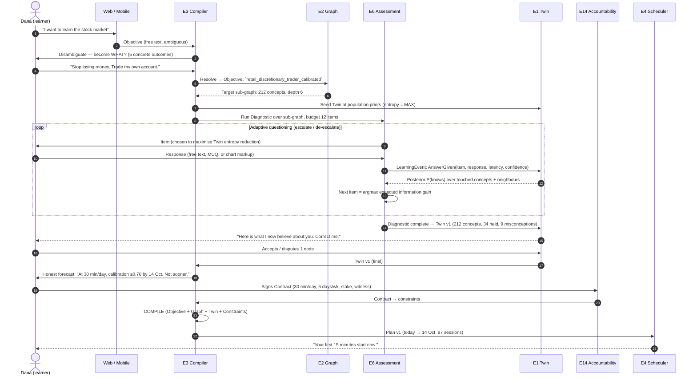
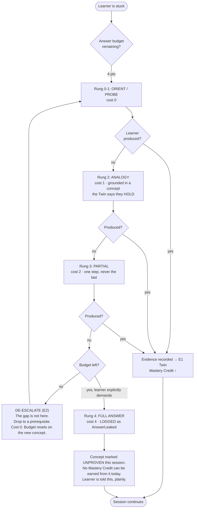
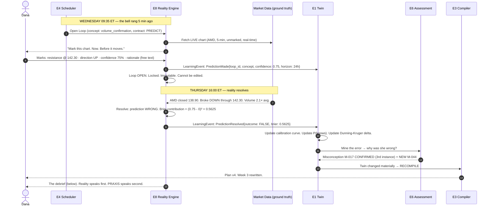
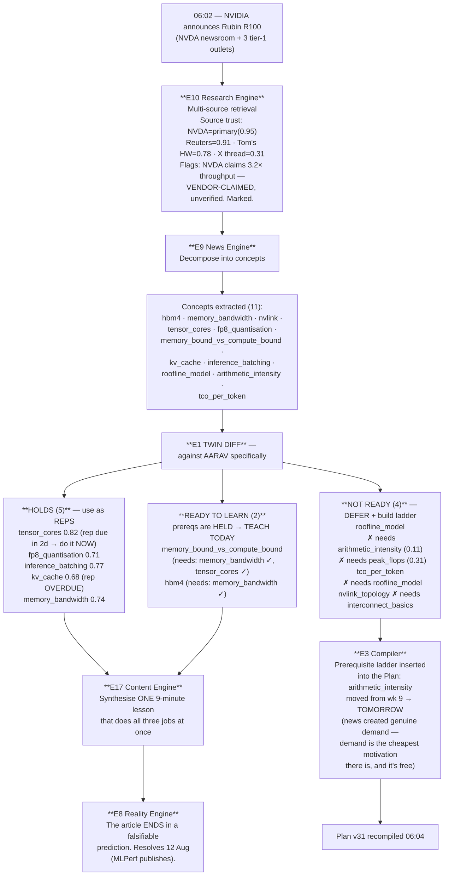
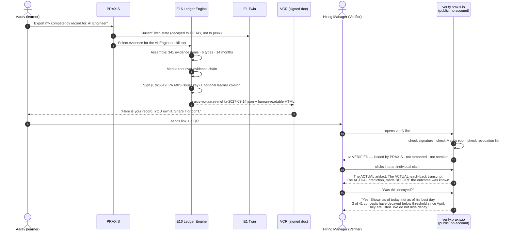

# 04 — User Journeys

> Obeys `CANON.md`. Six end-to-end journeys, with real dialogue and real screens.
> Where a screen shows text, that text is **the actual copy**, not a placeholder.
> Every step is annotated with the Engine (E1..E18) that owns it and the Invention (I-1..I-10) it serves.

**The six:**

| # | Journey | Why it exists | Crown Invention |
|---|---|---|---|
| A | **Day 0** — "What do you want to become?" → Diagnostic → Twin seeded → Contract → first compiled Plan | If we assume anything about the learner, the whole OS is built on sand | I-1, I-4 |
| B | **Day 1** — the first 15-minute session, end to end | This is where we either are, or are not, different from ChatGPT | I-5 |
| C | **A Reality Loop day** — mark the chart → reality grades you → calibration → Twin → recompile | The crown jewel, shown working | I-3 |
| D | **The relapse** — 11 days gone, decay bites, escalation ladder, the compiled return path | **Every learning product dies here. This journey is the product.** | I-9, I-4 |
| E | **News-as-Curriculum** — NVIDIA launches a GPU → Twin diff → prerequisite ladder → lesson → prediction | Proof the feed is a revision schedule in disguise | I-7 |
| F | **The Ledger moment** — export a Verified Competency Record; an employer verifies it | This is the moat and the money | I-8 |

---

## Journey A — Day 0: "What do you want to become?"

### A.0 The rule that governs this entire journey

> **The AI must never assume.**
> Not the learner's level. Not their vocabulary. Not what "stock market" means to them.
> The Diagnostic's job is to *destroy its own priors as fast as possible*.

We start at **maximum uncertainty**: every concept in the domain is at `P(knows(c)) = prior(c)`,
where `prior(c)` is the population base rate, and the **entropy of the Twin is at its maximum**.
The Diagnostic is an **information-maximizing search** (E6, adaptive/IRT) whose objective is not
to score the learner but to **collapse Twin entropy per question asked**.

Target: **< 12 questions, < 7 minutes, ≥ 60% entropy reduction** across the target sub-graph.

### A.1 The flow



### A.2 The disambiguation — because "stock market" is not an Objective

**Screen — Day 0, 00:00**

```
                    PRAXIS

        What do you want to become?

        ┌──────────────────────────────────────────┐
        │ i want to learn stock market             │
        └──────────────────────────────────────────┘

        Not a topic. A capability. Be greedy.
```

Dana types `i want to learn stock market`. PRAXIS does **not** load a "Stock Market 101" course.
There is no catalog (CANON §2). E3 cannot compile against an ambiguous target, so it refuses to
guess:

> **PRAXIS:** "Stock market" is five different jobs, and they need five different brains.
> Which of these is *your* actual goal? Pick the one that is true, not the one that sounds good.
>
> 1. **Invest long-term.** Buy good businesses, hold for a decade, ignore the noise.
> 2. **Trade actively.** Take positions over days or weeks. Your edge is timing.
> 3. **Understand the news.** Read a market story and know what it means. No trading.
> 4. **Get a finance job.** Analyst, research, risk. This is a career, not a hobby.
> 5. **Something else** — tell me.
>
> **Dana:** *2. Honestly — I already trade. I'm down $6,400 over two years. I want to stop
> losing money.*
>
> **PRAXIS:** Then your Objective is not "trading." It is:
>
> > **Become a *calibrated* trader** — someone whose confidence matches their correctness,
> > who knows when they have an edge and, more importantly, when they don't.
>
> That is a different, harder, and much more useful target. Losing money is rarely a knowledge
> problem. It is usually a **calibration** problem. We will measure both, separately, and you may
> not like what we find in week one.
>
> Accept this Objective?  **[ Yes ]  [ No, I want something else ]**

**Why this matters (I-4):** the Objective is the build target. A vague target compiles to a vague
plan. E3 is *architecturally* unable to accept `"learn stock market"` — it must resolve to a node
in the **Role/Outcome ontology** (E12) with a defined PoM contract set. This refusal is a feature.

### A.3 The Diagnostic — the AI never assumes

E6 now runs an adaptive diagnostic over the 212-concept sub-graph. It knows **nothing** about Dana.
It does not know if she knows what a stock is. It will not assume she does — and it will not
patronize her by starting at zero either. It **starts in the middle and moves**.

**The actual dialogue.** Annotations show the Twin update after each turn.

---

**Q1 — the calibration probe (always first, always)**

> **PRAXIS:** Before anything: a stock chart is on screen. Green candles, then three red ones,
> then a long green one that closes above all of them.
>
> **What happens next?**
>
> ○ It goes up  ○ It goes down  ○ I don't know  ○ Nobody can know
>
> **Dana:** *It goes up.* (latency 2.1s, self-reported confidence: **80%**)
>
> **PRAXIS:** Noted. I'm not going to tell you if that's right. I'm going to remember that you
> said **80%**.

> `E1 ← AnswerGiven{item: q_engulfing_predict, confidence: 0.80, latency: 2100ms}`
> **Twin:** `calibration.prior_overconfidence = HIGH` (flagged, not yet scored).
> The correct answer is **"Nobody can know"** — a single bullish engulfing candle has near-zero
> predictive power in isolation. Dana answered with 80% confidence. **This one item is the entire
> diagnosis of Dana's problem**, and PRAXIS files it silently. It will be shown to her in Journey C,
> when reality — not PRAXIS — has proved it. *(I-3, I-1)*

---

**Q2 — start mid-ladder, not at the bottom**

> **PRAXIS:** You said you already trade. So let's start where you actually are, not where a
> course would start you.
>
> **In one sentence: what is a stock?**
> Type it however you'd say it to a friend. There is no wrong phrasing here.
>
> **Dana:** *It's like a piece of a company you can buy and sell.*

> `E6` grades free-text against the concept rubric for `equity_share`.
> Rubric hits: *ownership* ✓, *tradable* ✓. Rubric misses: *residual claim*, *dilution*,
> *why the price moves*.
> **Twin:** `P(knows(equity_share)) : 0.42 → 0.88` (held, but shallow).
> **Escalate.** No point asking anything below this. E6 prunes 14 downstream concepts from the
> diagnostic — it will *not* ask her what a ticker is. *(I-1, I-4: cache hit)*

---

**Q3 — escalate**

> **PRAXIS:** Good — that's the ownership half. Here's the half most people never get:
>
> **A company's profits doubled. Its stock fell 9% that day. What happened?**
>
> **Dana:** *Maybe people were expecting more?*
>
> **PRAXIS:** Yes. Say the next sentence.
>
> **Dana:** *So... the price is about what people expect, not what actually happened?*
>
> **PRAXIS:** That's it. You just said the single most important sentence in markets, and I
> didn't tell it to you.

> **Twin:** `P(knows(expectations_vs_reality)) : 0.31 → 0.79`
> `P(knows(price_is_information)) : 0.28 → 0.66`
> **Escalate again.** Dana is *much* stronger conceptually than her P&L suggests. This is the
> signature of a **calibration** problem, not a knowledge problem. Hypothesis strengthening. *(I-1)*

---

**Q4 — escalate into her claimed domain**

> **PRAXIS:** You mentioned candles. Here is one:
>
> ```
>        │          Open  102.10
>      ┌─┴─┐        High  108.40
>      │   │        Low    99.80
>      │   │        Close 103.05
>      └─┬─┘
>        │
> ```
>
> **Tell me what this candle is telling you — and what it is NOT telling you.**
>
> **Dana:** *It's a small green body with long wicks both sides. Buyers and sellers fought,
> nobody won. Indecision.*
>
> **PRAXIS:** Correct. Now the second half of my question — what is it **not** telling you?
>
> **Dana:** *...I mean, it's not telling me what happens next?*
>
> **PRAXIS:** Right. And yet an hour ago you told me, at 80% confidence, what happened next.

> **Twin:** `P(knows(candle_anatomy)) : 0.5 → 0.94` (strongly held)
> `P(knows(candle_predictive_limits)) : 0.2 → 0.55` (**knows it when asked; does not act on it**)
> **New Misconception recorded:** `M-017 :: pattern_implies_prediction` —
> *"Learner treats a chart pattern as a forecast rather than as a conditional probability."*
> Evidence: Q1 (80% confidence) contradicted by Q4 (correct verbal reasoning).
> **This is the Dunning–Kruger delta made visible: she KNOWS the right thing and DOES the wrong
> thing.** No quiz score would ever have found this. *(I-6, I-1)*

---

**Q5 — probe a suspected hole (volume)**

> **PRAXIS:** A stock breaks above resistance. Volume is 40% below its 20-day average.
> **How does that change your read?**
>
> **Dana:** *Volume confirms the breakout, so... it's still a breakout, it's just weaker?*
>
> **PRAXIS:** Say more about "confirms."
>
> **Dana:** *High volume means the move is real. Low volume means... fewer people believe it?*
>
> **PRAXIS:** So what would you expect to happen more often, after a low-volume breakout?
>
> **Dana:** *It fails? Comes back down?*
>
> **PRAXIS:** That's the standard claim. Hold onto it — in three weeks I'm going to make you test
> whether it's actually true on live data, and you may be unpleasantly surprised.

> **Twin:** `P(knows(volume_confirmation)) : 0.35 → 0.61` — held **as a slogan**, not as a
> mechanism. `EXPLAIN` evidence is weak; the rubric line *"states the causal mechanism"* was not hit.
> **Do not escalate.** E6 detects a *shallow* hold and marks the concept for a `PREDICT` contract
> later (I-3) rather than drilling it now. *(I-2)*

---

**Q6 — DE-ESCALATE. This is the part everyone else gets wrong.**

> **PRAXIS:** One more on volume. **When you buy 100 shares, who is on the other side?**
>
> **Dana:** *...the market? The exchange?*
>
> **PRAXIS:** Not the exchange. The exchange is the room. Who *sold* you the shares?
>
> **Dana:** *Someone who wanted to sell them?*
>
> **PRAXIS:** Yes. And what do they believe about the price, right at that moment?
>
> **Dana:** *That it's going... down?* *...oh.*
>
> **PRAXIS:** Say it.
>
> **Dana:** *Every trade I make, someone equally convinced of the opposite is taking the other
> side.*
>
> **PRAXIS:** That is the sentence. Every single position you hold is a **disagreement**. If you
> don't know why the other side is wrong, you are the other side.

> **De-escalation triggered:** Dana answered Q4 (candle anatomy) at expert level and Q6
> (market microstructure, *a prerequisite*) at novice level. E6 detected an **inverted
> prerequisite hold** — she has the advanced concept and not its foundation.
> **This is only detectable by an engine that models the DAG.** A linear course would have taught
> microstructure in week 1 and she'd have skipped it as "basic."
> **Twin:** `P(knows(counterparty))` : 0.55 → **0.18** (a *downgrade* — the diagnostic
> found a hole *beneath* a held concept, and E2 propagates the doubt upward: `P(knows(order_flow))`
> and `P(knows(liquidity))` are both revised **down** by prerequisite back-propagation.)
> **Compiler consequence:** market microstructure moves from week 9 → **week 1**. *(I-1, I-4, I-6)*

---

**Q7–Q11** continue: risk of ruin (**she cannot compute it — hole**), position sizing (**hole**),
expectancy (**partial**), stop-loss mechanics (**held**), the difference between a *good decision*
and a *good outcome* (**hole — and this is the deepest one**).

> **Q11 — PRAXIS:** Last one. You take a trade with a 30% chance of working. It works. You make
> $800. **Was it a good trade?**
>
> **Dana:** *...I want to say yes because I made money. But you're asking, so, no?*
>
> **PRAXIS:** Don't answer what you think I want. Answer what you believe.
>
> **Dana:** *I genuinely don't know. That's the honest answer.*
>
> **PRAXIS:** Then that is the most valuable thing you've said today, and it's where we're going
> to start.

> **Twin:** `P(knows(process_vs_outcome)) = 0.09` — the **root cause node**.
> E2 flags it: this concept has 31 downstream dependents in the trading sub-graph. It is the
> highest-leverage node in Dana's entire Twin.
> **Diagnostic terminates** at 11 items — entropy reduction target hit (68%). *(I-6, I-4)*

### A.4 The Twin is shown to the learner — and she may dispute it

> **The AI never assumes.** That rule doesn't stop at the diagnostic. It extends to the Twin
> itself: PRAXIS shows Dana its model of her mind and **invites her to falsify it.**

**Screen — Day 0, 00:07**

```
  YOUR TWIN — v1                                        Built from 11 answers, 6m 41s

  This is what I now believe about your mind. I will be wrong about some of it.
  Tell me where.

  ── YOU HOLD (34 concepts) ─────────────────────────────────────────────────────
  ● candle anatomy                        0.94   strongly held
  ● equity share                          0.88   held, shallow
  ● expectations vs reality               0.79   held  ← you derived this yourself
  ● stop-loss mechanics                   0.81   held
  ...

  ── YOU PARTLY HOLD (18) ───────────────────────────────────────────────────────
  ◐ volume confirmation                   0.61   you hold the SLOGAN, not the mechanism
  ◐ expectancy                            0.44

  ── YOU DO NOT HOLD (160) ──────────────────────────────────────────────────────
  ○ process vs outcome                    0.09   ⚠ 31 concepts depend on this
  ○ risk of ruin                          0.12
  ○ counterparty / order flow             0.18   ⚠ this is BENEATH things you already know
  ○ position sizing                       0.15

  ── MISCONCEPTIONS I FOUND (2 so far) ──────────────────────────────────────────
  ⚠ M-017  pattern_implies_prediction
     You correctly said a candle can't predict the future (Q4) — one minute after you
     predicted the future from a candle at 80% confidence (Q1). You know the right
     thing. You do the wrong thing. This gap is why you are down $6,400.

  ⚠ M-031  outcome_is_evidence_of_process
     You are not yet able to tell a good decision from a good result.

  ── CALIBRATION ────────────────────────────────────────────────────────────────
     Not yet measured. It cannot be measured from a quiz.
     Reality has to measure it. We start tomorrow.

           [ This is right ]   [ I dispute a node → ]   [ Show me the evidence for any line ]
```

Dana clicks **dispute** on `stop-loss mechanics`. She says: *"I know what a stop is, I just never
use one."* PRAXIS accepts the distinction and **splits the node**: `stop_loss_mechanics` (held,
0.81) vs. `stop_loss_discipline` (a *behaviour*, not a concept — routed to E13 Motivation, not E1).

> **Novel:** every product shows you a score. **PRAXIS shows you its model of your mind and asks
> you to break it.** The dispute itself is a `LearningEvent`. *(I-1)*

### A.5 The honest forecast (I-10) — before any money changes hands

> **PRAXIS:** Before you commit to anything, here is the truth, and you should read it twice.
>
> | Your budget | What you actually reach | When |
> |---|---|---|
> | 15 min/day | Understanding, no verified edge. You will still lose money. | — |
> | **30 min/day** | **Calibration ≥ 0.70. You will know when you don't know.** | **14 Oct (11 weeks)** |
> | 60 min/day | Same, plus a tested, documented strategy with a measured expectancy. | 21 Sep |
>
> **What none of these buy you:** a guarantee of profit. PRAXIS does not teach you to make money.
> It teaches you to **know whether you can**, which is the only thing standing between you and
> another $6,400.
>
> Also, plainly: **your first four weeks will feel worse than doing nothing.** We are going to
> show you, with your own live predictions, that your edge is currently zero. Most people quit
> here. That is a rational response, and if you want to quit here, quit here — it's free.

### A.6 The Contract (I-9)

**Screen — Day 0, 00:09**

```
  YOUR CONTRACT                                         This is binding. That's the point.

  I, Dana Whitmore, commit to:

    ▸ 30 minutes/day                                              [ 15 · 25 · 30 · 45 · 60 ]
    ▸ 5 days/week (Mon–Fri, 12:30 — your lunch break)             [ edit ]
    ▸ Until 14 October — Objective: Calibrated Trader             [ edit ]

  ── STAKE (optional, and it works) ─────────────────────────────────────────────
    ☑ If I miss 3 sessions in a week, $25 goes to a charity I dislike.
       [ choose ]  Anti-charity selected: ▾
    ☐ No stake.  ← chosen by 71% of learners. They finish at less than half the rate.

  ── WITNESS (optional) ─────────────────────────────────────────────────────────
    ☑ My husband, Tom, gets a weekly summary.
       He will see: sessions kept, evidence produced, calibration trend.
       He will NOT see: wrong answers, struggle, misconceptions, session content.
       You can see exactly what he sees, always:  [ preview Tom's view ]

  ── WHAT PRAXIS COMMITS TO ─────────────────────────────────────────────────────
    ▸ Never to give you the answer. We will make you produce it.
    ▸ Never to give you a trade signal, a price target, or advice. Not once.
    ▸ To tell you if you are not improving — even if it makes you leave.
    ▸ To let you export or delete everything, including your Twin, at any time.

                        [ I sign ]                 [ Not yet ]
```

### A.7 The Compile (I-4)

`E3.Compile(Objective, Graph, Twin_v1, Constraints)` →

```
  PLAN v1 — compiled 11 Jul, 12:34 · valid until next recompile (tonight 03:00)

  Target:      Calibrated Trader (calibration ≥ 0.70, Brier ≤ 0.18, 40 resolved Loops)
  Budget:      30 min/day × 5 d/wk × 14 weeks  =  35 hours
  Graph:       212 concepts in scope · 34 already held (cache hit — 6.2 hrs saved)
  Critical path: 71 concepts

  ┌─ Week 1 ──────────────────────────────────────────────────────────────────┐
  │ NOT what you expected. We are not starting with charts. You already have   │
  │ charts. We are starting beneath them.                                      │
  │                                                                            │
  │  Mon  process_vs_outcome          ⚠ root cause · 31 dependents             │
  │  Tue  counterparty / order flow   ⚠ found a hole beneath what you know     │
  │  Wed  process_vs_outcome  REP     + first live Reality Loop opens          │
  │  Thu  risk_of_ruin                                                         │
  │  Fri  position_sizing             + Loop #1 resolves. Reality grades you.  │
  └────────────────────────────────────────────────────────────────────────────┘

  Deferred (you'll be annoyed, and I'll be right):
    · chart patterns — you already hold the anatomy; the *predictive* claim gets
      tested by reality in week 3, not taught by me in week 1.
    · indicators (RSI, MACD) — week 8, and only if your Loops show you need them.

  Why this order:  [ explain the compile → ]   ← opens the actual DAG, the actual
                                                 critical path, and the actual cost
                                                 function. Nothing is hidden.
```

**Day 0 ends at 00:14.** Fourteen minutes from "i want to learn stock market" to a signed contract
and a compiled, personalized, honest plan built on a probabilistic model of her actual mind.

---

## Journey B — Day 1: the first 15-minute session (I-5, the Answer Budget)

### B.0 What the Answer Budget actually is

Not a prompt. Not "please be Socratic." A **policy layer between the model and the learner** that
the model cannot bypass, because the model does not have the answer-emitting privilege — the
**policy** does.

| Rung | Name | What it may say | Cost from budget |
|---|---|---|---|
| 0 | **ORIENT** | Restate the problem; point at the right region of the graph | 0 |
| 1 | **PROBE** | Ask the question that exposes the gap | 0 |
| 2 | **ANALOGY** | Map to a domain the Twin says the learner already holds | 1 |
| 3 | **PARTIAL** | Give one step, never the last one | 2 |
| 4 | **FULL** | Give the answer. Logged as `AnswerLeaked`. Concept is marked **`UNPROVEN`** — it can no longer produce Mastery Credit from this session. | 4 (and it burns the concept) |

**Budget per concept, per session: 4 points.** Spend it all and the tutor *runs out of rungs* —
it must then de-escalate to a prerequisite (E2 traversal) rather than hand over the answer.
**The tutor literally cannot give the answer without destroying the thing the learner came for,
and it tells the learner that.**



### B.1 The session — real dialogue

**Screen — Day 1, 12:31. Dana's lunch break. Phone.**

```
  ┌────────────────────────────────────────────────┐
  │  SESSION 1                            15:00 ⏱  │
  │                                                │
  │  process_vs_outcome                            │
  │  Your Twin: 0.09 · 31 concepts depend on this  │
  │                                                │
  │  This is the root of your problem. Not         │
  │  candles. Not indicators. This.                │
  │                                                │
  │  Answer budget: ●●●●                           │
  │                        [ Begin ]               │
  └────────────────────────────────────────────────┘
```

---

**12:31:14 — PRAXIS (Rung 0, ORIENT, cost 0)**

> I'm going to give you two traders. You're going to tell me which one is better. It will take
> you thirty seconds to answer and about eleven weeks to actually believe.
>
> **Trader A** flips a coin. Heads, she buys. Tails, she sells. This year she made **$40,000**.
> **Trader B** has a tested system with a documented 8% edge. She sized every position correctly.
> This year she lost **$3,000**.
>
> **Who is the better trader?**

**12:31:52 — Dana**

> *B, obviously. You're clearly setting me up.*

**12:31:55 — PRAXIS (Rung 1, PROBE, cost 0)**

> Careful — you answered *me*, not the question. You said "obviously" and "you're setting me up."
> That's you reading the teacher, not the market.
>
> So let me make it hard. **You have $50,000. You must give it to one of them to manage for next
> year. Real money. Yours.**
>
> Now who?

**12:32:31 — Dana**

> *...Still B. Because A got lucky and luck runs out.*

**12:32:33 — PRAXIS (Rung 1, PROBE, cost 0)**

> "Luck runs out." Unpack that for me. **Why** does it run out? A coin doesn't get tired.

**12:33:10 — Dana**

> *Because over more flips it goes back to 50/50. Averages.*

**12:33:12 — PRAXIS (Rung 1, PROBE, cost 0)**

> So her $40,000 came from a **small sample**. Fine. Now the question I actually care about:
>
> **How many of YOUR trades would it take before your results told you anything true about your
> skill?**
>
> Guess. Order of magnitude. I want a number.

**12:33:58 — Dana**

> *I don't know. 20?*

**12:34:00 — PRAXIS (Rung 1, PROBE, cost 0)**

> You've made 214 trades in two years, and you told me on Sunday that you "almost have it."
> You've been reading your P&L as a report card. **Is 214 enough?**
>
> Don't guess again. Reason it. If your true win rate were 55% — a real edge — how far off could
> 214 coin-flips land you *by chance alone*?

**12:34:46 — Dana**

> *I genuinely can't do that math.*

> **[ Budget: ●●●● — nothing spent yet. Two minutes in. Everything so far has been free,
> because everything so far has been questions. ]**

**12:34:48 — PRAXIS (Rung 2, ANALOGY, cost 1 — grounded in a concept the Twin says she HOLDS)**

> Then don't do the math. Do the nursing.
>
> You told me you're an ICU nurse. A new sepsis protocol comes in. **Six patients** get it. Four
> survive. **Would you tell the hospital to adopt it?**

**12:35:20 — Dana**

> *God, no. Six patients is nothing. You'd need hundreds, and a control group, and you'd have to
> know how sick they were to begin with.*

**12:35:22 — PRAXIS (Rung 1, PROBE, cost 0)**

> You just refused to accept a 67% success rate over 6 trials as evidence of anything — instantly,
> without doing any math, because you have been trained not to.
>
> **Now say the same sentence about your trading account.**

**12:36:04 — Dana**

> *...214 trades is my six patients.*

**12:36:06 — PRAXIS**

> Yes.
>
> And here is the part that costs money: **when the coin-flipper makes $40,000, she doesn't
> conclude she got lucky. She concludes she's good.** And then she raises her size. And then the
> sample gets big enough to tell her the truth, and by then she's given it all back.
>
> **Finish the sentence: the only thing I can control is ______.**

**12:36:41 — Dana**

> *The process. Not the outcome.*

**12:36:43 — PRAXIS**

> Say it as a rule you'd actually follow, not as a slogan you'd retweet.

**12:37:20 — Dana**

> *I should judge my trades by whether I followed my rules, not by whether I made money. And I
> don't have rules. So right now I'm judging every trade by the only thing I have, which is the
> money, which is the one thing that lies to me.*

**12:37:22 — PRAXIS**

> That is the sentence. **You wrote it. I gave you one analogy and eleven questions.**
>
> `Evidence recorded — EXPLAIN, rubric 4/4`
> `Answer budget spent: 1 of 4`

---

**12:37:30 — The `APPLY` item (novel, never-seen — I-2)**

> One more thing before your fifteen minutes are up. This is a new item; nobody has ever seen it.
>
> **You made a trade. You broke your own position-sizing rule and went in 3× too big. It worked.
> You made $2,100.**
>
> **Grade the trade. One word.**
>
> **Dana:** *A loss.*
>
> **PRAXIS:** Explain "a loss" to me in ten seconds.
>
> **Dana:** *Because the money made me more likely to do it again, and next time it kills me.*
>
> **PRAXIS:** `Evidence: APPLY — novel item — passed.`
> `Twin: P(knows(process_vs_outcome)) 0.09 → 0.71`
> `Misconception M-031 (outcome_is_evidence_of_process): CHALLENGED — not yet cleared.`
> `Next rep scheduled: Wednesday (E7 — you will lose this by Friday if I don't).`

---

**12:38:02 — Session end. 14m 48s. Under budget.**

```
  ┌──────────────────────────────────────────────────────────┐
  │  SESSION COMPLETE                             14m 48s    │
  │                                                          │
  │  You produced:                                           │
  │    · 1 explanation (rubric 4/4)                          │
  │    · 1 novel application (passed)                        │
  │    · 12 answers, none of which I gave you                │
  │                                                          │
  │  Mastery-per-minute today:  0.047                        │
  │  (Your 30-day average will appear on day 7. It will be   │
  │   lower than today. Today was a high-leverage concept.)  │
  │                                                          │
  │  Answer budget used: 1 of 4.                             │
  │  You did that. Not me.                                   │
  │                                                          │
  │  ── TOMORROW ────────────────────────────────────────    │
  │  Your first Reality Loop opens at 09:35 ET.              │
  │  You will mark a live chart. Not a historical one.       │
  │  Wednesday, the market grades you. Not me.               │
  │                                                          │
  │                                   [ Done ]               │
  └──────────────────────────────────────────────────────────┘
```

### B.2 What just happened, structurally

| Turn | Rung | Cost | Why the tutor chose it |
|---|---|---|---|
| 1 | ORIENT | 0 | Frame with a concrete, emotionally live scenario |
| 2 | PROBE | 0 | Learner was performing for the teacher, not reasoning. Raise the stakes to break the performance |
| 3 | PROBE | 0 | Force her to unpack her own hand-wave ("luck runs out") |
| 4 | PROBE | 0 | Force a *number*. Vagueness is where understanding hides |
| 5 | PROBE | 0 | Connect it to *her actual account* — the emotional payload |
| 6 | **ANALOGY** | **1** | Learner hit a genuine wall (statistical power). **The Twin said she holds clinical-evidence reasoning at 0.91.** The analogy is not a rhetorical flourish — it is a *graph traversal into a held region of her mind.* This is only possible with I-1 |
| 7 | PROBE | 0 | Make her transfer it herself. **Transfer is the evidence** |
| 8 | — | 0 | She produces the whole insight. `EXPLAIN` evidence |
| 9 | APPLY | 0 | Novel item, immediately, to prove it wasn't parroting |

**Total answer budget spent: 1 of 4.** A ChatGPT session would have spent 4 in the first reply and
Dana would have learned nothing and felt great about it.

---

## Journey C — A Reality Loop day (I-3)

### C.0 The claim

> No learning platform on earth lets **reality** be the examiner. This one does.

### C.1 The flow



### C.2 Wednesday 09:35 — the mark

**Screen — live, ticking, real**

```
  ┌────────────────────────────────────────────────────────────────────────────┐
  │  REALITY LOOP #4                                        LIVE · AMD · 5m    │
  │                                                                            │
  │      [ live candlestick chart, updating, real AMD data, 09:35:12 ET ]      │
  │                                                                            │
  │  This is real. It is happening now. Nobody knows what happens next —       │
  │  including PRAXIS. That is the entire point.                               │
  │                                                                            │
  │  ── MARK IT ────────────────────────────────────────────────────────────   │
  │   1. Draw the level that matters.            [ ✎ drawn: 142.30 ]           │
  │   2. Direction by tomorrow's close:          ( • UP )  ( DOWN )  ( NEITHER)│
  │   3. How sure are you?                       ├──────────●──────┤  75%      │
  │   4. WHY. One sentence. This is graded.                                    │
  │      ┌──────────────────────────────────────────────────────────────┐      │
  │      │ Broke above 142.30 resistance on volume, so the breakout is  │      │
  │      │ confirmed and it should continue up.                         │      │
  │      └──────────────────────────────────────────────────────────────┘      │
  │                                                                            │
  │  ⚠ Once you submit, this is locked. You cannot edit it. You cannot delete  │
  │    it. It goes in your Ledger whether you're right or wrong. That is what  │
  │    makes it worth anything.                                                │
  │                                                                            │
  │                             [ Lock it in ]                                 │
  └────────────────────────────────────────────────────────────────────────────┘
```

> `E8 → E16 Ledger: Evidence{type: PREDICT, hash: 0x8f3a..., signed, immutable, t=09:37:02Z}`
> The prediction is now **cryptographically frozen**. This is what makes I-8 worth anything: Dana
> cannot go back and pretend she was right. Neither can we.

### C.3 Thursday 16:00 — reality grades her

**Push notification, 16:01 ET:**

> **PRAXIS**
> Reality has an opinion about yesterday. It's not a good one. *(tap)*

**Screen — the debrief. Reality speaks first.**

```
  ┌────────────────────────────────────────────────────────────────────────────┐
  │  LOOP #4 — RESOLVED                                     Reality: WRONG      │
  │                                                                            │
  │  You said:     UP, 75% confident                                           │
  │  Reality said: DOWN. AMD closed 138.90. It broke your level and kept going.│
  │                                                                            │
  │      [ your marked chart, overlaid with what actually happened ]           │
  │      [ your 142.30 line · the fake breakout · the reversal · the close ]   │
  │                                                                            │
  │  Brier contribution: 0.5625  (worst possible: 1.0 · perfect: 0.0)          │
  │                                                                            │
  │  ── I AM NOT GOING TO TELL YOU WHY YOU WERE WRONG. ─────────────────────   │
  │                                                                            │
  │  You are. Look at the volume bar at 09:35 — the one you called             │
  │  "confirmed." Compare it to the 20-day average line right beneath it.      │
  │                                                                            │
  │  What do you see?                                                          │
  │  ┌────────────────────────────────────────────────────────────────────┐    │
  │  │                                                                    │    │
  │  └────────────────────────────────────────────────────────────────────┘    │
  └────────────────────────────────────────────────────────────────────────────┘
```

**Dana:** *It's... below average. It was below average volume. I said "on volume" and it was
literally below average volume.*

**PRAXIS:**

> Correct. You did not look. You **pattern-matched to a story you already believed** and then
> attached 75% confidence to it.
>
> Here's the part that should actually scare you: **on Sunday, in your diagnostic, you told me
> that a low-volume breakout usually fails.** You *knew* this. You have known it the whole time.
>
> You didn't have a knowledge gap. You had a **75% gap between what you know and what you do**.

```
  ── YOUR CALIBRATION (4 loops resolved) ────────────────────────────────────────

    When you said you were   you were actually right
        90–100% sure              0%   (1 loop)      ████
        70–89%  sure             25%   (4 loops)     ██████████
        50–69%  sure             50%   (2 loops)     ████████████████████
        <50%    sure             67%   (3 loops)     ██████████████████████████

    ⚠ You are MOST accurate when you are LEAST confident.
      This is not a joke. It is the most common shape in trading, and it is
      expensive. Your confidence is an inverse indicator.

    Brier score (lower = better):   0.41
    Coin flip:                      0.25
    ⚠ You are currently WORSE THAN A COIN, because a coin is not overconfident.

  ── WHAT CHANGED IN YOUR TWIN ──────────────────────────────────────────────────
    volume_confirmation          0.61 → 0.38   (you hold the words, not the skill)
    M-017 pattern_implies_prediction    CONFIRMED — 3rd instance. Escalated.
    M-044 volume_spike ≠ volume_confirmation    NEW — you conflate "there was
          volume" with "there was ABOVE-AVERAGE volume." You have done this in
          3 of 4 loops.

  ── WHAT CHANGED IN YOUR PLAN ──────────────────────────────────────────────────
    Recompiled 16:04. Week 3 rewritten.
    Added:    "Reading volume relative to a baseline" — 2 sessions, tomorrow.
    Added:    A pre-commit checklist for every future Loop. You will be forced
              to state the volume number BEFORE you state a direction.
    Deferred: RSI (week 8 → week 11). You do not need another indicator. You need
              to look at the one you already have.
    Escalated: Your next 5 Loops require a confidence ≤ 60% until your Brier
              drops below 0.25. I am capping your confidence because you have not
              earned the right to be sure.
```

> **The confidence cap is a real, novel mechanic.** E8 restricts the confidence slider's upper
> bound based on measured calibration. You do not get to be 90% sure until you have *demonstrated*
> that your 90% means something. *(I-3, I-6, I-9)*

### C.4 Four weeks later — the payoff

```
  ── YOUR CALIBRATION (31 loops resolved) ───────────────────────────────────────

    When you said you were   you were actually right
        90–100% sure             88%   ██████████████████████████████████
        70–89%  sure             74%   ████████████████████████████
        50–69%  sure             58%   ██████████████████████
        <50%    sure             31%   ████████████

    Brier score:  0.19  ↓ from 0.41
    You are now calibrated. Your "sure" means something.

  ── AND HERE IS THE FINDING YOU DID NOT ASK FOR ────────────────────────────────

    Directional accuracy on your ENTRIES:      0.54   ← a coin flip
    Directional accuracy on your NO-TRADE calls: 0.81  ← a real, measured edge

    Dana: your edge is not in knowing what will happen.
    Your edge is in KNOWING WHEN YOU DON'T KNOW.
    That is a rare and genuinely valuable skill, and 31 predictions against live
    reality is how we found it. No quiz could have.

    Objective updated?  "Calibrated Trader" → "Calibrated Trader (selective)"
    Your Plan now optimises for the thing you are actually good at.
                                                     [ Accept ]  [ Not yet ]
```

---

## Journey D — The relapse (I-9, I-4) — **the most important journey in this document**

### D.0 Why this is the critical one

> Every learning product on earth works fine for the learner who shows up. **They all die on the
> learner who disappears.** Duolingo's answer is a guilt-tripping owl. Coursera's answer is an
> email you don't open. Our answer has to be structural, or we are them.

**The PRAXIS position:**
1. **Decay is real and we model it.** When you vanish, your Mastery Credit *actually falls* (I-2,
   E7). We do not pretend you still know it.
2. **We do not lie to make you feel better.** Coming back to a fake streak is an insult.
3. **We do not shame.** Shame produces avoidance, and avoidance produces churn. This is
   well-established and most products ignore it.
4. **The return is compiled.** The single hardest moment in learning is *re-entry* — the wall of
   accumulated debt. So PRAXIS **compiles a return path**: the shortest sequence that gets the
   learner from "I've lost everything" to "I still have it," and it makes the *first* session back
   a **guaranteed win**.

### D.1 The escalation ladder (E14 + E18 + E13)

```mermaid
flowchart TD
  D0["Day 0 — session missed"] --> C1{"Contract: 30 min/day,<br/>5 d/wk. Miss 1 = within tolerance."}
  C1 --> N1["**Day 1** · E18 · GENTLE<br/>'Your 15 minutes are still here.'<br/>Push, 12:30, her usual time.<br/>No guilt. No streak language."]
  N1 --> D2{"Day 2 — missed again"}
  D2 --> N2["**Day 2** · E13 · DIAGNOSTIC, NOT NAG<br/>'Two days. Is this a bad week,<br/>or is 30 minutes the wrong number?<br/>I can change the contract. That's not failure —<br/>that's engineering.'<br/>→ offers to RECOMPILE at 15 min"]
  N2 --> D3{"Day 4"}
  D3 --> N3["**Day 4** · E1 · THE HONEST COST<br/>'Here is what has actually decayed.<br/>Not a guilt trip — a balance sheet.'<br/>Shows real MC deltas."]
  N3 --> D5{"Day 7 — contract breached"}
  D5 --> N4["**Day 7** · E14 · THE STAKE FIRES<br/>'$25 goes to the anti-charity tomorrow<br/>unless you do 10 minutes.<br/>You signed this. I'm honouring it.'<br/>→ 24h grace, then it fires. It really fires."]
  N4 --> D6{"Day 7 — witness"}
  D6 --> N5["**Day 7** · E14 · WITNESS<br/>Tom gets the weekly summary he always gets.<br/>It says: 0 sessions.<br/>Dana was TOLD this would happen on Day 0.<br/>No surprise. No betrayal."]
  N5 --> D8{"Day 11"}
  D8 --> N6["**Day 11** · E13 · STOP NUDGING<br/>Nudges are now COUNTERPRODUCTIVE.<br/>E13 detects avoidance pattern.<br/>→ ALL notifications OFF.<br/>→ ONE message, then silence:<br/>'I'm going to stop messaging you.<br/>Your Twin is saved. Your evidence is<br/>permanent. Come back whenever.<br/>Nothing is lost that you can't rebuild<br/>in 40 minutes. I'll be here.'"]
  N6 --> RET{"Day 11, 22:14 — she opens the app"}
  RET --> COMPILE["**E3 · COMPILE A RETURN PATH**<br/>This is the invention."]
```



### D.2 The messages, exactly as sent

**Day 1, 12:30 — E18. Gentle. No streak language. No fire emoji.**

> Your 15 minutes are here. `position_sizing` is queued and it's a short one.

**Day 2, 12:30 — E13. This is a diagnostic, not a nag.**

> Two days. I'm not going to guilt you — I'm going to ask an engineering question.
>
> **Is this a bad week, or is 30 minutes/day the wrong number?**
>
> If it's the wrong number, say so and I'll recompile at 15. Your deadline moves from 14 Oct to
> 9 Nov. That's the honest trade, and taking it is not failure. A plan you don't follow has a
> value of zero.
>
> `[ Bad week — leave it ]  [ Recompile at 15 min ]  [ Pause for a defined period ]`

**Day 4 — E1. The balance sheet. No emotion. Just the truth.**

> ```
>   WHAT FOUR DAYS COST YOU
>   (not a guilt trip — an accounting statement)
>
>   process_vs_outcome      0.71 → 0.64     ↓ still holding
>   position_sizing         0.66 → 0.51     ↓ approaching threshold
>   risk_of_ruin            0.58 → 0.39     ⚠ BELOW threshold — you have lost this
>   counterparty            0.81 → 0.77     ↓ holding (you earned this one deeply)
>
>   Loops open, unresolved:  2  (they resolved. You weren't here. They're
>                                counted anyway — reality doesn't wait.)
>   Brier over those 2:      0.44   ↑ from 0.19
>
>   Cost to rebuild everything above: 40 minutes.
>   Cost if you're gone another week: 2h 10m.
>
>   That's it. That's the whole message. No badge, no streak, no owl.
> ```

**Day 7 — E14. The stake fires, because she signed it and we honour our contracts.**

> You signed a contract on 11 July: *"If I miss 3 sessions in a week, $25 goes to a charity I
> dislike."* You've missed 5.
>
> **The $25 charges tomorrow at 12:30 unless you do 10 minutes.** Not 30. Ten.
>
> I'm telling you 24 hours in advance because I'm a strict teacher, not a trap.
>
> `[ Do 10 minutes now ]  [ Let it fire ]  [ I need to renegotiate the contract ]`

*She lets it fire. The $25 charges. **PRAXIS does not mention it again.** Nagging about a fired
stake converts a clean consequence into shame, and shame produces churn.*

**Day 11 — E13 detects the avoidance pattern and does the thing nobody does: it stops.**

> `E13: avoidance_signature detected — 4 notifications delivered, 0 opened, app not launched.`
> `Continued nudging in this state has NEGATIVE expected value (it increases the cost of return).`
> `→ Policy: NOTIFICATIONS OFF. Send one closing message. Then silence.`

> I'm going to stop messaging you now.
>
> Not as a guilt trip — genuinely. You have four unread notifications from me and that means
> opening this app has started to feel like a bill arriving. That's my fault, not yours.
>
> Three true things, and then I'll be quiet:
>
> 1. **Your Twin is saved.** Everything I learned about how your mind works — the counterparty
>    insight, the six-patients moment, all of it — is still there. It doesn't expire.
> 2. **Your evidence is permanent.** The 14 predictions you made against live markets are in your
>    Ledger, signed, forever. Nobody can take those. You made them.
> 3. **Coming back costs 40 minutes.** Not 11 days. Forty minutes. I've already worked out the
>    path.
>
> No streak to break. There is nothing here to feel bad about.
>
> I'll be here.

*Then: **actual silence.** For as long as it takes.*

### D.3 Day 11, 22:14 — she comes back

**The single most important screen in the entire product.** What she braces for: a broken streak,
a wall of 47 overdue reps, a red "you're behind" banner, and a shame spiral that sends her straight
back out the door.

**What she gets:**

```
  ┌────────────────────────────────────────────────────────────────────────────┐
  │                                                                            │
  │   Welcome back.                                                            │
  │                                                                            │
  │   You were gone 11 days. Here's exactly where you stand — no spin.         │
  │                                                                            │
  │   ── WHAT YOU KEPT ──────────────────────────────────────────────────      │
  │    You still hold 29 of the 41 concepts you'd earned.                      │
  │    Including the hard one:                                                 │
  │                                                                            │
  │      counterparty / order flow        0.74                                 │
  │      "Every trade I make, someone equally convinced of the opposite        │
  │       is taking the other side."  — you, 11 July                           │
  │                                                                            │
  │    You didn't lose that. You never will. You derived it yourself.          │
  │                                                                            │
  │   ── WHAT DECAYED ───────────────────────────────────────────────────      │
  │    12 concepts fell below threshold. Mostly the ones you'd only            │
  │    just picked up — that's expected, it's how memory works, and it         │
  │    is not a moral event.                                                   │
  │                                                                            │
  │   ── THE RETURN PATH (compiled just now, for tonight) ───────────────      │
  │                                                                            │
  │    I've compiled a way back. It is 40 minutes, over 4 sessions.            │
  │    It is NOT your old plan with 11 days of debt bolted on. That plan       │
  │    is gone. I threw it away and compiled a new one.                        │
  │                                                                            │
  │      Session 1  (8 min)   ← tonight, right now if you want                 │
  │        The 3 concepts you'll get back fastest. You will feel              │
  │        competent within 4 minutes. That is deliberate.                     │
  │                                                                            │
  │      Session 2  (12 min)  tomorrow                                         │
  │      Session 3  (10 min)  Thursday                                         │
  │      Session 4  (10 min)  Friday — and you're fully restored.              │
  │                                                                            │
  │    Your deadline moved: 14 Oct → 28 Oct. That's the real cost. 14 days.    │
  │    Not a catastrophe. Not nothing. The truth.                              │
  │                                                                            │
  │   ── WHAT I AM NOT GOING TO DO ──────────────────────────────────────      │
  │    · No overdue queue. I deleted it. 47 red cards helps nobody.            │
  │    · No streak. It's gone. It was never the point.                         │
  │    · No lecture.                                                           │
  │                                                                            │
  │   ── ONE HONEST QUESTION ────────────────────────────────────────────      │
  │    Was 30 min/day wrong?                                                   │
  │    You kept it for 9 days and then broke for 11. That pattern usually      │
  │    means the contract was too ambitious, not that you're lazy.             │
  │                                                                            │
  │    Recompile at 15 min/day? You'd reach the same Objective on 2 Dec        │
  │    instead of 28 Oct — but you'd actually get there.                       │
  │                                                                            │
  │      [ Yes, 15 min ]   [ No, keep 30 ]   [ Just start session 1 ]          │
  │                                                                            │
  └────────────────────────────────────────────────────────────────────────────┘
```

### D.4 The return session — engineered to be won

Session 1 is not the next thing in the plan. It is **selected by E3 to be won**:

| Selection rule | Value | Why |
|---|---|---|
| Concept difficulty | **Lowest available** on the return path | Re-entry is about restoring self-efficacy, not making progress |
| Twin `P(knows)` | **0.45–0.60** — *just* below threshold | Fastest possible recovery. Relearning is far quicker than learning (E7 models this: `relearning_factor ≈ 0.35`) |
| Concept | One she **derived herself**, not one she was taught | Self-derived concepts recover fastest and carry the most emotional weight |
| First prompt | Must be answerable in **< 60 seconds** | She must feel competent before minute two, or she leaves |
| Answer budget | **Deliberately generous (6, not 4)** | Re-entry is the *one* time we relax I-5. Getting her back in the chair outranks purity. **We state this explicitly** — we don't hide it |

**22:15 — Session 1, first turn:**

> Eleven days ago you told me something, and I want to see if it's still in there.
>
> **You buy 100 shares. Who's on the other side, and what do they believe?**

**22:15:41 — Dana:** *Someone who thinks it's going down. Every trade is a disagreement.*

> Still there. It was never gone.
>
> `counterparty: 0.74 → 0.81` — **above where it was when you left.**
>
> Retrieving something after forgetting it strengthens it *more* than never forgetting it would
> have. Your 11 days off just made that concept stronger. That is a real, measured, boring fact
> about human memory, and it's the only good news I have about the last 11 days — but it is true.
>
> Three more. Eight minutes. Let's get you back.

### D.5 Relapse policy — the rules, stated

| Rule | Rationale |
|---|---|
| **Never fake the numbers.** Decay is shown honestly, even when it hurts | A product that lies to keep you is an engagement machine (CANON §2) |
| **Never shame.** No red, no "you failed," no broken-heart animation | Shame → avoidance → churn. This is not a moral stance; it's a measurable one |
| **Escalate, then STOP.** Nudging past the avoidance signature has negative EV | Nobody stops. We stop. It is our best retention feature *because* it isn't one |
| **Delete the debt queue.** Never show a returning learner 47 overdue items | The debt wall is the #1 cause of permanent churn in spaced-repetition products |
| **Compile the return.** The way back is a *compiled artifact*, not the old plan resumed | I-4. The Plan is ephemeral and always regenerable (CANON §3) |
| **Guarantee the first win.** Session 1 back is selected to be won, not to progress | Self-efficacy is the binding constraint at re-entry, not knowledge |
| **Move the deadline honestly.** 14 days late is 14 days late | I-10. We report it even when it's bad |
| **Renegotiate the contract, don't enforce a broken one.** | A contract the learner cannot keep is worth zero. Recompiling at 15 min is a *win*, and we say so |

---

## Journey E — News-as-Curriculum (I-7): NVIDIA launches a GPU

### E.0 The claim

> Your feed is a revision schedule wearing a news app's clothes.

**06:02 UTC — NVIDIA announces the Rubin R100.** 3nm, 288GB HBM4, 2.1 PB/s memory bandwidth,
NVLink 7. The internet produces 40,000 articles. Aarav (P1, AI Engineer) has 15 minutes on the bus.

### E.1 The flow



### E.2 What Aarav actually sees at 08:14 on the bus

```
  ┌────────────────────────────────────────────────────────────────────────────┐
  │  TODAY                                                          9 min      │
  │                                                                            │
  │  NVIDIA Rubin R100 — and the one number that matters to you                │
  │                                                                            │
  │  ⓘ Why you're seeing this: it hits 5 concepts you hold (2 were due for     │
  │    revision anyway) and 2 you're ready for today. It also exposed a gap    │
  │    I've moved to tomorrow. This is a revision session. It's just also      │
  │    the news.                                                               │
  │                                                                            │
  │  ── THE FACTS (sourced) ────────────────────────────────────────────────   │
  │   288 GB HBM4 · 2.1 PB/s bandwidth · NVLink 7                              │
  │   [NVIDIA newsroom · primary · trust 0.95]                                 │
  │                                                                            │
  │   NVIDIA claims "3.2× inference throughput vs. Blackwell."                 │
  │   ⚠ VENDOR CLAIM. Benchmark undisclosed. No independent test exists.       │
  │     Treat as marketing until MLPerf resolves it in August.                 │
  │   [E10: 4 sources agree on the spec. 0 independent sources verify the      │
  │    3.2× claim. Two outlets reprinted it as fact. They should not have.]    │
  │                                                                            │
  │  ── REP: you know this, prove you still do ─────────────────────────────   │
  │   Before I explain anything —                                              │
  │                                                                            │
  │   Your 70B model, batch size 1, is generating tokens. Is it limited by     │
  │   how fast the GPU can COMPUTE, or by how fast it can READ MEMORY?         │
  │                                                                            │
  │   ○ Compute-bound    ○ Memory-bound    ○ Depends                           │
  │                                                                            │
  │   (This is `kv_cache`, and it was 3 days overdue. The news is paying for   │
  │    the rep. You'd have had to do this today anyway.)                       │
  └────────────────────────────────────────────────────────────────────────────┘
```

**Aarav taps "Memory-bound."**

> **PRAXIS:** Right. **Why?**
>
> **Aarav:** *At batch 1 you're loading all 70B weights to produce one token. The GPU spends its
> life waiting on HBM. The tensor cores are basically idle.*
>
> **PRAXIS:** `Rep passed. kv_cache: 0.68 → 0.79. Next rep: 14 days.`
> `memory_bound_vs_compute_bound — prereqs confirmed. TEACHING NOW.`
>
> Now the new thing. You just explained *why* bandwidth matters more than FLOPs for single-stream
> inference. **So look at the R100 spec sheet and tell me which number NVIDIA wants you to look
> at, and which number actually matters for your use case.**
>
> **Aarav:** *They're shouting about FLOPs. But 2.1 PB/s of bandwidth is the number that changes
> my token/sec.*
>
> **PRAXIS:** `memory_bound_vs_compute_bound: 0.14 → 0.72. Held.`
>
> **You just learned a new concept off the back of a news article, using two concepts you already
> had, and it cost nine minutes.** That's the whole idea.

### E.3 The deferral — with a ladder, not a wall

```
  ── ONE THING I'M NOT TEACHING YOU TODAY ──────────────────────────────────────

   The R100 story that actually matters is **cost per token** — whether this
   thing is cheaper to serve on, not whether it's faster.

   You can't get there yet. Here's the honest reason:

     tco_per_token
        └── requires  roofline_model            you: 0.09
                        └── requires  arithmetic_intensity     you: 0.11  ← the gap
                        └── requires  peak_flops               you: 0.31

   Two concepts. About 35 minutes total. Then this article gets twice as
   interesting, and — more to the point — you can answer the question a staff
   engineer will actually ask you in an interview: *"when is a bigger GPU NOT
   worth it?"*

   I've moved `arithmetic_intensity` from week 9 → **tomorrow**. You now WANT it.
   Wanting it is worth more than any amount of scheduling.

                                                      [ Good ]  [ Not tomorrow ]
```

> **Novel:** every other feed either (a) shows you the article and lets you not understand it, or
> (b) hides it. PRAXIS shows you *precisely which two concepts stand between you and understanding
> it*, and puts them in your plan tomorrow. **A deferral is a promise with a date.** *(I-7, I-4)*

### E.4 The article ends in a prediction (I-3), because every article does

```
  ── YOUR TURN. THIS GOES IN YOUR LEDGER. ──────────────────────────────────────

   NVIDIA claims 3.2× inference throughput over Blackwell. MLPerf Inference v6.0
   publishes on **12 August**. It will resolve this.

   **What will the independently-measured speedup be on Llama-3-70B, offline,
   server scenario?**

     ○ ≥ 3.0×  (NVIDIA is telling the truth)
     ● 2.0–2.9× (real, but marketing)
     ○ 1.3–1.9× (mostly a memory-capacity story, not a speed story)
     ○ < 1.3×   (it's a bandwidth play and nothing else)

   How sure are you?    ├────────●───────┤   65%

   Your reasoning (graded when reality lands):
   ┌────────────────────────────────────────────────────────────────────────┐
   │ Bandwidth is up ~1.9x. If inference is memory-bound at batch 1, the   │
   │ ceiling is roughly the bandwidth ratio, not the FLOPs ratio. 3.2x     │
   │ probably comes from a big-batch or FP4 benchmark that isn't my        │
   │ workload.                                                             │
   └────────────────────────────────────────────────────────────────────────┘

   Locked. Resolves 12 Aug. Reality will grade this — I won't.

   ⓘ If you're right, this reasoning goes in your Verified Competency Record as
     evidence of `memory_bound_vs_compute_bound` under a PREDICT contract. A
     hiring manager can read it. That is worth more than a certificate.
```

**12 August — MLPerf publishes: 2.4×.** Aarav's prediction resolves **correct**, Brier 0.1225.
`memory_bound_vs_compute_bound: 0.72 → 0.89`. Evidence type `PREDICT` signed into the Ledger. His
*reasoning*, written on a bus on 11 July, is now a verifiable artifact.

---

## Journey F — The Ledger moment (I-8): export & verify a Verified Competency Record

### F.0 The claim

> A résumé is a claim. **A Verified Competency Record is evidence, and a third party can check it,
> line by line, without trusting us.**

### F.1 The flow



### F.2 The record itself

```
  ╔══════════════════════════════════════════════════════════════════════════════╗
  ║  VERIFIED COMPETENCY RECORD                                                  ║
  ║  Aarav Mehta  ·  AI Engineer  ·  issued 14 Mar 2027  ·  valid as of TODAY    ║
  ║  verify → verify.praxis.io/v/8f3a9c2e   ·   [QR]                             ║
  ╠══════════════════════════════════════════════════════════════════════════════╣
  ║                                                                              ║
  ║  ⓘ This is not a certificate. A certificate says someone attended            ║
  ║    something. This says what this human PRODUCED, when, under what           ║
  ║    conditions, and whether they can still do it TODAY.                       ║
  ║                                                                              ║
  ║  ── SUMMARY ──────────────────────────────────────────────────────────────   ║
  ║   Concepts currently held (≥ 0.70):      118 / 134                           ║
  ║   Concepts decayed since peak:             3    ← we show this. always.      ║
  ║   Evidence items produced:                341   over 14 months               ║
  ║   Verified hours of deliberate practice:  186   (evidence-backed, not        ║
  ║                                                  self-reported)              ║
  ║   Calibration (Brier, 47 predictions):   0.16   ← better than most seniors   ║
  ║   Answer-budget leaks:                      9   (2.6% of sessions —          ║
  ║                                                  he almost never took the    ║
  ║                                                  answer. This is a signal.)  ║
  ║                                                                              ║
  ║  ── EVIDENCE BY TYPE ─────────────────────────────────────────────────────   ║
  ║   BUILD     41 artifacts   ·  all ran against hidden tests                   ║
  ║   EXPLAIN   96 teach-backs ·  rubric-graded, mean 3.6/4                      ║
  ║   APPLY    141 novel items ·  none previously seen by him or anyone          ║
  ║   CRITIQUE  16 flaw-finds  ·  mean 0.81 precision                            ║
  ║   PREDICT   47 forecasts   ·  resolved by reality, Brier 0.16                ║
  ║   RECALL      —            ·  (weakest evidence type. Weighted lowest.)      ║
  ║                                                                              ║
  ║  ── SELECTED CLAIMS (each independently verifiable) ──────────────────────   ║
  ║                                                                              ║
  ║  ▸ CLAIM: Implements backpropagation from first principles.                  ║
  ║    EVIDENCE: BUILD · 22 Sep 2026 · no autograd, no library.                  ║
  ║              Passed 14/14 hidden gradient-check tests, incl. 3 designed      ║
  ║              to catch a copied implementation.                               ║
  ║              Wrote it in 71 min. Took 0 hint-ladder rungs above PROBE.       ║
  ║    → [ inspect the actual code ]  [ inspect the test harness ]               ║
  ║                                                                              ║
  ║  ▸ CLAIM: Diagnoses training instability from first principles.              ║
  ║    EVIDENCE: EXPLAIN · 4 Nov 2026 · 3m 12s spoken teach-back, unscripted,    ║
  ║              with 4 adaptive follow-ups he could not have anticipated.       ║
  ║              Rubric 4/4. Correctly separated exploding gradients from a      ║
  ║              bad LR schedule and stated the diagnostic that distinguishes    ║
  ║              them.                                                           ║
  ║    → [ play the audio ]  [ read the transcript ]  [ see the rubric ]         ║
  ║    ⓘ An LLM cannot have produced this on his behalf. It is a live, spoken,   ║
  ║      adaptive dialogue with follow-ups generated from HIS answers.           ║
  ║                                                                              ║
  ║  ▸ CLAIM: Reasons correctly about inference cost under uncertainty.          ║
  ║    EVIDENCE: PREDICT · made 11 Jul 2026 · resolved 12 Aug 2026 by MLPerf     ║
  ║              v6.0 — an independent third party, publishing AFTER he wrote    ║
  ║              this.                                                           ║
  ║              He predicted 2.0–2.9× at 65% confidence. Reality: 2.4×.         ║
  ║              His written reasoning, timestamped BEFORE the result:           ║
  ║                "Bandwidth is up ~1.9×. If inference is memory-bound at       ║
  ║                 batch 1, the ceiling is roughly the bandwidth ratio, not     ║
  ║                 the FLOPs ratio..."                                          ║
  ║    → [ verify the timestamp against the MLPerf publication date ]            ║
  ║                                                                              ║
  ║  ── WHAT HE CANNOT DO (we publish this too) ──────────────────────────────   ║
  ║   ✗ Distributed training at scale — 2 concepts held, 9 not attempted.        ║
  ║   ✗ CUDA kernel authoring — no evidence. He has never claimed it.            ║
  ║   ⚠ 3 concepts have DECAYED below threshold since Apr (last practised        ║
  ║     Jan): `lora_rank_selection`, `flash_attention_v2`, `speculative_decode`. ║
  ║     He held them. He may not now.                                            ║
  ║                                                                              ║
  ║   ⓘ Publishing the gaps is not a bug. It is the only reason to believe the   ║
  ║     rest of the document.                                                    ║
  ╚══════════════════════════════════════════════════════════════════════════════╝
```

### F.3 The employer verifies — and this is where the moat closes

**Priya Sharma, hiring manager at a Bengaluru AI infra startup.** 340 applicants. She has 11
seconds per CV. Aarav's has a QR code.

`verify.praxis.io/v/8f3a9c2e` — **no account, no login, no PRAXIS relationship required.**

```
  ┌────────────────────────────────────────────────────────────────────────────┐
  │  ✅ VERIFIED                                                                │
  │                                                                            │
  │  Signature valid.        Ed25519 · issuer: PRAXIS · key published at        │
  │                          praxis.io/.well-known/jwks.json                    │
  │  Evidence chain intact.  Merkle root matches. 341 items. Nothing altered.   │
  │  Not revoked.            Checked against the revocation list, 2s ago.       │
  │  Learner co-signed.      Aarav Mehta consented to this disclosure.          │
  │                                                                            │
  │  ── YOU DO NOT HAVE TO TRUST PRAXIS ────────────────────────────────────    │
  │  Every claim links to the raw artifact. Verify any of them yourself:        │
  │                                                                            │
  │   · Run his backprop code against the test harness.  [ download both ]      │
  │   · Play his teach-back. Judge it with your own ears. [ 3m 12s ]            │
  │   · Check his 11 Jul prediction against MLPerf's 12 Aug publication.        │
  │     [ his timestamped text ]  [ MLPerf's page ]                             │
  │                                                                            │
  │  ── WHAT WE WON'T TELL YOU ─────────────────────────────────────────────    │
  │  His wrong answers. His struggle. His misconceptions. His session times.    │
  │  Those belong to him and he has not shared them. They are not for sale,     │
  │  to you or to anyone. (CANON §5.9)                                          │
  └────────────────────────────────────────────────────────────────────────────┘
```

**Priya clicks "play the teach-back."** Three minutes and twelve seconds of a 22-year-old, unscripted,
explaining why his loss went to NaN — and correctly handling four follow-up questions he could not
have prepared for.

She skips the phone screen entirely and books him for the technical round.

> **This is the moat.** Not the AI. The AI is a commodity within 18 months. **The moat is that
> PRAXIS is the only place where 341 pieces of tamper-evident, third-party-verifiable evidence of
> a specific human's actual competence exist** — and the learner owns it, and takes it with them,
> and every employer who verifies one makes the next one more valuable. *(I-8)*

### F.4 Ledger invariants (non-negotiable)

| Invariant | Why |
|---|---|
| **Append-only.** No evidence is ever deleted or edited | A ledger you can rewrite is a CV |
| **Failures are in it too.** Wrong predictions, failed builds | A record with only successes is marketing. **Aarav's 0.16 Brier is only meaningful because his wrong predictions are in there** |
| **Decay is disclosed.** Held-as-of-today, never held-at-peak | Anything else is a lie with a timestamp |
| **The learner owns it and co-signs each disclosure** | CANON §5.9. Revocable, scoped, per-recipient |
| **Verification requires no PRAXIS account and no trust in PRAXIS** | If verifying needs us, we are a gatekeeper, not a ledger. Public keys, public Merkle roots, downloadable artifacts |
| **Struggle data is never exported.** Ever. At any price | The Twin's intimate half is the learner's alone (CANON §5.9) |
| **Answer-budget leaks are disclosed** | `9 leaks / 341 items` is *positive* signal. Hiding it would make the whole record suspect |

---

## Appendix — journeys still to be written

| Journey | Doc |
|---|---|
| G. Sofia's clinical Reality Loop (case → differential → real outcome grades her) | `13` |
| H. Hannah's org rollout: 900 engineers → Kubernetes capability map | `19` |
| I. Rahul's coach console: 30 Twins ranked by intervention value | `18` |
| J. Ishaan + Deepa: the witness dashboard, and the dinner-table problem | `18` |
| K. Priya's Mains answer: rubric grading at ≥0.85 kappa vs. a human examiner | `12` |
| L. Marcus in a sandboxed S/4HANA client: BUILD evidence in an enterprise system | `16` |
| M. Offline: Kenji on the Osaka subway, no signal, on-device tutor | `23` |
