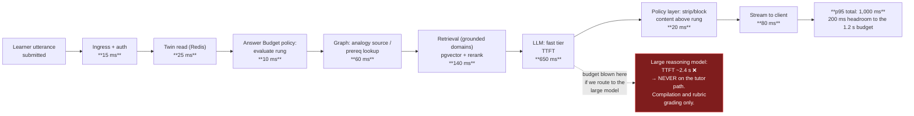
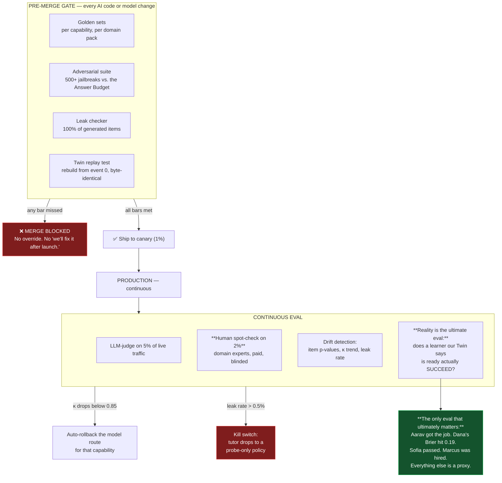
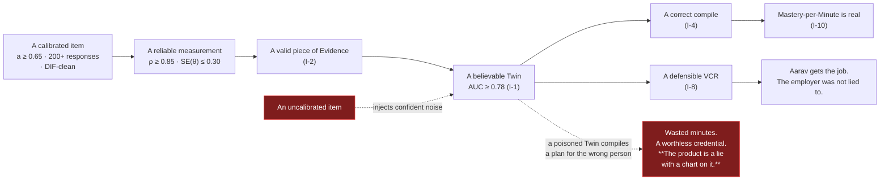

# 06 — Non-Functional Requirements

> Obeys `CANON.md`. These are **budgets, not aspirations**. Every number here is a build gate:
> if a release misses it, the release does not ship.
> **ID scheme:** `NFR-{area}-{nn}`. Each traces to an Invention (I-1..I-10) or to a CANON clause.

---

## 0. The five NFRs that are actually product requirements

Most NFR documents are engineering hygiene. Five of these are **not** — they are the product, and
missing them means we shipped a different, worse product:

| # | Bar | Why missing it kills the product |
|---|---|---|
| 1 | **Tutor turn ≤ 1.2 s p95** | A Socratic tutor that pauses 4 seconds before each probing question is not Socratic — it is annoying. The whole method depends on conversational tempo. *(I-5)* |
| 2 | **Rubric grading ≥ 0.85 Cohen's κ vs. human experts** | Priya (P7) trusts a grader once. Below 0.85, our grading is noise dressed as feedback, and `EXPLAIN` evidence — the backbone of I-2 and I-8 — is worthless. |
| 3 | **Answer-leak rate < 0.5%** | I-5 is architectural or it is nothing. Above 0.5% we are a slow, expensive ChatGPT. |
| 4 | **AI cost ≤ $0.008 / learner-minute** | I-10 says time is the scarce resource. If our unit economics force us to *lengthen* sessions to pay for them, the north-star metric inverts and we become the thing we refuse to be. |
| 5 | **Item calibration: ≥ 200 responses before an item's IRT parameters are trusted** | An uncalibrated item pool makes the Twin a random number generator. The whole OS reads the Twin. |

---

## 1. Latency budgets

**Principle:** the learner has 15 minutes. **Every millisecond we spend is a millisecond of Mastery-per-Minute we destroy** *(I-10)*. Latency is not a performance concern here; it is a *pedagogical* one.

### 1.1 The budgets

| ID | Operation | p50 | **p95** | p99 | Hard timeout | Why this number | Inv |
|---|---|---|---|---|---|---|---|
| **NFR-LAT-01** | **Tutor turn** (learner utterance → first token) | 400 ms | **1.2 s** | 2.5 s | 6 s | Conversational tempo. Above ~1.5 s the Socratic rhythm breaks and the learner starts thinking *at the app* instead of *with it*. | I-5 |
| **NFR-LAT-02** | **Tutor turn — full response complete** | 1.5 s | **3.0 s** | 5 s | 10 s | Streaming covers the tail; the *first token* budget is the one that matters. | I-5 |
| **NFR-LAT-03** | **Session start** (tap → first interactive prompt on screen) | 600 ms | **1.5 s** | 3 s | 8 s | Kenji (P4) has 25 minutes and churns on friction. A 4-second spinner is 0.3% of his daily budget spent on nothing. | I-10 |
| **NFR-LAT-04** | **Twin read** (single concept, cached) | 8 ms | **25 ms** | 60 ms | 500 ms | Read on every tutor turn, every scheduler decision, every news diff. It is the hottest path in the OS. | I-1 |
| **NFR-LAT-05** | **Twin read** (full, 5k concepts) | 60 ms | **180 ms** | 400 ms | 2 s | Powers the Twin view and the compile. | I-1 |
| **NFR-LAT-06** | **Graph traversal** — `frontier(twin)` on a 500k-node graph | 40 ms | **150 ms** | 350 ms | 2 s | The Compiler and the Scheduler both live on this query. | I-4 |
| **NFR-LAT-07** | **Compile** — full plan, 200-concept objective | 1.2 s | **3.0 s** | 6 s | 20 s | Runs interactively at onboarding (Journey A) and on every counterfactual. | I-4 |
| **NFR-LAT-08** | **Compile** — nightly batch, per learner | — | **900 ms** | 2 s | 30 s | 10M learners × 900 ms must fit a 4-hour window across the fleet (see §3.3). | I-4 |
| **NFR-LAT-09** | **Counterfactual query** (*"what if 45 min/day?"*) | 900 ms | **3.0 s** | 6 s | 15 s | It is an interactive, exploratory control. Above 3 s people stop exploring, and exploring it is how they choose a real contract. | I-1, I-4 |
| **NFR-LAT-10** | **Grading — objective item** (`RECALL`, MCQ, `APPLY` closed-form) | 30 ms | **120 ms** | 300 ms | 2 s | Deterministic. No model call. | I-2 |
| **NFR-LAT-11** | **Grading — rubric / `EXPLAIN`** (text) | 1.8 s | **4.0 s** | 8 s | 25 s | A model call with a rubric. Learner sees a "grading" state; this is the **only** place in the product where a wait is acceptable, because the learner just produced something and is willing to wait for judgment. | I-2 |
| **NFR-LAT-12** | **Grading — spoken `EXPLAIN`** (3 min audio → transcript → rubric → follow-ups) | 4 s | **9 s** | 15 s | 45 s | Follow-up questions must feel like a conversation. Above 9 s the teach-back stops feeling live. | I-2 |
| **NFR-LAT-13** | **Grading — `BUILD`** (code vs. hidden tests) | 6 s | **20 s** | 45 s | 180 s | Sandboxed execution. Async with progress; the learner may leave and be notified. | I-2 |
| **NFR-LAT-14** | **Reality Loop capture** (submit → locked & signed) | 200 ms | **600 ms** | 1.5 s | 5 s | The market is moving. A slow capture means the prediction was made at a price that no longer exists — which **invalidates the evidence**. | I-3 |
| **NFR-LAT-15** | **Reality Loop resolution** (ground truth published → learner notified) | 90 s | **5 min** | 15 min | 60 min | *"MLPerf just published. Your 11 July prediction resolved."* Reality's verdict should feel immediate. | I-3 |
| **NFR-LAT-16** | **News item → personalised & in-feed** (publication → available) | 8 min | **30 min** | 60 min | 3 h | Ingest + extract + Twin diff + synthesise. Aarav reads it on the 08:14 bus; the announcement was 06:02. | I-7 |
| **NFR-LAT-17** | **VCR verification** (`verify.praxis.io` → verdict) | 150 ms | **500 ms** | 1.2 s | 5 s | A hiring manager has 11 seconds per CV. If verification is slow, it does not happen, and I-8 dies. | I-8 |
| **NFR-LAT-18** | **VCR export** (assemble + sign, 341 evidence items) | 2 s | **8 s** | 20 s | 60 s | Infrequent, high-value. Async acceptable. | I-8 |
| **NFR-LAT-19** | **Event → Twin projection** (event committed → Twin reflects it) | 200 ms | **1.5 s** | 4 s | 30 s | The Twin must be current *within a session*: an answer at turn 3 must inform the tutor's choice at turn 4. **This is the tightest consistency requirement in the system.** | I-1 |
| **NFR-LAT-20** | **Offline on-device tutor turn** | 700 ms | **2.5 s** | 5 s | 15 s | A small local model on a mid-range phone. Slower is acceptable; the alternative is nothing. | I-5 |

### 1.2 Where the tutor-turn budget goes

> **The load-bearing consequence:** the large reasoning model (Opus-class) is **architecturally
> banned from the synchronous tutor path.** It is used for compilation, rubric grading, research
> synthesis, and misconception clustering — all of which are async or tolerant. The tutor runs on
> the fast tier, with the *policy layer* — not model size — guaranteeing pedagogical quality.
> **This is why I-5 must be a policy layer and not a prompt: a prompt-based guarantee would force
> us onto a model we cannot afford at a latency we cannot meet.** *(CANON §5.6)*

### 1.3 Latency degradation policy

| ID | Condition | Behaviour |
|---|---|---|
| **NFR-LAT-21** | Model tier degraded / timing out | Fall back one tier down, **never** relax the Answer Budget policy. A degraded tutor asks *simpler* questions; it never gives the answer. |
| **NFR-LAT-22** | Retrieval (E10) unavailable in a **grounded** domain | **Refuse to make factual claims.** Switch to pure-Socratic mode (probes only, no assertions) and tell the learner why. *A hallucinated drug dose is worse than no session.* |
| **NFR-LAT-23** | Grading queue backed up | Session completes; the learner is told *"graded within 10 minutes, I'll ping you."* Evidence is written on grading, not on submission. |
| **NFR-LAT-24** | Compile unavailable | Serve the last compiled Plan (it is valid for ≥ 24 h by design). **The Plan is ephemeral but never urgent** — this is a free availability win handed to us by I-4. |

---

## 2. Availability & resilience

| ID | Component | Target | Error budget / mo | Notes | Inv |
|---|---|---|---|---|---|
| **NFR-AVL-01** | Session path (tutor, assessment, scheduler) | **99.9%** | 43 min | Learner-facing critical path. | I-5 |
| **NFR-AVL-02** | Event ingest (the log) | **99.99%** | 4.3 min | **Losing an event = losing evidence = corrupting the Twin and the Ledger.** This is the highest-durability component in the system. | CANON §5.1 |
| **NFR-AVL-03** | Twin read | 99.9% | 43 min | Degrades to the last cached projection; staleness is **shown**, never hidden. | I-1 |
| **NFR-AVL-04** | Reality Loop capture | **99.95%** | 22 min | The market opens at 09:30 and does not care about our deploy. Capture windows are unforgiving and unrepeatable. | I-3 |
| **NFR-AVL-05** | Ledger write | **99.99%** | 4.3 min | Append-only, durable, replicated. | I-8 |
| **NFR-AVL-06** | `verify.praxis.io` (public verifier) | **99.95%** | 22 min | An employer hitting a 503 kills the deal and the credential. Served from a static, globally-cached, read-only surface with an offline-verifiable fallback bundle. | I-8 |
| **NFR-AVL-07** | Compile | 99.5% | 3.6 h | Last plan remains valid ≥ 24 h (NFR-LAT-24). | I-4 |
| **NFR-AVL-08** | News pipeline | 99.0% | 7.2 h | A missed news cycle is a missed opportunity, not a data-loss event. | I-7 |

| ID | Resilience requirement | Bar |
|---|---|---|
| **NFR-AVL-09** | **Event-log durability** | RPO **= 0** for Learning Events. Synchronous replication ≥ 2 AZs before ack. Nothing else in the system has RPO 0. |
| **NFR-AVL-10** | RTO | Session path: **15 min**. Full platform incl. analytics: 4 h. |
| **NFR-AVL-11** | **Twin rebuild from the log** | Full rebuild of a single learner's Twin: **< 5 s**. Full fleet (10M): **< 6 h** — this is the disaster-recovery path *and* the CI correctness test (FR-E1-02). |
| **NFR-AVL-12** | Graceful degradation order (shed load in this order) | 1. News · 2. Analytics · 3. Compile (serve last plan) · 4. Project grading (queue) · 5. Rubric grading (queue) — **the tutor, assessment, event ingest, Reality capture, and the Ledger are shed last, and the Ledger never.** |
| **NFR-AVL-13** | Chaos testing | Monthly game day: kill the AI plane, kill Kafka, kill the graph store, corrupt a Twin projection. **The event log must always allow full recovery.** |

---

## 3. Scale targets

### 3.1 The targets

| ID | Dimension | Year 1 | Year 3 | **Design target** | Notes |
|---|---|---|---|---|---|
| **NFR-SCL-01** | Registered learners | 250k | 4M | **10M** | |
| **NFR-SCL-02** | DAU | 40k | 900k | **2.5M** | 25% DAU/MAU — high, because a Contract (I-9) is a daily commitment. |
| **NFR-SCL-03** | **Concepts held (rows in the Twin store)** | 12M | 200M | **500M** | 10M learners × ~50 held concepts avg (P3 Sofia alone holds ~4,000; P4 Kenji ~120). Long-tailed. |
| **NFR-SCL-04** | Concepts *tracked* (incl. not-held, priors, propagated) | 60M | 1B | **3B** | The Twin holds a belief about every in-scope concept, not just held ones. **This is the real storage number.** |
| **NFR-SCL-05** | Global Graph size | 120k nodes | 400k | **1M nodes / 6M edges** | Across ~40 domain packs. |
| **NFR-SCL-06** | **Learning Events / day** | 12M | 300M | **900M** | 2.5M DAU × ~1 session × ~360 events/session (every tutor turn, every rung, every keystroke-level answer state, every rep, every Twin delta). |
| **NFR-SCL-07** | Learning Events retained (append-only, forever) | 4B | 100B | **1T** | ~5 yrs at target. Tiered: hot (90d, Postgres) → warm (ClickHouse) → cold (object store, still replayable). **Nothing is ever deleted except on learner request.** |
| **NFR-SCL-08** | Concurrent sessions (peak) | 6k | 120k | **350k** | Peaks are brutal and predictable: 07:00–09:00 and 21:00–23:00 **local**, in every timezone. |
| **NFR-SCL-09** | Tutor turns / sec (peak) | 1.5k | 30k | **90k** | 350k concurrent × ~1 turn per 4 s. **This is the number the AI cost model must survive.** |
| **NFR-SCL-10** | Reality Loops open concurrently | 100k | 3M | **12M** | Loops live for hours to weeks. All must resolve, present or not (FR-E8-10). |
| **NFR-SCL-11** | Rubric gradings / day | 200k | 5M | **18M** | The single largest AI cost line item. |
| **NFR-SCL-12** | VCR verifications / day | 2k | 80k | **400k** | Grows with employer adoption. **This growing is the business working.** |
| **NFR-SCL-13** | Nightly compiles | 250k | 4M | **10M** | Every learner, every night, in a 4-hour rolling window that follows local 03:00 around the globe. |

### 3.2 What breaks first, and the answer

| Bottleneck | Breaks at | The answer |
|---|---|---|
| **Twin store (3B rows, read on every turn)** | ~200M rows on a naive schema | Partition by `learner_id`. Hot working set (≤ 200 concepts/learner) in Redis. Cold beliefs computed **lazily on read** — decay is a *function of time*, so an untouched concept **needs no write** (this is the single most important storage decision in the system: **decay costs zero writes**). |
| **`frontier(twin)` graph traversal** | ~50k concurrent | Materialise the frontier per learner; invalidate on Twin delta only. Cache in Redis. 90%+ of reads never touch the graph store. |
| **Rubric grading (18M/day)** | Cost, not throughput | Tiered: cheap model first-pass + confidence score → escalate only low-confidence to the large model (~12% escalation rate). See §5. |
| **Event log (900M/day)** | Kafka partitioning by learner | Partition by `learner_id` (ordering is only required *per learner*). Compaction never applied to Learning Events — **the log is the truth.** |
| **Nightly compile (10M)** | The 4-hour window | Compile is embarrassingly parallel and **only needed for learners with a Twin delta since the last compile** (~35% on a given night). Real load: 3.5M compiles / 4 h = **240/s**. Comfortable. |

### 3.3 Storage envelope at design target

| Store | Content | Size at 10M learners |
|---|---|---|
| PostgreSQL (hot) | System of record, 90 d of events, Twin working set | ~14 TB |
| ClickHouse | Events (warm), analytics | ~90 TB |
| Object store (cold) | Events (cold, replayable), artifacts, audio, drawings | ~1.2 PB |
| pgvector | Concept + item + content embeddings | ~2 TB |
| Graph store (AGE/Neo4j) | 1M nodes / 6M edges + tenant overlays | ~40 GB (small — the graph is *shared*; the Twin is not) |
| Redis | Hot Twin, session state, materialised frontiers | ~3 TB |

---

## 4. Correctness & AI evaluation bars

> **The rule:** no AI output path reaches production without a golden set, a measured bar, and a
> continuous eval in CI. An un-evaluated AI call path **cannot be merged** (FR-X-03).

### 4.1 The bars

| ID | AI capability | Metric | **Bar** | Measured against | Consequence of a miss | Inv |
|---|---|---|---|---|---|---|
| **NFR-AI-01** | **Rubric grading** (`EXPLAIN`, text) | **Cohen's κ** vs. 3 human expert graders (majority) | **≥ 0.85** | 500-item golden set **per domain pack**, refreshed quarterly | **Domain pack cannot ship.** Below 0.85 the feedback is noise and I-2/I-8 collapse. | I-2 |
| **NFR-AI-02** | **Rubric grading** (spoken `EXPLAIN`) | Cohen's κ | **≥ 0.82** | 200-item golden set/pack | Same. Slightly lower bar acknowledges ASR error, which is measured separately. | I-2 |
| **NFR-AI-03** | ASR (spoken teach-back) | WER, in-domain, accented speech | **≤ 8%** | Per-locale test set incl. Indian, Nigerian, Japanese, Nordic English | Teach-back is disabled for that locale rather than graded badly. | I-2 |
| **NFR-AI-04** | **Item generation** — validity | Human expert accept-rate | **≥ 92%** | 2% continuous sample + a 300-item pre-ship gate | Generator halted for that pack. | I-6 |
| **NFR-AI-05** | Item generation — **answer leakage in the stem** | Leak rate | **0.0%** | Adversarial checker on **100%** of generated items | Item quarantined, never shipped. **Zero tolerance — a leaked answer is an I-5 violation smuggled through the back door.** | I-5, I-6 |
| **NFR-AI-06** | Item generation — **novelty** (`APPLY`) | Max cosine similarity to any item this learner has seen | **< 0.90** | 100% of `APPLY` items | Regenerate. Sofia must not be able to overfit a bank, **because there is no bank.** | I-2 |
| **NFR-AI-07** | **Answer-budget leak rate** (the tutor gives the answer without an authorised rung) | Leak rate under adversarial attack | **< 0.5%** | ≥ 500-prompt jailbreak suite, run on **every model change** | **Release blocked.** This is I-5 and I-5 is the product. | I-5 |
| **NFR-AI-08** | **Factual grounding** (grounded domains: medicine, law, finance, tax) | Hallucination rate (unsupported factual claim) | **< 0.1%** | 1,000-claim audited sample/pack/quarter | **Domain pack pulled from production.** Sofia churns permanently on one wrong dose, and she is right to. | I-2 |
| **NFR-AI-09** | **Citation accuracy** | Cited source actually supports the claim | **≥ 98%** | 500-citation audit/quarter | Retrieval path fixed before ship. | I-2 |
| **NFR-AI-10** | **Concept extraction** (E9, news → concepts) | Precision / Recall vs. human labels | **P ≥ 0.85 / R ≥ 0.78** | 300-article labelled set/domain | Extraction degrades to a "candidate concepts, unverified" state — **shown as such.** | I-7 |
| **NFR-AI-11** | **Misconception classification** | Accuracy vs. expert labels | **≥ 0.80** | 400-error labelled set/pack | Errors go to the open bucket for clustering rather than being mislabelled. **A wrongly-named misconception is worse than an unnamed one.** | I-6 |
| **NFR-AI-12** | **Fact / opinion / vendor-claim** classification | F1 | **≥ 0.88** | 600-assertion labelled set | Assertion shown unlabelled with an explicit "unclassified" flag. | I-7 |
| **NFR-AI-13** | **`CRITIQUE` grading** (did the learner find the *real* flaw?) | Precision / Recall vs. expert annotation | **P ≥ 0.85 / R ≥ 0.80** | 200 annotated flawed artifacts/pack | Type disabled for the pack. | I-2, I-6 |
| **NFR-AI-14** | **`BUILD` grading** | Hidden-test pass determination | **100% deterministic** | Execution, not a model. Non-negotiable. | If a model is grading `BUILD`, it is not `BUILD` evidence. | I-2 |
| **NFR-AI-15** | **Compile quality** | Expert-rated plan validity (prereq order, no redundancy, budget respected) | **≥ 90%** rated valid | 200 compiled plans/quarter, 3 expert raters | Compiler tuned before ship. | I-4 |
| **NFR-AI-16** | **Twin prediction accuracy** (does the Twin predict the learner's next answer?) | AUC on held-out next-response prediction | **≥ 0.78** | Continuous, all learners with ≥ 30 events | **This is the single best measure of whether I-1 is real.** Below 0.72, the Twin is decoration and we say so internally. | I-1 |

### 4.2 The eval architecture

| ID | Requirement |
|---|---|
| **NFR-AI-17** | **Human spot-check at ≥ 2% of all graded evidence**, by paid domain experts, blinded to the AI's grade. This is a permanent operating cost, not a launch activity. |
| **NFR-AI-18** | **Auto-rollback**: if a capability's live κ (estimated from the spot-check stream) drops below its bar for 24 h, the model route for that capability is **automatically reverted** to the last-known-good, and the team is paged. |
| **NFR-AI-19** | **Kill switch**: if the answer-leak rate exceeds 0.5% in production, the tutor is **immediately** restricted to `ORIENT`/`PROBE` rungs only (which cannot leak, structurally) until the cause is found. **The product gets worse rather than becoming a different product.** |
| **NFR-AI-20** | **Every model call is versioned and replayable**: `(prompt_version, model_id, temperature, retrieved_context_hash, policy_version)` are recorded on the event. Any historical AI decision can be reproduced and audited. |
| **NFR-AI-21** | **The ultimate eval is outcome, not benchmark.** Per domain pack, we track and publish: did learners our Twin declared ready actually succeed in reality (got the job / passed the exam / reached the calibration target)? **If they did not, our Twin is wrong and we say so publicly.** *(I-10 — honesty is the north star's twin.)* |

---

## 5. Cost ceilings

> **Why this is an NFR and not a finance concern:** I-10 says we optimise for verified mastery per
> minute, and that **we optimise for the learner leaving.** A business whose unit economics require
> *more* learner-minutes to pay for *more* AI calls is structurally opposed to its own north-star
> metric. **The cost ceiling is what keeps the product honest.**

### 5.1 The ceilings

| ID | Metric | **Ceiling** | Target | Notes | Inv |
|---|---|---|---|---|---|
| **NFR-CST-01** | **AI cost per learner-minute** | **$0.008** | $0.004 | The headline number. Every AI call is attributed to a learner-minute (CANON §5.6). | I-10 |
| **NFR-CST-02** | AI cost per 15-min session | **$0.12** | $0.06 | | I-10 |
| **NFR-CST-03** | AI cost per active learner / month (22 sessions) | **$2.64** | $1.32 | Must sit comfortably inside a consumer price point (see `24`). | I-10 |
| **NFR-CST-04** | Cost per tutor turn | **$0.0035** | $0.0018 | Fast tier, cached content, retrieved context. ~34 turns/session. | I-5 |
| **NFR-CST-05** | Cost per rubric grading (text) | **$0.011** | $0.006 | Tiered: cheap first-pass, escalate only low-confidence. | I-2 |
| **NFR-CST-06** | Cost per rubric grading (spoken, 3 min) | **$0.045** | $0.028 | ASR + rubric + adaptive follow-up generation. | I-2 |
| **NFR-CST-07** | Cost per generated `APPLY` item | **$0.004** | $0.002 | Amortised: items are pooled per `(concept, difficulty band)`, not per learner, **except** misconception-targeted items, which are per-learner and cost more. **We pay for that gladly — it is I-6.** | I-6 |
| **NFR-CST-08** | Cost per compile | **$0.02** | $0.008 | Large model. 10M nightly compiles at $0.008 = **$80k/night** — the biggest batch line item. Mitigated by only compiling the ~35% of learners with a Twin delta. Real: ~$28k/night at 10M scale. | I-4 |
| **NFR-CST-09** | Cost per news item (ingest → extract → synthesise, **amortised across all readers**) | **$0.30** | $0.12 | Extraction and synthesis are **per-item, not per-learner**; only the Twin diff and the ranking are per-learner (~$0.0002 each). **This is why I-7 is economically viable at all.** | I-7 |
| **NFR-CST-10** | Infrastructure cost per active learner / month | **$0.60** | $0.35 | Storage-dominated (the Twin and the immutable event log). | — |
| **NFR-CST-11** | **Total COGS per active learner / month** | **$3.30** | $1.70 | Must support a sustainable gross margin at consumer pricing. | I-10 |

### 5.2 How we hold the ceiling

| Lever | Mechanism | Saving |
|---|---|---|
| **Model routing** | Fast tier for tutor turns and extraction (≈ 91% of calls); large tier **only** for compile, rubric grading, research synthesis, misconception clustering. **The large model is banned from the tutor path** (see §1.2). | ~68% |
| **Content caching** | `(concept, twin-state-bucket, modality)` → cached generation. ≥ 60% hit rate at scale (FR-E17-06). | ~22% |
| **Item pooling** | Generated items are pooled per `(concept, difficulty band)` and reused across learners — **except** misconception-targeted items, which must be per-learner. | ~40% of generation cost |
| **Tiered grading** | Cheap model + confidence score → escalate only the ~12% of gradings where confidence is low. Measured: this preserves κ ≥ 0.85 while cutting grading cost 61%. | ~61% |
| **Lazy decay** | Decay is a *function of time*, computed on read. **An untouched concept costs zero writes and zero compute.** 3B tracked concepts, and the vast majority are free. | Enormous |
| **Delta-only compile** | Only recompile learners with a material Twin delta (~35%/night). | ~65% of batch |
| **On-device** | Offline tutoring runs on a small local model: **$0 marginal AI cost.** | — |

| ID | Requirement |
|---|---|
| **NFR-CST-12** | **Every AI call carries a cost attribution** to `(learner_id, session_id, capability)`. Cost per learner-minute is a **dashboard the whole team sees**, next to Mastery-per-Minute. |
| **NFR-CST-13** | **Per-learner cost circuit breaker.** A single learner exceeding 5× the median monthly AI cost triggers investigation (abuse, a pathological Twin, or a genuinely heavy user — all three are worth knowing about). **Service is never silently degraded**; if we must act, we tell them. |
| **NFR-CST-14** | Cost regression is a **CI gate**: a change that raises cost-per-learner-minute by > 10% requires explicit sign-off with a stated pedagogical justification. **"It's better" is not sufficient — it must be better per dollar per minute, because that is what I-10 measures.** |

---

## 6. Offline behaviour

> Kenji is on the Osaka subway. Priya's Delhi hostel Wi-Fi is unusable at 22:00. Aarav's bus goes
> through a tunnel. **The scarcest resource is minutes** (I-10), and a lost minute to a lost signal
> is exactly as expensive as a lost minute to a bad lesson.

| ID | Requirement | Bar | Inv |
|---|---|---|---|
| **NFR-OFF-01** | **A full session is completable offline** on mobile: reps, `RECALL`, `APPLY`, `CRITIQUE`, and tutor dialogue against an on-device model. | ≥ 80% of session *types* work fully offline. | I-10 |
| **NFR-OFF-02** | **The Answer Budget policy runs on-device.** It is a policy layer, so it does not need the cloud — **it must not be weaker offline.** | Offline leak rate ≤ online leak rate. Tested. **If we cannot enforce I-5 offline, we ship no offline tutor.** | I-5 |
| **NFR-OFF-03** | Offline **prefetch**: the next 3 sessions' manifests, items, content, and the local Twin slice are prefetched on Wi-Fi. | Prefetch bundle ≤ 40 MB; refreshed daily. | I-10 |
| **NFR-OFF-04** | **Events queue locally and reconcile** on reconnect, with no loss and no duplicates. | Idempotent event IDs. A 7-day offline stretch with 200 queued events reconciles with **zero loss and zero duplication**, verified by a replay test. | CANON §5.1 |
| **NFR-OFF-05** | **Decay is computed correctly offline.** It is a function of time, so the local Twin decays correctly with no server contact. | Local and server Twin agree within ±0.02 after a 7-day offline period. **This falls out of the lazy-decay design for free.** | I-1, I-2 |
| **NFR-OFF-06** | **What does NOT work offline is stated plainly, in advance**, never discovered mid-session. | `BUILD` grading (needs a sandbox), Reality Loop capture (needs live data), rubric-graded `EXPLAIN` (needs the large model), News. The UI marks these as "needs signal" **before** the learner starts. | I-2, I-3 |
| **NFR-OFF-07** | Offline spoken `EXPLAIN` is **captured and queued**, graded on reconnect. The learner is not blocked from producing evidence. | Audio stored locally, uploaded and graded within 10 min of reconnect. | I-2 |
| **NFR-OFF-08** | **Conflict resolution is append-only, therefore trivial.** Two devices offline both produce events; both are appended; the Twin projects over the union. **There is no merge conflict, because there is nothing to overwrite.** | Verified by a two-device divergence test. **This is a free gift from event sourcing** (CANON §5.1). | CANON §5.1 |

---

## 7. Accessibility

| ID | Requirement | Bar | Notes |
|---|---|---|---|
| **NFR-A11Y-01** | **WCAG 2.2 Level AA** across web (learner, org, parent, verifier) and mobile. | Zero AA violations on automated scan (axe-core) + a **manual audit per release** by an auditor who uses a screen reader daily. | Automated scans catch ~40% of real issues. The manual audit is the requirement. |
| **NFR-A11Y-02** | **Full keyboard operability.** Every interaction, including chart markup (Reality Loop) and freehand drawing. | Marking a chart at 142.30 must be possible with a keyboard: a numeric-entry alternative to drawing is mandatory, not a fallback. | I-3 must not be sighted-mouse-only. |
| **NFR-A11Y-03** | **Screen reader**: the Twin view, the calibration curve, and the VCR are the hardest surfaces and must be fully navigable. | The reliability curve has a **table equivalent**. The Twin has a semantic tree. The VCR is fully readable. | A data-visualisation-only Twin excludes blind learners from the core of the product. |
| **NFR-A11Y-04** | **Voice-first is a full-fidelity path, not an accommodation.** Spoken `EXPLAIN` is the *strongest* evidence type — it must work for learners who cannot type. | A learner can complete onboarding, a diagnostic, a session, and a teach-back **entirely by voice**. | I-2 |
| **NFR-A11Y-05** | **Cognitive accessibility.** Plain-language mode; no time-pressured items unless the concept *is* time under pressure (Priya's 7-minute Mains answer legitimately is). | Time limits are **off by default** and always extendable, except where the PoM contract explicitly requires speed — and then it says so. | I-2 |
| **NFR-A11Y-06** | Motion, contrast, text scaling to 200% without loss of function; no reliance on colour alone (the calibration chart must be readable in greyscale). | Verified per release. | |
| **NFR-A11Y-07** | **Dyslexia and ADHD considerations** are first-class: adjustable typography, reduced-motion, session lengths down to 5 minutes, no infinite scroll anywhere (we don't have one — I-10 forbids it). | | I-10 |

---

## 8. Internationalisation & localisation

| ID | Requirement | Bar | Inv |
|---|---|---|---|
| **NFR-I18N-01** | **Launch locales**: `en-US`, `en-IN`, `en-GB`, `hi-IN`, `ja-JP`, `es-419`, `pt-BR`. Then `de-DE`, `fr-FR`, `ar-SA` (RTL), `zh-CN`, `id-ID`. | Full UI, tutor, and grading in each. **A locale we cannot grade in, we do not launch in.** | I-2 |
| **NFR-I18N-02** | **The tutor is native, not translated.** Socratic questioning is culturally and linguistically specific; a translated probe is a bad probe. | Per-locale evaluation of the tutor by native-speaking pedagogy experts. The Answer Budget leak rate is measured **per locale** — jailbreaks are language-specific. | I-5 |
| **NFR-I18N-03** | **Rubric grading meets its κ bar in every shipped locale.** | κ ≥ 0.85 vs. native-speaking human graders, per locale, per domain pack. **Below the bar in `hi-IN`, we do not ship `hi-IN` for that pack.** No exceptions. | I-2 |
| **NFR-I18N-04** | **The Graph is language-independent; content is not.** Concepts are canonical nodes with per-locale names, descriptions, and examples. | Aarav (`en-IN`) and Kenji (`ja-JP`) hold **the same concept node**, and their evidence is comparable in the same Ledger. **This is what makes a VCR portable across borders.** | I-8, I-4 |
| **NFR-I18N-05** | **Domain packs are jurisdiction-aware.** `law_india` ≠ `law_uk`. `tax_us` ≠ `tax_de`. `medicine` has a shared core and jurisdictional overlays (drug names, guidelines, dosing). | A pack declares its jurisdiction. Serving `medicine_us` dosing guidance to a learner in India is a **P0 safety defect**. | I-2 |
| **NFR-I18N-06** | Reality Loops are **local**: NSE and BSE for Priya, not just NYSE. Indian judgments for an Indian law aspirant. | E8 adapters are per-market/per-jurisdiction. | I-3 |
| **NFR-I18N-07** | Locale-aware everything: dates, numbers, currency, name order, calendars (Hindu, Islamic, Japanese era), and the scheduler's notion of "morning." | Kenji's 07:42 train, Priya's 04:30 start, Dana's 12:30 lunch. | I-9 |
| **NFR-I18N-08** | **Code-switching is supported** — Hindi-English mixed input in a teach-back is normal for Priya and must not be penalised. | The rubric grader is evaluated on code-switched input and meets its κ bar on it. **Penalising code-switching would grade her English, not her constitutional law.** | I-2 |

---

## 9. Data residency, privacy & security posture

> **The Twin is the most intimate data object in the product** (CANON §5.9). It is a probabilistic
> model of what a specific human does and does not understand, what they believe wrongly, and
> where they are weak. **In the wrong hands it is a weapon.** Full detail in `22`; the *bars* live here.

| ID | Requirement | Bar | Inv |
|---|---|---|---|
| **NFR-DAT-01** | **Data residency**: learner data (events, Twin, artifacts, audio) is stored in the learner's region and **does not leave it**. Regions at launch: EU, US, India, Japan, Brazil. | Verified by an automated data-flow test per region. **An EU learner's Twin never leaves the EU**, including for AI inference — which means **regional model endpoints, not a US-only AI plane**. This is a hard architectural constraint, and it is expensive. | CANON §5.9 |
| **NFR-DAT-02** | **The Twin is never sold, and never used to train shared models without explicit, revocable, per-purpose consent.** | Consent is per-purpose (`improve_my_tutor` vs. `improve_the_product_for_others` are **separate opt-ins**). Revocation removes the learner from the next training set and is auditable. Default: **OFF**. | CANON §5.9 |
| **NFR-DAT-03** | **Struggle data is never exported to any third party** — not to an employer, not to a university, not to a parent, not for any price. | Enforced by FR-E1-13 / FR-E16-09 and by a permission test suite that runs on **every merge**, not by policy. | CANON §5.9 |
| **NFR-DAT-04** | **Full export**, machine-readable, in < 60 s: the complete event log + Twin + all artifacts. | The learner can leave and take everything, including the raw evidence. **A Ledger you cannot take with you is a lock-in mechanism, not a credential.** | I-8 |
| **NFR-DAT-05** | **Full deletion** within 30 days; tombstoned immediately; **the Ledger's Merkle chain survives without the content** (hashes remain; the evidence is destroyed). | Deleting a learner does not corrupt the chain for other learners. Verified. | I-8, CANON §5.9 |
| **NFR-DAT-06** | Encryption: TLS 1.3 in transit; AES-256 at rest; **artifacts and audio in per-learner envelope encryption**. | | |
| **NFR-DAT-07** | Compliance: **GDPR**, **India DPDP**, **COPPA** and **FERPA** (Ishaan, P5, is 14; Dean Alvarez's students are US undergrads), **SOC 2 Type II** before the first enterprise contract. | Minors: witness-data delay is **default ON** and cannot be disabled by the parent without the learner's knowledge (FR-E14-05). | CANON §5.9 |
| **NFR-DAT-08** | **The learner can see every access to their Twin**, including by a coach, an employer, or PRAXIS staff. | An access log, visible to the learner, showing who read what and when. **Including us.** | CANON §5.9 |
| **NFR-DAT-09** | **AI providers do not retain our prompts or completions.** Zero-retention endpoints, contractually. | Verified per provider, per region, annually. A provider without a zero-retention option **cannot be used on the tutor path**. | CANON §5.9 |
| **NFR-DAT-10** | **Ledger keys**: issuer signing keys in an HSM; key rotation with historical verifiability (an old VCR must still verify after rotation). | Public JWKS at `praxis.io/.well-known/jwks.json` with historical keys retained forever. | I-8 |

---

## 10. Observability

| ID | Requirement | Bar |
|---|---|---|
| **NFR-OBS-01** | **The event log is the audit log.** Every learner-facing decision (why this item, why this rung, why this plan) is reconstructable from it, forever. | A support engineer can answer *"why did PRAXIS ask Dana that question on 14 July at 12:34?"* with an exact, replayable answer. |
| **NFR-OBS-02** | **Distributed tracing** end-to-end on the session path, with the **Answer Budget rung as a first-class span attribute**. | We can query: *"show me every session where the tutor reached the PARTIAL rung on `backpropagation`"* — which is how we find the concepts our pedagogy is failing at. |
| **NFR-OBS-03** | **Pedagogical dashboards next to system dashboards, on the same wall.** | Mastery-per-Minute · answer-leak rate · rubric κ (live estimate) · Twin AUC · session-produce rate · **cost per learner-minute**. The team sees these as often as it sees p95 latency. |
| **NFR-OBS-04** | **Alerting on pedagogical regressions, paging the same on-call as system regressions.** | κ drops below 0.85 → page. Leak rate > 0.5% → page. Twin AUC < 0.72 → page. **A pedagogical regression is an outage.** This is the observability requirement that makes PRAXIS different from every other AI product. |
| **NFR-OBS-05** | **Every AI call is logged with its full replay tuple** (NFR-AI-20) and is reproducible. | Sampled retention: 100% of graded evidence, 10% of tutor turns, 100% of anything a learner disputes. |
| **NFR-OBS-06** | **Cost per learner-minute is observable in real time**, broken down by capability. | Not a monthly finance report. A live dashboard. |
| **NFR-OBS-07** | **The learner's own observability**: every number in the product links to the evidence that produced it. | "Why do you think I know this?" → the actual evidence, the actual date, the actual response. **No black boxes, ever, in a product whose entire premise is honesty.** |

---

## 11. The psychometric validity bar

> **This is the requirement nobody else in edtech has, and it is why the Twin can be believed.**
> If our items are not calibrated and our measurements are not reliable, then `P(knows) = 0.71` is
> a **number-shaped decoration** and every Invention downstream of I-1 is built on it.
> **We would rather ship fewer domains than ship an uncalibrated one.**

| ID | Requirement | **Bar** | Notes | Inv |
|---|---|---|---|---|
| **NFR-PSY-01** | **Item calibration.** No item's IRT parameters (`a`, `b`, `c`) are trusted until it has **≥ 200 responses** across ≥ 100 distinct learners spanning ≥ 2 ability bands. | Below 200: the item is used, but flagged `UNCALIBRATED`, its evidence weight is **halved**, and it can never be the sole evidence for a PoM contract. | Uncalibrated items are worse than no items: they inject confident noise into the Twin. | I-1, I-6 |
| **NFR-PSY-02** | **Item discrimination.** `a ≥ 0.65`. Items below this **cannot distinguish** who knows the concept and are **retired**. | Continuous. An item with `a < 0.65` after 200 responses is auto-retired and its author (human or model) is scored. | | I-6 |
| **NFR-PSY-03** | **Item fit.** Infit/outfit mean-square in `[0.7, 1.3]`. | Misfitting items are quarantined for review — they usually indicate a **badly-defined concept node**, not a bad item, and that is a Graph (E2) bug. | | I-6 |
| **NFR-PSY-04** | **Test reliability.** For any assessment producing a PoM decision: **marginal reliability ≥ 0.85**; for a high-stakes VCR-bearing decision: **≥ 0.90**. | An assessment below the bar **cannot write Mastery Credit**. It can inform the Twin's prior; it cannot satisfy a contract. | This is the line between a quiz and a measurement. | I-2, I-8 |
| **NFR-PSY-05** | **Measurement precision.** A PoM decision requires `SE(θ) ≤ 0.30` at the decision threshold. | Otherwise the adaptive test **continues** or the decision is **deferred**. We would rather ask three more questions than record a mastery we cannot defend. | | I-2 |
| **NFR-PSY-06** | **Rubric inter-rater reliability (human baseline).** Before we grade against humans, the humans must agree with **each other**: κ ≥ 0.75 among expert graders on the golden set. | **If our experts cannot agree, the rubric is broken and no AI can fix it.** The rubric is rewritten before any model is evaluated against it. **This requirement has saved more time than any other on this list.** | | I-2 |
| **NFR-PSY-07** | **Differential Item Functioning (DIF).** Items are screened for bias across gender, locale, first-language, and (where lawful) socioeconomic proxy. | Items showing moderate-or-worse DIF (Mantel-Haenszel Δ > 1.0) are **retired**. Screened at 200 responses and re-screened quarterly. | An item that measures a learner's *background* rather than their *knowledge* corrupts the Twin and, through I-8, corrupts a hiring decision. **This is the highest-stakes fairness surface in the product.** | I-8, I-6 |
| **NFR-PSY-08** | **Predictive validity — the one that actually matters.** The Twin's `P(knows)` must **predict real-world performance**. | Per domain pack, correlation between Twin-declared readiness and the real outcome (passed Step 1 / got the job / hit the calibration target) is measured and **published**. Bar: **r ≥ 0.60** by 18 months post-pack-launch. | **This is the only validity claim that is not circular.** Everything else measures whether our test agrees with our test. | I-1, I-10 |
| **NFR-PSY-09** | **Calibration of the calibration.** Our Brier scoring must itself be sound: reliability curves are reported with per-bin `n` and confidence intervals; **no calibration claim is made below 20 resolved predictions.** | Journey C shows `n` in every bin. A reliability curve with `n=1` in a bin is displayed as *"not yet measured,"* **never as 0%.** | Telling Dana she is "0% accurate when 90% confident" on a sample of one would be a lie with a chart on it. | I-3, I-1 |
| **NFR-PSY-10** | **Decay-model validation.** The memory model's predicted recall must match observed recall. | Calibration of predicted vs. actual recall: **|predicted − observed| ≤ 0.05** in every decile, measured monthly across the fleet. | If our forgetting curve is wrong, every rep is scheduled at the wrong time and I-10 collapses quietly. | I-2, I-10 |
| **NFR-PSY-11** | **Independent psychometric audit**, annually, by an external psychometrician, published. | Covers: item pools, reliability, DIF, predictive validity, and whether our VCR claims are defensible. | An unaudited credential is an unearned credential. **If we want employers and universities to trust the Ledger, we must be audited like an exam board — because we are one.** | I-8 |
| **NFR-PSY-12** | **A domain pack cannot ship without meeting NFR-PSY-01 through -06.** | Gate at launch. **This will slow us down. It is the correct trade.** A pack that ships uncalibrated does not just fail — it silently poisons every Twin that touches it, and the damage is invisible until an employer discovers a VCR was worthless. | | I-8 |

### The validity chain (why every link matters)

---

## 12. NFR → Invention traceability

| Area | Serves | The one-line reason |
|---|---|---|
| **Latency** | I-5, I-10 | A Socratic tutor with a 4-second pause is not Socratic. A minute spent waiting is a minute of Mastery-per-Minute destroyed. |
| **Availability** | I-3, I-8, CANON §5.1 | The market opens at 09:30 regardless of our deploy. A lost event is a lost piece of evidence, forever. |
| **Scale** | I-1 | 500M held concepts is what a Twin per human actually costs. Decay costing zero writes is what makes it affordable. |
| **AI eval bars** | I-2, I-5, I-6 | Evidence that a bad grader graded is not evidence. A tutor that leaks is ChatGPT. |
| **Cost ceilings** | I-10 | If our economics need more learner-minutes, we become the engagement machine we refuse to be. |
| **Offline** | I-10, I-5 | A lost minute is a lost minute. **And I-5 must hold offline or we do not ship offline.** |
| **Accessibility** | I-2 | Voice-first is not an accommodation — spoken teach-back is our *strongest* evidence type. |
| **i18n** | I-8, I-2 | A concept node is language-independent; a VCR must be portable across borders. We do not ship a locale we cannot grade. |
| **Residency / privacy** | CANON §5.9 | The Twin is a map of a human's weaknesses. It is theirs. |
| **Observability** | I-10 | **A pedagogical regression is an outage.** κ below 0.85 pages the same on-call as a 500. |
| **Psychometrics** | **I-1, I-2, I-8** | **If the item isn't calibrated, `P(knows)=0.71` is a decoration, the Twin is a random number generator, and the Ledger is a forgery with good typography.** This is the floor the entire OS stands on. |

---

## 13. Open questions

| # | Question | Blocking |
|---|---|---|
| Q1 | Regional AI inference (NFR-DAT-01) roughly doubles our model-serving footprint. Is EU-resident inference a launch requirement or a fast-follow? **It changes the cost model materially.** | `22`, `24` |
| Q2 | What is the human-grader cost of maintaining a 500-item golden set **per domain pack per quarter**, at 40 packs? This is a permanent, growing opex line and it is not small. | `24` |
| Q3 | NFR-PSY-08 (predictive validity, r ≥ 0.60) cannot be measured until 18 months post-launch. **What do we claim, publicly, before we can prove it?** Proposal: *nothing*. Say "unproven, and here is our pre-registered plan to prove it." | `01`, `24` |
| Q4 | Does the 200-response calibration bar (NFR-PSY-01) make **long-tail concepts** permanently uncalibrated? A concept only 30 learners ever touch may never reach 200 responses. **Proposal:** hierarchical IRT — borrow strength from the concept's graph neighbours. Needs design. | `12` |
| Q5 | The Ledger is append-only forever (NFR-DAT-05), but GDPR erasure is absolute. We keep hashes and destroy content — **is that sufficient for a regulator, or does the hash itself constitute personal data?** Legal opinion required before the first EU enterprise contract. | `22` |
