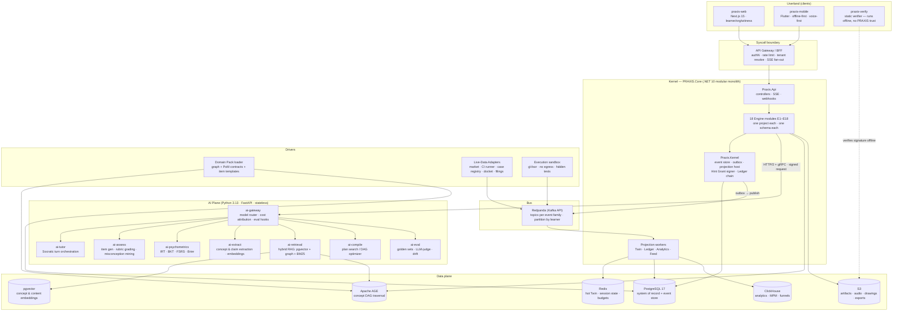
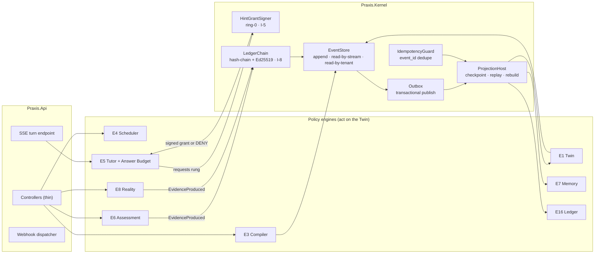
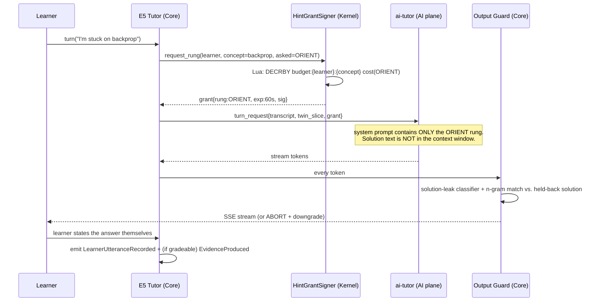
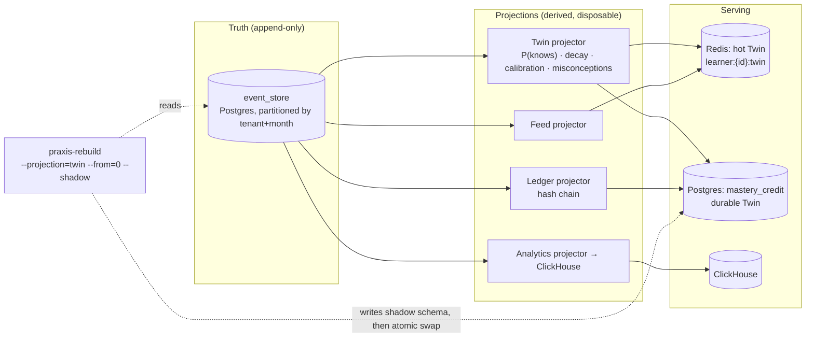
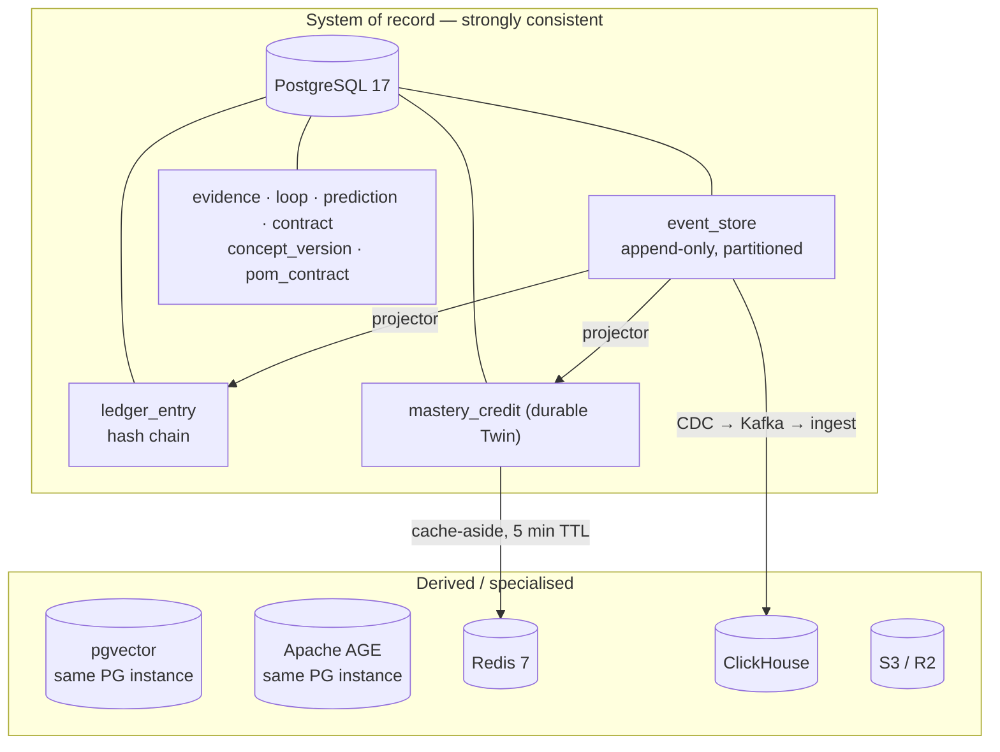
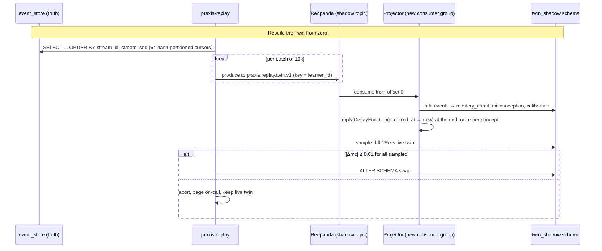
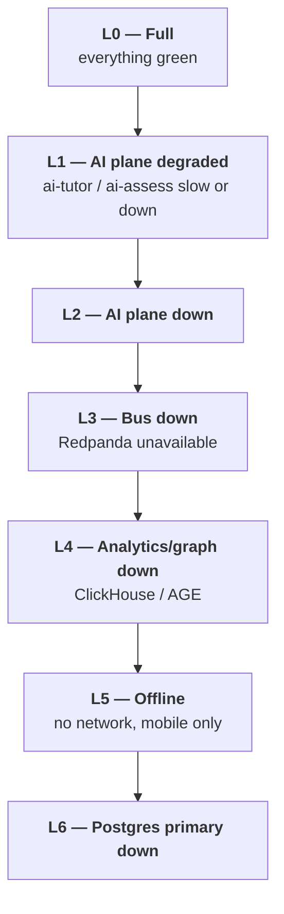
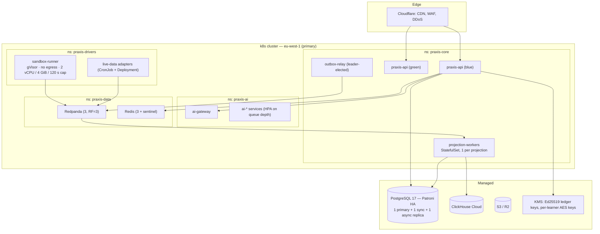

# 07 — System Architecture

> **Obeys:** `CANON.md`. Every structure here exists to serve an Invention (I-1..I-10).
> **Transactional core follows:** `D:\claude\ARCHITECTURE_STANDARD.md` (modular monolith + vertical slice).

---

## 0. The OS framing, made literal

PRAXIS is not "architected like an OS" as a metaphor. The mapping is load-bearing: it decides
where code lives, what may call what, and what is allowed to fail.

| OS concept | PRAXIS reality | Invention |
|---|---|---|
| **Kernel** | Append-only **Learning Event log** + the **Twin projection** + the **policy engines** that act on the Twin. Nothing mutates learner truth except by appending an event. | I-1, I-8 |
| **Process table** | The **Twin**: one live probabilistic "process" per `(learner, concept)` with state `P(knows)`, decay curve, calibration, misconception set. | I-1 |
| **Filesystem** | The **Graph**: versioned concept DAG. Concepts are inodes; `REQUIRES`/`RELATES`/`CONTRASTS`/`APPLIES_TO` are links. | I-4 |
| **Page cache** | Mastery Credits. **Forgetting is cache invalidation** — decay evicts pages; the Memory Engine is the eviction/refresh policy. | I-2, I-4 |
| **Scheduler** | E4 Scheduler: what to do in the next 15 minutes. Optimizes **Mastery-per-Minute**, not time-on-app. | I-10 |
| **Compiler / `make`** | E3 Compiler: `Objective + Graph + Twin(cache) + Constraints → Plan`. Recompiled nightly and on significant events. | I-4 |
| **Test suite / CI** | E6 Assessment + E8 Reality + E11 Project. **No build ships without passing tests** — no "mark as complete." | I-2, I-3, I-6 |
| **Syscall interface** | The public API (`/v1`). Userland *asks*; the kernel *decides*. Clients cannot write the Twin directly. | I-1, I-5 |
| **Ring-0 policy / MMU** | The **Answer Budget** policy layer. The tutor model is untrusted userland; it cannot emit an answer without a kernel-signed **Hint Grant**. | I-5 |
| **Userland** | Next.js web, Flutter mobile, org/witness dashboards, third-party verifiers. | I-8, I-9 |
| **Drivers** | **Domain Packs** (graph + PoM contracts + item templates for a domain) and **Live-Data Adapters** (market, CI runner, court docket, filings, case registry) that let reality grade the learner. | I-3, I-7 |
| **Audit / secure boot** | The **Ledger**: hash-chained, signed evidence. Externally verifiable. | I-8 |
| **Init / cron** | Nightly recompile, decay sweep, rep scheduling, loop resolution polling. | I-2, I-3, I-4 |

**The one architectural rule that makes the product true:**
> There is no code path anywhere in PRAXIS that raises a Mastery Credit without an `EvidenceProduced`
> event carrying a Ledger-chained evidence id. Not an admin endpoint, not a migration, not a seed
> script, not a support tool. `MasteryCredit` has **no writable API**. This is I-2 enforced in silicon,
> not in copy.

---

## 1. C4 Level 1 — System Context

```mermaid
graph TB
    subgraph People
        L["Learner<br/>web · mobile · voice"]
        W["Witness<br/>parent · manager · mentor"]
        O["Org Admin<br/>school · L&D"]
        A["Author / Domain Expert<br/>domain packs"]
        V["Verifier<br/>employer · university · regulator"]
    end

    P["<b>PRAXIS — Mastery OS</b><br/>event-sourced kernel · Twin · engines E1–E18"]

    subgraph "Reality (the examiner) — I-3"
        MKT["Market data feeds<br/>prices, settlements"]
        CI["Code execution sandbox<br/>hidden test suites"]
        CASE["De-identified clinical case registry<br/>with outcomes"]
        LAW["Court dockets / rulings"]
        FIL["Filings, earnings, macro releases"]
    end

    subgraph "World inputs"
        NEWS["News & publication firehose"]
        SRC["Sources: papers, docs, books, standards"]
    end

    subgraph "Platform services"
        AI["AI Plane<br/>FastAPI model services"]
        IDP["Identity provider<br/>OIDC"]
        PAY["Payments / stakes escrow"]
        PUSH["Push · email · SMS"]
    end

    L -->|"produces evidence"| P
    P -->|"asks · never answers"| L
    W -->|"holds learner to Contract"| P
    P -->|"witness digest — I-9"| W
    O -->|"cohort objectives, budgets"| P
    A -->|"authors Domain Pack"| P
    V -->|"verifies a Competency Record — I-8"| P

    P -->|"opens Loops"| MKT
    P --> CI
    P --> CASE
    P --> LAW
    P --> FIL
    MKT -->|"resolution = ground truth"| P
    CI --> P
    CASE --> P
    LAW --> P
    FIL --> P

    NEWS -->|"ingest"| P
    SRC -->|"retrieval + trust scoring"| P

    P <-->|"stable contract"| AI
    P --> IDP
    P --> PAY
    P --> PUSH
```



| Actor / system | Why it exists | Invention |
|---|---|---|
| Learner | The only entity that can *produce* evidence. | I-2 |
| Witness | Receives the dashboard when the learner opts in; gives accountability teeth. | I-9 |
| Verifier | Third party who cryptographically verifies a Ledger export without trusting PRAXIS. | I-8 |
| Reality adapters | Provide **ground truth that PRAXIS does not control** — the whole point of I-3. | I-3 |
| AI Plane | Model-heavy work. Stateless. **Never trusted with policy.** | I-5 |

---

## 2. C4 Level 2 — Containers



| Container | Tech | Scale unit | State | Invention served |
|---|---|---|---|---|
| `praxis-web` | Next.js 15, RSC, SSE | CDN + 3 pods | none | I-10 |
| `praxis-mobile` | Flutter, SQLite + local small model | device | offline queue | I-5, I-7 |
| `praxis-verify` | Static WASM verifier (Ed25519 + SHA-256) | none | none | **I-8** |
| API Gateway / BFF | YARP + Envoy | HPA 3–30 | none | — |
| `PRAXIS.Core` | .NET 10, modular monolith | HPA 4–40 | Postgres | all |
| Projection workers | .NET 10 hosted services | 1 per projection, partitioned | offsets | I-1 |
| AI Plane | Python 3.13, FastAPI, uvloop | HPA 2–60 per service | **stateless** | I-5, I-6 |
| Redpanda | 3 brokers, RF=3 | fixed | logs | I-1 |
| PostgreSQL | 17 + pgvector + AGE | 1 primary + 2 replicas | **truth** | I-8 |
| ClickHouse | 3 shards | fixed | derived | I-10 |

> **Boundary rule (locked, CANON §5.5):** no engine calls another engine's internals. Engines
> communicate by (a) publishing events, or (b) calling a *contract* interface exposed in
> `Praxis.Shared.Contracts` and implemented by the owning module. Compile-time enforced: engine
> projects have no `ProjectReference` to each other, only to `Praxis.Shared` and `Praxis.Kernel`.
> An architecture test (`NetArchTest`) fails the build if this is violated.

---

## 3. C4 Level 3 — Components of the kernel



### 3.1 Kernel components

| Component | Responsibility | Guarantee |
|---|---|---|
| `EventStore` | Single append path for every Learning Event. `(tenant_id, stream_id, stream_seq)` unique. | Serializable append per stream; gapless `stream_seq` |
| `Outbox` | Events written in the **same transaction** as the aggregate change; a relay publishes to Redpanda. | Exactly-once *into the log*, at-least-once *out of it* |
| `IdempotencyGuard` | Per-consumer `processed_event(consumer, event_id)` table. | Effectively-once projection |
| `HintGrantSigner` | Decrements the per-`(learner, concept)` answer budget in Redis (Lua, atomic), then issues a short-lived signed grant naming the exact rung. | **The tutor cannot escalate without it** (I-5) |
| `LedgerChain` | Computes `entry_hash = SHA256(prev_hash ‖ canonical(evidence))`, signs with the tenant's Ed25519 key. | Tamper-evident, externally verifiable (I-8) |
| `ProjectionHost` | Runs projections with checkpoints; supports `rebuild-from-zero`, `replay-from(seq)`, shadow rebuild. | The Twin is *always* re-derivable (I-1) |

### 3.2 The Answer Budget as a ring-0 mechanism (I-5)

The tutor LLM is **untrusted userland**. Architecture, not prompt:



| Enforcement layer | What it stops |
|---|---|
| Budget in Redis (atomic Lua) | Infinite hint escalation |
| Grant is signed, rung-scoped, 60s TTL | AI plane inventing a higher rung |
| **The solution string is never placed in the AI context** below rung `FULL` | Prompt injection extracting the answer |
| Output Guard: n-gram overlap + leak classifier on the token stream | Model reconstructing the answer anyway |
| `AnswerBudgetExhausted` event → session must end in learner production | Reading instead of producing |

> The AI plane **cannot** be the enforcement point, because a model can be jailbroken and a
> microservice can be called directly. The budget lives in the kernel; the AI plane is a renderer.

---

## 4. The event-sourced kernel

### 4.1 Envelope

Every Learning Event shares one envelope. `stream_id` is almost always the **learner** — that is
what gives us per-learner ordering and per-learner replay.

```json
{
  "event_id": "0198f3c2-1a4e-7c31-9a2b-4f0a2c6b7d10",
  "event_type": "praxis.assessment.AnswerGraded",
  "event_version": 1,
  "tenant_id": "t_9f2c",
  "stream_id": "lrn_01H8X7...",
  "stream_seq": 48211,
  "occurred_at": "2026-07-11T09:14:02.481Z",
  "recorded_at": "2026-07-11T09:14:02.902Z",
  "actor": { "type": "learner", "id": "lrn_01H8X7..." },
  "causation_id": "0198f3c2-1a4e-7c31-9a2b-4f0a2c6b7d0f",
  "correlation_id": "sess_01H8XA...",
  "emitter": "E6",
  "payload": { "...": "..." },
  "meta": { "device": "mobile", "offline_captured": true, "schema": "avro/AnswerGraded.v1" }
}
```

| Field | Purpose |
|---|---|
| `event_id` | UUIDv7 — time-sortable, used for idempotency |
| `stream_id` | Partition key. Learner streams for learner facts; `graph:{pack}` for graph facts |
| `stream_seq` | Gapless per-stream sequence. Enables `replay-from(seq)` |
| `occurred_at` vs `recorded_at` | **Offline capture** (mobile) means these differ by hours. The Twin uses `occurred_at`; the Ledger chains on `recorded_at` |
| `causation_id` / `correlation_id` | Full provenance for "why did the Twin change?" (I-1 explainability) |

### 4.2 The Learning Event taxonomy

45 event types. Every Twin mutation, Ledger entry and analytic fact derives from exactly this list.

#### Lifecycle & objective

| # | Event | Key payload | Emitter | Consumers | Invention |
|---|---|---|---|---|---|
| 1 | `LearnerRegistered` | `locale, timezone, tenant_kind` | Tenancy | E1, E13, E18 | — |
| 2 | `ObjectiveDeclared` | `objective_id, target_role, deadline, source` | E12 | E3, E4, E15 | I-4 |
| 3 | `ConstraintsSet` | `minutes_per_day, days_per_week, deadline, device_mix` | E14 | E3, E4, E13 | I-4, I-9 |
| 4 | `ConsentGranted` / 5 `ConsentRevoked` | `purpose, scope, expires_at` | Tenancy | all (gates AI plane) | CANON §5.9 |
| 6 | `TwinSnapshotTaken` | `snapshot_id, s3_key, event_seq_hwm` | E1 | E15, E16 | I-1 |

#### Graph & domain packs (drivers)

| # | Event | Key payload | Emitter | Consumers | Invention |
|---|---|---|---|---|---|
| 7 | `DomainPackInstalled` | `pack_id, version, concept_count, tenant_scope` | E2 | E3, E6, E17 | I-4 |
| 8 | `ConceptVersionPublished` | `concept_id, version, pom_contract_ref, irt_priors` | E2 | E1, E3, E6, E7 | I-2 |
| 9 | `EdgeProposed` | `from, to, kind, evidence, proposer` | E2/E10 | E2 review queue | I-4 |
| 10 | `ConceptVersionSuperseded` | `concept_id, old_v, new_v, migration` | E2 | **E1 (re-map credits)**, E3 | I-2 |

#### Compile & schedule

| # | Event | Key payload | Emitter | Consumers | Invention |
|---|---|---|---|---|---|
| 11 | `PlanCompiled` | `plan_id, objective_id, horizon_days, node_order[], predicted_ready_date, mpm_forecast` | E3 | E4, E15, E18 | **I-4** |
| 12 | `PlanInvalidated` | `plan_id, reason: DECAY \| NEW_EVIDENCE \| CONSTRAINT_CHANGE \| GRAPH_CHANGE` | E3 | E3 (recompile) | I-4 |
| 13 | `SessionStarted` | `session_id, planned_minutes, modality, blocks[]` | E4 | E5, E6, E13, E15 | I-10 |
| 14 | `SessionCompleted` | `session_id, actual_minutes, mc_delta, mpm` | E4 | E1, E13, E15 | **I-10** |
| 15 | `SessionAbandoned` | `session_id, at_block, elapsed_s, last_interaction` | E4 | E13 (burnout), E15 | I-10, I-9 |

#### Tutor (under Answer Budget)

| # | Event | Key payload | Emitter | Consumers | Invention |
|---|---|---|---|---|---|
| 16 | `ConceptIntroduced` | `concept_id, lesson_id, modality, source_ids[]` | E17 | E1, E7 | I-2 |
| 17 | `HintRequested` | `concept_id, rung_asked, stuck_seconds` | E5 | E5, E13 | **I-5** |
| 18 | `HintGranted` | `rung: ORIENT\|PROBE\|ANALOGY\|PARTIAL\|FULL, cost, budget_remaining, grant_id` | Kernel | E1 (discounts MC), E6, E15 | **I-5** |
| 19 | `HintDenied` | `rung_asked, reason: BUDGET_EXHAUSTED \| POLICY` | Kernel | E5, E13 | **I-5** |
| 20 | `AnswerBudgetExhausted` | `concept_id, spent, window` | Kernel | E4 (forces production block) | **I-5** |
| 21 | `LearnerUtteranceRecorded` | `utterance_id, transcript, audio_s3, concept_ids[]` | E5 | E6 (grade), E1 | I-5 |
| 22 | `SolutionLeakBlocked` | `grant_id, ngram_hit, model_id` | Output Guard | E5, AI eval | **I-5** |

#### Assessment (failure-seeking)

| # | Event | Key payload | Emitter | Consumers | Invention |
|---|---|---|---|---|---|
| 23 | `ItemGenerated` | `item_id, concept_id, evidence_type, irt_a/b/c, targets_misconception_id?` | E6 | E6, E15 | **I-6** |
| 24 | `ItemServed` | `item_id, session_id, ability_estimate, selection_rule` | E6 | E1, E15 | I-6 |
| 25 | `ConfidenceStated` | `item_id, confidence: 0..1` | E6 | **E1 (calibration)** | I-1, I-3 |
| 26 | `AnswerGiven` | `item_id, response_blob, latency_ms, hints_used` | E6 | E6 | I-2 |
| 27 | `AnswerGraded` | `item_id, correct, partial_credit, rubric_scores{}, grader: RULE\|MODEL\|HUMAN, grader_conf` | E6 | **E1**, E7, E16 | I-2 |
| 28 | `ExplanationRecorded` | `concept_id, transcript, audio_s3, duration_s` | E5/E6 | E6 | I-2 (`EXPLAIN`) |
| 29 | `ExplanationGraded` | `rubric{completeness, causality, jargon_free, no_gaps}, score, gaps[]` | E6 | E1, E16 | I-2 |
| 30 | `CritiqueSubmitted` | `worked_example_id, flaw_found: bool, flaw_span, justification` | E6 | E6, E1 | I-2 (`CRITIQUE`) |
| 31 | `MisconceptionDetected` | `misconception_id, concept_id, signature, evidence_ids[], confidence` | E6 | **E1**, E6 (item gen), E17 | **I-6** |
| 32 | `MisconceptionTargeted` | `misconception_id, item_id` | E6 | E15 | I-6 |
| 33 | `MisconceptionRetired` | `misconception_id, disconfirming_evidence_ids[]` | E1 | E6, E15 | I-6 |
| 34 | `ProbeBoundaryFound` | `concept_id, ability_theta, se, ceiling_item_id` | E6 | E1, E3 | I-6 |

#### Memory (forgetting = cache invalidation)

| # | Event | Key payload | Emitter | Consumers | Invention |
|---|---|---|---|---|---|
| 35 | `RepScheduled` | `concept_id, due_at, stability_d, difficulty, retrievability_target` | E7 | E4, E18 | I-2 |
| 36 | `RepDue` | `concept_id, overdue_hours, current_retrievability` | E7 | E4, E9, E18 | **I-2** |
| 37 | `RepPerformed` | `concept_id, grade: AGAIN\|HARD\|GOOD\|EASY, latency_ms, via: DRILL\|NEWS\|LOOP\|PROJECT` | E7 | E1, E7 | I-2, I-7 |
| 38 | `ConceptLapsed` | `concept_id, mc_at_lapse, days_since_rep` | E7 | E1, E3 (**PlanInvalidated**), E18 | **I-4** |

#### Reality Loop (the crown jewel)

| # | Event | Key payload | Emitter | Consumers | Invention |
|---|---|---|---|---|---|
| 39 | `LoopOpened` | `loop_id, domain, question, resolution_source, resolves_at, concept_ids[]` | E8 | E4, E18 | **I-3** |
| 40 | `PredictionMade` | `loop_id, claim, probability, rationale, staked_concepts[]` | E8 | E1, E16 | **I-3** |
| 41 | `PredictionResolved` | `loop_id, outcome, source_ref, brier, log_score, resolved_by: ADAPTER` | E8 | **E1 (calibration)**, E15, E16 | **I-3** |
| 42 | `PredictionVoided` | `loop_id, reason: SOURCE_AMBIGUOUS \| EVENT_CANCELLED` | E8 | E1, E15 | I-3 |
| 43 | `CalibrationUpdated` | `window, brier, reliability_curve[], overconfidence_delta` | E1 | E15, E5 (tutor tone) | **I-1, I-3** |

#### Projects & artifacts

| # | Event | Key payload | Emitter | Consumers | Invention |
|---|---|---|---|---|---|
| 44 | `ArtifactSubmitted` | `artifact_id, brief_id, s3_key, kind: REPO\|DOC\|MODEL\|DESIGN` | E11 | E11, E16 | I-2 (`BUILD`) |
| 45 | `ArtifactBuilt` | `artifact_id, sandbox_run_id, tests_passed/total, coverage, runtime_ms, logs_s3` | Sandbox driver | E11, **E1**, E16 | **I-2, I-3** |
| 46 | `ArtifactReviewed` | `artifact_id, rubric{}, reviewer: MODEL\|PEER\|MENTOR, score` | E11 | E1, E16 | I-2 |
| 47 | `PeerReviewSubmitted` | `artifact_id, reviewer_learner_id, rubric{}, review_quality_score` | E11 | E1 (reviewer's own `CRITIQUE` credit) | I-2 |

#### News, research, content

| # | Event | Key payload | Emitter | Consumers | Invention |
|---|---|---|---|---|---|
| 48 | `NewsItemIngested` | `item_id, source_id, url, published_at, hash` | E9 | E9 | I-7 |
| 49 | `NewsConceptsExtracted` | `item_id, concept_ids[], novelty, confidence` | E9 | E9 | I-7 |
| 50 | `NewsRouted` | `item_id, learner_id, decision: TEACH \| DEFER \| REP, missing_prereqs[], rep_concept_ids[]` | E9 | E4, E7, E17, E18 | **I-7** |
| 51 | `FeedItemAnswered` | `item_id, question_id, correct \| prediction_id` | E9 | E1, E7, E8 | I-7 |
| 52 | `SourceTrustScored` | `source_id, trust, dimensions{track_record, transparency, conflict}` | E10 | E9, E17 | — |
| 53 | `DisagreementSurfaced` | `claim_id, positions[], sources[], strength` | E10 | E17, E5 | — |
| 54 | `LessonSynthesized` | `lesson_id, concept_id, grounded_source_ids[], twin_adapted_for` | E17 | E5, E15 | I-5 |

#### Motivation, accountability, ledger, analytics

| # | Event | Key payload | Emitter | Consumers | Invention |
|---|---|---|---|---|---|
| 55 | `ContractSigned` | `contract_id, minutes, cadence, deadline, stake?, witness?` | E14 | E3, E13, E18 | **I-9** |
| 56 | `ContractBreached` | `contract_id, missed_days, debt_minutes, escalation_rung` | E14 | E13, E18, witness | **I-9** |
| 57 | `ContractRenegotiated` | `contract_id, old, new, reason: BURNOUT \| LIFE` | E14 | E3 (recompile) | I-9 |
| 58 | `StakeForfeited` | `contract_id, amount, beneficiary` | E13 | payments | I-9 |
| 59 | `StreakAdvanced` / 60 `StreakBroken` | `length, freeze_used` | E13 | E18, E15 | I-9 |
| 61 | `BurnoutSuspected` | `signals{abandon_rate, latency_drift, sentiment, sleep_hours}, severity` | E13 | **E3 (load down)**, E18 | I-9 |
| 62 | `LoadAdjusted` | `old_minutes, new_minutes, reason` | E13 | E3, E4 | I-9 |
| 63 | `NudgeDelivered` / 64 `NudgeIgnored` | `channel, template_id, at, twin_context` | E18 | E13, E15 | I-9 |
| 65 | `WitnessDigestSent` | `witness_id, period, mpm, adherence, mc_delta` | E14 | — | I-9 |
| 66 | `EvidenceProduced` | **see §4.3 — the spine of the system** | E6/E8/E11/E5 | **E1, E16** | **I-2, I-8** |
| 67 | `EvidenceRejected` | `reason: PLAGIARISM \| SANDBOX_FAIL \| RUBRIC_FLOOR \| HINT_CEILING` | E6/E11 | E1, E13 | I-2 |
| 68 | `LedgerEntryAppended` | `entry_id, seq, prev_hash, entry_hash, signature, key_id` | E16 | E15 | **I-8** |
| 69 | `LedgerExported` | `export_id, scope, s3_key, root_hash, verify_url` | E16 | — | **I-8** |
| 70 | `LedgerVerificationRequested` | `export_id, verifier_ip_hash, result` | E16 | E15 (proof of demand) | I-8 |
| 71 | `MasteryCreditUpdated` | `concept_id, mc_before, mc_after, stability_d, driver_event_id, reason` | E1 | E3, E4, E15 | **I-1** |
| 72 | `MasteryPerMinuteComputed` | `window, mpm, mc_gained, minutes, honest_flag` | E15 | E18, web | **I-10** |
| 73 | `RoleGapComputed` | `role_id, missing_concepts[], weeks_to_ready, market_signal` | E12 | E3, E18 | I-4 |

> Count: **73 event types.** Event schemas are Avro in a schema registry; `event_version` is
> bumped on breaking change; upcasters live in `Praxis.Kernel/Upcasters/`.

### 4.3 `EvidenceProduced` — the spine

Only four emitters may raise it: E6 (Assessment), E8 (Reality), E11 (Project), E5 (Tutor, for
`EXPLAIN` only). It is the **only** input that can raise a Mastery Credit.

```json
{
  "event_type": "praxis.evidence.EvidenceProduced",
  "stream_id": "lrn_01H8X7",
  "payload": {
    "evidence_id": "ev_01J4KQ2M9",
    "concept_id": "cpt_backprop_chain_rule",
    "concept_version": 7,
    "evidence_type": "EXPLAIN",
    "pom_contract_id": "pom_backprop_v3",
    "produced_at": "2026-07-11T09:14:02.481Z",
    "artifact_ref": { "kind": "audio", "s3": "s3://praxis-ev/t_9f2c/ev_01J4KQ2M9.webm", "sha256": "9f86d0..." },
    "grading": {
      "grader": "MODEL",
      "model_id": "sonnet-4.7",
      "rubric_id": "rub_explain_v2",
      "scores": { "completeness": 0.8, "causal_chain": 0.9, "jargon_free": 0.6, "no_gaps": 0.7 },
      "score": 0.78,
      "grader_confidence": 0.86,
      "human_spot_check": null
    },
    "integrity": {
      "hints_used": [{ "rung": "PROBE", "cost": 2 }],
      "hint_discount": 0.10,
      "novel_item": true,
      "proctoring": "NONE",
      "plagiarism_score": 0.02
    },
    "mc_effect": { "before": 0.41, "after": 0.63, "stability_days_after": 9.2 }
  }
}
```

| Rule | Why |
|---|---|
| `hint_discount` reduces the credit granted | You did not produce it alone (I-5) |
| `novel_item: false` → capped credit for `APPLY` | I-2 requires a *never-seen* item for APPLY |
| `grader_confidence < 0.7` → routed to human spot-check queue, credit held `PENDING` | Honest grading (I-10) |
| Every `EvidenceProduced` produces exactly one `LedgerEntryAppended` | I-8 |

### 4.4 The Twin is a projection



**Rebuild from zero — the operational procedure**

| Step | Command / action | Note |
|---|---|---|
| 1 | `praxis-rebuild plan --projection twin --tenant t_9f2c` | Estimates events, time, cost |
| 2 | `CREATE SCHEMA twin_shadow` | New tables, same DDL |
| 3 | Replay `event_store` ordered by `(stream_id, stream_seq)`, **not** by global time — per-learner causality is what matters | 64 parallel workers, hash-partitioned by `stream_id` |
| 4 | Decay is **recomputed, not replayed**: the projector applies FSRS from `occurred_at` to `now()` | Decay is a *function of time*, not an event — so no `MasteryCreditDecayed` events pollute the log |
| 5 | Compare shadow vs live on a 1% sample; alert on any `|Δmc| > 0.01` | Catches projector regressions |
| 6 | `ALTER SCHEMA twin RENAME TO twin_old; ALTER SCHEMA twin_shadow RENAME TO twin;` | Atomic swap |
| 7 | Flush `learner:*:twin` in Redis | Cache rebuilds lazily |

Measured envelope: **~40k events/s/worker**, 64 workers → a 500M-event tenant rebuilds in **~3.3 hours**.
A single learner's Twin (≈40k events lifetime) rebuilds in **<2 seconds**, which is what makes
"why does my Twin think that?" answerable live.

> Decay is deliberately **not** an event. Emitting `MasteryCreditDecayed` per concept per day would
> generate ~10^9 junk events/year and would make the log a clock rather than a record of what the
> learner *did*. **Events record production; decay is a pure function `mc(t)` applied at read.** This
> is what makes I-2 ("mastery bleeds") cheap.

---

## 5. Module & solution layout — `PRAXIS.Core`

Exactly the shape mandated by `ARCHITECTURE_STANDARD.md`: modular monolith, one project per
module (= per Engine), one `DbContext`/schema each, vertical slices as use cases, thin controllers,
`Result<T>` → `ApiResponse<T>`, no MediatR, no AutoMapper.

```
src/
  Praxis.Api/                          Host: Program.cs, controllers, SSE, webhooks, DI, middleware
  Praxis.Shared/                       Result<T>, ApiResponse<T>, BaseEntity, TenantEntity,
                                       PagedResult<T>, ITenantContext, IUserContext,
                                       Contracts/  (the ONLY cross-engine surface)
  Praxis.Infrastructure/               Interceptors, auth, Redis, S3, Redpanda producer/consumer,
                                       AI-plane HttpClients (typed, signed), OpenTelemetry
  Praxis.Kernel/                       EventStore, Outbox, ProjectionHost, IdempotencyGuard,
                                       HintGrantSigner, LedgerChain, Upcasters/, Events/ (Avro POCOs)

  Modules/
    Praxis.Modules.Twin/               E1
      Domain/                          MasteryCredit, CalibrationWindow, MisconceptionHolding
      Persistence/                     TwinDbContext  (schema: twin)
      Projections/                     TwinProjector.cs, DecayFunction.cs
      Features/
        Twin/
          GetTwinSnapshot.cs           slice: Query + Handler
          QueryTwinCounterfactual.cs   slice: Command + Validator + Handler   ← I-1
          ExplainMasteryCredit.cs      slice: Query + Handler  ("why do you think I know this?")
          ListMisconceptions.cs        slice: Query + Handler
          TwinController.cs            thin
        Calibration/
          GetCalibrationCurve.cs
          CalibrationController.cs
      TwinModule.cs                    DI, migrations, permissions, event subscriptions

    Praxis.Modules.Graph/              E2   schema: graph   (+ AGE graph `praxis_graph`)
      Features/Concepts/               GetConcept, ListConcepts, ProposeEdge, PublishConceptVersion
      Features/DomainPacks/            InstallDomainPack, ListDomainPacks, DiffDomainPack
      Features/PomContracts/           GetPomContract, UpsertPomContract

    Praxis.Modules.Compiler/           E3   schema: compiler
      Features/Plans/                  CompilePlan, GetCurrentPlan, ExplainPlan, SimulatePlan
      Domain/                          Plan, PlanNode, CompileConstraints, CompileTrace

    Praxis.Modules.Scheduler/          E4   schema: scheduler
      Features/Sessions/               StartSession, GetNextBlock, CompleteSession, AbandonSession
      Domain/                          Session, Block, BlockMix (NEW | REP | LOOP | PROJECT)

    Praxis.Modules.Tutor/              E5   schema: tutor
      Policy/                          AnswerBudgetPolicy.cs, HintLadder.cs, OutputGuard.cs
      Features/Turns/                  StreamTurn.cs (SSE), RequestHint.cs, RecordUtterance.cs
      Features/Explanations/           StartTeachBack, SubmitExplanation

    Praxis.Modules.Assessment/         E6   schema: assessment
      Features/Items/                  GenerateItems, ServeNextItem, SubmitAnswer, GradeAnswer
      Features/Probes/                 StartAdaptiveProbe, GetProbeResult
      Features/Misconceptions/         MineMisconceptions, TargetMisconception, RetireMisconception

    Praxis.Modules.Memory/             E7   schema: memory
      Features/Reps/                   ListDueReps, PerformRep, RescheduleRep
      Domain/                          FsrsParameters, RepSchedule

    Praxis.Modules.Reality/            E8   schema: reality
      Features/Loops/                  OpenLoop, MakePrediction, ListOpenLoops, ResolveLoop(internal)
      Adapters/                        IResolutionAdapter + Market, Sandbox, Case, Docket, Filing
      Domain/                          Loop, Prediction, Resolution, BrierWindow

    Praxis.Modules.News/               E9   schema: news
      Features/Feed/                   GetFeed, AnswerFeedItem, DeferFeedItem
      Features/Ingest/                 IngestNewsItem, RouteNewsItem

    Praxis.Modules.Research/           E10  schema: research
      Features/Sources/                ScoreSource, ListSources
      Features/Claims/                 ExtractClaims, GetDisagreements

    Praxis.Modules.Project/            E11  schema: project
      Features/Briefs/                 GenerateBrief, GetBrief
      Features/Artifacts/              SubmitArtifact, GetArtifactBuild, RequestPeerReview
      Features/Reviews/                SubmitPeerReview, GetReview

    Praxis.Modules.Career/             E12  schema: career
      Features/Roles/                  GetRole, ComputeRoleGap, ListMarketSignals
      Features/Interviews/             StartInterviewSim, ScoreInterviewSim

    Praxis.Modules.Motivation/         E13  schema: motivation
      Features/Streaks/                GetStreak, UseFreeze
      Features/Load/                   DetectBurnout, AdjustLoad
      Features/Stakes/                 CommitStake, ForfeitStake

    Praxis.Modules.Accountability/     E14  schema: accountability
      Features/Contracts/              SignContract, RenegotiateContract, GetContractStatus
      Features/Witnesses/              InviteWitness, GetWitnessDashboard, SendWitnessDigest

    Praxis.Modules.Analytics/          E15  schema: analytics   (reads ClickHouse)
      Features/Mastery/                GetMasteryPerMinute, GetGrowthCurve, GetRoi
      Features/Org/                    GetCohortDashboard

    Praxis.Modules.Ledger/             E16  schema: ledger
      Features/Ledger/                 GetLedger, ExportCompetencyRecord, RevokeExport
      Features/Verification/           VerifyExport (public, unauthenticated)

    Praxis.Modules.Content/            E17  schema: content
      Features/Lessons/                SynthesizeLesson, GetLesson, RateLesson

    Praxis.Modules.Notification/       E18  schema: notification
      Features/Nudges/                 ScheduleNudge, DeliverNudge, RecordNudgeOutcome

    Praxis.Modules.Tenancy/            schema: tenancy
      Features/Tenants/                CreateTenant, GetTenant
      Features/Consent/                GrantConsent, RevokeConsent, ExportMyData, DeleteMyTwin

tests/
  Praxis.Modules.Twin.Tests/           handler + validator + projector-determinism tests
  Praxis.Modules.Tutor.Tests/          Answer-Budget policy tests (the most important suite)
  Praxis.Kernel.Tests/                 event store, outbox, ledger chain, replay determinism
  Praxis.Architecture.Tests/           NetArchTest: no engine→engine ProjectReference
```

### 5.1 A real slice — `MakePrediction.cs` (E8, serves I-3)

```csharp
namespace Praxis.Modules.Reality.Features.Loops;

public static class MakePrediction
{
    public record Command(
        Guid LoopId,
        string Claim,
        double Probability,
        string Rationale,
        IReadOnlyList<Guid> StakedConceptIds);

    public sealed class Validator : AbstractValidator<Command>
    {
        public Validator()
        {
            RuleFor(x => x.Probability).InclusiveBetween(0.01, 0.99)
                .WithMessage("A prediction of 0 or 1 is not a forecast.");
            RuleFor(x => x.Rationale).NotEmpty().MinimumLength(40)
                .WithMessage("Reality will grade the claim; PRAXIS grades the reasoning.");
            RuleFor(x => x.StakedConceptIds).NotEmpty();
        }
    }

    public sealed class Handler
    {
        private readonly RealityDbContext _db;
        private readonly IEventStore _events;
        private readonly IClock _clock;

        public Handler(RealityDbContext db, IEventStore events, IClock clock)
            => (_db, _events, _clock) = (db, events, clock);

        public async Task<Result<PredictionResponse>> HandleAsync(Command cmd, CancellationToken ct)
        {
            var loop = await _db.Loops.FirstOrDefaultAsync(l => l.Id == cmd.LoopId, ct);
            if (loop is null) return Result<PredictionResponse>.NotFound("Loop not found.");
            if (loop.ResolvesAt <= _clock.UtcNow)
                return Result<PredictionResponse>.Conflict("Reality already resolved this loop.");
            if (await _db.Predictions.AnyAsync(p => p.LoopId == cmd.LoopId, ct))
                return Result<PredictionResponse>.Conflict("A prediction is a commitment. One per loop.");

            var prediction = Prediction.Create(loop, cmd.Claim, cmd.Probability,
                                               cmd.Rationale, cmd.StakedConceptIds, _clock.UtcNow);
            _db.Predictions.Add(prediction);

            // Same transaction: event → outbox → Redpanda. No dual write.
            await _events.AppendAsync(new PredictionMade(
                loop.Id, prediction.Id, cmd.Claim, cmd.Probability,
                cmd.Rationale, cmd.StakedConceptIds, loop.ResolvesAt), ct);

            await _db.SaveChangesAsync(ct);
            return Result<PredictionResponse>.Success(prediction.ToResponse(),
                $"Locked. Reality grades this on {loop.ResolvesAt:yyyy-MM-dd}.");
        }
    }
}
```

Note what the slice does **not** do: it does not touch the Twin. `E1` learns about this only when
`PredictionResolved` lands on the bus. Engines never write each other's tables (CANON §5.5).

### 5.2 Cross-engine contracts (the only permitted synchronous coupling)

`Praxis.Shared/Contracts/` holds narrow read-only interfaces. The owning module implements; others
inject. No engine may reference another engine's `DbContext` or `Domain` types.

| Contract | Owner | Callers | Why sync (not an event) |
|---|---|---|---|
| `ITwinReader.GetSliceAsync(learner, conceptIds)` | E1 | E3, E4, E5, E6, E9 | The tutor needs the Twin *this millisecond* |
| `IGraphReader.GetPrereqClosureAsync(conceptId)` | E2 | E3, E9, E12 | DAG traversal, read-only |
| `IPomContractReader.GetAsync(conceptId, version)` | E2 | E6, E8, E11 | Determines what evidence counts |
| `IAnswerBudget.RequestGrantAsync(...)` | Kernel | E5 | **Ring-0.** Must be synchronous & atomic |
| `ILedgerAppender.AppendAsync(evidence)` | E16 | E6, E8, E11 | Evidence must be chained *before* the HTTP 201 |
| `IScheduleWriter.EnqueueRepAsync(...)` | E7 | — | *Rejected.* E7 subscribes to `AnswerGraded` instead |

### 5.3 Core ↔ AI plane contract

| Property | Decision | Rationale |
|---|---|---|
| Transport | HTTP/2 + JSON for streaming turns; gRPC for batch (embeddings, item gen) | SSE passthrough needs HTTP; batch needs throughput |
| Auth | mTLS + short-lived JWT signed by Core, carrying `tenant_id`, `learner_id`, `consent_scopes[]` | AI plane **refuses** any request whose consent scope doesn't cover the purpose (CANON §5.9) |
| Statelessness | AI plane holds **no learner state**. Everything it needs is in the request body. | Horizontal scale; and the Twin never leaks into a model service's disk |
| Idempotency | Every call carries `Idempotency-Key = causing event_id` | Safe retry |
| Twin exposure | Core sends a **Twin *slice*** (only the concepts in scope), never the whole Twin | Blast-radius containment |
| Policy | AI plane receives a **Hint Grant** or it does not escalate. Solution text is withheld below rung `FULL`. | **I-5** |
| Cost | Every response returns `usage{input, output, model, cost_usd}`; Core attributes it to a **learner-minute** | **I-10**, CANON §5.6 |
| Eval | 2% of calls shadow-routed to `ai-eval` (LLM-judge + golden set); drift alarms page | CANON §5.6 |

```python
# ai-assess: item generation — the contract, not a sketch.
class GenerateItemsRequest(BaseModel):
    request_id: str                       # == causing event_id, idempotency key
    tenant_id: str
    concept: ConceptSlice                 # id, version, definition, pom_contract
    twin_slice: TwinSlice                 # mc, stability_d, calibration, misconceptions[]
    evidence_type: Literal["RECALL","APPLY","EXPLAIN","BUILD","CRITIQUE","PREDICT"]
    n: int = Field(ge=1, le=20)
    target_misconception_id: str | None    # I-6: hunt the boundary
    target_difficulty_b: float             # IRT b-parameter to aim at
    exclude_item_hashes: list[str]         # APPLY items must be NEVER-SEEN (I-2)
    consent_scopes: list[str]

class GeneratedItem(BaseModel):
    stem: str
    modality: Literal["text","image","audio","code","chart"]
    solution: str                          # returned to CORE only — never re-entered into a tutor context
    solution_hash: str                     # Output Guard n-gram source
    rubric: Rubric | None
    irt_priors: IrtPriors                  # a, b, c — refined by ai-psychometrics after 200 responses
    distractors: list[Distractor]          # each tagged with the misconception it diagnoses (I-6)
    novelty_hash: str                      # dedupe against exclude_item_hashes
```

| AI service | Model tier (CANON §5.6) | p95 latency budget |
|---|---|---|
| `ai-tutor` (turn) | fast (Sonnet/Haiku-class) | 400 ms to first token |
| `ai-assess` (item gen) | fast; large for `CRITIQUE`/`BUILD` briefs | 3 s batch of 10 |
| `ai-assess` (rubric grading of `EXPLAIN`) | **large** (Opus-class) | 6 s |
| `ai-compile` (plan search) | large + solver | 20 s (nightly, async) |
| `ai-extract` (concepts, embeddings) | small/local | 120 ms |
| `ai-retrieval` | none (retrieval) + fast rerank | 250 ms |
| `ai-psychometrics` | none (numpy/scipy: IRT-2PL, BKT, FSRS-6, Brier) | 30 ms |

---

## 6. Data topology



| Store | What lives there | Why *this* store | Invention |
|---|---|---|---|
| **PostgreSQL 17** | `event_store` (truth), evidence, ledger chain, loops, predictions, contracts, plans, concept versions, PoM contracts, durable `mastery_credit` | ACID append + one transaction spanning aggregate *and* outbox. The Ledger's trustworthiness needs a single serializable writer. `xmin` optimistic concurrency per ARCHITECTURE_STANDARD §2. | I-1, I-8 |
| **pgvector** (in PG) | Concept embeddings (1536-d), lesson chunks, item stems, misconception signatures, news article vectors | Keeping vectors *in Postgres* means a retrieval can `JOIN` against the Twin in one query: *"chunks about concepts where this learner's `mc < 0.5`"*. A separate vector DB would make that two round trips and eventually inconsistent. | I-1, I-7 |
| **Apache AGE** (in PG) | The concept DAG: `Concept`, `ConceptVersion`, `Objective`, `Role`, `Misconception` nodes; `REQUIRES`, `RELATES`, `CONTRASTS`, `APPLIES_TO`, `DIAGNOSES` edges | Prereq-closure and shortest-path-to-competence are graph queries; doing them in recursive CTEs is possible but the compiler needs weighted multi-source shortest path over 10^5 nodes. AGE keeps it in the same transaction as the relational graph metadata — no dual write. **Escape hatch:** if traversal p99 > 150 ms at 10^6 nodes, lift to Neo4j behind `IGraphReader` (the contract already isolates this). | I-4 |
| **Redis 7** | Hot Twin (`learner:{id}:twin`, hash of `concept → mc,stab,due`), **answer budgets** (`budget:{learner}:{concept}`, atomic Lua), session state, SSE turn buffers, rate limits, feed cache | The Answer Budget must be decremented atomically in sub-ms on the tutor hot path. Postgres round trip per hint would blow the 400 ms first-token budget. Redis is a **cache and a counter — never truth**; budgets are reconstructable from `HintGranted` events. | **I-5**, I-1 |
| **ClickHouse** | Every event (via CDC), Mastery-per-Minute rollups, calibration curves, cohort dashboards, cost-per-learner-minute, item p-values | MPM (I-10) is a windowed aggregate over 10^9 events with arbitrary group-bys — this is exactly ClickHouse's job and exactly not Postgres's. **Nothing in ClickHouse is authoritative.** | **I-10**, I-6 |
| **S3 / R2** | Artifacts (repos, docs, models), teach-back audio, whiteboard drawings, sandbox logs, **signed Competency Record exports**, Twin snapshots | Blobs. Exports are content-addressed (`{sha256}.jsonl`) and served with the detached signature so `praxis-verify` works with **zero trust in PRAXIS** and even after PRAXIS is offline. | **I-8** |

**Explicit non-choices**

| Rejected | Why |
|---|---|
| Separate vector DB (Pinecone/Weaviate) | Breaks the Twin⋈embedding join; adds a consistency boundary for no throughput we need at 10^7 chunks. |
| Event store as a product (EventStoreDB) | Then the Ledger and the aggregate live in two systems and we need 2PC or sagas for the one thing that must never be wrong (I-8). |
| Kafka as the system of record | Retention economics for 10-year Ledger history are absurd, and a Ledger you can't `SELECT` is a Ledger you can't verify. **Kafka is transport, Postgres is truth.** |
| MongoDB anywhere | No. |

---

## 7. Bus: topic design, ordering, idempotency, replay

**Redpanda** (Kafka API, no ZooKeeper, single binary, lower p99). Swappable for Kafka.

### 7.1 Topics

| Topic | Partitions | Key | Retention | Compaction | Primary consumers |
|---|---|---|---|---|---|
| `praxis.learner.lifecycle.v1` | 24 | `learner_id` | 30d | — | E1, E13, E18 |
| `praxis.evidence.v1` | 96 | `learner_id` | **∞ (tiered → S3)** | — | **E1, E16**, E15 |
| `praxis.assessment.v1` | 96 | `learner_id` | 30d | — | E1, E7, E15 |
| `praxis.tutor.v1` | 48 | `learner_id` | 7d | — | E1, E13, ai-eval |
| `praxis.memory.v1` | 48 | `learner_id` | 30d | — | E4, E9, E18 |
| `praxis.reality.v1` | 48 | `learner_id` | **∞** | — | E1, E15, E16 |
| `praxis.plan.v1` | 24 | `learner_id` | 7d | ✔ (latest plan per learner) | E4, E18 |
| `praxis.session.v1` | 96 | `learner_id` | 30d | — | E1, E13, E15 |
| `praxis.news.v1` | 24 | `news_item_id` | 7d | — | E9 fan-out |
| `praxis.news.routed.v1` | 96 | `learner_id` | 7d | — | E4, E17, E18 |
| `praxis.graph.v1` | 6 | `pack_id` | ∞ | ✔ | E1, E3, E6 |
| `praxis.ledger.v1` | 12 | `learner_id` | ∞ | — | E15, exporters |
| `praxis.motivation.v1` | 24 | `learner_id` | 30d | — | E3, E18 |
| `praxis.accountability.v1` | 12 | `contract_id` | ∞ | — | E13, E18, witness |
| `praxis.twin.snapshot.v1` | 96 | `learner_id` | ∞ | **✔ log-compacted** | cold-start readers |
| `praxis.dlq.v1` | 12 | `event_id` | 90d | — | on-call |

### 7.2 Ordering

> **The only ordering guarantee we need — and the only one we take — is per-learner.**

`key = learner_id` ⇒ same partition ⇒ Kafka's per-partition order ⇒ per-learner total order. That is
sufficient because **every causal chain in PRAXIS is within one learner**: `ItemServed →
AnswerGiven → AnswerGraded → EvidenceProduced → MasteryCreditUpdated → PlanInvalidated`.

Cross-learner order is *meaningless* (learner A's rep does not causally precede learner B's), and
cross-topic order is handled by carrying `causation_id` + `stream_seq` and having projectors
**gap-detect**: if the Twin projector sees `stream_seq = 48213` while its checkpoint is `48211`, it
parks the event for up to 5 s waiting for `48212` before raising `ProjectionGap` and reading the
missing event **directly from `event_store`** (Postgres is truth; the bus is a fast path).

| Concern | Mechanism |
|---|---|
| Hot learner (a whale, or an org-wide cohort event) | Partition count 96 with `murmur2(learner_id)`; a single learner never exceeds ~50 events/min. No hot-key risk. |
| Rebalance duplicates | Idempotency guard (below) |
| Producer retries | `enable.idempotence=true`, `acks=all`, `max.in.flight=5` |
| Poison pill | 3 retries → DLQ with full envelope + consumer stack; **projection does not advance its checkpoint past a DLQ'd event without an operator ack** (silently skipping would corrupt the Twin) |

### 7.3 Idempotency

Every projection writes, in the **same transaction** as its state change:

```sql
INSERT INTO kernel.processed_event (consumer, event_id, processed_at)
VALUES ($1, $2, now())
ON CONFLICT (consumer, event_id) DO NOTHING;
-- if 0 rows inserted → already processed → skip the state change, commit, ack.
```

Result: **at-least-once delivery + idempotent apply = effectively-once**. No exactly-once transactions,
no Kafka transactions, no distributed coordinator.

Additionally, Twin updates are written as **conditional deltas** keyed by the driving event:
`mastery_credit.last_driver_event_id` — so even a replay of the whole log converges to the same state
(the projector is a pure fold; `DecayFunction` is time-based, not accumulative).

### 7.4 Replay & backfill

| Scenario | Procedure | Blast radius |
|---|---|---|
| **Projector bug** (Twin math wrong) | Fix code → `praxis-rebuild --projection twin --shadow --from 0` → sample-diff → atomic schema swap (§4.4) | Zero downtime; reads served from `twin` until swap |
| **New projection** (e.g. a new "learning-velocity" view) | Deploy consumer with `auto.offset.reset=earliest` against a **replay topic** fed from `event_store`, not the live topic (live topic only retains 30d) | Isolated consumer group |
| **New engine added** (E19) | Same as above. This is *why* the event store retains forever and the bus does not. | — |
| **Tenant onboarding / migration** | Import as events (`EvidenceProduced` with `meta.imported_from`), never as direct `mastery_credit` writes | I-2 preserved: imported mastery is *evidenced* mastery or it isn't mastery |
| **Backfill a Reality Loop resolution** (adapter was down 6 h) | Adapter replays from the external source, emits `PredictionResolved` with true `occurred_at`; Twin projector applies calibration **as of** `occurred_at` | Calibration is `occurred_at`-ordered, so late arrival is correct, not just tolerated |
| **GDPR erasure** | Crypto-shredding: per-learner AES key in KMS; delete key → event payloads are unreadable. Envelope (seq, hashes) survives so the **Ledger chain stays verifiable** for everyone else | I-8 intact |
| **Bus total loss** | Rebuild every topic from `event_store` (`praxis-replay --topic praxis.evidence.v1 --from 0`). We can lose Redpanda entirely and lose nothing. | RTO ~2 h |



---

## 8. Consistency model

The honest table. What is a lie here is a lie in the product.

| Data | Model | Staleness budget | Consequence if stale | Why this choice |
|---|---|---|---|---|
| **Evidence record** | **Strong** (serializable, single PG txn) | 0 | — | I-2: it is the unit of truth |
| **Ledger chain** | **Strong**, single-writer per tenant (advisory lock on `ledger_seq`) | 0 | A gap or fork = the moat is gone | **I-8** |
| **Answer budget** | **Strong** (Redis Lua, atomic; reconciled against `HintGranted` events hourly) | 0 | Learner buys an answer they didn't pay for | **I-5** |
| **Prediction lock** | **Strong** (unique on `loop_id`, `resolves_at > now()` checked in-txn) | 0 | Learner predicts after reality resolved = fraud | **I-3** |
| **Contract & stake** | **Strong** | 0 | Money | I-9 |
| **Concept version / PoM contract** | **Strong** on write, **cached 60 s** on read | 60 s | Learner graded against a 1-min-old rubric | Acceptable |
| **Mastery Credit (Twin)** | **Read-your-writes**, then eventual | **< 500 ms p99** (synchronous write-through for the *driving* concept; async fan-out for neighbours) | The concept you just proved shows the wrong number *to you* — unacceptable, hence write-through | **I-1** |
| **Twin neighbours** (`RELATES` spillover credit) | Eventual | ~2 s | A related concept's bar lags — invisible | Cheap |
| **Plan** | Eventual, explicitly **regenerable** | up to 24 h (nightly) or on `PlanInvalidated` (~10 s) | You see yesterday's plan | CANON: "Plan is ephemeral, always regenerable" (I-4) |
| **Feed (News)** | Eventual | ~60 s | An article appears a minute late | I-7 |
| **Analytics / MPM** | Eventual (ClickHouse, CDC) | **< 30 s**, dashboards say *"as of HH:MM:SS"* | A number is 30 s old, and **we print that** | I-10 demands honesty about the metric, including its freshness |
| **Calibration curve** | Eventual | ~5 min | — | I-3 |
| **Witness dashboard** | Eventual | ~5 min | — | I-9 |
| **Org cohort dashboard** | Eventual | 15 min | — | — |

**The read-your-writes rule for the Twin (the one non-negotiable):**
When `EvidenceProduced` commits, the *same transaction* updates `mastery_credit` for **that concept
only** (write-through) and writes the outbox event. Everything else (spillover to `RELATES`
neighbours, calibration, plan invalidation, analytics) happens asynchronously off the bus. So:

> The bar you just moved always moves. The bars you *implied* move a couple of seconds later.

---

## 9. Failure modes & the degradation ladder

The product's promise ("evidence or nothing") must survive every dependency. What follows is
what **still works** at each rung — the OS keeps running with fewer drivers.



| Rung | Broken | Still works | Degraded | **Dead** | Rule |
|---|---|---|---|---|---|
| **L1** | AI plane slow (p95 > 3 s) | Everything | Tutor falls back to **pre-generated hint ladders** cached per item; item bank served from `assessment.item` instead of live generation | Live novel-item generation | Budget policy is *unaffected* — it's kernel-side |
| **L2** | AI plane **down** | ✅ Reps (FSRS is pure math, in Core) · ✅ Cached item bank (≥30 days of items pre-generated per active concept) · ✅ **Reality Loops** (adapters resolve without AI) · ✅ Rule-graded `RECALL`/`APPLY` (deterministic answer keys) · ✅ Sandbox-graded `BUILD` (**hidden tests are code, not AI**) · ✅ Ledger, export, verification · ✅ Plan (last compiled plan is still valid — it's a plan, not a stream) | Tutor becomes a **Socratic state machine** over the pre-generated hint ladder (still cannot give the answer) · `EXPLAIN` submissions are **captured and queued**, graded when AI returns · Feed shows only `REP` routing | Live `EXPLAIN`/`CRITIQUE` grading · new item gen · lesson synthesis · nightly recompile | **The learner can still produce evidence and still get graded on 4 of 6 evidence types.** That is the whole point of putting `BUILD` and `PREDICT` grading in *reality*, not in a model. |
| **L3** | Redpanda down | All **writes** (event store append + outbox is a Postgres txn — no bus needed) · Tutor · Assessment · Evidence · **Ledger** | Twin updates for the *driving* concept still write-through synchronously ✅. Spillover, calibration, analytics, feed, nudges **queue in the outbox** and drain on recovery | Nothing | The outbox is the buffer. We can run bus-less for hours; the outbox table grows and drains. |
| **L4** | ClickHouse / AGE down | Everything transactional | Analytics dashboards show last snapshot + a banner *"as of HH:MM"*. Compiler falls back to a **cached prereq closure** (materialized `concept_closure` table in PG, refreshed hourly) | Live cohort dashboards; new-graph pathfinding | Analytics is never on a write path. Ever. |
| **L5** | **Offline** (mobile) | ✅ Reps due today (bundle pre-downloaded: item, answer key, FSRS params) · ✅ **On-device small model tutor** with the *same hint ladder*, budget enforced by a **signed offline budget lease** (kernel-issued, N hints, expires in 24 h — spend is reconciled on reconnect) · ✅ `RECALL`/`APPLY` graded locally by answer key · ✅ **Prediction capture** (a Loop's `resolves_at` is in the future by definition — you can predict offline) · ✅ Explanation *recording* (audio → local queue) · ✅ Streak/contract accounting locally | Events queue in SQLite with true `occurred_at`; on reconnect they replay to `/v1/events:sync` and the Twin re-folds them **in `occurred_at` order** (this is why the envelope separates `occurred_at` from `recorded_at`) | New lesson synthesis · Loop *resolution* · Ledger append (evidence is chained on sync, in `occurred_at` order) | An offline lease that is over-spent is **caught on sync** and the excess hints are retroactively applied as `hint_discount` on the affected evidence. You cannot cheat by flying. |
| **L6** | PG primary down | Reads from replica (Twin, plan, ledger *reads*, verification of already-exported records) | — | **All writes.** No evidence can be produced. | **We refuse to fabricate mastery.** A read-only PRAXIS shows the learner their Twin and says *"evidence capture is offline"*. Failover: Patroni, RTO **< 60 s**, RPO **0** (synchronous replica). |

**The refusals (what we will *not* do to stay up):**

| Tempting degradation | Verdict |
|---|---|
| "AI is down — let the learner mark it complete" | **Never.** CANON: there is no mark-as-complete button. |
| "Grading is queued — grant provisional mastery" | **Never.** Credit is `PENDING` and shows as `PENDING` (I-2). |
| "Ledger is slow — append later, return 201 now" | **Never.** The 201 comes after the chain link. (I-8) |
| "Budget service is down — let the tutor answer" | **Never.** Budget down → tutor is capped at rung `ORIENT`. Fail *closed*. (I-5) |

---

## 10. Deployment

### 10.1 Topology



### 10.2 Environments

| Env | Purpose | Data | Notes |
|---|---|---|---|
| `dev` | Local: `docker compose` — PG+AGE+pgvector, Redpanda, Redis, ClickHouse, MinIO, AI plane with a **stub model router** | Synthetic learners; a **deterministic Twin fixture** so projector tests are reproducible | One command: `make up` |
| `ci` | PR pipeline | Testcontainers PG; golden-set evals for every AI prompt change | An AI prompt change that regresses the golden set **fails the build** |
| `staging` | Full stack, real models, **shadow traffic** (5% of prod events replayed) | Anonymised | Where projector rebuilds are rehearsed |
| `prod` | | | Blue/green |

### 10.3 Release: blue/green + the projection problem

Stateless services are trivially blue/green. **Projections are not** — a new projector version may
compute a different Twin. The procedure:

| Step | Action |
|---|---|
| 1 | Deploy **green** `praxis-api` with the new code. Projection workers stay on **blue**. |
| 2 | If the release changes a projector: run `praxis-rebuild --shadow` on the green projector against the *live* event stream (dual-write to `twin_shadow`). |
| 3 | Diff `twin` vs `twin_shadow` continuously for ≥ 1 h. Alert on `|Δmc| > 0.01` on any learner. |
| 4 | Shift traffic 5% → 25% → 100% to green (Argo Rollouts, automatic rollback on SLO burn). |
| 5 | Swap the projection schema (§4.4 step 6). Retire blue. |
| 6 | **Event schema changes are additive only.** Removing a field requires a new `event_version` + an upcaster. Never edit a historical event. |

| SLO | Target | Error budget policy |
|---|---|---|
| Tutor first token | p95 < 800 ms | burn > 2%/h → freeze deploys |
| `POST /v1/evidence` | p99 < 400 ms | |
| Twin read-your-writes | p99 < 500 ms | |
| Evidence durability | **100%** | any loss = SEV-1, post-mortem, public disclosure to the learner |
| Ledger chain integrity | **100%** — a nightly full-chain verify job re-hashes every entry | any fork = SEV-0 |
| Availability (write path) | 99.9% | |
| Availability (verification endpoint, I-8) | **99.99%** — employers verify at 3am; it's a static-ish read | |

### 10.4 Cost envelope

Per **10,000 monthly active learners**, at CANON's target of 45 min/day, 6 days/week
(≈ 1,170 learner-hours/day).

| Line | Driver | Monthly |
|---|---|---|
| AI plane — tutor turns | ~18 turns/session × 1 session/day × 10k × 26d ≈ 4.7M turns; fast model, ~1.2k in / 200 out tokens; heavy prompt caching on the Twin slice + lesson context (~70% cache hit) | **$5,600** |
| AI plane — item generation | Batched, cached 30 d per (concept, misconception, difficulty); ~120k new items/mo | $900 |
| AI plane — `EXPLAIN`/`CRITIQUE` rubric grading (large model) | ~260k gradings/mo × ~3k tokens | **$4,200** |
| AI plane — nightly recompile | 10k compiles/night × 26 = 260k; large model + solver; **only recompile when `PlanInvalidated`** → ~35% actually run | $1,900 |
| AI plane — embeddings + extraction | small/local models on GPU nodes | $600 |
| Sandbox (`BUILD` grading) | ~90k runs/mo × 40 s × 2 vCPU, spot | $450 |
| Compute (Core, projections, AI serving nodes) | ~40 vCPU avg, mixed spot/on-demand | $2,300 |
| PostgreSQL (HA, 8 vCPU / 64 GiB / 2 TB) | | $1,400 |
| Redpanda (3 × i3en.xlarge) + tiered S3 | | $900 |
| ClickHouse Cloud | ~3 TB, 10^9 events | $700 |
| Redis, S3, CDN, egress, observability | | $850 |
| **Total** | | **≈ $19,800 / mo** |
| **Per learner-month** | | **≈ $1.98** |
| **Per learner-minute (I-10's unit)** | 45 min × 26 d = 1,170 min | **≈ $0.0017 / min** |

> Cost is attributed *per learner-minute* because that is the denominator of **Mastery-per-Minute
> (I-10)**. The AI router's job is to *lower the numerator without lowering mastery*, and we can
> measure exactly that: `Δcost / Δ(verified MC)`. Any model swap that raises cost per verified
> mastery point is rejected, no matter how good its benchmarks are.

**Cost controls that are architecture, not policy:** prompt-cache the Twin slice (it changes slowly);
generate items in batches and cache them by `(concept, misconception, difficulty)` for 30 days;
route `RECALL`/`APPLY` grading to *deterministic answer keys* (zero model cost); make **reality** the
grader wherever it can be (`BUILD` → sandbox, `PREDICT` → adapter) — free, and better.

---

## 11. Traceability

| Architectural decision | Invention |
|---|---|
| Event-sourced kernel; Twin as a fold of the log | **I-1** |
| `mastery_credit` has no writable API; only `EvidenceProduced` moves it | **I-2** |
| Live-Data Adapters as first-class drivers; resolution outside our control | **I-3** |
| Compile is a nightly job + `PlanInvalidated` trigger; Plan is disposable | **I-4** |
| `HintGrantSigner` in the kernel; solution withheld from the AI context; Output Guard | **I-5** |
| `MisconceptionDetected` → targeted item generation loop | **I-6** |
| `NewsRouted` with `TEACH \| DEFER \| REP` | **I-7** |
| `LedgerChain` (hash chain + Ed25519), S3 exports, offline verifier | **I-8** |
| `ContractBreached` escalation, witness digest, stake escrow | **I-9** |
| Cost attributed per learner-minute; MPM as the ClickHouse north star; **we optimize for the learner leaving** | **I-10** |
