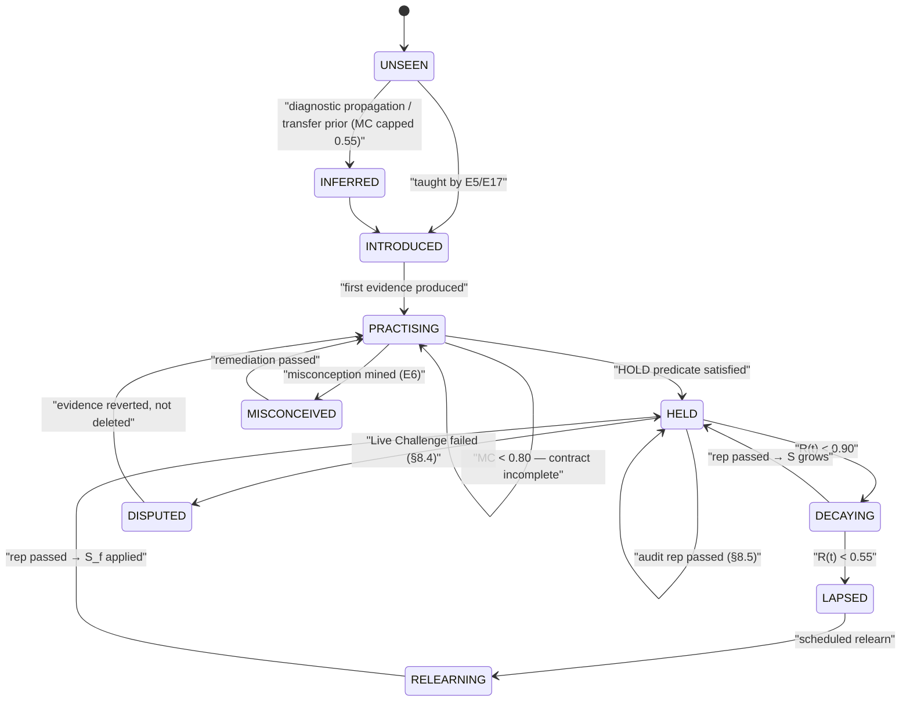
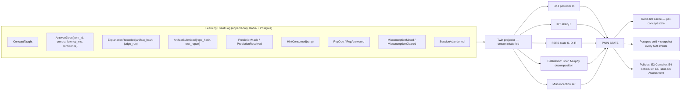
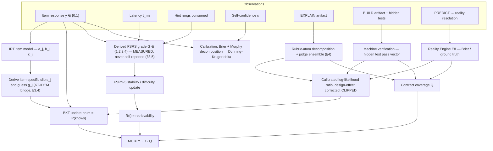
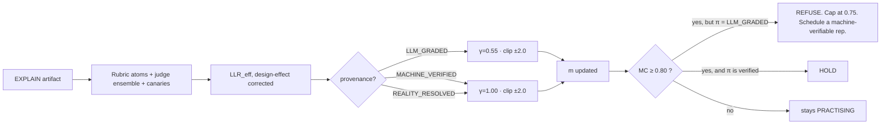
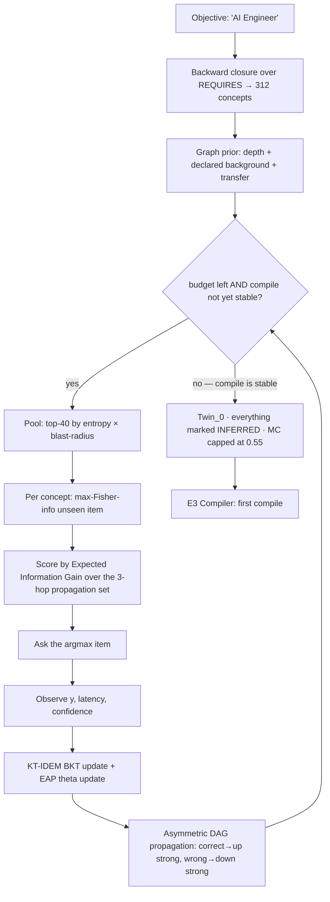
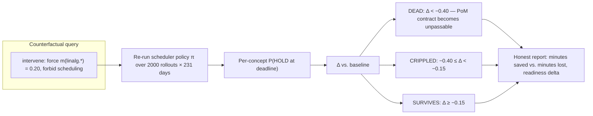
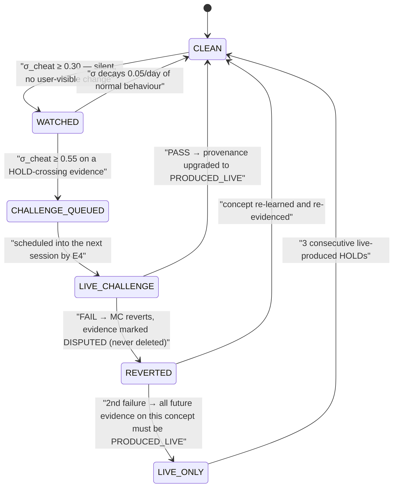

# 08 — The Cognitive Twin

> **Engines:** `E1 Twin Engine` · `E7 Memory Engine`
> **Primary Invention:** **I-1 (The Cognitive Twin)**. Supporting: I-2 (PoM), I-6 (Failure-Seeking), I-8 (Ledger), I-10 (Mastery-per-Minute).
> **Obeys:** `CANON.md`. If this doc contradicts CANON, CANON wins.

---

## 0. The claim

> The Twin is not a profile, a progress bar, or a "skill level." It is a **probabilistic simulator
> of one mind**, at concept granularity, that can be **run forward in time** to answer
> counterfactual questions about a human being.

Everything else in PRAXIS is a **policy acting on the Twin**. The Compiler reads it as a cache.
The Scheduler reads it as a priority function. The Tutor reads it as a model of what you don't
know. The Ledger is its audit trail. If the Twin is wrong, PRAXIS is wrong — so the Twin is
built to be **falsifiable, self-auditing, and pessimistic**.

**What is genuinely novel here** (vs. table stakes):

| Component | Status |
|---|---|
| BKT, IRT, FSRS individually | Table stakes. 20+ years of literature. |
| Running all three on the same latent, fused | Uncommon; a few research systems. |
| **Fusing LLM-graded qualitative evidence into the same Bayesian posterior via calibrated rubric-atom likelihoods** | **Novel.** §4. |
| **The Evidence Ceiling: LLM-only evidence structurally cannot produce mastery** | **Novel.** §4.6. |
| **Compile-stability stopping** for the Day-0 diagnostic | **Novel.** §5.4. |
| **Twin Fidelity** — the Twin scores *itself* with unannounced audit reps and corrects its own parameters | **Novel.** §8.5. |
| **Live Challenge** as the sole resolver of cheating suspicion (no accusation, no detector verdict) | **Novel.** §8.4. |
| Counterfactual forward simulation over Plan + decay | **Novel** as a product surface. §6. |
| Graph-embedding transfer priors that **can never produce a HOLD** | **Novel guardrail.** §7. |

---

## 1. Formal model

### 1.1 The per-concept state vector

For learner `i` and concept `c` at wall-clock time `t`, the Twin holds:

| Symbol | Name | Type | Source engine | Meaning |
|---|---|---|---|---|
| `m_ic` | Encoding belief | `[0,1]` | E1 (BKT) | `P(knows(c))` — probability the concept was ever correctly encoded |
| `θ_ic` | Concept ability | `ℝ` (logits) | E1 (IRT) | Continuous proficiency on the concept-local scale; `θ=0` ≙ threshold of holding |
| `S_ic` | Stability | days, `>0` | E7 (FSRS) | Interval at which retrievability falls to 0.90 |
| `D_ic` | Difficulty | `[1,10]` | E7 (FSRS) | *This learner's* difficulty with this concept (not the item's difficulty) |
| `t_ic` | Elapsed | days | E7 | Days since last successful retrieval |
| `R_ic(t)` | Retrievability | `[0,1]` | E7 | `P(successful retrieval right now)` |
| `Q_ic` | Contract coverage | `[0,1]` | E1 + E6 | Fraction of the concept's **PoM contract** satisfied, weighted |
| `MC_ic(t)` | **Mastery Credit** | `[0,1]` | E1 | The product. See §1.2. |
| `κ_ic` | Confidence | `[0,1]` | E1 | Learner's own self-report, elicited *before* feedback |
| `Δ_ic` | **Dunning–Kruger delta** | `[-1,1]` | E1 | `κ_ic − MC_ic`. Positive = overclaiming. |
| `v_i(d)` | Learning velocity | `ℝ⁺` | E1 | Learner random effect from a mixed-effects AFT model, per domain `d` |
| `M_ic` | Misconception set | `set` | E6 | Named, specific wrong models this learner holds |
| `X_ic` | Evidence chain | `hash-list` | E16 | Hash-linked pointers into the Ledger |
| `π_ic` | Provenance floor | `enum` | E1 | The *weakest* provenance in the evidence that produced `MC` |

### 1.2 Mastery Credit — the one number

```
MC_ic(t)  =  m_ic  ·  R_ic(t)  ·  Q_ic
```

Three multiplicative gates, and every one of them can be zero:

| Gate | Question it answers | If it is 0 |
|---|---|---|
| `m_ic` | *Did she ever actually learn it?* | She never encoded it. |
| `R_ic(t)` | *Can she retrieve it **right now**?* | She learned it and forgot it. |
| `Q_ic` | *Did she produce the evidence the contract demands?* | **She has not proven it — and PRAXIS will not say she knows it.** |

`Q` is where **I-2** becomes arithmetic. It is why there is no "mark as complete" button: `Q` is
not settable, only earnable.

```
Q_ic = Σ_{k ∈ contract(c)}  v_k · sat_k        /   Σ_{k ∈ contract(c)} v_k
```

with `sat_k ∈ [0,1]` the graded satisfaction of evidence type `k`, and default weights:

| Evidence type | `v_k` | Notes |
|---|---|---|
| `RECALL` | 0.10 | Deliberately the weakest. CANON §2. |
| `APPLY` (novel item) | 0.25 | Item must be IRT-calibrated and never seen. |
| `EXPLAIN` (teach-back) | 0.20 | LLM-graded → capped. §4.6. |
| `BUILD` (artifact runs) | 0.25 | Machine-verifiable. |
| `CRITIQUE` (find the flaw) | 0.10 | Generated from `CONTRASTS` edges. |
| `PREDICT` (reality resolves) | 0.10 | The Reality Loop (I-3). Highest trust per unit. |

### 1.3 The HOLD predicate — the hard gate

```
HOLD(i, c, t)  ⟺   MC_ic(t) ≥ τ_hold                                  (default τ_hold = 0.80)
             ∧   ∀ k ∈ mandatory(contract(c)) :  sat_k ≥ θ_k
             ∧   π_ic ∈ { PRODUCED_LIVE, MACHINE_VERIFIED, REALITY_RESOLVED }
             ∧   no ACTIVE misconception attached to c
```

Four conjuncts. All four are enforced **in the Twin's write path**, not in a prompt, not in a
UI check. The update function *refuses the write*. This is the architectural expression of the
category-defining refusal.

### 1.4 Concept lifecycle



> **A concept is never "done."** `HELD` is a state you *bleed out of*. **I-2.**

---

## 2. The Twin is a projection, not a table

Per **CANON §5.1**, the Twin is a **fold over the immutable Learning Event log**.



### 2.1 Determinism (non-negotiable)

The Twin must rebuild **bit-identically** from event zero, or the Ledger (I-8) is worthless.
Therefore:

| Source of nondeterminism | How it is removed |
|---|---|
| LLM rubric grading | **The judge's verdict is the event.** We persist the graded atom vector `y`, the judge ensemble IDs, temperature, seed and `judge_run_hash` — never "re-grade on replay." |
| Model version drift | Every event carries `grader_model_version`, `graph_version`, `fsrs_weights_version`, `irt_calibration_version`. Replay uses the *versions in the event*. |
| Adaptive item selection | RNG seeded by `hash(learner_id ‖ session_id ‖ event_seq)`. |
| Floating point | Fixed op-order in the projector; `float64`; no parallel reduction in the fold. |

**Consequence:** a third party handed the event log + the pinned model/param manifests can
recompute the Twin and verify every claim on a Verified Competency Record. That is the moat.

---

## 3. The inference stack

Three estimators, one latent construct, fused. Each answers a different question.

| Estimator | Question | Latent | Time-aware? |
|---|---|---|---|
| **BKT** | *Has she learned it at all?* | binary `L ∈ {0,1}` | no |
| **IRT (2PL/3PL)** | *How good is she, on a graded scale, relative to calibrated items?* | continuous `θ` | no |
| **FSRS / DSR** | *Can she retrieve it right now, and when will she not be able to?* | `(S, D)` → `R(t)` | **yes** |



### 3.1 Bayesian Knowledge Tracing — the encoding belief `m`

Four parameters per **concept** (not per item — item effects live in IRT; see §3.4):

| Param | Meaning | Prior (Beta) | Constraint |
|---|---|---|---|
| `P(L₀)` | Prior probability of already knowing it | `Beta(2, 8)` → mean 0.20 | seeded by graph depth + transfer (§7) |
| `P(T)` | Transition ("learn") probability per opportunity | `Beta(4, 16)` → mean 0.20 | `∈ [0.02, 0.45]` |
| `P(S)` | Slip: knows it, answers wrong | `Beta(2, 18)` → mean 0.10 | `≤ 0.30` |
| `P(G)` | Guess: doesn't know it, answers right | `Beta(2.5, 7.5)` → mean 0.25 | `≤ 0.30`, and **`P(S) + P(G) < 1`** (Beck's degeneracy guard) |

**Update on observation `y` at opportunity `n`:**

```
                                m_n · (1 − P(S))
  y = 1 (correct):  m_n⁺  =  ─────────────────────────────────────────
                             m_n · (1 − P(S))  +  (1 − m_n) · P(G)

                                m_n · P(S)
  y = 0 (wrong):    m_n⁺  =  ─────────────────────────────────────────
                             m_n · P(S)  +  (1 − m_n) · (1 − P(G))

  Then learning transition:
                    m_{n+1}  =  m_n⁺  +  (1 − m_n⁺) · P(T)
```

**Real parameters, real concepts** (fitted by EM over the telemetry of ≥ 500 learners per
concept; cold concepts inherit the domain-pack prior):

| Concept | `P(L₀)` | `P(T)` | `P(S)` | `P(G)` | Comment |
|---|---|---|---|---|---|
| `ta.support_resistance` | 0.18 | 0.24 | 0.12 | 0.28 | high guess — S/R "looks" obvious on a chart |
| `ta.breakout_vs_fakeout` | 0.06 | 0.11 | 0.09 | 0.22 | low `P(T)`: genuinely hard, needs many reps |
| `ml.bias_variance` | 0.14 | 0.22 | 0.10 | 0.24 | 4-option MCQ floor pins `P(G)` ≈ 0.25 |
| `linalg.matmul_as_composition` | 0.21 | 0.31 | 0.08 | 0.18 | high `P(T)`: one good explanation usually does it |
| `ml.attention_mechanism` | 0.03 | 0.14 | 0.13 | 0.16 | high slip: people who "get it" still botch the shapes |
| `erp.three_way_match` | 0.09 | 0.35 | 0.06 | 0.20 | procedural; sticks fast once seen |

**Worked BKT trace — Meera, `ml.bias_variance`** (`L₀=0.14, T=0.22, S=0.10, G=0.24`):

| # | Opportunity | `m` before | `y` | `m⁺` (posterior) | `m` after transit |
|---|---|---|---|---|---|
| 1 | APPLY item `bv-114` (b=−0.3) | 0.140 | ✗ | `0.14·0.10 / (0.14·0.10 + 0.86·0.76)` = **0.021** | 0.021 + 0.979·0.22 = **0.236** |
| 2 | Taught + APPLY item `bv-207` (b=0.1) | 0.236 | ✓ | `0.236·0.90 / (0.236·0.90 + 0.764·0.24)` = **0.537** | 0.537 + 0.463·0.22 = **0.639** |
| 3 | APPLY item `bv-233` (b=0.4) | 0.639 | ✓ | `0.639·0.90/(0.639·0.90+0.361·0.24)` = **0.869** | 0.869 + 0.131·0.22 = **0.898** |
| 4 | CRITIQUE `bv-c19` (wrong worked example) | 0.898 | ✓ | **0.972** | **0.978** |
| 5 | EXPLAIN teach-back (LLM-graded, §4) | 0.978 | LLR clipped | see §4.5 | **0.984** (clipped contribution) |

At step 5, `m = 0.984`. But `MC = m · R · Q` — and `Q` is only 0.70 because the contract for
`ml.bias_variance` mandates a `BUILD` (a learning-curve plot from a real over/under-fit run)
that Meera has not submitted. `R = 0.98` (learned an hour ago). So:

```
MC = 0.984 × 0.98 × 0.70 = 0.675   →   NOT HELD.   PRAXIS says: "You can talk about it.
                                                     You haven't shown it. Build the curve."
```

**That is the product.**

### 3.2 Item Response Theory — the graded scale

**3PL** (used for selected-response items; `c=0` reduces it to **2PL**, used for constructed
response):

```
P(y=1 | θ, a_j, b_j, c_j)  =  c_j  +  (1 − c_j) · σ( a_j · (θ − b_j) )
                                      where σ(x) = 1 / (1 + e^{−x})
```

| Param | Name | Typical range | Rejection rule |
|---|---|---|---|
| `a_j` | discrimination | 0.4 – 2.5 | **retire if `a_j < 0.45`** (item doesn't separate) |
| `b_j` | difficulty | −3 – +3 | keep bank spread `b ∈ [−2, +2]` per concept |
| `c_j` | pseudo-guess | 0 – 0.30 | **retire if `c_j > 0.35`** (item is a coin flip) |

**Fisher information** (this is what the adaptive engine maximizes):

```
                a_j² · (1 − P_j)   ( P_j − c_j )²
  I_j(θ)  =  ───────────────── · ( ───────────── )         (3PL)
                     P_j          (   1 − c_j   )

  I_j(θ)  =  a_j² · P_j · (1 − P_j)                        (2PL)
```

**Calibration pipeline (E6):**

| Stage | Method | Trigger |
|---|---|---|
| Birth | LLM proposes `(â, b̂, ĉ)` from the item text + concept difficulty prior. Marked `UNCALIBRATED`. Never used for a HOLD-crossing decision. | item authored |
| Provisional | Bayesian shrinkage toward the concept's bank mean: `b̃ = (n·b̂_MLE + k·b̄_bank) / (n+k)`, `k = 25` | `n ≥ 25` responses |
| Calibrated | **Marginal Maximum Likelihood (MML) via EM** with Bock–Aitkin Gauss–Hermite quadrature (41 nodes over `θ ~ N(0,1)`); priors `log a ~ N(0, 0.5²)`, `b ~ N(0,1)`, `logit c ~ N(−1.4, 0.5²)` | `n ≥ 200` responses |
| Linked | Non-equivalent-groups anchor-test (NEAT) linking with **Stocking–Lord** to keep every concept's `θ` scale comparable across item cohorts | each calibration run |
| Monitored | Weekly drift check: `Δb > 0.35` → item **leaked** (posted online) → retire. **DIF** (Mantel–Haenszel) across locale/tenant → flag for review | weekly |

> **Anti-leak:** an item whose `b_j` suddenly *drops* while `a_j` *drops* is the classic
> signature of a leaked item. PRAXIS auto-retires it and regenerates the slot from the
> concept's item template. This is the assessment analogue of cache poisoning.

### 3.3 FSRS-5 / DSR — the memory model (E7)

**Three variables:** `D` Difficulty, `S` Stability, `R` Retrievability.

**Retrievability (power-law forgetting, FSRS-4.5+):**

```
                          ⎛        t  ⎞^ DECAY
  R(t, S)  =  ⎜ 1 + FACTOR · ─── ⎟            DECAY = −0.5,   FACTOR = 0.9^(1/DECAY) − 1 = 19/81
                          ⎝        S  ⎠

  ⇒  R(t, S)  =  ( 1 + (19/81) · t/S ) ^ (−0.5)
```

Sanity check: `t = S` ⇒ `R = (1 + 0.2346)^(−0.5) = 0.900`. ✔ **`S` is by definition the
interval at which retrievability is 0.90.** This identity is load-bearing in §9 and in doc 10.

**Interval for a desired retention `R_d`:**

```
                  S      ⎛      1/DECAY      ⎞        81·S   ⎛   1        ⎞
  I(R_d, S)  =  ────── · ⎜ R_d          − 1  ⎟   =   ────── ·⎜ ─────  − 1 ⎟
                FACTOR   ⎝                   ⎠         19    ⎝  R_d²      ⎠
```

**FSRS-5 weights** — published defaults, used as the **population prior**; PRAXIS refits per
learner (once `≥ 400` reviews) and per domain pack via mini-batch gradient descent on the
log-loss of `R̂` vs. observed recall:

```
w = [0.40255, 1.18385, 3.17300, 15.69105,   7.19490, 0.53450, 1.46040, 0.00460,
     1.54575, 0.11920, 1.01925,  1.93950,   0.11000, 0.29605, 2.26980, 0.23150,
     2.98980, 0.51655, 0.66210]
```

**Initial state** after the first successful retrieval with grade `G ∈ {1,2,3,4}`:

```
  S₀(G) = w_{G−1}                                    → 0.40, 1.18, 3.17, 15.69 days
  D₀(G) = w₄ − e^{ w₅ · (G−1) } + 1                  clamped to [1, 10]
```

**Stability update — successful review** (`G ≥ 2`), given current `(D, S)` and `R` *at review
time*:

```
  S'_success = S · ⎡ 1 + e^{w₈} · (11 − D) · S^{−w₉} · ( e^{ w₁₀·(1−R) } − 1 ) · h · b ⎤
                   ⎣                                                                   ⎦
        h = w₁₅  if G = 2 ("hard")   else 1
        b = w₁₆  if G = 4 ("easy")   else 1
```

Read it: stability grows **more** when `D` is low, when `S` is small, and — the crucial term —
when `R` is **low**. `e^{w₁₀(1−R)} − 1` is the **desirable-difficulty term**: *retrieving
something you had almost forgotten is worth far more than retrieving something fresh.* The
Scheduler (doc 10) exploits this directly.

**Stability after a lapse** (`G = 1`):

```
  S'_fail = w₁₁ · D^{−w₁₂} · ( (S + 1)^{w₁₃} − 1 ) · e^{ w₁₄ · (1 − R) }
  S'      = min( S'_fail , S )                       (a lapse can never increase stability)
```

**Difficulty update:**

```
  ΔD  = −w₆ · (G − 3)
  D'  = D + ΔD · (10 − D) / 9                        (linear damping — hard to push D to extremes)
  D'' = w₇ · D₀(4)  +  (1 − w₇) · D'                 (mean reversion toward "easy" anchor)
  D'' clamped to [1, 10]
```

**Same-day extra review:** `S' = S · e^{ w₁₇ · (G − 3 + w₁₈) }` — near-flat, because massed
practice buys almost no stability. **The model refuses to reward cramming.** This is not a
policy we added; it falls out of the memory model, and it is why PRAXIS can honestly say
cramming does not work.

### 3.4 The KT-IDEM bridge — how IRT and BKT are fused

BKT's `P(S)`/`P(G)` are per-concept, which is wrong: a trivial item and a brutal item are not
equally informative. The fix is **KT-IDEM** (Knowledge Tracing – Item Difficulty Effect Model):
make slip and guess **item-specific**, and *derive them from the item's calibrated IRT
parameters*.

Anchor the concept-local ability scale so that:

* `θ_naive = −1.2` — a learner who does **not** hold the concept
* `θ_master = +1.2` — a learner who **holds** it at `τ_hold`

Then, for item `j` with calibrated `(a_j, b_j, c_j)`:

```
  g_j  =  P(y=1 | θ_naive , a_j, b_j, c_j)   =  c_j + (1−c_j)·σ( a_j·(−1.2 − b_j) )
  s_j  =  1 − P(y=1 | θ_master, a_j, b_j, c_j) = 1 − [ c_j + (1−c_j)·σ( a_j·(+1.2 − b_j) ) ]
```

**Diagnosticity gate:** if `g_j + s_j ≥ 0.95`, the item carries almost no information about the
latent → **rejected from the bank**, regardless of how nice it looks.

**Worked:** item `bv-233`, `a = 1.4, b = 0.4, c = 0.22`.

```
  g = 0.22 + 0.78·σ(1.4·(−1.6)) = 0.22 + 0.78·σ(−2.24) = 0.22 + 0.78·0.0962 = 0.295
  s = 1 − [0.22 + 0.78·σ(1.4·0.8)] = 1 − [0.22 + 0.78·σ(1.12)] = 1 − [0.22 + 0.78·0.754] = 0.192
  g + s = 0.487  ✔ diagnostic
```

These `(s_j, g_j)` replace `P(S), P(G)` in the BKT update of §3.1 **for that item only**. The
concept-level `P(S), P(G)` remain as the prior for uncalibrated items.

Meanwhile `θ_ic` is updated by **EAP** (expected a posteriori) over the concept's response
history, with prior `θ ~ N(μ_transfer, 1)` where `μ_transfer` comes from §7. `θ` and `m` are
two views of the same latent; they are reconciled by the consistency check
`|σ(θ_ic) − m_ic| ≤ 0.25` — a persistent violation is a **model fault**, logged and fed into
Twin Fidelity (§8.5).

### 3.5 The FSRS grade is **measured**, never asked

Anki asks "how hard was that?" That is a self-report, and self-reports are exactly what PRAXIS
refuses to trust (I-1: the confidence/competence gap is a *bug to be measured*, not an input to
be believed).

PRAXIS **derives** `G` from observed behaviour:

| `G` | Label | Derivation rule |
|---|---|---|
| **1** | Again | `y = 0` **or** hint ladder reached `partial`/`full` (I-5) |
| **2** | Hard | `y = 1` **and** ( latency `z > +1.0` **or** hint rung ≥ `analogy` ) |
| **3** | Good | `y = 1`, latency `z ∈ [−1.0, +1.0]`, hints ≤ `probe` |
| **4** | Easy | `y = 1`, latency `z < −1.0`, **zero** hints, **and** `κ ≥ 0.75` with `y=1` (confident *and* right) |

Latency `z` is the residual of a **lognormal response-time model** (van der Linden):

```
  ln T_ij  ~  N( λ_j − τ_i ,  σ_j² )        λ_j = item time-intensity,  τ_i = learner speed

  z_ij  =  ( ln t_ij − (λ_j − τ_i) ) / σ_j
```

The same `z` is the input to cheating forensics (§8.2). One model, two uses.

---

## 4. Fusing LLM-graded evidence — the novel part

**The problem, stated honestly.** An LLM rubric score is *not* a Bernoulli trial with known
slip and guess. It is a noisy, biased instrument with known pathologies:

| Pathology | What it does to a naive Twin |
|---|---|
| Verbosity/fluency bias | Rewards a beautiful, confidently wrong teach-back → **hallucinated mastery** |
| Sycophancy | If told "this learner is advanced," grades up |
| Holistic-score compression | Everything lands 7/10; no discrimination (`a ≈ 0`) |
| Positional/anchoring bias | The rubric's first criterion dominates |
| Non-determinism | Breaks the deterministic projection (§2.1) |

If you feed an LLM score straight into a Bayesian update, **the Twin will lie to the learner
and the Ledger will be fraudulent.** So we do not.

### 4.1 Step 1 — Decompose into rubric atoms (no holistic scores, ever)

An `EXPLAIN` or `BUILD` contract is compiled from the concept node into `K` **binary,
independently checkable atoms**, each of which must be *span-grounded* in the artifact.

Example — concept `ta.breakout_vs_fakeout`, `EXPLAIN` contract, `K = 7`:

| # | Atom (binary) | Class | `s_k` (miss-given-knows) | `g_k` (hit-given-not-knows) |
|---|---|---|---|---|
| a1 | States that a breakout requires a *close* beyond the level, not a wick | `DEFINITIONAL` | 0.10 | 0.30 |
| a2 | Connects volume expansion to conviction, with a mechanism (not a slogan) | `MECHANISTIC` | 0.18 | 0.12 |
| a3 | Names the liquidity-sweep / stop-hunt reason a fakeout *happens* | `MECHANISTIC` | 0.22 | 0.08 |
| a4 | Distinguishes it from a *retest* (the `CONTRASTS` edge) | `DISCRIMINATIVE` | 0.20 | 0.10 |
| a5 | Gives a falsifiable invalidation level | `OPERATIONAL` | 0.15 | 0.15 |
| a6 | Does **not** assert the misconception `M-114: "high volume ⇒ breakout is real"` | `NEGATIVE` | 0.12 | 0.35 |
| a7 | Handles the degenerate case: low-liquidity session / news gap | `EDGE-CASE` | 0.30 | 0.05 |

Note atom **a6 is a negative atom** — it checks for the *absence* of a known misconception.
Negative atoms are what stop a fluent bullshitter. `g` is high on definitional atoms (anyone can
parrot a definition) and low on edge-case and mechanistic atoms (you cannot fake those). **The
`(s_k, g_k)` are exactly the psychometric parameters of the atom**, and they are fitted, not
guessed — see §4.3.

### 4.2 Step 2 — Judge ensemble + canaries

Each atom is graded **independently** (separate call, atom in isolation, artifact quoted, judge
blind to learner identity, blind to prior mastery, blind to other atoms' verdicts).

| Judge | Model tier | Instruction |
|---|---|---|
| `J⁺` | fast (Sonnet-class) | "Is atom `k` satisfied? Quote the exact span that satisfies it, or output NONE." |
| `J⁻` | fast, **adversarial** | "Give the strongest reason atom `k` is **not** satisfied by this artifact." |
| `J⁰` | large (Opus-class) | Adjudicates `J⁺` vs `J⁻`, sees both, outputs `y_k ∈ {0,1}` + `ρ_k` (self-agreement over 3 samples) |

**Judge canaries (novel).** Into every grading run we inject **2 synthetic artifacts whose
ground truth we know**: one *correct* and one *subtly wrong* (built from the concept's
misconception library). The judge grades all three, shuffled, unaware. If the judge misgrades a
canary, **the entire run is discarded** and re-run at a higher model tier; two consecutive canary
failures on a concept ⇒ the concept's `EXPLAIN` contract is **suspended** (falls back to
`APPLY` + `CRITIQUE`) and the atom set goes to the human review queue.

> We do not trust the judge. We **test** the judge, every single time, in-band.

### 4.3 Step 3 — Calibrate the judge as an instrument

Per **atom class** (not per atom — too little data), per domain pack, we hold out a
human-labelled golden set (`n ≥ 300` artifacts, 2 expert raters, Krippendorff's `α ≥ 0.75`) and
estimate:

```
  η_k = P( judge says 1 | atom truly satisfied )        sensitivity
  ζ_k = P( judge says 0 | atom truly unsatisfied )      specificity
```

with `Beta` posteriors so that small golden sets produce *wide* likelihoods (and therefore
*small* Twin updates — uncertainty is automatically conservative).

**Measured values** (v1 golden sets, Sonnet-class `J⁺` + Opus-class `J⁰` adjudication):

| Atom class | `η` | `ζ` | Comment |
|---|---|---|---|
| `DEFINITIONAL` | 0.95 | 0.71 | Judges over-accept definitions. Low specificity ⇒ **low evidential weight.** |
| `MECHANISTIC` | 0.84 | 0.88 | The workhorse. |
| `DISCRIMINATIVE` | 0.81 | 0.91 | Best specificity — hard to fake a real distinction. |
| `OPERATIONAL` | 0.88 | 0.86 | |
| `NEGATIVE` | 0.76 | 0.94 | **Highest specificity.** If the negative judge says you asserted the misconception, you did. |
| `EDGE-CASE` | 0.72 | 0.93 | Judges miss real edge-case handling (low `η`) but rarely invent it. |

Note what this table does: **it makes "the LLM said it was good" into a number with an error
bar.** Definitional atoms, which is where hallucinated mastery lives, are automatically
near-worthless (`ζ = 0.71`).

### 4.4 Step 4 — The likelihood update

Latent `L ∈ {0,1}` = *the learner holds the concept*. For each atom `k`, marginalising over
whether the atom is *truly* satisfied:

```
  P(y_k = 1 | L=1)  =  (1 − s_k)·η_k  +  s_k·(1 − ζ_k)
  P(y_k = 1 | L=0)  =        g_k ·η_k  +  (1 − g_k)·(1 − ζ_k)
  P(y_k = 0 | L=·)  =  1 − P(y_k = 1 | L=·)
```

**Raw log-likelihood ratio:**

```
                ⎡        P(y_k=1|L=1)                 P(y_k=0|L=1) ⎤
  LLR_raw = Σ_k ⎢ y_k·ln ─────────────  + (1−y_k)·ln ───────────── ⎥
                ⎣        P(y_k=1|L=0)                 P(y_k=0|L=0) ⎦
```

**Correlation correction (design effect).** Atoms are *not* conditionally independent — a
fluent writer passes several at once. Treating `K` correlated atoms as `K` independent trials is
the single biggest way to over-update. Apply the survey-sampling **effective sample size**:

```
                  K                                  ρ̄ = mean pairwise residual correlation of
  K_eff  =  ───────────────                               atom verdicts within an artifact,
            1 + (K − 1)·ρ̄                                measured on the golden set.
                                                    Measured: ρ̄ = 0.34 (EXPLAIN), 0.11 (BUILD).

  LLR_eff  =  LLR_raw · ( K_eff / K )
```

For `K = 7, ρ̄ = 0.34`: `K_eff = 7 / (1 + 6·0.34) = 7/3.04 = 2.30` → **LLR is scaled by 0.33.**
Seven LLM verdicts are worth about **two and a third** independent observations. That is the
honest exchange rate, and we pay it.

**Asymmetric gain (the Twin is a skeptic):**

```
  LLR_final = clip(  γ ·  LLR_eff ,  −2.0 ,  +2.0  )        (± 2.0 logits, hard clip)

      γ = 0.55   if  LLR_eff > 0   and evidence is LLM-graded only     (rise slowly)
      γ = 1.35   if  LLR_eff < 0                                       (fall fast)
      γ = 1.00   if  evidence is MACHINE_VERIFIED or REALITY_RESOLVED
```

**Posterior:**

```
  logit( m⁺ )  =  logit( m )  +  LLR_final
```

The clip at `±2.0` logits means **no single LLM-graded artifact can move `P(knows)` from 0.50
to more than 0.88, ever** — and typically far less.

### 4.5 Worked example — Meera's `ml.bias_variance` teach-back

Prior `m = 0.978` (from §3.1). She records a 90-second voice teach-back. Atoms (`K = 6`):

| Atom | Class | `y_k` | `s_k` | `g_k` | `η` | `ζ` | `P(y|L=1)` | `P(y|L=0)` | `ln LR` |
|---|---|---|---|---|---|---|---|---|---|
| a1 defines both terms | DEFINITIONAL | 1 | 0.08 | 0.35 | 0.95 | 0.71 | 0.898 | 0.521 | +0.545 |
| a2 links variance to model capacity, mechanistically | MECHANISTIC | 1 | 0.16 | 0.10 | 0.84 | 0.88 | 0.725 | 0.192 | +1.329 |
| a3 distinguishes from *noise* (irreducible error) | DISCRIMINATIVE | 1 | 0.20 | 0.09 | 0.81 | 0.91 | 0.666 | 0.155 | +1.458 |
| a4 does **not** claim "more data always fixes bias" (M-081) | NEGATIVE | **0** | 0.14 | 0.30 | 0.76 | 0.94 | 0.662 | 0.270 | `ln(0.338/0.730)` = **−0.770** |
| a5 gives an operational test (learning curves) | OPERATIONAL | 1 | 0.12 | 0.14 | 0.88 | 0.86 | 0.791 | 0.243 | +1.180 |
| a6 handles the high-bias-and-high-variance case | EDGE-CASE | 0 | 0.28 | 0.06 | 0.72 | 0.93 | 0.538 | 0.109 | `ln(0.462/0.891)` = **−0.656** |

```
  LLR_raw  =  0.545 + 1.329 + 1.458 − 0.770 + 1.180 − 0.656  =  +3.086
  K = 6, ρ̄ = 0.34  ⇒  K_eff = 6 / (1 + 5·0.34) = 6/2.70 = 2.222  ⇒  scale = 0.370
  LLR_eff  =  3.086 × 0.370  =  +1.142
  LLM-only, positive ⇒ γ = 0.55  ⇒  LLR_final = +0.628   (well inside the ±2.0 clip)

  logit(0.978) = 3.789   →   3.789 + 0.628 = 4.417   →   m⁺ = σ(4.417) = 0.988
```

**And the two failed atoms did real work:**
* `a4 = 0` ⇒ E6 opens **misconception `M-081` ("more data always fixes bias")** as `SUSPECTED`.
  A `CRITIQUE` item targeting exactly `M-081` is queued (I-6).
* `a6 = 0` ⇒ `sat_EXPLAIN` is graded, not binary: `sat = Σ v_k y_k / Σ v_k` over the atoms
  ⇒ `sat_EXPLAIN = 0.63`, below the contract threshold `θ_EXPLAIN = 0.75`.

So `Q` does **not** advance. `MC` stays below `τ_hold`. The teach-back was *good*, and PRAXIS
still says: **not yet.**

### 4.6 The Evidence Ceiling — the guardrail that makes this safe

> **An LLM can raise suspicion of mastery. Only reality, a test suite, or a calibrated item
> can confirm it.**

Enforced in the Twin's write path as three hard rules:

| Rule | Statement |
|---|---|
| **EC-1** | Evidence with provenance `LLM_GRADED` cannot raise `MC` above **`τ_llm = 0.75`**. Below `τ_hold = 0.80`. Period. |
| **EC-2** | Crossing `τ_hold` requires **≥ 1** evidence record with provenance in `{ MACHINE_VERIFIED, REALITY_RESOLVED, CALIBRATED_ITEM }` — i.e. a `BUILD` that passes hidden tests, a `PREDICT` that reality graded, or an `APPLY` on an IRT-calibrated item the learner had never seen. |
| **EC-3** | The `MC` decay floor: if the *only* recent evidence is LLM-graded, `π_ic` (provenance floor) is `LLM_GRADED`, and the concept is force-scheduled for a machine-verifiable rep within `min(7d, 0.5·S)`. |



---

## 5. Cold start — the Day-0 diagnostic

**Constraint:** seed a Twin over a **312-concept** backward closure in **≤ 16 items / ≤ 10
minutes**. A 312-item test is not a product; it is a punishment.

**Key insight:** we do not test *concepts*, we test **cut-points in the DAG**. Because
`REQUIRES` is transitive, one well-placed item collapses the entropy of dozens of nodes.

### 5.1 The graph prior

```
  logit( P(knows(c)) )₀  =  β₀  −  β_d · depth(c)  +  β_x · declared_background(c)  +  transfer(c)
```

| Term | Value | Meaning |
|---|---|---|
| `β₀` | +1.10 | root concepts are usually known |
| `β_d` | 0.62 per level | knowledge thins with depth |
| `β_x` | +0.9 × (self-declared exposure, 0–1) | "3 yrs backend Python" lifts the whole Python subgraph |
| `transfer(c)` | §7 | graph-embedding transfer from concepts already believed held |

### 5.2 Belief propagation over the DAG

A response on concept `c` propagates. The propagation is **deliberately asymmetric**, because the
logic is asymmetric:

| Direction | Trigger | Gain `γ` | Decay `φ` per hop | Why |
|---|---|---|---|---|
| ↑ ancestors (prereqs) | **correct** on `c` | **0.65** | 0.70 | If you can do `c`, you almost certainly have `c`'s prerequisites. Strong. |
| ↓ descendants | **incorrect** on `c` | **0.75** | 0.65 | If you can't do `c`, you can't do what *requires* `c`. Strong. |
| ↓ descendants | correct on `c` | 0.10 | 0.60 | Passing a prereq says *little* about the harder thing above it. Weak. |
| ↑ ancestors | incorrect on `c` | 0.15 | 0.60 | You might hold every prereq and still fail `c`. Weak. |

```
  logit( m_c' )  ←  logit( m_c' )  +  γ_dir · φ_dir^{ dist(c, c') } · LLR_c
```

Propagation is capped at `dist ≤ 3` hops and the total propagated shift per item is clipped to
`±1.5` logits.

### 5.3 Item selection — expected information gain

```
  j*  =  argmax_j   EIG(j)  =  argmax_j  Σ_{c' ∈ Prop(j)}  [  H( m_{c'} )  −  𝔼_y [ H( m_{c'} | y ) ]  ]

  where  H(p) = −p·log₂ p − (1−p)·log₂(1−p)                          (bits)
         𝔼_y[·] = P(y=1)·H(m'|y=1) + P(y=0)·H(m'|y=0)
         P(y=1) = m_c·(1 − s_j) + (1 − m_c)·g_j                      (from the KT-IDEM bridge)
```

`Prop(j)` = the item's primary concept plus everything within 3 hops. **A single item at the
right depth can yield 6–14 bits.** A leaf item yields < 1.

### 5.4 Stopping — *compile-stability stopping* (novel)

Standard adaptive testing stops on a **standard-error** criterion. That is the wrong objective
here, because we do not need a precise `θ` — **we need a stable compile** (I-4). We only need
enough certainty that *more testing would not change the plan*. Anything beyond that is minutes
stolen from the learner (I-10).

```
  STOP  when  |{ c ∈ R : 0.10 < P(c enters Plan) < 0.90 }| / |R|  <  0.08
        or    max_j EIG(j) < 0.05 bits
        or    items ≥ 16   or   minutes ≥ 10
```

> **We stop testing when more testing wouldn't change what we'd teach you.**

### 5.5 The algorithm

```python
def diagnostic_seed(learner, objective, max_items=16, max_minutes=10):
    R      = graph.backward_closure(objective.target_set, edge="REQUIRES")   # e.g. 312 concepts
    twin   = Twin(prior = graph_prior(R, learner.declared_background))        # §5.1
    asked  = []

    while len(asked) < max_items and elapsed() < max_minutes:

        # 1. candidate concepts: highest posterior entropy, breadth-first over levels
        pool = top_k(R, key=lambda c: entropy(twin.m[c]) * blast_radius(c), k=40)

        # 2. for each candidate, pick its most informative *unseen* calibrated item
        best, best_eig = None, 0.0
        for c in pool:
            j = argmax(item_bank[c], key=lambda j: fisher_info(j, theta=logit(twin.m[c])))
            if j in seen(learner): continue
            eig = expected_information_gain(j, twin, propagate_kernel)      # §5.3
            if eig > best_eig:
                best, best_eig = j, eig

        if best_eig < 0.05: break                                            # §5.4
        if compile_stability(twin, objective) < 0.08: break                  # §5.4

        # 3. ask, observe (response + latency + confidence)
        y, t_ms, kappa = ask(best)
        asked.append(best)

        # 4. direct update (KT-IDEM), then graph propagation (§5.2)
        twin.update_bkt(best.concept, y, s=slip(best), g=guess(best))
        twin.update_theta_eap(best.concept, y, best.irt)
        twin.propagate(best.concept, llr=log_lr(y, best), kernel=propagate_kernel)
        twin.update_calibration(kappa, y)

    # 5. EVERYTHING seeded here is INFERRED. Inference is not evidence. (I-2)
    for c in R:
        twin.provenance[c] = INFERRED
        twin.MC[c] = min(twin.MC[c], 0.55)      # ← inferred mastery can NEVER be a HOLD
        twin.Q[c]  = 0.0                         # ← no contract satisfied by a diagnostic

    return twin
```



### 5.6 Meera's actual Day-0 (16 items, 9m 40s)

| # | Item on | Depth | `y` | EIG (bits) | Cumulative resolved | Twin move |
|---|---|---|---|---|---|---|
| 1 | `py.comprehensions` | 2 | ✓ | 11.4 | 41 | whole Python subgraph ↑ |
| 2 | `ml.attention_mechanism` | 9 | ✗ | 9.8 | 96 | all of transformers/serving ↓ |
| 3 | `linalg.matmul_shapes` | 4 | ✓ | 8.1 | 128 | linear-algebra base ↑ |
| 4 | `prob.bayes_rule` | 4 | ✓ (slow, `z=+1.8`) | 7.6 | 149 | ↑ but `D` set high — *fragile* |
| 5 | `ml.bias_variance` | 6 | ✗ | 7.2 | 181 | ML-fundamentals gap confirmed |
| 6 | `stat.hypothesis_testing` | 5 | ✗ | 5.9 | 203 | |
| 7 | `linalg.eigendecomposition` | 6 | ✗ | 5.1 | 219 | |
| 8 | `sql.window_functions` | 4 | ✓ | 4.4 | 234 | data-engineering branch ↑ |
| 9 | `ml.gradient_descent` | 7 | ✗ | 4.0 | 248 | |
| 10 | `rag.chunking_strategy` | 10 | ✗ | 3.3 | 259 | |
| 11 | `py.async_await` | 5 | ✓ | 2.7 | 268 | |
| 12 | `ml.overfitting_signals` | 6 | ✓ (guess? `κ=0.25`) | 2.4 | 275 | flagged: low confidence + correct = **lucky** |
| 13 | `calc.chain_rule` | 5 | ✓ | 2.0 | 283 | backprop prereq present |
| 14 | `eval.llm_judge_bias` | 11 | ✗ | 1.5 | 289 | |
| 15 | `docker.multistage` | 3 | ✓ | 0.9 | 293 | |
| 16 | `ml.regularization_l2` | 7 | ✗ | 0.6 | 296 | |

**Stop:** compile-stability = 0.061 (< 0.08). **Result:**

| Bucket | Count |
|---|---|
| `MC ≥ 0.80` believed (but **INFERRED**, capped 0.55 → *not* HELD) | 74 |
| Partial `0.50 – 0.79` | 51 |
| Unheld `< 0.50` | 187 |
| **Day-0 readiness for "AI Engineer"** | **0.31** |

> Note item 12: correct, but self-reported confidence 0.25. The Twin records `m` up **and** logs
> a `LUCKY_GUESS` flag; the concept is re-probed in week 1 with a harder item. **I-6.**

---

## 6. Counterfactual queries — running the Twin forward

The Twin is a **simulator**. Given a Plan (doc 10) and the memory model (§3.3), we can roll it
forward and ask questions no other product can answer.

### 6.1 The simulator

```python
def forward_simulate(twin, plan, horizon_days, n_rollouts=2000, seed=…):
    results = []
    for r in range(n_rollouts):
        T   = twin.clone()
        v   = sample_velocity(twin)          # lognormal, from the AFT random effect (§6.4)
        adh = sample_adherence(twin)         # Beta(α,β) fitted from Contract history (I-9)

        for d in range(horizon_days):
            attended = bernoulli(adh) and is_scheduled(d)
            minutes  = plan.minutes(d) if attended else 0

            for action in scheduler.serve(T, minutes, plan):    # E4's real policy, in the loop
                if action.type == NEW:
                    p_ok = irt_p(theta=T.theta[action.c], item=sample_item(action.c))
                    y    = bernoulli(p_ok)
                    T.update_bkt(action.c, y); T.update_fsrs(action.c, grade(y, …))
                elif action.type == REP:
                    p_ok = T.R[action.c]                       # retrievability IS P(recall)
                    y    = bernoulli(p_ok)
                    T.update_fsrs(action.c, grade(y, …))
                elif action.type == LOOP:
                    T.open_loop(action.c, resolves_in=action.lead_time)
                …
            T.advance_decay(1)                                  # every concept ages one day
        results.append(T.trace)
    return summarize(results)                                   # P50/P80/P95 bands
```

**Readiness** — the quantity all counterfactuals are about:

```
                    Σ_{c ∈ TargetSet}  rel_c · 1[ HOLD(c, t) ]
  Readiness(t)  =  ──────────────────────────────────────────        rel_c from E12 (Career)
                            Σ_{c ∈ TargetSet}  rel_c
```

`Job-ready ⟺ Readiness ≥ 0.85` **and** every `rel ≥ 0.9` ("must-have") concept is HELD. A single
missing must-have cannot be averaged away.

### 6.2 Query 1 — *"When will she be job-ready as an AI Engineer?"*

**Inputs.** Meera: Day-0 Twin (§5.6); Contract = 45 min/day × 6 d/wk; adherence prior
`Beta(17,3)` → 0.85; domain velocity `v = 1.00` (population median — nothing observed yet).

| Line | Computation | Value |
|---|---|---|
| Concepts in closure `R` | | 312 |
| Believed held at Day-0 | | 74 |
| Partial (need top-up) | | 51 |
| Plan-relevant unheld (`rel ≥ 0.25`) | | **143** |
| Mean `est_minutes` for NEW | `[T_teach + T_pom] · f_D(D̄=5.8) / v` = `[12.4 + 12.0] · 1.064 / 1.00` | **26.0 min** |
| NEW acquisition minutes | `143 × 26.0` | **3,718** |
| Top-up minutes | `51 × 10.5` | **536** |
| **Total acquisition** | | **4,254 min = 70.9 h** |
| Weekly budget | `45 × 6` | 270 min |
| × adherence 0.85 | | **229 effective min/wk** |
| Mean acquisition share (rest = reps/loops/project/remediation; ramps 0.72 → 0.48) | | **0.56** |
| Acquisition throughput | `229 × 0.56` | **128 min/wk** |
| **Weeks to Readiness 0.85** | `4,254 / 128` | **33.2** |

**Monte-Carlo (2,000 rollouts) — the honest answer:**

| Percentile | Job-ready week | Calendar |
|---|---|---|
| P20 | 28 | 2027-01-22 |
| **P50** | **33** | **2027-02-26** |
| P80 | 41 | 2027-04-23 |
| P95 | 49 | 2027-06-18 |

**What PRAXIS actually says to Meera:**

> *"At 45 minutes a day, six days a week, you are job-ready as an AI Engineer in **33 weeks**
> — most likely late February. Not 12. At 90 minutes a day it's **18 weeks**. At 20 minutes a
> day it's **71 weeks**, and I'd rather you narrowed the target than spent 16 months.
> **Here is why**, minute by minute."*

**Sensitivity (from the same 2,000 rollouts, re-parameterised):**

| Change | P50 job-ready | Δ |
|---|---|---|
| Baseline: 45 min/day, adherence 0.85 | **week 33** | — |
| 90 min/day | week 18 | −15 |
| 60 min/day | week 25 | −8 |
| 30 min/day | week 48 | +15 |
| 20 min/day | week 71 | +38 |
| Adherence drops to 0.60 | week 45 | +12 |
| Velocity `v = 1.3` (fast learner) | week 27 | −6 |
| Desired retention lowered 0.90 → 0.85 | week 30 | −3 (**and 11% more forgotten at the finish line — reported**) |

Note the last row: PRAXIS will happily show you the shortcut *and* its cost. **I-10.**

### 6.3 Query 2 — *"What breaks if she skips linear algebra?"*

Skipping is not blocked. Skipping **changes the compile** (I-4). The Twin answers by
**intervention**: force `m_c ← 0.20` for the 9 concepts in `linalg.*`, forbid the compiler from
scheduling them, and re-simulate.

```
  BREAKS(X)  =  { c ∈ TargetSet :  ΔP(HOLD(c) at deadline)  <  −0.15 }
```

**Result of skipping `linalg.{vector_ops, matmul_shapes, matmul_as_composition, norms,
projection, eigendecomposition, svd, rank_nullspace, pos_def_matrices}` (≈ 9 concepts, 218
minutes saved):**

| Downstream concept | `rel` | P(HOLD at wk 33) **with** linalg | **without** | Δ | Verdict |
|---|---|---|---|---|---|
| `ml.pca` | 0.45 | 0.91 | 0.14 | **−0.77** | **DEAD** — PCA *is* eigendecomposition |
| `ml.attention_mechanism` | **0.95** | 0.88 | 0.31 | **−0.57** | **DEAD** — QKᵀ is a matmul you must *see* |
| `ml.gradient_descent` | 0.90 | 0.93 | 0.62 | −0.31 | **CRIPPLED** — you can run it, not debug it |
| `emb.vector_search` | 0.85 | 0.92 | 0.58 | −0.34 | **CRIPPLED** — cosine similarity without norms |
| `ml.backprop` | 0.80 | 0.86 | 0.44 | −0.42 | **DEAD** — the Jacobian is a matrix |
| `serving.quantization` | 0.55 | 0.79 | 0.71 | −0.08 | survives |
| `rag.chunking_strategy` | 0.75 | 0.94 | 0.92 | −0.02 | survives |
| `mlops.experiment_tracking` | 0.60 | 0.95 | 0.95 | 0.00 | untouched |

```
  Readiness at week 33:      0.86   →   0.58
  Minutes "saved":           218
  Minutes *lost* downstream: 1,140  (re-teach + failed PoM attempts + remediation cycles)
  Net:                       −922 minutes.  Skipping linear algebra COSTS 15.4 hours.
```

**What PRAXIS says:**

> *"You can skip linear algebra. Here's what it does: `attention` and `backprop` stop being
> learnable — not harder, **not learnable**, because their PoM contracts are `BUILD` contracts
> whose tests you cannot pass without matrix shapes. You save 3.6 hours now and lose 19 hours
> later. Your readiness at week 33 drops from 0.86 to 0.58 — that's **not an AI engineer**.
> Skip it if you want. I'll recompile. I'll also tell you this again in week 9."*



### 6.4 Learning velocity — done properly

Not a ratio. A **mixed-effects accelerated-failure-time (AFT) model** on engaged-minutes-to-HOLD:

```
  ln( T_hold, ic )  =  μ_d  +  β_D · D_c  +  β_x · exposure_ic  +  β_k · 1[procedural]  +  b_i  +  ε
                       b_i ~ N(0, σ_b²)          ε ~ logistic(0, s)     (log-logistic AFT)

  Learner velocity:      v_i  =  exp( − b̂_i )                    (v > 1 ⇒ faster than median)
```

Fitted on the trading + AI packs: `σ_b = 0.41` ⇒ the 10th–90th percentile learner spans
`v ∈ [0.59, 1.70]` — a **2.9×** spread in time-to-mastery. This is why authored roadmaps are
malpractice and compiled ones are not.

`v_i` is EWMA'd (`α = 0.20`, minimum 14-day window) so one bad week does not rewrite the plan.
See doc 10 §6 (anti-thrash).

---

## 7. Transfer — graph embeddings raise priors, never mastery

**Serves I-1 and I-4** (a better prior ⇒ fewer diagnostic items ⇒ a cheaper compile ⇒ higher
mastery-per-minute, I-10).

### 7.1 The embedding

| Choice | Spec |
|---|---|
| Model | **R-GCN**, 3 layers, 128-dim, relation-specific weight matrices with **basis decomposition** (B = 8 bases) to keep parameters tractable across 6 edge types |
| Structural loss | DistMult link prediction, 1:8 negative sampling, `L_link` |
| **Behavioural loss** | An auxiliary head that must predict the **empirically measured transfer coefficient** `τ̂(a,b)` from telemetry: `L_behav = ‖ MLP(z_a ‖ z_b ‖ e_rel) − τ̂(a,b) ‖²` |
| Total | `L = L_link + λ · L_behav`, `λ = 0.6` |
| Eval | MRR / Hits@10 on held-out edges (**target: Hits@10 ≥ 0.72**); RMSE on `τ̂` (**target ≤ 0.09**) |

The behavioural loss is the point: the embedding is not just "concepts that look alike," it is
**"concepts that actually transfer, as measured on real learners."**

### 7.2 The empirical transfer coefficient

For a concept pair `(a, b)` with `n ≥ 200` learners, fit:

```
  logit P( first-attempt correct on b )  =  α  +  τ̂ · 1[HOLD(a)]  +  γ · θ_general  +  δ · depth(b)
```

`τ̂` is the **log-odds lift of holding `a` on first-attempt success at `b`, controlling for
general ability.** Pairs with `n < 200` fall back to the R-GCN's predicted `τ̂`.

### 7.3 The prior update

```
  logit( m_b )  ←  logit( m_b⁰ )  +  Σ_{a ∈ HELD}  τ(a,b) · [ logit(MC_a) − logit(τ_hold) ]₊

  τ(a,b)  =  ω · cos( z_a , z_b ) · ψ( rel(a,b) )          ω = 0.8
```

| Relation `rel(a,b)` | `ψ` | Rationale |
|---|---|---|
| `REQUIRES` | **0.00** | This is *not* transfer. Prerequisites are handled by the DAG, not by a prior. Double-counting them would be a bug. |
| `GENERALIZES` (a is the general case) | 0.60 | Knowing the general case really does buy the special case. |
| `RELATES` | 0.45 | |
| `PART_OF` | 0.35 | |
| `APPLIES_TO` | 0.25 | |
| `CONTRASTS` | **0.15** | Weakest — and sometimes *negative*: knowing the contrast case is how **confusion misconceptions** are born (`support/resistance` ↔ `supply/demand zones`). Monitored; `ψ` is allowed to go negative if telemetry says so. |

**Two hard caps:**

```
  Σ transfer contribution  ≤  +1.2 logits          (prior 0.30 → at most 0.58)
  Transfer sets Q = 0 and provenance = INFERRED    →  TRANSFER CAN NEVER PRODUCE A HOLD.
```

> **Transfer is a hypothesis, not evidence.** It changes which question we ask you next. It never
> changes what we claim you know.

### 7.4 Worked

Meera HOLDs `linalg.matmul_as_composition` at `MC = 0.88`. Target: `ml.attention_mechanism`.

```
  rel = RELATES,  ψ = 0.45,  cos(z_a, z_b) = 0.61,  ω = 0.8
  τ(a,b) = 0.8 × 0.61 × 0.45 = 0.220
  [logit(0.88) − logit(0.80)]₊ = [1.992 − 1.386]₊ = 0.606
  contribution = 0.220 × 0.606 = +0.133 logits

  prior m⁰(attention) = 0.09  (logit −2.314)
  + contributions from matmul (+0.133), softmax (+0.191), dot_product_similarity (+0.244)
  → logit = −2.314 + 0.568 = −1.746  →  m = 0.148
```

Effect: the diagnostic now targets `attention` with a **harder** item (higher `b`), because it
expects a better shot. It saves ~1.5 items. It does **not** say she knows attention.

---

## 8. Honesty guardrails — how the Twin refuses to lie

**Serves I-1, I-2, I-8.** A Verified Competency Record is only worth money if it is *hard to
fake*. Everything in this section exists to make the Ledger buyable by an employer.

### 8.1 Provenance is a first-class field

| Provenance | Can raise MC? | Can cross `τ_hold`? | Example |
|---|---|---|---|
| `INFERRED` | to ≤ 0.55 | **no** | Diagnostic propagation, transfer prior |
| `LLM_GRADED` | to ≤ 0.75 | **no** | EXPLAIN teach-back, rubric-graded critique |
| `CALIBRATED_ITEM` | yes | **yes** | APPLY on a never-seen IRT-calibrated item |
| `MACHINE_VERIFIED` | yes | **yes** | BUILD artifact passing hidden tests |
| `REALITY_RESOLVED` | yes | **yes** | PREDICT graded by what actually happened (I-3) |
| `ATTESTED` | yes, ≤ 0.85 | yes, if attester is verified | Human mentor / proctored exam |
| `IMPORTED` | to ≤ 0.50 | **no** | A certificate from elsewhere. We note it. We don't believe it. |

### 8.2 Response-time & person-fit forensics

| Signal | Statistic | Flag threshold |
|---|---|---|
| **Impossibly fast + correct + too hard** | RT residual `z_ij < −2.5` **and** `y=1` **and** `b_j > θ_i + 1.0` | `+0.30` suspicion |
| **Uniform latency** (paste-and-submit) | `sd(z)` across a session `< 0.25` | `+0.20` |
| **Blur-gap signature** | tab/app blur ≥ 25 s immediately preceding a long, polished, first-try-perfect constructed response | `+0.35` |
| **Person-fit** | `l_z` statistic (standardised log-likelihood of the response pattern under the IRT model) `< −2.0`: hard items right, easy items wrong | `+0.25` |
| **Twin surprise** | `P(y=1 \| Twin) < 0.15` and `y = 1`, three times in one session | `+0.20` |
| **Keystroke/edit trace** (BUILD, in-product editor) | > 60% of the artifact arrives in single paste events with no intermediate broken states | `+0.30` |
| **Stylometry** | burstiness / perplexity of prose | **explicitly NOT used as a verdict.** Unreliable. Used only as a `+0.10` trigger. We say so out loud. |

`σ_cheat = clip( Σ flags , 0, 1 )`. It is **never shown as an accusation** and it **never
directly changes MC**.

### 8.3 What we do *not* do

* We do not run an "AI detector" and call the result truth. **They don't work.** Anyone claiming
  otherwise is selling something.
* We do not delete evidence. The Ledger is append-only (I-8).
* We do not accuse.

### 8.4 The Live Challenge — the only resolver

When `σ_cheat ≥ 0.55`, the Twin does not adjudicate. It **schedules a Live Challenge**:

| Property | Spec |
|---|---|
| Trigger | `σ_cheat ≥ 0.55` on a concept whose evidence would cross `τ_hold` |
| Form | Voice-first, 4–6 minutes, camera optional |
| Content | A **freshly generated, never-seen** `APPLY` + `EXPLAIN` on the *same* concept, at the same `b`. Generated at challenge time — cannot be pre-solved. |
| Timing | Strict per-turn latency window (`z > +2.0` on any turn ⇒ additional probe) |
| Interruption | The tutor interrupts mid-answer with "why?" — a scripted, unanswerable-by-lookup follow-up |
| **Pass** | `MC` stands. Provenance **upgraded** to `PRODUCED_LIVE`. `σ_cheat` cleared. The learner is told: *"That was a spot check. You passed. Nothing changes."* |
| **Fail** | `MC` reverts to its pre-evidence value. The evidence record is marked `DISPUTED` — **not deleted**. The concept re-enters the Plan. |
| Repeat fail (2×) | Concept's PoM contract for this learner is upgraded: all future evidence must be `PRODUCED_LIVE`. Recorded on the Ledger as a **contract flag**, visible on the VCR. |



> **PRAXIS does not detect cheating. It makes cheating pointless.** The only currency is evidence
> you can **reproduce, live, on demand** — and the thing you'd be cheating for (a Verified
> Competency Record) is precisely the thing that gets checked. Cheat the Twin and you have bought
> yourself an asset with a flag on it.

### 8.5 Twin Fidelity — the Twin audits *itself*

The Twin makes predictions (`P(y=1)` for every item it serves). Those predictions are
**falsifiable**. So we falsify them.

| Mechanism | Spec |
|---|---|
| **Audit reps** | Every 30 days, **5% of HELD concepts**, chosen at random (blast-radius-weighted), get an *unannounced* `APPLY` item. The learner is not told it is an audit. |
| **Twin Brier** | `B = (1/N) Σ ( P̂(y=1) − y )²` over all served items. **Target `B ≤ 0.14`.** |
| **Murphy decomposition** | `B = Reliability − Resolution + Uncertainty`. Reliability ↑ ⇒ the Twin is *miscalibrated*. Resolution ↓ ⇒ the Twin *cannot tell hard from easy for this learner*. Different faults, different fixes. |
| **Corrective action** | If the audit pass-rate is materially below `MC`, **the Twin's parameters are corrected — not the learner's record.** Concept-level `P(S)`, `P(G)`, FSRS `w`, and `τ_hold` are refit. If a *concept* systematically over-claims across many learners, it is flagged to E2 as a **graph fault** (see doc 09 §6: the concept is probably too coarse). |
| **Surfaced to the learner** | Yes. *"Twin Fidelity: 0.91. When I say you know something, I'm right 91% of the time. I'm currently over-confident about your `RSI divergence`."* |

> A model of a mind that never checks itself against the mind is astrology. **The Twin publishes
> its own error bar.**

### 8.6 The Twin is a pessimist by construction

| Asymmetry | Value | Effect |
|---|---|---|
| Positive gain (verified evidence) | `γ⁺ = 1.00` | |
| Positive gain (LLM-only evidence) | `γ⁺ = 0.55` | Rises slowly on talk |
| Negative gain (any evidence) | `γ⁻ = 1.35` | **Falls fast on failure** |
| Decay | continuous | Silence is evidence of forgetting |
| Ceiling | `MC ≤ 0.75` without verified evidence | Talk is capped |

**Net:** it is roughly **2.5× easier to lose mastery in the Twin than to gain it.** This is
deliberate. A Twin that is easy to please is a Twin nobody will pay to verify.

---

## 9. The evidence chain (E16 interface)

Every evidence record is a hash-linked node:

```json
{
  "id": "01JZ8Q7R3K9V4X2M",
  "learner_id": "lrn_meera",
  "concept": "ml.bias_variance",
  "concept_version": "sha256:9f3c…",       // evidence is bound to a CONCEPT VERSION (doc 09 §4)
  "evidence_type": "EXPLAIN",
  "provenance": "LLM_GRADED",
  "artifact_hash": "sha256:71ba…",          // the voice recording / repo tree
  "judge_run": {
    "atoms":   [1,1,1,0,1,0],
    "models":  ["sonnet-4.6@t0.0", "sonnet-4.6-adv@t0.0", "opus-4.8@t0.0"],
    "canary_result": "PASS",
    "eta_zeta_version": "goldenset:ai-eng:v3",
    "rho_bar": 0.34,
    "run_hash": "sha256:c04e…"
  },
  "item_id": null,
  "latency_ms": 91340,
  "rt_residual_z": -0.4,
  "confidence": 0.80,
  "twin_prior_m": 0.978,
  "llr_raw": 3.086, "k_eff": 2.222, "gamma": 0.55, "llr_final": 0.628,
  "twin_post_m": 0.988,
  "sat_explain": 0.63,
  "mc_before": 0.641, "mc_after": 0.675,
  "hold_crossed": false,
  "sigma_cheat": 0.00,
  "ts": "2026-08-19T07:14:22Z",
  "prev_hash": "sha256:aa19…",
  "hash":      "sha256:e7d2…",              // H( canonical(record) ‖ prev_hash )
  "sig_learner": "ed25519:…",
  "sig_tenant":  "ed25519:…"
}
```

Daily **Merkle root** anchored (per tenant). A verifier can replay the log, recompute the Twin
(§2.1), and confirm every number on the VCR — including `llr_final` and the fact that
`hold_crossed = false`.

**This record is why the Ledger is worth money:** it does not say *"Meera learned bias-variance."*
It says *"Meera produced this artifact, six atoms were graded by these three models which passed
their canaries, the evidence was worth 0.628 logits at a 0.55 skeptic gain, and it was **not
enough**."*

---

## 10. Parameter reference (defaults; all per-domain-pack overridable)

| Symbol | Default | Where |
|---|---|---|
| `τ_hold` | 0.80 | §1.3 |
| `τ_llm` (LLM evidence ceiling) | 0.75 | §4.6 |
| `τ_in` / `τ_out` (compiler hysteresis) | 0.75 / 0.85 | doc 10 §6 |
| `θ_naive` / `θ_master` (KT-IDEM anchors) | −1.2 / +1.2 | §3.4 |
| LLR clip | ±2.0 logits | §4.4 |
| `γ⁺` LLM-only / verified / `γ⁻` | 0.55 / 1.00 / 1.35 | §4.4, §8.6 |
| `ρ̄` (atom correlation) EXPLAIN / BUILD | 0.34 / 0.11 | §4.4 |
| FSRS `DECAY` / `FACTOR` | −0.5 / 19/81 | §3.3 |
| Default desired retention `R_d` | 0.90 (per-concept optimised — doc 10 §5) | §3.3 |
| Diagnostic budget | 16 items / 10 min | §5 |
| Compile-stability stop | 0.08 | §5.4 |
| Inferred-MC cap | 0.55 | §5.5 |
| Transfer cap | +1.2 logits | §7.3 |
| Audit rep rate | 5% of HELD / 30 d | §8.5 |
| Twin Brier target | ≤ 0.14 | §8.5 |
| `σ_cheat` → Live Challenge | 0.55 | §8.4 |
| Item retire: `a_j` / `c_j` | < 0.45 / > 0.35 | §3.2 |
| Item diagnosticity gate | `s_j + g_j < 0.95` | §3.4 |

---

## 11. Invention trace

| Section | Invention |
|---|---|
| §1 state vector, §1.2 `MC = m·R·Q`, §2 projection | **I-1** |
| §1.2 `Q`, §1.3 HOLD predicate, §4.5 "not yet" | **I-2** |
| §4 `REALITY_RESOLVED` provenance, §6 Brier in the sim | **I-3** |
| §5.4 compile-stability stopping, §6 counterfactuals | **I-4** |
| §3.5 grade derived from hint-rungs consumed | **I-5** |
| §4.5 misconception mined from a failed negative atom, §5.6 LUCKY_GUESS flag | **I-6** |
| §9 evidence chain, §2.1 determinism, §8.4 DISPUTED-not-deleted | **I-8** |
| §6.1 adherence sampled from the Contract | **I-9** |
| §5.4 stop when it wouldn't change the plan; §6.2 honest 33-week answer; §8.5 published error bar | **I-10** |

---

*Next: `09-knowledge-graph.md` — the filesystem this kernel schedules over.*
