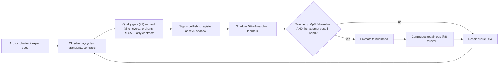
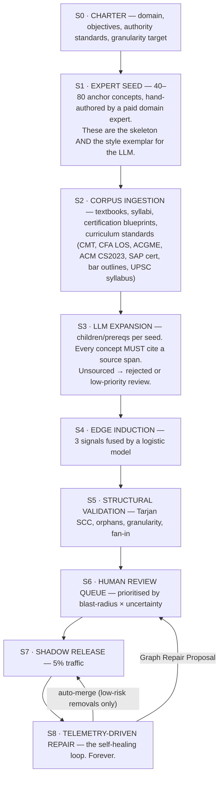
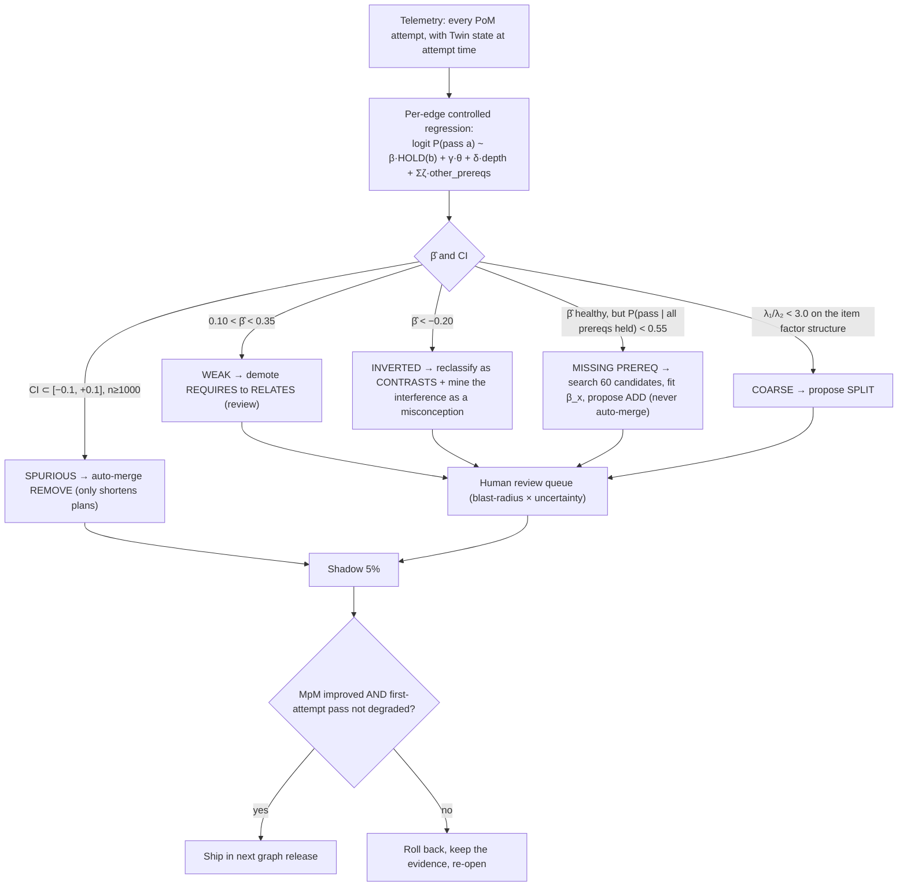
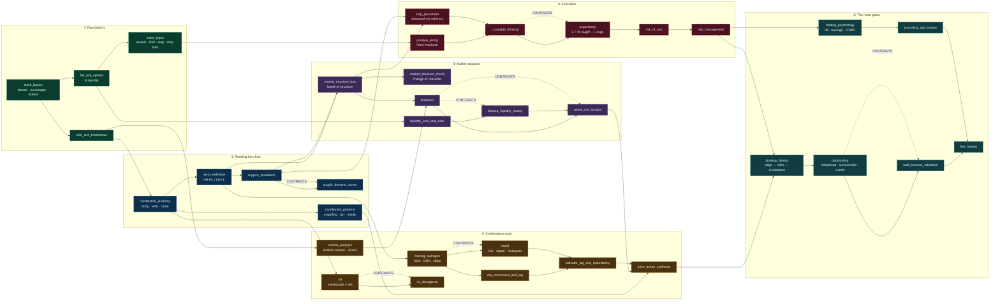
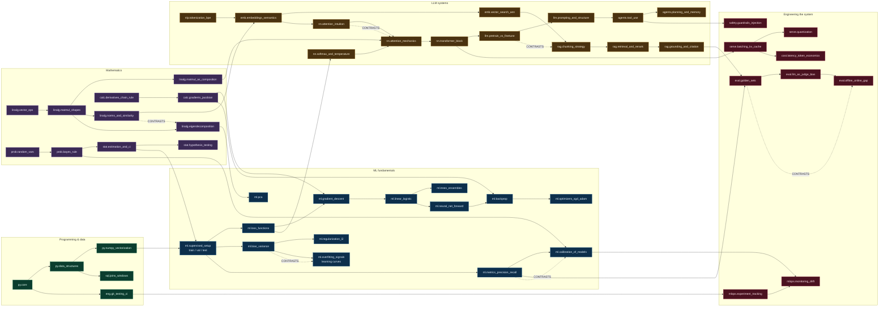

# 09 — The Knowledge Graph

> **Engine:** `E2 Graph Engine`
> **Primary Invention:** **I-4 (The Curriculum Compiler)** — the Graph is the dependency DAG the
> compiler resolves against. Supporting: I-1 (the Twin is a per-node overlay on this graph),
> I-2 (every node ships a **PoM contract**), I-6 (misconceptions live on nodes), I-7 (news is
> decomposed *into* these nodes).
> **Obeys:** `CANON.md`.

---

## 0. The claim

> In `make`, the Makefile is written by a human, once, and rots. In PRAXIS, the dependency graph
> is **built by a hybrid pipeline and then repaired by the learners themselves** — every failed
> PoM attempt is a unit test against the graph's own correctness.

If 4,000 learners who provably HOLD `ta.support_resistance` still fail `ta.breakout` on first
attempt at the same rate as learners who don't, then **the `REQUIRES` edge is wrong** and PRAXIS
finds out — automatically, with a confidence interval. Nobody else can do this, because nobody
else has evidence-grade telemetry at concept granularity (that requires I-2, which requires the
refusal to have a "mark as complete" button).

**The moat is not the graph. The moat is the repair loop.** A competitor can copy a graph. They
cannot copy 400 million PoM attempts.

| Component | Novel? |
|---|---|
| A prerequisite DAG of concepts | Table stakes (Knewton, ALEKS, Khan) |
| Concept nodes with IRT params + misconceptions | Uncommon but known |
| **PoM contract as a node field** — the node declares what evidence proves it | **Novel** (§2) |
| **Concept versioning with an evidence-migration policy** | **Novel** (§4) |
| **Domain Pack manifest with a mandatory Reality Adapter** | **Novel** (§5) |
| **Telemetry-driven edge repair with a causal-ish estimand and auto-merge rules** | **Novel** (§6) |
| **Unidimensionality-based automatic concept splitting** (eigenvalue test) | **Novel** (§6.4) |
| **Per-tenant overlays that may lower thresholds — but the Ledger records which threshold was used** | **Novel** (§4.3) |

---

## 1. Shape of the graph

| Property | Value |
|---|---|
| Nodes | **Concepts**. Atomic. Teachable in **≤ 15 minutes** (hard rule, §7). |
| Primary edge | `REQUIRES` — **must be acyclic**. This is the DAG the compiler topologically sorts. |
| Secondary edges | `RELATES`, `CONTRASTS`, `APPLIES_TO`, `GENERALIZES`, `PART_OF` — may cycle, may be symmetric. |
| Storage | Apache AGE / Neo4j for traversal; Postgres as system of record; pgvector for node embeddings (CANON §5.4). |
| Scale (target, year 2) | ~120k concepts across ~60 domain packs; ~480k `REQUIRES` edges. |
| Versioning | Content-addressed, immutable releases (§4). |
| Tenancy | Base graph + layered overlays (§4.3). |

---

## 2. Node schema

```json
{
  "id":            "cpt_01JZ9K2T7Q",
  "slug":          "ta.breakout_vs_fakeout",
  "version":       "sha256:3ac9…",            // = H(definition ‖ contract ‖ params ‖ edges_out)
  "pack":          "pack.trading.ta@2.3.0",
  "title":         "Breakout vs. Fakeout",
  "definition":    "A breakout is a decisive close beyond a level with participation; a fakeout is the same move without participation, engineered to trigger stops and reverse. The distinction is not the wick — it is the close, the volume, and what happens on the retest.",   // ≤ 60 words, hard limit
  "formal":        "Let L be a level. BREAKOUT(L) ⟺ close_t > L ∧ vol_t > 1.5·MA20(vol) ∧ ¬reclaim(L, t+1..t+k). FAKEOUT(L) ⟺ high_t > L ∧ close_t ≤ L ∨ reclaim(L, t+1..t+k).",

  "teach_minutes":  13,                        // ≤ 15. Enforced. See §7.
  "difficulty_prior": 7.4,                     // 1–10; seeds FSRS D₀ and the compiler's cost model
  "cognitive_type": "DISCRIMINATIVE",          // FACTUAL | CONCEPTUAL | PROCEDURAL | DISCRIMINATIVE | STRATEGIC
  "bloom":          "ANALYZE",

  "bkt": { "L0": 0.06, "T": 0.11, "S": 0.09, "G": 0.22 },     // doc 08 §3.1
  "irt_bank": {
     "n_items": 34, "n_calibrated": 28,
     "b_mean": 0.71, "b_sd": 0.83, "a_mean": 1.31, "c_mean": 0.19
  },

  "pom_contract": {                            // ← I-2. THE NODE DECLARES ITS OWN PROOF.
    "mandatory": [
      { "type": "APPLY",   "threshold": 0.75, "n_novel_items": 3, "b_min": 0.4 },
      { "type": "PREDICT", "threshold": 0.60, "n_loops": 2, "resolver": "market_ohlcv", "lead_days": 3 }
    ],
    "optional":  [
      { "type": "EXPLAIN",  "threshold": 0.75, "atoms": 7, "weight": 0.20 },
      { "type": "CRITIQUE", "threshold": 0.70, "source_edge": "CONTRASTS:ta.retest", "weight": 0.10 }
    ],
    "recall_allowed_share": 0.10               // RECALL can never be more than 10% of Q
  },

  "misconceptions": [
    { "id": "M-114", "name": "Volume confirms the breakout",
      "statement": "High volume on the break means it is real.",
      "why_wrong": "Stop-runs produce the highest volume prints in the sample. Volume is necessary, not sufficient; the retest is the test.",
      "prevalence": 0.61,                       // measured, not guessed
      "detector": { "item_ids": ["bf-c07","bf-c19"], "negative_atom": "a6" },
      "source": "telemetry+forum_mining" },
    { "id": "M-118", "name": "The wick counts",
      "statement": "If price pierced the level, the level broke.",
      "prevalence": 0.44, "source": "expert_seed" }
  ],

  "exemplars":      ["ex_spy_2024-03-08_real_breakout", "ex_aapl_2023-11-14"],
  "anti_exemplars": ["ex_tsla_2024-01-24_fakeout", "ex_nifty_2024-06-04_news_gap"],
  "media":          [{ "kind": "chart_replay", "uri": "s3://…", "locale": "en" }],

  "embedding":      { "model": "rgcn-v4", "dim": 128, "vec": "…" },

  "provenance":     { "origin": "expert_seed", "sources": ["Bulkowski 2005 ch.11", "CMT L2 §4.2"],
                      "reviewers": ["rev_ak", "rev_ms"], "krippendorff_alpha": 0.81 },
  "status":         "published",               // draft | in_review | shadow | published | deprecated
  "telemetry": {
     "n_attempts": 41290, "first_attempt_pass": 0.38,
     "median_minutes_to_hold": 41, "lapse_rate_30d": 0.29,
     "unidimensionality_ratio": 4.1            // λ₁/λ₂ — see §7
  }
}
```

### 2.1 The three fields nobody else has

| Field | Why it exists |
|---|---|
| `pom_contract` | **I-2.** A concept is not "content to consume"; it is a **claim with a proof obligation attached**. The compiler *costs* the contract (doc 10 §3). The Twin's `Q` term (doc 08 §1.2) is computed from it. Without this field, "mastery" is a vibe. |
| `misconceptions[].prevalence` | **I-6.** Measured from telemetry, not invented by an LLM. It is what lets the Assessment Engine *generate items that target the wrong model this learner actually holds*. |
| `telemetry.unidimensionality_ratio` | **§7.** If a concept's items don't load on one factor, the concept is **two concepts wearing a trench coat** and gets split. Automatically. |

---

## 3. Edge schema & semantics

```json
{ "from": "ta.breakout_vs_fakeout", "to": "ta.volume_analysis", "type": "REQUIRES",
  "strength": 0.86, "evidence": "telemetry", "beta_hat": 1.42, "beta_ci": [1.19, 1.65],
  "n_learners": 3841, "confidence": 0.97, "version": "sha256:…", "status": "published" }
```

| Type | Direction | Semantics | Acyclic? | Compiler use | Transfer `ψ` (doc 08 §7.3) | Assessment use |
|---|---|---|---|---|---|---|
| **`REQUIRES`** | `a → b` : *b is a prerequisite of a* | Hard gate. You cannot be taught `a` before HOLDing `b`. | **YES — enforced** | **Backward closure + topological sort.** The only edge the compiler traverses for ordering. | 0.00 (never — would double-count) | Blocks item service |
| `RELATES` | symmetric | Conceptual neighbourhood, no dependency | no | Interleaving pass (P2): related concepts are interleaved to force discrimination | 0.45 | Distractor generation |
| **`CONTRASTS`** | symmetric | *Actively confusable.* The pair is where misconceptions are born. | no | Forces a `CRITIQUE`/discrimination item into the plan | 0.15 (can go **negative**) | **`CRITIQUE` item generation** — the flawed worked example is drawn from the contrast partner |
| `APPLIES_TO` | `concept → context` | Where the concept is used | no | Project/BUILD brief selection; Reality Loop adapter routing | 0.25 | Transfer items (novel context) |
| `GENERALIZES` | `a → b` : *a is the general case of b* | Abstraction ladder | no | Compiler may substitute `a` for several `b`s (**generalisation pass**, doc 10 §4 P-G) | 0.60 | |
| `PART_OF` | `b → a` : *b is a component of a* | Composition | no | Cluster detection for `BUILD` contracts (a project evidences the whole `a`) | 0.35 | |

**`CONTRASTS` deserves its own note.** It is the most valuable edge in the graph and almost
nobody models it. Every important misconception in every domain is a **failure to discriminate
between two things that look alike**:

| Domain | `CONTRASTS` pair | The misconception it breeds |
|---|---|---|
| Trading | `breakout` ⟷ `fakeout / liquidity sweep` | "It broke the level, so it broke" |
| Trading | `support_resistance` ⟷ `supply_demand_zones` | Treating a line as a zone |
| AI | `correlation_matrix` ⟷ `covariance_matrix` | Forgetting normalisation |
| AI | `fine_tuning` ⟷ `RAG` | "Fine-tuning teaches it facts" |
| AI | `precision` ⟷ `recall` | Optimising the wrong one for the business |
| Medicine | `sensitivity` ⟷ `PPV` | Base-rate neglect |
| Law | `void` ⟷ `voidable` | Whole doctrines collapse |
| ERP | `movement type` ⟷ `document type` | Config chaos |
| Finance | `accrual` ⟷ `cash` | The single biggest source of P&L errors |

The `CRITIQUE` evidence type (I-2) is **generated from `CONTRASTS` edges**: we show the learner a
worked example that is subtly on the wrong side of the contrast and ask them to find the flaw.
That is the cheapest, most brutal test of understanding in the product.

---

## 4. Versioning, releases, and the migration problem

### 4.1 Content-addressed versions

```
  concept.version   =  H( definition ‖ formal ‖ pom_contract ‖ bkt ‖ teach_minutes ‖ sorted(edges_out) )
  graph.release     =  "graph@2026.07.0"  →  Merkle root over all published concept versions
```

Every **Evidence record binds `concept_version`** (doc 08 §9). This creates a problem nobody in
adaptive-learning has solved: **what happens to a learner's mastery when the concept changes?**

### 4.2 Evidence migration policy — declared at merge time

The graph diff tool proposes a policy; the human reviewer must confirm it.

| Policy | When | Effect on every learner's Twin |
|---|---|---|
| `COMPATIBLE` | Typo, better media, added exemplar, added *optional* evidence type | **Nothing.** `MC` unchanged, evidence carries. |
| `REFRESH` | Definition sharpened, difficulty re-estimated, item bank rotated | `MC ← MC × 0.80`; next rep advanced to `min(due, +7d)`. The learner is told: *"`ta.breakout` was sharpened. I've scheduled a quick re-check."* |
| `RECONTRACT` | A **mandatory** PoM evidence type added or its threshold raised | `Q` recomputed against the **new** contract ⇒ `MC` may drop below `τ_hold` ⇒ the concept **re-enters the Plan**. The old evidence stays valid *for the old version* on the Ledger. |
| `INVALIDATE` | The concept was **wrong** | All evidence for the old version marked `SUPERSEDED` (not deleted — I-8). `MC ← 0`. Concept re-enters the Plan with priority. Learner is told what was wrong and why. |
| `SPLIT` | Concept split into `a₁, a₂` (§6.4) | Evidence is **apportioned by item→child mapping**; `MC` recomputed per child. Any child with insufficient evidence re-enters the Plan. |
| `MERGE` | Two concepts collapse | `MC = min(MC_a, MC_b)` — pessimistic (doc 08 §8.6). |

> A learner's Verified Competency Record says *"held `ta.breakout_vs_fakeout` @`sha256:3ac9…`
> under graph release `2026.07.0`."* A verifier can fetch that exact concept version and see
> exactly what was proven. **Immutable claims about a mutable world.**

### 4.3 Per-tenant overlays

Resolution order (later wins), computed at read time and cached:

```
  BASE (global graph)  ⊕  DOMAIN PACK  ⊕  TENANT  ⊕  COHORT  ⊕  LEARNER
```

| Layer | May do | May **NOT** do |
|---|---|---|
| Domain pack | add nodes/edges, set defaults | contradict base semantics of edge types |
| **Tenant** (school / enterprise / coach) | ADD nodes & edges; OVERRIDE `difficulty_prior`, `teach_minutes`, `media`, `locale`, `exemplars`; **MASK** nodes (out of syllabus); PIN a graph release; **lower or raise PoM thresholds** | delete base nodes; introduce a `REQUIRES` cycle; remove a *mandatory* non-`RECALL` evidence type (see below) |
| Cohort | mask, reorder emphasis, set deadlines | change contracts |
| **Learner** | accessibility (locale, media modality, font, TTS speed), pacing | **anything that touches a PoM contract.** Ever. |

**The threshold-honesty rule.** A tenant *is* allowed to lower `τ_hold` from 0.80 to 0.70
("our bootcamp ships at 0.70"). PRAXIS permits it — and then **writes the threshold it used into
every evidence record and onto the VCR**:

> `HELD ta.breakout_vs_fakeout @ MC 0.73 · tenant threshold 0.70 · global threshold 0.80`

So the tenant can lower the bar; they cannot **hide** that they lowered it. This is the single
mechanism that lets the Ledger (I-8) be sold to employers across thousands of tenants who all
have different standards. **We do not enforce one standard. We make every standard visible.**

Hard floor: no tenant may reduce a contract to `RECALL`-only. `recall_allowed_share ≤ 0.30` is a
platform invariant. CANON §2.

---

## 5. Domain Packs — the unbounded-domain mechanism

**Any** domain plugs in: programming, finance, technical analysis, medicine, law, ERP, cooking,
music theory, civil-service exams, aviation, welding. A pack is a **versioned, signed bundle**.

### 5.1 The manifest

```yaml
# pack.trading.ta / manifest.yaml
apiVersion: praxis.graph/v1
kind: DomainPack

id:        pack.trading.ta
version:   2.3.0
domain:    "Technical Analysis & Discretionary Trading"
locales:   [en, hi, ne, es]
license:   "CC-BY-SA-4.0 (concepts) / proprietary (items)"
signature: "ed25519:…"                       # packs are signed; unsigned packs never publish

authorities:                                  # what this pack claims to cover, and against what
  - { standard: "CMT Level I",  coverage_claim: 0.94, mapping: mappings/cmt1.yaml }
  - { standard: "CMT Level II", coverage_claim: 0.61, mapping: mappings/cmt2.yaml }

concepts:  concepts/**/*.yaml                 # 187 nodes
edges:     edges/requires.yaml                # 402 REQUIRES
           edges/contrasts.yaml               # 61 CONTRASTS  ← the valuable ones
item_templates: items/**/*.jinja              # generators, not static banks
contracts: contracts/library.yaml             # reusable PoM contract archetypes
misconceptions: misconceptions/*.yaml

# ─────────────────────────────────────────────────────────────────────────
# THE REALITY ADAPTER — this is what makes a pack first-class. (I-3)
# ─────────────────────────────────────────────────────────────────────────
reality_adapters:
  - id: market_ohlcv
    kind: PREDICT
    capture:  { schema: schemas/chart_mark.json, ui: "chart_annotation" }
    resolver:
      source:   "polygon.io/v2/aggs"
      cadence:  "daily @ 21:30 UTC"
      settle:   "T+{lead_days} close"
      truth_fn: "resolvers/breakout_confirmed.py::resolve"
      dispute:  "resolvers/breakout_confirmed.py::adjudicate"
    scoring:  { metric: "brier", calibration_bins: 5 }
    lead_days_range: [1, 10]

content_sources:                              # E10/E17 grounding
  - { kind: rss,   uri: "…", trust: 0.7 }
  - { kind: corpus,uri: "s3://packs/ta/books/", trust: 0.9 }

review_board:
  - { id: rev_ak, credential: "CMT, 11y prop desk", alpha: 0.83 }
  - { id: rev_ms, credential: "PhD Finance",        alpha: 0.79 }

quality_report: reports/2.3.0.json            # §7 metrics, gated in CI
```

### 5.2 The Reality Adapter is the class boundary

| | Pack **with** a reality adapter | Pack **without** |
|---|---|---|
| Evidence types available | all six, including `PREDICT` | five |
| I-3 (Reality Loop) | **yes** | no |
| Calibration / Brier | **yes** — first-class metric | not available |
| VCR strength | *"predicted 41 novel cases at 0.79 calibration"* | *"passed 41 novel items"* |
| Classification | **first-class pack** | **second-class pack** |

**We say this out loud in the pack registry.** A pack that cannot let reality grade the learner
is a lesser pack, and it is labelled as one. That pressure is what makes pack authors go find a
ground-truth source.

| Pack | Reality adapter | Ground truth |
|---|---|---|
| `pack.trading.ta` | `market_ohlcv` | The market. T+n close. |
| `pack.ai-engineering` | `hidden_test_harness` + `eval_leaderboard` | Your code runs, or it doesn't. Your eval score is what it is. |
| `pack.med.internal-medicine` | `deident_case_outcomes` | The patient's actual outcome (de-identified, licensed). |
| `pack.law.in.constitutional` | `judgment_feed` | The court actually ruled. |
| `pack.finance.equity-research` | `filings_resolver` (10-Q/10-K) | The company actually reported. |
| `pack.erp.sap-fi` | `sandbox_system_resolver` | The posting actually cleared in a real SAP sandbox. |
| `pack.civil-service.upsc.gs2` | `answer_key_resolver` + `current_affairs_resolver` | The official key; the policy actually passed. |
| `pack.music.jazz-harmony` | `audio_pitch_resolver` | You played the voicing, or you played a different chord. |
| `pack.cooking.mother-sauces` | `photo+temp_probe_resolver` | The emulsion broke, or it didn't. |

### 5.3 Pack lifecycle



---

## 6. How a graph is BUILT — and how it REPAIRS ITSELF

### 6.1 The pipeline



### 6.2 Edge induction (S4) — three signals, one model

| Signal | How | Weight |
|---|---|---|
| `x₁` **LLM proposal** | "Does understanding `a` *require* understanding `b`? Answer only from these source spans. Cite." → logit of the self-consistency vote over 5 samples | 0.34 |
| `x₂` **Curricular precedence** | Across `N` ingested textbooks/syllabi, the fraction in which `b` is taught **before** `a`, and the mean chapter gap. *If every textbook on earth teaches `b` first, that is evidence.* | 0.29 |
| `x₃` **Structural/semantic** | `cos(z_a, z_b)` + citation-graph co-occurrence + shared-symbol overlap in `formal` | 0.17 |
| `x₄` **Expert prior** | Seed edges from S1, and any reviewer votes | 0.20 |

```
  P(REQUIRES(a→b))  =  σ( β₀ + Σ βᵢ xᵢ )       (β fitted on a 4,000-edge human-labelled set)
```

| Score | Action |
|---|---|
| ≥ 0.75 | auto-accept as **`provisional`** — usable, but under telemetry watch |
| 0.40 – 0.75 | **human review queue**, priority = blast_radius × (1 − |score − 0.5|·2) |
| < 0.40 | drop (logged; may resurface from telemetry in §6.3) |

### 6.3 THE REPAIR LOOP — the moat

**The estimand.** For a `REQUIRES` edge `a → b` (*b is a prerequisite of a*), take every learner
who attempted `a`'s PoM, and fit:

```
  logit P( first-attempt pass on a )  =  α  +  β · 1[ HOLD(b) at attempt time ]
                                             +  γ · θ_general          (control: overall ability)
                                             +  δ · depth(a)
                                             +  Σ ζ_k · 1[ HOLD(other declared prereqs of a) ]
                                             +  u_learner              (random effect)
```

**`β` is the edge's necessity** — the log-odds lift of holding `b` on passing `a`, *with general
ability and the other prerequisites controlled for*. A real prerequisite has large positive `β`.

| Diagnostic | Condition | Diagnosis | Auto-action |
|---|---|---|---|
| **Spurious edge** | `β̂` 95% CI ⊂ `[−0.10, +0.10]`, `n ≥ 1000`, stable across 2 weekly windows | Holding `b` doesn't help with `a`. The edge is a **fiction** — someone assumed it. | **AUTO-MERGE REMOVAL.** Low risk: removing a fake prereq only *shortens* plans. Logged, reversible, A/B'd. |
| **Weak edge** | `0.10 < β̂ < 0.35`, `n ≥ 300` | Helpful, not required. | Demote `REQUIRES` → `RELATES`. Goes to review. |
| **Missing prerequisite** | Learners who HOLD **all** declared prereqs of `a` still have `P(pass a) < 0.55` | Something is missing from `a`'s prereq set. | **Search for it** (§6.3.1). Propose `ADD EDGE`. **Never auto-merges** — adding a prereq *lengthens* every downstream learner's plan. Human review, mandatory. |
| **Redundant edge** | `P(pass a | ¬HOLD(b)) > 0.80` | `b` isn't needed, or `a` is too easy, or `a`'s items leaked. | Check item bank first (doc 08 §3.2 leak signature); then propose removal. |
| **Inverted edge** | `β̂ < −0.20` with `n ≥ 500` | Holding `b` makes `a` **harder**. This is a **`CONTRASTS` edge misfiled as `REQUIRES`** — `b` is *interfering*. | Propose reclassify `REQUIRES` → `CONTRASTS`, and mine the interference as a misconception. **This is a discovery, not a bug fix.** |
| **Coarse concept** | See §6.4 | `a` is two concepts. | Propose `SPLIT`. |

#### 6.3.1 Finding a *missing* prerequisite

```python
def find_missing_prereq(a, n_min=300):
    # cohort: learners who hold every declared prereq of `a` and still failed `a` first-attempt
    fail_cohort = [L for L in learners_who_attempted(a)
                   if all(holds(L, p) for p in declared_prereqs(a)) and not first_attempt_pass(L, a)]
    pass_cohort = [L for L in learners_who_attempted(a)
                   if all(holds(L, p) for p in declared_prereqs(a)) and     first_attempt_pass(L, a)]
    if len(fail_cohort) < n_min: return None

    # candidates: concepts NOT already prereqs of `a`, ranked by
    #   (i) embedding similarity to `a`, (ii) differential hold-rate between the cohorts
    candidates = top_k(graph.concepts - ancestors(a),
                       key=lambda x: 0.4*cos(z[x], z[a]) + 0.6*abs(hold_rate(pass_cohort, x)
                                                                 - hold_rate(fail_cohort, x)),
                       k=60)

    # fit β_x for each candidate in the SAME controlled regression
    results = [(x, fit_beta(a, x, control=declared_prereqs(a) + [theta_general])) for x in candidates]
    best = max(results, key=lambda r: r[1].beta_hat)

    if best.beta_hat > 0.60 and best.ci_low > 0.30 and best.n >= n_min:
        return GraphRepairProposal(
            kind      = "ADD_REQUIRES",
            edge      = (a, best.x),
            evidence  = { "beta": best.beta_hat, "ci": best.ci, "n": best.n,
                          "pass_rate_with": …, "pass_rate_without": … },
            blast     = downstream_learner_count(a),
            auto_merge= False)          # ← ADD never auto-merges. It costs learners minutes.
    return None
```

#### 6.3.2 A real repair (from the trading pack)

| | |
|---|---|
| **Edge under test** | `ta.breakout` **REQUIRES** `ta.volume_analysis` |
| Cohort | 3,841 learners, 5,102 first attempts |
| `P(pass \| HOLD volume)` | 0.51 |
| `P(pass \| ¬HOLD volume)` | 0.44 |
| **Controlled `β̂`** | **0.19**, 95% CI `[0.04, 0.34]` — real but **weak** |
| **The anomaly** | Even *with* volume held, pass rate is only **0.51**. Something is missing. |
| Missing-prereq search | Top candidate: **`ta.market_structure_bos`** (break of structure). `β̂ = 0.94`, CI `[0.71, 1.17]`, n = 2,904 |
| `P(pass \| HOLD bos ∧ HOLD volume)` | **0.79** |
| **Proposal GRP-2291** | `ADD REQUIRES: ta.breakout → ta.market_structure_bos`; `DEMOTE ta.breakout → ta.volume_analysis` from `REQUIRES` to `RELATES` |
| Human review | Approved by 2 CMT reviewers. Comment: *"Obvious in hindsight. A breakout without a prior structural break is just noise. We had the folk-taxonomy edge, not the real one."* |
| Shadow A/B (5%, 3 weeks) | first-attempt pass on `ta.breakout` **0.51 → 0.74**; median minutes-to-HOLD **63 → 44**; **mastery-per-minute +38%** |
| Ship | ✅ `graph@2026.05.2` |

**Read that again.** The graph *discovered a pedagogical fact* — that market structure, not
volume, is the real prerequisite for breakout trading — **from learner failure data**, and it
was right, and it made everyone 38% faster. No human authored that insight. **This is the moat.**



### 6.4 Automatic concept splitting — the unidimensionality test

A concept is *one* thing if its items measure *one* latent. Test it.

1. Take the concept's calibrated item bank (`n ≥ 12` items, `≥ 200` respondents each).
2. Compute the **tetrachoric correlation matrix** of item responses.
3. Eigendecompose. Take `λ₁ / λ₂`.

| `λ₁/λ₂` | Reading | Action |
|---|---|---|
| ≥ 3.0 | Unidimensional. It's one concept. | ✅ |
| 1.5 – 3.0 | Suspicious. | Flag for review. |
| < 1.5 | **Multidimensional.** The items are measuring two different things. | **Propose SPLIT.** Cluster items by their loadings on factors 1 and 2; an LLM names the two clusters from the item text; a human confirms. |

**Real case.** `ml.attention_mechanism` had `λ₁/λ₂ = 1.31`. Factor 1 loaded on items about
*shapes and matmuls*; factor 2 on items about *what attention is FOR* (soft alignment / content-based
retrieval). It was two concepts. Split into `ml.attention_mechanics` (`PROCEDURAL`, teach 12 min)
and `ml.attention_intuition` (`CONCEPTUAL`, teach 9 min), with `mechanics REQUIRES intuition`.
Post-split first-attempt pass: `0.34 → 0.61`.

> The graph found out that *we* — the authors — didn't understand attention well enough to teach
> it. The learners told us, in the covariance structure of their wrong answers.

### 6.5 Item-level repair (feeds E6)

| Signal | Action |
|---|---|
| `a_j < 0.45` | Retire. Non-discriminating. |
| `c_j > 0.35` | Retire. Coin flip. |
| `Δb_j < −0.35` **and** `Δa_j < −0.2` within 30 d | **Leaked.** Auto-retire, regenerate from template. |
| Mantel–Haenszel DIF across locale/tenant | Flag for translation/cultural review. |
| `n_calibrated < 12` for a published concept | **Blocks publication** (§7). |

---

## 7. Quality metrics — the graph's own test suite

Every one of these runs in CI on every pack release and continuously in production.

| # | Metric | Definition | Gate |
|---|---|---|---|
| Q1 | **Cycles** | Tarjan SCC over `REQUIRES`; any SCC of size > 1 | **0 — HARD FAIL** |
| Q2 | **Orphans** | Published concepts with `in_degree = out_degree = 0` on `REQUIRES` and not in a declared root set | **0 — HARD FAIL** |
| Q3 | **Granularity** | `p95(teach_minutes)` | **≤ 15 min — HARD FAIL.** A concept you cannot teach in 15 minutes is not a concept; it is a chapter. Split it. |
| Q4 | **Contract completeness** | Published concepts with ≥ 1 mandatory **non-`RECALL`** evidence type | **100% — HARD FAIL.** CANON §2. |
| Q5 | **Item bank depth** | Calibrated items per published concept (`n ≥ 200` responses, `(a,b,c)` fitted) | **≥ 12 — blocks publish** |
| Q6 | **Item bank spread** | `sd(b_j)` within concept | ≥ 0.6 (need easy and hard) |
| Q7 | **Edge precision** | Fraction of `REQUIRES` edges with telemetry `β̂ > 0.35` **or** ≥ 2 expert confirmations | **≥ 0.90** |
| Q8 | **Edge recall (proxy)** | `1 −` rate of "learner HOLDs all declared prereqs and still fails 3 consecutive PoM attempts" | **≥ 0.85** |
| Q9 | **Unidimensionality** | Per concept: `λ₁/λ₂` of the tetrachoric item matrix | **≥ 3.0** (< 1.5 ⇒ auto-SPLIT proposal) |
| Q10 | **Fan-in** | `p95(REQUIRES in-degree)` | ≤ 6 (higher ⇒ the concept is under-decomposed) |
| Q11 | **Fan-out sanity** | Concepts with `out_degree = 0` that are not target-set leaves | investigate |
| Q12 | **Coverage** | Fraction of an authority standard's stated learning outcomes mapped to ≥ 1 concept | **≥ 0.95** for a *claimed* standard |
| Q13 | **Misconception coverage** | Concepts with ≥ 2 **telemetry-confirmed** (`prevalence ≥ 0.15`) misconceptions | ≥ 0.70 |
| Q14 | **`CONTRASTS` density** | `CONTRASTS` edges per 10 concepts | ≥ 2.5 (a pack with no contrasts has no `CRITIQUE` items and no discrimination training) |
| Q15 | **Reality coverage** | Fraction of target-set concepts reachable by a Reality Adapter | ≥ 0.40 for a **first-class pack** |
| Q16 | **Freshness** | `p50(days since expert review)` for concepts in volatile domains (AI, law, markets, tax) | ≤ 90 d |
| Q17 | **Blast-radius-weighted staleness** | `Σ (downstream_learners × days_since_review)` | tracked, drives review queue priority |
| Q18 | **Depth** | `p95` path length from root to target-set leaf | ≤ 14 (deeper ⇒ probably over-decomposed) |

**Depth budget note.** Q3 (≤ 15 min/concept) and Q18 (≤ 14 levels) together bound the graph:
a 312-concept closure at ~13 min teach + ~13 min PoM ≈ 135 hours of raw acquisition. That number
must be *true*, because the Compiler quotes it to the learner (doc 10 §7). Granularity is not an
aesthetic — **it is what makes the ETA honest.**

---

## 8. Worked graph #1 — Stock Market / Technical Analysis (`pack.trading.ta`)

The full chain from the brief, rendered as a real DAG. Solid arrows = `REQUIRES` (the compiler's
edges). Dotted = `CONTRASTS` (the misconception factories, and the source of every `CRITIQUE`
item).



### 8.1 PoM contracts on the load-bearing nodes

| Concept | `D` | teach | **Mandatory evidence (I-2)** | Optional | Reality adapter |
|---|---|---|---|---|---|
| `order_types` | 3.1 | 9 m | `APPLY` ×4 novel (given a scenario, pick and *justify* the order type; 2 items are traps where a market order slips) ≥ 0.75 | `RECALL` (≤10% of Q) | — |
| `candlestick_anatomy` | 2.4 | 7 m | `APPLY` ×3 (annotate 3 unseen charts: mark body/wick/close) ≥ 0.80 | `EXPLAIN` | — |
| `support_resistance` | 4.6 | 12 m | `APPLY` ×3 (**draw** the levels on 3 unseen charts; graded by IoU against expert-annotated ground truth, threshold 0.65) · `CRITIQUE` ×1 (find the flaw in a chart where a *single wick touch* was called a level) | `EXPLAIN` | — |
| **`breakout`** | 6.8 | 12 m | `APPLY` ×3 (`b ≥ 0.4`) ≥ 0.75 · **`PREDICT` ×2** — *mark a live setup today; the market resolves it at T+3 close*; Brier ≤ 0.20 | `EXPLAIN` (7 atoms), `CRITIQUE` | **`market_ohlcv`** |
| **`fakeout_liquidity_sweep`** | 7.4 | 13 m | `CRITIQUE` ×3 (given 3 charts that *look* like breakouts, identify which are sweeps and say why) ≥ 0.70 · **`PREDICT` ×3** (Brier ≤ 0.22) | `EXPLAIN` | **`market_ohlcv`** |
| `volume_analysis` | 5.9 | 11 m | `APPLY` ×3 · `CRITIQUE` ×1 (the M-114 trap: a high-volume print that was a stop-run) | `EXPLAIN` | — |
| `rsi_divergence` | 6.5 | 12 m | `APPLY` ×4 (mark divergences on unseen charts, IoU ≥ 0.60) · **`PREDICT` ×2** | `CRITIQUE` | `market_ohlcv` |
| `position_sizing` | 5.2 | 10 m | **`BUILD`** — a position-size calculator that passes 14 hidden tests including the 3 degenerate cases (zero stop distance, account < 1 share, fractional-share broker) | `APPLY` | `hidden_test_harness` |
| `expectancy` | 6.1 | 11 m | **`BUILD`** — compute expectancy from a supplied 200-trade CSV; must match reference to 1e-6 · `APPLY` ×2 (given two systems, which do you trade and why) | `EXPLAIN` | `hidden_test_harness` |
| `risk_of_ruin` | 7.9 | 14 m | **`BUILD`** — Monte-Carlo the ruin probability for a given edge/size; `CRITIQUE` ×1 (a "risk-free martingale" pitch) | `EXPLAIN` | `hidden_test_harness` |
| **`backtesting`** | 8.2 | 15 m | **`BUILD`** — backtest a supplied strategy on supplied data; the harness **injects lookahead bias** and the learner's report must *detect and state it*. Passing requires finding the bug, not producing a number. | `CRITIQUE` ×2 | `hidden_test_harness` |
| `walk_forward_validation` | 8.5 | 14 m | `BUILD` (walk-forward the same strategy; report in-sample vs. out-of-sample decay) · **`PREDICT` ×1** — *forecast your own out-of-sample Sharpe before you run it.* Brier on your own overconfidence. | — | `hidden_test_harness` |
| **`live_trading`** | 9.4 | 15 m | **`PREDICT` ×20 over 8 weeks**, journaled, resolved by the market. Requires: Brier ≤ 0.22, **calibration slope ∈ [0.85, 1.15]**, and adherence-to-own-rules ≥ 0.85 (self-reported, spot-audited against the journal). | `EXPLAIN` | **`market_ohlcv`** |

> Look at `backtesting`. Its PoM contract is *"we broke the harness on purpose; find it."* And
> `live_trading`'s contract is *not passable in a day* — it takes 8 weeks of the market grading
> you. **That is I-3, and it is why `live_trading` cannot be crammed, bought, or faked.**

---

## 9. Worked graph #2 — "AI Engineer" objective subgraph

Target set (E12): 128 concepts. Backward closure: 312. Shown: the spine.



**Selected contracts:**

| Concept | Mandatory PoM | Note |
|---|---|---|
| `linalg.matmul_shapes` | `BUILD` — implement `matmul` in pure Python; passes 20 hidden tests incl. broadcast + shape-error cases | The Twin will *not* let you near `attention` without this. |
| `ml.bias_variance` | `APPLY` ×3 + **`BUILD`** — produce a learning-curve plot from a real over/under-fit run and *label which regime each is in* | Doc 08 §3.1's worked example. Talk isn't enough. |
| `nn.attention_mechanics` | `BUILD` — single-head attention in numpy; must match a reference to `1e-6`; hidden tests include a *causal-mask* case | Machine-verifiable. `EC-2` (doc 08 §4.6) satisfied. |
| `rag.retrieval_and_rerank` | `BUILD` — RAG over a supplied corpus; report `Recall@10` and faithfulness; must **beat a stated baseline** | |
| `eval.llm_as_judge_bias` | `CRITIQUE` ×3 — three eval harnesses; find the bias in each (one has positional bias, one has verbosity bias, one leaks the answer into the prompt) | Drawn from `CONTRASTS: eval.golden_sets ⟷ eval.offline_online_gap` |
| `cost.latency_token_economics` | **`PREDICT` ×2** — *forecast p95 latency and $/1k requests for your own RAG service before you load-test it.* The load test grades you. | **I-3 in an engineering domain.** |

---

## 10. Worked graph #3 — "ERP Consultant (SAP FI/MM)" objective subgraph

```mermaid
flowchart LR
  classDef biz  fill:#0b3d2e,stroke:#1f7a5c,color:#e8fff6
  classDef acct fill:#3b2a55,stroke:#7a5cb0,color:#f2ebff
  classDef org  fill:#0d2f4b,stroke:#2b6fa8,color:#e6f3ff
  classDef proc fill:#4a3210,stroke:#a87a2b,color:#fff4e0
  classDef proj fill:#4b1220,stroke:#a83b55,color:#ffe6ec

  subgraph B["Business grounding"]
    B1["biz.process_thinking<br/>P2P · O2C · R2R"]:::biz
    B2["biz.internal_controls_sod"]:::biz
  end
  subgraph A["Accounting core"]
    A1["acct.double_entry"]:::acct
    A2["acct.chart_of_accounts"]:::acct
    A3["acct.accrual_vs_cash"]:::acct
    A4["acct.gl_subledger"]:::acct
    A5["acct.ap_ar"]:::acct
    A6["acct.asset_accounting"]:::acct
    A7["acct.period_close"]:::acct
    A8["co.cost_profit_centers"]:::acct
  end
  subgraph O["ERP org & master data"]
    O1["sap.org_structure<br/>company code · plant · sloc"]:::org
    O2["sap.master_data<br/>vendor · customer · material"]:::org
    O3["sap.document_types"]:::org
    O4["sap.movement_types"]:::org
    O5["sap.account_determination<br/>OBYC"]:::org
  end
  subgraph P["Processes"]
    P1["mm.purchase_requisition"]:::proc
    P2["mm.purchase_order"]:::proc
    P3["mm.goods_receipt"]:::proc
    P4["mm.invoice_verification"]:::proc
    P5["mm.three_way_match"]:::proc
    P6["sd.quotation_to_order"]:::proc
    P7["sd.delivery_and_billing"]:::proc
    P8["int.mm_fi_integration"]:::proc
    P9["int.sd_fi_integration"]:::proc
  end
  subgraph J["Project craft"]
    J1["proj.requirements_and_fitgap"]:::proj
    J2["proj.config_img"]:::proj
    J3["proj.data_migration"]:::proj
    J4["proj.testing_unit_int_uat"]:::proj
    J5["proj.cutover_and_hypercare"]:::proj
    J6["proj.change_management"]:::proj
  end

  B1 --> A1 --> A2 --> A4
  A1 --> A3 --> A7
  A4 --> A5 --> A7
  A4 --> A6 --> A7
  A2 --> A8
  B2 --> P5
  A2 --> O1 --> O2 --> O3 --> O4 --> O5
  A4 --> O5
  B1 --> P1 --> P2 --> P3 --> P4 --> P5
  O2 --> P2
  O4 --> P3
  O5 --> P8
  P4 --> P8
  A5 --> P8
  B1 --> P6 --> P7 --> P9
  A5 --> P9
  P5 --> J1
  P9 --> J1
  J1 --> J2 --> J3 --> J4 --> J5
  J5 --> J6
  A8 --> J2
  A7 --> J5

  A3 -. CONTRASTS .-> A1
  O3 -. CONTRASTS .-> O4
  P3 -. CONTRASTS .-> P4
  A4 -. CONTRASTS .-> A8
```



**Selected contracts** (note the reality adapter — a real SAP sandbox):

| Concept | Mandatory PoM | Resolver |
|---|---|---|
| `mm.three_way_match` | **`BUILD`** — in a live SAP sandbox, create PR → PO → GR → IR and make it clear. Then the harness **injects a quantity mismatch** and you must explain *which document blocked it and why*. | `sandbox_system_resolver` |
| `sap.account_determination` | `BUILD` — configure OBYC so that a goods receipt hits the correct GL accounts; verified by *reading the actual FI document generated by the posting.* | `sandbox_system_resolver` |
| `acct.accrual_vs_cash` | `CRITIQUE` ×3 — three period-close packs, each with one accrual error; find it. | — |
| `proj.data_migration` | `BUILD` — migrate a supplied 4,000-record vendor master with 11 deliberately dirty records; the load must be **rejected** for the right 11 reasons. | `sandbox_system_resolver` |
| `proj.cutover_and_hypercare` | **`PREDICT`** — before the mock cutover, forecast which 3 objects will fail and how many hours the cutover will take. The mock cutover grades you. | `sandbox_system_resolver` |

> An ERP consultant's real job is **predicting what will break**. So that is exactly what the
> PoM contract asks for. **I-3.**

---

## 11. What the Graph exposes to the other engines

| Consumer | API | Used for |
|---|---|---|
| **E3 Compiler** | `backward_closure(target_set, REQUIRES)`, `topo_order(subgraph)`, `cost_hints(c)` | The build DAG (I-4) |
| **E1 Twin** | `node(c).bkt`, `node(c).irt_bank`, `node(c).pom_contract` | Priors, `Q` computation |
| **E4 Scheduler** | `unlock_count(c)`, `blast_radius(c)`, `CONTRASTS(c)` | Priority function (doc 10 §5) |
| **E6 Assessment** | `misconceptions(c)`, `CONTRASTS(c)`, `item_templates(c)` | Misconception-targeted item generation (I-6) |
| **E7 Memory** | `difficulty_prior(c)` | FSRS `D₀` |
| **E8 Reality** | `pack.reality_adapters` | Loop capture + resolution (I-3) |
| **E9 News** | `embed(article) → nearest concepts` | Decompose an event into nodes (I-7) |
| **E12 Career** | `role → target_set(rel weights)` | Objective definition |
| **E16 Ledger** | `concept.version` | Immutable claim binding (I-8) |
| **E17 Content** | `node(c).definition/formal/exemplars/media` | Grounded on-demand lesson synthesis |

---

## 12. Invention trace

| Section | Invention |
|---|---|
| §1, §3, §11 (closure, topo sort, cost hints) | **I-4** |
| §2 `pom_contract` on the node; §8.1 & §9 & §10 contract tables | **I-2** |
| §2 `misconceptions[].prevalence`; §3 `CONTRASTS` → `CRITIQUE` generation; §6.3 inverted-edge discovery | **I-6** |
| §5.2 Reality Adapter as the class boundary; `live_trading`, `cost.latency`, `proj.cutover` contracts | **I-3** |
| §4.1–4.2 concept versions bound into evidence; §4.3 threshold-honesty rule | **I-8** |
| §7 Q3 granularity ⇒ honest ETAs; §6.3.2 repair that lifted MpM 38% | **I-10** |
| §2/§7 per-node priors that make the diagnostic cheap | **I-1** |
| §11 `embed(article) → concepts` | **I-7** |

---

*Next: `10-curriculum-compiler.md` — `make`, for the mind.*
