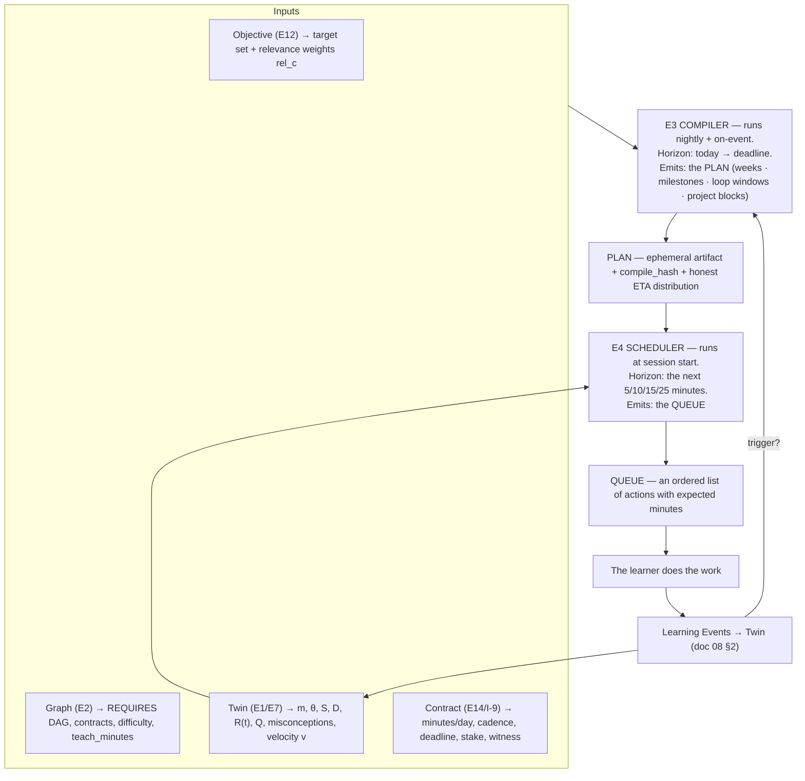
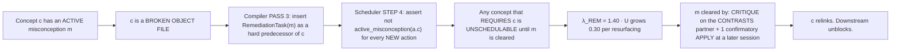
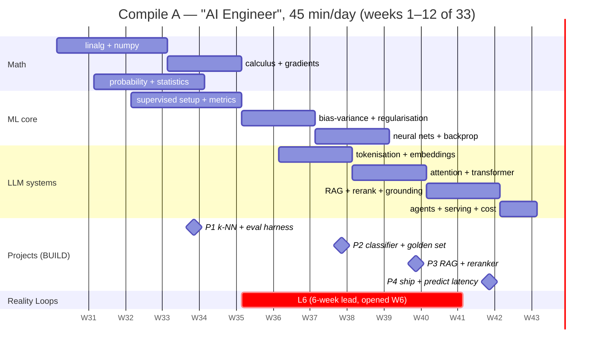

# 10 — The Curriculum Compiler & Scheduler

> **Engines:** `E3 Compiler Engine` · `E4 Scheduler Engine`
> **Primary Invention:** **I-4 (The Curriculum Compiler)**. Supporting: I-1 (the Twin is the
> cache), I-2 (contracts are the build's test suite), I-3 (loops are scheduled *backwards from
> resolution*), I-9 (the Plan is a commitment device, so it must not thrash), **I-10 (the
> scheduler's ranking function *is* mastery-per-minute)**.
> **Obeys:** `CANON.md`.

---

## 0. `make`, for the mind

Not a metaphor we reach for in marketing. A metaphor we **implement**.

| `make` | PRAXIS | Where |
|---|---|---|
| Build target | **Objective** ("Become an AI Engineer") | §2 |
| Makefile / dependency graph | **Concept DAG** (`REQUIRES`) — doc 09 | §2 |
| `ccache` — what's already built | **The Twin** (`MC ≥ τ_hold`) — doc 08 | §2 |
| `mtime` changed ⇒ rebuild | **Forgetting.** `R(t)` falls ⇒ the cache entry expires. | §2, §5 |
| **Cache invalidation** | **The forgetting curve.** *This is the whole idea.* | §5 |
| `make check` — build fails if tests fail | **PoM contracts.** A concept is not built until its evidence exists. | §3 |
| `-j N` parallelism | **Interleaving** — 2–3 concurrent threads per week | §4 P2 |
| `-O2` optimisation passes | **Scheduling passes** P1–P9 | §4 |
| Link error | **Prerequisite violation** — the Scheduler refuses to serve the item | §5 |
| Incremental build | **Nightly recompile** | §6 |
| Reproducible build | **`compile_hash`** — same inputs ⇒ same Plan, byte for byte | §6.7 |
| Build artifact | **Plan** — ephemeral, always regenerable, never precious | §2 |
| CI, against reality | **The Reality Loop** (I-3) | §4 P8 |
| **`make -n` (dry run)** | **Counterfactual query** — doc 08 §6 | doc 08 |

> A roadmap is not authored. It is **compiled**. It has no author to blame and no ego to protect.
> If you skip a lesson, nothing "breaks" — the **compile changes**.

---

## 1. The two-level architecture



| | **E3 Compiler** | **E4 Scheduler** |
|---|---|---|
| Horizon | today → deadline (weeks/months) | the next session (5–25 min) |
| Cadence | nightly 03:00 local + 11 event triggers (§6.1) | every session start |
| Optimises | shortest path to competence, subject to constraints | **mastery-per-minute, right now** |
| Output | Plan (weeks, milestones, loop windows, project blocks) | Queue (ordered actions) |
| Stability requirement | **high** — it is a commitment device (I-9). See §6. | **low** — it may differ every session |
| Analogy | `make -f Makefile all` | the CPU scheduler picking the next quantum |

---

## 2. The compile algorithm

```python
def compile(objective, graph, twin, contract, now) -> Plan:

    # ── PASS 0 · RESOLVE TARGET ─────────────────────────────────────────────
    T   = career.target_set(objective)            # {concept: rel ∈ [0,1]}  from E12
    must = {c for c,r in T.items() if r >= 0.90}  # must-haves: cannot be averaged away

    # ── PASS 1 · DEPENDENCY RESOLUTION (backward closure) ───────────────────
    R = graph.backward_closure(T.keys(), edge="REQUIRES")      # e.g. 312 concepts
    assert not graph.has_cycle(R)                              # doc 09 Q1 — hard gate
    rel = propagate_relevance(T, R)   # rel(c) = max over descendants d of rel(d)·decay^dist(c,d)

    # ── PASS 2 · CACHE READ (the Twin) — TIME-AWARE ─────────────────────────
    # A concept you hold TODAY may not be held when you NEED it. The cache is
    # not "hit / miss" — it is "hit at time t". This is the whole point of I-4.
    need = []
    for c in R:
        t_need = estimated_need_time(c, R, T)                  # when the plan will lean on c
        mc_then = twin.project_MC(c, at=t_need, policy=MAINTENANCE_ONLY)
        if mc_then < TAU_IN:                                   # 0.75 — hysteresis, see §6.3
            need.append(c)
        elif mc_then < TAU_OUT and c in twin.plan_prev:        # dead-band: keep what's already in
            need.append(c)

    # ── PASS 3 · MISCONCEPTION BARRIERS (build errors) ──────────────────────
    # A concept with an ACTIVE misconception is a broken object file.
    # You cannot LINK against it. Remediation is inserted as a hard predecessor.
    for c in list(need):
        for m in twin.active_misconceptions(c):
            need.insert_before(c, RemediationTask(m, cost=remediation_cost(m)))

    # ── PASS 4 · COST ───────────────────────────────────────────────────────
    for c in need:
        c.est = est_minutes(c, twin, graph)                    # §3

    # ── PASS 5 · TOPOLOGICAL ORDER (with a real priority, not a tiebreak) ───
    order = topo_sort(need, edge="REQUIRES",
                      key=lambda c: (
                          −critical_path_length(c),   # P1: longest-path first
                          −unlock_count(c),           # unblock breadth early
                          −rel[c],
                          +c.est,                     # cheap first within a tier
                          hash(learner.id, c.id)))    # deterministic tiebreak (§6.7)

    # ── PASS 6 · OPTIMISATION PASSES ────────────────────────────────────────
    plan = Plan(order, horizon=contract.deadline)
    plan = P1_critical_path(plan)
    plan = P2_interleave(plan, threads=3)                      # §4
    plan = P3_difficulty_ramp(plan, band=(0.70, 0.85))
    plan = PG_generalisation(plan, graph)                      # substitute a GENERALIZES parent
    plan = P4_decay_aware_placement(plan, twin)                # just-in-time, not too-early
    plan = P5_energy_curve(plan, twin.chronotype)
    plan = P7_project_insertion(plan, graph)                   # PART_OF clusters → BUILD briefs
    plan = P8_loop_backscheduling(plan, graph)                 # ← I-3. Schedule BACKWARD from resolution.
    plan = P9_retention_allocation(plan, twin, contract)       # ← §5.3 water-filling on R_d

    # ── PASS 7 · FEASIBILITY ────────────────────────────────────────────────
    rho = plan.required_minutes / contract.available_minutes
    if   rho <= 0.85:  plan.verdict = FEASIBLE
    elif rho <= 1.00:  plan = degrade_gracefully(plan, rho)    # §7.3 — and SAY SO
    else:              return Infeasible(options=negotiate(objective, contract, plan))  # §7.4

    # ── PASS 8 · ANTI-THRASH (proximal regularisation) ──────────────────────
    plan = damp(plan, twin.plan_prev, mu=0.25, move_budget=0.12)   # §6.4–6.5

    # ── PASS 9 · EMIT ───────────────────────────────────────────────────────
    plan.eta          = monte_carlo_eta(twin, plan, n=2000)    # doc 08 §6.1
    plan.compile_hash = H(objective, graph.release, twin.snapshot_hash, contract, PARAMS)
    plan.report       = honest_report(plan)                    # §7 — including when it's bad
    return plan
```

---

## 3. The cost model

```
                       [ T_teach(c)  +  T_pom(c) ]
  est_minutes(c)  =  ───────────────────────────────  ·  f_D(D_c)  ·  f_exp(c)  ·  f_load(c)
                              v_L(domain)
```

| Term | Definition | Source |
|---|---|---|
| `T_teach(c)` | The graph's `teach_minutes`. **≤ 15 by rule** (doc 09 Q3). | E2 |
| `T_pom(c)` | **Σ over the concept's mandatory evidence types.** This is the term everyone else forgets: *proving it costs minutes too.* | E2 contract |
| `v_L(domain)` | Learner velocity, `exp(−b̂_i)` from the AFT model (doc 08 §6.4). Clamped `[0.5, 2.0]`, EWMA `α = 0.20`. | E1 |
| `f_D(D)` | `0.62 + 0.076·D` → `D=1 → 0.70`, `D=5 → 1.00`, `D=9 → 1.30` | E2/E7 |
| `f_exp(c)` | `1 − 0.35 · min(1, MC_c / τ_hold)` — partial credit is cheaper to top up | E1 |
| `f_load(c)` | `1 + 0.15 · |active misconceptions touching c|` — a poisoned concept costs more | E1/E6 |

**Expected minutes per evidence type** (population medians; refit per pack):

| Evidence type | Minutes | Note |
|---|---|---|
| `RECALL` | 0.5 | capped at ≤10% of `Q` anyway |
| `APPLY` (per novel item) | 3.0 | |
| `EXPLAIN` (teach-back) | 6.0 | + 0 for the learner (grading is async) |
| `CRITIQUE` | 4.0 | |
| `BUILD` | 25.0, **amortised across the `PART_OF` cluster it evidences** | one project can evidence 6–11 concepts ⇒ the *best* mastery-per-minute in the product |
| `PREDICT` | 2.0 to make + 1.0 to resolve | but **weeks of wall-clock** ⇒ drives P8 |

**Worked:** `ml.bias_variance` — `T_teach = 11`, contract = `APPLY×3` + `BUILD` (amortised over
a 4-concept cluster ⇒ `25/4 = 6.25`), `D = 6.2`, Meera's `v = 1.0`, `MC = 0.0`, 0 misconceptions.

```
  T_pom      = 3×3.0 + 6.25 = 15.25
  est        = (11 + 15.25) / 1.0 × (0.62 + 0.076×6.2) × 1.0 × 1.0
             = 26.25 × 1.091
             = 28.6 min   →   split across ≥ 2 sessions (no single concept may own a whole session)
```

---

## 4. The optimisation passes

| Pass | Name | What it does | Why (the evidence) |
|---|---|---|---|
| **P1** | **Critical path** | Order by longest remaining path to a `must` target. Unblock breadth early. | Standard CPM. A concept with 40 descendants is worth more *today* than one with 2. |
| **P2** | **Interleaving** | Run **3 concurrent threads** per week (e.g. `math` ‖ `ml-fundamentals` ‖ `engineering`). No more than 2 consecutive items from one concept. | **Contextual interference.** Blocked practice feels better and retains worse. Interleaving costs ~8% in-session accuracy and buys ~40% on delayed retention. We pay it, and we **tell the learner it will feel worse** — otherwise they'll think we broke something. |
| **P3** | **Difficulty ramp** | Choose items whose predicted `P(correct)` lands in **`[0.70, 0.85]`**. Widen to `[0.80, 0.92]` if E13 signals burnout/low energy. | Desirable difficulty. Also: FSRS's `e^{w₁₀(1−R)} − 1` term (doc 08 §3.3) means **retrieval near the edge of failure buys the most stability.** The scheduler exploits the memory model's own gradient. |
| **PG** | **Generalisation** | If `a GENERALIZES {b₁…bₙ}` and teaching `a` costs less than `Σ est(bᵢ)`, substitute — and mark `b₁…bₙ` as `COVERED_BY(a)` with a reduced contract (spot-check only). | This is `-O2` inlining. It is where the compiler beats a human author. |
| **P4** | **Decay-aware placement** | Place `c` so that `R_c(t_need) ≥ 0.85` when the milestone that needs it arrives. **Not too early** (it'll rot) and not too late (it'll block). | Solve `t_place = t_need − I(0.85, S₀(c))`. Just-in-time compilation, literally. |
| **P5** | **Energy curve** | Heavy `NEW` in the learner's measured high-performance window (from RT residuals by hour-of-day, ≥ 30 sessions); `REPS` in the trough. | Measured, not asked. A learner whose `z` at 23:00 is +0.9 does not learn new concepts at 23:00. |
| **P7** | **Project insertion** | Detect `PART_OF` clusters of ≥ 4 plan concepts and emit a `BUILD` brief that evidences all of them at once. Reserve a contiguous block. | Highest mastery-per-minute action in the product (see §5.5). |
| **P8** | **Loop back-scheduling** | **← THE NOVEL ONE.** | ↓ |
| **P9** | **Retention allocation** | Solve the water-filling problem for per-concept desired retention `R_d`. | §5.3 |

### 4.1 P8 — Loop back-scheduling (I-3)

**The constraint nobody else has.** A `PREDICT` contract is satisfied by *reality*, and reality
takes its time:

| Loop | Lead time to resolution |
|---|---|
| `ta.breakout` — mark a setup, market resolves | **3 days** |
| `finance.earnings_forecast` — the filing resolves it | **6 weeks** |
| `med.diagnosis` — the case outcome resolves it | 1–14 days |
| `law.ruling_prediction` — the court resolves it | **3–9 months** |
| `cost.latency_token_economics` — the load test resolves it | 1 day |
| `ta.live_trading` — 20 predictions, journaled | **8 weeks** |

If the milestone needs the evidence at week 8, and the loop takes 6 weeks to resolve, the loop
must be **opened in week 2** — *before the learner has finished learning the concept.* So P8 runs
**backwards from the resolution date**, and it deliberately opens loops on concepts the learner
holds only *partially*:

```
  for each concept c in plan with a PREDICT contract:
      t_evidence_needed  = milestone_date(c)
      t_open_latest      = t_evidence_needed − lead_days(c.resolver) − buffer(2d)
      t_open_earliest    = first date where MC_c ≥ 0.55        # you must know *something* to predict
      if t_open_latest < t_open_earliest:
          → the milestone is infeasible; either move the milestone or drop the PREDICT requirement
      schedule LOOP_OPEN(c) at max(t_open_earliest, t_open_latest − slack_pref)
```

> **This inverts the normal order of learning.** PRAXIS asks you to make a falsifiable prediction
> about the real world *while you are still learning*, because that is the only way reality can
> grade you in time. It is also, not coincidentally, when the prediction teaches you the most.

---

## 5. The Scheduler (E4) — what to do in the next 15 minutes

### 5.1 Objective function = the north-star metric (I-10)

The scheduler's ranking function **is** mastery-per-minute. Not a proxy for it. It.

```
                     λ_type  ·  V(a)  ·  U(a)
      Score(a)  =  ──────────────────────────────
                             ĉ(a)

      V(a)   =  expected verified-mastery value of action a  (relevance-weighted)
      U(a)   =  urgency multiplier
      ĉ(a)   =  expected minutes
      λ_type =  policy weight for the action's type
```

And the metric we report:

```
                     Σ_c  rel_c · ΔMC_c  ,  measured at the OBJECTIVE'S TARGET DATE
      MpM(session) = ───────────────────────────────────────────────────────────────
                                    minutes spent
```

Note the definition carefully: **`ΔMC` is evaluated at the date you'll need it, not today.**
Cramming produces a huge `ΔMC` today and ~zero at the target date (FSRS `S' = S·e^{w₁₇(G−3+w₁₈)}`
— doc 08 §3.3 — massed practice buys almost no stability). **So cramming scores near zero on our
north-star metric, automatically, without us adding a rule against it.**

### 5.2 The five action types

| Type | `V(a)` — value | `U(a)` — urgency | `ĉ(a)` | `λ` |
|---|---|---|---|---|
| **REP**<br/>(a due repetition) | `rel_c · (1 − R_c(t))`<br/>*the mastery about to be lost* | `min( exp( (R_d,c − R_c(t)) / 0.08 ), 12 )` | `1.6 · f_D(D_c)` | 1.00 |
| **NEW**<br/>(learn a concept) | `rel_c · (1 + 0.15 · unlock(c))`<br/>*relevance × how much it unblocks* | `min( exp( (14 − slack(c)) / 14 ), 4.0 )`<br/>`slack` = CPM float in days | `est_minutes(c)` §3 | 1.00 |
| **LOOP**<br/>(open / resolve a prediction) | **resolve:** `1.10` (evidence already earned — collecting it is nearly free)<br/>**open:** `rel_c · calibration_gain(c)` | **resolve:** 3.0 (reality has spoken; grade it while it's fresh)<br/>**open:** `exp((14 − window_left)/7)`, capped 6 | resolve 1.5 · open 2.5 | **1.25** |
| **PROJECT**<br/>(BUILD work) | `Σ_{c ∈ cluster} rel_c · (τ_hold − MC_c)₊`<br/>*it evidences many concepts at once* | `exp((7 − block_slack)/7)`, capped 5 | block-reserved (§5.4) | 1.10 |
| **REMEDIATION**<br/>(kill a misconception) | `severity(m) · (1 + 0.10 · fanout(m))`<br/>`fanout` = plan concepts downstream of the poisoned node | `1 + 0.30 · resurfacings(m)` | 4–7 min | **1.40** |

**Why `λ_LOOP = 1.25`:** loops are the crown jewel (I-3) **and structurally scarce** — you cannot
manufacture more of them, reality issues them on its own clock. A minute spent on a loop is not
substitutable.

**Why `λ_REM = 1.40`:** a misconception is a **build error**. You do not link against a broken
object file. See §5.6.

### 5.3 P9 — Optimal retention allocation (the water-filling result)

**The problem.** Maintenance is a **fixed tax on everything you hold.** You cannot escape it. At
low daily budgets it eats the majority of the session. So: *how much retention should you buy on
each concept?*

From doc 08 §3.3, the review interval at desired retention `R` for a concept with stability `S`:

```
              81·S  ⎛  1        ⎞                                     19
  I(R, S) =  ────── ⎜ ────  − 1 ⎟        ⇒  rep rate  r(R,S) = ─────────────────────
               19   ⎝  R²       ⎠                               81·S·( R⁻² − 1 )
```

Sanity: `R = 0.90 ⇒ I = S` exactly. (Stability *is* the 90%-retention interval. The formula
self-checks.)

**Maintenance budget:** `B` minutes/day, `m_rep ≈ 1.6` min/rep.

```
  maximise   Σ_c  rel_c · R_c          subject to     Σ_c  m_rep · r(R_c, S_c)  ≤  B
```

Lagrangian stationarity gives:

```
                                      2·R⁻³
  rel_c · S_c  =  μ' · g(R_c),   g(R) = ───────────         (g is strictly increasing in R)
                                        (R⁻² − 1)²

  ⇒   R_c*  =  g⁻¹ ( rel_c · S_c / μ' )      clamped to [0.75, 0.95]
      μ' solved by bisection so the budget binds exactly.
```

**Read the result.** `R_c*` increases in `rel_c` **and in `S_c`**.

> **Buy retention where it is cheap.** Spend your maintenance minutes on concepts that are
> (a) job-critical **and** (b) already stable — because those are the ones where an extra
> percentage point of retention costs almost nothing. **Let the fragile, low-relevance stuff
> decay.** That is not laziness; that is the optimum.

**Worked** (`g(0.75)=8.3, g(0.80)=12.3, g(0.85)=21.2, g(0.90)=49.9, g(0.95)=199.9`; `μ' = 3.4`):

| Concept | `rel` | `S` (d) | `rel·S / μ'` | **`R*`** | Interval `I(R*,S)` | Rep cost/day |
|---|---|---|---|---|---|---|
| `nn.attention_mechanics` | 0.95 | 46 | 12.9 | **0.94** | 20.7 d | 0.077 min |
| `ml.bias_variance` | 0.95 | 31 | 8.7 | **0.92** | 20.8 d | 0.077 min |
| `prob.bayes_rule` | 0.90 | 9 | 2.4 | **0.83** | 18.6 d | 0.086 min |
| `rag.chunking_strategy` | 0.75 | 24 | 5.3 | **0.89** | 28.8 d | 0.056 min |
| `linalg.eigendecomposition` | 0.45 | 12 | 1.6 | **0.80** | 17.9 d | 0.089 min |
| `serve.quantization` | 0.35 | 7 | 0.7 | **0.75** *(floor)* | 14.6 d | 0.110 min |
| `sql.window_functions` | 0.20 | 88 | 5.2 | **0.89** | 105 d | 0.015 min |

Notice `sql.window_functions`: low relevance, but **enormously stable** (she's used it for three
years) ⇒ it gets 0.89 retention for **1.5 seconds a day**. And `prob.bayes_rule`: high relevance,
but *fragile* (`S = 9`, flagged in the Day-0 diagnostic as slow-and-correct) ⇒ it gets a *lower*
retention target than a less-relevant concept, because keeping it at 0.92 would cost 5× more. The
optimiser is buying retention at the best price available.

### 5.4 The mix policy — quotas first, ranking second

Pure greedy-by-`Score` is **wrong**, and here is the failure mode: reps are cheap (1.6 min), so
their `V·U/ĉ` ratio dominates, and the learner spends every session on flashcards and never
learns anything new. Real spaced-repetition apps have exactly this pathology.

So: **quota, then rank, then allow preemption.**

```python
def build_queue(twin, plan, minutes M, now):

    # ── STEP 1 · MIX POLICY — demand-driven quotas, not fixed percentages ───
    due       = [c for c in twin.held if R(c, now) < R_d(c)]          # from §5.3
    q_REP     = clip( sum(1.6 * f_D(D_c) for c in due),  0.15*M, 0.45*M )
    q_REM     = min( 0.15*M, 6.0 * len(twin.active_misconceptions()) )
    q_LOOP    = 1.5 * len(matured_loops(twin)) \
              + (2.5 if open_loops(twin) < plan.target_open_loops else 0)
    q_PROJ    = plan.block_minutes(today) \
              + (0.30*M if project_slack(plan) < 2 else 0)
    q_NEW     = M - (q_REP + q_REM + q_LOOP + q_PROJ)

    # floor: a session with no new learning is a maintenance session, and
    # maintenance-only sessions are how learners quit. Defer the least urgent reps.
    if q_NEW < 0.20*M and not deadline_crisis(plan):
        shed = defer_lowest_urgency_reps(due, need=0.20*M - q_NEW)   # FSRS tolerates ±20% interval
        q_REP -= shed; q_NEW += shed

    # ── STEP 2 · RANK WITHIN TYPE ───────────────────────────────────────────
    picks = []
    for typ, quota in [(REM,q_REM),(LOOP,q_LOOP),(REP,q_REP),(PROJ,q_PROJ),(NEW,q_NEW)]:
        picks += knapsack(candidates(typ), budget=quota, key=Score)   # §5.1

    # ── STEP 3 · CROSS-TYPE PREEMPTION ──────────────────────────────────────
    # A badly-overdue critical rep, or a loop reality just resolved, may jump any quota.
    theta_promote = 3.0 * median(Score(p) for p in picks)
    for a in all_candidates:
        if Score(a) > theta_promote and a not in picks:
            picks = evict_lowest(picks, to_fit=ĉ(a)); picks.append(a)

    # ── STEP 4 · HARD CONSTRAINTS (non-negotiable) ──────────────────────────
    assert all(prereqs_held(a.c) for a in picks if a.type == NEW)     # link error
    assert not any(active_misconception(a.c) for a in picks if a.type == NEW)  # broken object
    assert sum(D_c for a in picks if a.type == NEW) <= 18             # cognitive load cap
    assert distinct_concepts(picks) >= 2 if M >= 10                   # interleaving floor

    # ── STEP 5 · SEQUENCE (fatigue + serial position + interleave) ──────────
    return sequence(picks, policy = HARDEST_NEW_FIRST_REPS_LAST)
```

### 5.5 Worked example — Meera, Day 34 (Week 6, Tuesday), 45 minutes

**Twin state:** 121 concepts HELD · 4 reps due · 1 loop matured overnight · 1 active
misconception (`M-081`) · Project `P2` in flight, block reserved for Saturday.

**Step 1 — quotas:**

| Type | Demand | Quota |
|---|---|---|
| `REP` | 4 due → `1.6 × (1.08+1.07+1.05+1.04)` = 6.8 min | **7.0** |
| `REM` | 1 active misconception | **6.0** |
| `LOOP` | 1 matured (1.5) + open-loop deficit (2 open, target 3 → +2.5) | **4.0** |
| `PROJECT` | not a block day; `P2` slack = 4 d | **0.0** |
| `NEW` | `45 − 17 = 28` ✓ (≥ 0.20 × 45 = 9) | **28.0** |

**Step 2/3 — candidates, scored:**

| Action | Detail | `V` | `U` | `ĉ` | `λ` | **Score** | Sel |
|---|---|---|---|---|---|---|---|
| `LOOP-RESOLVE` | **L-04**: *"val-F1 of model B > model A"* — her overnight training run resolved it. Reality has spoken. | 1.10 | 3.00 | 1.5 | 1.25 | **2.75** | ✅ |
| `REP` | `prob.bayes_rule` — `R = 0.62`, `R_d = 0.83`, 7 d overdue, `rel = 0.90` | 0.342 | 12.0 *(cap)* | 1.7 | 1.00 | **2.41** | ✅ |
| `REP` | `linalg.vector_projection` — `R = 0.71`, `rel = 0.75` | 0.218 | 10.8 | 1.6 | 1.00 | **1.47** | ✅ |
| `REP` | `ml.overfitting_signals` — `R = 0.84`, `rel = 0.60` | 0.096 | 2.12 | 1.5 | 1.00 | **0.14** | ✅ |
| `REP` | `ml.gradient_descent` — `R = 0.88`, `rel = 0.90` | 0.108 | 1.28 | 1.7 | 1.00 | **0.08** | ✅ |
| `REM` | **M-081** *"more data always fixes bias"* (mined from her failed negative atom, doc 08 §4.5). `severity = 0.70`, `fanout = 9`, 2nd resurfacing | 1.33 | 1.60 | 6.0 | 1.40 | **0.50** | ✅ |
| `NEW` | `ml.bias_variance` — `rel = 0.95`, `unlock = 4`, `slack = 9 d` | 1.52 | 1.43 | 14.0 | 1.00 | **0.155** | ✅ |
| `NEW` | `ml.regularization_l2` — `rel = 0.85`, `unlock = 2`, `slack = 11 d` | 1.11 | 1.22 | 12.0 | 1.00 | **0.113** | ✅ |
| `LOOP-OPEN` | *"Will L2 @ λ=0.01 beat dropout @ 0.2 on val-F1 for your W6 classifier? P(yes)? Confidence?"* Resolves Thursday when she runs it. | 0.71 | 2.01 | 2.5 | 1.25 | **0.71** | ✅ |
| `NEW` | `ml.trees_ensembles` — `rel = 0.55`, `unlock = 1`, `slack = 26 d` | 0.63 | 0.41 | 19.0 | 1.00 | **0.014** | ❌ *(no budget)* |
| `REP` | `docker.multistage` — `R = 0.91`, `rel = 0.20` | 0.018 | 0.90 | 1.4 | 1.00 | **0.012** | ❌ *(not due)* |

**Step 4 — hard constraints:** `NEW` cognitive load = `D(bias_variance) 6.2 + D(reg_l2) 5.4 =
11.6 ≤ 18` ✓. Distinct concepts = 8 ≥ 2 ✓. All prereqs held ✓. `M-081` attaches to
`ml.bias_variance` — but the REM task is scheduled **before** the NEW task, so the barrier clears
in-session ✓.

**Step 5 — the sequenced queue (fatigue-aware):**

| # | Min | Action | What she actually does | Evidence produced |
|---|---|---|---|---|
| 1 | 0.0 – 1.5 | `LOOP-RESOLVE` **L-04** | *"You predicted B beats A at 0.72 confidence. B won by 0.04 F1. Brier 0.078. Your calibration is improving — you're no longer over-confident on model comparisons."* | `PredictionResolved` → **`REALITY_RESOLVED`** provenance → satisfies `PREDICT` on `ml.metrics_precision_recall` |
| 2 | 1.5 – 7.5 | `REM` **M-081** | A `CONTRASTS` pair (`bias` vs `variance` learning curves) + a `CRITIQUE`: *"This team added 10× data and the val error didn't move. Their lead says 'we need more data.' Find the error in that reasoning."* | `CritiqueGraded` → `M-081` → `CLEARED` (pending 1 confirmatory rep) |
| 3 | 7.5 – 21.5 | `NEW` `ml.bias_variance` | Teach (11 min) + 3 `APPLY` items at `b ∈ [0.3, 0.6]` | `AnswerGiven ×3` → `CALIBRATED_ITEM` |
| 4 | 21.5 – 33.5 | `NEW` `ml.regularization_l2` | Teach (8 min) + 2 `APPLY` | `AnswerGiven ×2` |
| 5 | 33.5 – 36.0 | `LOOP-OPEN` | She marks a prediction with a confidence. It sits open until Thursday. **The market of her own experiment will grade her.** | `PredictionMade` |
| 6 | 36.0 – 43.0 | `REP ×4` | Interleaved retrieval, hardest first, at the tail (fatigued retrieval is *good* for stability — the `e^{w₁₀(1−R)}` term) | `RepAnswered ×4` |
| | **43.0** | *1.5 min slack* | | |

**Session result:**

| | |
|---|---|
| Minutes | 43.0 |
| `MC` gained (at target-date, relevance-weighted) | 1.78 |
| **Mastery-per-minute** | **0.0414** |
| 30-day rolling MpM | 0.0389 → **0.0402** ↑ |
| HOLDs crossed | 0 — *`ml.bias_variance` reached `MC = 0.68`; its `BUILD` contract (the learning-curve artifact) is still open. **PRAXIS will not say she knows it.*** |
| Loops: open → closed | 2 → 2 (one resolved, one opened) |
| Misconceptions | 1 → 0 (pending confirmation) |

### 5.6 Misconceptions are build errors



> You cannot link against a broken object. PRAXIS will not let you build a transformer on top of
> a wrong model of `softmax`. **This is the linker, and it errors.**

---

## 6. Recompilation, and why the plan must not thrash

The Plan is a **commitment device** (I-9 — the learner *signed* for it, possibly with money and a
witness). A plan that reshuffles every morning cannot hold anyone accountable to anything, and it
destroys trust faster than being wrong.

### 6.1 Triggers

| Trigger | Latency | Scope |
|---|---|---|
| Nightly (03:00 local) | scheduled | **full** |
| Objective change | immediate | **full** |
| Deadline change | immediate | **full** |
| Contract change (minutes/day, cadence) | immediate | **full** |
| Graph release (doc 09 §4) | on release | **full**, with the evidence-migration policy applied first |
| Session complete | immediate | **incremental** — Twin update, re-rank today & tomorrow only |
| PoM failed 2× on the same concept | immediate | **local** — insert remediation, re-cost, re-place |
| New misconception, `severity ≥ 0.60` | immediate | **local** — barrier insertion (§5.6) |
| Prediction resolved | on resolve | **incremental** — calibration update, loop quota |
| 3 consecutive missed days | immediate | **full** — decay debt + possible renegotiation (§7.2) |
| Velocity drift `|Δv|/v > 0.25` over 14 d | next nightly | **full** — re-cost everything |
| Live Challenge failed (doc 08 §8.4) | immediate | **local** — concept reverts, re-enters plan |

### 6.2 The frozen horizon

| Window | Status | May change? |
|---|---|---|
| Days 1–3 | **FROZEN** | Only on a *hard invalidation* (a prerequisite just failed; a Live Challenge reverted a concept). Never for optimisation. |
| Days 4–14 | **FIRM** | May **reorder**. May **not** change scope. |
| Day 15 → deadline | **FLUID** | Recompiled freely. |

The learner sees a **solid** next 3 days, a **shaded** next 2 weeks, and a **hazy** horizon. The
UI *tells the truth about the compiler's own confidence*.

### 6.3 Hysteresis — a Schmitt trigger on scope

Concepts flapping in and out of the plan is the #1 way an adaptive planner destroys trust.

```
  c ENTERS the plan   when   MC_c  <  τ_in   = 0.75
  c LEAVES the plan   when   MC_c  >  τ_out  = 0.85
  in the dead-band [0.75, 0.85]:  the plan keeps whatever it already had.
```

A thermostat, exactly. Without the dead-band, a concept at `MC = 0.799` would appear and vanish
from the roadmap on alternate days as noise pushed it either side of `0.80`.

### 6.4 The compiler is a **proximal** optimiser, not a greedy one

The optimisation objective carries a **churn penalty**:

```
  maximise   MpM( plan )   −   μ · d( plan , plan_prev )         μ = 0.25

  d(·,·) = normalised edit distance over the (day, action) assignment in the FIRM window
```

This is a trust-region / proximal term. It means: **a new plan must be meaningfully better to be
worth the disruption of adopting it.** A 3% improvement in projected MpM does not justify
rewriting someone's week.

### 6.5 Move budget & the Plan Change Proposal

```
  a recompile may alter at most  K = 12%  of the scheduled actions in the FIRM window.
  if the unconstrained optimum differs by more than K:
      → do NOT silently rewrite.
      → emit a PLAN CHANGE PROPOSAL to the learner.
```

> *"Your plan wants to change a lot. Your velocity on the math thread is 1.7× what I assumed, and
> `linalg` is done 3 weeks early. If I recompile, you finish 4 weeks sooner but weeks 7–9 look
> completely different. **Recompile?** [Show me the diff] [Keep my plan]"*

The learner is the authority over their own week. The compiler advises.

### 6.6 Damping the ETA

Even a stable *plan* can have a jittery *ETA*, and a jittery ETA is a broken promise generator.

```
  ETA_t        = α · ETA_raw + (1 − α) · ETA_{t−1}          α = 0.15   (EWMA)

  ANNOUNCE only if   | ETA_t − ETA_shown |  >  max( 3 days , 0.08 · ETA_shown )
```

The displayed ETA has its **own** dead-band. Underneath, the true distribution is always
available (`P20/P50/P80/P95` — doc 08 §6.2); we just don't shout a new number at someone every
time the wind changes.

### 6.7 Reproducible builds

```
  compile_hash = H( objective ‖ graph.release ‖ twin.snapshot_hash ‖ contract ‖ PARAMS_version )
```

Same inputs ⇒ **byte-identical Plan**. All tie-breaks seeded by `hash(learner_id ‖ concept_id)`.
Every Plan is auditable: *"why is `linalg.eigendecomposition` in week 5?"* → replay the compile
with that hash and read the pass trace. **A compiler you cannot debug is a horoscope.**

```mermaid
stateDiagram-v2
    [*] --> STABLE
    STABLE --> INCREMENTAL : "session complete · loop resolved"
    INCREMENTAL --> STABLE : "today+tomorrow re-ranked; plan untouched"
    STABLE --> LOCAL : "2× PoM failure · new misconception · Live Challenge reverted"
    LOCAL --> STABLE : "remediation inserted; barrier placed; ≤12% moved"
    STABLE --> FULL : "nightly · objective/deadline/contract change · graph release · velocity drift"
    FULL --> DAMPED : "proximal objective: MpM − μ·d(plan, plan_prev)"
    DAMPED --> STABLE : "churn ≤ 12% of the FIRM window → apply silently"
    DAMPED --> PROPOSED : "churn > 12% → do NOT rewrite"
    PROPOSED --> STABLE : "learner accepts the diff"
    PROPOSED --> STABLE : "learner declines — old plan stands, compiler re-proposes in 7 days"
    STABLE --> INFEASIBLE : "ρ = required/available > 1.0"
    INFEASIBLE --> NEGOTIATION : "PRAXIS refuses to compile a plan it does not believe (§7.4)"
    NEGOTIATION --> STABLE : "deadline moved · minutes raised · objective narrowed"
```



---

## 7. Handling reality

### 7.1 Missed days → **decay debt**, denominated in minutes

Not "you lost your streak." A number, in the only currency that matters:

```
  Debt(t)  =  Σ_c  rel_c · [ R_d,c − R_c(t) ]₊  ·  m_restore(c)         (minutes)
```

**Repayment policy — deliberately gentle, because the alternative kills people's habits:**

| Rule | Value |
|---|---|
| Daily catch-up cap | **≤ 1.5 × M** (never a 3-hour wall) |
| Spread over | `min( 7, ceil( Debt / (0.5·M) ) )` days |
| Priority | high-`rel` first (P9 already told us which concepts are worth paying for) |
| If `Debt > 4 × M` | **Do not grind. Renegotiate.** → §7.4 |

> *"You missed 5 days. You owe 71 minutes of retrieval, and I've spread it over 4 days —
> 18 minutes a day on top of your 45. Or: I can drop `serve.quantization` and
> `ml.trees_ensembles` from the plan; they were `rel < 0.4` anyway, and that clears 44 of the 71.
> **Your call.**"*

### 7.2 Deadline pressure — graceful degradation, stated out loud

```
  ρ  =  required_minutes  /  available_minutes
```

| `ρ` | Verdict | What the compiler does | What it **says** |
|---|---|---|---|
| ≤ 0.85 | **FEASIBLE** | nothing special; keeps slack for decay debt | *"You're on track with room."* |
| 0.85 – 1.00 | **TIGHT** | ① drop `rel < 0.35` concepts ② lower the retention budget via P9 (`μ'` rises ⇒ every `R_c*` falls) ③ increase interleaving (cheap, raises retention, lowers future rep load) ④ shift `BUILD` earlier (best MpM) | *"To hit March 1 I'm dropping 12 nice-to-have concepts and lowering your retention target from 0.90 to 0.86. **Translation: you will forget more.** Here's exactly what."* |
| **> 1.00** | **INFEASIBLE** | **REFUSES TO COMPILE.** → §7.4 | ↓ |

### 7.3 The refusal

> ### PRAXIS never compiles a plan it does not believe.
>
> An infeasible plan is a lie with a Gantt chart on it. Every other product ships one, because a
> fantasy roadmap converts better than an honest "no." Ours returns three options with their real
> readiness numbers, and lets you choose.

```
INFEASIBLE: "AI Engineer" by 2026-11-01 at 20 min/day.
            Required 4,254 min of acquisition + 1,840 min of maintenance.
            Available: 1,530 min.  ρ = 3.98.

  A) MOVE THE DEADLINE  →  2027-11-14 (71 weeks). Readiness 0.86. You keep the full objective.
  B) RAISE THE MINUTES  →  62 min/day. Readiness 0.86 by 2026-11-01. Adherence risk: your
                           measured adherence is 0.85 at 45 min; at 62 min the model predicts 0.61.
                           I do not recommend this.
  C) NARROW THE OBJECTIVE → "LLM Application Engineer (RAG + Evals)".
                           168-concept closure, 84-concept target set.
                           Readiness 0.82 by 2026-11-01 at 20 min/day.
                           You give up: training/finetuning, serving optimisation, classical ML depth.
                           You keep: RAG, evaluation, agents, prompting, cost engineering.
                           73% of the AI-engineer job postings you saved match this narrower role.

  ▸ RECOMMENDED: (C).
```

### 7.4 The decay wall — why 20 min/day is not "45 min/day, slower"

This is the most important quantitative result in the document, and it is **not obvious**.

**Maintenance is a fixed tax on your holdings.** Define the learner's **carrying capacity**:

```
                M · ρ_maint · k(R_d) · S̄
   H_max  =  ─────────────────────────────
                        m_rep

   M        = daily minutes
   ρ_maint  = share of the session spent on reps
   k(R_d)   = interval multiplier  = (81/19)·(R_d⁻² − 1) , normalised so k(0.90) = 1.00
              k(0.95)=0.46 · k(0.90)=1.00 · k(0.86)=1.50 · k(0.85)=1.64 · k(0.80)=2.40
   S̄        = mean stability of held concepts (days) — grows with reps, but slowly, and it is
              LOW for anything learned recently
   m_rep    ≈ 1.6 min
```

**At the 6-month horizon, `S̄ ≈ 25 days` for a mixed portfolio** (things learned in month 1 have
`S ≈ 60`; things learned last week have `S ≈ 4`).

| Budget `M` | `ρ_maint` | `R_d` | `k` | **`H_max`** | Closure needed for "AI Engineer" | Verdict |
|---|---|---|---|---|---|---|
| 45 min | 0.30 (13.5 min) | 0.90 | 1.00 | **211** | 312 | tight but reachable (S̄ keeps growing) |
| 45 min | 0.30 | 0.86 *(P9 optimised)* | 1.50 | **316** | 312 | ✅ **feasible** |
| 20 min | 0.45 (9.0 min) | 0.90 | 1.00 | **141** | 312 | ❌ **structurally impossible** |
| 20 min | 0.45 | 0.85 | 1.64 | **231** | 312 | ❌ still impossible |
| 20 min | 0.45 | 0.85 | 1.64 | 231 | **168** *(narrowed objective)* | ✅ **feasible** |

**At 20 minutes a day you cannot hold 312 concepts.** Not "it takes longer" — *you cannot hold
them*, because the maintenance alone exceeds the budget before you learn anything new. The
compiler detects this in PASS 7 and produces option (C) — **it narrows the objective**, because
that is the only honest move.

**And it explains itself:**

> *"At 20 minutes a day, **63% of your time goes to not-forgetting**, and you only learn 7 new
> minutes' worth per day. That is not a study plan; that is a treadmill. Here is a narrower target
> you can actually reach — and if you can find me 45 minutes, the full target opens up."*

*(Caveat we state openly: `S̄` grows over years, so carrying capacity rises. The constraint binds
on **short horizons** — which is exactly when people are trying to get hired.)*

---

## 8. The compiled plan — "Become an AI Engineer", 45 min/day × 6 d/wk

**Learner:** Meera. Day-0 Twin from doc 08 §5.6. Adherence prior `Beta(17,3) → 0.85`.
**Closure:** 312 · **Target set:** 128 · **Day-0 readiness:** 0.31.
**Compiler verdict:** `FEASIBLE` at `ρ = 0.78`. **Full job-readiness (0.85): week 33 (P50), 80% CI [28, 42].**
**This 12-week plan is Milestone 1 of 3.** PRAXIS says so on the first screen.

### 8.1 Weeks 1–12 (the compiled artifact)

| Wk | Threads (P2 interleave ×3) | NEW | Key PoM evidence produced | Loops opened / resolved | Project (P7 block, Sat) | Reps min/day | Readiness |
|---|---|---|---|---|---|---|---|
| **1** | `linalg` ‖ `py.numpy` ‖ `ml.setup` | 8 | `BUILD` pure-python `matmul` (20 hidden tests) · `APPLY` ×14 | **open L1** *(which of 3 models wins on held-out? resolves W2)* | — | 2 | 0.31 → **0.35** |
| **2** | `linalg` ‖ `prob` ‖ `ml.setup` | 8 | `APPLY` ×16 · `CRITIQUE` ×2 (`M-081` trap) | **resolve L1** · open L2 | — | 4 | **0.38** |
| **3** | `calc.grad` ‖ `prob/stat` ‖ `ml.metrics` | 7 | `BUILD` gradient-descent from scratch · `EXPLAIN` (chain rule, 6 atoms) | resolve L2 · open L3 | — | 6 | **0.41** |
| **4** | `ml.core` ‖ `linalg.eig` ‖ `eng.ci` | 6 | **`BUILD` P1** · `APPLY` ×12 | open L4 | **P1 · Vectorised k-NN + eval harness — passes hidden tests** | 8 | **0.44** |
| **5** | `ml.core` ‖ `ml.trees` ‖ `stat` | 6 | `APPLY` ×13 · `CRITIQUE` ×3 (precision/recall CONTRASTS) | resolve L3, L4 · open L5 | — | 9 | **0.46** |
| **6** | `ml.bias_var` ‖ `ml.reg` ‖ `nlp.token` | 5 | **`BUILD`** learning-curve artifact · `EXPLAIN` (bias-variance) · **`REM M-081`** | open L6 *(**6-wk lead** — resolves W12)* | — | 11 | **0.49** |
| **7** | `nn.forward` ‖ `emb` ‖ `mlops` | 5 | `BUILD` MLP forward pass · `APPLY` ×11 | resolve L5 | — | 12 | **0.51** |
| **8** | `nn.backprop` ‖ `emb.ann` ‖ `eval` | 5 | **`BUILD` P2** · `EXPLAIN` (backprop, 8 atoms) | open L7 | **P2 · Text classifier + the eval harness (golden set, not accuracy)** | 13 | **0.54** |
| **9** | `nn.attention` ‖ `rag.chunk` ‖ `cost` | 4 | `BUILD` single-head attention (numpy, `1e-6` vs reference, causal-mask test) | resolve L6, L7 · open L8 | — | 14 | **0.56** |
| **10** | `nn.transformer` ‖ `rag.rerank` ‖ `safety` | 4 | **`BUILD` P3** · `CRITIQUE` ×3 (three biased eval harnesses) | open L9 | **P3 · RAG over a real corpus + reranker; Recall@10 must beat the stated baseline** | 15 | **0.58** |
| **11** | `llm.prompt` ‖ `agents.tools` ‖ `serve` | 4 | `APPLY` ×10 · `EXPLAIN` (RAG vs finetune CONTRASTS) | resolve L8 | — | 15 | **0.60** |
| **12** | `agents.memory` ‖ `mlops.drift` ‖ **consolidation** | 4 | **`PREDICT`** — *forecast p95 latency & $/1k for your own RAG service.* The load test grades you. | **resolve L6 (6-wk loop) & L9** | **P4 · Ship P3 behind an API; predict then measure** | 16 | **0.61** |
| | **Totals** | **66** | 4 projects · 9 loops · 1 remediation | | | | **0.31 → 0.61** |

### 8.2 The honest report attached to that plan

| | |
|---|---|
| Readiness at week 12 | **0.61** |
| Job-ready (0.85) | **week 33** (P50). CI80 `[28, 42]` |
| Concepts HELD at wk 12 | **166 / 312** (74 seeded + 66 new + 30 top-ups, minus 4 lapses) |
| Reps as a share of session, wk 12 | **36%** — *and climbing. This is the tax. It is why week 20 is slower than week 2.* |
| Mastery-per-minute, wk 1 → wk 12 | 0.061 → **0.038** (↓ 38%) |
| Calibration (Brier over 9 resolved loops) | 0.71 → **0.79** |
| Verified Competency Record v1 | 166 concepts · 4 machine-verified BUILD artifacts · 9 reality-resolved predictions |

> **We show the declining MpM curve to the learner.** Every other product would hide it. It is
> the truth: the first 60 concepts are cheap, the next 60 cost you maintenance, and *nobody tells
> you that.* **I-10.**

### 8.3 The same objective at **20 min/day** — a different compile, not a slower one



**Compile B — same objective, 20 min/day. The compiler *refuses* and renegotiates (§7.3):**

| | **Compile A — 45 min/day** | **Compile B — 20 min/day** |
|---|---|---|
| Objective as given | AI Engineer | AI Engineer → **REFUSED (`ρ = 3.98`)** |
| Objective **compiled** | AI Engineer (312-concept closure) | **LLM Application Engineer** (168-concept closure, 84 target) — *the compiler narrowed it* |
| Verdict | `FEASIBLE`, `ρ = 0.78` | `FEASIBLE` **only after narrowing**, `ρ = 0.91` |
| Weekly effective minutes | 229 | **102** |
| Maintenance share (steady state) | 30% | **63%** ← the decay wall |
| Acquisition throughput | 128 min/wk | **38 min/wk** |
| Carrying capacity `H_max` | 316 concepts | **231 concepts** |
| Desired retention `R_d` (P9 water-fill) | 0.86 avg, `[0.78, 0.94]` | **0.83 avg, `[0.75, 0.91]`** — *it buys less retention because it cannot afford it* |
| NEW concepts in 12 weeks | **66** | **21** |
| Interleave threads | 3 | **2** (fewer threads = less context-switch overhead when minutes are scarce) |
| `BUILD` projects in 12 wks | 4 | **2** — *but a **larger share** of the plan, because a project evidences 6–11 concepts at once and is the best MpM action available* |
| Reality Loops in 12 wks | 9 | **6** — *loops cost 2.5 min and are the cheapest evidence in the product; the compiler protects them* |
| Concepts **dropped** | 0 | **144** — all of classical-ML depth, training/finetuning, serving optimisation |
| Readiness at wk 12 | 0.61 (of AI Engineer) | **0.44** (of the *narrowed* objective) |
| Full readiness | **week 33** — AI Engineer | **week 26** — LLM Application Engineer<br/>*(week 71 if she insists on the full AI Engineer objective — and PRAXIS tells her that number)* |

**The three structural differences** — this is what "the compile differs" actually means:

1. **The objective itself changes.** At 20 min/day the compiler *narrows the target*, because the
   carrying-capacity arithmetic (§7.4) says the wide target is unreachable. It does not silently
   produce a worse plan for the same target; **it tells you the target is wrong for your budget.**
2. **The retention budget collapses**, so P9 water-fills at a lower `μ'` — every concept gets a
   *lower* `R_d`, intervals stretch, and the learner is **explicitly told they will forget more.**
3. **The action mix inverts toward `BUILD` and `PREDICT`** — the two highest-mastery-per-minute
   evidence types — and away from `APPLY` drills, which are the most minute-hungry per unit of `Q`.

---

## 9. Parameter reference

| Symbol | Default | §|
|---|---|---|
| `τ_hold` / `τ_in` / `τ_out` | 0.80 / 0.75 / 0.85 | §2, §6.3 |
| `f_D(D)` | `0.62 + 0.076·D` | §3 |
| `v_L` clamp / EWMA `α` | `[0.5, 2.0]` / 0.20 | §3 |
| `m_rep` | 1.6 min | §5.3 |
| Difficulty band (P3) | `P(correct) ∈ [0.70, 0.85]`; `[0.80, 0.92]` under burnout | §4 |
| Interleave threads | 3 (2 at `M ≤ 25`) | §4 |
| Cognitive-load cap per session | `Σ D(new) ≤ 18` | §5.4 |
| `q_REP` clamp | `[0.15·M, 0.45·M]` | §5.4 |
| `q_NEW` floor | `0.20·M` | §5.4 |
| `λ`: REP / NEW / LOOP / PROJECT / REM | 1.00 / 1.00 / **1.25** / 1.10 / **1.40** | §5.2 |
| `U_REP` cap | 12 | §5.2 |
| Promotion threshold `Θ` | `3 × median(Score of picks)` | §5.4 |
| `R_d` clamp (P9) | `[0.75, 0.95]` | §5.3 |
| Churn penalty `μ` | 0.25 | §6.4 |
| Move budget `K` | 12% of the FIRM window | §6.5 |
| Frozen / firm horizon | 3 d / 14 d | §6.2 |
| ETA EWMA `α` / announce dead-band | 0.15 / `max(3 d, 8%)` | §6.6 |
| Feasibility `ρ` bands | ≤0.85 / ≤1.00 / >1.00 | §7.2 |
| Debt catch-up cap | `1.5 × M`/day, spread ≤ 7 d | §7.1 |
| Renegotiation trigger | `Debt > 4 × M` | §7.1 |

---

## 10. Invention trace

| Feature | Invention |
|---|---|
| §0 the whole `make` mapping; §2 the compile; §6 recompilation | **I-4** |
| §2 PASS 2 — cache read is **time-aware** because forgetting is cache invalidation | **I-4 + I-1** |
| §3 `T_pom(c)` — *proving it costs minutes*; §5.5 "PRAXIS will not say she knows it" | **I-2** |
| §4 P8 loop back-scheduling; §5.2 `λ_LOOP = 1.25`; §8.1 the 6-week loop opened in week 6 | **I-3** |
| §5.6 misconceptions as build errors; the linker errors | **I-6** |
| §6.2–6.6 frozen horizon, hysteresis, proximal objective, move budget, damped ETA | **I-9** — a plan you can be held to |
| §5.1 `Score = λ·V·U/ĉ` **is** mastery-per-minute; §5.3 water-filling; §7.4 the decay wall; §8.2 showing the learner their **declining** MpM; §7.3 the refusal to compile | **I-10** |
| §7.1 debt in minutes, not streaks; §7.3 renegotiation instead of grinding | **I-9 + I-10** |

---

> **The compiler's last word.**
> Every other product answers *"what should I learn next?"* with content.
> PRAXIS answers it with a **build plan, a cache, an invalidation schedule, a test suite, and an
> honest ETA with error bars** — and if the plan is a lie, it **refuses to emit it.**

*End of doc 10.*
