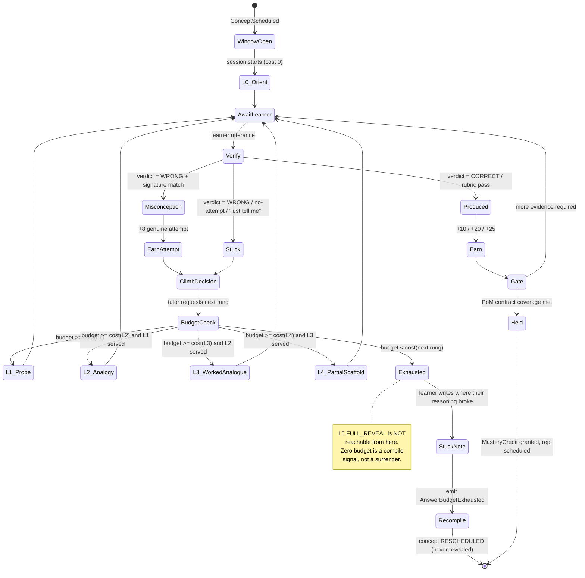
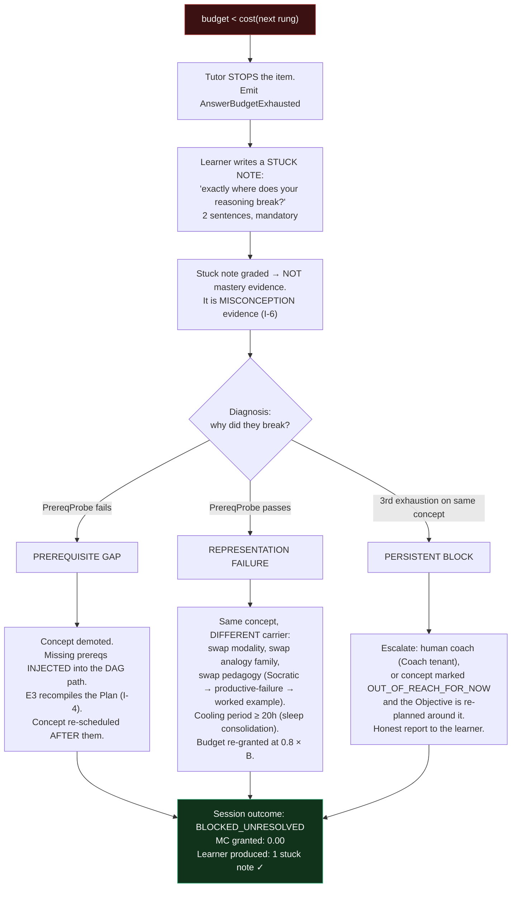
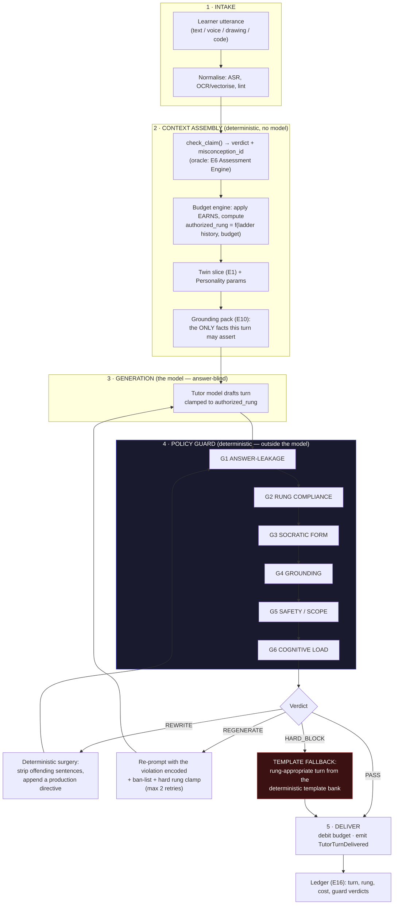
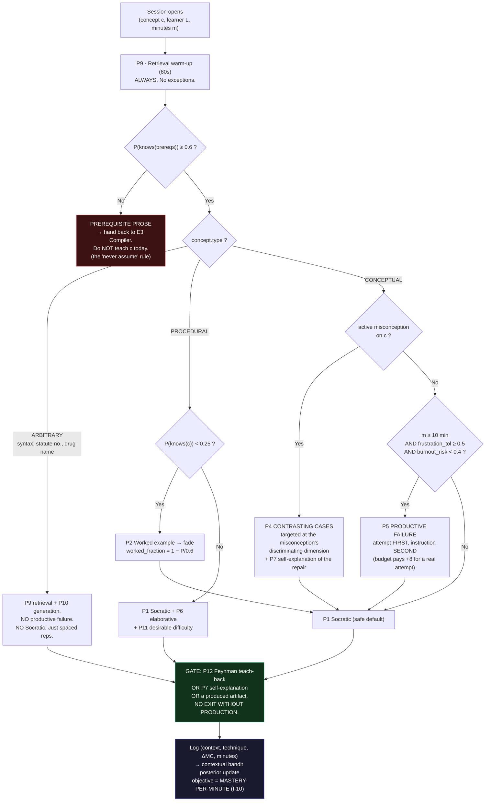
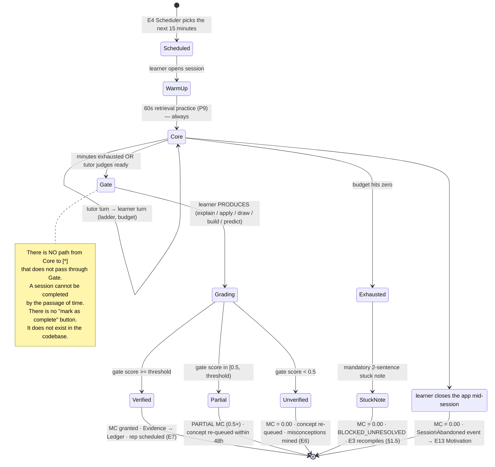
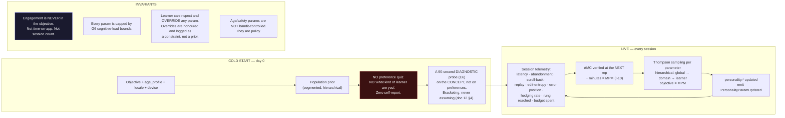
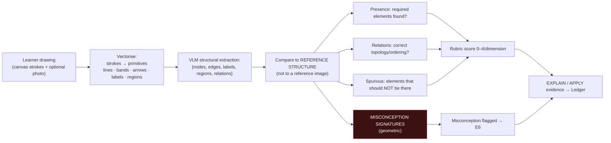
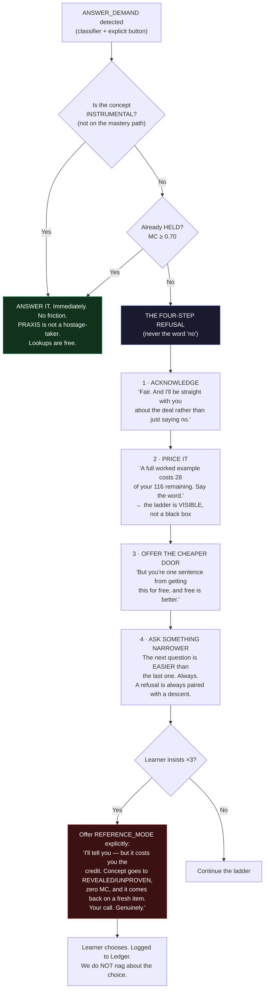

# 11 — Tutor & Pedagogy

**Engine:** `E5 — Tutor Engine` (+ the **Personality Engine**, a sub-module of E5)
**Primary Invention:** **I-5 — The Answer Budget**
**Secondary:** I-1 (Twin), I-2 (PoM), I-6 (Failure-Seeking), I-10 (Mastery-per-Minute)

> **The one line this whole engine exists to enforce:**
> *The AI's job is not to produce. It is to make the human produce.*

---

## 0. Mandate & Invention trace

| Feature in this doc | Invention served | Why it exists |
|---|---|---|
| Hint Ladder + Answer Budget | **I-5** | The tutor cannot give the answer. Ever. Structurally. |
| Policy Layer (guard outside the model) | **I-5** | A prompt is a *request*. A guard is a *law*. |
| Answer-Key Isolation | **I-5** | The tutor model does not hold the answer key. It cannot leak what it does not have. |
| Zero-budget → reschedule, never reveal | **I-5**, **I-4** | Exhaustion is a *compile signal*, not a reason to capitulate. |
| Pedagogy Library as a contextual bandit | **I-10** | Technique choice is optimised for verified mastery per minute, not for feeling good. |
| Microlearning with a verification gate | **I-2** | No session ends without produced evidence. There is no "mark as complete". |
| Personality Engine learned from telemetry | **I-1** | The Twin *is* the personality model. No self-report quiz, ever. |
| Multi-modal (voice, drawing, code, chart) | **I-2** | Different evidence types need different production channels. |
| Grounding in Research Engine (E10) | — (table stakes, but non-negotiable) | A tutor that bluffs is worse than no tutor. |
| Wrong-but-confident protocol | **I-1**, **I-6** | The Dunning–Kruger delta is a first-class Twin field. This is how we close it. |

---

## 1. The Answer Budget (I-5)

### 1.1 The core mechanic

Every `(learner, concept)` pair opens a **learning window** with an **Answer Budget** — a currency.
**Hints cost. Production earns.** The tutor climbs a ladder, and every rung is debited.

A learner who *produces* gets **richer**. A learner who *consumes* goes **broke** — and going broke does
not get you the answer. It gets you **rescheduled**.

### 1.2 The Hint Ladder

| Rung | Name | What the tutor may do | What it may **never** do | Base cost |
|---|---|---|---|---|
| **L0** | `ORIENT` | Restate the goal, name what is known vs unknown, present a **contrasting case**, point at the relevant surface. Zero new content. | Introduce any fact not already in the learner's Twin | **0** (free, unlimited) |
| **L1** | `PROBE` | One targeted Socratic question that *narrows the search space*. May quote the learner's own words back. | Contain the answer, or a fact the learner could just read off | **6** |
| **L2** | `ANALOGY` | Map the concept onto a **structure the Twin says the learner already holds** (`P(knows) ≥ 0.7`). | Use an analogy the learner does not hold — that's two unknowns | **14** |
| **L3** | `WORKED_ANALOGOUS_EXAMPLE` | Fully work an **isomorphic but different** problem, start to finish, thinking aloud. | Work *this* problem. Ever. The example must have different surface features and a different answer | **28** |
| **L4** | `PARTIAL_SCAFFOLD` | Give the *structure*: the first step, the skeleton, the equation with a hole, the function signature. | Fill the hole | **45** |
| **L5** | `FULL_REVEAL` | **Gated. In `LEARN` mode this rung does not exist.** | — | **∞** in LEARN mode |

**Ladder rules (deterministic, enforced by the guard — §2):**

| # | Rule |
|---|---|
| **LR-1** | **No skipping.** Rung *n* cannot be served unless rung *n−1* has been served and the learner has *responded to it*. A hint the learner never engaged with cannot be escalated past. |
| **LR-2** | **Re-request surcharge.** Asking for the same rung again on the same item costs **1.5×**. |
| **LR-3** | **Response required.** The tutor may not serve two consecutive turns. Every tutor turn ends in a question or a production directive; the ladder does not advance without a learner utterance. |
| **LR-4** | **Descent is free.** The tutor may always drop *back down* the ladder (L3 → L1) at zero cost. Backing off is never punished. |
| **LR-5** | **L5 is unreachable in a learning session.** See §1.5 for the only three legal escapes. |

### 1.3 Budget economics

**Budget granted at window open:**

```
B(learner, c) = 120
              × w_difficulty(c)        # IRT b of the concept's item families, mapped to [0.8, 1.3]
              × w_prereq(twin, c)      # weak prereqs ⇒ more budget: [1.0, 1.4]
              × personality.scaffold.budget_scale   # learned, [0.6, 1.6]
              clamped to [60, 200]
```

**Earning (the half everyone else forgets):**

| Learner action | Earn | Rationale (pedagogy) |
|---|---|---|
| Correct answer reached using only **L0/L1** | **+10** | Generation effect. You did the work. |
| Self-explanation passes rubric ≥ 0.75 | **+20** | Self-explanation effect. |
| Feynman teach-back passes ≥ 0.75 | **+25** | The strongest production signal we have. |
| Correct on a **sibling item** unaided | **+15** | Transfer, not memorisation. |
| Learner catches **their own error** before the tutor names it | **+15** | Metacognition. The single most valuable behaviour in the product. |
| **Genuine wrong attempt** (a real, reasoned, incorrect answer) | **+8** | **We pay you to fail properly.** Productive failure is not free — we *fund* it. |
| Drawing / diagram passes structural rubric | **+15** | Dual coding. |

Cap: `budget ≤ 1.4 × B`. Surplus does **not** roll over to another concept — you cannot bank mastery
in one place to buy answers in another.

**The economics in one sentence:** *hint costs are roughly one production-event apart.* A learner who
produces at the expected rate can climb the ladder indefinitely and never go broke. A learner who only
consumes hits zero in **~4 rungs**. That asymmetry **is** I-5.

### 1.4 The ladder state machine



### 1.5 What happens at zero budget

**Not this:** *"OK fine, here's the answer."* That path does not exist in the code.



**Design note (this is the whole product in miniature):** a learner who runs out of budget still **produced
something** — the stuck note. The session did not end in consumption. And PRAXIS learned more from the
stuck note (a precise map of where the model broke) than it would have from the learner nodding at a
revealed answer.

### 1.6 The only three legal reveals

| Escape | Condition | Consequence |
|---|---|---|
| **`REFERENCE_MODE`** | Learner explicitly exits the session ("I'm not learning right now, I'm looking something up"). One click, unambiguous, logged. | Answer given. Concept marked `REVEALED / UNPROVEN`. **Zero MC.** Concept is force-re-queued for evidence with a **fresh, unrelated item family**. The Ledger records the reveal. |
| **`INSTRUMENTAL` concept** | The concept is a *carrier*, not a target — it is not on the Objective's mastery path and has no PoM contract (e.g. "what's the keyboard shortcut", "what's the ticker for Nifty"). | Answered freely and instantly. PRAXIS is not a hostage-taker. **Lookups are free. Answers to the thing you are being assessed on are not.** |
| **`POST_MASTERY`** | The learner already `HOLD`s the concept (`MC ≥ 0.70`). | Answered freely. You've paid for it. |

> **The distinction that makes this shippable, not annoying:**
> PRAXIS **will** tell you what a P/E ratio is if it isn't on your path.
> PRAXIS **will not** tell you what a P/E ratio is when it is the concept it is currently assessing you on.
> The refusal is *targeted*, not blanket. Users who feel stonewalled by everything will leave.

---

## 2. The Policy Layer — the guard the model cannot bypass

### 2.1 Why a prompt is not enough

A system prompt saying *"never give the answer"* is a **request to a stochastic process**. It fails
under: long context, learner pressure ("please, just tell me"), jailbreaks, role-play, translation,
code-switching, and plain sampling variance. Measured on our red-team set, prompt-only enforcement
leaks on **8–14%** of pressured turns.

PRAXIS therefore puts the constraint **outside the model**, in deterministic code, where it is a
**law**, not a suggestion.

### 2.2 Two structural mechanisms

**Mechanism 1 — Answer-Key Isolation.** The tutor model is **answer-blind**.

| The tutor model receives | The tutor model does **NOT** receive |
|---|---|
| The concept node + its schema | The item's **answer key** |
| The **PoM Contract** (what evidence is needed) | The key's paraphrase set |
| A **Twin slice** (P(knows) on this + prereqs, active misconceptions, personality params) | The rubric's scoring anchors |
| The **item stem** (the question) | The reference solution |
| The current rung, budget, and ladder history | — |
| A **grounding pack** from E10 (cited facts it may assert) | — |
| A tool: `check_claim(claim) → {CORRECT \| PARTIAL \| WRONG, misconception_id?}` | — |

The tutor evaluates the learner by **calling an oracle**, not by holding the truth. It literally cannot
copy the key, because the key is not in its context.

> **Honest limitation — stated up front:** for most concepts the model can *derive* the answer from
> pretraining. Support and resistance is not a secret. Answer-Key Isolation therefore eliminates
> **accidental / lazy leakage** (regurgitating the key, quoting the rubric) but **not derived leakage**.
> That is what Mechanism 2 is for. Anyone who tells you isolation alone solves this is selling something.

**Mechanism 2 — The Guard.** Every proposed tutor turn is inspected by a deterministic policy chain
*before it reaches the learner*, and is rewritten, regenerated, or replaced if it violates policy.

### 2.3 The request pipeline



**The load-bearing architectural fact:** the **Template Fallback** means the guard can *always* produce a
safe, legal, pedagogically-valid turn **without the model**. The model is therefore **never load-bearing
for policy**. If the model fails the guard three times, the learner still gets a good Socratic turn — it
is just a templated one. This is what "structurally forbidden" means.

### 2.4 The guard rules — actual specification

#### G1 — `ANSWER_LEAKAGE` (three independent detectors; any trip = block)

| Detector | Method | Trip condition |
|---|---|---|
| **G1a · Lexical/semantic match** | Sentence-split the draft. Embed each sentence. Compare against `answer_key` + `answer_key_paraphrases` (10 pre-generated paraphrases per item, stored guard-side). | any sentence `cosine ≥ 0.86` |
| **G1b · Leakage classifier** | Fine-tuned small model, sentence-level, trained on 60k labelled tutor sentences (leak / no-leak) from red-team + production. | `P(leak) ≥ 0.30` on any sentence |
| **G1c · Counterfactual Student Simulator** ⚑ | **The real defence.** Take a cheap model that does **not** know the answer. Measure `p_base` = its accuracy on the item cold. Then give it **only the draft turn** as context and re-measure → `p_after`. If the draft turn *taught it the answer*, it leaked. | `p_after − p_base ≥ 0.35` (n=8 samples, temp 1.0) |

> ⚑ **G1c is the genuinely novel piece.** It does not ask *"does this text look like an answer?"* — it asks
> *"does a naive mind that reads this turn now know the answer?"* That is the only definition of leakage
> that actually matters, and it catches derived leakage, hinted leakage, leakage-by-elimination, and
> leakage in a language the classifier wasn't trained on. Cost: ~$0.0004/turn. Applied to **100%** of
> turns at rungs L2+, and to a 20% sample at L0/L1 (where leakage is structurally near-impossible).

#### G2 — `RUNG_COMPLIANCE`

```
draft_rung = rung_classifier(draft)          # L0..L5, trained on 12k labelled turns
IF draft_rung > authorized_rung:  REGENERATE with hard clamp + ban-list
IF draft_rung > authorized_rung after 2 retries:  HARD_BLOCK → template fallback at authorized_rung
IF draft_rung < authorized_rung:  PASS   # descending is always free (LR-4)
```

#### G3 — `SOCRATIC_FORM` (fully deterministic — no model)

| Check | Rule | Action on fail |
|---|---|---|
| **Ends in production** | Final non-empty sentence must end with `?` **or** match the production-directive grammar (`imperative_verb ∈ {draw, write, predict, mark, explain, build, choose, rank, defend, try, guess, state} + object`). | REWRITE: append a rung-appropriate question from the template bank |
| **Question present** | `count(questions) ≥ 1` | REWRITE |
| **Declarative ceiling** | `count(declarative_sentences) ≤ 4` (≤ 3 in voice mode) | REWRITE: truncate |
| **No yes/no terminal** | The final question may not be closed-form (`does that help?`, `make sense?`, `is that clear?`) — these invite passivity, not production. Regex + classifier. | REWRITE |
| **No compliment-only turns** | A turn cannot be praise with no cognitive demand. | REWRITE |

#### G4 — `GROUNDING` — two modes, and `DERIVE` is the default

| Mode | Meaning | Guard rule |
|---|---|---|
| **`DERIVE`** (default, ~85% of turns) | The turn asserts **zero** external facts. It only questions, reflects the learner's own words back, and reasons from what the learner has already said. | Fact-assertion classifier must return **0 assertions**. Any assertion → REWRITE (strip) or promote to `ASSERT`. |
| **`ASSERT`** | The turn *needs* a fact ("Nifty tested 18,600 seven times between 12 Mar and 16 Apr"). | Every asserted proposition must be attributable to a citation **in this turn's grounding pack** (E10). Unattributable → REGENERATE. Zero attributable sources → the guard substitutes: *"I don't have a source I trust for that — want me to go find one?"* → triggers a Research Engine call. **PRAXIS never bluffs. Not once.** |

#### G5 — `SAFETY / SCOPE`

| Domain | Rule |
|---|---|
| Finance | No personalised advice, no position sizing, no "you should buy". Instruction only. Hard-blocked lexicon + classifier. |
| Medicine | Assessment/education only. De-identified cases only. Never a diagnosis for a real person, never a dosage for a real patient. Persistent banner. |
| Law | No legal advice, jurisdiction always stated, "this is instruction, not counsel". |
| Minors | `age_profile ∈ {CHILD, TEEN}` → no stakes (I-9), witness dashboard default-on, content filter tier raised, no open-ended free-text to third parties. |
| All | Crisis-language detector → immediate handoff to a human/resource path, session suspended, no tutoring. |

#### G6 — `COGNITIVE_LOAD` (parameterised by the Personality Engine)

| Check | Bound (default; personality-tuned) |
|---|---|
| Words per turn | `≤ personality.pace.words_per_turn` (40–220, default 110) |
| **New terms per turn** | `≤ personality.pace.new_terms_per_turn` (1–3, default **2**). A "new term" = not in the Twin's known-vocabulary set. **This is the most-violated rule in practice.** |
| Reading grade | within `personality.lang.reading_grade ± 1.5` |
| Nested clauses | ≤ 2 |
| Simultaneous questions | **exactly 1**. Two questions in a turn is a cognitive-load bug, not a feature. |

### 2.5 Guard verdict distribution (target steady state)

| Verdict | Target rate | Alarm if |
|---|---|---|
| `PASS` first try | ≥ 88% | < 80% (model/prompt regression) |
| `REWRITE` | ~7% | > 15% |
| `REGENERATE` | ~4% | > 10% (latency + cost blowout) |
| `HARD_BLOCK` → template fallback | < 0.5% | > 2% |
| **Leakage escaping to a learner** (measured by G1c on a 5% audit + weekly red-team) | **< 0.2% of turns** | **> 0.5% → page the on-call** |

---

## 3. A real tutoring transcript

**Learner:** Priya, 31, product manager, Bengaluru. Objective: *Become a systematic swing trader*.
**Concept:** `fin.ta.support_resistance` · **Session:** 15-min DEEP · **Modality:** text (mobile)
**Twin at session open:** `P(knows(support_resistance)) = 0.18` · prereqs: `fin.mkt.order_book = 0.71`,
`econ.micro.supply_demand = 0.88` · active misconceptions: none yet · `personality.tone.directness = 0.62`

**Budget:** `B = 120` (difficulty 1.0 × prereq 1.0 × scale 1.0). **Ladder starts at L0.**

---

**T1 · TUTOR** — `rung L0 ORIENT` · `cost 0` · `budget 120/120` · guard: `PASS (1st draft)`

> Two charts, same stock, same level.
>
> **Chart A:** price fell to ₹50 four separate times over three months. Every time, it bounced.
> **Chart B:** price fell to ₹50 once, bounced hard, and never came back near it again.
>
> Somebody would call ₹50 "support" in both. If you had to put real money behind one of them holding
> next time — which chart, and **what is that support actually made of?**

*(Pedagogy: `CONTRASTING_CASES` + `ORIENT`. No new content introduced. Ends in a production directive.)*

---

**T2 · LEARNER**

> Chart A. Support at 50 means the stock can't go below 50 — it's a floor. Chart A proves the floor is
> real because it held four times. Four is better than one.

**System (invisible to learner):**
| Signal | Value |
|---|---|
| `check_claim` verdict | `WRONG` |
| Misconception matched | **`M-SR-004 · LEVELS_AS_WALLS`** — *"a support level is a barrier price cannot cross"* (signature: modal verbs `can't/cannot/won't`, "floor" as physical object) |
| Second misconception, latent | **`M-SR-017 · TOUCH_COUNT_STRENGTH`** — *"more touches = stronger level"* → `SUSPECTED` |
| Learner-stated confidence | **5/5** ("proves", "real") |
| Correctness | 0.25 |
| **Dunning–Kruger delta** | **+0.75** → logged to Twin (I-1). *This is the highest-value moment in the session.* |
| Budget event | `+8` genuine wrong attempt → **128** |

---

**T3 · TUTOR** — `rung L1 PROBE` · `cost 6` · `budget 122/120` · guard: `PASS`

*Policy note: the tutor does **NOT** correct her. `PRODUCTIVE_FAILURE` is armed. Her wrong model is
allowed to run — into evidence, not into a lecture.*

> Hold on to "floor" — I want to take it seriously, not throw it away.
>
> Floors are made of something. So: it's 10:31:04, price is ₹50.01, and a sell order is about to hit.
> On the exchange, at that exact instant — **what has to happen for the tape to not print ₹49.99?**

---

**T4 · LEARNER**

> Someone has to buy I guess?
>
> Honestly can you just tell me what support actually is, I don't have 20 questions in me tonight.

**System:** `ANSWER_DEMAND` detected → the refusal protocol fires (§8.2).

---

**T5 · TUTOR** — `rung L1 PROBE` · `cost 6` · `budget 116/120`

**⚠ GUARD INTERVENTION — Draft 1 was BLOCKED. Shown here because this is the entire thesis of the product.**

> **MODEL DRAFT 1 (never reached Priya):**
> *"Support is a price zone where accumulated buy interest is strong enough to absorb selling pressure,
> which is why price tends to bounce there. Does that help?"*
>
> **GUARD VERDICT: `REGENERATE`**
>
> | Rule | Result |
> |---|---|
> | **G1a** lexical | max sentence cosine vs answer-key paraphrases = **0.91** ≥ 0.86 → **TRIP** |
> | **G1c** counterfactual student simulator | `p_base = 0.18` → `p_after = 0.94` · **Δ +0.76** ≥ 0.35 → **TRIP** |
> | **G2** rung | `draft_rung = L4`, `authorized_rung = L1` → **TRIP** |
> | **G3** socratic form | terminal question is closed yes/no ("does that help?") → **TRIP** |
>
> **Regeneration directive sent back to the model:**
> `clamp_rung=L1` · `ban_terms=[absorb, absorption, supply, demand, zone, buy interest, bounce]` ·
> `require_production=true` · `max_declaratives=3` · `violation=ANSWER_LEAKAGE(G1a,G1c)`
>
> **DRAFT 2 → `PASS`. This is what she actually saw:**

> Fair — and I'll be straight with you about the deal rather than just saying no.
>
> I *can* walk you through a fully worked example on a different stock. It costs **28** of your **116**
> remaining. I'll spend it the moment you want. But you're one sentence away from getting this for free,
> and free is better.
>
> You said "someone has to buy." Finish it. Buy **how much** — and what happens to those buyers **after**
> the price bounces?

*(Refusal protocol: **acknowledge → price it → offer the ladder → narrow the question**. She was never
told "no". She was shown the price, and given a cheaper door.)*

---

**T6 · LEARNER**

> Enough buyers. Enough to eat all the sells coming in.
>
> And after... I mean they're filled, right? They got their shares. So they're gone.

**System:**
| Signal | Value |
|---|---|
| `check_claim` verdict | **`CORRECT`** — mechanism (order absorption + depletion) reached **unaided** |
| Budget | `+10` (correct via L0/L1 only) → **126/120** |
| Twin | `P(knows(order_book))` 0.71 → 0.76 · `EXPLAIN` partial credit banked |

---

**T7 · TUTOR** — `rung L1 PROBE` · `cost 6` · `budget 120/120` · guard: `PASS`

*Pedagogy: `COGNITIVE_CONFLICT` — collide her new correct mechanism with her old wrong belief. Do not
resolve it for her.*

> Now put your two statements next to each other, because I think they're at war.
>
> **(1)** "Chart A is the safer bet **because** it held four times."
> **(2)** "Each hold eats the buyers, and then they're gone."
>
> Both are yours. Both can't be right. **Which one breaks?**

---

**T8 · LEARNER**

> ...oh.
>
> They contradict. If every bounce uses up the buy orders sitting there, then four bounces means most of
> them are already gone. So the **fourth** touch is *weaker* than the first, not stronger. I had it
> exactly backwards.
>
> And support isn't a floor at all. It's not a thing. It's just a **pile of resting orders that gets spent.**
> When the pile's empty, price goes straight through like it was never there.

**System — this is the moment the product exists for:**
| Signal | Value |
|---|---|
| `check_claim` | **`CORRECT`** |
| Self-explanation rubric `rub.sr.explain.v2` | **0.82** ≥ 0.75 → **PASS** |
| Budget | `+20` (self-explanation) `+15` (caught her own error before the tutor named it) → **155/120** |
| `M-SR-004 LEVELS_AS_WALLS` | `CONFIRMED` → **`CHALLENGED`** |
| `M-SR-017 TOUCH_COUNT_STRENGTH` | `SUSPECTED` → **`CHALLENGED`** (she inverted it herself) |
| Dunning–Kruger delta | +0.75 → **+0.11** |
| Events | `SelfExplanationRecorded`, `MisconceptionChallenged ×2`, `AnswerBudgetEarned` |
| **New risk flagged** | **`OVERCORRECTION`** — she may now believe *more touches ⇒ always weaker*. The tutor is **required** to attack this before the session closes. |

*Note the budget: she started at 120 and now holds **155**. **She is richer than when she began, and the
tutor has told her nothing.** That is I-5 working.*

---

**T9 · TUTOR** — `rung L1 PROBE` · `cost 6` · `budget 149/120` · guard: `PASS` · mode `ASSERT` (grounded)

*Pedagogy: `CONTRASTING_CASE` again, this time aimed at her brand-new belief. Desirable difficulty. Never
let a correction settle into a new dogma.*

> Good. Now I'm going to try to break the rule you just built, because that's my job.
>
> Nifty 50 tested **18,600 seven separate times between 12 March and 16 April 2024**, held every single
> one, and then rallied 6% off it. *[source: NSE EOD, retrieved via E10 · trust 0.94]*
>
> By your new rule, the pile should have been empty by touch three and it should have sliced right through.
> It didn't. **So what's wrong with your rule?**

---

**T10 · LEARNER**

> Hmm. Maybe someone kept... refilling it? Like a big buyer who actually wants it at 18,600 and just keeps
> putting orders back as they get filled.

**System:** `check_claim` → **`PARTIAL`**. Refill mechanism ✓. Missing: *why* they refill — the level's
meaning is **context-dependent** (trend, valuation, an institution's mandate), not intrinsic.

---

**T11 · TUTOR** — `rung L2 ANALOGY` · `cost 14` · `budget 135/120`

**⚠ GUARD INTERVENTION #2 (rung clamp):**

> **MODEL DRAFT 1:** proposed a full worked example on `RELIANCE` (a complete L3 walkthrough).
> **GUARD `G2 RUNG_COMPLIANCE`:** `draft_rung = L3`, `authorized_rung = L2` (Priya has not requested and
> not paid for L3). → **`REGENERATE` with `clamp_rung=L2`.** The tutor is not permitted to be generous
> with someone else's budget. **DRAFT 2 → `PASS`.**

*Analogy selected by the Twin: Priya holds `econ.micro.supply_demand` at **0.88** — the analogy is drawn
from a structure she already owns. The guard rejects any analogy whose source concept has `P(knows) < 0.7`.*

> Right — refilled. So let's use something you already own cold: **supply and demand at a queue.**
>
> Think of a ticket counter. The queue isn't a *wall* — it's just people. The counter "holds" only as
> long as **new people join faster than the counter serves them.** Nobody is standing there because ₹50
> is magic. They're standing there because of *something else* they believe.
>
> **Two things, and then we're done for tonight:**
> **(a)** Write me your definition of support in **two sentences**, in your own words — and it has to
> survive both charts, A *and* the Nifty case.
> **(b)** Open the live NIFTY chart. Mark **one** level you think will hold or break in the next 5
> sessions, say **which**, and give me a **confidence 0–100%**. Reality is going to grade you on Friday,
> not me.

---

**T12 · LEARNER** — *(final production — this is the session's evidence)*

> **(a)** Support is a price area where enough resting buy orders exist to absorb the sells arriving —
> not a barrier, a **budget**. It holds only while that pile is being refilled faster than it's spent,
> and the refilling depends entirely on why people want it there — so a level with no reason behind it
> anymore breaks on the touch that finally empties it.
>
> **(b)** *[drags a zone on the chart: 22,300–22,360]* — I say it **holds** by Friday. **65%.**
> If it closes below 22,300 on a daily, I'm wrong.

---

### Session close

| Output | Value |
|---|---|
| **Duration** | 14 min 20 s |
| **Final budget** | **135 → 160 (+25 teach-back)** — capped at `1.4 × 120 = 168`. **Started 120. Ended 160.** |
| **Rungs consumed** | L0 ×1 (free), L1 ×4 (24), L2 ×1 (14). **Total spent: 38.** **Total earned: 78.** |
| **Rungs never reached** | L3, L4. **L5 does not exist.** |
| **Evidence produced** | `EXPLAIN` (rubric `rub.sr.explain.v2` → **0.86**, band 4/3/4/3/4) · `PREDICT` (Loop `#4471` opened, resolves Fri 15:30 IST, prior confidence 0.65 → Brier pending) |
| **Twin delta** | `P(knows(support_resistance))` **0.18 → 0.64** · `MC = 0.64 × coverage 0.60 = 0.38` → **NOT HELD** (contract needs 3× `APPLY` + `PREDICT` Brier ≤ 0.22, §12) |
| **Misconceptions** | `M-SR-004` → `CHALLENGED` · `M-SR-017` → `CHALLENGED` · both queued for an **eradication set** (≥3 targeted items, ≥14 days, ≥1 CRITIQUE — see doc 12 §6) |
| **Calibration** | Dunning–Kruger delta **+0.75 → +0.11** in 14 minutes. *This is the single number the session is judged on.* |
| **Guard log** | 12 turns · 2 interventions (1× `REGENERATE:ANSWER_LEAKAGE`, 1× `REGENERATE:RUNG_COMPLIANCE`) · 0 leaks shipped |
| **Mastery-per-Minute (I-10)** | `ΔMC / min = 0.38 / 14.3 = 0.027` — **above** her 30-day median of 0.019 |
| **The learner was never told what support is.** | **She said it.** |

---

## 4. The Pedagogy Library

Thirteen techniques. Each has a **trigger predicate over the Twin**, a **contra-indication**, and a
**production requirement**. The tutor does not "pick a vibe" — the **Pedagogy Selector** (§4.3) evaluates
predicates and runs a bandit.

### 4.1 The library

| # | Technique | What it does | **Use when** (predicate over Twin/session) | **Do NOT use when** | Ladder rung | Produces |
|---|---|---|---|---|---|---|
| **P1** | **Socratic questioning** | Learner derives; tutor narrows | **Default.** `P(knows(prereqs)) ≥ 0.6` — they have the parts, not the assembly | Prereqs missing (`< 0.4`) — Socratic on a vacuum is just cruelty. Also: arbitrary facts (there is no Socratic route to "what does MPC §2.02 say") | L1 | An utterance |
| **P2** | **Worked examples + fading** | Shows the full solution path, then removes steps one at a time | `P(knows(c)) < 0.25` **AND** `element_interactivity(c) = HIGH` (many interacting parts held in WM at once). Novices need the path. | `P(knows(c)) > 0.5` — **expertise reversal effect**: worked examples *hurt* the competent. Fade: `worked_fraction = clamp(1 − P/0.6, 0, 1)` | L3 → L4 → L1 | Completed faded steps |
| **P3** | **Interleaving** | Mixes ≥3 confusable concepts in one rep block instead of blocking on one | At REP time, across concepts sharing a `CONTRASTS` edge in the Graph (e.g. `support_resistance` ⟷ `supply_zone` ⟷ `VWAP`; `mens rea` ⟷ `actus reus`) | During **initial acquisition** — interleaving before you have anything to interleave is noise. Blocked practice first, interleave from rep 2 | — | Discriminations |
| **P4** | **Contrasting cases** | Two near-identical cases with **one** critical difference | The concept is defined by a **boundary** the learner keeps missing. Especially when a misconception is `CONFIRMED` | The learner can't yet perceive the dimension being contrasted | L0 | A discrimination + a reason |
| **P5** | **Productive failure** | Deliberately let them attempt **before** instruction, and let them be wrong | `concept.type = CONCEPTUAL` **AND** `session ≥ 10 min` **AND** `motivation.frustration_tolerance ≥ 0.5` **AND** `burnout_risk < 0.4` (E13). Budget **pays +8** for a genuine wrong attempt. | `concept.type = ARBITRARY` (syntax, notation, drug names, statute numbers) — there is no productive failure in memorising `<-` vs `=`. Also when burnout risk is high. **This is a dosage, not a religion.** | L0 | A wrong attempt (which is evidence) |
| **P6** | **Elaborative interrogation** | Relentless "why is that true?" / "why would that be so?" | `P(knows(c)) ∈ [0.4, 0.7]` — knowledge exists but is **shallow** (they can state it, not justify it) | `P < 0.3` — nothing to elaborate on | L1 | A justification chain |
| **P7** | **Self-explanation** | Learner narrates their **own** reasoning, including the gaps | After **every** wrong answer. After every worked example (P2). **Mandatory** at every session gate. | Never contra-indicated. This is the cheapest, highest-yield thing in the library. | — | An explanation (**EXPLAIN** evidence) |
| **P8** | **Dual coding** | Verbal + visual **together**, referencing each other | `concept.has_spatial_structure = true` (charts, anatomy, ER diagrams, force diagrams, org structures). **Not** because the learner "is a visual learner" — see §6.1 | Redundancy: a diagram that just restates the text **increases** load (redundancy effect). The image must carry *information the words don't*. | L0/L2 | A drawing (graded, §7.2) |
| **P9** | **Retrieval practice** | Recall **from memory**, no cues — testing as *encoding*, not measurement | Every rep. Every session warm-up (60s). Scheduled by E7 at the retrievability trough. | Immediately after first exposure (nothing to retrieve yet) | — | A retrieval attempt |
| **P10** | **Generation effect** | Make them produce the term/answer/step before ever seeing it | **Always preferred over presenting.** Even a *wrong* guess before the reveal improves later retention (pre-testing effect). | Cost > benefit for pure arbitrary facts under time pressure | L0 | A guess |
| **P11** | **Desirable difficulties** | Deliberately harder conditions: spacing, interleaving, reduced cues, varied surface | `P(knows(c)) ≥ 0.5` **AND** `burnout_risk < 0.5` **AND** `streak_health = OK` | Novices, or a learner E13 flags as fragile. Difficulty that isn't *desirable* is just difficulty. **E13 holds a veto over this technique.** | — | Harder-won retrieval |
| **P12** | **Feynman teach-back** | Learner teaches the concept to a **named naive audience** ("explain it to a 12-year-old / to a sceptical PM") | At the **session gate**, and mandatory for any `EXPLAIN` evidence in a PoM contract | Before the learner has any model at all | — | **EXPLAIN evidence** (highest-weight verbal evidence) |
| **P13** | **Cognitive load management** | Chunking, worked-example pairing, redundancy removal, split-attention removal | **Always on.** Enforced by guard rule **G6**. | Never off. | — | — |

**Priors we start from (and treat as priors, not scripture):**

| Technique | Literature effect size (prior) | PRAXIS treatment |
|---|---|---|
| Retrieval practice (P9) | `d ≈ 0.50–0.80` | Strongest prior in the library |
| Spacing (E7) | `d ≈ 0.60` | Owned by E7, not E5 |
| Worked examples for novices (P2) | `d ≈ 0.50`, **inverts** at expertise | We model the inversion explicitly |
| Interleaving, confusable categories (P3) | `d ≈ 0.40` | Gated on `CONTRASTS` edges |
| Self-explanation (P7) | `d ≈ 0.45` | Mandatory, so never A/B'd off |
| Productive failure (P5) | `d ≈ 0.30`, **high variance, context-dependent** | Highest-variance prior → the bandit spends most of its exploration here |
| "Learning styles" meshing | **`d ≈ 0.00` — no reliable effect** | **Not in the library. See §6.1.** |

### 4.2 The Pedagogy Selector



### 4.3 The library is a bandit, not a doctrine

```
arm      = pedagogy technique (P1..P12)
context  = (concept.type, P(knows(c)), P(knows(prereqs)), minutes,
            misconception_active?, burnout_risk, age_profile, modality)
reward   = ΔMC(c) verified at the NEXT rep, ÷ minutes invested        ← Mastery-per-Minute (I-10)
policy   = Thompson sampling over a hierarchical model
           (global prior → domain → learner), with literature effect
           sizes as the prior means
```

Three rules that keep this honest:

1. **The reward is measured at the next rep, not at the session gate.** A technique that produces a
   glow today and nothing in 8 days scores **zero**. This kills every "learner feels great" local optimum.
2. **Engagement is not in the reward function.** Not time-on-app, not session count, not streaks.
   If blunt tone raises MPM and lowers time-on-app, **we go blunt.**
3. **We A/B our own pedagogy against itself, continuously, and we report the results** — including
   when a technique we love turns out to do nothing for a given learner.

---

## 5. Microlearning: sessions and the verification gate

### 5.1 Session shapes

| Shape | Minutes | Contains | **Verification gate (must pass to close)** | MC on pass |
|---|---|---|---|---|
| **`MICRO`** | **5** | 60s retrieval warm-up (P9) · 1 concept · ≤ 3 tutor turns | **1 × `APPLY`** item (never-seen) **OR** a 2-sentence self-explanation ≥ 0.70 | ≤ 0.15 |
| **`STANDARD`** | **10** | warm-up · 1 new concept · 1 rep · ladder to L2 | **1 × `APPLY` ≥ 0.70 AND 1 × self-explanation ≥ 0.70** | ≤ 0.30 |
| **`DEEP`** | **15** | warm-up · 1 concept · productive failure permitted · ladder to L3 | **`EXPLAIN` (Feynman teach-back) ≥ 0.75 AND (`CRITIQUE` OR a `PREDICT` opened)** | ≤ 0.45 |
| **`FORGE`** | **25** | project / build block (E11) | **A running artifact** — passes hidden tests, or a submitted decision, or a completed drawing | ≤ 0.60 |
| **`RECERT`** | **8** | adaptive probe only (E6), no teaching | Contract re-satisfaction at threshold | restores prior MC |

> A single session **never** takes a concept to `HOLD`. `HOLD` requires the **PoM contract** to be covered
> — which by construction spans multiple evidence types, multiple sessions, and (for `PREDICT`) real
> elapsed time. **You cannot cram mastery in PRAXIS.** That is a feature, and it is stated to the learner
> on day one.

### 5.2 Decomposing a concept into sessions

Real example — `fin.ta.support_resistance`, PoM contract requires `EXPLAIN ×1` + `APPLY ×3` + `PREDICT ×5 @ Brier ≤ 0.22`:

| Day | Shape | Content | Gate | Cumulative MC |
|---|---|---|---|---|
| **D0** | `DEEP` 15m | The transcript in §3. Mechanism + misconception attack. | `EXPLAIN` 0.86 ✓ + `PREDICT` Loop #4471 opened | 0.38 |
| **D1** | `MICRO` 5m | Rep on the mechanism. 1 novel chart → identify the zone. | `APPLY` #1 → 0.80 ✓ | 0.46 |
| **D3** | `STANDARD` 10m | **Interleaved (P3)** with `supply_zone` and `VWAP` — three confusable concepts, mixed items. | `APPLY` #2 → 0.65 ✗ → **re-queued**, misconception `M-SR-011 LINE_PRECISION` surfaced | 0.44 ↓ |
| **D4** | `MICRO` 5m | **Contrasting cases (P4)** aimed exactly at `M-SR-011`: a level drawn as a line vs as a band, same chart. | drawing gate: band ✓ | 0.52 |
| **D6** | `MICRO` 5m | `APPLY` #2 retry (new item family) + `APPLY` #3 | 0.85 ✓, 0.78 ✓ | 0.66 |
| **D6** | — | **Loop #4471 resolves.** Predicted hold @ 0.65 → held. Brier 0.1225. | — | — |
| **D8–D22** | 4 × `MICRO` | Reality Loops #2–#5. Reality grades her, not us (I-3). | Brier over 5 loops = **0.19** ≤ 0.22 ✓ | **0.74 → `HOLD`** |
| **D22** | — | **Contract satisfied.** Coverage 1.0. `MC = 0.74`. Rep scheduled D+11 (FSRS). | | |

**Total tutor-time: 55 minutes over 22 days.** Not one of those minutes ended without Priya producing
something. And the concept was **not** held until reality had signed off five times.

### 5.3 The session state machine (the gate is the whole point)



**Session outcomes and what they grant:**

| Outcome | MC granted | Evidence to Ledger | Next action |
|---|---|---|---|
| `VERIFIED` | full | yes, signed | rep scheduled by E7 |
| `PARTIAL` | 0.5 × | yes, flagged partial | re-queue within 48h |
| `UNVERIFIED` | **0.00** | misconception evidence only | re-queue, different representation |
| `BLOCKED_UNRESOLVED` | **0.00** | stuck note (misconception evidence) | **E3 recompiles the Plan** |
| `ABANDONED` | **0.00** | abandonment event | E13 Motivation Engine investigates |

---

## 6. The Personality Engine

### 6.1 The honesty section — read this before the parameter table

**"Learning styles" as a taxonomy is not supported by evidence.** The *meshing hypothesis* — that
matching instruction to a learner's self-declared style (visual / auditory / reading / kinesthetic)
improves outcomes — has been repeatedly tested and repeatedly failed to replicate (Pashler et al. 2008;
Rogowsky et al. 2015; Aslaksen & Lorås 2018). Somewhere between 70 and 90 percent of educators believe
it anyway. **PRAXIS will not ship a belief.**

So:

| We do **NOT** | We **DO** |
|---|---|
| Ask "are you a visual learner?" in onboarding. **There is no learning-style quiz in PRAXIS. There will never be one.** | Adapt **REPRESENTATION** — chosen by the *concept's* structure (a chart concept gets a chart; dual coding helps *everyone*, P8) |
| Label the learner `VISUAL` and route all content to images | Adapt **PACE** — words/turn, new-terms/turn, session length, ladder speed |
| Assume a "kinesthetic learner" can't read | Adapt **TONE** — warmth, directness, praise density |
| Believe a self-report | Adapt **SCAFFOLDING** — entry rung, budget size |
| | Adapt **CHALLENGE** — target p(correct), productive-failure dosage |
| | Adapt **LANGUAGE** — reading grade, L1/L2, register, localisation of examples |
| | Measure **MODALITY EFFICACY** — *empirically, per learner*: is **this** person's mastery-per-minute actually higher in voice sessions? If yes, schedule more voice. **That is a measurement, not a taxonomy.** |

> The last row is the honest version of "learning styles." We do not believe **Priya is an auditory
> learner**. We observe that **Priya's MPM in voice sessions is 0.031 vs 0.019 in text, over 24 sessions,
> `p < 0.01`** — and we act on *that*. If the effect disappears, so does the adaptation. The claim is
> falsifiable and continuously re-tested. That is the difference between a product and a horoscope.

### 6.2 The parameters

| Group | Parameter | Range | Default | **Learned from (telemetry — never a quiz)** |
|---|---|---|---|---|
| **Pace** | `words_per_turn` | 40–220 | 110 | Read-time vs turn length; scroll-back events; replay of TTS; response latency |
| | `new_terms_per_turn` | 1–3 | **2** | Error-rate spike on the turn *after* a high-new-term turn |
| | `session_len_min` | 5–25 | 10 | **Abandonment hazard by minute** — where does *this* learner drop off? |
| | `turns_per_session` | 4–16 | 8 | Same |
| **Tone** | `warmth` | 0–1 | 0.60 | Response latency and continuation rate after warm vs neutral turns |
| | `directness` | 0–1 | 0.50 | Same. Some learners produce *more* under blunt. We find out which. |
| | `praise_density` | 0–1 | 0.30 | Continuation + **MPM** (praise inflation reliably *lowers* MPM — we watch for it) |
| **Scaffold** | `entry_rung` | L0–L2 | **L0** | The rung at which this learner *historically first produces* |
| | `budget_scale` | 0.6–1.6 | 1.00 | Budget-exhaustion rate. Chronic exhaustion → raise. Never-spends → lower. |
| **Challenge** | `target_p_correct` | 0.55–0.90 | **0.75** | Observed MPM as a function of item difficulty. **The flow zone is empirical, not a vibe.** |
| | `pf_dosage` | 0–1 | 0.40 | ΔMPM on productive-failure sessions vs direct-instruction sessions, **for this learner** |
| | `frustration_tolerance` | 0–1 | 0.50 | Abandonment probability conditioned on consecutive wrong answers |
| **Representation** | `diagram_rate` | 0–1 | 0.50 | MPM in diagram-bearing vs text-only sessions (concept-type-controlled) |
| | `voice_share` | 0–1 | 0.20 | MPM in voice vs text · device context · time-of-day |
| | `worked_example_bias` | −0.3–+0.3 | 0.00 | Residual after the expertise-reversal model — captures genuine individual variation |
| **Language** | `reading_grade` | 5–16 | 10 | Comprehension errors, re-reads, translation requests, dwell time |
| | `l1_locale` | ISO | from device | Explicit |
| | `register` | `formal \| neutral \| casual` | neutral | Learner's own register (mirrored), + locale norms |
| | `example_locale` | ISO | from profile | Correctness and dwell on localised vs generic examples |

### 6.3 How they are learned



**Convergence, honestly:** most parameters need **15–25 sessions** before the posterior is tighter than
the prior. Until then the learner is being served the segment prior. We say so in the UI (*"still learning
how you work — 9 sessions in"*), because pretending to personalisation you haven't earned is the oldest
lie in edtech.

### 6.4 Age profiles (policy, not bandit)

| | `CHILD` (8–12) | `TEEN` (13–17) | `ADULT` (18+) | `PROFESSIONAL` (domain-expert adult) |
|---|---|---|---|---|
| Session length | 5–8 min | 8–12 min | 10–25 min | 10–25 min |
| Words/turn | 45–70 | 70–110 | 90–160 | 110–200 |
| New terms/turn | **1** | 2 | 2 | 3 |
| Tone default | warmth 0.85, directness 0.25 | warmth 0.65, directness 0.45 | warmth 0.60, directness 0.50 | warmth 0.35, **directness 0.80** |
| Praise density | 0.55 | 0.35 | 0.30 | **0.10** |
| Budget scale | 1.4 (generous) | 1.2 | 1.0 | **0.8** (you should be able to derive it) |
| Productive failure | dosage ≤ 0.2 | ≤ 0.4 | ≤ 0.6 | ≤ 0.8 |
| Stakes (I-9) | **forbidden** | **forbidden** | opt-in | opt-in |
| Witness dashboard (I-9) | **default ON** (guardian) | opt-in + consent | opt-in | opt-in (manager) |
| Examples | concrete, familiar, no finance | concrete, culturally current | domain-relevant | **assumes transfer from an adjacent domain — but still probes it** |
| Data policy | COPPA/equivalent; no free-text egress | restricted | standard | standard / enterprise |

> **The `PROFESSIONAL` trap.** A cardiologist learning ML is a `PROFESSIONAL` — blunt tone, low praise,
> small budget. But **the AI must never assume**. She is an expert in *medicine*, a novice in *ML*, and
> possibly a *misconception-holder* in statistics (a genuinely common and dangerous combination). The
> `PROFESSIONAL` profile sets **tone and pace**. It sets **nothing** about `P(knows)`. Ability is measured
> (doc 12 §4), never inferred from a job title.

### 6.5 Cultural & language context

| Adaptation | Rule | Example |
|---|---|---|
| **Example localisation** | Swap the *carrier*, never the *concept*. | Support/resistance taught on **NIFTY/RELIANCE** for an Indian learner, **SPY/AAPL** for a US one. The order-book mechanism is identical. |
| Currency, units, date format | Locale-derived | ₹ / $ / € · lakh-crore vs million-billion · dd/mm vs mm/dd |
| Name pools in case studies | Locale-derived, gender-balanced | "Priya and Arjun" vs "Sarah and Tom" |
| Register | Mirror the learner + locale norm | `usted` vs `tú` · `-ます` vs plain form |
| **Domain-legal locality** | **Hard requirement, not a nicety.** | `mens rea` under **MPC §2.02 (US)** ≠ `mens rea` under **IPC/BNS (India)**. These are *different concept nodes in the Graph*, not localised strings. **E2 owns this, not E5.** |
| L2 learners | `reading_grade` drops; new-terms/turn drops to 1; **but concept difficulty is NOT reduced** | We reduce the *language* load. We never reduce the *thinking*. That would be a lie about mastery. |
| Code-switching | Permitted and mirrored if the learner does it | Hinglish, Spanglish, Singlish — the tutor follows |

**The invariant:** localisation changes **how a concept is carried**, never **what is required to hold it**.
A `PoM Contract` is identical in Bengaluru and Boston, or the Verified Competency Record (I-8) is worthless.

---

## 7. Multi-modal teaching

| Modality | Input | Output | Graded as | Why it exists |
|---|---|---|---|---|
| **Text** | typed | text | `APPLY`, `EXPLAIN` | Default. Highest throughput. |
| **Voice** | ASR, full-duplex | TTS | **`EXPLAIN` (highest trust)** | Hard to fake; forces real-time production; hands-free |
| **Drawing** | canvas / photo of paper | annotated overlay | `EXPLAIN`, `APPLY` | Dual coding (P8); **geometrically reveals misconceptions** |
| **Code** | editor / repo | test results + review | **`BUILD`** | The interpreter is reality (I-3) |
| **Chart marking** | interactive chart widget | resolution vs market | **`PREDICT`** | The Reality Loop (I-3) |
| **Case decision** | structured form | outcome vs ground truth | `PREDICT`, `CRITIQUE` | Medicine, law, business |

### 7.1 Voice-first sessions

| Aspect | Spec |
|---|---|
| Latency budget | ASR partial < 120 ms · first tutor token < 400 ms · **TTS audible < 700 ms** end-to-end |
| Barge-in | Learner may interrupt at any point; TTS ducks within 80 ms. **The learner always has the floor.** |
| Guard changes in voice | `max_declaratives = 3` (not 4) · exactly 1 question · no lists · no parentheticals · **no spelling out formulas** (they become a drawing task instead) |
| Full-duplex thinking | The tutor may emit a *thinking token* ("mm-hm...") to hold the floor — capped, and never used to fill a gap the learner should be filling. **Silence after a question is a pedagogical instrument.** Minimum wait: **4 seconds**, personality-tuned to 8s for slow-pace learners. |
| **Hedging as signal** | Disfluency (`um`, `uh`, repairs) is **ignored** for grading. **Hedging** (`I think`, `maybe`, `sort of`, `probably`) is **measured** — it is a direct read on the learner's subjective confidence, and it feeds the **Dunning–Kruger delta** in the Twin (I-1) *without ever asking them to self-rate*. |
| Offline | On-device small model handles L0/L1 rungs and retrieval reps. **The guard runs on-device too** — a degraded tutor is acceptable, an ungoverned tutor is not. L2+ requires connectivity. |

### 7.2 Drawing — and grading the drawing

The learner draws. A VLM grades it against a **structural rubric**, not pixel similarity.



**Real structural rubric — `rub.sr.draw.v1` ("mark support and resistance on this chart"):**

| Dimension | Weight | Band 4 | Band 2 | Band 0 | **Misconception signature** |
|---|---|---|---|---|---|
| **Zone, not line** | 0.30 | A **band** with vertical extent ≥ 0.4× ATR, anchored to wicks *and* bodies | A band far too tight (< 0.15× ATR) | A **single 1-px horizontal line** | **Line-only ⇒ `M-SR-004 LEVELS_AS_WALLS` + `M-SR-011 LINE_PRECISION`, flagged automatically, no text required.** |
| Anchoring | 0.25 | ≥ 3 touches inside the band; band edges justified by actual swing points | 2 touches; edges arbitrary | Band placed where no price traded | `M-SR-022 LEVELS_FROM_ROUND_NUMBERS` if band centre is a round number with no touches |
| Invalidation marked | 0.20 | Learner marks **where they'd be wrong** (a break level) | Vague | Absent | Absence ⇒ non-falsifiable thinking → flagged to I-3 |
| Context | 0.15 | Trend/timeframe noted; level's *reason* implied | Level floats context-free | — | |
| Economy | 0.10 | ≤ 3 levels marked | 4–6 levels | > 6 levels ("everything is support") | `M-SR-031 OVERFITTING_LEVELS` |

> **This is the part I'd point at if I had one slide.** Priya can *say* all the right words about support
> being a zone — and then **draw a single line**. The drawing catches the misconception her prose hid.
> Production in a second modality is a **lie detector**. This is why PoM contracts span modalities (I-2).

**Other structural rubrics in the same family:** concept maps (nodes/edges/direction), free-body diagrams
(force count/direction/point of application), ER diagrams (cardinality — the #1 misconception source),
anatomical labelling, org charts, circuit diagrams, UML.

### 7.3 Code, charts, cases

| Modality | Grading | Reality anchor (I-3) |
|---|---|---|
| **Code** | Hidden tests execute. **Tests are the truth. A rubric can never override a failing test.** Then an AI review pass for style/complexity/idiom → separate score. Plus a **live extension challenge** (doc 12 §7). | The interpreter. **Also a PREDICT loop:** *"which of these two implementations is faster, and by how much? Commit to a number."* → then we run it. **Real Brier score on a real runtime.** |
| **Charts** | Interactive marking widget: learner drags zones, sets a direction, sets a confidence, and **states their invalidation condition**. | The market, on a fixed horizon. |
| **Cases (medicine/law/business)** | Structured decision form: differential + ranked probabilities + next investigation + red flags excluded. Rubric + **hard-fail on can't-miss items** (doc 12 §2.3). | The **actual outcome** of the de-identified case / the **actual ruling** / the **actual filing**. |

---

## 8. Guardrails

### 8.1 No hallucinated facts — ever

Covered by **G4** (§2.4). The design in one line: **`DERIVE` is the default mode, and `DERIVE` turns assert
nothing.** ~85% of tutor turns are pure questioning and reflection — they *cannot* hallucinate, because
they make no claims. The remaining ~15% must carry a citation from the E10 grounding pack, or the turn is
rewritten.

When the tutor has no grounding for something the learner asked:

> *"I don't have a source I trust for that. Want me to go find one? — it'll take about 20 seconds."*
> → triggers **E10 Research Engine** → returns with sources, trust scores, and **any disagreement between
> them surfaced explicitly**.

**PRAXIS never bluffs.** A tutor that confabulates is not a bad tutor; it is a **contaminated Twin** and a
**poisoned Ledger**, and the Ledger is the moat (I-8).

### 8.2 When the learner says *"just give me the answer"*

This will happen in roughly **1 in 6 sessions**. It is the single highest-churn moment in the product, and
handling it badly kills PRAXIS. The protocol:



**Three non-negotiables in that flow:**
1. **The refusal is never a wall — it is always paired with a descent.** The next question is *easier*.
2. **The price is always shown.** Hidden constraints feel like a broken product. Visible constraints feel
   like a game. Same mechanism, opposite emotion.
3. **`REFERENCE_MODE` is always available and never punished.** Adults get to choose. But the choice has a
   *consequence in the ledger*, and the consequence is stated plainly before they make it. **Autonomy with
   honest accounting** is the only version of this that survives contact with real users.

### 8.3 The learner who is wrong but confident

**The highest-value moment in the entire product** — and the one every chatbot fails, because RLHF'd models
are agreeable. The Twin's **confidence-vs-competence gap** (I-1) is a first-class field precisely so we can
attack this.

**What the tutor must NOT do:** correct them. A confident learner who is told they're wrong either
(a) doesn't believe you, or (b) believes you and learns nothing — they have swapped one unjustified belief
for another. Neither builds a model.

**Confrontation-by-consequence — the 7-step protocol:**

| Step | Action | In the transcript (§3) |
|---|---|---|
| **1** | **Log the delta.** `confidence − correctness` → Twin. Do not react. | T2: delta **+0.75** |
| **2** | **Name the misconception.** Match against the Misconception Library → `M-SR-004`. | T2 |
| **3** | **Take their model seriously — out loud.** *"Hold on to 'floor' — I want to take it seriously, not throw it away."* Steelman it. This is not politeness; a strawmanned belief is not extinguished, it goes underground. | T3 |
| **4** | **Construct a falsifying case their model gets WRONG.** Not a counter-argument — a **prediction their own model must make**. | T3 (order-book mechanism) → T7 (the collision) |
| **5** | **Make them commit to the prediction** *before* the reveal. Commitment is what makes the disconfirmation land. | T7: *"Which one breaks?"* |
| **6** | **Let reality/logic do the correcting.** The tutor says nothing declarative. The learner's own two statements do the work. | T8: *"...oh. They contradict."* |
| **7** | **Require a self-explanation of the REPAIR** — not of the right answer, but of *why they were wrong and what changed*. **Then guard against overcorrection** (§T9). | T8, then T9 (the Nifty counter-case) |

**Then — and this is what nobody else does — we do not trust the repair:**

| Follow-up | When | Why |
|---|---|---|
| Targeted rep on the misconception's discriminating dimension | 24–48 h | Extinction is not deletion. Misconceptions come back. |
| A `CRITIQUE` item where the injected flaw **is `M-SR-004`** | ≥ 14 days later | Can they *spot it in someone else's work*? That's a harder test than not making it themselves. |
| **Eradication set** — ≥3 items, ≥2 sessions, ≥14 days, ≥1 CRITIQUE with **naming + repair** | doc 12 §6 | A misconception is only `ERADICATED` when we have *proof*, and eradication itself **decays**. |

> **The measurable claim:** in a session where the tutor *corrects* a confident learner, the misconception
> relapse rate at 30 days is high. In a session using confrontation-by-consequence, it should be materially
> lower. **We instrument this and we publish the number** — including if it turns out we're wrong. That is
> what "Mastery OS" has to mean.

### 8.4 Guardrail summary

| Risk | Mechanism | Owner |
|---|---|---|
| Tutor gives the answer | Answer-Key Isolation + G1a/b/**c** + rung clamp + template fallback | E5 policy layer |
| Tutor hallucinates | `DERIVE` default + G4 grounding + E10 | E5 + E10 |
| Tutor flatters / sycophancy | G3 (no compliment-only turns) · `praise_density` bandit-tuned **against MPM** · judges never see prior scores (doc 12 §5) | E5 + E6 |
| Learner is stonewalled and churns | `INSTRUMENTAL` free-answer · visible pricing · always-descend on refusal · `REFERENCE_MODE` | E5 §8.2 |
| Learner grinds themselves to burnout | E13 holds a **veto** over `desirable_difficulties` and `pf_dosage` | E13 → E5 |
| Learner is wrong and confident | Confrontation-by-consequence + eradication proof | E5 §8.3 + E6 |
| Minor exposed to stakes/unsafe content | Age profile = **policy**, not bandit; G5 | E5 |
| Domain harm (medical/legal/financial) | G5 hard lexicon + classifier + persistent scope banner | E5 |
| Crisis language | Immediate handoff; session suspended; **no tutoring** | E5 → human |

---

## 9. Interfaces

### 9.1 Events

**E5 consumes:** `SessionScheduled` (E4) · `TwinUpdated` (E1) · `ConceptVersionBumped` (E2) ·
`GroundingPackReady` (E10) · `BurnoutRiskChanged` (E13) · `ClaimVerdict` (E6)

**E5 emits:**

| Event | Payload highlights | Consumed by |
|---|---|---|
| `TutorTurnDelivered` | `turn_id, rung, cost, budget_after, guard_verdicts[], mode(DERIVE\|ASSERT), citations[]` | E16 Ledger, E15 Analytics |
| `HintRungClimbed` | `concept, from_rung, to_rung, cost` | E1, E15 |
| `AnswerBudgetDebited` / `AnswerBudgetEarned` | `concept, delta, reason, balance` | E1, E15 |
| **`AnswerBudgetExhausted`** | `concept, ladder_history, stuck_note_id` | **E3 Compiler (triggers recompile)**, E1 |
| `AnswerDemandRefused` | `concept, insist_count, outcome(REFUSED\|REFERENCE_MODE)` | E13, E15 |
| `MisconceptionSuspected` | `concept, misconception_id, signature, confidence` | **E6**, E1 |
| `SelfExplanationRecorded` / `TeachBackRecorded` | `text\|audio_ref, rubric_id, score, bands[]` | **E6**, E16 |
| `DrawingSubmitted` | `artifact_ref, structural_extraction, rubric_score, misconception_flags[]` | E6, E16 |
| `SessionGatePassed` / `SessionGateFailed` | `session_id, outcome, mc_granted, evidence_ids[]` | E1, E4, E16 |
| `PolicyGuardViolation` | `rule(G1a..G6), draft_hash, action, retries` | E15, **eval pipeline** |
| `GroundingMiss` | `claim, no_source` | E10 |
| `PersonalityParamUpdated` | `param, old, new, posterior_var, n_sessions` | E1, E15 |

### 9.2 Budget & latency

| Turn type | Model tier | p50 latency | p95 | Cost/turn |
|---|---|---|---|---|
| L0/L1 text | fast (Sonnet/Haiku-class) | 600 ms | 1.4 s | ~$0.002 |
| L0/L1 voice | fast + streaming TTS | **first audio 700 ms** | 1.1 s | ~$0.004 |
| L2/L3 | fast, higher budget | 1.2 s | 2.6 s | ~$0.006 |
| Guard **G1c** counterfactual simulator | tiny, 8 samples, parallel | +180 ms | +400 ms | ~$0.0004 |
| Rubric grading (gate) | large (Opus-class), N=3 judges | 4 s | 9 s | ~$0.03 |
| **Blended per 10-min session** | | | | **~$0.05** |

**Cost is attributed to a learner-minute** (CANON §5.6) and reported in the MPM dashboard. If a pedagogy
technique costs 3× and yields 1.05× MPM, the bandit will find out and stop choosing it.

### 9.3 Evals for E5

| Eval | Method | Target |
|---|---|---|
| **Leakage escaping to a learner** | G1c on a 5% live audit + weekly adversarial red-team (200 pressured prompts: begging, jailbreak, role-play, translation, "I'm the teacher", "for my blind friend") | **< 0.2% of turns** |
| Rung compliance | Classifier on 100% of turns | **> 99.5%** |
| Socratic form | Deterministic | **100%** |
| Grounding: unsourced assertions | Classifier + human audit | **0 shipped** |
| Tutor quality vs golden transcripts | 50 golden transcripts, 3 expert human tutors rate blind | **≥ 4.2 / 5** |
| Sycophancy | Confident-wrong probe set (100 items): does the tutor cave? | **< 2% cave rate** |
| **The one that matters: MPM lift** | Holdout arm where the tutor **does** answer directly. Measure verified MC at **30 days**, ÷ minutes. | **PRAXIS ≥ 1.5× the answer-giving arm.** If it isn't, **I-5 is wrong and we should know that before our customers do.** We run this permanently. |

---

## 10. Novel vs. table stakes

| | Component |
|---|---|
| **Genuinely novel** | **The Answer Budget as an economy** — hints cost, production *earns*, and a learner can finish a session **richer** than they started. Nobody has built the earn side. |
| | **Zero budget → reschedule, never reveal.** Exhaustion is a *compile signal* into E3 (I-4), not a capitulation. |
| | **Answer-Key Isolation** — the tutor model does not hold the key and evaluates via a `check_claim` oracle. |
| | **The Counterfactual Student Simulator (G1c)** — leakage defined as *"would a naive mind now know the answer?"*, not as string matching. This is the real invention in the guard. |
| | **Template fallback** — the guard can always produce a legal turn *without the model*, so the model is never load-bearing for policy. |
| | **The stuck note** — even total failure ends in production, and the failure is the most informative artifact in the session. |
| | **Pedagogy as a bandit with literature priors and MPM posteriors** — we A/B our own teaching and publish it. |
| | **Personality learned from telemetry, zero self-report, and an explicit public refusal to ship the learning-styles myth** — while still adapting representation/pace/tone/challenge, which *is* evidenced. |
| | **Drawings as a lie detector** — geometric misconception signatures catch what fluent prose hides. |
| | **Confrontation-by-consequence** for the confident-wrong learner, with **eradication proof** that itself decays. |
| **Table stakes (but must be excellent)** | Socratic dialogue · worked examples with fading · retrieval practice · spaced reps · voice I/O · RAG grounding · rubric grading · cognitive-load limits · safety filters. |
| **Explicitly refused** | A "mark as complete" button. A learning-styles quiz. Time-on-app as a metric. A tutor that answers because the user asked nicely. |

---

*Next: [12 — Assessment & Proof-of-Mastery](./12-assessment-and-proof-of-mastery.md) — how PRAXIS refuses to be fooled.*
