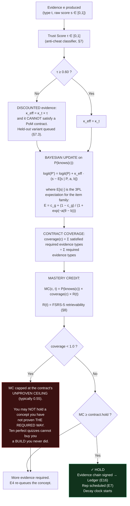
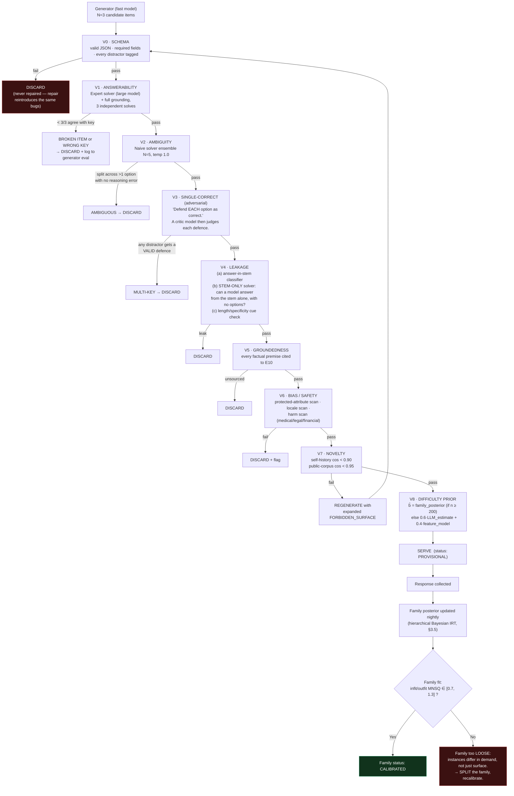
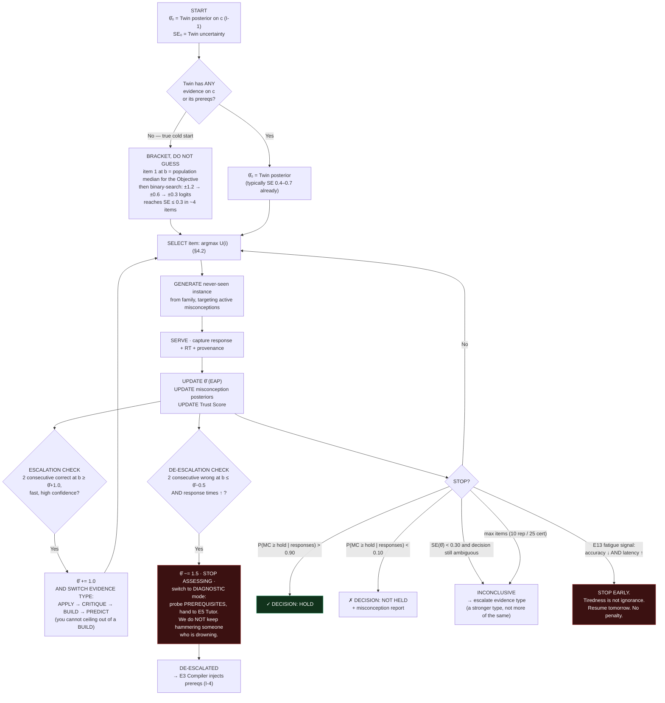
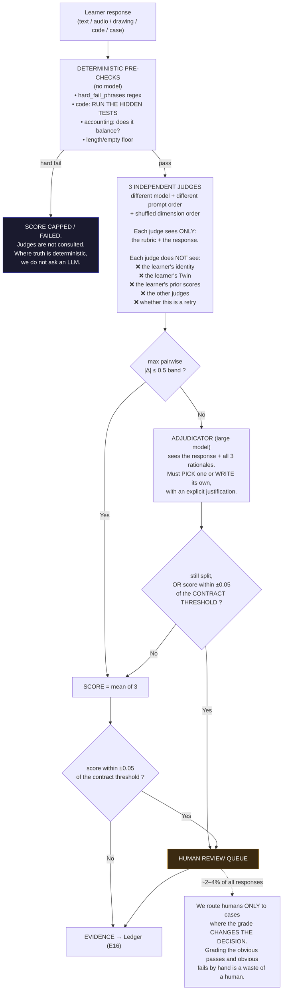
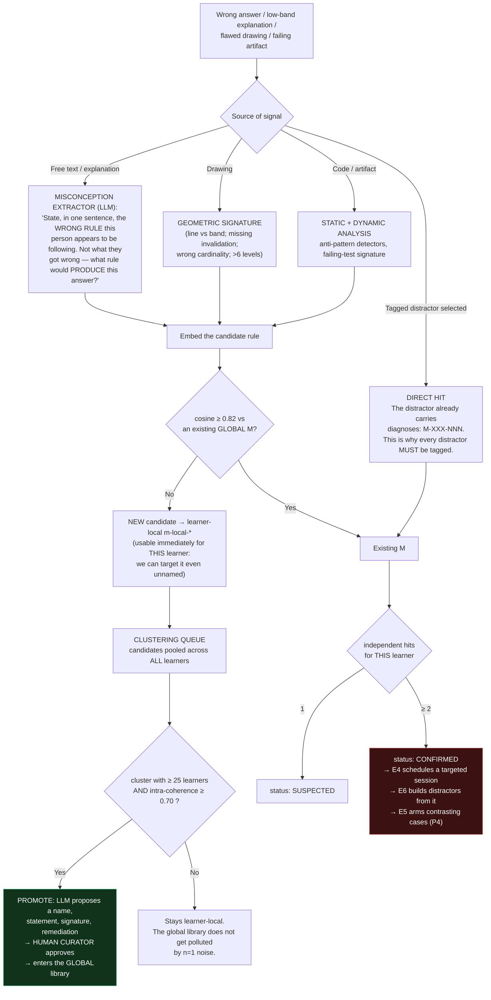
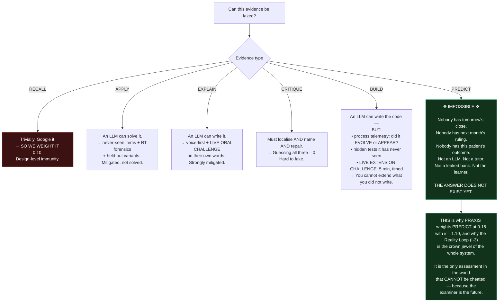
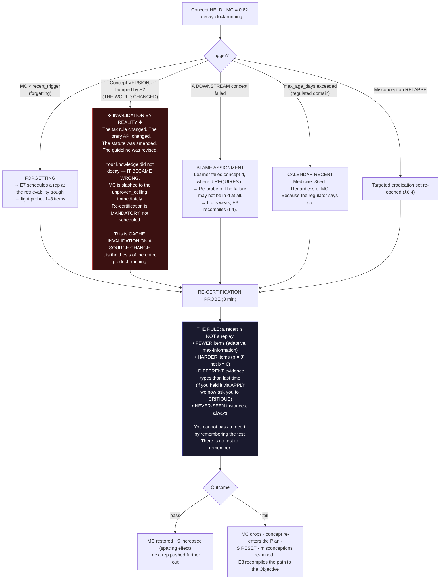

# 12 — Assessment & Proof-of-Mastery

**Engine:** `E6 — Assessment Engine`
**Primary Inventions:** **I-2 (PoM Contracts)** · **I-6 (Failure-Seeking Assessment)**
**Secondary:** I-1 (Twin), I-3 (Reality Loop), I-8 (Ledger)

> **The category-defining refusal (CANON §0):**
> *There is no "mark as complete" button in the entire product. It does not exist.*
> **This document is the reason it doesn't have to.**

> **The assessment engine's job is not to give you a good score.
> It is to find where you break — and then to refuse to be fooled about it.**

---

## 0. Mandate & Invention trace

| Feature | Invention | Why |
|---|---|---|
| Six evidence types | **I-2** | Mastery is what you *produced*, not what you *consumed*. |
| PoM Contracts with exact thresholds | **I-2** | Every concept declares, in advance, what will be accepted as proof. |
| Never-seen item generation | **I-6** | An item bank is a memorisation target. We don't have one. |
| Distractors mined from the learner's **own** misconceptions | **I-6** | A wrong answer stops being "wrong" and becomes a **diagnosis**. |
| Decision-theoretic adaptive testing | **I-6**, **I-1** | Hunt the boundary. Start from the Twin's posterior, not from zero. |
| Multi-judge rubric grading + human boundary review | **I-2** | Open evidence is the majority of evidence. It must be graded as well as a human would. |
| Misconception Library with **eradication proof** | **I-6**, **I-1** | Naming the bug is half the fix; proving it's gone is the other half. |
| Trust Score, held-out variants, live oral challenge | **I-8** | The Ledger is only a moat if it cannot be forged. |
| **PREDICT** evidence | **I-3** | *Unfakeable by construction. The answer does not exist yet.* |
| Mastery decay & re-certification | **I-2** | Mastery is a **decaying credit**, never a permanent badge. |

---

## 1. The six evidence types

| Type | **What it proves** | How it is **generated** | How it is **graded** | **Twin weight** `w` | Update gain `κ` | Latency |
|---|---|---|---|---|---|---|
| **`RECALL`** | The item is *retrievable*. Nothing more. | Template + LLM from the concept card; cloze, MCQ, free-recall | Exact/fuzzy key match; MCQ key | **0.10** | 0.35 | instant |
| **`APPLY`** | **Transfer** — the model works on an instance never seen before | LLM from the concept's **deep structure** + a surface-feature randomiser | Key + tolerance; or unit test; or classification against a labelled fact-pattern | **0.20** | 0.80 | instant |
| **`EXPLAIN`** | A **causal/mechanistic** model exists, not a memorised sentence (Feynman) | Prompt derived from the PoM contract; teach-back to a named naive audience | **Rubric, multi-judge** (§5) | **0.20** | 0.90 | seconds |
| **`BUILD`** | **The thing actually works.** Not an opinion — an execution. | Brief + hidden tests / machine-verifiable invariants | **Automated execution first**, AI review second, peer review third | **0.25** | 1.40 | minutes–days |
| **`CRITIQUE`** | **Discrimination** — can find the flaw in someone *else's* work | A known flaw is **injected** into a worked example — very often **the learner's own misconception** | Flaw must be **localised + named + repaired**. All three. | **0.10** | 0.60 | instant |
| **`PREDICT`** | A **calibrated model of reality** (I-3) | Reality Engine (E8) opens a Loop against a resolvable real-world event | **Ground truth on resolution** → **Brier score** → Calibration | **0.15** | 1.10 | hours–months |

`Σw = 1.00`. These are the **domain-neutral defaults**; every PoM Contract may override them (§2).

### 1.1 Why the weights are what they are

> **`RECALL` is deliberately the *lowest*-weight evidence type — because it is the only one a search engine
> can also do.** CANON already says it: *"Quizzes are one of six evidence types, and the weakest one."*
> A product that weights recall highly is measuring the wrong species.
>
> **`BUILD` and `PREDICT` carry the highest trust** — not because they're fashionable, but because they are
> the two types that are **structurally hard to fake** (§7). `PREDICT` is the only evidence type in the world
> that is **impossible to cheat**, because *the answer does not exist yet*.

### 1.2 Gaming vectors and countermeasures

| Type | **How it gets gamed** | **How we stop it** |
|---|---|---|
| `RECALL` | Google it. Ask an LLM. Share the bank. | Timed windows · never-seen generation · **and we simply don't weight it much.** Design-level immunity. |
| `APPLY` | Paste the item into an LLM | Never-seen items (§3.1) · **response-time forensics** (§7.2) · held-out isomorphic variants · Trust Score discount |
| `EXPLAIN` | An LLM writes the essay | **Voice-first delivery** · **live oral challenge on their own words** (§7.4) · edit-entropy · hedging profile · consistency with their *own* prior utterances |
| `BUILD` | Copy-paste, LLM codegen, buy it | **Process telemetry** (did it *evolve* or *appear*?) · hidden tests · **live extension challenge** (§7.5) · defence oral |
| `CRITIQUE` | Guess "there's a bug on line 12" | Must **localise AND name AND repair**. Guessing localisation is 1-in-N; guessing all three is ~0. |
| `PREDICT` | — | **Cheating is impossible.** Nobody has tomorrow's close, tomorrow's ruling, or this patient's outcome. **This is the whole point of I-3.** |

### 1.3 How evidence updates the Twin



Additionally, **`PREDICT` evidence updates a second, independent axis**: **Calibration**.

```
Brier(loop) = (confidence − outcome)²                     outcome ∈ {0, 1}
Calibration(learner, domain) = 1 − mean(Brier) over the trailing 20 resolved loops
```

Calibration sits **next to** Mastery in the Twin — never averaged into it. A learner can be *knowledgeable
and badly calibrated* (the dangerous one) or *ignorant and well-calibrated* (the safe one). Collapsing them
into a single number destroys the most useful signal in the product.

---

## 2. PoM Contracts (I-2)

### 2.1 Schema

```yaml
pom_contract:
  concept_id:      string          # FQ node id in the Graph (E2)
  version:         int             # bumped when the WORLD changes (§8.3)
  domain:          string
  bloom_target:    REMEMBER | UNDERSTAND | APPLY | ANALYZE | EVALUATE | CREATE

  required_evidence:
    - type:                  RECALL | APPLY | EXPLAIN | BUILD | CRITIQUE | PREDICT
      count:                 int          # how many instances
      min_score:             float|null   # null ⇒ scored by a non-accuracy metric (e.g. Brier)
      max_consecutive_fail:  int
      item_family:           string       # calibration unit (§3.4)
      rubric_id:             string?      # for open responses
      modality:              [text|voice|drawing|code|chart|case]
      min_trust:             float        # anti-cheat floor for THIS evidence type
      spacing_min_days:      int?         # instances must be spread, not crammed
      optional:              bool         # optional evidence adds coverage BONUS, not requirement

  forbidden:
    - RECALL_ONLY                          # cannot hold on recall alone
    - SAME_SESSION_COVERAGE                # cannot satisfy the whole contract in one sitting

  weights_override:  { TYPE: float }?      # else domain-neutral defaults (§1)

  thresholds:
    hold:              float   # MC ≥ this ⇒ HOLD
    strong:            float   # MC ≥ this ⇒ STRONG (shown on the VCR)
    unproven_ceiling:  float   # MC cap while coverage < 1.0

  hard_fail:                              # domain-critical; ANY hit fails the contract outright
    - rule: string
      reason: string

  decay:
    model:                   FSRS-5
    initial_stability_days:  float
    recert_trigger:          float        # MC below this ⇒ re-certification due
    max_age_days:            int?         # regulated domains: recert on the calendar regardless of MC

  misconception_watch: [misconception_id]
  prerequisites_for_assessment: [concept_id]   # we will NOT assess c if these are weak
  assurance_levels_supported: [A0, A1, A2, A3] # §7.7
```

---

### 2.2 Contract — `fin.ta.support_resistance` · **"Support & Resistance"**

```yaml
concept_id: fin.ta.support_resistance
version: 3
domain: finance.technical_analysis
bloom_target: ANALYZE

required_evidence:
  - type: EXPLAIN
    count: 1
    min_score: 0.75
    rubric_id: rub.sr.explain.v2
    modality: [voice, text]
    min_trust: 0.70

  - type: APPLY
    count: 3
    min_score: 0.70
    max_consecutive_fail: 1
    item_family: sr.identify_zone            # never-seen charts
    modality: [chart, drawing]
    min_trust: 0.60

  - type: PREDICT                            # ← THE REALITY LOOP (I-3)
    count: 5
    min_score: null
    brier_max: 0.22                          # ≈ better than a coin flip by a real margin
    horizon: 5 sessions
    resolution: market_close
    spacing_min_days: 2
    min_trust: 1.00                          # unfakeable by construction

  - type: CRITIQUE
    count: 1
    min_score: 0.70
    optional: true                           # coverage BONUS
    item_family: sr.flawed_chart_annotation

forbidden: [RECALL_ONLY, SAME_SESSION_COVERAGE]

thresholds:
  hold:             0.70
  strong:           0.85
  unproven_ceiling: 0.55

decay:
  model: FSRS-5
  initial_stability_days: 9
  recert_trigger: 0.65

misconception_watch: [M-SR-004, M-SR-011, M-SR-017, M-SR-022, M-SR-031]
prerequisites_for_assessment: [fin.mkt.order_book, econ.micro.supply_demand]
assurance_levels_supported: [A0, A1, A2]
```

> **Read the `PREDICT` block again.** To hold *Support & Resistance* in PRAXIS you must make **five
> falsifiable calls on a live market, spaced over at least ten days**, and beat a Brier of 0.22.
> **You cannot cram this. You cannot fake this. There is no course on earth that does this.**

---

### 2.3 Contract — `prog.py.list_comprehension` · **"Python list comprehension"**

```yaml
concept_id: prog.py.list_comprehension
version: 5
domain: programming.python
bloom_target: CREATE

required_evidence:
  - type: BUILD
    count: 4
    min_score: 1.00                   # hidden tests: ALL must pass. No partial credit from a rubric.
    item_family: py.lc.transform
    modality: [code]
    min_trust: 0.65

  - type: APPLY
    count: 5
    min_score: 0.75
    item_family: py.lc.predict_output  # "what does this print?" — never-seen snippets
    max_consecutive_fail: 1

  - type: EXPLAIN
    count: 1
    min_score: 0.70
    rubric_id: rub.py.lc.explain.v3    # must cover: readability boundary, when NOT to use one
    modality: [voice, text]

  - type: CRITIQUE
    count: 2
    min_score: 0.70
    item_family: py.lc.antipattern     # injected flaws: side-effects in a comprehension;
                                       # a triple-nested comprehension; O(n²) `in list` inside one
  - type: PREDICT                      # ← THE INTERPRETER IS REALITY (I-3)
    count: 3
    min_score: null
    brier_max: 0.25
    prompt: |
      Before we run it: which is faster, and by how much? Commit to a ratio and a confidence.
    resolution: actual_wall_clock_benchmark
    horizon: immediate

forbidden: [RECALL_ONLY]

thresholds: { hold: 0.70, strong: 0.88, unproven_ceiling: 0.50 }
decay: { model: FSRS-5, initial_stability_days: 14, recert_trigger: 0.60 }
misconception_watch: [M-PY-002, M-PY-007, M-PY-014]
prerequisites_for_assessment: [prog.py.iterables, prog.py.for_loop, prog.core.scope]
assurance_levels_supported: [A0, A1, A2, A3]
```

> **The Reality Loop in programming isn't a metaphor.** `PREDICT` here means: *commit to a performance
> claim, in public, with a number and a confidence — then we run `timeit` and the machine grades you.*
> This is how you kill `M-PY-002 · COMPREHENSIONS_ARE_ALWAYS_FASTER` permanently: not by telling the
> learner it's false, but by making them **bet on it** and lose.

---

### 2.4 Contract — `med.em.ddx_chest_pain` · **"Differential diagnosis of chest pain"**

```yaml
concept_id: med.em.ddx_chest_pain
version: 7
domain: medicine.emergency
bloom_target: EVALUATE
scope_banner: "Educational assessment on de-identified cases. NOT a medical device.
               NOT clinical decision support. No output of this engine may be used
               in the care of a real patient."

required_evidence:
  - type: PREDICT                      # ← DE-IDENTIFIED REAL CASES; THE OUTCOME GRADES YOU (I-3)
    count: 12
    min_score: null
    brier_max: 0.18
    resolution: adjudicated_final_diagnosis + 30d_outcome
    horizon: case_resolution
    submission_schema:
      differential: [{dx, probability}]        # must sum to 1.0, min 3 entries
      next_investigation: string
      red_flags_excluded: [dx]
      disposition: admit | observe | discharge

  - type: EXPLAIN
    count: 3
    min_score: 0.80                    # HIGH — reasoning trace, not just the answer
    rubric_id: rub.med.ddx.reasoning.v4
    modality: [voice]                  # voice-only: real-time reasoning cannot be ghost-written
    min_trust: 0.85

  - type: CRITIQUE
    count: 3
    min_score: 0.75
    item_family: med.ddx.flawed_workup  # find the error in a colleague's documented workup

  - type: APPLY
    count: 6
    min_score: 0.80
    item_family: med.ddx.vignette

hard_fail:                             # ← THE PART THAT MATTERS
  - rule: "ANY case in which a can't-miss diagnosis is absent from the top-3 differential
           when its pretest probability exceeds 0.05"
    can_t_miss: [ACS, pulmonary_embolism, aortic_dissection, tension_pneumothorax,
                 esophageal_rupture, cardiac_tamponade]
    reason: "Aggregate accuracy is irrelevant if you miss the one that kills them.
             A high average score does NOT purchase a missed dissection.
             ONE hard-fail voids the contract regardless of every other number."

forbidden: [RECALL_ONLY, SAME_SESSION_COVERAGE]

thresholds: { hold: 0.80, strong: 0.90, unproven_ceiling: 0.40 }
decay:
  model: FSRS-5
  initial_stability_days: 21
  recert_trigger: 0.75
  max_age_days: 365                    # calendar recert regardless of MC (CME-aligned)

misconception_watch: [M-MED-013, M-MED-021, M-MED-034]
prerequisites_for_assessment: [med.cardio.acs, med.pulm.pe, med.stats.bayes_pretest]
assurance_levels_supported: [A2, A3]   # ← A0/A1 NOT PERMITTED. Oral defence is MANDATORY.
```

> **Three things here are the product.**
> **(1)** The primary evidence is `PREDICT` on **real de-identified cases whose outcomes are already
> known to the system but not to the learner** — reality is the examiner (I-3).
> **(2)** `hard_fail` on the can't-miss list. **A 92% average with one missed dissection is a fail.**
> No LMS on earth encodes that, because no LMS models *asymmetric harm*.
> **(3)** `assurance_levels_supported: [A2, A3]` — you **cannot** earn this concept without an oral
> defence. Not configurable. Not a setting.

---

### 2.5 Contract — `acct.fin.double_entry` · **"Double-entry bookkeeping"**

```yaml
concept_id: acct.fin.double_entry
version: 2
domain: accounting.financial
bloom_target: APPLY

required_evidence:
  - type: BUILD                        # ← MACHINE-VERIFIABLE. The books balance, or they don't.
    count: 3
    min_score: 1.00
    item_family: acct.de.journalise_and_post
    verification: |
      Automatic, deterministic, zero AI:
        1. Σ debits == Σ credits           for every journal entry
        2. Every entry posts to the correct T-account
        3. Trial balance balances
        4. Accounting equation holds: A = L + E, exactly, to the paisa
      The rubric CANNOT override this. Truth is arithmetic.

  - type: APPLY
    count: 8
    min_score: 0.80
    item_family: acct.de.classify_txn    # never-seen transactions: which account, debit or credit
    max_consecutive_fail: 2

  - type: CRITIQUE
    count: 2
    min_score: 0.75
    item_family: acct.de.unbalanced_tb    # here is a trial balance that does NOT balance.
                                          # Find the entry. Name the error type. Fix it.
  - type: EXPLAIN
    count: 1
    min_score: 0.70
    rubric_id: rub.acct.de.explain.v1     # must explain WHY duality exists (every txn has two
                                          # sides because every value received is a value given)

forbidden: [RECALL_ONLY]
thresholds: { hold: 0.75, strong: 0.90, unproven_ceiling: 0.45 }
decay: { model: FSRS-5, initial_stability_days: 30, recert_trigger: 0.65 }
misconception_watch: [M-ACC-005, M-ACC-009, M-ACC-018]
prerequisites_for_assessment: [acct.fin.accounting_equation, acct.fin.account_types]
assurance_levels_supported: [A0, A1, A2, A3]
```

> **Accounting is the cleanest domain in the whole product**, because `BUILD` is *deterministically*
> verifiable. The books balance or they don't. No rubric, no judge, no LLM. **Where truth is arithmetic,
> we use arithmetic.** We reserve AI grading for where AI grading is actually necessary.

---

### 2.6 Contract — `law.crim.mens_rea` · **"Mens rea"**

```yaml
concept_id: law.crim.mens_rea.us_mpc          # ← JURISDICTION IS PART OF THE NODE ID.
version: 4                                    #   law.crim.mens_rea.in_bns is a DIFFERENT concept.
domain: law.criminal
bloom_target: ANALYZE
authority: "Model Penal Code § 2.02 — purposely / knowingly / recklessly / negligently"

required_evidence:
  - type: APPLY
    count: 8
    min_score: 0.80
    item_family: law.mr.classify_fact_pattern   # never-seen fact patterns; classify the mental
                                                # state as to EACH material element (MPC element analysis)
    max_consecutive_fail: 1
    validation: "Every generated fact pattern is reviewed by a licensed attorney
                 before entering the golden set; live items inherit family calibration."

  - type: EXPLAIN
    count: 2
    min_score: 0.80
    rubric_id: rub.law.mr.explain.v2
    modality: [voice, text]
    # must distinguish: recklessness (conscious disregard of a substantial and unjustifiable
    # risk) vs negligence (SHOULD have been aware) — the exact line most students never hold.

  - type: CRITIQUE
    count: 3
    min_score: 0.75
    item_family: law.mr.flawed_brief     # a brief argues mens rea. It is wrong. Find where,
                                         # name the error, and write the correct argument.

  - type: PREDICT                        # ← REALITY GRADES YOU (I-3)
    count: 4
    min_score: null
    brier_max: 0.25
    prompt: "Pending appellate case. Predict the holding on the mens rea issue + confidence."
    resolution: published_judgment
    horizon: until_judgment              # weeks to months. The Loop stays open.

forbidden: [RECALL_ONLY, SAME_SESSION_COVERAGE]
thresholds: { hold: 0.75, strong: 0.88, unproven_ceiling: 0.50 }
decay: { model: FSRS-5, initial_stability_days: 25, recert_trigger: 0.65 }
misconception_watch: [M-LAW-003, M-LAW-008, M-LAW-015]
prerequisites_for_assessment: [law.crim.actus_reus, law.crim.material_elements]
assurance_levels_supported: [A0, A1, A2, A3]
```

### 2.7 Contract comparison — the exact thresholds side by side

| Concept | `hold` | `strong` | `unproven_ceiling` | Required types | Total instances | **Min days to HOLD** | Assurance floor |
|---|---|---|---|---|---|---|---|
| Support & Resistance | 0.70 | 0.85 | 0.55 | EXPLAIN, APPLY×3, **PREDICT×5** | 9 | **≥ 10 days** (loop resolution) | A0 |
| Python list comprehension | 0.70 | 0.88 | 0.50 | **BUILD×4**, APPLY×5, EXPLAIN, CRITIQUE×2, PREDICT×3 | 15 | ≥ 2 days | A0 |
| DDx chest pain | **0.80** | 0.90 | **0.40** | **PREDICT×12**, EXPLAIN×3 (voice), CRITIQUE×3, APPLY×6 | 24 | **≥ 21 days** | **A2 (oral mandatory)** |
| Double-entry bookkeeping | 0.75 | 0.90 | 0.45 | **BUILD×3** (arithmetic), APPLY×8, CRITIQUE×2, EXPLAIN | 14 | ≥ 3 days | A0 |
| Mens rea (US/MPC) | 0.75 | 0.88 | 0.50 | APPLY×8, EXPLAIN×2, CRITIQUE×3, **PREDICT×4** | 17 | **≥ weeks** (judgment) | A0 |

**Read the last-but-one column.** In PRAXIS, **time-to-mastery has a floor that money cannot buy and
motivation cannot shorten** — because reality resolves on reality's schedule. This is the single most
honest thing in the product, and it is the thing every competitor's "complete this course in 4 hours"
badge is lying about.

---

## 3. Item generation (I-6)

### 3.1 The NEVER-SEEN guarantee

Items are **generated per learner, per attempt**. There is no bank to leak, buy, or memorise.

| Layer | Mechanism | Reject threshold |
|---|---|---|
| **Deep structure fixed** | Every item is an instance of an **item family** — a parameterised template where the *cognitive demand* is fixed and the *surface features* vary | — |
| **Surface randomiser** | Names, tickers, numbers, dates, jurisdictions, chart segments, entity types, code identifiers, patient demographics | — |
| **Self-dedup** | Embed the item; compare to **this learner's** last 90 days of served items | `cosine ≥ 0.90` → regenerate |
| **Public-corpus dedup** | Bloom filter + embedding index over scraped public benchmarks, textbook question banks, Chegg/Quizlet-class corpora, past exam papers | `cosine ≥ 0.95` → **hard reject** |
| **Cross-learner dedup (cohort)** | Within an `Institution` tenant, no two learners in the same cohort get the same instance in the same window | exact-instance collision → regenerate |

### 3.2 Distractors from the learner's **own** misconceptions — the core of I-6

**Every distractor is a diagnosis.** A distractor that diagnoses nothing is dead weight and is retired.

```json
{
  "item_id": "itm_9f3a21",
  "family": "sr.identify_zone",
  "stem": "RELIANCE, daily. Price has approached ₹2,840 four times in eleven weeks and bounced each time. It is approaching a fifth time, and each successive bounce has been shallower than the last. Which statement best describes the state of that level?",
  "options": [
    {
      "id": "A",
      "text": "The level is now stronger than ever — four confirmed holds make it a proven floor.",
      "is_key": false,
      "diagnoses": "M-SR-017 · TOUCH_COUNT_STRENGTH",
      "plausibility_prior": 0.41,
      "targets_this_learner": true
    },
    {
      "id": "B",
      "text": "Resting bids at the level have been progressively consumed; shallower bounces suggest less is being replenished than is being spent. The level is more likely to fail on this touch than on the first.",
      "is_key": true
    },
    {
      "id": "C",
      "text": "₹2,840 is a hard floor. Price cannot close below it while the level is intact.",
      "is_key": false,
      "diagnoses": "M-SR-004 · LEVELS_AS_WALLS",
      "plausibility_prior": 0.27,
      "targets_this_learner": true
    },
    {
      "id": "D",
      "text": "The level is exactly ₹2,840.00; a print at ₹2,839.85 would invalidate it.",
      "is_key": false,
      "diagnoses": "M-SR-011 · LINE_PRECISION",
      "plausibility_prior": 0.19,
      "targets_this_learner": false
    }
  ],
  "irt": { "a": 1.21, "b": 0.55, "c": 0.19, "source": "family_posterior", "n_family": 1840 },
  "generated_for": "learner_7731",
  "misconceptions_targeted": ["M-SR-017", "M-SR-004"],
  "novelty": { "self_max_cos": 0.61, "public_max_cos": 0.72 }
}
```

> **This is not a multiple-choice question. It is a differential diagnosis of Priya's mind.**
> Options **A** and **C** are the *exact two wrong models she voiced in the tutoring transcript*
> (doc 11 §3, T2). If she picks A, the engine doesn't learn "she got it wrong." It learns
> **`M-SR-017` has relapsed** — a named, specific, targetable, previously-`CHALLENGED` misconception.
> **The wrong answer is the payload.** That is Invention I-6.

**Distractor efficiency monitoring:** for each distractor we track selection rate conditioned on θ. A
distractor selected by **< 3%** of learners at any θ is **dead** — it teaches us nothing and it makes the
item easier by elimination. It is retired and regenerated. Target: every distractor has a selection rate
**≥ 0.05** somewhere on the θ curve.

### 3.3 The generation prompt (real)

```text
SYSTEM
You are an item writer for the PRAXIS Assessment Engine. You write assessment items that
DIAGNOSE, not items that decorate. You will be evaluated on whether your distractors detect
specific named misconceptions.

HARD CONSTRAINTS — an item violating any of these is discarded, not repaired:
  1. Exactly ONE option is defensibly correct. If a competent expert could argue for a
     second option, you have failed.
  2. The stem must NOT contain the answer, nor make it inferable by elimination alone,
     nor by length/specificity cues (the key must not be the longest option).
  3. Every DISTRACTOR must be tagged with the misconception it diagnoses. A distractor
     that diagnoses nothing is forbidden. Write NO throwaway options.
  4. The item must be answerable from the concept + the stated prerequisites ALONE.
     No outside knowledge. No trick.
  5. Do not reuse any surface feature listed in FORBIDDEN_SURFACE.
  6. Every factual premise in the stem must come from GROUNDING. Invent nothing.

CONCEPT
  id: fin.ta.support_resistance
  deep_structure: |
    A price level "holds" iff resting liquidity at that level absorbs arriving flow.
    Liquidity is FINITE and is CONSUMED by each test. It persists only if replenished.
    Therefore: (a) a level is a ZONE, not a line; (b) repeated tests DEPLETE it;
    (c) whether it holds is CONTEXT-dependent (why is the liquidity there at all?),
    never intrinsic to the number.
  prerequisites_assumed: [fin.mkt.order_book, econ.micro.supply_demand]

LEARNER MISCONCEPTION SET  (from this learner's Misconception Library — I-6)
  M-SR-004  LEVELS_AS_WALLS        status CHALLENGED  "price cannot cross a support level"
  M-SR-017  TOUCH_COUNT_STRENGTH   status CHALLENGED  "more touches ⇒ stronger level"
  M-SR-011  LINE_PRECISION         status SUSPECTED   "support is an exact price, not a zone"
  → You MUST convert M-SR-004 and M-SR-017 into distractors. They are the eradication targets.
  → M-SR-011 is optional (include as a third distractor if natural).

TARGET
  evidence_type:   APPLY
  item_family:     sr.identify_zone
  difficulty (b):  0.55 logits          ← from adaptive selection (§4)
  format:          single-best-answer, 4 options
  locale:          en-IN  (use NSE-listed instruments, ₹, Indian date format)

FORBIDDEN_SURFACE  (already served to this learner)
  instruments: [NIFTY, HDFCBANK, INFY]
  levels:      [18600, 22300, 1450]
  patterns:    ["four times over three months"]

GROUNDING  (E10 — the ONLY facts you may assert)
  - RELIANCE daily OHLCV, 2024-01-02 .. 2024-06-28  [NSE EOD, trust 0.97]
  - "Bounce depth" defined as % retracement from the level to the subsequent swing high.

OUTPUT
  Strict JSON conforming to schema `item.v3`. No prose. No markdown.
  Include: stem, options[{text, is_key, diagnoses, plausibility_prior}],
           rationale_key, rationale_each_distractor, sources[], b_estimate, b_reasoning.
```

### 3.4 The validation pipeline — items are guilty until proven innocent



**First-pass yield (target):** ~**78%** of generated items survive V0–V8. We discard the rest rather than
repair them — a repaired item carries the defect that caused the repair.

### 3.5 IRT: how a never-seen item gets calibrated parameters

**The problem:** if every item is generated fresh for one learner, then `n = 1` per item. **You cannot
calibrate an item with one response.** Anyone claiming otherwise is hand-waving.

**The answer: calibrate the FAMILY, not the item.**

```
Hierarchical / item-cloning IRT (Glas & van der Linden):

    family f has parameters   (a_f, b_f, c_f)  and  spread  (σ_a, σ_b, σ_c)
    instance i drawn from f:  b_i ~ N(b_f, σ_b²),  a_i ~ LogN(log a_f, σ_a²)

    P(correct | θ) = c_i + (1 − c_i) / (1 + exp(−a_i (θ − b_i)))

    The FAMILY is the calibration unit.
    The INSTANCE inherits the family posterior + its own prior-adjusted offset.
    σ_b is the thing we watch: a family with large σ_b is NOT a family — it is a bag.
```

| Stage | Source of `b` | Precision | Trigger to advance |
|---|---|---|---|
| **Cold (n < 30 family responses)** | `b̂ = 0.6·LLM_estimate + 0.4·feature_model` <br/> *feature model:* # inference steps · # new terms · distractor plausibility spread · stem length · prereq depth | RMSE(b) target **≤ 0.55 logits** vs the human-calibrated golden set (2,000 items, 4 psychometricians) | — |
| **Warming (30 ≤ n < 200)** | Shrinkage: `b = λ·b̂_prior + (1−λ)·b_MLE`, `λ = τ²/(τ² + σ²/n)` | improving | — |
| **Calibrated (n ≥ 200, ≥ 50 distinct learners)** | Family posterior from nightly EM / MCMC | SE(b) ≤ 0.15 | Family status → `CALIBRATED` |
| **Monitored (always)** | Infit/outfit MNSQ; DIF scan across locale, age, L1 | — | MNSQ outside [0.7, 1.3] → **split or retire the family** |

**Anchor set & scale drift.** A fixed set of **120 human-calibrated anchor items** is served at a low rate
across all learners, forever. They never change and they are never regenerated. They exist to hold the θ
scale stable across time, model upgrades, and content drift. If the anchors move, **our ruler moved**, and
every mastery number in the product is quietly wrong. Anchor drift is a **P1 page.**

**Provisional responses count immediately but weakly:** a response to an item from an uncalibrated family
updates the Twin with `κ_eff = κ_t × 0.6` until the family reaches `CALIBRATED`. We do not withhold learning
signal while we wait for statistics — we discount it and re-weight retroactively on the nightly rebuild
(the event log makes this trivially correct — CANON §5.1).

---

## 4. Adaptive testing — hunting the boundary (I-6)

### 4.1 The two things everyone else gets wrong

| Standard CAT | **PRAXIS** |
|---|---|
| Starts at `θ = 0` (population mean) — knows nothing about you | **Starts at the Twin's posterior** (I-1). We already have a probabilistic model of this mind. Using θ=0 would be throwing away the entire product. |
| Maximises **Fisher information about θ** — tries to measure your ability precisely | **Maximises expected information about the DECISION** — *does this learner HOLD this concept?* We don't need θ to three decimals. We need the contract decision, and we need it in as few items as possible. |

**Result: median items to a confident decision drops from ~20 (cold CAT) to ~7 (Twin-primed, decision-theoretic).**
Every item saved is a minute returned to the learner — which is the north star (I-10).

### 4.2 Item selection utility

```
U(i) =        I_θ(i, θ̂)                                  # Fisher information — classic
        + λ_d · ΔH(decision | i)                          # ← expected entropy reduction in
                                                          #    "HOLD vs NOT-HOLD" at the contract
                                                          #    threshold. THIS is what we're buying.
        + λ_m · Σ_{m ∈ active_misconceptions} H(m) · d(i,m)   # ← THE HUNT (I-6)
                                                          #    d(i,m) = 1 if item i has a distractor
                                                          #    that diagnoses misconception m
        − λ_x · exposure(i)                               # exposure control (Sympson-Hetter)
        − λ_c · cost(i)                                   # a BUILD item costs 20 min; an APPLY costs 40s
        − λ_f · fatigue_penalty(i, session)

defaults:  λ_d = 1.0   λ_m = 0.60   λ_x = 0.15   λ_c = 0.10   λ_f = 0.20
```

> **The `λ_m` term is Invention I-6 expressed as one line of arithmetic.** The engine will deliberately
> choose a *slightly less informative* item about θ if that item can **resolve an open misconception**.
> It is not trying to score you. **It is trying to find where you break.**

### 4.3 The loop



### 4.4 **"The AI must never assume"** — the two failure modes, one mechanism

| Failure mode | What it looks like | What it costs |
|---|---|---|
| **Assuming ignorance** | A 15-year derivatives trader signs up and item 1 is *"What is a stock?"* | **Instant churn.** Insulting an expert is unrecoverable. |
| **Assuming competence** | A total beginner signs up and item 1 is *"Compute the delta-adjusted notional."* | **Instant churn**, plus a corrupted Twin (a wrong answer here means nothing). |

**One mechanism handles both: BRACKET, DON'T GUESS.**

| Item | Difficulty `b` | If correct | If wrong |
|---|---|---|---|
| 1 | population median for the Objective (≈ 0.0) | → +1.2 | → −1.2 |
| 2 | ±1.2 | → ±0.6 | → ±0.6 |
| 3 | ±0.6 | → ±0.3 | → ±0.3 |
| 4 | ±0.3 | **SE ≈ 0.30 · locked** | **SE ≈ 0.30 · locked** |

**Four items. Never an insult, never a crushing.** And the very first item is drawn from the *middle* of
the objective's distribution — not from the bottom, which is what every onboarding quiz in the industry
does, and which is why every expert bounces off them.

**Self-declared level is a weak prior — and its first job is to catch a lie.**

```
θ̂₀ = 0.7 × population_prior(objective, age)  +  0.3 × self_declared_level

The 0.3 weight is not humility about our model. It is realism about self-report:
learners are systematically miscalibrated, in BOTH directions.

AND — the moment the bracket resolves, we compute:

    dunning_kruger_delta₀ = self_declared_θ − measured_θ

This is the FIRST data point in the learner's confidence-vs-competence gap (I-1),
harvested in the first 90 seconds, from a question we had to ask anyway.
The onboarding form is not a form. It is the first assessment item.
```

### 4.5 Escalating an expert

You cannot ceiling out of PRAXIS by being good at multiple choice. When a learner tops out on `APPLY`:

| Consecutive ceiling hits | Engine response |
|---|---|
| 2 at `b ≥ θ̂ + 1.0`, fast, confident | `θ̂ += 1.0` and **switch evidence type: `APPLY` → `CRITIQUE`** |
| Ceilings `CRITIQUE` | → **`BUILD`**. Ship something that runs. |
| Ceilings `BUILD` | → **`PREDICT`**. Now call the market / the case / the ruling. |
| Ceilings `PREDICT` (Brier < 0.10 over 20 loops) | **You are genuinely expert. PRAXIS says so, records it in the Ledger at assurance `A2/A3`, and gets out of your way (I-10: *we optimize for the learner leaving*).** |

---

## 5. Rubric grading of open responses

Open responses — explanations, teach-backs, drawings, code reviews, case decisions — are the **majority of
evidence by weight** (EXPLAIN 0.20 + BUILD 0.25 + CRITIQUE 0.10 = **0.55**). If we grade them badly, the
entire Ledger (I-8) is worthless.

### 5.1 Rubric schema

```yaml
rubric:
  id: rub.sr.explain.v2
  concept: fin.ta.support_resistance
  evidence_type: EXPLAIN
  scale: 0..4 per dimension            # 4 = expert · 3 = competent · 2 = descriptive
                                       # 1 = restatement · 0 = absent or wrong
  audience: "explain it to a smart friend who has never traded"

  dimensions:
    - id: mechanism
      weight: 0.35
      probe: "Do they explain WHY price reacts there — order flow, finite resting
              liquidity, absorption — or only THAT it reacts?"
      bands:
        4: "Names the mechanism (resting limit orders absorbing arriving flow) AND
            explains DEPLETION (the liquidity is finite and is spent by each test)."
        3: "Supply/demand imbalance, correctly, but no order-book mechanism."
        2: "Descriptive only: 'price tends to bounce there.' No mechanism."
        1: "Restates a textbook definition without content."
        0: "Absent, or asserts a false mechanism."

    - id: zone_not_line
      weight: 0.20
      probe: "Is support a ZONE (a region of concentrated liquidity) or a LINE (a magic number)?"
      bands:
        4: "Explicitly a zone/region, and explains WHY it must be (liquidity clusters, it doesn't stack on one tick)."
        3: "Says zone/area, no justification."
        2: "Ambiguous — 'level'."
        1: "Treats it as an exact price."
        0: "Asserts an exact price is required."
      auto_flag: { band<=1 : "M-SR-011 · LINE_PRECISION" }

    - id: invalidation
      weight: 0.20
      probe: "Do they state what would make them WRONG? When does the level break?"
      bands:
        4: "States a specific, checkable invalidation condition AND explains what a break means (liquidity exhausted)."
        3: "States an invalidation condition."
        2: "Gestures at 'if it breaks...' with no condition."
        1: "No invalidation."
        0: "Asserts it cannot break."
      auto_fail: { band==0 : "M-SR-004 · LEVELS_AS_WALLS" }

    - id: context_dependence
      weight: 0.15
      probe: "Is holding intrinsic to the number, or dependent on WHY the liquidity is there?"
      bands: { 4: "Explicit: the level means nothing without a reason for the liquidity.",
               3: "Mentions trend/context.", 2: "Implicit.", 1: "None.", 0: "Asserts the level is intrinsic." }

    - id: economy_of_language
      weight: 0.10
      probe: "Could a smart non-trader follow this? Jargon used, or jargon hidden behind?"
      bands: { 4: "Crisp, jargon defined on use.", 3: "Clear.", 2: "Jargon-dependent.",
               1: "Word salad.", 0: "Incoherent." }

  hard_fail_phrases:                   # deterministic pre-check, before any judge runs
    - pattern: "(cannot|can't|will not|won't|never) (go|fall|drop|close) below"
      → M-SR-004 · LEVELS_AS_WALLS · score capped at 0.40 regardless of eloquence

  pass: weighted_mean / 4 ≥ 0.75       # = 3.0/4
  strong: ≥ 0.88
```

### 5.2 Real responses, real scores

**Response A — Priya, doc 11 §3 turn 12** *(this is the actual text from the transcript)*

> *"Support is a price area where enough resting buy orders exist to absorb the sells arriving — not a
> barrier, a budget. It holds only while that pile is being refilled faster than it's spent, and the
> refilling depends entirely on why people want it there — so a level with no reason behind it anymore
> breaks on the touch that finally empties it."*

| Dimension | Band | Judge rationale |
|---|---|---|
| mechanism | **4** | Resting orders + absorption + **depletion** ("spent"). Full mechanism. |
| zone_not_line | **3** | "price area" ✓, but no justification for *why* it must be an area. |
| invalidation | **4** | "breaks on the touch that finally empties it" — specific and checkable. |
| context_dependence | **4** | "depends entirely on why people want it there." Explicit. |
| economy | **3** | The "not a barrier, a budget" reframe is excellent. Slightly compressed. |
| | | |
| **Weighted** | | `(4×.35 + 3×.20 + 4×.20 + 4×.15 + 3×.10) / 4 =` **0.86** |
| **Verdict** | | **PASS · STRONG** (≥ 0.88 narrowly missed). Judge agreement: 3/3 within 0.04. **No adjudication.** |

**Response B — band ~2**

> *"Support is a level where the price stops going down and bounces back up. It's an important level for
> traders to watch. If it breaks, it can become resistance."*

| Dimension | Band | Note |
|---|---|---|
| mechanism | **2** | Purely descriptive. *That*, never *why*. |
| zone_not_line | **2** | "level" — ambiguous. |
| invalidation | **2** | "if it breaks" with no condition. |
| context_dependence | **1** | None. |
| economy | **3** | Clear, but empty. |
| **Weighted** | | **0.50** → **FAIL** |
| **Diagnosis** | | Not a misconception — an **absence**. This is the textbook definition, memorised. `EXPLAIN` at band 2 is exactly what `RECALL` would have scored full marks on. **This is why RECALL weighs 0.10.** |

**Response C — band 0, hard fail**

> *"Support is the floor. The stock can't fall below it. The more times it touches, the stronger it gets."*

| | |
|---|---|
| **Hard-fail phrase** | `"can't fall below"` → **`M-SR-004 · LEVELS_AS_WALLS`** → score capped at **0.40** *before a judge even runs* |
| Second misconception | **`M-SR-017 · TOUCH_COUNT_STRENGTH`** (mined from free text) |
| **Weighted** | **0.18** → **FAIL** |
| **Action** | Both misconceptions → `CONFIRMED`. Contrasting-case session (P4) scheduled by E4 within 24h. Item generator instructed to build distractors from **both**. |

### 5.3 Multi-judge design



**Bias controls (each one is a real, observed LLM-judge failure mode):**

| Bias | Control |
|---|---|
| **Position bias** | Dimension order shuffled per judge; option order shuffled |
| **Verbosity bias** | **Verbosity probe:** a padded version of the same answer (same content, +60% words) must score within **±0.25 band**. A judge that fails the probe is **demoted out of the pool**. |
| **Sycophancy / anchoring** | Judges never see the learner's identity, Twin, prior scores, or retry status |
| **Self-preference** | The judge pool must not be the same model that *generated the item* |
| **Leniency drift** | Weekly re-run on the frozen golden set. Drift > 0.05 QWK → **judge frozen and rolled back** |
| **Language bias** | Golden set stratified by L1/L2; a judge that scores L2 English lower **for the same content** is demoted. *This one is non-negotiable.* |

### 5.4 Calibration against the golden set

| Metric | Definition | **Target** | Fail action |
|---|---|---|---|
| **Human–human agreement (the ceiling)** | 2 expert raters + adjudicator, 400 responses per rubric family | **QWK ≥ 0.80** | If humans can't agree, **the rubric is broken, not the model.** Rewrite the rubric. |
| **AI–human agreement** | Multi-judge score vs adjudicated human score | **QWK ≥ 0.75**, and **≥ 90% of the human ceiling** | Judge pool re-prompted / re-selected |
| **Systematic bias** | `\|mean(AI) − mean(human)\|` on a 0–1 scale | **≤ 0.10** | Recalibrate band anchors |
| **DECISION agreement** | pass/fail at the contract threshold — *the only number the learner feels* | **≥ 95%** | Widen the human-review band |
| **Boundary rate** | % of responses routed to humans | 2–4% | > 8% ⇒ the rubric bands are too vague |
| **Drift** | Weekly golden-set re-run | ΔQWK ≤ 0.05 | **Freeze + rollback** |

### 5.5 Grading by modality

| Modality | Pre-check (deterministic — runs first, and can end it) | Judge |
|---|---|---|
| **Text explanation** | hard_fail phrases · length floor | 3 judges, rubric |
| **Voice explanation** | ASR confidence floor · **hedging rate extracted → Calibration signal, NOT scored** | 3 judges on the transcript; **disfluency explicitly ignored** (a stammer is not a knowledge gap) |
| **Drawing** | Structural extraction (doc 11 §7.2) · **geometric misconception signatures** | VLM judges on the **structural rubric** — never pixel similarity |
| **Code** | **HIDDEN TESTS EXECUTE. A rubric can never override a failing test.** | Rubric judges style/complexity/idiom as a **separate, secondary score** |
| **Accounting artifact** | **Does it balance? Does A = L + E, exactly?** Arithmetic. No AI. | Rubric only for the *explanation* of the entries |
| **Case decision** | **`hard_fail` can't-miss check** (§2.4) | Rubric on the reasoning trace + calibration on the probability vector |

> **The rule:** *where truth is deterministic, we use determinism.* An LLM judge is a tool for grading
> **arguments**, not for grading **arithmetic**. Half of the AI-grading disasters in edtech come from
> asking a language model to check a sum.

---

## 6. The Misconception Library (I-6)

### 6.1 Two levels

| Level | Scope | Contents |
|---|---|---|
| **GLOBAL library** | per concept, curated | `id · name · concept · statement (in the learner's voice) · diagnostic signature · prevalence · discriminating dimension · remediation strategy · eradication test` |
| **LEARNER instance** | per (learner, misconception) | `status · confidence · first_seen · last_seen · evidence[] · remediation_attempts · challenged_at · eradicated_at · relapse_count` |

### 6.2 Real entries

| ID | Name | Concept | **The wrong belief, in the learner's voice** | Diagnostic signature | Remediation |
|---|---|---|---|---|---|
| **M-SR-004** | `LEVELS_AS_WALLS` | Support & resistance | *"Price **can't** go below support. It's a floor."* | Modal verbs `can't/cannot/won't` + physical nouns (`floor`, `wall`, `barrier`); **drawing a 1px line, not a band**; picks distractor C in `sr.identify_zone` | Order-book mechanism (P1 Socratic) → depletion → **break-and-retest contrasting case** (P4) |
| **M-SR-011** | `LINE_PRECISION` | Support & resistance | *"Support is exactly ₹2,840.00."* | Quotes levels to 2 dp; band width < 0.15× ATR in a drawing | Contrasting case: two charts, wick-through vs body-close |
| **M-SR-017** | `TOUCH_COUNT_STRENGTH` | Support & resistance | *"Four holds means it's stronger than one hold."* | Ranks levels by touch count; picks distractor A | **Cognitive conflict** (doc 11 §3 T7): collide "each hold eats liquidity" with "more holds = stronger". Let the learner break their own rule. |
| **M-SR-031** | `OVERFITTING_LEVELS` | Support & resistance | *"There's support here, and here, and here..."* | Marks > 6 levels on one chart | Economy dimension in the drawing rubric; forced ranking |
| **M-PY-002** | `COMPREHENSIONS_ALWAYS_FASTER` | List comprehension | *"A comprehension is always faster than a loop."* | Asserts speed with no benchmark; fails `py.lc.predict_output` timing items | **`PREDICT` loop (I-3):** commit to a ratio + confidence → **run `timeit`** → the machine grades them. A single lost bet ends this misconception. |
| **M-PY-007** | `SIDE_EFFECT_COMPREHENSION` | List comprehension | *"I'll use a comprehension to print/append/mutate."* | `[print(x) for x in ...]` in a BUILD artifact | `CRITIQUE` item where the injected flaw **is** this |
| **M-MED-021** | `NORMAL_ECG_EXCLUDES_ACS` | DDx chest pain | *"ECG was normal, so it's not cardiac."* | ACS absent from top-3 after a normal ECG | **`hard_fail` on the contract.** Then: de-identified cases with normal initial ECG and positive troponin. Reality does the teaching. |
| **M-MED-013** | `ANCHORING_ON_FIRST_VITAL` | DDx chest pain | *"BP was fine so it's not a dissection."* | Differential locked before the full history; probability vector doesn't move on new data | Serial-case format: the same case, revealed in stages, probabilities re-elicited at each stage. **Their own Brier punishes the anchor.** |
| **M-ACC-005** | `DEBIT_MEANS_DECREASE` | Double-entry | *"Debit = money going out."* | Credits every expense; trial balance fails in a *characteristic pattern* | The pattern of the failure IS the signature. Show them their own trial balance and make them find it. |
| **M-LAW-003** | `MOTIVE_IS_MENS_REA` | Mens rea | *"He did it for a good reason, so no mens rea."* | Cites motive in a mens rea analysis | **Contrasting cases (P4):** good motive + purpose (guilty) vs bad motive + no intent (not guilty). The classic pair. |
| **M-LAW-008** | `RECKLESS_EQUALS_NEGLIGENT` | Mens rea | *"He should have known — that's reckless."* | Uses "should have known" to justify recklessness | The **conscious-disregard** line, drilled with fact-pattern pairs differing in exactly one fact: *did he actually advert to the risk?* |

### 6.3 How a wrong answer becomes a NAMED misconception



> **The extractor prompt is the trick.** We don't ask *"what did they get wrong?"* — that yields
> *"they said support can't be broken."* We ask **"what RULE would PRODUCE this answer?"** — which yields
> *"they believe a price level is a physical barrier rather than a finite pool of liquidity."*
> **The first is an error. The second is a bug report on a human mind.** Only the second is targetable.

### 6.4 The lifecycle — and eradication is *earned*, not declared

```mermaid
stateDiagram-v2
    [*] --> SUSPECTED : 1 independent hit
    SUSPECTED --> CONFIRMED : ≥2 independent hits
    SUSPECTED --> [*] : 3 clean items on the discriminating dimension (it was noise)

    CONFIRMED --> CHALLENGED : learner produces the correct discrimination themselves\n(cognitive conflict / contrasting case / self-caught error)
    CONFIRMED --> PERSISTENT : 3 failed remediation attempts

    CHALLENGED --> REMEDIATED : passes the ERADICATION SET
    CHALLENGED --> CONFIRMED : relapse on any targeted item

    REMEDIATED --> ERADICATED : survives 2 further reps at ≥30 and ≥90 days\nincluding ≥1 CRITIQUE where the injected flaw IS this misconception
    REMEDIATED --> CONFIRMED : RELAPSE\n(relapse_count++ ; harder remediation)

    ERADICATED --> CONFIRMED : LATE RELAPSE\n(misconceptions decay back, just like mastery)

    PERSISTENT --> Escalate : different representation\n+ different pedagogy\n+ human coach (Coach tenant)
    Escalate --> CHALLENGED : it finally lands
    Escalate --> OutOfScope : concept re-planned around\n(E3 recompiles — honest report to the learner)

    note right of ERADICATED
      ERADICATED is NOT permanent.
      Nothing in PRAXIS is permanent (I-2).
      A misconception that has been
      eradicated once is re-probed
      forever, at the concept's rep cadence.
    end note
```



**The Eradication Set — what it actually takes to close a misconception:**

| Requirement | Value | Why |
|---|---|---|
| Targeted items passed | **≥ 3** | whose distractors specifically diagnose this `M` |
| Spread across sessions | **≥ 2** | one good day is not a repair |
| Spread across days | **≥ 14** | a repair that doesn't survive a sleep cycle is a performance, not a learning |
| **CRITIQUE item** | **≥ 1**, where the **injected flaw IS this misconception** | Spotting it in *someone else's work* is strictly harder than not making it yourself |
| **Naming required** | The learner must **name the error and repair it** — not merely select the right option | *"There's a bug"* ≠ *"He's treating the level as a barrier when it's a finite liquidity pool"* |
| Modality change | ≥ 1 item in a **different modality** than where it was first found | Misconceptions hide in the modality they were learned in |

**Relapse is expected and is not a failure of the learner.** `relapse_count` is a first-class field. A
misconception with `relapse_count ≥ 2` gets a **permanently elevated rep priority** and a permanent slot in
the concept's item-generation targets. **We never stop watching.**

---

## 7. Anti-cheating / anti-LLM-assistance

### 7.1 The philosophy

> **We do not block. We DISCOUNT — and then we offer a way to prove it.**

Blocking creates an arms race we lose, punishes false positives (catastrophic for trust), and gives the
cheater information about the detector. Discounting is quiet, cheap, and *correct*: low-trust evidence
contributes less to the Twin, **cannot satisfy a PoM contract at all**, and silently queues a held-out
variant. The learner who was honest notices nothing. The learner who wasn't gets asked to do it again,
live, out loud.

**And the deepest defence isn't a detector at all — it's the evidence types themselves (§7.6).**

### 7.2 The layers

| # | Layer | Mechanism | What it catches | Honest limits |
|---|---|---|---|---|
| **1** | **Provenance envelope** | Client-signed record: keystroke/edit **timing** (not content), paste events (count + size), focus/blur events, input modality, device, clock skew. Stored in the Ledger (I-8). | Paste-from-elsewhere; long blur → fluent burst | Signed client-side ⇒ a determined attacker can forge it. **We treat provenance as a likelihood, never as proof.** |
| **2** | **Response-time forensics** | Per item-family, a distribution of legitimate RT conditioned on θ and score. Compute `RT z-score`. The LLM-assist signature: **too fast for its quality**, or **long blur → fast fluent paste-shaped entry with near-zero edit entropy**. | Copy-paste assistance; someone else answering | Slow honest learners; fast honest experts. Hence: **discount, never accuse.** |
| **3** | **Trust Score** | Calibrated classifier: `τ = P(unassisted \| RT, quality, paste, blur, edit_entropy, stylometry_vs_own_history, device)` → **stored ON the evidence**, forever, in the Ledger. | — | Target **AUC ≥ 0.88** on the red-team set, **FPR ≤ 3%** at the operating point |
| **4** | **Held-out variants** | Every served item retains an **isomorphic sibling**. If `τ < 0.60`: the sibling is served within 48h **in a different modality** (usually voice). Fail the sibling → **the original evidence is REVOKED** (an append-only revocation entry — never a deletion; the Ledger is immutable). | Everything in layers 1–3, confirmed | Costs the learner 90 seconds. Honest learners pass trivially. |
| **5** | **Live oral challenge** | 90 seconds. 3 unscripted questions **derived from their own submission**. 20-second answer window each. Graded on **consistency with what they submitted**, not on eloquence. | Ghost-written explanations; bought artifacts; proxy test-takers | The strongest single weapon we have (§7.4) |
| **6** | **Never-seen items** | §3.1 | **Item-bank sharing: eliminated entirely.** There is no bank. | — |
| **7** | **The evidence types themselves** | §7.6 | **BUILD and PREDICT are structurally hard/impossible to fake** | This is the real answer |

### 7.3 Trust Score → consequences

| `τ` | Twin update | PoM contract | Ledger | Learner sees |
|---|---|---|---|---|
| **≥ 0.85** | full `κ` | satisfies | evidence signed, `assurance: A1` | nothing |
| **0.60–0.85** | `κ × τ` | satisfies **if** `τ ≥ contract.min_trust` | signed with `τ` recorded | nothing |
| **< 0.60** | `κ × τ` (heavily discounted) | **cannot satisfy** | signed, flagged `LOW_TRUST` | *"Let's do one quick voice check on this — 90 seconds."* — **framed as routine, because it is** |
| **< 0.30 · repeated** | 0 | cannot satisfy | flagged | Held-out variant **+ mandatory oral**. Still **no accusation.** |

**No accusation. Ever.** PRAXIS never says *"we think you cheated."* It says *"prove it again, live."*
The burden is always on **evidence**, and there is **always a path to redemption** — which is precisely
what an accusation-based system does not have.

**Appeals:** any learner may *demand* a live oral challenge at any time to clear a `LOW_TRUST` flag. It
is a right, not a punishment. Passing it restores `τ = 1.0` on that evidence, permanently, in the Ledger.

### 7.4 The live oral challenge

| Property | Spec |
|---|---|
| Trigger | `τ < 0.60` · random 5% audit · **mandatory** for any `A2/A3` certification · **mandatory** on every `med.*` contract · learner-requested appeal |
| Duration | **90 seconds** |
| Questions | **3**, generated live **from their own submission** — never from a bank |
| Answer window | **20 s each.** *(A learner querying an LLM in another window cannot produce a coherent, on-topic, submission-consistent answer in 20 seconds — and the round-trip is visible in the latency profile.)* |
| Question types | *"Why did you choose X over Y here?"* · *"What would break if I changed Z?"* · *"Walk me through line 14 — why is it there?"* · *"You said the level was at 2,840. Why not 2,860?"* |
| Graded on | **Consistency with the submission.** Not eloquence, not fluency, not accent, not grammar. |
| Explicitly ignored | Disfluency, stammering, accent, L2 grammar, filler words. **A person who knows their own work can explain their own choices.** That is the only thing being measured. |

### 7.5 The live extension challenge (`BUILD` only)

> *"Nice. Now make it handle duplicates. Five minutes. Go."*

Delivered in-session, edit-logged, timed. **You cannot extend code you did not write.** This is, in
practice, the single most effective anti-plagiarism mechanism in the product for `BUILD` evidence — and it
is also *genuinely good pedagogy* (transfer, desirable difficulty), which means honest learners **like** it.
**The best anti-cheating measures are indistinguishable from good teaching.** If yours feel like a
metal detector, you designed them wrong.

### 7.6 Why `BUILD` and `PREDICT` are the answer



### 7.7 Assurance levels — and the Verified Competency Record says which one you earned

Every piece of evidence — and therefore every concept, and therefore every **Verified Competency Record**
(I-8) — carries an **assurance level**. An employer reading a VCR knows *exactly* what they are buying.

| Level | Requirements | What a third party can conclude |
|---|---|---|
| **`A0`** · Self-paced | Never-seen items. No trust gating. | *"They did the work, on the honour system."* |
| **`A1`** · Trust-scored | All evidence `τ ≥ 0.60`; held-out variants served on any low-trust item. | *"Provenance was checked and nothing looked assisted."* |
| **`A2`** · Orally defended | `A1` **+ a passed live oral challenge on ≥ 30% of evidence, including every `BUILD` and every `EXPLAIN`.** | ***"A human defended this work, live, and could answer for it."*** |
| **`A3`** · Proctored | `A2` + identity verification + a proctored session (tenant-configurable). | *"Regulator-grade."* |

> **This is the honest, sellable design.** We do **not** claim every learner is un-cheatable. We **label
> precisely how hard each claim was to earn**, and we let the market price it. A `Python` concept at `A0` and
> the same concept at `A2` are **different products**, and everyone can see the difference on the record.
> **Medicine contracts do not permit `A0` or `A1` at all.**

### 7.8 What we cannot detect (say it out loud)

| We cannot catch | Mitigation | Residual risk |
|---|---|---|
| A learner who genuinely uses an LLM as a *tutor* and then genuinely learns | **This is not cheating. This is the goal.** Evidence is evidence. | None |
| A skilled human collaborator sitting off-camera at `A0`/`A1` | Oral challenge at `A2`; held-out variants | Real at `A0`. **Priced into the assurance level.** |
| A learner who retypes an LLM answer slowly with realistic edit entropy | Oral + extension challenge; stylometry vs their own history | Real, but the cost of the attack now exceeds the cost of learning — **which is the actual win condition** |
| A `PREDICT` loop in a domain where the outcome leaks early | Loop design review; embargoed resolution; randomised horizons | Domain-specific; audited per Reality Loop family |

**The strategic point:** we are not trying to make cheating impossible. We are trying to make cheating
**more expensive than learning**. At `A2`, with never-seen items, live orals, extension challenges, and
`PREDICT` evidence, **faking mastery is simply harder work than acquiring it.** That is the only
anti-cheating strategy that has ever worked, anywhere.

---

## 8. Mastery decay & re-certification (I-2)

> **Mastery is never permanent. There is no badge. There is no certificate that means "forever".**
> You do not *complete* a concept — you **hold** it, and it **bleeds**.

### 8.1 The decay model

```
FSRS-5 power forgetting curve:

    R(t) = (1 + F · t / S) ^ D          F = 19/81,  D = −0.5

    R = retrievability (probability of successful recall at time t)
    S = stability (days) — grows with each successful, well-spaced rep
    t = days since the last successful rep

    MC(c, t) = P(knows(c)) × coverage(c) × R(t)
```

**Decay is evidence-type-aware.** *How* you proved it determines *how long it lasts*:

| Evidence type that produced the credit | Initial stability multiplier `× S₀` | Why |
|---|---|---|
| `RECALL` | **1.0** | baseline — and it evaporates |
| `CRITIQUE` | 1.5 | discrimination sticks |
| `APPLY` | 1.4 | transfer sticks better than recall |
| `EXPLAIN` | 1.6 | generation effect — you built the trace yourself |
| `PREDICT` | 1.8 | emotionally and consequentially encoded; **you had skin in it** |
| **`BUILD`** | **2.2** | **deepest encoding we can measure. You made a thing that ran.** |

> **A concept held via `BUILD` and `PREDICT` decays roughly half as fast as the same concept held via
> `RECALL`.** This is not a philosophical stance — it is a **parameter fitted per domain from our own
> event log** (CANON §5.1: the Twin is a projection, so we can re-fit these retroactively over the whole
> history whenever the model improves). The multipliers above are **priors**, and we say so.

### 8.2 Re-certification triggers



### 8.3 The Verified Competency Record tells the truth about time (I-8)

A PRAXIS credential does **not** say *"Certified: Support & Resistance."* It says:

```
CONCEPT   fin.ta.support_resistance                          v3
STATUS    HELD → DECAYING
MASTERY   0.88  as of 2026-03-04
          0.61  projected today (2026-07-11)     ← 129 days, no rep
ASSURANCE A2 (orally defended)
EVIDENCE  EXPLAIN ×1 (voice, 0.86, τ=1.00, orally defended 2026-03-02)
          APPLY   ×3 (0.80 / 0.85 / 0.78, all never-seen, τ≥0.91)
          PREDICT ×5 (Brier 0.19 over 5 resolved market loops, 2026-02-18 → 2026-03-04)
          CRITIQUE×1 (0.81 — bonus)
CALIBRATION  0.81 in domain finance.technical_analysis (n=23 resolved loops)
MISCONCEPTIONS  M-SR-004 ERADICATED (2026-02-27) · M-SR-017 ERADICATED (2026-03-01)
                M-SR-011 REMEDIATED — re-probe due
LAST VERIFIED  129 days ago
RE-CERT        DUE (MC 0.61 < trigger 0.65)
LEDGER    signed · verifiable · chain #4471..#4489 · praxis.io/v/7731/sr
```

> **A résumé that expires.** Every other credential on earth is a photograph of a moment, presented forever
> as if it were the present tense. **PRAXIS ships the decay curve with the claim.** An employer does not
> learn *"she passed a course in March."* They learn **"she held this at 0.88 in March, she has not touched
> it in 129 days, and here is exactly what the evidence was and how hard it was to fake."**
>
> **That is the product. That is the moat (I-8). And it is only possible because of everything above it in
> this document.**

---

## 9. Interfaces

### 9.1 Events

**E6 consumes:** `SessionScheduled` (E4) · `TwinUpdated` (E1) · `ConceptVersionBumped` (E2) ·
`MisconceptionSuspected` (E5) · `SelfExplanationRecorded` / `TeachBackRecorded` / `DrawingSubmitted` (E5) ·
`ArtifactSubmitted` (E11) · `PredictionResolved` (E8) · `GroundingPackReady` (E10)

**E6 emits:**

| Event | Payload highlights | Consumed by |
|---|---|---|
| `ItemGenerated` / `ItemRejected` | `family, b̂, misconceptions_targeted[], novelty, reject_stage(V0..V8)` | E15, eval pipeline |
| `AssessmentStarted` / `ItemServed` | `θ̂, SE, utility_breakdown` | E15 |
| `AnswerGiven` | `item, response, correct, rt_ms, provenance_envelope, distractor_diagnoses` | **E1**, E16 |
| `AssessmentDeEscalated` | `concept, θ̂_drop, suspected_prereq_gap[]` | **E3 (recompile)**, E5 |
| `RubricGraded` | `rubric, judges[3], scores[], adjudicated?, human_reviewed?, bands[]` | E1, E16 |
| `JudgeDisagreement` / `HumanReviewRequested` | `spread, boundary_distance` | ops, eval |
| `MisconceptionSuspected` / `Confirmed` / `Challenged` / `Eradicated` / `Relapsed` | `misconception_id, evidence[], relapse_count` | **E1**, E4, E5 |
| `TrustScoreAssigned` | `evidence_id, τ, features[]` | E16, E15 |
| `HeldOutVariantServed` / `OralChallengeIssued` / `Passed` / `Failed` | `evidence_id, outcome` | E16 |
| **`EvidenceAccepted`** / **`EvidenceRevoked`** | `evidence_id, type, score, τ, assurance` | **E16 Ledger (signed)**, E1 |
| **`ContractSatisfied`** | `concept, coverage, MC, assurance_level` | **E1**, E3, E16, E12 Career |
| `MasteryDecayed` / `RecertificationDue` | `concept, MC_now, trigger` | E4, E7, E18 |
| **`ContractInvalidatedByGraphVersion`** | `concept, old_v, new_v, learners_affected` | E1, E3, **E18 (tell them)** |

### 9.2 Cost & latency

| Operation | Model tier | p50 | Cost |
|---|---|---|---|
| Item generation + V0–V8 validation | fast gen + large validators | 2.8 s | **~$0.012/item** (incl. ~22% discarded) |
| MCQ grading | none (key match) | 4 ms | $0 |
| Code grading | sandboxed execution | 3–40 s | ~$0.001 |
| Rubric grading (3 judges + maybe adjudicator) | large | 4 s / 9 s | **~$0.03** |
| Trust Score | small classifier | 30 ms | ~$0.0001 |
| Nightly IRT re-calibration | batch (no LLM) | — | amortised |
| **Blended per verified concept (full contract)** | | | **~$0.35** |

### 9.3 Evals for E6

| Eval | Target | Fail action |
|---|---|---|
| Item first-pass validation yield | ≥ 78% | Regenerate the generator prompt; re-fit |
| **Ambiguous items escaping to learners** | **< 0.5%** (learner flags + post-hoc misfit) | Tighten V2/V3 |
| Family IRT fit (infit/outfit MNSQ) | ∈ [0.7, 1.3] | Split or retire the family |
| Cold-start `b` prior accuracy | **RMSE ≤ 0.55 logits** vs golden set | Re-fit the feature model |
| **Anchor drift** | ≤ 0.10 logits/quarter | **P1 page. Our ruler moved.** |
| Rubric: AI–human QWK | **≥ 0.75**, ≥ 90% of the human ceiling | Judge pool rotation |
| Rubric: **decision agreement** | **≥ 95%** | Widen the human-review band |
| Adaptive efficiency | **median ≤ 8 items** to a decision (Twin-primed) | Re-tune `λ_d` |
| Trust classifier | **AUC ≥ 0.88**, **FPR ≤ 3%** | Re-train; **lower the operating point — a false accusation is far worse than a missed cheat** |
| Misconception precision | ≥ 85% of `CONFIRMED` agree with expert review | Raise the confirmation threshold |
| **❖ FALSE-MASTERY RATE ❖** | **< 5%** — of concepts marked `HOLD`, what fraction fail a **surprise held-out probe at 30 days, beyond what the decay model predicts**? | **This is the number that matters more than any other in PRAXIS.** If it rises, the Ledger is lying, the VCR is worthless, and the moat is gone. It is a permanent, unblinking, board-level metric. |

---

## 10. Novel vs. table stakes

| | Component |
|---|---|
| **Genuinely novel** | **PoM Contracts** — every concept declares *in advance* the exact evidence that will be accepted, with numeric thresholds, forbidden evidence patterns, and a **minimum wall-clock time to mastery that money cannot shorten**. |
| | **`PREDICT` as unfakeable evidence (I-3)** — the only assessment in existence that cannot be cheated, because the examiner is the future. |
| | **Distractors mined from the learner's *own* named misconceptions (I-6)** — the wrong answer is the payload, not the failure. |
| | **Decision-theoretic CAT primed by the Twin** — maximise information about *the contract decision*, not about θ. ~8 items instead of ~20. |
| | **The `λ_m` hunt term** — the engine will trade item information for *misconception* information. It is trying to find where you break. |
| | **Item-family hierarchical IRT** — the only honest way to calibrate items that are generated fresh and served once. |
| | **`hard_fail` on asymmetric harm** — a 92% average with one missed aortic dissection is a **fail**. No LMS models this. |
| | **Eradication proof, and eradication that itself decays** — a misconception is closed only by a named, repaired, cross-modal, ≥14-day, `CRITIQUE`-including set. |
| | **Discount-don't-block + assurance levels (A0–A3) on the credential** — we don't claim un-cheatability; we **price it, label it, and let the market read it.** |
| | **The live extension challenge** — anti-cheating that is indistinguishable from good pedagogy. |
| | **A credential that ships its own decay curve** — *"held at 0.88 in March; 0.61 today; last verified 129 days ago."* |
| | **The false-mastery rate as the company's most important number.** |
| **Table stakes (must be excellent)** | IRT/CAT · rubric grading · LLM-as-judge with multi-judge aggregation · golden-set calibration · spaced repetition · plagiarism heuristics · hidden-test code execution. |
| **Explicitly refused** | A static item bank. A permanent certificate. A pass mark that ignores *how* you passed. Accusing a learner of cheating. A completion button. |

---

*Previous: [11 — Tutor & Pedagogy](./11-tutor-and-pedagogy.md) · Next: [13 — The Reality Loop](./13-reality-loop.md)*
