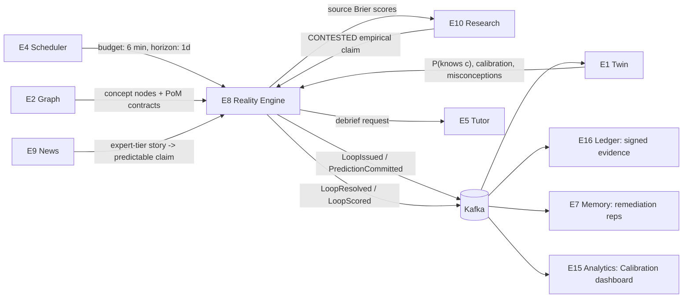
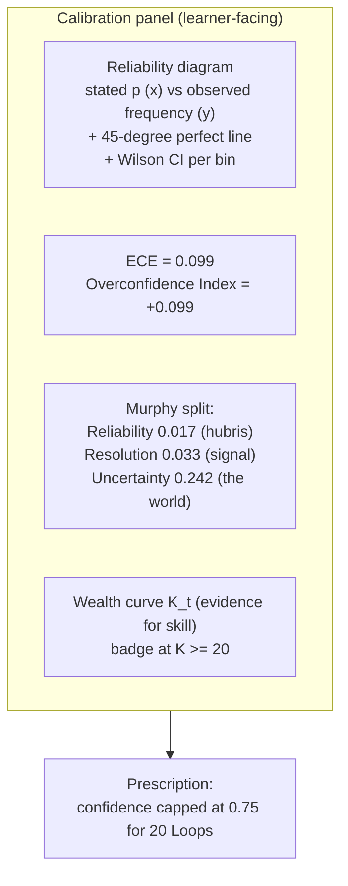

# 13 — The Reality Loop

**Engine:** `E8 — Reality Engine`
**Invention:** `I-3 — The Reality Loop` (the crown jewel)
**Supporting Inventions:** `I-1 Twin` · `I-2 PoM (PREDICT evidence type)` · `I-6 Failure-Seeking` · `I-8 Ledger` · `I-10 Mastery-per-Minute`

---

## 1. The thesis

Every learning product on earth grades the learner against **an answer key written by a human**.
The answer key is the ceiling. You cannot know more than the person who wrote the test.

PRAXIS installs a different examiner.

> **The learner makes a falsifiable claim about the real world, commits to it irrevocably, and then the world resolves it. Reality grades the exam.**

There is no answer key. There is no author. There is no ceiling. There is a **timestamp**, a **frozen snapshot of what the learner could see**, a **committed probability**, and — later — **what actually happened**.

| Every other platform | PRAXIS |
|---|---|
| "Which of these is the correct diagnosis?" (author knows) | "Diagnose this real case. The chart's actual 30-day outcome will grade you." |
| "What does support/resistance mean?" (definition recall) | "Mark this live chart. Tomorrow's close grades you." |
| "Which sorting algorithm is O(n log n)?" | "Write it. A hidden test suite and a perf harness grade you." |
| Score = % correct vs. a key | Score = **Brier** vs. **ground truth**, **decomposed** into calibration and discrimination, **tested for significance** against a market/naive baseline |
| Certificate says: "completed 12 hours" | Ledger says: "41 novel cases, 0.79 calibration, BSS +0.14 over base rate, p = 0.004, n = 41, verifiable" |

**What is genuinely novel:** the *commitment* mechanic. Not the prediction — anyone can predict. The fact that the prediction is **write-once, server-timestamped, hash-chained, and sealed against a frozen data snapshot** is what turns a guess into **evidence**. Everything else in this document exists to protect that one property.

**Table stakes here:** trading simulators, code judges (LeetCode), forecasting tournaments (Metaculus/GJP). **Novel:** unifying them under one scoring substrate, wiring the result back into a cognitive model of the learner, and letting the *engine* choose the difficulty so the track record cannot be curated.

---

## 2. Where E8 sits



**Note the last edge.** Because E8 resolves predictions against ground truth, it can score *anyone* who made a prediction — including **the sources** E10 retrieved. Pundits get Brier scores. See §12.

---

## 3. The Loop lifecycle

### 3.1 The seven acts

| # | Act | What happens | Immutable? | Why it exists |
|---|---|---|---|---|
| 1 | **TASK** | Adapter selects an item at the learner's boundary from **live data**, seals a content-addressed snapshot | Snapshot: **yes** (SHA-256) | Grounds the exam in reality, not in a question bank |
| 2 | **PREDICTION** | Learner supplies a structured forecast **+ a mandatory confidence** + a rationale citing concept nodes | No (pre-commit) | Confidence is not optional — a forecast without a probability is unscoreable |
| 3 | **COMMITMENT** | Write-once. Server-timestamped. Hash-chained. Ed25519-signed. **Cannot be edited or deleted.** | **Yes** | *This is the honesty mechanism. Everything else is decoration.* |
| 4 | **WAIT** | The Loop is `PENDING`. Nothing the learner does can change it. | — | Reality needs time. This is the cost of a real examiner. |
| 5 | **RESOLUTION** | The registered ground-truth adapter returns the actual outcome + source URI + `observed_at` | **Yes** | The examiner speaks |
| 6 | **SCORING** | Proper scoring rule → Brier / CRPS / rubric. Decomposed. Compared to baselines. | **Yes** | See §4. Accuracy is not a metric here. |
| 7 | **TWIN UPDATE + DEBRIEF** | Twin updates `P(knows c)` and the confidence–competence gap; Tutor explains *exactly which concept the learner ignored*; Memory schedules remediation reps | — | The Loop is worthless if it only produces a score |

### 3.2 State machine

```mermaid
stateDiagram-v2
    [*] --> SELECTED: E8 picks adapter + item
    SELECTED --> ISSUED: snapshot sealed (sha256, as_of_ts)
    ISSUED --> OPEN: learner opens the task
    OPEN --> DRAFTING: enters forecast + confidence + rationale
    DRAFTING --> DRAFTING: revise freely (pre-commit only)
    DRAFTING --> COMMITTED: COMMIT --- write-once, signed, chained

    ISSUED --> EXPIRED: commit_deadline passed
    OPEN --> EXPIRED: commit_deadline passed
    DRAFTING --> EXPIRED: commit_deadline passed
    EXPIRED --> FORFEITED: scored at forfeit rule (NOT dropped)

    COMMITTED --> PENDING: waiting for reality
    PENDING --> PENDING: resolver tick (t < min_delay)
    PENDING --> RESOLVED: adapter.resolve() -> ground truth
    PENDING --> VOID: source failed / event cancelled / halt

    RESOLVED --> SCORED: proper scoring rule + baselines
    SCORED --> DISPUTED: learner contests resolution
    DISPUTED --> RESOLVED: adjudicated - re-resolve
    DISPUTED --> VOID: adjudicated - invalid loop
    SCORED --> DEBRIEFED: Tutor attributes error to concepts
    DEBRIEFED --> CLOSED: Twin updated, reps scheduled, Evidence signed

    FORFEITED --> CLOSED
    CLOSED --> [*]
    VOID --> [*]
```



**Three states that most products would not have, and that make this real:**

- **`EXPIRED → FORFEITED`** — you cannot make a Loop disappear by ignoring it. An unresolved commitment is scored at the **forfeit rule** (§4.7). Otherwise every learner's track record would be "the ones I felt good about."
- **`DISPUTED`** — the learner can contest a resolution (bad tick data, a restated filing, an ambiguous judgment). Disputes are adjudicated against the adapter's resolution contract and **the adjudication is itself logged to the Ledger**. Trust requires an appeals process.
- **`VOID`** — the *world* failed, not the learner (trading halt, case withdrawn, filing delayed past horizon). VOIDed Loops are excluded from scoring but **remain in the Ledger** with their void reason. Silent deletion is how track records get laundered.

### 3.3 End-to-end sequence

```mermaid
sequenceDiagram
    autonumber
    participant S as E4 Scheduler
    participant R as E8 Reality Engine
    participant A as Domain Adapter
    participant SS as Snapshot Store (content-addressed)
    participant L as Learner
    participant LG as E16 Ledger
    participant K as Kafka
    participant T as E1 Twin
    participant TU as E5 Tutor
    participant M as E7 Memory

    S->>R: requestLoop(twin, objective, budget=6min, horizon=1d)
    R->>A: select(twin, constraints)
    A->>A: target boundary concept; force base rate into [0.35, 0.65]
    A->>SS: seal(payload as-of T0)
    SS-->>A: snapshot_uri + sha256
    A-->>R: LoopSpec + responseSchema + resolve_after
    R->>K: LoopIssued
    R-->>L: render task (ONLY the frozen snapshot is visible)

    L->>R: {p: 0.72, rationale, concepts_cited:[...]}
    R->>R: validate vs responseSchema (probabilities sum to 1, p in (0,1))
    R->>LG: commit(hash(payload), prev_hash, server_ts, Ed25519 sig)
    LG-->>R: commit_id, chain_index, receipt
    R->>K: PredictionCommitted
    R-->>L: read-only receipt. No edit path exists in the API.

    loop resolver ticks
        R->>A: resolve(snapshot, now)
        A-->>R: PENDING
    end

    A-->>R: GroundTruth{value, source_uri, observed_at}
    R->>R: score(prediction, truth, baselines[naive, climatology, market])
    R->>K: LoopResolved + LoopScored
    R->>T: brier_delta, calib_bin, concept attribution
    T->>T: update P(knows c); update Dunning-Kruger delta
    R->>TU: debrief(prediction, truth, rationale, concepts, snapshot)
    TU-->>L: "You were 0.85. Reality said no. Your rationale never mentions memory bandwidth."
    TU->>M: schedule reps: [memory_bandwidth, roofline_model]
    TU->>K: MisconceptionObserved + RemediationScheduled
    R->>LG: Evidence{type: PREDICT, signed}
```

### 3.4 The commitment record (the thing that makes it honest)

```json
{
  "loop_id": "loop_01HQ8F3K2M9X",
  "learner_id": "lrn_7f3a",
  "adapter": { "id": "markets.equity.direction", "version": "3.2.0" },
  "snapshot": {
    "uri": "s3://praxis-snapshots/2026-07-10/8c1f...e93a.json",
    "sha256": "8c1f4a77bb2e0d51f6c9a3e7d20b4f8c9a1e2d3b4c5f6a7b8c9d0e1f2a3b4c5d",
    "as_of": "2026-07-10T20:00:00Z",
    "fields_visible": ["ohlcv_1y_daily", "ohlcv_5d_5m", "volume", "sector_etf_ohlcv_1y"],
    "fields_withheld": ["news_after_as_of", "analyst_notes", "options_flow"]
  },
  "task_hash": "3d9b...c41e",
  "prediction": {
    "schema": "binary_v1",
    "claim": "NVDA closes >= its 2026-07-10 close on 2026-07-11",
    "p": 0.72,
    "rationale": "Higher low on the 4h; volume expansion into the 148.20 breakout; sector ETF confirming.",
    "concepts_cited": ["cpt.ta.support_resistance", "cpt.ta.volume_confirmation", "cpt.ta.trend_structure"],
    "time_spent_ms": 214000
  },
  "commit": {
    "server_ts": "2026-07-10T20:04:11.882Z",
    "ntp_stratum": 2,
    "commit_deadline": "2026-07-10T20:30:00Z",
    "prev_hash": "a41c...77f0",
    "payload_hash": "9e02...1bb7",
    "chain_index": 184032,
    "signature": "ed25519:Kv9x...Qw==",
    "signer_key_id": "praxis-ledger-2026-q3"
  },
  "resolution_policy": {
    "resolver": "markets.equity.direction@3.2.0",
    "min_delay": "PT14H",
    "resolve_after": "2026-07-11T20:00:00Z",
    "truth_source": "consolidated_tape_official_close",
    "void_conditions": ["trading_halt_full_session", "ticker_delisted", "corporate_action_unadjusted"]
  },
  "status": "PENDING"
}
```

Note `fields_withheld`. The adapter must **declare what it hid**. That declaration is hashed into the commit. A future auditor can verify not only *what the learner said* but *what the learner could possibly have known*.

---

## 4. Scoring: doing it properly

Accuracy is a **broken metric** and we do not report it as a primary. Two reasons:

1. **It is not a proper scoring rule.** A learner maximizing accuracy is incentivized to say "90%" whenever they mean "60%," because accuracy only reads the side of 0.5 you land on. It rewards lying about confidence.
2. **It cannot separate skill from luck** (§4.4).

### 4.1 Why Brier (the propriety proof, in three lines)

Let the learner's *true* belief be `q` and their *reported* probability be `p`. Expected Brier:

```
E[BS] = q(1 - p)^2 + (1 - q)p^2
d/dp  = -2q(1 - p) + 2(1 - q)p = 2(p - q)
```

Setting to zero gives `p = q`; the second derivative is `+2 > 0`, so it is a strict minimum.

> **Reporting your true belief is the uniquely optimal strategy.** There is no confidence you can fake that improves your score. This is the entire reason the confidence field is mandatory and the entire reason we score with Brier rather than accuracy.

### 4.2 The scoring rules, per outcome type

| Outcome type | Rule | Formula | Range (best) | Used by |
|---|---|---|---|---|
| Binary | **Brier** | `BS = (1/N) Σ (p_i − o_i)²` | 0–1 (0) | Market direction, policy passage, A/B winner, judgment outcome |
| Multi-class (k) | **Multi-class Brier** | `BS = (1/N) Σ_i Σ_k (p_ik − o_ik)²` | 0–2 (0) | Differential diagnosis, which-variant-wins, ruling category |
| Continuous point | **CRPS** | `CRPS(F, y) = ∫ (F(x) − 1{x ≥ y})² dx` | 0–∞ (0) | Revenue forecast, temperature, latency |
| Continuous, Normal `N(μ,σ)` | closed-form CRPS | `σ [ z(2Φ(z) − 1) + 2φ(z) − 1/√π ]`, `z = (y−μ)/σ` | — | Same, when the learner gives mean + sd |
| Interval `[l, u]` at `1−α` | **Winkler interval score** | `IS = (u−l) + (2/α)(l−y)·1{y<l} + (2/α)(y−u)·1{y>u}` | 0–∞ (0) | "80% CI on next-quarter DC revenue" |
| Quantiles | **Pinball loss** | `L_τ(y, ŷ) = max(τ(y−ŷ), (τ−1)(y−ŷ))` | 0–∞ (0) | Distributional forecasts |
| Rubric / artifact | **Normalized rubric → treated as continuous** | rubric score `r ∈ [0,1]`; scored against `p` with Brier-analogue `(p − r)²` | 0–1 (0) | Code review, clause drafting, differential quality |
| Ranked set | **RPS** (ranked prob. score) | ordinal-aware cumulative Brier | 0–(k−1) (0) | League placement, ordinal severity |

**Secondary (diagnostic, never primary):** the **log score** `−[o·ln p + (1−o)·ln(1−p)]`. It is proper and it punishes catastrophic overconfidence far harder than Brier — but it is unbounded at `p ∈ {0,1}`, so a single 0.99-and-wrong destroys a career track record. We compute it (clipped at `ε = 0.01`) as an **overconfidence detector** and surface it as "Blowup Risk," but the Ledger's headline is Brier.

### 4.3 Decomposition: *why* was the score what it was?

Murphy's decomposition, over `K` confidence bins:

```
BS  =  Reliability  −  Resolution  +  Uncertainty

Reliability = (1/N) Σ_k n_k (p̄_k − ō_k)²      ← miscalibration cost.  LOWER is better.
Resolution  = (1/N) Σ_k n_k (ō_k − ō)²        ← discrimination.       HIGHER is better.
Uncertainty = ō(1 − ō)                         ← the domain's irreducible noise. Not your fault.
```

This is the single most important formula in the product, because it answers a question no LMS can even ask:

> **"Am I bad at this, or is this hard?"**

`Uncertainty` is the hardness of the world. `Resolution` is *your signal*. `Reliability` is *your hubris*. PRAXIS shows all three, separately.

#### Worked example — a real learner's 120 resolved market Loops

| Bin | n_k | mean stated `p̄_k` | observed `ō_k` | gap `p̄−ō` |
|---|---|---|---|---|
| 0.0–0.1 | 6 | 0.06 | 0.000 | +0.060 |
| 0.1–0.2 | 9 | 0.15 | 0.111 | +0.039 |
| 0.2–0.3 | 11 | 0.25 | 0.182 | +0.068 |
| 0.3–0.4 | 14 | 0.35 | 0.286 | +0.064 |
| 0.4–0.5 | 16 | 0.45 | 0.438 | +0.013 |
| 0.5–0.6 | 18 | 0.55 | 0.500 | +0.050 |
| 0.6–0.7 | 17 | 0.65 | 0.529 | +0.121 |
| 0.7–0.8 | 15 | 0.74 | 0.600 | +0.140 |
| 0.8–0.9 | 9 | 0.84 | 0.556 | **+0.284** |
| 0.9–1.0 | 5 | 0.95 | 0.600 | **+0.350** |
| **Total** | **120** | — | `ō = 0.408` | — |

```
Uncertainty = 0.408 × 0.592           = 0.2416
Reliability = 2.0734 / 120            = 0.0173
Resolution  = 3.9145 / 120            = 0.0326
BS          = 0.0173 − 0.0326 + 0.2416 = 0.2263

ECE  = Σ (n_k/N)|p̄_k − ō_k|          = 0.0993   (9.9% average miscalibration)
OCI  = Σ (n_k/N)(p̄_k − ō_k)          = +0.0993  (signed: pure overconfidence, zero underconfidence)
Best achievable at this discrimination = Uncertainty − Resolution = 0.2090
Cost of miscalibration                 = 0.2263 − 0.2090 = 0.0173
```

**What the learner is told, in words:**

> You have **real signal**. Your Resolution is +0.033 — you genuinely discriminate up-days from down-days better than chance, and most people never get there.
> Your problem is **not knowledge. It is hubris.** Every one of your ten bins is overconfident, and it is catastrophic above 0.7: when you say **85%, you are right 56% of the time.** When you say **95%, you are right 60%.**
> If you kept exactly the same insight and simply **stopped exaggerating**, your Brier would fall from **0.226 to 0.209**. You are paying **0.017 for your ego**.
> **Prescription:** for the next 20 Loops, your confidence field is capped at 0.75. Earn the top bins back.

That prescription is not a metaphor. `max_confidence: 0.75` is written into the learner's adapter constraints, and it is enforced by the response schema. **The Twin's Dunning–Kruger delta (I-1) is literally this number**: `OCI = +0.099`.

### 4.4 Skill vs. luck: the hardest problem, done honestly

A learner gets **6 out of 10** predictions right. They feel like a genius. Here is what PRAXIS tells them.

#### The naive read

Under a fair coin, `X ~ Binomial(10, 0.5)`:
```
P(X ≥ 6) = 386 / 1024 = 0.377
```
**37.7% of coin-flippers hit 6/10 or better.**

Under the market's actual base rate of up-days (`p₀ = 0.53`), `X ~ Binomial(10, 0.53)`:
```
P(X ≥ 6) = 0.453
```
**45% of coin-flippers hit 6/10 or better** in this domain. 6/10 is not evidence of anything.

#### The proper read — the same 10 Loops, scored

| # | stated `p` | outcome `o` | "hit"? | `(p−o)²` | baseline `(0.53−o)²` | `d_i = ref − learner` |
|---|---|---|---|---|---|---|
| 1 | 0.70 | 1 | ✓ | 0.0900 | 0.2209 | +0.1309 |
| 2 | 0.60 | 0 | ✗ | 0.3600 | 0.2809 | −0.0791 |
| 3 | 0.80 | 1 | ✓ | 0.0400 | 0.2209 | +0.1809 |
| 4 | 0.55 | 1 | ✓ | 0.2025 | 0.2209 | +0.0184 |
| 5 | 0.30 | 1 | ✗ | 0.4900 | 0.2209 | −0.2691 |
| 6 | 0.65 | 1 | ✓ | 0.1225 | 0.2209 | +0.0984 |
| 7 | 0.40 | 0 | ✓ | 0.1600 | 0.2809 | +0.1209 |
| 8 | 0.75 | 0 | ✗ | 0.5625 | 0.2809 | −0.2816 |
| 9 | 0.45 | 1 | ✗ | 0.3025 | 0.2209 | −0.0816 |
| 10 | 0.85 | 1 | ✓ | 0.0225 | 0.2209 | +0.1984 |
| | | **7 up / 3 down** | **6/10** | **BS = 0.2353** | **BS_ref = 0.2389** | **d̄ = +0.00365** |

**Brier Skill Score** against the climatological baseline (the market's own long-run up-rate, computed from a **5-year prior, never from this sample** — using the in-sample base rate is leakage and inflates BSS):

```
BSS = 1 − BS / BS_ref = 1 − 0.2353 / 0.2389 = +0.0153
```

**1.5% better than a rock that always says 53%.**

#### Is +0.0153 real? A paired test on the per-item differences `d_i`

```
d̄  = +0.00365
s   = 0.17587        (sample sd of d_i, n = 10)
SE  = s/√n = 0.05562
t   = d̄ / SE = 0.0656,  df = 9  →  p ≈ 0.95  (two-sided)

95% CI on d̄  : 0.00365 ± 2.262 × 0.05562 = [−0.1222, +0.1295]
95% CI on BSS: [−0.51, +0.54]
```

> **The verdict shown to the learner:** *"You went 6 for 10. Against the market's base rate, **45% of coin-flippers do that or better.** Your skill score is +0.015 with a 95% interval of **[−0.51, +0.54]**. That interval contains zero, and it contains 'much worse than a coin,' and it contains 'genuinely good.' **We do not know if you are skilled. Neither do you.** Come back at n = 100."*

**No product on earth says this to a user.** It is the single most valuable sentence in the app.

#### How many Loops do you actually need?

```
n ≥ (z_{1−α/2} + z_{1−β})² · s² / δ²      with α = 0.05, β = 0.20 → (1.96 + 0.842)² = 7.85
```

| Detectable edge `δ` (Brier points) | ≈ BSS | Noisy domain (`s = 0.176`, markets) | Low-noise domain (`s = 0.05`, code tests) |
|---|---|---|---|
| 0.05 (large) | ≈ 0.21 | **98 Loops** | 8 Loops |
| 0.02 (real, modest) | ≈ 0.08 | **607 Loops** | 50 Loops |
| 0.01 (subtle) | ≈ 0.04 | **2,428 Loops** | 197 Loops |

This table is **displayed in the product**, per domain, as a progress bar: *"Statistical power: 41 / 98 Loops to prove a large edge in equities."* It reframes the learner's grind as **evidence accumulation**, which is exactly what it is.

#### The three baselines every Loop is scored against

| Baseline | Definition | What beating it proves |
|---|---|---|
| **Uniform** | `p = 0.5` (or `1/k`) | You know *something*. Trivial. |
| **Climatology** | The long-run base rate from a **held-out prior window** | You know more than the domain's default. This is the real bar. |
| **Market-implied / consensus** | Options-implied prob., betting odds, analyst consensus, the maintainer-merge rate, the base rate of the diagnosis in the population | **You know more than the aggregated opinion of everyone who is already paid to know.** This is the bar that matters, and almost nobody clears it. |

Beating climatology earns a **Calibrated** badge. Beating the market-implied baseline with `p < 0.05` at `n ≥ 100` earns an **Edge** badge — and it is *rare*, by design, and the product says so.

#### Always-valid inference (so the badge can update after every single Loop)

Loops resolve continuously. If we re-ran a t-test after every resolution and awarded the badge the first time `p < 0.05`, we would be doing textbook p-hacking and every learner would eventually get a badge.

Instead the Edge badge is governed by a **test martingale / confidence sequence**. Maintain a wealth process on the per-item Brier improvements `d_i` (bounded to `[−1, 1]`):

```
K_0 = 1
K_t = K_{t−1} · (1 + λ_t · d_t),      λ_t ∈ [−1/2, 1/2] chosen predictably (GRAPA / mixture)
Reject H₀ (no skill) at level α  ⟺  K_t ≥ 1/α        (α = 0.05 → K_t ≥ 20)
```

Under `H₀: E[d] ≤ 0`, `K_t` is a non-negative supermartingale, so by Ville's inequality `P(∃t : K_t ≥ 1/α) ≤ α` — **valid at every stopping time, forever.** The learner can watch the wealth curve climb in real time. It is an honest, continuously-updating measure of accumulated evidence, and it cannot be gamed by optional stopping.

**Multiplicity:** a learner running Loops in 6 domains gets 6 chances at a badge. Domain badges are awarded under **Benjamini–Hochberg FDR control at q = 0.10** across the learner's active domains.

**Regime robustness:** an edge that exists only in one market regime is not an edge. Before awarding **Edge**, we require the effect to persist on a **temporal hold-out** (the most recent 25% of Loops, never used in the fitting of any baseline).

### 4.5 The calibration curve

The reliability diagram is a **first-class screen**, not an analytics afterthought.



Each bin carries a **Wilson score interval**, because a bin with `n_k = 5` tells you almost nothing and the UI must not pretend otherwise:

```
Wilson CI(ō_k, n_k) at 95% — bins with CI width > 0.30 are rendered greyed out and labelled "not enough data"
```

### 4.6 Rationale scoring — the process, not just the outcome

A learner can be **right for the wrong reason** and **wrong for the right reason**. Outcome-only scoring would teach superstition. So every Loop scores **two things**:

| Score | Source | Weight in Mastery Credit | Weight in Ledger track record |
|---|---|---|---|
| **Outcome score** (Brier/CRPS/rubric) | Reality | 60% | **100%** — this is the verifiable part |
| **Process score** (rubric on the rationale) | E6 Assessment rubric, graded against the concept nodes the learner *should* have invoked | 40% | 0% (shown, not certified) |

The process rubric asks: *did the rationale invoke the concepts that actually mattered? did it consider the base rate? did it name a falsifier?* A learner whose process score is high and outcome score is low is **unlucky**. A learner whose process score is low and outcome score is high is **about to blow up**, and the debrief says so explicitly.

### 4.7 The forfeit rule

An `EXPIRED` Loop is not deleted. It is scored as:

```
BS_forfeit = BS_ref(baseline) + 0.05      (i.e. slightly worse than doing nothing)
```

The penalty is small (you are not punished for having a life) but it is **non-zero and permanent**, and forfeits are **displayed in the Ledger as a Coverage metric**:

```
Coverage = resolved_loops / (resolved_loops + forfeited_loops)
```

A track record with **Coverage 0.61** is a track record that was curated. Employers reading a Verified Competency Record see Coverage next to Brier. **Cherry-picking is visible.**

---

## 5. Domain adapters

### 5.1 The adapter contract

Every adapter implements exactly this. No exceptions, no side channels.

```typescript
interface RealityAdapter {
  id: string;                       // "medicine.dx.differential"
  version: string;                  // semver — a version bump invalidates comparability
  domain: DomainId;
  safety_class: "SIM_ONLY" | "EDUCATIONAL_RETROSPECTIVE" | "PUBLIC_RECORD" | "BENIGN";
  licence: LicenceRef;

  concepts: ConceptId[];            // Graph nodes this adapter can produce evidence for

  // 1. SELECT — the ENGINE picks, never the learner (§6.5)
  select(twin: Twin, c: Constraints): LoopSpec;

  // 2. SNAPSHOT — freeze exactly what the learner may see, content-addressed
  snapshot(spec: LoopSpec): Snapshot;          // { uri, sha256, as_of, fields_visible, fields_withheld }

  // 3. RENDER — task text + assets, derived ONLY from the snapshot
  render(snap: Snapshot): Task;
  responseSchema: JSONSchema;                  // forces a probability; rejects unnormalised distributions

  // 4. WAIT
  min_resolution_delay: Duration;              // a Loop CANNOT resolve before this
  max_resolution_window: Duration;             // after which: VOID, not "guess"

  // 5. RESOLVE — an independent ground-truth source, not us
  resolve(snap: Snapshot, now: Instant): GroundTruth | PENDING | UNRESOLVABLE;
  truth_source: SourceRef;                     // auditable URI class
  void_conditions: string[];

  // 6. SCORE
  scoring_rule: ScoringRule;                   // BRIER | MULTICLASS_BRIER | CRPS | INTERVAL | RUBRIC | RPS
  baselines(snap: Snapshot): Baseline[];       // >= climatology; market-implied where it exists
}
```

**Non-negotiable invariant, enforced by a replay harness in CI:**

> `∀ field f ∈ snapshot : f.observed_at ≤ snapshot.as_of` **and** `resolve()` may only read data with `observed_at > commit.server_ts`.
>
> The learner cannot see the future. The resolver cannot see the past that the learner saw. There is no overlap. This is tested by replaying every adapter against historical data and asserting that a lookahead injection fails the harness.

### 5.2 The adapter roster

| # | Adapter | Live data source | Ground truth | Delay | Rule | Safety class |
|---|---|---|---|---|---|---|
| A1 | `markets.equity.direction` | Delayed/EOD OHLCV + fundamentals (licensed vendor) | Official consolidated close | 14h–5d | Brier | SIM_ONLY |
| A2 | `swe.build.hidden_tests` | Real repo issue / spec | Hidden test suite + perf harness | 0–120s | Rubric+pass rate | BENIGN |
| A3 | `swe.review.pr_outcome` | Open PR on a public repo (pre-merge) | What maintainers actually did | 2–30d | Multiclass Brier + rubric | BENIGN |
| A4 | `medicine.dx.differential` | De-identified retrospective case (licensed/DUA) | Recorded discharge dx + outcome | 0s (blinded) | Multiclass Brier + rubric | EDUCATIONAL_RETROSPECTIVE |
| A5 | `law.judgment.forecast` / `law.clause.redline` | Pending public case docket / real deal precedent | Published ruling / senior-lawyer redline | 2w–9m / 3–5d | Brier / rubric | PUBLIC_RECORD |
| A6 | `business.filing.metric` | Company IR, prior filings, guidance | The 10-Q/10-K/annual report | 4–13w | CRPS + interval score | PUBLIC_RECORD |
| A7 | `datasci.leaderboard.holdout` | Public dataset, train split | Held-out private split scored server-side | 0–10min | Task metric + rank | BENIGN |
| A8 | `product.experiment.winner` / `product.rank.forecast` | Public A/B corpus / app-store rank data | Published result / observed rank | 1–8w / 1–4w | Brier / CRPS | BENIGN |
| A9 | `civics.policy.outcome` | Bill trackers, official gazettes, regulator dockets | Official gazette / vote record | 1w–12m | Brier | PUBLIC_RECORD |
| A10 | `calib.weather` · `calib.sports` · `calib.elections` | NWS/ECMWF grids, fixture lists, official returns | Observed weather / final score / certified result | 12h–7d | Brier / RPS | BENIGN (see §7.5) |

---

### A1 — Stock market / trading

| Field | Value |
|---|---|
| **Live data** | Licensed EOD + intraday OHLCV, corporate actions, sector ETF series. **No news after `as_of`. No options flow. No analyst notes.** |
| **Task template** | *"Here is NVDA through today's close (chart + 1y daily + 5d/5m). (a) Mark the trend structure. (b) Mark the nearest support and resistance. (c) **Will tomorrow's close be at or above today's close?** Give `p`. (d) Give one falsifier: what would you see tomorrow that proves you wrong?"* |
| **Ground truth** | Official consolidated close, next session. |
| **Delay** | 14h (next close). Multi-horizon variants: 5d, 21d. |
| **Scoring** | Brier on (c). Rubric on (a),(b) against an auto-derived structural label (swing highs/lows, volume-weighted levels) — **and** the rubric is scored *only for process*, never certified. |
| **Baselines** | Climatology (5y up-day rate for this ticker, held out) · **Market-implied** (delta of the nearest ATM option ⇒ risk-neutral P(up), where listed). |
| **Anti-gaming** | Snapshot has no post-`as_of` news. Commit deadline is **20:30 UTC**, before Asian pre-market signal. Ticker + horizon are **randomized per learner** (see §6.4). Charts rendered server-side from the snapshot — the client never receives a live feed. |
| **Concepts** | `trend_structure`, `support_resistance`, `volume_confirmation`, `base_rate_neglect`, `risk_of_ruin`, `expectancy` |
| **Safety** | **Simulated capital only.** No broker link. No order routing. The word "buy" does not appear. See §7.1. |

**Why this adapter is transformative:** every trading course on earth teaches "support and resistance" and then shows you a chart *where it worked*, chosen in hindsight. PRAXIS shows you **today's** chart, takes your commitment, and then shows you your **Brier score over 200 charts**. Roughly speaking, most learners discover their Resolution is **0.00**. That discovery is worth more than the course.

---

### A2 — Software engineering: BUILD against hidden tests

| Field | Value |
|---|---|
| **Live data** | A real issue/spec drawn from a public repo, or a generated-but-novel spec. The learner sees the spec, the public tests, and the interface. |
| **Task template** | *"Implement `rate_limiter.allow(key, now)` to this spec. Public tests: 6. **Hidden tests: unknown count, including adversarial and concurrency cases.** Before you submit: **what fraction of hidden tests do you predict you will pass? (`p̂ ∈ [0,1]`)** And: which edge case do you think you have missed?"* |
| **Ground truth** | Sandboxed execution (gVisor/Firecracker, no network, CPU+mem capped) against the hidden suite + a performance harness (p99 latency, allocations). |
| **Delay** | 0–120 seconds. **The lowest-latency Reality Loop in the product** — and therefore the best training ground for calibration. |
| **Scoring** | (i) Objective pass rate `r ∈ [0,1]`. (ii) **Calibration Brier `(p̂ − r)²`** — *this is the part nobody else does*. (iii) Perf percentile vs. a reference implementation. |
| **Baselines** | Climatology = the cohort's mean pass rate on this item (from IRT calibration). |
| **Anti-gaming** | Hidden tests never shipped to the client. Network egress blocked in the sandbox (no fetching the repo's real test file). Solution similarity check against known public solutions. Timing floor: an instant-perfect submission on a novel item is flagged for review. |
| **Concepts** | `concurrency`, `token_bucket`, `time_monotonicity`, `edge_case_reasoning`, `amortized_complexity` |
| **Safety** | BENIGN. |

> The learner who says "I'll pass 95%" and passes 61% has just been shown, by a machine, in 90 seconds, the exact shape of their overconfidence. This loop runs **dozens of times a week**. It is the calibration gym.

---

### A3 — Software engineering: PR review vs. what maintainers actually did

| Field | Value |
|---|---|
| **Live data** | An **open, un-merged** PR on a large public repo, snapshotted at `as_of` (diff, description, CI status, files touched, **comments hidden after `as_of`**). |
| **Task template** | *"Review this PR. (a) List the issues you'd raise, ranked. (b) **Predict the outcome:** `MERGED_AS_IS` / `MERGED_AFTER_CHANGES` / `CLOSED_UNMERGED` / `STALE_90D` — give a probability to each (must sum to 1). (c) Predict the single change the maintainers will most likely demand."* |
| **Ground truth** | The repo itself, 2–30 days later: merge state + the actual review comments + the actual diff of requested changes. |
| **Delay** | 2–30 days (`max_resolution_window` = 90d, then `STALE_90D` resolves or VOID). |
| **Scoring** | Multi-class Brier on (b). **Recall-against-reality on (a)**: what fraction of the issues the maintainers actually raised did the learner catch? (`recall`), and precision penalty for noise. Semantic match on (c) via an LLM judge with a human-audited golden set. |
| **Baselines** | Climatology = this repo's historical merge-rate distribution (held out). |
| **Anti-gaming** | Snapshot freezes comments; the client is served a **rendered diff from the snapshot**, not a link. Learner is blocked from the repo URL during the Loop (and the URL is not in the payload). Post-hoc: if the learner's rationale contains text that appears verbatim in a comment posted after `as_of`, the Loop is voided and flagged. |
| **Concepts** | `code_review_heuristics`, `api_design`, `backward_compat`, `test_coverage_reasoning`, `maintainer_incentives` |

**This is the single most under-appreciated adapter.** It is the only mechanism in existence that tells a junior engineer: *"Of the 7 things the maintainers cared about, you caught 2, and 4 of the 5 things you raised, nobody cared about."* That is a **calibrated model of what senior engineers actually value**, learned from reality, not from a blog post.

---

### A4 — Medicine: de-identified real case → diagnosis → actual outcome

| Field | Value |
|---|---|
| **Live data** | A **retrospective, de-identified, licensed** case (published case reports; MIMIC-class ICU datasets under a Data Use Agreement; institutional teaching archives with consent). **Never a live patient. Never learner-uploaded patient data — there is no intake path for it, by design.** Presented **staged**: presentation → vitals → labs → imaging, revealed only as the learner requests them (each request is logged and costs from a budget). |
| **Task template** | *"62F, 3d worsening dyspnoea, pleuritic chest pain, HR 112, SpO₂ 91% RA. (a) Give your **differential with probabilities** (must sum to 1). (b) Choose up to 3 investigations — **each costs from your budget, and each choice is scored**. (c) After results: **re-state your posterior**. (d) Predict the 30-day outcome."* |
| **Ground truth** | The case's recorded final diagnosis, the investigations that were actually decisive, and the recorded 30-day outcome. Blinded until commit. |
| **Delay** | 0s (the truth already exists — it is blinded, not pending). **`min_resolution_delay` is nonetheless enforced at the commit boundary: the truth object is not even fetched into the serving tier until `PredictionCommitted` is on the chain.** |
| **Scoring** | (i) Multi-class Brier on the differential, **before and after** investigations — the **Δ Brier from the investigations is the real score**: did your test choice actually move you toward truth? (ii) Investigation-choice value: information gain per unit cost vs. the decisive investigation. (iii) Multi-class Brier on the 30-day outcome. |
| **Baselines** | **Population prevalence** of each dx given the presenting complaint (this is the climatology, and it is *brutal* — most learners cannot beat prevalence). |
| **Anti-gaming** | Case bank is private and each case is **perturbed** (units, non-diagnostic demographics, presentation order) per learner. Truth object is not in the client bundle. Cases are retired after exposure. |
| **Concepts** | `bayesian_reasoning`, `pretest_probability`, `likelihood_ratio`, `anchoring_bias`, `premature_closure`, `test_characteristics` |
| **Safety** | **EDUCATIONAL_RETROSPECTIVE.** See §7.2 — this is where the guardrails are strictest. |

> The **Δ Brier from investigation choice** is the whole point. Medical education teaches "order the D-dimer." PRAXIS measures whether *ordering it actually changed your belief in the right direction* — which is what a diagnostician is.

---

### A5 — Law: predict the judgment / draft the clause

**Two sub-adapters.**

**A5a — `law.judgment.forecast`**

| Field | Value |
|---|---|
| **Live data** | A **pending, public** appellate case: the docket, the filed briefs, the questions presented, the panel composition, the oral-argument transcript. Public record only. |
| **Task template** | *"(a) `AFFIRM` / `REVERSE` / `REVERSE_IN_PART` / `DIG` — probabilities, sum to 1. (b) Predict the vote split. (c) Predict the controlling doctrinal test the majority will apply. (d) One sentence: the crux."* |
| **Ground truth** | The published opinion. |
| **Delay** | 2 weeks – 9 months. **`max_resolution_window` = 18 months → VOID.** |
| **Scoring** | Multi-class Brier on (a). RPS on (b) (ordinal). LLM-judge + human-audited semantic match on (c). |
| **Baselines** | Climatology = this court's historical reversal rate for this case type, held out. **Market-implied** where a legal-forecasting consensus exists. |
| **Concepts** | `standard_of_review`, `stare_decisis`, `textualism_vs_purposivism`, `justiciability`, `oral_argument_signal` |

**A5b — `law.clause.redline`**

| Field | Value |
|---|---|
| **Task template** | *"Draft the limitation-of-liability clause for this (real, anonymized) SaaS MSA, for the **customer** side. Then: **predict how many of your provisions a senior counterparty will strike (`p̂` over 0/1/2/3+)**."* |
| **Ground truth** | The **actual redline** produced by a qualified practitioner (a paid reviewer panel, or the real historical redline from the anonymized deal). |
| **Delay** | 3–5 days. |
| **Scoring** | Rubric (coverage of the required protections, enforceability, jurisdiction fit) + **Brier on the learner's own prediction of how they'd be redlined** — again, calibration is scored separately from competence. |
| **Safety** | **PUBLIC_RECORD / educational.** No client matter intake. No jurisdiction-specific advice. See §7.3. |

---

### A6 — Business / strategy: forecast the quarter, the filing grades you

| Field | Value |
|---|---|
| **Live data** | Snapshot at `as_of`: prior 12 filings (10-Q/10-K), the last earnings-call transcript, management guidance, segment history, relevant macro series. |
| **Task template** | *"NVDA reports FY-Q3 on ~2026-11-19. Forecast **Data Center revenue**: (a) point estimate `μ` in $B; (b) an **80% interval** `[l, u]`; (c) `P(beats company guidance midpoint)`; (d) name the single variable your forecast is most sensitive to."* |
| **Ground truth** | The **filed 10-Q**, segment table. Auditable, public, dated. |
| **Delay** | 4–13 weeks. |
| **Scoring** | **CRPS** on (a)+(b) if a full distribution is given; **Winkler interval score** on (b); **Brier** on (c). Interval score is the honest one: it punishes a lazy-wide interval (`u−l` term) *and* a cocky-narrow one (the `2/α` miss penalty). |
| **Baselines** | Naive: last quarter × trailing growth. **Market-implied: the analyst consensus estimate** — the exact number that professional analysts are paid to produce. |
| **Anti-gaming** | Commit deadline = **T−7 days before the report**, so post-commit leaks/pre-announcements cannot help. Guidance revisions after `as_of` are withheld from the snapshot but *are* used at resolution. |
| **Concepts** | `unit_economics`, `segment_reporting`, `operating_leverage`, `guidance_semantics`, `base_rates_in_forecasting`, `supply_constraint` |

> **Beating the analyst consensus** on CRPS, at `n ≥ 30`, with an always-valid `K_t ≥ 20`, is a claim an equity fund will interview you on. That is not a metaphor; that is the product's business model (I-8).

---

### A7 — Data science: the held-out set is the examiner

| Field | Value |
|---|---|
| **Live data** | A real dataset (train + public validation). The learner never sees the private split. |
| **Task template** | *"Predict 30-day readmission on this cohort. (a) Submit predictions on the private split. (b) **Before you see your score: predict your own private-split AUC (point + 80% interval).** (c) Predict your **rank** among the cohort."* |
| **Ground truth** | Server-side scoring against the private labels. Cohort leaderboard for rank. |
| **Delay** | 0–10 min. |
| **Scoring** | Task metric (AUC/RMSE/F1) **+ CRPS on the learner's self-forecast of their own score** **+ Brier on rank prediction**. |
| **Baselines** | (i) The dumb baseline (majority class / mean). (ii) A tuned reference model. (iii) The cohort median. |
| **Anti-gaming** | **Submission budget** (max 3/day) — this is the *actual* anti-overfitting mechanism, and it teaches the real lesson: **every peek at the leaderboard is a hypothesis test you're spending.** Ladder-style noised feedback on the public split. Private labels never leave the scoring service. |
| **Concepts** | `train_test_leakage`, `overfitting_the_validation_set`, `class_imbalance`, `metric_selection`, `multiple_comparisons` |

> The learner who submits 40 times and tops the public leaderboard, then collapses on the private split, has learned the most important lesson in applied ML — **from reality, at zero risk**, instead of from a production incident.

---

### A8 — Product management

**A8a — `product.experiment.winner`**

| Field | Value |
|---|---|
| **Live data** | A **public A/B experiment corpus** (published growth teardowns, GoodUI-class experiment archives, open experiment write-ups, company engineering blogs) — snapshotted **with the result stripped**. Learner sees: hypothesis, both variants (screenshots), audience, primary metric, sample size. |
| **Task template** | *"(a) `P(variant B wins on the primary metric)`. (b) Predict the **effect size** (point + 80% interval). (c) Predict whether the result was **statistically significant at the stated n**. (d) Name the mechanism."* |
| **Ground truth** | The published result. |
| **Delay** | 1–8 weeks (queued so the learner cannot search for it) — or 0s blinded for archival experiments, with the same commit-before-fetch discipline as A4. |
| **Scoring** | Brier on (a) and (c) · Winkler interval on (b). |
| **Baselines** | **The killer baseline: "B wins" base rate in real experiments is roughly 1-in-3 to 1-in-8 depending on the corpus.** Most PMs predict 0.8 confidence that their favourite variant wins. Their Reliability score is a career intervention. |
| **Concepts** | `novelty_effect`, `mde_and_power`, `primary_vs_guardrail_metric`, `srm`, `peeking`, `local_maximum` |

**A8b — `product.rank.forecast`** — *"Forecast app X's US App Store category rank on date D (point + 80% interval)."* Ground truth: observed public rank. Delay 1–4w. Winkler + CRPS. Baseline: random walk from the last observed rank (**and it is very hard to beat**, which is the lesson).

---

### A9 — Civil service / current affairs

| Field | Value |
|---|---|
| **Live data** | Bill trackers, official gazettes, regulator dockets, central-bank calendars, official statistics releases. |
| **Task templates** | *"`P(Bill X passes its third reading before date D)`"* · *"`P(the central bank holds at the next meeting)`"* · *"Forecast the CPI print (point + 80% interval)."* · *"Which of these four statements about the new regulation is factually correct? (probabilities)"* |
| **Ground truth** | The **official** source: the gazette, the vote record, the statistical agency's release. Never a news outlet. |
| **Delay** | 1 week – 12 months. |
| **Scoring** | Brier / Winkler. |
| **Baselines** | Climatology (historical passage rates by bill type and sponsor status) · market-implied (rate futures, where they exist). |
| **Anti-gaming** | Resolution source is declared **at issue time** and is a primary/official document. Learner cannot dispute on "but the news said." |
| **Safety** | **No individual public leaderboards on politically sensitive outcomes.** No wagering. Resolution sources are official-only, to keep the loop epistemic and not partisan. See §7.4. |

---

### A10 — Weather, sports, elections: the calibration gym

These adapters exist for exactly one reason: **forecasting hygiene, with fast, clean, abundant, uncontroversial resolution.**

| Sub-adapter | Task | Truth | Delay | Why |
|---|---|---|---|---|
| `calib.weather` | *"`P(measurable precipitation at station K, tomorrow 12:00–18:00 local)`"* | Observed station report | 12–36h | **The best calibration trainer in existence.** Clean base rates, daily volume, zero stakes, and the professional benchmark (the national met service) is public — so the learner is scored against *the best forecasters alive*. |
| `calib.sports` | *"`P(home win / draw / away)`; and the score line (RPS)"* | Final score | 1–7d | High volume, sharp market-implied baseline (closing odds, de-vigged) → the learner learns viscerally that **beating a market is nearly impossible**, which inoculates them before A1. |
| `calib.elections` | *"`P(candidate/party X wins seat Y)`"* | Certified result from the electoral authority | days–months | Base-rate reasoning, poll aggregation, uncertainty under correlation. |

**The pedagogy:** a learner cannot access A1 (markets) or A6 (business) at high confidence bins until they have demonstrated **ECE < 0.08 over ≥ 50 `calib.*` Loops**. You earn the right to be confident about money by first being honest about rain.

---

## 6. Anti-gaming

The Ledger's value is exactly equal to the difficulty of faking it. This section is the product's security model.

| # | Attack | Defence |
|---|---|---|
| G1 | **Lookahead** — the learner (or the client) sees data from after `as_of` | Snapshot is server-sealed and content-addressed. The client **never** touches a live data source — charts, diffs, cases are **rendered server-side from the snapshot**. Adapter CI runs a **replay harness**: inject a post-`as_of` field, assert the harness rejects it. `fields_withheld` is declared and hashed into the commit. |
| G2 | **Hindsight editing** — "I actually meant 0.3" | There is **no update endpoint**. `PUT /loops/{id}/prediction` does not exist. The prediction is hashed into an append-only chain at commit. Any "revision" is a **new Loop with a `supersedes` pointer — and both are scored.** |
| G3 | **Timestamp forgery** | Server-authoritative time (NTP stratum ≤ 2, recorded). Ed25519 signature over `(payload_hash ‖ prev_hash ‖ server_ts ‖ chain_index)`. Daily **Merkle root** of the chain is published and anchored to an **RFC 3161 timestamp authority** (and optionally a public chain). An auditor can prove a commit existed on day *D* without trusting PRAXIS. |
| G4 | **Resolution tampering** — we grade ourselves generously | The resolver is a **separate service** with read-only credentials to the truth source, and it records `{truth_value, source_uri, observed_at, resolver_version}` into the Ledger. **Ground truth is re-derivable by a third party from the recorded `source_uri`.** Disputes are adjudicated with the recorded artifact. |
| G4b | **Restatement** (the filing gets restated; the tick data is corrected) | The Loop is scored against the **first officially published value** (declared in `truth_source`), and a restatement is recorded as an **annotation**, never a silent rescore. Rescoring history is a form of laundering. |
| G5 | **Copy-from-a-guru** | (a) The **item is per-learner randomized** (§6.4) — the guru is not talking about *your* ticker/horizon/case. (b) The **rationale is mandatory** and is independently rubric-scored against concept nodes — a copied conclusion with an empty rationale scores near-zero on process and is flagged. (c) **Cross-learner similarity detection**: near-duplicate rationale embeddings + identical prediction vectors within a cohort → collusion flag. (d) **Commit deadlines precede the public signal** (e.g., markets commit before the pre-market chatter; PR reviews commit from a snapshot with comments stripped). (e) Copying a guru who is themselves uncalibrated **transfers their Brier to you** — which is, delightfully, the lesson. |
| G6 | **Cherry-picking easy Loops** | **The engine chooses.** See §6.5. |
| G7 | **Abandoning the losers** | The forfeit rule (§4.7) + the public **Coverage** metric. |
| G8 | **Sandbagging** (deliberately under-confident to protect calibration) | Brier is **proper** (§4.1) — sandbagging costs you. And **Resolution is displayed separately**: a learner who says 0.5 to everything has `Resolution = 0`, which is visibly worthless. You cannot hide behind humility. |
| G9 | **Volume spam** (thousands of base-rate guesses) | The headline metric is **BSS + significance**, not count. Base-rate spam yields `BSS ≈ 0` and `K_t ≈ 1` forever. Also: **rate limits** and a **cost-per-Loop budget** in the Scheduler (I-10: Loops must earn their minutes). |
| G10 | **Automation** (a bot makes the predictions) | Interaction telemetry (time-on-task distribution, snapshot dwell, rationale entropy), rationale-authorship consistency vs. the learner's other Evidence, and **randomized in-session challenge Loops**. Suspected automation → the Ledger flags the affected span rather than deleting it: **the record shows the doubt**. |
| G11 | **Selection of favourable domains only** | The Verified Competency Record shows **every domain the learner opened Loops in**, with `n`, Coverage, and BSS. You may not export a subset. **The export is the whole record or nothing.** |

### 6.4 Per-learner item randomization

The adapter's `select()` receives a learner-specific seed:

```
item = adapter.pick(candidate_pool, seed = HMAC(learner_id, epoch_day, adapter_id))
```

Two learners on the same day, in the same cohort, get **different tickers, different horizons, different cases, different PRs** — drawn from a pool that is **matched on difficulty** (IRT `b`-parameter) so the scores remain comparable. Collusion is starved of a shared item; comparability is preserved by matched difficulty.

### 6.5 The engine chooses the difficulty — this is not negotiable

A learner who is allowed to pick their own Loops will build a track record out of the easy ones. So they cannot pick.

**Selection utility (the Scheduler asks E8 for a Loop; E8 maximizes):**

```
U(L) =  w1 · EIG(L | Twin)                 expected reduction in Twin uncertainty over L's concepts
      + w2 · PlanRelevance(L, Objective)   graph proximity to the compiled Plan's frontier
      + w3 · CalibrationCoverage(L)        does this fill an under-sampled confidence bin / domain?
      − w4 · ResolutionLag(L)              slow truth is worth less (but not worthless)
      − w5 · Cost(L)                       minutes + $ (I-10: Mastery-per-Minute)

EIG(L) = Σ_{c ∈ L.concepts} [ H(P(knows c)) − E_outcome[ H(P(knows c) | outcome) ] ]
                              where H(p) = −p log p − (1−p) log(1−p)
```

**Hard constraints on `select()`:**

| Constraint | Value | Why |
|---|---|---|
| Baseline base rate | `p₀ ∈ [0.35, 0.65]` | Maximizes `Uncertainty = ō(1−ō)` ⇒ the item is *informative*. A question whose base rate is 0.95 teaches nothing. |
| Difficulty target | IRT `b` ≈ learner's `θ` for the target concept, +0.3σ | I-6: **hunt the boundary**. |
| Confidence cap | Learner-specific, from their OCI | The overconfident learner is *rationed* on the top bins until they earn them. |
| Domain diversity | ≥ 2 domains per rolling 30 Loops if the Objective spans them | Prevents a single-domain track record masquerading as general skill. |
| Skip budget | ≤ 2 skips per 10 issued Loops | You may decline a Loop. It costs Coverage. It is visible. |

> **A learner cannot request an easier Loop. They can only request *more* Loops — and they come from the same generator.**

---

## 7. Safety, ethics, and the lines we will not cross

> **PRAXIS never acts in the world. It only ever asks the learner to predict it.**
> Every guardrail below is a corollary of that one sentence.

### 7.1 Markets — this is NOT investment advice

| Guardrail | Implementation |
|---|---|
| No real money | **Simulated capital only.** No brokerage integration. No API keys. No order routing. No affiliate links to brokers. Ever. This is a product-level commitment, not a config flag. |
| No recommendations | The response schema has **no "buy/sell" field.** The task is *"what will happen?"*, never *"what should I do?"*. The Tutor is policy-blocked (I-5's policy layer) from producing a directional recommendation about a real, currently-tradable instrument; the refusal is a hard rail, not a prompt. |
| Disclosure at the point of commitment | The disclaimer is **on the commit button**, not in a footer: *"This is a forecasting exercise. PRAXIS is not a broker, adviser, or signal service. Nothing here is investment advice."* Displayed every time, un-dismissable. Recorded in the commit payload. |
| No copy-trading, no signals | Learner predictions are **never aggregated into a public signal**, never sold, never exposed as a feed. A high-Brier learner's Loops are not visible to other learners in real time. |
| No leverage/derivatives fantasy | Simulated P&L, where shown, is **unlevered, fee-inclusive, and slippage-inclusive** — and it is a *secondary* display. **The primary display is Brier.** We deliberately refuse to make P&L the hero, because P&L is where the gambling instinct lives. |
| Loss-chasing detection | E13 (Motivation) watches Loop volume against recent scores. A volume spike after a bad streak **throttles the adapter** and triggers a check-in. |
| Minors | Market adapters are **off by default** for under-18 tenants and **hard-disabled** under 16. Stakes (I-9) are never available on any Loop for minors. |

### 7.2 Medicine — educational, retrospective, never clinical

| Guardrail | Implementation |
|---|---|
| **No live patients. Structurally.** | There is **no ingestion path for patient data.** A learner cannot paste a chart, upload a scan, or describe "my patient." The Tutor detects and **refuses** clinical-consultation framing and redirects to the case bank. This refusal is a policy rail in E5, not a system prompt. |
| **Not a medical device / not CDS** | PRAXIS does not act on an identifiable patient and does not inform a specific clinical decision. It scores a learner against a **recorded historical outcome**. Keeping that line bright is a *design constraint*, and any feature that would blur it (e.g., "diagnose from a photo you upload") is out of scope permanently. |
| Data provenance | Cases only from: published case reports (licensed), de-identified research datasets under a **DUA**, or institutional teaching archives with documented consent. Provenance recorded per case; purgeable by source. |
| De-identification | Verified de-identification + **per-learner perturbation** of non-diagnostic attributes (which also serves G5). No re-identification attempts; contractual prohibition; audit. |
| Outcome framing | The debrief never says *"the correct treatment is X."* It says: *"the recorded management in this case was X, and the recorded 30-day outcome was Y."* One case is not a guideline. Where a guideline exists, it is **cited** (E10), with its evidence grade. |
| Supervision | For institutional tenants, cases and rubrics are reviewable by a **named clinical educator**; disputed resolutions are adjudicated by them, not by us. |
| Scope of the certificate | The Ledger's medical entries certify **diagnostic reasoning on retrospective cases**. They are explicitly **not** a licence, not a credential to practise, and the export says so in the artifact itself. |

### 7.3 Law — educational, public record, never advice

- Only **public-record** matters (published dockets, filed briefs, published opinions). **No client-matter intake**, and the Tutor refuses "here is my situation, what should I do."
- Drafting exercises are **against anonymized precedent** and are graded by rubric or by a qualified practitioner. Every output carries a jurisdiction tag and an explicit *"not legal advice"* rail at commit.
- No prediction of outcomes involving **identifiable private individuals** in ongoing matters that could affect them (criminal defendants, family matters, immigration). Appellate/commercial/constitutional public matters only. This is an explicit **banned-item class** enforced in `select()`.

### 7.4 Civics & elections

- Resolution is **official-only** (gazettes, electoral authorities, statistical agencies). Never a partisan outlet.
- **No public individual leaderboards** on politically sensitive outcomes. **No wagering, ever** — market-implied baselines are read-only *price data*, and PRAXIS will not integrate with a real-money prediction market.
- The Loop is framed epistemically (*"what will happen?"*) and never normatively (*"what should happen?"*). Normative questions are not falsifiable and are therefore **not eligible to be Loops** — a rule that also happens to be excellent epistemic hygiene.

### 7.5 Banned adapter classes (permanent)

| Banned | Why |
|---|---|
| Predicting outcomes for **identifiable private individuals** (recidivism, creditworthiness, employability, health of a named person) | Training people to make consequential predictions about real, named humans is a harm vector regardless of accuracy. |
| Any Loop whose ground truth is a **protected-attribute-correlated social outcome** | We will not build a calibration gym for discrimination. |
| Real-money betting, prediction-market integration, copy-trading, signal distribution | Turns an epistemic instrument into a gambling product. |
| Loops on **self-harm, violence, or human suffering as a scored event** | No. |
| Any Loop the learner could **cause to come true** | A prediction the learner can influence is not a forecast; it is an action. This preserves the "PRAXIS never acts in the world" invariant. |

### 7.6 The universal rails

1. **Every Loop carries a `safety_class` and renders its disclaimer at the commit moment** — the moment of maximum attention, not the moment of minimum (onboarding).
2. **PRAXIS never routes, executes, files, prescribes, advises, or transmits anything into the real world.** Read-only from reality; write-only to the Ledger.
3. **A Loop's debrief cites sources (E10) with epistemic status.** "Reality resolved it this way" ≠ "this is the general truth." The distinction is taught, every time.

---

## 8. First-class metrics: Calibration sits next to Mastery

The learner's home screen shows **three numbers**, not one.

| Metric | Definition | Formula | Why it is first-class |
|---|---|---|---|
| **Mastery** | Evidence-backed, decaying credit across the Objective's concepts | `Σ MC(c) · w(c) / Σ w(c)` over the Plan's frontier | I-2. What you *hold*. |
| **Calibration** | How well stated confidence matches reality | `1 − ECE` (displayed 0–100), with the reliability diagram one tap away | I-3. **Whether you can be trusted about what you hold.** A learner with 0.9 Mastery and 0.4 Calibration is *dangerous*, and we say so. |
| **Prediction Accuracy** | Skill against a baseline, with its uncertainty | `BSS` + its confidence sequence + `n` + Coverage | I-3. **Whether reality agrees with you.** Never shown without `n` and the CI — a naked accuracy number is a lie. |
| *(supporting)* Resolution | Discrimination — do you separate the cases at all? | Murphy `Resolution` term | Distinguishes "I have no signal" from "I have signal and bad calibration." Completely different prescriptions. |
| *(supporting)* Coverage | Did you finish what you started? | `resolved / (resolved + forfeited)` | Anti-cherry-picking. Exported. |
| *(supporting)* Blowup Risk | Clipped log score | `−(1/N) Σ [o ln p + (1−o) ln(1−p)]`, `p` clipped to `[0.01, 0.99]` | Catastrophic overconfidence, which Brier under-punishes. |

**The refusal, restated:** we will never display "prediction accuracy: 60%" as a hero number. It is meaningless without `n`, the baseline, and the interval. **Every accuracy figure in PRAXIS ships with its own uncertainty.** That is the product's epistemic character in a single UI rule.

---

## 9. The debrief (the part that makes it *learning* and not a scoreboard)

Scoring without attribution is a casino. The debrief is what converts a resolved Loop into **mastery**.

```json
{
  "loop_id": "loop_01HQ8F3K2M9X",
  "outcome": { "actual": 0, "truth_source": "consolidated_tape", "observed_at": "2026-07-11T20:00:00Z" },
  "score": {
    "rule": "BRIER", "raw": 0.5184, "p_stated": 0.72,
    "baselines": { "uniform": 0.25, "climatology": 0.2809, "market_implied": 0.2304 },
    "bss_vs_climatology": -0.845,
    "percentile_in_cohort": 22
  },
  "attribution": {
    "concepts_cited_by_learner": ["cpt.ta.support_resistance", "cpt.ta.volume_confirmation", "cpt.ta.trend_structure"],
    "concepts_that_actually_mattered": ["cpt.ta.volume_confirmation", "cpt.macro.sector_beta", "cpt.stats.base_rate_neglect"],
    "missed": [
      { "concept": "cpt.macro.sector_beta",
        "evidence_in_snapshot": "SOXX was -2.1% into the close; the snapshot showed it and the rationale never mentions it.",
        "twin_state": { "p_knows": 0.31, "status": "NOT_HELD", "prereqs_held": true } },
      { "concept": "cpt.stats.base_rate_neglect",
        "evidence_in_snapshot": "You stated p=0.72. The 5y base rate for this ticker is 0.53. You needed a 0.19 edge and your rationale supports maybe 0.03.",
        "twin_state": { "p_knows": 0.58, "status": "HELD_WEAK", "due": true } }
    ],
    "misconception_mined": {
      "id": "msc.ta.volume_confirms_direction",
      "statement": "Learner believes rising volume confirms the direction of the breakout. Volume expansion is direction-agnostic; it confirms *significance*, not *sign*.",
      "observed_count": 4,
      "first_seen": "2026-06-02"
    }
  },
  "tutor_debrief": "You were 72% on up. It closed down 1.8%. Two things: (1) You are the fourth time now treating volume as directional — it is not. Volume tells you the move matters, not which way it goes. (2) Your rationale never mentions the sector. SOXX was down 2.1% into your close and it was in the snapshot you were looking at. You made a single-name call in a sector tape. (3) The base rate here is 53%. You said 72%. What in your rationale is worth 19 points of edge? Name it, or don't say 72 again.",
  "remediation_scheduled": [
    { "engine": "E7", "concept": "cpt.ta.volume_confirmation", "type": "CRITIQUE", "when": "next_session",
      "item": "Here are 6 charts with volume expansion. 3 went up. Find the tell that separates them (there isn't one — the answer is 'you can't'). " },
    { "engine": "E7", "concept": "cpt.macro.sector_beta", "type": "APPLY", "when": "+1d" },
    { "engine": "E8", "constraint": "max_confidence = 0.65 for next 15 market Loops", "reason": "OCI = +0.099" }
  ],
  "twin_delta": {
    "cpt.ta.volume_confirmation": { "p_knows": "0.61 -> 0.38" },
    "cpt.macro.sector_beta": { "p_knows": "0.31 -> 0.24" },
    "calibration.market": { "ece": "0.094 -> 0.099", "oci": "+0.091 -> +0.099" }
  },
  "events_emitted": ["LoopResolved", "LoopScored", "MisconceptionObserved", "RemediationScheduled", "CalibrationUpdated", "EvidenceRecorded"]
}
```

**Read the `tutor_debrief` string again.** No LMS has ever said that to anyone. It is specific, it references the exact frozen data the learner was looking at, it names a repeated misconception with a count, and it ends with a demand that the learner *produce* something (I-5: *the AI's job is to make the human produce*).

---

## 10. Events & API surface

### 10.1 Learning Events emitted by E8

| Event | Payload (core) | Consumers |
|---|---|---|
| `LoopIssued` | `loop_id, adapter, snapshot_digest, concepts[], resolve_after, baselines[]` | E1, E4, E15 |
| `PredictionCommitted` | `loop_id, payload_hash, prev_hash, chain_index, signature, server_ts, p, concepts_cited[]` | **E16 (Ledger)**, E1, E15 |
| `LoopExpired` | `loop_id, reason` | E13, E15 |
| `LoopResolved` | `loop_id, truth_value, truth_source_uri, observed_at, resolver_version` | E16, E1 |
| `LoopScored` | `loop_id, rule, raw, baselines{}, bss, calib_bin, process_rubric` | **E1 (Twin)**, E15, E16 |
| `LoopVoided` | `loop_id, void_reason, adjudicator` | E15, E16 |
| `MisconceptionObserved` | `learner_id, misconception_id, evidence_ref, count` | E1, E6 |
| `RemediationScheduled` | `concept_id, evidence_type, when` | E4, E7 |
| `CalibrationUpdated` | `domain, ece, oci, brier, reliability, resolution, uncertainty, n, K_t` | E1, E15 |

### 10.2 API (the shape is the security model)

```http
POST   /v1/loops                       # request a Loop. Body has NO difficulty field. (G6)
GET    /v1/loops/{id}                  # returns the task, rendered from the snapshot
POST   /v1/loops/{id}/commit           # write-once. 409 Conflict if already committed.
GET    /v1/loops/{id}/receipt          # signed commitment receipt (learner-verifiable)
POST   /v1/loops/{id}/dispute          # opens DISPUTED
GET    /v1/calibration?domain=markets  # reliability diagram data + Murphy split + K_t
GET    /v1/ledger/export               # the WHOLE record. No filters. (G11)

# Endpoints that DO NOT EXIST, and never will:
#   PUT    /v1/loops/{id}/prediction    (G2)
#   DELETE /v1/loops/{id}               (G7)
#   POST   /v1/loops?difficulty=easy    (G6)
```

> **The absence of `PUT` is a product feature.** It is the API-level expression of I-3.

---

## 11. Non-functional notes

| Concern | Decision |
|---|---|
| Snapshot storage | S3-compatible, content-addressed (`sha256`), **immutable bucket policy + object lock**, 7-year retention (matches the Ledger's certification horizon). ~40 KB/Loop median; ~3 MB for chart+case bundles. |
| Resolver | A separate service, its own credentials, **read-only** to truth sources. Runs on a cron per adapter's cadence. Idempotent. A resolution is written exactly once. |
| Clock | NTP stratum ≤ 2; server time is authoritative; client clock is recorded but **never trusted**. Skew > 2s between client and server on a commit is logged as an anomaly. |
| Ledger anchoring | Daily Merkle root → RFC 3161 TSA; root published. Third-party verification requires no access to PRAXIS. |
| Cost | A Loop costs ~$0.004 (snapshot + render + resolve) + ~$0.02 (debrief synthesis, Opus-class). Attributed to the learner-minute per CANON §5.6. |
| Scale | Loops are the *lowest*-volume event family (a learner makes ~2–5/day) but the *highest*-value. Retention: **forever**. Nothing is ever pruned. |

---

## 12. The long game: why this is the deepest moat in the product

### 12.1 What the Ledger actually contains

```
LEARNER: Ana Iyer                              Objective: AI Equity Analyst
────────────────────────────────────────────────────────────────────────────
business.filing.metric      n=34   CRPS 0.081   vs analyst consensus: BSS +0.11
                                   Coverage 0.94    K_t = 26.3  (skill: significant, α=0.05)
                                   Temporal hold-out: edge persists (last 25%, BSS +0.09)
markets.equity.direction    n=212  Brier 0.221  vs climatology:      BSS +0.014
                                   Coverage 0.97    K_t = 1.8   (skill: NOT established)
                                   Calibration: ECE 0.031  (top bins earned back 2026-05)
calib.weather               n=88   Brier 0.148  vs met service:      BSS −0.06
                                   Coverage 1.00
────────────────────────────────────────────────────────────────────────────
First commit: 2025-11-04.  Latest: 2026-07-10.  247 days of continuous record.
Merkle root anchored daily. Verify: praxis.dev/verify/8c1f...e93a
```

Read what that says. It says: **this human can forecast a company's quarter better than the analysts, has no demonstrated edge in short-term price direction, knows the difference, and has 247 days of timestamped receipts.** It also says she is *worse than the national weather service at forecasting rain* — and it says so anyway, because a record that only shows the wins is not a record.

**No résumé, no certificate, no degree, no GitHub profile, and no LinkedIn endorsement can say that.**

### 12.2 Why it cannot be faked

| Property | Mechanism |
|---|---|
| **Commit precedes reality** | Cryptographic timestamp, externally anchored (§6/G3). You cannot backdate a forecast. |
| **The examiner is not us** | Resolution comes from the consolidated tape, the 10-Q, the published opinion, the repo, the met office. Third parties can re-derive it from the recorded `source_uri`. |
| **The difficulty was not chosen by the learner** | The engine selected the items (§6.5). The record is not a highlight reel. |
| **Nothing was hidden** | Coverage and forfeits are exported. Every domain is exported. The export is all-or-nothing. |
| **The chain is tamper-evident** | Append-only, hash-chained, signed, Merkle-anchored. Altering entry *k* changes every root after it. |

### 12.3 Why it cannot be copied

> **You cannot backfill a track record. Time is the moat.**

A competitor who ships a perfect clone of E8 tomorrow starts every one of their learners at **n = 0**. Our learners are at n = 212, with 247 days of anchored timestamps. Statistical power (§4.4) says a market edge needs ~100 Loops to establish and ~600 to establish subtly. **That is a year of wall-clock time that no amount of funding compresses.** Content moats can be bought; graph moats can be scraped; *a timestamped forecasting record is manufactured only by waiting.*

And the wait is not idle. It compounds in four directions:

| Flywheel | What accrues |
|---|---|
| **Item calibration** | Every resolved Loop is an IRT datapoint. Our items get sharper `b`/`a` parameters; our `select()` hunts the boundary better than anyone's (I-6). |
| **Predictive validity of concepts** | We can compute, empirically, **which concepts actually predict real-world forecasting accuracy** — `corr(MC(c), BSS)` across thousands of learners. That tells us which parts of every curriculum on earth are *decorative*. **Nobody else can compute this, because nobody else has resolutions.** It rewrites the Graph (E2) from evidence. |
| **Source Brier scores** | Every pundit, analyst, and outlet that made a resolvable claim gets scored by the same machinery (§2). E10's Source Trust model gets a **track-record term nobody else can build** (see Doc 15 §4). |
| **The Verified Competency Record** | The thing employers, universities, and regulators pay for (I-8). Its price is set by how hard it is to fake — which is the whole of §6. |

### 12.4 The one-sentence version

> Every other learning company owns **content**, which depreciates, and can be regenerated by a model in an afternoon.
> PRAXIS owns **a corpus of human predictions, sealed before the world resolved them, and the world's answers.**
> That asset gets **more valuable every single day**, it **cannot be created retroactively**, and it is the only thing in the education industry that a skeptical third party will actually *believe*.

---

## 13. Open questions

| # | Question | Current lean |
|---|---|---|
| 1 | Long-horizon Loops (a 9-month judgment) risk learner drop-off before resolution. Do we pay out partial credit? | **No partial credit** — it would corrupt the record. Instead: *interim* Loops on the same case (short-horizon proxies) so the learner stays engaged, each scored independently. |
| 2 | Should cohort leaderboards exist at all? | Only **calibration** leaderboards (ECE), never P&L, never in politically sensitive domains, and never public by default. Ranking on outcome invites variance-chasing. |
| 3 | How do we score a learner who is right for a reason we did not anticipate? | The process rubric is advisory, not certifying (§4.6). The outcome score stands. The rationale is archived and mined — a systematically *unanticipated-but-correct* learner is a signal that **our Graph is wrong**, and it is escalated to E2. |
| 4 | Restatements and data corrections | Score against first-published; annotate; never rescore (§G4b). Revisit if a domain's restatement rate is material. |
| 5 | Cross-domain calibration transfer — does being calibrated on weather make you calibrated on markets? | **This is an empirical question we are uniquely positioned to answer**, and the answer is a paper. Instrumented from day one. |
```
