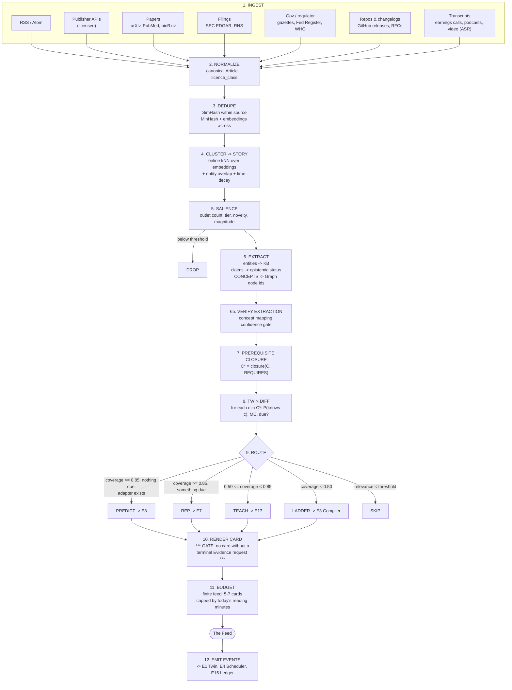
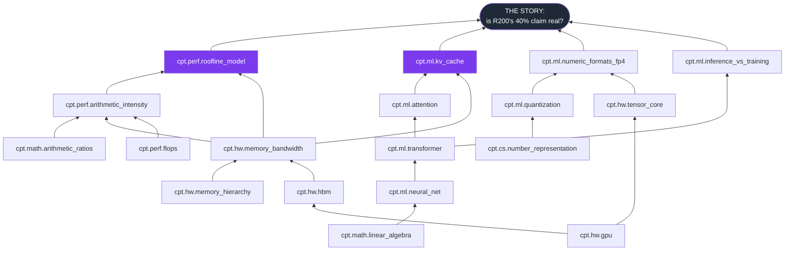

# 14 — The News Engine

**Engine:** `E9 — News Engine`
**Invention:** `I-7 — News-as-Curriculum`
**Supporting Inventions:** `I-1 Twin` · `I-2 PoM` · `I-3 Reality Loop` · `I-4 Compiler` · `I-10 Mastery-per-Minute`

---

## 1. The thesis

> **Your feed is a revision schedule wearing a news app's clothes.**

Every news app on earth is optimized for one thing: **that you keep scrolling.** The ranking function is `P(click)`. The feed is infinite because a bottom would end the session, and ending the session is the one thing the business model cannot tolerate.

PRAXIS inverts every part of that.

| Every feed | The PRAXIS feed |
|---|---|
| Ranked by `P(click)` | Ranked by **expected Mastery gained per minute** (I-10) |
| Infinite scroll | **Finite. It has a bottom.** Typically 5–7 cards. |
| Pull to refresh for more | There is no more. *"You're done. Come back tomorrow."* |
| Optimizes time-on-app | **Optimizes you leaving.** Time-on-app is not a tracked metric. |
| An article ends in "related stories" | **An article ends in a question or a prediction.** Always. Without exception. |
| Reading = consumption | Reading = a **retrieval rep**, a **lesson**, or a **Reality Loop** |
| Personalized by what you clicked | Personalized by **what your Twin knows** — a live model of your mind |

**The mechanism, in one line:** every story is decomposed into concept nodes, those concepts are closed over the prerequisite DAG, the closure is diffed against the Twin, and the story is **routed** to one of five outcomes.

```
TEACH   — you have the prerequisites. Here is the lesson, and this story is the worked example.
LADDER  — you don't. Here are the 3 rungs that get you there, and then the story pays off.
REP     — you already hold these concepts and one is due. This story is your retrieval rep.
PREDICT — you hold all of it. Now put a number on it. → hands off to E8 (I-3).
SKIP    — this is not on your path. It is not shown. You will never know it existed.
```

**Genuinely novel:** the Twin diff and the prerequisite closure — the feed *knows what you can't yet understand* and refuses to waste your minutes pretending you can. **Table stakes:** ingestion, dedupe, clustering, NER.

---

## 2. The pipeline



---

## 3. Stage by stage

### 3.1 Ingest

| Source class | Examples | Cadence | Licence class | Trust prior (E10) |
|---|---|---|---|---|
| **Primary / official** | SEC EDGAR, Federal Register, official gazettes, central-bank releases, statistical agencies, WHO/EMA/FDA | 1–15 min poll / webhook | `PUBLIC_RECORD` | 0.95 |
| **Peer-reviewed** | arXiv, PubMed, bioRxiv, conference proceedings | 1 h | `OPEN` or `METADATA_ONLY` | 0.85 (pre-print: 0.60) |
| **Vendor / project primary** | GitHub releases, RFCs, standards bodies, official product docs & changelogs, engineering blogs | 15 min | `OPEN` / `LINK_ONLY` | 0.80 (COI-flagged when self-referential) |
| **Licensed news** | Wire services and publishers under contract | 1–5 min | `FULL_TEXT_LICENSED` | 0.70–0.90 by outlet |
| **Unlicensed news** | Everything else with a public RSS | 5–15 min | **`METADATA_ONLY` / `LINK_ONLY`** | 0.40–0.75 |
| **Transcripts** | Earnings calls, podcasts (ASR), video (ASR) | on publish | varies | 0.60 (+ASR error flag) |
| **Community** | HN, Stack Overflow, subject forums | 30 min | `LINK_ONLY` | 0.25 — **never a sole source for a FACT** |

**The licence class is carried on every chunk, forever**, and it governs what the renderer may do with it (Doc 15 §8). An article we may only **link to** can still be *clustered*, *counted as corroboration*, and used to *detect the story* — it simply cannot have its text reproduced in a card. **Detection is not reproduction.**

### 3.2 Dedupe

| Level | Technique | Threshold |
|---|---|---|
| Exact / near-exact (same article, syndicated) | SimHash (64-bit) over shingles | Hamming ≤ 3 |
| Same story, different wording (wire pickup) | MinHash LSH over 5-shingles | Jaccard ≥ 0.6 |
| Same story, independently written | Embedding cosine + entity-set overlap + time window | `0.55·cos + 0.45·jaccard(entities) ≥ 0.72`, within 72 h |

**Critical subtlety — the ownership graph.** Forty outlets running the same wire copy is **one source, not forty**. Corroboration (§5) is computed over **distinct owners**, resolved through a maintained media-ownership graph. Without this, echo looks like consensus, and the entire trust model collapses. This is the single most-skipped step in every news-aggregation product, and it is why they all mistake volume for truth.

### 3.3 Cluster → Story

Online, streaming clustering:

```
for each incoming Article a:
    candidates = ANN(embed(a), index, k=50, time_window=72h)
    best = argmax_s  sim(a, centroid(s)) · decay(now − s.last_seen)
    if sim(a, best) ≥ τ_join (0.72):   join(a, best);  update centroid (EWMA)
    else:                              new Story(a)

decay(Δt) = exp(−ln2 · Δt / half_life)      half_life = 36 h (news), 30 d (papers/filings)
```

A **Story** is the unit of everything downstream:

```json
{
  "story_id": "sty_01HQ9",
  "first_seen": "2026-07-08T13:02:00Z",
  "outlets": 14,
  "distinct_owners": 6,
  "tiers_present": ["PRIMARY", "LICENSED_NEWS", "VENDOR", "COMMUNITY"],
  "centroid": "<vec1536>",
  "canonical_title": "NVIDIA launches Rubin R200 data-center GPU",
  "salience": 0.91,
  "stance_distribution": { "SUPPORTS": 11, "ADDS": 2, "DISPUTES": 1, "SPECULATES": 5 },
  "primary_anchor": "https://nvidianews.nvidia.com/news/... (VENDOR, COI: self)"
}
```

### 3.4 Salience — what is even worth a learner's minute?

```
Salience(S) = w1·log(1 + distinct_owners)          breadth of independent coverage
            + w2·max_tier_weight(S)                did a PRIMARY source say it?
            + w3·Novelty(S | corpus_30d)           is this new, or the 40th take?
            + w4·Magnitude(S)                      numeric magnitude of the change claimed
            − w5·ClickbaitScore(S)                 affect-loaded, low-concept-density
            − w6·Recurrence(S)                     this story runs every quarter
```

`ClickbaitScore` is a **penalty**, not a feature. That single sign flip is the entire difference between PRAXIS's feed and everyone else's.

**Below `salience_threshold` → DROP, before we spend a single token on extraction.** ~95% of the ingest volume dies here. That is the intent.

### 3.5 Extract — entities, claims, CONCEPTS

Three extractions, three different jobs:

| Extraction | Output | Method | Gate |
|---|---|---|---|
| **Entities** | linked KB ids (companies, people, products, laws, tickers, genes) | NER + entity linking against a maintained KB | linking confidence ≥ 0.8 or `UNLINKED` |
| **Claims** | atomic, checkable propositions + epistemic status | LLM extraction → E10 status classifier (`FACT`/`CONSENSUS`/`CONTESTED`/`OPINION`, see Doc 15 §5) | every claim must carry ≥1 source span |
| **Concepts** ← **the one that matters** | **Graph node ids** (E2) | LLM candidate extraction → embedding match into the Graph → **verification pass** (does this node's definition actually apply here?) | mapping confidence ≥ 0.65, else `UNMAPPED_CANDIDATE` → queued for Graph review |

**Concept extraction is not keyword extraction.** "NVIDIA launches new GPU" contains the *word* GPU. It **invokes** memory bandwidth, arithmetic intensity, and the roofline model — none of which appear in the text. The extractor's job is to name **what you would have to understand in order to understand this story**, which is a fundamentally different and much harder task than tagging.

`UNMAPPED_CANDIDATE` concepts are a **feature**: they are how the Graph learns that the world has invented something new (E2 review queue). The world produces new concepts faster than any curriculum author can. The news is our concept-discovery firehose.

### 3.6 Prerequisite closure

```
C   = extracted concepts                                    (what the story invokes)
C*  = C ∪ { c' : c' —REQUIRES*→ c, c ∈ C }                  (transitive prereq closure over the DAG)
```

Then **prune the closure** by what the Twin already holds, so we don't drag the learner back to arithmetic:

```
C*_open = { c ∈ C* : P(knows c) < θ_hold }                  θ_hold = 0.75
depth   = longest REQUIRES-path within C*_open              (how many rungs from here to there)
```

### 3.7 Twin diff

For each `c ∈ C*`, ask E1:

| Bucket | Condition | Meaning |
|---|---|---|
| `HELD` | `MC(c) ≥ 0.75` and not due | You've got it |
| `DUE` | `MC(c) ≥ 0.75` but retrievability below threshold (E7/FSRS) | You've got it and it's **fading** — this story is a free rep |
| `READY` | `MC(c) < 0.75`, **all direct prereqs HELD** | You can learn it **right now** |
| `BLOCKED` | `MC(c) < 0.75`, some prereq not HELD | You cannot learn it today. Showing it to you is theatre. |

```
coverage(S) = |{c ∈ C* : HELD or DUE}| / |C*|
blocked(S)  = |{c ∈ C* : BLOCKED}|
```

### 3.8 Route — the exact algorithm

```python
def route(story, twin, objective, plan):
    rel = relevance(story, objective, plan)          # §3.9
    if rel < 0.35 and not civic_minimum(story):
        return SKIP

    cov = coverage(story, twin)
    due = [c for c in story.concepts_star if bucket(c) == DUE]

    if cov >= 0.85:
        if due:
            return REP(concepts=due)                          # I-7: a rep in a news app's clothes
        if adapter_exists(story) and twin.calibration_ready(story.domain):
            return PREDICT(adapter=pick_adapter(story))       # I-3: hand off to E8
        return REP(concepts=sample(held, k=2), light=True)    # keep the retrieval habit alive

    if cov >= 0.50:
        new = [c for c in story.concepts_star if bucket(c) == READY]
        if len(new) <= 3 and est_minutes(new) <= budget_left:
            return TEACH(concepts=new, hook=story)            # the story IS the worked example
        return LADDER(...)

    return LADDER(rungs=shortest_path_to(story.concepts_star, twin), hook=story)
```

**Design notes that matter:**

- **`TEACH` is capped at 3 new concepts.** A story that would require teaching 7 new things is not a lesson; it is a firehose. It becomes a `LADDER`.
- **`LADDER` does not defer the story silently.** It shows the story as a **hook** with the price of admission on it: *"This story is 3 sessions away. Here's the path. Want it?"* Curiosity is the scarcest fuel in learning and the news generates it for free. Wasting it is the sin.
- **`SKIP` is silent.** A skipped story does not appear anywhere. There is no "other stories" section. Doing otherwise would reintroduce the infinite feed through the back door.
- **`civic_minimum`** is a small, explicit allowance (a handful of major public-interest events per week) so the Objective-driven feed does not build an epistemic bubble. It is capped, declared, and switchable off. **We surface this rule in the UI, because a feed that silently decides what you don't need to know has to be honest that it is doing so.**

### 3.9 Relevance

```
relevance(S, Objective) = α · cos( centroid(S), centroid(Objective.concept_set) )
                        + β · graph_proximity(S.concepts, Plan.frontier)
                        + γ · entity_watchlist_hit(S)          # learner's declared interests

graph_proximity = max over (c ∈ S.concepts, f ∈ Plan.frontier) of  1 / (1 + shortest_path(c, f))
```

Graph proximity is what makes this work where embeddings fail. A story about **CoWoS packaging yields** is not textually close to "AI Engineer" — but it is **two hops** from `memory_bandwidth`, which is on the Plan's frontier. Semantic similarity would miss it entirely. **The Graph is the feed's ranking signal.**

### 3.10 The render gate (I-2, enforced in code)

> **A card cannot be published without a terminal Evidence request.**

```
assert card.terminal in {RECALL, APPLY, EXPLAIN, CRITIQUE, PREDICT}
# There is no "Mark as read." There is no "Got it." There is no dismiss-as-complete.
# CANON §0: "There is no 'mark as complete' button in the entire product. It does not exist."
```

The card can be **dismissed** (I'm not interested) — which is an event that trains relevance — but it cannot be marked **learned**. The only path from a card to a Twin update is through **produced evidence**.

### 3.11 Ranking & the budget

```
Score(S) = ExpectedMasteryGain(S, Twin) / EstMinutes(S)     ← this is literally I-10
         × TrustWeight(S)                                    ← from E10
         × RecencyDecay(S)
         − ClickbaitPenalty(S)

ExpectedMasteryGain(S) = Σ_{c ∈ taught(S)}  w(c | Objective) · ΔMC_expected(c)
                       + Σ_{c ∈ rep(S)}     w(c | Objective) · ΔRetrievability(c)
                       + Σ_{c ∈ predict(S)} w(c | Objective) · EIG(c)      # from Doc 13 §6.5

cards_today = clamp( floor(reading_budget_minutes / mean_card_minutes), 3, 7 )
```

The learner's **Reading Budget** (minutes/day) is part of their Contract (I-9). When it is spent, the feed is **over**.

---

## 4. Worked example: "NVIDIA launches new GPU"

### 4.1 The Story

Fourteen articles across six distinct owners over nine hours. Primary anchor: the vendor's own release (COI-flagged). Salience 0.91.

### 4.2 Extracted concept map (real output of stage 6)

```json
{
  "story_id": "sty_01HQ9",
  "canonical_title": "NVIDIA launches Rubin R200 data-center GPU (288GB HBM4, 1.4 PF FP4 dense)",
  "as_of": "2026-07-08T13:02:00Z",
  "entities": [
    { "kb_id": "org.nvidia",        "type": "ORG",     "role": "SUBJECT", "ticker": "NVDA" },
    { "kb_id": "prod.rubin_r200",   "type": "PRODUCT", "role": "SUBJECT", "new": true },
    { "kb_id": "org.tsmc",          "type": "ORG",     "role": "SUPPLIER" },
    { "kb_id": "tech.cowos_l",      "type": "PROCESS", "role": "CONSTRAINT" },
    { "kb_id": "org.amd",           "type": "ORG",     "role": "COMPETITOR" }
  ],
  "claims": [
    { "id": "cl_1", "text": "R200 carries 288GB of HBM4 at 13 TB/s.",
      "status": "FACT", "sources": ["src.nvidia_pr#p3"], "coi": "self_reported", "confidence": 0.93 },
    { "id": "cl_2", "text": "R200 delivers 1.4 PFLOPS dense FP4.",
      "status": "FACT", "sources": ["src.nvidia_pr#p4"], "coi": "self_reported", "confidence": 0.90,
      "note": "Vendor benchmark. Independent measurement not yet available." },
    { "id": "cl_3", "text": "R200 will cut inference cost-per-token by ~40% vs Blackwell.",
      "status": "CONTESTED", "confidence": 0.42,
      "supporting": ["src.nvidia_pr#p7"],
      "disputing":  ["src.semianalysis#p11 (argues 15-22% at realistic batch/context)",
                     "src.chipsandcheese#p4 (bandwidth-bound at long context; FP4 gains don't transfer)"],
      "crux": "Whether production workloads are compute-bound or bandwidth-bound at target context lengths.",
      "resolvable_by": "MLPerf Inference v6.1 results (expected ~2026-09)" },
    { "id": "cl_4", "text": "CoWoS-L packaging capacity is the binding constraint on 2027 volume.",
      "status": "CONSENSUS", "confidence": 0.78,
      "sources": ["src.reuters#p2", "src.digitimes#p1", "src.tsmc_earnings_call#q14"] },
    { "id": "cl_5", "text": "This cements NVIDIA's dominance for another cycle.",
      "status": "OPINION", "confidence": null, "sources": ["src.outlet_c#p1"] }
  ],
  "concepts": [
    { "id": "cpt.hw.gpu",                  "salience": 0.95, "surface": "explicit",  "map_conf": 0.99 },
    { "id": "cpt.hw.hbm",                  "salience": 0.92, "surface": "explicit",  "map_conf": 0.97 },
    { "id": "cpt.hw.memory_bandwidth",     "salience": 0.94, "surface": "IMPLICIT",  "map_conf": 0.91 },
    { "id": "cpt.hw.tensor_core",          "salience": 0.71, "surface": "implicit",  "map_conf": 0.88 },
    { "id": "cpt.sw.cuda",                 "salience": 0.66, "surface": "explicit",  "map_conf": 0.95 },
    { "id": "cpt.ml.transformer",          "salience": 0.80, "surface": "implicit",  "map_conf": 0.93 },
    { "id": "cpt.ml.attention",            "salience": 0.72, "surface": "implicit",  "map_conf": 0.89 },
    { "id": "cpt.ml.inference_vs_training","salience": 0.88, "surface": "explicit",  "map_conf": 0.94 },
    { "id": "cpt.ml.kv_cache",             "salience": 0.85, "surface": "IMPLICIT",  "map_conf": 0.86,
      "why": "cl_3's dispute is entirely about KV-cache-driven bandwidth pressure at long context." },
    { "id": "cpt.ml.quantization",         "salience": 0.83, "surface": "explicit",  "map_conf": 0.92 },
    { "id": "cpt.ml.numeric_formats_fp4",  "salience": 0.79, "surface": "explicit",  "map_conf": 0.90 },
    { "id": "cpt.perf.flops",              "salience": 0.84, "surface": "explicit",  "map_conf": 0.96 },
    { "id": "cpt.perf.arithmetic_intensity","salience": 0.90,"surface": "IMPLICIT",  "map_conf": 0.87 },
    { "id": "cpt.perf.roofline_model",     "salience": 0.89, "surface": "IMPLICIT",  "map_conf": 0.85,
      "why": "The entire compute-bound-vs-bandwidth-bound dispute in cl_3 IS the roofline model." },
    { "id": "cpt.hw.cowos_packaging",      "salience": 0.68, "surface": "explicit",  "map_conf": 0.83 },
    { "id": "cpt.biz.supply_constraint",   "salience": 0.70, "surface": "implicit",  "map_conf": 0.81 },
    { "id": "cpt.biz.segment_reporting",   "salience": 0.55, "surface": "implicit",  "map_conf": 0.76 },
    { "id": "cpt.biz.tco_perf_per_watt",   "salience": 0.74, "surface": "implicit",  "map_conf": 0.84 }
  ],
  "unmapped_candidates": [
    { "surface": "HBM4", "nearest": "cpt.hw.hbm", "sim": 0.79,
      "action": "PROPOSE_CHILD_NODE -> E2 review queue" }
  ]
}
```

**Look at the `IMPLICIT` entries.** `memory_bandwidth`, `kv_cache`, `arithmetic_intensity`, `roofline_model` — **none of these words appear in a single one of the fourteen articles.** They are the concepts *without which the story is noise*. A keyword tagger returns "GPU, NVIDIA, AI." The Graph returns **the roofline model**, and that is the difference between a news app and a Mastery OS.

### 4.3 Prerequisite closure



**`C*` = 18 concepts.** Now diff it against three different minds.

---

### 4.4 Priya — beginner (CS undergrad, week 3, Objective: AI Engineer) → **LADDER**

| Concept | `P(knows)` | Bucket |
|---|---|---|
| `math.linear_algebra` | 0.71 | READY |
| `hw.gpu` | 0.44 | READY |
| `hw.memory_hierarchy` | 0.52 | READY |
| `ml.neural_net` | 0.38 | READY |
| `hw.hbm`, `hw.memory_bandwidth` | 0.09, 0.06 | BLOCKED |
| `ml.transformer`, `ml.attention`, `ml.kv_cache` | 0.05, 0.02, 0.01 | BLOCKED |
| `perf.arithmetic_intensity`, `perf.roofline_model` | 0.02, 0.01 | BLOCKED |
| `ml.quantization`, `ml.numeric_formats_fp4` | 0.03, 0.01 | BLOCKED |
| … 6 more | < 0.15 | BLOCKED |

```
coverage = 0 / 18 = 0.00      blocked = 14      depth = 5
→ LADDER
```

**Her card:**

> ### The whole industry is arguing about one number today.
> NVIDIA says its new chip cuts AI inference cost by 40%. Two respected analysts say 15–22%. **They are not arguing about the chip. They are arguing about whether the chip's memory can keep its math units fed** — and there is a single idea, from 1980s supercomputing, that settles it.
>
> **You are 4 sessions from being able to referee this argument yourself.**
>
> | Rung | Concept | Est. | Why it's needed |
> |---|---|---|---|
> | 1 | Memory hierarchy & bandwidth | 12 min | The chip's math is useless if data can't reach it |
> | 2 | FLOPs and what they don't measure | 8 min | The 1.4 PFLOPS headline number |
> | 3 | Arithmetic intensity | 14 min | FLOPs *per byte moved* — the actual currency |
> | 4 | **The roofline model** | 15 min | The referee. This is the thing that settles the argument. |
>
> **[ Add this ladder to my plan ]** → recompiles the Plan (I-4). It doesn't create a side-quest — it **reorders the build**, because these 4 concepts were already on her path to AI Engineer; the news just proved *why*.
>
> *Right now, in 60 seconds:* **Q: A chip doubles its math speed but keeps the same memory speed. Name one workload that gets exactly 0% faster.** *(terminal Evidence: APPLY — the card cannot close without her answering)*

**That last line is the whole invention.** A beginner, on day 3, is asked a real question about a real event and can actually answer it — and she now *wants* the roofline model, which is the hardest thing to manufacture in education.

---

### 4.5 Dev — intermediate (ML engineer, 4 yrs, Objective: LLM Inference Infra) → **TEACH**

| Concept | `P(knows)` | Bucket |
|---|---|---|
| gpu, cuda, transformer, attention, inference_vs_training, flops, tensor_core, quantization, neural_net, linear_algebra, memory_hierarchy, memory_bandwidth | 0.81 – 0.96 | **HELD** (12) |
| `ml.kv_cache` | 0.72 | **DUE** (retrievability 0.58, last rep 31d) |
| `perf.arithmetic_intensity` | 0.68 | READY |
| `perf.roofline_model` | 0.41 | **READY** (prereqs held) |
| `ml.numeric_formats_fp4` | 0.22 | **READY** |
| `hw.cowos_packaging` | 0.05 | BLOCKED (not on his Plan → dropped from C*, not laddered) |
| `biz.segment_reporting` | 0.10 | BLOCKED (off-Objective → dropped) |

```
coverage = 13 / 16 (after off-Objective pruning) = 0.81      → TEACH
new concepts = [roofline_model, numeric_formats_fp4]  (2 ≤ 3 ✓)
plus a free REP on kv_cache (it's DUE, and the story is *about* it)
```

**His card — a 10-minute lesson (E17) whose hook is the news itself:**

| Stage | Min | Content |
|---|---|---|
| **HOOK** | 1 | *"NVIDIA claims 40% cheaper inference. SemiAnalysis says 15–22%. **You have the knowledge to determine who's right.** Let's do it."* |
| **REP** (kv_cache, due) | 1 | *"Before we start — no looking: at 128k context, batch 32, 70B model, roughly how many GB is the KV cache, and what does that do to your bytes-moved per token?"* → **retrieval rep, scored, feeds E7** |
| **CONTRAST** | 2 | FP4 quadruples peak FLOPS. HBM4 raises bandwidth 1.6×. **These are not the same multiplier.** What happens when they aren't? |
| **WORKED EXAMPLE** | 3 | Build the roofline for R200 from the *actual announced numbers* (13 TB/s, 1.4 PF FP4 → ridge point ≈ 108 FLOP/byte). Plot decode-phase attention (arithmetic intensity ≈ 2–8 FLOP/byte at batch 32). **It lands far to the left of the ridge. It is bandwidth-bound. The FP4 gains cannot transfer.** |
| **GENERATION TASK** | 3 | *"Compute the ridge point yourself for batch 1 and batch 256. At what batch size does decode become compute-bound? Show your work."* (I-5: **he** produces it) |
| **VERIFICATION GATE** | 1 | Novel APPLY item + a CRITIQUE: *"Here's a wrong analysis claiming FP4 solves it. Find the error."* → **Evidence → Ledger.** No gate, no close. |

**Terminal:** a `PREDICT`-lite, because he's not yet calibrated enough for a full Loop:

> *"MLPerf Inference v6.1 publishes in ~September. **What cost-per-token reduction will independent measurement show?** Give a point estimate and an 80% interval."* → this **opens a Reality Loop** (Doc 13, adapter `A7`-class) that resolves in ~8 weeks against the published MLPerf result.

**He just read the news for 10 minutes and walked out with:** 2 new concepts evidenced, 1 due concept repped, 1 misconception probe, and **an open, timestamped, falsifiable commitment about the real world.**

---

### 4.6 Ana — expert (equity analyst, Objective: AI Equity Analyst) → **PREDICT**

```
coverage = 17 / 18 = 0.94      due = []      adapter = business.filing.metric ✓
calibration_ready(business) = true  (ECE 0.041, n=34)
→ PREDICT  → hand off to E8
```

Her card is not a lesson. It is **an exam that reality will grade.**

> ### NVIDIA launched R200 today. Put a number on it.
> **Snapshot sealed:** 2026-07-08T13:02Z · `sha256:4a17…c0e1` · you are seeing prior 12 filings, the last call transcript, guidance, TSMC's capacity commentary, and the 14-outlet cluster. **You are not seeing anything published after this timestamp.**
>
> 1. **NVDA Data Center revenue, FY-Q4 (reports ~2027-02-18):** point estimate ($B) + **80% interval**
> 2. `P(beats company guidance midpoint)` = ____
> 3. The contested claim: `P(MLPerf v6.1 shows ≥ 30% cost/token reduction vs Blackwell)` = ____
> 4. **Name the single variable your forecast is most sensitive to.** *(process rubric — Doc 13 §4.6)*
>
> **Baselines you are being scored against:** naive trend · **analyst consensus** · guidance midpoint.
> **Resolution:** the filed 10-Q, segment table. **Scoring:** CRPS + Winkler interval score + Brier.
> **This is a forecasting exercise. Not investment advice. Simulated only.**
>
> **[ COMMIT — write-once, signed, timestamped. There is no edit. ]**

**This is the join.** The News Engine (I-7) does not *end* at the news. For an expert, **the news is the raw material of a Reality Loop (I-3)**, and the Ledger entry it produces is the thing an employer will actually pay to verify (I-8).

> **One story. Three minds. A prerequisite ladder, a lesson, and an exam that the world itself will mark.**
> That is News-as-Curriculum.

---

## 5. Bias, trust, and disagreement

### 5.1 The rules

| Rule | Implementation |
|---|---|
| **Never a single-source fact** | A `FACT`-status claim requires a `PRIMARY`/`PEER_REVIEWED` attestation, or ≥2 **distinct-owner** corroborations. Single-source claims render as `REPORTED BY <outlet>`, with the outlet named. |
| **Corroboration is counted over owners, not outlets** | The ownership graph (§3.2). Wire echo is one voice. |
| **Stance is shown, not resolved** | Each article's stance toward the Story's claim set: `SUPPORTS` / `DISPUTES` / `ADDS` / `SPECULATES`. Rendered as a strip on the card. |
| **Political lean is declared, never inferred by us** | We attach **published, third-party media-bias ratings** and say whose rating it is. **We do not build our own political classifier** — that would make PRAXIS a referee of politics, which is a role we refuse. |
| **Fact vs. opinion at sentence granularity** | Every extracted claim carries `FACT` / `CONSENSUS` / `CONTESTED` / `OPINION` (Doc 15 §5). `OPINION` sentences are **visually distinct** in the card and **can never be the basis of a lesson claim**. |
| **Disagreement is SURFACED, never averaged** | See §5.2. This is the anti-Wikipedia design decision. |
| **Trust weights, it never silences** | A low-trust source can still be cited **when it is the subject** — NVIDIA's own claim about its own chip is *primary evidence of what NVIDIA claimed* and is labelled `COI: self_reported`. |
| **COI is on the face of the card** | Vendor announcing their own product; analyst with a position; author funded by the subject. Detected + declared. |

### 5.2 The "Sources disagree" panel

When a claim is `CONTESTED`, the card **renders the disagreement** with both sides, their trust, and — the part nobody does — **the crux**:

```json
{
  "claim": "R200 cuts inference cost-per-token by ~40% vs Blackwell.",
  "status": "CONTESTED",
  "sides": [
    { "position": "~40%", "sources": ["NVIDIA PR"], "trust": 0.62,
      "coi": "SELF_REPORTED", "basis": "vendor benchmark, undisclosed batch/context" },
    { "position": "15-22%", "sources": ["SemiAnalysis", "Chips and Cheese"], "trust": 0.81,
      "coi": "NONE_DECLARED", "basis": "modelled at production batch sizes and 128k context" }
  ],
  "crux": "Is production decode compute-bound or bandwidth-bound at the target context length?",
  "what_would_settle_it": "MLPerf Inference v6.1 (independent, standardized, ~2026-09).",
  "praxis_position": "WE DO NOT KNOW. Here is the concept that lets you decide: cpt.perf.roofline_model.",
  "spawns": { "reality_loop": "resolvable 2026-09", "critique_item": "cpt.perf.roofline_model" }
}
```

**Three things happen here that happen nowhere else:**

1. **PRAXIS says "we do not know."** Explicitly. As a first-class rendering state. (Doc 15 §7.)
2. The disagreement is **converted into pedagogy** — the crux *is* a concept, and that concept becomes a lesson or a CRITIQUE item.
3. The disagreement is **converted into a Reality Loop** — because it will *resolve*, and when it does, **both sides get a Brier score** (Doc 13 §12.3, Doc 15 §4). **Pundits accumulate track records in PRAXIS.** Over a year, a source's "Track Record" trust term stops being a reputation and becomes a **measurement**.

> That last point is the quiet bomb in this document. **The News Engine and the Reality Loop, together, can score the press.** Nobody else has both halves.

### 5.3 Anti-doomscroll — an explicit, enforced design contract

| We do | We refuse |
|---|---|
| A **finite feed with a bottom** (3–7 cards) | Infinite scroll. Pull-to-refresh-for-more. |
| A **daily reading budget in minutes**, from the learner's Contract (I-9) | Any mechanism that extends a session |
| Rank by **expected mastery per minute** (I-10) | Rank by `P(click)`, dwell, or engagement |
| **Demote** high-arousal, low-concept-density stories (`ClickbaitScore` is a *penalty*) | Promoting outrage because it performs |
| **Cards expire.** News decays; unread cards vanish at 72 h | A guilt-inducing unread pile |
| Concepts **outlive the card**: an expiring card's concepts persist as reps in the Scheduler | Losing the learning value along with the story |
| **"You're done. Come back tomorrow."** — a real end state, with a real screen | Never showing an end |
| Push notification **only** for opted-in watchlist entities, hard-capped, batched | Breaking-news pushes |
| Weekly digest of **what we skipped and why**, on request | Silent, unaccountable filtering |

**Metrics we explicitly refuse to instrument, in the code, in the analytics schema (E15):**

```
❌ session_length          ❌ scroll_depth        ❌ dau_from_feed
❌ cards_per_session       ❌ time_on_card (as a goal)
❌ any feed A/B test whose success metric is engagement

✅ mastery_gain_per_reading_minute      ← the only feed metric that exists
✅ evidence_produced_per_card
✅ rep_completion_rate
✅ ladder_adoption_rate (did the news successfully create demand for a prerequisite?)
✅ prediction_conversion_rate (did the news become a Reality Loop?)
```

Per CANON §1/I-10: **we optimize for the learner leaving.** A feed that a learner finishes in 9 minutes and closes is a *successful* feed. If mastery-per-reading-minute is high and time-on-app is falling, **that is the product working.**

---

## 6. Events, contracts, and cost

### 6.1 Events emitted

| Event | Payload | Consumers |
|---|---|---|
| `StoryClustered` | `story_id, outlets, distinct_owners, salience` | E15 |
| `ConceptsExtracted` | `story_id, concepts[], unmapped_candidates[]` | **E2 (Graph review queue)** |
| `StoryRouted` | `learner_id, story_id, route, concepts[]` | E4, E15 |
| `CardServed` | `learner_id, card_id, route, est_minutes` | E4, E15 |
| `CardEvidenceProduced` | `learner_id, card_id, evidence{type, concept, score}` | **E1**, E16 |
| `LadderAdopted` | `learner_id, story_id, rungs[]` | **E3 (recompile the Plan)** |
| `StoryToLoop` | `learner_id, story_id, adapter, claim` | **E8** |
| `CardDismissed` | `learner_id, story_id, reason` | E9 relevance model |
| `ContestedClaimDetected` | `claim_id, sides[], crux, resolvable_by` | **E8, E10, E17** |

### 6.2 Latency budget

| Stage | Target (p95) | Notes |
|---|---|---|
| Ingest → normalized | 60 s | Webhooks where available |
| Dedupe + cluster | 15 s | Streaming; incremental |
| Salience gate | 2 s | **Kills ~95% of volume before any LLM touches it** — this is the cost model |
| Extract (entities/claims/concepts) | 25 s | Fast model (Sonnet/Haiku-class) + embedding match; Opus-class only for `CONTESTED` adjudication |
| Closure + Twin diff + route | 400 ms | Per learner. Redis-cached Twin. Fan-out. |
| Render card | 3 s (cached: 80 ms) | Lesson bodies cached per (story, twin-bucket) — see Doc 15 §9 |
| **Story published → in a learner's feed** | **< 3 min** | |

### 6.3 Cost

| Item | Cost |
|---|---|
| Ingest + dedupe + cluster (per story) | ~$0.0002 |
| Extraction (per **surviving** story) | ~$0.012 |
| Route + diff (per learner-story) | ~$0.00005 |
| Card render (per twin-bucket, **cached & shared**) | ~$0.03 → amortized **~$0.004/learner** at typical bucket sharing |
| **Per learner-day (6 cards)** | **≈ $0.03** |

The salience gate and the twin-bucket cache are what make a fully-synthesized, fully-personalized feed cost three cents a day instead of three dollars.

---

## 7. What is genuinely novel here

| Claim | Novel? | Why |
|---|---|---|
| RSS ingest, dedupe, clustering, NER | **No** — table stakes | Every aggregator does it |
| Multi-outlet stance strips | **Barely** — Ground News-class | Exists, but it stops at display |
| **Mapping a story to Graph concept nodes *including the implicit ones*** | **Yes** | Nobody extracts "the roofline model" from a GPU launch. It requires a real concept DAG. |
| **Prerequisite closure + Twin diff to decide teach/ladder/rep/predict** | **Yes — this is the invention** | Requires a cognitive model of the reader. No feed has one. |
| **A finite feed ranked by mastery-per-minute** | **Yes, and commercially insane for anyone else** | It is only rational because we don't sell attention (I-10) |
| **Every card terminates in produced evidence** | **Yes** | The "no mark-as-complete" refusal, applied to news |
| **Contested claims become Reality Loops that score the *sources*** | **Yes — and unique to us** | Requires E8 + E9 + E10 in one system |

---

## 8. Open questions

| # | Question | Lean |
|---|---|---|
| 1 | Does `civic_minimum` make us an editor with a worldview? | Yes, unavoidably — so **publish the rule**, keep the allowance tiny and switchable, and never let it be personalized by engagement. Transparency over false neutrality. |
| 2 | How do we avoid the Twin diff becoming a filter bubble for *facts* (not just topics)? | The route decides **pedagogy**, never **truth**. `CONTESTED` claims render their disagreement identically for every learner regardless of Twin state; only the *depth of explanation* varies. |
| 3 | Concept extraction on breaking, ambiguous stories | Salience gate holds a story until `distinct_owners ≥ 2` or a `PRIMARY` source is present. **We are deliberately, structurally slow on breaking news.** We are not a news app; we are 30 minutes late and correct. |
| 4 | Paywalled primary reporting we cannot reproduce | Cluster it, count it as corroboration, cite and **link** it — never reproduce it (Doc 15 §8). Where the story cannot be taught without the paywalled text, the card says so and links out. |
| 5 | Should the learner be able to inject a story ("teach me this article")? | Yes — same pipeline, `relevance` override, but **the route is still the engine's**. If they're not ready, they get the ladder, not the lesson. The engine does not lie to flatter you. |
```
