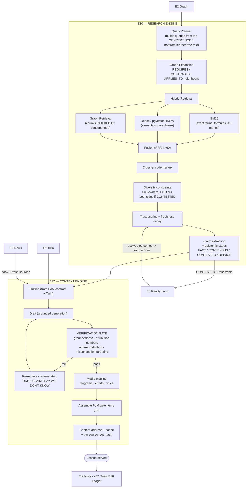
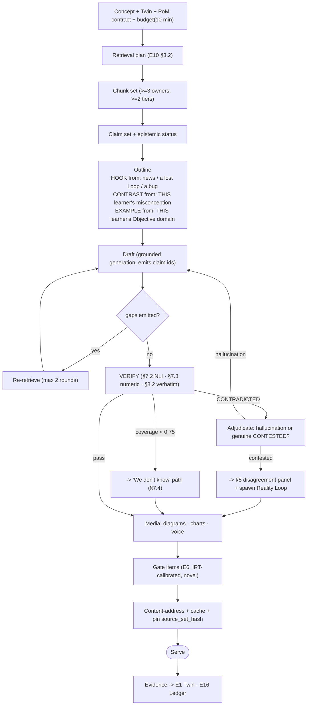

# 15 — The Research Engine & The Content Engine

**Engines:** `E10 — Research Engine` · `E17 — Content Engine`
**Inventions served:** `I-4 Curriculum Compiler` (there is nothing to compile *from* without this) · `I-5 Answer Budget` · `I-7 News-as-Curriculum` · `I-2 PoM`
**Hard dependency of:** every lesson, every item, every debrief, every news card in PRAXIS.

---

## 1. The refusal: PRAXIS has no content catalog

> **There is no course library. There are no videos we own. There is no catalog. Lessons are *synthesized on demand*, grounded in retrieved sources, for one learner, at one moment, against one Twin state.**

This is not a cost-saving hack. It is forced by the Ten Inventions, and the moment you accept I-1 and I-4 you cannot have a catalog:

| Invention | Why it *forbids* a catalog |
|---|---|
| **I-1 Twin** | The right explanation of `kv_cache` for a systems engineer and for an equity analyst are **different artifacts**. A catalog has one. A Twin implies `N` — one per mind. |
| **I-4 Compiler** | The Plan is recompiled nightly. A catalog is a **fixed set of pre-cut paths**; a compiler needs a **generator**, not a shelf. |
| **I-6 Failure-Seeking** | Items must target *this learner's* misconceptions, which did not exist when any author was writing. |
| **I-7 News-as-Curriculum** | The world produces new concepts faster than any author can. A catalog is stale the day it ships. |
| **I-2 PoM** | Six evidence types per concept, per learner, novel each time. Nobody is authoring that by hand. |

### 1.1 The honest consequences

We are not going to pretend this is free. Here is the whole bill.

| Consequence | The problem | What we actually do about it |
|---|---|---|
| **Cost** | Generating beats retrieving-a-file on quality and loses on price. Naively: ~$0.05–0.12 per 10-min lesson vs ~$0 for a cached MP4. | **The Lesson Cache** (§9.5). Cache key = `(concept_version, pom_contract, twin_bucket, source_set_hash, locale, model_version)`. Twin buckets are coarse (~40 per concept), so a cohort **shares** synthesized lessons. Hit rate 65–80% at steady state → **amortized ~$0.02/lesson**. See §1.2. |
| **Quality variance** | A human-authored lesson has a floor. A generated one can be *worse* on a bad day. | Every lesson passes the **verification gate** (§7) before render — groundedness, attribution, numeric check, anti-reproduction. **A lesson that fails is not shipped**; the learner gets the previous cached version or an explicit "we're checking our sources" state. Golden-set evals in CI with regression gates (§7.5). |
| **Freshness** | This is where we *win*. A catalog is stale in 12 months. | Source-change invalidation: when a cited source's chunk hash changes, every lesson depending on it is invalidated. **CUDA docs change → the CUDA lesson regenerates that night.** No catalog can do this. |
| **Licensing** | We don't own the corpus. | Per-chunk `licence_class` carried forever, enforced at **render time** by the anti-reproduction gate (§8). We paraphrase, we cite, we link. We do not reproduce. |
| **Hallucination** | The mortal risk. A confidently wrong lesson is worse than no lesson. | §7, in full: retrieval-grounded generation with **no free-recall path for factual claims**, claim-level NLI verification, exact-match numeric checking, and a **"we don't know" state that is a first-class render outcome, not a failure.** |
| **Attribution / trust** | Learners must be able to check us. | Every assertive sentence carries claim ids → spans → chunks → source URIs. **Uncited assertive sentences are blocked at the gate** (§6). |
| **Reproducibility / audit** | "What exactly were you taught on 2026-03-04?" | Every rendered lesson is content-addressed and pinned to its `source_set_hash` + `model_version`. It is **reconstructible byte-for-byte** and it is in the Ledger. |

### 1.2 The unit economics, stated plainly

| | Authored catalog | PRAXIS synthesis |
|---|---|---|
| Cost to create one hour of instruction | **$5,000 – $50,000** (SME + instructional designer + video + edit) | **~$0.12** uncached |
| Time to create | 6–16 weeks | **~14 seconds** |
| Personalization | 1 version | **~40 twin-buckets × N locales**, on demand |
| Staleness | 12–36 months | **Invalidated the night a source changes** |
| Marginal cost of the 100,000th learner | ~$0 | ~$0.02/lesson (cache) |
| Cost to cover a **new** domain | Another $500k–$5M | **~$0** (add the corpus, the Graph does the rest) |

The break-even is not close. A catalog wins only on the *marginal* replay of a *single* fixed artifact — and a single fixed artifact is precisely the thing PRAXIS refuses to build.

> **The cache is not a catalog.** A catalog is *authored, fixed, and shipped*. The cache is *derived, invalidated, and disposable*. If we deleted the entire cache tonight, PRAXIS would regenerate it by morning, better, from fresher sources. Delete a catalog and the company is gone.

---

## 2. Architecture



**Note the bottom-right edge again.** `E8 → TR`. **The Reality Loop scores our sources.** §4.5.

---

## 3. Retrieval

### 3.1 Corpus tiers

| Tier | Contents | Ingest | Trust prior | Licence class | Refresh |
|---|---|---|---|---|---|
| **T0 — Primary / canonical** | Statutes, court opinions, regulations, standards (ISO/IETF RFC/W3C), SEC filings, central-bank & statistical releases, clinical guidelines, official API/product docs | Full text | **0.95** | `PUBLIC_RECORD` / `OPEN` | 1–24 h |
| **T1 — Peer-reviewed** | Journals, conference proceedings, systematic reviews & meta-analyses | Full text (OA) / abstract+link (paywalled) | **0.85** (meta-analysis 0.92; pre-print **0.60**) | `OPEN` / `METADATA_ONLY` | daily |
| **T2 — Textbooks & reference** | Licensed textbooks, OA textbooks, encyclopaedias, canonical monographs | Full text (licensed) | **0.88** | `LICENSED` / `OPEN` | yearly |
| **T3 — Practitioner primary** | Vendor docs, changelogs, engineering blogs, **code repositories**, RFC discussions, conference talks | Full text | **0.75** (COI-flagged if self-referential) | `OPEN` / `LINK_ONLY` | 15 min – 1 d |
| **T4 — Reputable news** | Wires and established outlets | Licensed: full text. Else: **metadata + link only** | **0.55 – 0.80** by outlet | `FULL_TEXT_LICENSED` / `LINK_ONLY` | 1–5 min |
| **T5 — Video & audio** | Lectures, talks, podcasts — **via transcript** | Transcript + timestamps (ASR flagged) | **0.60** (−0.10 if ASR-only) | `LINK_ONLY` + transcript rights | on publish |
| **T6 — Community** | Stack Overflow, HN, subject forums, GitHub issues | Full text where licence permits | **0.30** | `OPEN` (CC-BY-SA → quote-limited) | hourly |
| **T7 — Learner-generated** | Peer explanations, top-rated Feynman teach-backs | Internal | **0.20** | `OWNED` | live |

**Hard rule:** **T6 and T7 can never be the sole support for a `FACT`.** They are excellent for *intuition, gotchas, and "why does everyone get this wrong"* — and they are exactly where **misconceptions** are mined from (I-6). They are terrible for truth. We use each for what it is good at.

### 3.2 Query planning: retrieve by **concept**, not by text

The single most important architectural choice in E10:

> **The retrieval query is constructed from the Graph node — its canonical name, its aliases, its formal definition, its notation, and its neighbours — not from the learner's words.**

Learner free text ("that memory thing that makes GPUs slow") is a **terrible** query. The concept node `cpt.perf.arithmetic_intensity` is a **perfect** one, because E2 already knows its aliases (`operational intensity`, `FLOP/byte`, `compute-to-memory ratio`), its formal definition, its notation, and — critically — **what it contrasts with**.

```json
{
  "retrieval_plan_for": "cpt.perf.roofline_model",
  "twin_context": { "learner": "dev_9f2", "objective": "obj.llm_inference_infra",
                    "held": ["cpt.hw.memory_bandwidth","cpt.perf.flops","cpt.ml.kv_cache"],
                    "misconceptions": ["msc.perf.flops_are_speed"] },
  "graph_expansion": {
    "self":         ["roofline model", "roofline analysis", "Williams-Waterman-Patterson"],
    "REQUIRES":     ["cpt.perf.arithmetic_intensity", "cpt.hw.memory_bandwidth", "cpt.perf.flops"],
    "CONTRASTS":    ["cpt.perf.amdahls_law", "cpt.perf.peak_flops_fallacy"],
    "APPLIES_TO":   ["cpt.ml.kv_cache", "cpt.ml.inference_vs_training", "cpt.hw.gpu"]
  },
  "queries": [
    { "type": "BM25",  "q": "roofline model arithmetic intensity ridge point memory bound compute bound",
      "filter": { "tier": ["T0","T1","T2"] } },
    { "type": "BM25",  "q": "\"operational intensity\" FLOP/byte roofline ridge",
      "why": "exact-term recall for the formal notation — dense retrieval loses formulas" },
    { "type": "DENSE", "q": "why does a faster processor not speed up a memory-limited workload",
      "filter": { "tier": ["T1","T2","T3"], "freshness_halflife_days": 3650 } },
    { "type": "GRAPH", "concept": "cpt.perf.roofline_model", "hops": 1,
      "why": "chunks indexed directly against this node, incl. its canonical figure" },
    { "type": "DENSE", "q": "LLM decode phase bandwidth bound batch size arithmetic intensity",
      "filter": { "tier": ["T1","T3"], "freshness_halflife_days": 180 },
      "why": "APPLIES_TO the learner's Objective — the worked example must be in HIS domain" },
    { "type": "DENSE", "q": "common misconception FLOPS equals performance peak throughput",
      "filter": { "tier": ["T6"] },
      "why": "targets msc.perf.flops_are_speed — T6 is where misconceptions live (I-6)" }
  ],
  "constraints": {
    "min_distinct_owners": 3, "min_distinct_tiers": 2,
    "must_include_tier": "T0_or_T1_or_T2",
    "if_contested": "retrieve >= 1 source from EACH side",
    "k_per_query": 40, "final_k": 12
  }
}
```

**Six queries, three retrieval modes, and every one of them is justified by the Graph or the Twin.** Note the last query: we go *fishing in Stack Overflow specifically to find how people get this wrong*, because the learner holds `msc.perf.flops_are_speed` and the lesson must **contrast against his actual error**, not a generic one.

### 3.3 Hybrid retrieval & fusion

| Mode | Index | Wins at | Loses at |
|---|---|---|---|
| **BM25** | Postgres FTS / OpenSearch | Exact terms, API names, formulas, statute numbers, tickers, "HBM4" | Paraphrase, "the memory thing" |
| **Dense** | pgvector + HNSW (`m=32, ef_construction=200, ef_search=100`) | Semantics, paraphrase, cross-lingual | **Rare exact tokens** — it will happily return HBM3 chunks for an HBM4 query |
| **Graph** | Apache AGE / Neo4j — chunks are **edges to concept nodes** | *"Give me everything the Graph says is about `roofline_model`"* — precision, and the canonical figure | Novel material not yet linked to a node |

**Fusion — Reciprocal Rank Fusion:**

```
RRF(d) = Σ_r  1 / (k + rank_r(d)),   k = 60
```

RRF over score-normalization because BM25 and cosine scores are not commensurable and every attempt to make them so is a fudge factor that rots.

**Then rerank** (cross-encoder, top-40 → top-12), **then diversify** (MMR, `λ = 0.7`) under the hard constraints in the plan above: **≥3 distinct owners, ≥2 distinct tiers, and if the claim is CONTESTED, at least one source from each side.** A retrieval set that satisfies the relevance objective but violates the diversity constraint is **rejected and re-run with a broadened filter**. Relevance is not permitted to produce an echo chamber.

### 3.4 Chunking

Structural + semantic, never fixed-width:

| Source type | Chunk boundary | Carried metadata |
|---|---|---|
| Paper | section → paragraph; **tables/figures/equations kept whole** | `doi, section, page, char_span, figure_id` |
| Statute / opinion | section / paragraph number | `citation, court, date, jurisdiction, para_no` |
| Filing | XBRL fact + surrounding narrative | `cik, form, period, tag, accession` |
| API doc | symbol / heading | `library, version, symbol, url_fragment` |
| Code repo | function / class + docstring | `repo, path, commit_sha, licence, lineno_span` |
| Transcript | speaker turn / topic segment | `video_id, t_start, t_end, speaker, asr_conf` |

**Every chunk carries `{source_id, tier, owner_id, published_at, licence_class, char_span}` forever.** Citation precision is a *storage* decision, not a prompting decision. If you don't carry the span, you cannot cite the span, and everything downstream becomes a guess.

### 3.5 Freshness — a per-concept half-life

Recency is not universally good. A 1970s paper on linear algebra is *better* than a 2026 blog post about it.

```
freshness_weight(chunk, concept) = exp( −ln2 · age_days / halflife(concept.domain) )
```

| Concept domain | Half-life | Why |
|---|---|---|
| `cuda_api`, `framework_syntax`, `vendor_hardware` | **180 d** | Deprecated in a year |
| `security_advisories`, `market_structure` | **90 d** | |
| `clinical_guidelines`, `tax_law`, `regulation` | **2 y** | Versioned, but slow |
| `ml_methods` | **3 y** | |
| `statistics`, `algorithms`, `microeconomics` | **15 y** | |
| `linear_algebra`, `calculus`, `thermodynamics` | **30 y+** | The chunk from 1978 is fine |

Freshness **weights**, it never **filters** — except for one hard rule: **a source superseded by a versioned successor (a repealed statute, a deprecated API, a retracted paper) is hard-excluded and flagged.** A retracted paper is not a low-weight source. It is a **poison** source, and it is removed with prejudice.

---

## 4. The Source Trust model

### 4.1 The score

```
T(s) = σ(  w_a·Authority(s)
         + w_r·Recency(s)
         + w_c·Corroboration(s)
         + w_t·TrackRecord(s)      ← ★ only PRAXIS can compute this
         − w_i·COI(s)
         − w_p·PropagandaRisk(s) )

σ = logistic.  Weights are per-domain and are themselves fit against resolved outcomes (§4.5).
Default: w_a .25 · w_r .10 · w_c .20 · w_t .30 · w_i .10 · w_p .05
```

### 4.2 The terms

| Term | Computed from | Notes |
|---|---|---|
| **Authority** | Tier prior + domain reputation: journal impact/retraction rate, court level, regulatory standing, repo maintainership & stars-per-contributor, author h-index-in-field | A prior, not a verdict |
| **Recency** | §3.5 freshness, per concept domain | Domain-relative |
| **Corroboration** | Fraction of this source's extracted claims independently supported by ≥2 sources of **equal or higher tier and different owner** | **Owner-deduped** (Doc 14 §3.2). Wire echo is one voice. This is the step everyone skips and it is why everyone mistakes volume for truth. |
| **COI** | Declared (sponsor, funding, disclosure statements) + **detected** (vendor writing about its own product; analyst with a disclosed position; institution reporting on its own study) | **COI never silences.** NVIDIA on NVIDIA is *primary evidence of what NVIDIA claimed* — labelled `SELF_REPORTED`, downweighted as a claim, retained as a fact-about-the-claim. |
| **PropagandaRisk** | State-affiliation registries, coordinated-inauthentic-behaviour signals, network-level astroturf detection | Downweight + label. Not a ban. |
| **TrackRecord** | **§4.5. The one nobody else has.** | |

### 4.3 Trust weights. It never silences.

```
Trust is a WEIGHT on a claim's confidence and on retrieval ranking.
Trust is NEVER a filter that hides a source from the learner.
A cited low-trust source renders WITH ITS TRUST SCORE AND WHY.
```

A learner who cannot see the low-trust source cannot learn to evaluate sources — and evaluating sources is itself a concept in the Graph with its own PoM contract. **Hiding the bad source would delete the lesson.**

### 4.4 Independence: the ownership graph

Corroboration is meaningless without it.

```
independent(s1, s2)  ⟺  owner(s1) ≠ owner(s2)
                     ∧  ¬ syndication_edge(s1, s2)
                     ∧  ¬ shared_primary_source(s1, s2)      ← both just cite the same press release
                     ∧  ¬ shared_funding(s1, s2)
```

That third clause is the killer. **Forty outlets reporting a press release is not forty corroborations. It is one press release, forty times.** We collapse it to one, and we say so on the card.

### 4.5 ★ TrackRecord — the term that only PRAXIS can compute

The Reality Loop (E8, Doc 13) resolves predictions against ground truth. **It does not care whose predictions.**

So: **every source that made a resolvable claim gets a Brier score.**

```
For a source s and its resolved predictive claims i = 1..n_s:
    BS(s)   = (1/n_s) Σ (p_i − o_i)²          (implicit p from hedging language, calibrated per outlet;
                                               explicit p where the source gives one)
    BSS(s)  = 1 − BS(s) / BS_climatology
    K_t(s)  = the always-valid wealth process (Doc 13 §4.4)

TrackRecord(s) = clamp( BSS(s) , −1, +1 ),  shrunk toward 0 by n_s:
                 TR(s) = BSS(s) · n_s / (n_s + n₀),   n₀ = 25   (empirical Bayes shrinkage)
```

**Concretely.** In Doc 14, SemiAnalysis said 15–22% and NVIDIA's PR said ~40%. In September, MLPerf v6.1 publishes. **One of them ate a Brier score.** That number is now part of that source's trust, forever, and it was **measured, not asserted.**

| Source | Domain | `n` | Brier | BSS vs base rate | TrackRecord |
|---|---|---|---|---|---|
| `src.semianalysis` | `hw.perf_claims` | 41 | 0.147 | **+0.31** | **+0.19** |
| `src.nvidia_pr` | `hw.perf_claims` (self) | 12 | 0.308 | −0.18 | −0.06 (shrunk; COI-flagged) |
| `src.analyst_consensus` | `biz.filing_metric` | 210 | 0.171 | +0.22 | +0.20 |
| `src.outlet_c` | `hw.perf_claims` | 8 | 0.401 | −0.42 | −0.10 (shrunk hard: n=8) |

> **This is a moat inside a moat.** Building it requires a resolution corpus. Building a resolution corpus requires E8 and **years of wall-clock time** (Doc 13 §12.3). A competitor can buy a better embedding model tomorrow. They cannot buy the fact that we watched a pundit be wrong 41 times.
>
> **PRAXIS is the only retrieval system in existence whose source ranking is trained on whether the source turned out to be right.**

---

## 5. Epistemic status: FACT / CONSENSUS / CONTESTED / OPINION

Every atomic claim carries one. It drives rendering, it drives what a lesson is *allowed* to assert, and it drives what becomes a Reality Loop.

| Status | Rule | Rendered as | Lesson may… |
|---|---|---|---|
| **FACT** | Directly attestable in ≥1 **T0/T1** primary source, **and** no contradiction from any source of tier ≤ T2 | plain text + citation | assert it |
| **CONSENSUS** | ≥3 **independent** (owner-deduped) T0–T2 sources agree; contradiction rate < 10%; effect direction stable | plain text + *"consensus (n=7 sources)"* | assert it, with the hedge |
| **CONTESTED** | ≥2 independent credible sources **materially** disagree — opposite sign on a causal claim, or numeric divergence beyond the domain tolerance | **the "Sources disagree" panel** (§5.2) — both sides, both trusts, **and the crux** | **never assert it.** Must show the disagreement. |
| **OPINION** | Normative / evaluative / predictive with no attesting primary source | visually distinct; **attributed to the person** | quote it, attributed. **Never state it as the lesson's own voice.** |
| **UNKNOWN** | Retrieval coverage below threshold after N rounds | **"We don't know"** (§7.4) | say so, and stop |

**Material divergence, per domain:**

```
numeric:      |x₁ − x₂| / max(|x₁|,|x₂|)  >  tol(domain)      tol: finance 0.10 · physics 0.02 · epidemiology 0.25
causal:       sign(effect₁) ≠ sign(effect₂),  or  one asserts an effect and the other a null
definitional: the sources are using the same term for different objects  → ALWAYS contested, and the
              lesson's first job becomes disambiguating the term (this is a huge, under-served class of confusion)
```

### 5.1 Disagreement is surfaced, never averaged

> **Averaging two disagreeing sources produces a number that nobody believes and that is not true.**
> It is the single most common failure of AI answers and it destroys the learner's ability to think.

When sources disagree, PRAXIS does **not** produce a consensus sentence. It produces a **structured disagreement**, and then it does three things nobody else does:

1. **Names the crux** — the one empirical question on which the disagreement turns.
2. **Turns the crux into pedagogy** — the crux is a concept; that concept becomes the lesson, or a `CRITIQUE` item (I-2).
3. **Turns the disagreement into a Reality Loop** if it will resolve (I-3) — and when it resolves, **both sides get scored** (§4.5).

```json
{
  "claim_id": "cl_3",
  "text": "R200 cuts inference cost-per-token ~40% vs Blackwell.",
  "status": "CONTESTED",
  "confidence": 0.42,
  "sides": [
    { "position": "~40%", "sources": [{"id":"src.nvidia_pr","trust":0.62,"coi":"SELF_REPORTED"}],
      "basis": "vendor benchmark; batch size and context length not disclosed" },
    { "position": "15-22%", "sources": [{"id":"src.semianalysis","trust":0.81,"track_record":"+0.19"},
                                        {"id":"src.chipsandcheese","trust":0.74}],
      "basis": "modelled at production batch sizes, 128k context" }
  ],
  "crux": {
    "question": "Is production decode compute-bound or bandwidth-bound at target context length?",
    "concept": "cpt.perf.roofline_model",
    "why_it_settles_it": "FP4's 4x peak FLOPS only transfers if the workload sits RIGHT of the ridge point."
  },
  "resolution": { "resolvable": true, "by": "MLPerf Inference v6.1", "eta": "2026-09", "adapter": "swe.benchmark.forecast" },
  "praxis_position": "WE DO NOT KNOW. We will in September, and so will you — because you're about to predict it.",
  "spawns": ["lesson:cpt.perf.roofline_model", "critique_item:cl_3", "reality_loop:mlperf_v61"]
}
```

---

## 6. Citations: the claim → evidence structure

**Every assertive sentence in every generated lesson is traceable to a span in a source.** Not to a document. To a **span**.

```json
{
  "lesson_id": "lsn_01HQA7",
  "concept": "cpt.perf.roofline_model",
  "source_set_hash": "sha256:b1c9…44af",
  "sentences": [
    { "sid": "s7",
      "text": "R200's ridge point sits at roughly 108 FLOP per byte.",
      "class": "ASSERTIVE_DERIVED",
      "claims": ["cl_r200_flops", "cl_r200_bw"],
      "derivation": { "op": "divide", "expr": "1.4e15 FLOP/s ÷ 13e12 B/s = 107.7 FLOP/byte",
                      "checked_by": "numeric_verifier", "status": "PASS" } },

    { "sid": "s8",
      "text": "Decode-phase attention at batch 32 runs at 2-8 FLOP per byte.",
      "class": "ASSERTIVE_CITED",
      "claims": ["cl_decode_ai"] },

    { "sid": "s9",
      "text": "Think of it as a kitchen: doubling your chefs doesn't help if the door is the bottleneck.",
      "class": "RHETORICAL",
      "claims": [],
      "note": "Makes no world-claim. Permitted uncited. Flagged as scaffolding, not evidence." }
  ],
  "claims": {
    "cl_r200_flops": {
      "text": "R200 delivers 1.4 PFLOPS dense FP4.",
      "status": "FACT", "confidence": 0.90, "coi": "SELF_REPORTED",
      "evidence": [
        { "chunk_id": "chk_9f21", "source_id": "src.nvidia_pr", "tier": "T3", "owner": "own.nvidia",
          "trust": 0.62, "published_at": "2026-07-08",
          "url": "https://nvidianews.nvidia.com/...#specs",
          "span": { "start": 1204, "end": 1288 },
          "quote": "…delivers 1.4 petaflops of dense FP4 compute…",
          "entailment": { "model": "nli-v3", "label": "ENTAILED", "score": 0.97 } }
      ] },
    "cl_decode_ai": {
      "text": "Autoregressive decode is bandwidth-bound at typical batch sizes.",
      "status": "CONSENSUS", "confidence": 0.88,
      "evidence": [
        { "chunk_id": "chk_2c04", "source_id": "src.pope2022_efficient_transformers", "tier": "T1",
          "owner": "own.arxiv", "trust": 0.87, "span": {"start": 8801, "end": 8990},
          "entailment": { "label": "ENTAILED", "score": 0.93 } },
        { "chunk_id": "chk_7b1e", "source_id": "src.vllm_docs", "tier": "T3", "owner": "own.vllm",
          "trust": 0.79, "entailment": { "label": "ENTAILED", "score": 0.91 } },
        { "chunk_id": "chk_a330", "source_id": "src.chipsandcheese", "tier": "T3", "owner": "own.candc",
          "trust": 0.74, "entailment": { "label": "PARTIAL", "score": 0.68 } }
      ],
      "independent_owners": 3 }
  }
}
```

### 6.1 The sentence classes — and the gate

| Class | Definition | Citation required? |
|---|---|---|
| `ASSERTIVE_CITED` | Makes a claim about the world | **YES — hard gate** |
| `ASSERTIVE_DERIVED` | Computed from cited claims | **YES — cited claims + a verified derivation** |
| `RHETORICAL` | Analogy, framing, transition, question. **Makes no world-claim.** | No — but it is **classified and flagged**, and the classifier is itself evaluated |
| `SOCRATIC` | A question to the learner (I-5) | No |
| `QUOTED_OPINION` | Someone's opinion, attributed | Attribution required; **never in the lesson's own voice** |

> **An `ASSERTIVE_*` sentence with zero claims does not ship.** The gate drops it, and if dropping it breaks the lesson, the lesson goes back for re-retrieval. This is the single most important rule in E17.

---

## 7. Hallucination defense

Five layers. Each one alone is insufficient; together they are the reason a learner can trust a machine-written lesson.

### 7.1 Layer 1 — Grounded generation, with no free-recall path

The generator's context contains **only**: the retrieved chunks, the Graph's formal definitions, the Twin's state, and the PoM contract. The system prompt is explicit and the architecture enforces it:

```
You may assert ONLY what is supported by the CHUNKS provided. You have no other knowledge.
Every assertive sentence must emit the claim ids it rests on.
If the chunks do not support a claim the lesson needs, you MUST emit:
    {"gap": "<the claim you need>", "why": "<why the lesson requires it>"}
and STOP. Do not fill the gap from memory. Filling a gap from memory is the only unforgivable act.
Analogies, questions, and framing are permitted uncited — tag them RHETORICAL.
```

A `gap` is **not a failure**. It triggers **re-retrieval** with a query built from the gap text. If two rounds of re-retrieval still can't fill it, the pipeline takes the **"we don't know" path** (§7.4).

### 7.2 Layer 2 — Claim-level verification (the real defense)

The draft is decomposed into **atomic claims**, and each is checked **against its own cited spans** — not against the model's memory:

| Label | Meaning | Action |
|---|---|---|
| `ENTAILED` (NLI ≥ 0.85) | The span says this | ✅ ship |
| `PARTIAL` (0.60–0.85) | The span half-says it; the sentence overreaches | **Rewrite the sentence to match the span**, or find a better span |
| `UNSUPPORTED` (< 0.60) | The span does not say this | **Re-retrieve. If still unsupported → DROP the claim.** |
| `CONTRADICTED` | The span says the *opposite* | **Escalate.** Either the model hallucinated, or we have found a genuine `CONTESTED` claim. Adjudicate with an Opus-class judge; if genuinely contested → reroute to §5. |

Two-model check: a fast NLI cross-encoder for volume, a reasoning model for `PARTIAL` / `CONTRADICTED` adjudication. **Disagreement between the two is itself logged and sampled for human review.**

### 7.3 Layer 3 — Numbers, units, dates, code, citations

**A hallucinated number is the most damaging thing this system can produce** — a learner will remember "108 FLOP/byte" for years. So numbers do not go through the NLI path at all. They go through a **deterministic verifier**:

| Check | Method | On failure |
|---|---|---|
| **Quoted number** appears in the cited span | exact string / numeric-normalized match (handles `1.4 PF` ≡ `1.4e15 FLOPS`) | **Hard fail. Never a soft warning.** |
| **Derived number** is arithmetically correct | re-execute the declared `derivation.expr` in a sandbox | Hard fail |
| **Units** are dimensionally consistent | dimensional analysis on the derivation | Hard fail |
| **Dates** | match the source's `published_at` / stated date | Hard fail |
| **Code** in a lesson **runs** | execute in the sandbox against the lesson's own stated output | **Hard fail.** A lesson never ships code it did not run. |
| **Citation is real** | the `chunk_id` exists, the `span` exists, the quote is at that offset | Hard fail (this catches fabricated citations — the classic failure) |

> **We do not trust a language model with arithmetic in a teaching artifact.** Every number in every lesson is either **quoted from a verified span** or **computed by a calculator whose expression is itself shown to the learner**.

### 7.4 Layer 4 — The "we don't know" path (a first-class outcome)

Coverage after retrieval:

```
coverage = |claims_needed ∩ claims_supported| / |claims_needed|
if coverage < 0.75 after 2 re-retrieval rounds  →  UNKNOWN path
```

The lesson **still ships**, and it says:

> **We could not settle this from our sources.**
> Here is what **is** established: *(the supported claims, cited)*.
> Here is exactly **what is missing**: *(the gap, stated)*.
> Here is **who would know** and where to look: *(the tier-0 source that ought to answer it)*.
> Here is **the crux** — the one thing that, if you learned it, would let you settle this yourself.
>
> *(and, if it will resolve: **[ Open a Reality Loop on it ]** )*

This is not a degraded experience. **It is the best experience in the product**, and it is what a real teacher does. Per CANON §0: PRAXIS refuses to record anything as learned without evidence. **The corollary is that PRAXIS refuses to assert anything as true without evidence.** The refusal runs both ways.

`UNKNOWN` outcomes are **logged and reviewed** — a spike in `UNKNOWN` for a concept means the corpus has a hole, which is a **procurement signal**, not a bug.

### 7.5 Layer 5 — The eval harness

Every AI call is evaluated (CANON §5.6). Golden sets per domain, LLM-judge + human spot-check, **regression gates in CI**.

| Metric | Definition | Ship gate | Regression gate |
|---|---|---|---|
| **Groundedness** | % of `ASSERTIVE_*` sentences fully entailed by their cited spans | **≥ 0.98** | −0.01 blocks the release |
| **Attribution precision** | % of citations that actually support the claim (human-audited sample, n=200/wk) | **≥ 0.95** | −0.02 blocks |
| **Attribution recall** | % of claims that have *all* their needed support cited | ≥ 0.90 | −0.03 blocks |
| **Faithfulness** | % of lessons with zero `CONTRADICTED` claims | **= 1.00** | **any failure blocks the release** |
| **Numeric accuracy** | % of numbers verified by the deterministic checker | **= 1.00** | **any failure blocks** |
| **Citation validity** | % of citations whose URL + span resolve and contain the quote | **= 1.00** | any failure blocks |
| **Contested detection F1** | vs. a human-labelled contested set | ≥ 0.80 | −0.05 blocks |
| **Refusal appropriateness** | on a golden set of *genuinely unanswerable* questions, does it say "we don't know"? | ≥ 0.90 | −0.05 blocks |
| **Over-refusal** | on a golden set of *answerable* questions, does it wrongly refuse? | ≤ 0.05 | +0.03 blocks |
| **Anti-reproduction** | max verbatim run ≤ 25 tokens; verbatim ratio ≤ 5% | **= 1.00** | **any failure blocks** |
| **Pedagogical quality** | LLM-judge rubric + human panel: hook, contrast quality, worked-example correctness, gate difficulty | ≥ 4.0 / 5 | −0.3 blocks |
| **Twin fit** | Does the lesson actually target the learner's declared misconceptions? | ≥ 0.85 | −0.05 blocks |

`Faithfulness`, `Numeric accuracy`, `Citation validity`, and `Anti-reproduction` are **absolute gates**. Not thresholds. **Any single failure blocks the deploy.** These are the four ways this product could actually hurt someone.

---

## 8. Licensing & copyright

### 8.1 What we may do, per licence class

| Licence class | Crawl | Store full text | Embed | Retrieve internally | Show a quote | Paraphrase into a lesson | Link |
|---|---|---|---|---|---|---|---|
| `OWNED` (ours, learner-generated) | ✅ | ✅ | ✅ | ✅ | ✅ | ✅ | ✅ |
| `PUBLIC_DOMAIN` / `GOV_RECORD` (statutes, filings, opinions, official releases) | ✅ | ✅ | ✅ | ✅ | ✅ | ✅ | ✅ |
| `OPEN_PERMISSIVE` (CC-BY, CC0, MIT/Apache docs, OA papers) | ✅ | ✅ | ✅ | ✅ | ✅ w/ attribution | ✅ w/ attribution | ✅ |
| `OPEN_SHAREALIKE` (CC-BY-SA — Wikipedia, much of Stack Overflow) | ✅ | ✅ | ✅ | ✅ | ✅ **short, quoted, attributed** | ✅ **paraphrase only — never paste** (SA would contaminate the derivative work) | ✅ |
| `LICENSED` (contracted publishers, textbooks, wires) | ✅ | ✅ | ✅ | ✅ | **per contract** | ✅ per contract | ✅ |
| `METADATA_ONLY` (paywalled news/papers) | ✅ (title/abstract) | ❌ | abstract only | ✅ (abstract) | ❌ | **abstract only** | ✅ |
| `LINK_ONLY` (unlicensed news, restrictive ToS) | ✅ if robots permit | ❌ **transient index only, TTL 30d, never served as text** | ✅ (for detection & corroboration) | ✅ **for routing/corroboration** | ❌ | ❌ | ✅ |
| `CODE_<licence>` (repos) | ✅ | ✅ | ✅ | ✅ | ✅ **snippet w/ licence notice** | ✅ w/ notice; **GPL/AGPL code is never emitted into a learner's artifact without a prominent licence warning** | ✅ |

**The `LINK_ONLY` row is the important one.** We can *detect* a story from an unlicensed outlet, *count it as corroboration*, and *cluster* it — and we may never reproduce a word of it. **Detection is not reproduction.** That distinction is what makes a lawful news pipeline possible (Doc 14 §3.1).

### 8.2 The anti-reproduction gate (enforced at render, hard fail)

```
For every rendered lesson L and every source chunk c in its source set:
    longest_common_substring_tokens(L, c) ≤ 25        # no long verbatim runs
    verbatim_ratio(L, c) ≤ 0.05                       # ≤5% of L may be verbatim from any one source
    verbatim_ratio(L, ALL_SOURCES) ≤ 0.12

EXCEPT inside an explicit <quote source="…" span="…"> block, which:
    - is capped by licence class (OPEN: 200 tokens · LICENSED: per contract · SHAREALIKE: 80 tokens
      · METADATA_ONLY: 0 · LINK_ONLY: 0)
    - is visually distinct, attributed, and linked
    - counts toward a per-lesson total quote budget

VIOLATION → the lesson does NOT render. It is regenerated with a stronger paraphrase constraint.
This is an ABSOLUTE gate (§7.5). There is no override flag.
```

### 8.3 Operational

| Concern | Policy |
|---|---|
| robots.txt / ToS | Per-source **crawl policy record**, honoured; a source whose ToS forbids ingestion is `LINK_ONLY`, full stop |
| Provenance | Every chunk retains `source_id` + `owner_id` forever → **purge-by-source is a single query** |
| Takedown | SLA: index removal ≤ 24 h; **cascading invalidation of every cached lesson whose `source_set_hash` includes that chunk** (this is why the pin exists) |
| Attribution | Every lesson ships a visible source list with tier, trust, and licence |
| Training | **We do not train shared models on learner data** (CANON §5.9), and we do not train on licensed corpora beyond contract |
| Audit | The `source_set_hash` + `model_version` pin means any lesson ever served can be **reconstructed and defended**, byte for byte |

---

## 9. E17 — The Content Engine: how a 10-minute lesson is built

### 9.1 The anatomy

Ten minutes. Five stages. **The learner produces in three of them.**

| Stage | Min | Pedagogy | The AI **may** | The AI **may NOT** (I-5, policy layer) | Output |
|---|---|---|---|---|---|
| **HOOK** | 1 | Curiosity gap; anchor to something real (a news story, a Loop the learner lost, a bug they hit) | Pose the tension. Show the disagreement. Show their own wrong prediction. | Resolve the tension. Give the answer away. | A question the learner *wants* answered |
| **CONTRAST** | 1.5 | **Contrast is how concepts are actually formed.** Present the near-miss — the thing this is *not*, especially **this learner's specific misconception** (from the Twin) | Show two cases that differ on exactly one dimension | State which is right | The boundary of the concept |
| **WORKED EXAMPLE** | 3 | Worked examples beat problem-solving for novices (cognitive load); **faded** for the intermediate | Show the full derivation, every step, **with every number verified** (§7.3) | Skip a step. Hand-wave. Use a number it didn't verify. | The procedure, made visible |
| **GENERATION TASK** | 3.5 | **The generation effect.** The learner produces. This is where learning happens; everything before it was setup. | Hint under the **Answer Budget ladder**: `orient → probe → analogy → partial → full`, each rung costing from the budget | **Give the answer.** Structurally forbidden — the policy layer, not the prompt, blocks it. | **The learner's artifact** |
| **VERIFICATION GATE** | 1 | PoM contract (I-2). Novel item, never seen. | Grade against the rubric; mine the wrong answer for a misconception | **Pass them because they clicked "next."** There is no next. | **Evidence → Ledger** |

**Hard rules, enforced in the state machine, not in a prompt:**

1. **A lesson cannot close without passing its gate.** A failed gate does not end the lesson — it **forks into remediation** and the concept stays `NOT_HELD`.
2. **There is no skip. There is no "mark as complete."** (CANON §0.)
3. The `GENERATION TASK` is not optional and is not a quiz. **The learner must produce** — write, explain, build, critique, or predict.
4. **Every stage's factual content passes §7.** The hook is allowed to be dramatic. It is not allowed to be false.

### 9.2 Assembly pipeline



### 9.3 The payoff of having no catalog: one concept, two minds

**Same concept node (`cpt.ml.kv_cache`). Same PoM contract. Same claim set. Two completely different lessons.**

| | **Dev** — ML engineer, Objective: LLM Inference Infra | **Ana** — analyst, Objective: AI Equity Analyst |
|---|---|---|
| **HOOK** | *"Your p99 latency triples at 32k context and your GPU shows 30% utilization. Your GPU is not slow. It is **waiting**."* | *"Every hyperscaler's inference cost line has a hidden driver nobody models: **context length**. Here's why a 128k-context product costs ~8× more to serve than an 8k one — and why that hits gross margin, not opex."* |
| **CONTRAST** | KV cache vs. recomputing attention: memory-vs-compute trade. Targets his misconception `msc.perf.flops_are_speed`. | KV cache vs. model weights: **weights are fixed cost, cache is per-user variable cost.** Targets her misconception `msc.biz.ai_costs_are_fixed`. |
| **WORKED EXAMPLE** | Compute cache size for 70B, batch 32, 128k ctx → GB → bytes-moved per token → **it's bandwidth-bound**, roofline it. | Same arithmetic → **$/1M tokens at $2.50/GPU-hr**, then → **the gross-margin line of a real 10-Q**. |
| **GENERATION TASK** | *"You have 80GB. What batch size can you serve at 128k? Show your work. Now propose one architectural change that doubles it."* | *"Model the gross margin of a 128k-context product at $20/mo, 40 sessions/user/mo. At what context length does it go negative?"* |
| **GATE** | `BUILD` — a working KV-cache size calculator that passes hidden tests | `APPLY` — a novel margin model on an unseen company; graded against the actual filing |
| **Shared** | Same concept node · same claims · **same cited spans** · same PoM contract · same Twin update | ← |

> **A catalog can hold one of these.** PRAXIS holds both, and forty more, and generates the forty-first when someone shows up with an Objective nobody anticipated.

### 9.4 The media pipeline

| Medium | Pipeline | The rule |
|---|---|---|
| **Diagrams** | LLM → **Mermaid / SVG spec** (structured, not pixels) → deterministic render → **visual QA pass** (a vision model checks the rendered image against the spec's intent) | Diagrams are **generated as code**, so they are diffable, cacheable, themeable, translatable, and **screen-reader-able**. Never a raster blob. |
| **Charts** | **Retrieved data** → Vega-Lite spec → render | **A chart may only be drawn from data in a cited chunk.** A chart drawn from a model's memory is a hallucination with a y-axis, and it is the most persuasive lie this system could tell. **Every chart carries its source citation on its face.** |
| **Voice** | Lesson text → SSML (emphasis on the concept's key terms) → TTS → cached MP3 per (lesson, voice, speed) | Voice-first mobile (CANON §5.7). Learner-set speed. Cached for offline. |
| **Images** | **Only** licensed, public-domain, or generated-diagram assets | **No scraped images. Ever.** |
| **Code** | Generated → **executed in the sandbox** → output captured and shown | A lesson never ships code it did not run (§7.3). |
| **A11y** | Alt text generated **from the diagram spec** (not from the pixels — the spec is the ground truth); transcripts for all audio; full keyboard path through the gate | The gate is the product; it must be reachable by everyone. |

### 9.5 The Lesson Cache

```
cache_key = sha256(
    concept_id ‖ concept_version ‖          # E2 bumps this → invalidate
    pom_contract_version ‖                  # I-2 change → invalidate
    twin_bucket ‖                           # ~40 coarse buckets (prior knowledge × misconception set × objective family)
    source_set_hash ‖                       # ★ any cited source changes → invalidate  ← the freshness win
    locale ‖ model_version ‖ media_profile
)
```

| Invalidation trigger | Effect |
|---|---|
| A cited source's chunk hash changes (**doc updated, paper revised, statute amended**) | Every lesson pinned to it regenerates that night. **This is how a no-catalog product stays fresh, and it is impossible for a catalog.** |
| A source is **retracted** or taken down | **Immediate purge + regenerate.** The pin makes this a single query. |
| Graph node version bump | Regenerate |
| Model upgrade | Regenerate lazily, on next request, **behind an eval gate** (§7.5) |
| Eval regression on a golden set | **Roll back to the previous cached generation** and alert |

**Hit rate at steady state: 65–80%** within a cohort (many learners share a twin-bucket). Amortized cost **~$0.02/lesson**.

> **Say it once more, because it is the crux of the whole design:** the cache is *derived*. Burn it down and PRAXIS rebuilds it overnight, from fresher sources, in every language, for every twin-bucket. **A catalog cannot be rebuilt. That is the difference between an asset and a liability.**

---

## 10. Worked synthesis trace — `cpt.perf.roofline_model` for Dev

*Triggered by the NVIDIA story (Doc 14 §4.5). This is the real trace.*

### 10.1 Input

```json
{
  "trigger": { "engine": "E9", "story_id": "sty_01HQ9", "route": "TEACH" },
  "concept": { "id": "cpt.perf.roofline_model", "version": 7 },
  "twin": {
    "learner": "dev_9f2",
    "objective": "obj.llm_inference_infra",
    "held": ["cpt.hw.memory_bandwidth:0.91", "cpt.perf.flops:0.88", "cpt.ml.kv_cache:0.72(DUE)",
             "cpt.ml.inference_vs_training:0.93"],
    "target_state": "cpt.perf.roofline_model: 0.41 -> >= 0.75",
    "misconceptions": ["msc.perf.flops_are_speed (observed 3x, last 2026-06-19)"],
    "prefers": "concrete-first, numbers, no metaphor-until-after-the-math",
    "calibration": { "ece": 0.11, "oci": "+0.09" }
  },
  "pom_contract": { "required": ["APPLY", "CRITIQUE"], "threshold": 0.75 },
  "budget_minutes": 10
}
```

### 10.2 Retrieval → chunks (12 kept from 214 candidates)

| chunk | source | tier | owner | trust | fresh | why kept |
|---|---|---|---|---|---|---|
| `chk_1a` | Williams et al., *Roofline: an insightful visual performance model* (CACM 2009) | T1 | ACM | 0.94 | 1.00 (30y half-life) | **The canonical definition + the canonical figure** |
| `chk_1b` | ibid. §3 | T1 | ACM | 0.94 | 1.00 | The ridge-point derivation |
| `chk_2c` | Pope et al., *Efficiently Scaling Transformer Inference* | T1 | arXiv | 0.87 | 0.81 | Decode arithmetic intensity — **his domain** |
| `chk_3d` | NVIDIA R200 spec page | T3 | nvidia | 0.62 | 1.00 | **The live numbers** (`SELF_REPORTED`, COI-flagged) |
| `chk_4e` | vLLM docs, *paged attention* | T3 | vllm | 0.79 | 0.93 | Practitioner grounding |
| `chk_5f` | SemiAnalysis R200 analysis | T3 | semianalysis | 0.81 (**TR +0.19**) | 1.00 | **The other side of `cl_3`** |
| `chk_5g` | Chips and Cheese | T3 | candc | 0.74 | 1.00 | Second source, same side |
| `chk_6h` | Hennessy & Patterson, *Computer Architecture*, §4.4 | T2 | licensed | 0.90 | 1.00 | Textbook floor |
| `chk_7i` | Stack Overflow: *"Why doesn't my GPU get faster when I use FP16?"* (312 upvotes) | T6 | SO | 0.30 | 0.55 | **★ The misconception in the wild — this is the CONTRAST material for `msc.perf.flops_are_speed`** |
| `chk_8j` | MLPerf Inference v6.0 results | T0 | mlcommons | 0.95 | 0.88 | The **independent** benchmark; the baseline for the Loop |
| `chk_9k` | NVIDIA CUDA C++ Best Practices, *memory bandwidth* | T3 | nvidia | 0.70 | 0.92 | Vendor-primary, non-COI (it's about the general principle) |
| `chk_10l` | Pope et al., Table 3 | T1 | arXiv | 0.87 | 0.81 | The AI-vs-batch-size numbers |

**Diversity check:** 8 distinct owners ✅ · 5 distinct tiers (T0,T1,T2,T3,T6) ✅ · CONTESTED claim `cl_3` has both sides (`chk_3d` vs `chk_5f`+`chk_5g`) ✅ · a T0/T1/T2 anchor is present ✅ → **plan accepted.**

### 10.3 Claim set

| id | claim | status | conf | evidence |
|---|---|---|---|---|
| `cl_a` | Attainable perf = `min(peak_FLOPS, bandwidth × arithmetic_intensity)` | **FACT** | 0.99 | `chk_1a`, `chk_6h` |
| `cl_b` | The ridge point = `peak_FLOPS / peak_bandwidth` | **FACT** | 0.99 | `chk_1b` |
| `cl_c` | R200: 1.4 PF dense FP4, 13 TB/s HBM4 | **FACT** (`SELF_REPORTED`) | 0.90 | `chk_3d` |
| `cl_d` | Autoregressive decode is bandwidth-bound at typical batch sizes | **CONSENSUS** (3 owners) | 0.88 | `chk_2c`, `chk_4e`, `chk_10l` |
| `cl_e` | Decode attention AI ≈ 2–8 FLOP/byte at batch 32 | **CONSENSUS** | 0.84 | `chk_10l`, `chk_2c` |
| `cl_f` | **R200 cuts inference cost/token by ~40%** | **CONTESTED** | **0.42** | `chk_3d` (40%) **vs** `chk_5f`,`chk_5g` (15–22%) → **§5 panel + Reality Loop** |
| `cl_g` | Raising peak FLOPS does not speed a bandwidth-bound kernel | **FACT** | 0.98 | `chk_1a`, `chk_9k` |

### 10.4 Draft → verification

| Sentence | Class | Verifier | Result |
|---|---|---|---|
| *"R200's ridge point is ~108 FLOP/byte."* | `ASSERTIVE_DERIVED` | numeric: `1.4e15 ÷ 13e12 = 107.7` | ✅ **PASS** (re-executed in sandbox; the expression is shown to the learner) |
| *"Decode at batch 32 sits at 2–8 FLOP/byte."* | `ASSERTIVE_CITED` | NLI vs `chk_10l` | ✅ `ENTAILED` 0.93 |
| *"So FP4's 4× peak FLOPS delivers roughly 4× on decode."* | `ASSERTIVE_DERIVED` | NLI vs `chk_1a` | ❌ **`CONTRADICTED` (0.04)** — the model wrote the exact opposite of the roofline. **This is the hallucination the gate exists for.** |
| ↳ *adjudication* | | Opus-class judge vs `chk_1a`, `chk_9k` | **Verdict: hallucination, not a contested claim.** Regenerate. |
| ↳ *regenerated* | `ASSERTIVE_DERIVED` | NLI vs `chk_1a` + numeric | ✅ *"Decode sits ~15–50× LEFT of the ridge. It is bandwidth-bound. **FP4's 4× peak FLOPS delivers ~0× on decode.** The math units were already idle."* — `ENTAILED` 0.95 |
| *"NVIDIA claims 40%; SemiAnalysis models 15–22%."* | `QUOTED_OPINION` ×2 | attribution check | ✅ → routes to the **§5 disagreement panel** |
| *"Think of it as a kitchen with one door."* | `RHETORICAL` | classifier | ✅ uncited, flagged (and **deferred to after the math** — his Twin says *concrete-first*) |
| — verbatim scan — | | LCS vs all 12 chunks | ✅ max run **17 tokens** (< 25), ratio **2.1%** (< 5%) |

**Coverage: 6/7 claims supported (`cl_f` is legitimately CONTESTED, not a gap) → 0.86 ≥ 0.75 → SHIP.**

### 10.5 The lesson

| Stage | Content |
|---|---|
| **HOOK** (1m) | *"NVIDIA says 40% cheaper. SemiAnalysis says 15–22%. They're not arguing about the chip. **They're arguing about one number, and you can compute it in ninety seconds.**"* |
| **REP** (1m) | `cpt.ml.kv_cache` is DUE → retrieval rep: *"No looking: 70B, batch 32, 128k ctx — KV cache size?"* → **scored, feeds E7** |
| **CONTRAST** (1.5m) | `chk_7i` — the real Stack Overflow question, 312 upvotes: *"Why didn't FP16 make my kernel faster?"* → **"You have made this exact mistake three times. `msc.perf.flops_are_speed`. Today we kill it."** |
| **WORKED EXAMPLE** (3m) | Ridge point: `1.4e15 / 13e12 = 107.7 FLOP/byte` *(computed, shown, verified)*. Decode AI at batch 32: `2–8` *(cited: Pope et al. Table 3)*. **Plot both. Decode lands 15–50× left of the ridge.** → `cl_g`: FP4 buys ~nothing on decode. |
| **DISAGREEMENT PANEL** | `cl_f` rendered per §5: both sides, both trusts, **the crux** (*"is decode compute- or bandwidth-bound at target context?"* — **which he just answered**), and *"MLPerf v6.1 settles this in September."* |
| **GENERATION TASK** (3m) | *"Compute the ridge point yourself. Find the batch size at which decode crosses it. Then: name one architectural change that moves the workload right of the ridge — and say what it costs you."* **(Answer Budget: 4 hint rungs available; each costs.)** |
| **GATE** (1m) | `APPLY` — novel: same analysis on a chip he has never seen (specs supplied). `CRITIQUE` — *"Here's a blog post claiming FP4 solves decode. Find the error."* *(the error is exactly the one the model itself made in §10.4 — we kept the hallucination and turned it into an item)* |
| **TERMINAL** | **Reality Loop opened** (I-3): *"MLPerf v6.1, ~September. What cost/token reduction will independent measurement show? Point + 80% interval."* → **COMMIT.** |

> **The generator hallucinated. The gate caught it. And then we turned the hallucination into a CRITIQUE item.** That is the system working exactly as designed — and it is a better item than a human would have written, because it is the mistake a *plausible reasoner* actually makes.

### 10.6 Cost & timing

| Stage | Model | Latency | Cost |
|---|---|---|---|
| Query plan + graph expansion | Haiku-class | 0.4 s | $0.0004 |
| Retrieval (BM25 + dense + graph, 214 cands) | — | 0.7 s | $0.0002 |
| Rerank (cross-encoder, 40) | reranker | 0.5 s | $0.0006 |
| Claim extraction + status | Sonnet-class | 2.1 s | $0.008 |
| Draft | Sonnet-class | 4.8 s | $0.021 |
| Verify (NLI ×31 claims + numeric + verbatim) | NLI + sandbox | 1.9 s | $0.004 |
| **Adjudicate the `CONTRADICTED` claim** | **Opus-class** | 3.2 s | **$0.014** |
| Regenerate the failed sentence | Sonnet-class | 1.1 s | $0.003 |
| Media (2 diagrams from spec, 1 chart from cited data, TTS) | mixed | 3.4 s | $0.009 |
| Gate items (IRT-calibrated, E6) | Sonnet-class | 2.2 s | $0.007 |
| **Total (cache miss)** | | **~20 s** | **$0.067** |
| **Total (cache hit — same twin-bucket)** | | **~80 ms** | **$0.0001** |

Attributed to the learner-minute per CANON §5.6: **$0.0067/min uncached, ~$0.002/min amortized.**

---

## 11. What is genuinely novel

| | Novel? | |
|---|---|---|
| Hybrid BM25 + dense retrieval, RRF, cross-encoder rerank | **No — table stakes** | Every serious RAG system |
| Citations on generated text | **No** | Perplexity-class |
| **Retrieving by *concept node* with graph expansion, not by learner text** | **Yes** | Requires a real concept DAG (E2). It is why we find "the roofline model" for a GPU story. |
| **Retrieving T6 sources *specifically to mine the learner's misconception*** | **Yes** | The contrast material is chosen by the Twin (I-1, I-6) |
| **FACT / CONSENSUS / CONTESTED / OPINION as a first-class, rendered state** | **Rare** | Most systems average disagreement into mush |
| **Owner-deduped corroboration (the ownership graph)** | **Rare and load-bearing** | Without it, echo = consensus |
| **★ Source TrackRecord = the source's own Brier score, from resolved predictions** | **Yes — and unique to PRAXIS** | Requires E8 + years. §4.5. |
| **"We don't know" as a first-class, *good* outcome** | **Yes** | Everyone else's incentive is to always answer |
| **Deterministic numeric verification (no LLM arithmetic in a teaching artifact)** | **Yes, in this domain** | A hallucinated number is remembered for years |
| **Turning the model's own caught hallucination into a CRITIQUE item** | **Yes, and delicious** | §10.5 |
| **A derived, invalidatable lesson cache instead of a catalog** | **Yes** | Freshness that no catalog can match, at catalog-like unit cost |

---

## 12. Open questions

| # | Question | Lean |
|---|---|---|
| 1 | Do we ever license a real catalog as a **corpus tier** (not as lessons)? | **Yes — as T2 source material.** Textbooks are excellent *sources*. They are poor *lessons*, because they are not written for this learner. Ingest the book; synthesize the lesson. |
| 2 | Cold-start on a brand-new domain with a thin corpus | Route to **`UNKNOWN` honestly** and treat the gap as a **procurement signal**. We will not paper over a thin corpus with confident prose. That is the one thing that would kill the product's credibility. |
| 3 | Cost at 1M DAU | The twin-bucket cache is the lever. If hit rate holds at 75%, marginal cost/learner-day ≈ $0.05. Below that, coarsen the buckets — **degrading personalization before degrading verification.** Verification is never the thing we cut. |
| 4 | Should learners see raw trust scores? | **Yes.** Evaluating sources is a concept in the Graph with its own PoM contract. Hiding the machinery would delete the lesson. |
| 5 | Multilingual: retrieve in the source language, teach in the learner's? | Yes — retrieval is cross-lingual (dense), claims are language-neutral, the **span citation always points at the original**, and the quote is shown in its original language alongside the translation. **We never cite a translation as if it were the source.** |
| 6 | Who adjudicates a `CONTESTED` claim in a regulated domain (medicine, law)? | **Nobody at PRAXIS.** We render the disagreement, we cite the guideline with its evidence grade, and we name the body that would settle it. **We are not a referee of medicine or law, and we will not become one.** |
```
