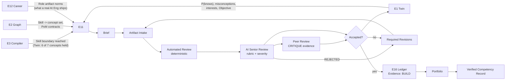
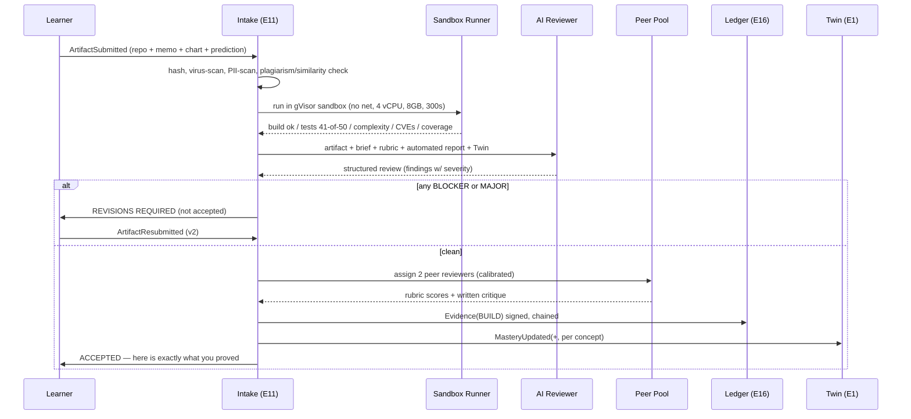
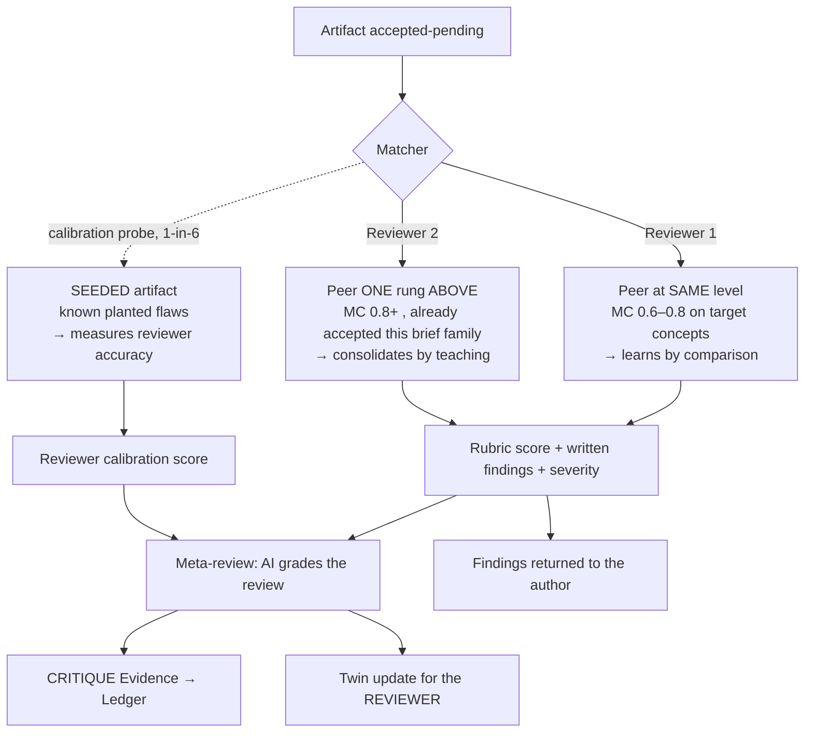
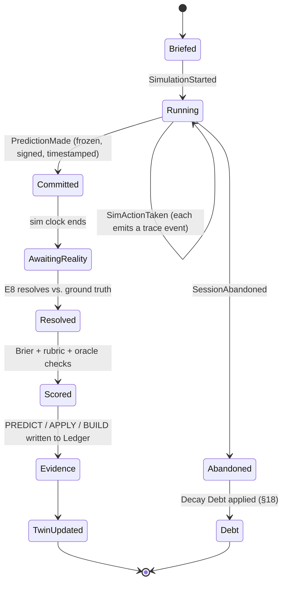
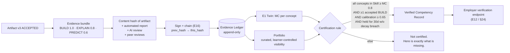

# 16 — Project Engine (E11)

> **The refusal, restated:** every major topic in PRAXIS ends in **production**, not in a quiz.
> A quiz is the weakest of the six evidence types. `BUILD` is the strongest. E11 is the engine
> that turns a topic boundary into a **thing the learner made, that a senior reviewer accepted.**

**Inventions served:** **I-2** (PoM contracts — `BUILD` + `CRITIQUE`) · **I-3** (Reality Loop —
simulations resolve against ground truth) · **I-8** (Evidence Ledger — projects are the highest-
weight ledger entries) · **I-1** (briefs are generated *from* the Twin) · **I-10** (a project is the
highest mastery-per-minute instrument we have, and we measure it).

---

## 1. Position in the OS

E11 is triggered by the **Compiler (E3)**, not by the learner browsing a project catalog.
There is no project catalog. Briefs are **compiled**, like everything else.



### Trigger conditions (when E11 fires)

| Trigger | Condition | Emits |
|---|---|---|
| `SkillBoundaryReached` | Twin holds ≥ 80% of a Skill's concept set at MC ≥ 0.7 | `ProjectBriefRequested` |
| `ObjectiveMilestone` | Plan crosses a phase boundary (e.g. "Foundations" → "Applied") | `CapstoneBriefRequested` |
| `EvidenceGapDetected` | Concept held only by `RECALL`; PoM contract demands `BUILD` | `MicroProjectRequested` |
| `MisconceptionPersists` | Same misconception survives 3 reps | `CritiqueTaskRequested` (find the flaw) |
| `LearnerRequest` | Learner explicitly asks: "give me something to build" | `ProjectBriefRequested` |
| `PeerReviewQueue` | Another learner's artifact needs a reviewer at this learner's level | `CritiqueAssignment` |

---

## 2. The seven production forms

Every major topic terminates in **one or more** of these. The Graph node's PoM contract declares which.

| # | Form | What it is | Evidence type | Graded by | Reality-coupled? |
|---|---|---|---|---|---|
| 1 | **Project** | Build an artifact from a brief. Open-ended, novel. | `BUILD` | Automated + AI review | Sometimes |
| 2 | **Case Study** | Analyse a real, messy, historical situation; defend a call. | `EXPLAIN` + `PREDICT` | Rubric + outcome | Yes (outcome known, hidden from learner) |
| 3 | **Simulation** | Act inside a sandboxed world with consequences. | `APPLY` + `PREDICT` | Sim engine + Reality Engine | Yes (I-3) |
| 4 | **Challenge** | Time-boxed, constrained, adversarial. Hidden tests. | `BUILD` | Automated only, hard pass/fail | No |
| 5 | **Peer Review** | Review another learner's artifact against a rubric. | `CRITIQUE` | Meta-review (rubric-on-the-rubric) | No |
| 6 | **Portfolio** | The curated, signed set of accepted artifacts. | (aggregate) | — | — |
| 7 | **Certification** | The Skill-level attestation, backed by the Ledger. | (aggregate) | Ledger verification | — |

> **Novel:** #5 is the one nobody does honestly. Reviewing someone else's work is *itself* graded
> evidence in PRAXIS — a first-class evidence type (`CRITIQUE`). **Reviewing teaches.** A learner who
> can find the bug in someone else's model understands the model better than one who merely wrote it.

---

## 3. Brief generation (I-1 → I-2)

### 3.1 The generation policy

A brief is **not** picked from a library. It is synthesized from four inputs:

| Input | Source | Effect on the brief |
|---|---|---|
| **Objective** | Twin | Determines the artifact's *shape* (a trader gets a backtester, not a to-do app) |
| **Twin state** | E1 | Determines difficulty: targets the concepts at MC 0.55–0.75 (the productive edge) |
| **Interests / context** | Learner profile, prior artifacts | Determines the *domain skin* (a footballer's data project uses xG data) |
| **Role norms** | E12 | Determines the *professional bar* (a real AI Eng ships evals, not notebooks) |

**Anti-generic guard:** the brief generator is given the learner's last 3 accepted artifacts and is
**forbidden from producing a brief within cosine 0.85 of any of them**. Novelty is a hard constraint,
because `APPLY` evidence requires a *never-seen* item (I-2).

### 3.2 Brief schema

```jsonc
{
  "brief_id": "brf_01J8ZK...",
  "version": 1,
  "learner_id": "lnr_7c2a",
  "objective_id": "obj_ai_engineer",
  "generated_at": "2026-07-11T09:14:02Z",
  "generator": { "model": "opus-class", "prompt_version": "brief.v7", "seed_artifacts": ["art_31","art_44"] },

  "title": "Ship an eval harness for a RAG pipeline that is currently lying to you",
  "form": "PROJECT",                 // PROJECT | CASE_STUDY | SIMULATION | CHALLENGE | CRITIQUE
  "narrative": "You inherited a support-bot RAG service. It scores 0.91 on the team's 'accuracy' metric and users hate it. Find out why the metric is wrong, and replace it.",

  "targets": {                       // WHY this brief exists — traceable to the Twin
    "skills":   ["skl_rag_eval"],
    "concepts": [
      { "concept_id": "cpt_retrieval_precision", "mc_before": 0.61, "pom": ["BUILD"] },
      { "concept_id": "cpt_llm_as_judge",        "mc_before": 0.58, "pom": ["BUILD","CRITIQUE"] },
      { "concept_id": "cpt_goodhart_law",        "mc_before": 0.44, "pom": ["EXPLAIN"] }
    ],
    "misconceptions_probed": ["msc_accuracy_is_a_scalar", "msc_more_context_is_better"]
  },

  "constraints": {
    "estimated_minutes": 240,
    "sessions_suggested": 6,
    "hard_deadline": "2026-07-25T23:59:00Z",
    "allowed_tools": ["any language", "any library", "AI assistance permitted for boilerplate only"],
    "forbidden": ["copying the reference eval repo", "hardcoding the golden set"]
  },

  "deliverables": [
    { "id": "d1", "type": "CODE_REPO",   "spec": "eval harness, runnable via `make eval`, exits nonzero on regression" },
    { "id": "d2", "type": "DOCUMENT",    "spec": "1-page memo: why the old metric was wrong. Must name the failure mode." },
    { "id": "d3", "type": "CHART",       "spec": "old metric vs new metric on the same 200 queries" },
    { "id": "d4", "type": "PREDICTION",  "spec": "predict the new metric's score on a 50-item holdout you cannot see" }
  ],

  "rubric_id": "rub_ai_eval_v3",
  "acceptance": {
    "automated": { "must_run": true, "hidden_tests": "tst_rag_eval_holdout", "min_pass": 0.8 },
    "ai_review": { "max_open_severity": "MINOR" },     // no MAJOR/BLOCKER may remain
    "peer_review": { "reviewers_required": 2, "min_mean_score": 3.0 }
  },

  "evidence_on_accept": [
    { "type": "BUILD",   "concepts": ["cpt_retrieval_precision","cpt_llm_as_judge"], "weight": 1.0 },
    { "type": "EXPLAIN", "concepts": ["cpt_goodhart_law"], "weight": 0.8 },
    { "type": "PREDICT", "concepts": ["cpt_llm_as_judge"], "weight": 0.6, "resolves_via": "E8" }
  ],

  "stakes": { "decay_debt_if_abandoned": 0.12, "unlocks": ["skl_agent_eval"] }
}
```

### 3.3 Six real briefs, six domains

---

#### Brief A — Objective: **AI Engineer** · Skill: `RAG evaluation`

> **"Ship an eval harness for a RAG pipeline that is currently lying to you."**
>
> You inherit `support-bot-v3`. It reports **0.91 "accuracy"**. The CSAT is **2.9/5**.
> The metric is exact-string-match against a golden answer. Users ask questions the golden set never
> anticipated.
>
> **Deliver:** (1) a runnable harness (`make eval`, non-zero exit on regression); (2) a new metric you
> can *defend* — faithfulness + answer-relevance + retrieval-precision@k, with an LLM-judge whose
> agreement with your own 50 hand-labels you must report; (3) a chart of old-vs-new on the same 200
> queries; (4) **a prediction**: what will your metric score on a 50-item holdout you cannot see?
> You will be graded on the *gap between your prediction and reality* (I-3), not only on the score.
>
> **We are hunting:** your belief that "accuracy is a scalar" and that "more context is better."
> The holdout contains 12 queries where adding context makes the answer worse. If your metric doesn't
> notice, you don't hold `cpt_retrieval_precision`.

---

#### Brief B — Objective: **Trader** · Skill: `Strategy validation`

> **"Backtest your own idea, then prove it's probably garbage."**
>
> You told the Tutor last week that "RSI < 30 on the Nifty 50 is a buy." Fine. Prove it.
>
> **Deliver:** (1) a backtester in any language, taking OHLCV in, trades out — with **transaction
> costs, slippage, and survivorship-bias-free universe** (we will check: your universe file must
> include the 7 delisted tickers); (2) an equity curve, drawdown, Sharpe, and **a walk-forward
> out-of-sample split you did not peek at**; (3) a **red-team memo**: three reasons your result is
> a false positive. Multiple-testing correction is one of them; name the other two.
> (4) **Reality Loop:** paper-trade the strategy for 20 sessions in the Sim. The market grades you.
>
> **Auto-fail conditions:** look-ahead bias (we scan for it), in-sample Sharpe reported as the result,
> or a backtest with zero costs.

---

#### Brief C — Objective: **ERP Consultant / Architect** · Skill: `Chart of accounts design`

> **"Configure a real chart of accounts for a company that is about to break yours."**
>
> Client: *Meridian Foods Pvt Ltd.* 3 legal entities (India, UAE, Singapore), 2 currencies of
> transaction + 1 group reporting currency, 4 plants, 2 of them **bonded warehouses**. They do
> contract manufacturing for third parties and also sell their own brand. GST in India, VAT in UAE,
> GST in Singapore. They want segment reporting by brand *and* by channel.
>
> **Deliver:** (1) the **CoA** (account, type, group, reconciliation flag, blocked-for-posting flag);
> (2) the **dimension design** — what is an account vs. what is a cost center vs. a profit center vs.
> a segment. Justify every choice you did *not* make an account; (3) the **intercompany** flow for
> a Singapore entity buying from the Indian plant; (4) a **posting walkthrough**: a single sale from
> order → delivery → invoice → revenue → COGS → tax → collection, with the exact journal lines;
> (5) a **document** answering: what breaks when they acquire a company with a different fiscal year?
>
> **We are hunting:** the classic misconception `msc_dimension_as_account` — the instinct to create
> `4001-Revenue-BrandA-Retail-India` instead of one revenue account with dimensions. If you do that,
> the AI reviewer will make you count how many accounts you'd need after their next acquisition.

---

#### Brief D — Objective: **Physician (Internal Medicine)** · Skill: `Diagnostic reasoning under uncertainty`

> **"Run the clinic. You have twelve patients and you cannot order everything."**
>
> A **Clinical Simulation** (see §6). De-identified, real-derived presentations. You have a budget:
> tests cost time and money, and one of them has a real complication risk.
>
> **Deliver (in-sim):** for each patient — a **ranked differential with explicit probabilities**
> (this is the `PREDICT` evidence), the tests you order and *why*, your posterior after results,
> your disposition (admit / discharge / refer). Then a **post-hoc memo** on the two patients you
> got wrong.
>
> **The grading is Bayesian, not multiple-choice:** you are scored on **Brier score** against the
> resolved diagnoses, on whether your differential *contained* the truth, and on whether you ordered
> a test that could not have changed your management. The last one is the hardest bar and most
> learners fail it.
>
> **Hidden case:** patient #9 is a normal variant. Ordering the CT is a *penalty*.

---

#### Brief E — Objective: **Product Manager** · Skill: `Opportunity sizing & spec writing`

> **"Kill your own feature."**
>
> Your team wants to ship in-app chat. You believe in it. Your job this week is to **build the case
> against it**, honestly, and then decide.
>
> **Deliver:** (1) a **spreadsheet model** of the opportunity — reachable users × activation ×
> retention lift × ARPU, with every assumption in its own named cell and a **sensitivity table**
> (we will change your assumptions and re-run your model; if it's hardcoded, it fails); (2) the
> **counterfactual**: what else could the same 6 engineer-weeks buy? Model both; (3) a **1-page spec**
> for whichever one wins, in the format: problem → evidence → non-goals → the one metric that
> would prove us right → the cheapest experiment that could kill it in 2 weeks;
> (4) **Prediction:** state the experiment's result *now*. We will hold it. If your team runs it,
> reality grades you.
>
> **Auto-check:** the spreadsheet is executed. Circular refs, hardcoded outputs, and a sensitivity
> table that doesn't actually move are all detected mechanically.

---

#### Brief F — Objective: **Litigation Lawyer** · Skill: `Appellate argument construction`

> **"Moot court. You are arguing the side you think is wrong."**
>
> Case: a real, decided appellate matter you have not seen (we check your search history within
> PRAXIS; the citation is redacted from your corpus). Facts and the lower-court record are provided.
>
> **Deliver:** (1) a **written submission** — issues, standard of review, authorities, argument,
> relief. Every proposition cited; **hallucinated citations are an instant BLOCKER** and are checked
> against the reporter database; (2) a **recorded 8-minute oral argument** (audio or video);
> (3) survive **AI bench questions** — the reviewer plays a hostile judge and will interrupt;
> (4) **Prediction:** how did the real court rule, and on which ground? Brier-scored (I-3).
>
> **We are hunting:** arguing the merits when you lose on the standard of review. Half of learners
> do this. The bench will ask about it in the first 60 seconds.

---

## 4. Artifact intake

Everything a learner produces enters through one pipe and leaves as **immutable, content-addressed,
signed** evidence (I-8).

| Artifact type | Accepted as | Stored | Automated handling |
|---|---|---|---|
| `CODE_REPO` | git URL, zip, or in-browser workspace | S3 + content hash | clone → sandboxed run → tests → static analysis → complexity → security scan |
| `DOCUMENT` | md, docx, pdf | S3 + extracted text + embedding | structure check, citation check, rubric grading |
| `SPREADSHEET` | xlsx, csv, Google Sheet export | S3 + parsed formula graph | **formulas are executed**; hardcode detection; sensitivity re-run |
| `CHART` | png/svg + underlying data (data required) | S3 | axis/scale/misleading-chart checks; data-vs-render consistency |
| `DESIGN` | Figma link, png, pdf | S3 + render | heuristic checks (contrast, hierarchy, touch targets) + AI critique |
| `PRESENTATION` | recorded video/audio (+ slides) | S3 + transcript + prosody | transcript → rubric; pace, filler-rate, structure; slide-vs-speech consistency |
| `DIAGRAM` | mermaid, drawio, image | S3 + parsed graph where possible | structural validation (does the architecture actually connect?) |
| `PREDICTION` | structured forecast | Event store | handed to **E8 Reality Engine**, open until reality resolves |
| `SIM_TRACE` | emitted by the simulator | Event store | scored by the sim's own oracle |



### Sandbox contract (non-negotiable, security doc `22` owns the details)

| Property | Value |
|---|---|
| Isolation | gVisor / Firecracker microVM, one per submission |
| Network | **denied** by default; allow-list only for briefs that require it (declared in brief) |
| Limits | 4 vCPU · 8 GB · 300 s wall · 2 GB disk · no persistent state |
| Secrets | none. Ever. A brief needing an API key gets a scoped mock. |
| Output | stdout/stderr (truncated), test report, coverage, artifacts under `/out` |

---

## 5. Review: the two-stage gate

> **The rule:** *the project is NOT accepted until it passes.* There is no partial credit that
> silently becomes mastery. A rejected artifact produces **zero** `BUILD` evidence. It may produce a
> small `APPLY` credit for the parts that worked — recorded honestly as such.

### 5.1 Stage 1 — Automated review (deterministic, no LLM)

| Artifact | Checks | Hard fail if |
|---|---|---|
| **Code** | builds; hidden test suite; visible tests; coverage; cyclomatic complexity; duplication; linters; **SAST** (semgrep-class); dependency CVEs; secret scanning; runtime (time/mem) | doesn't build; hidden tests < brief `min_pass`; a `CRITICAL` CVE introduced; a secret committed |
| **Document** | structure vs. required sections; word budget; **citation existence** (every citation resolved against source DB); readability; similarity to known sources (plagiarism) | a cited source does not exist; similarity > 0.35 to an existing public artifact |
| **Spreadsheet** | **formula graph executed**; hardcoded-value detection (a "computed" cell that is a literal); circular refs; **sensitivity re-run** (we perturb named inputs ±20% and check outputs actually move); unit consistency | outputs don't move under input perturbation (⇒ it's a picture of a model, not a model) |
| **Financial model** | balance sheet **balances**; cash flow ties to the balance sheet delta; no negative inventory; tax computed, not typed; IRR/NPV recomputed independently and compared to the learner's cell | our recomputation differs from theirs by > 0.5% and they can't explain it |
| **Chart** | data file present; render matches data; truncated y-axis flagged; dual-axis flagged; colour accessibility | the chart does not match its own data |
| **Design** | contrast ratios; tap-target size; text scaling; state coverage (empty/loading/error) | no error state, no empty state |
| **Presentation** | duration; transcript; slide/speech consistency | over/under the time budget by > 25% |

**Output:** a machine report, attached to the artifact forever. This is *evidence about the evidence*.

### 5.2 Stage 2 — AI review: a senior reviewer, not a cheerleader

The AI reviewer is prompted **as a specific senior role from E12** ("You are a staff ML engineer
doing a code review you will have to defend to your director"). It receives: the brief, the rubric,
the automated report, the artifact, **and the learner's Twin** (so it can distinguish *this learner
doesn't know monads yet* from *this learner is being sloppy*).

**Severity ladder — this is the whole mechanism:**

| Severity | Meaning | Effect on acceptance |
|---|---|---|
| `BLOCKER` | Wrong, unsafe, or dishonest. Would cause harm in production. | **Reject.** Mandatory revision. |
| `MAJOR` | The core competency is not demonstrated. | **Reject.** Mandatory revision. |
| `MINOR` | Real but non-disqualifying. | Accept; revision *recommended*; logged. |
| `NIT` | Style/taste. | Accept; informational. |
| `PRAISE` | Explicitly called out. Named, specific, never generic. | — |

Every finding **must** be tagged with the `concept_id` it touches, which is how a review updates the
Twin and how "code review" becomes "cognitive measurement."

### 5.3 A real AI code review output

*(Artifact: Brief A, learner `lnr_7c2a`, submission v1. Automated: builds ✅, hidden tests 34/50 = 0.68 — below the 0.80 bar. AI review runs anyway, because the learner deserves to know **why**.)*

```
════════════════════════════════════════════════════════════════════════
 PRAXIS · SENIOR REVIEW · art_0912  ·  brf_01J8ZK "RAG eval harness"
 Reviewer persona: Staff ML Engineer (evals & measurement)
 Automated gate: FAILED (hidden tests 34/50, required 40/50)
 Verdict:  ❌ REVISIONS REQUIRED   ·  2 BLOCKER · 3 MAJOR · 4 MINOR · 2 NIT · 2 PRAISE
════════════════════════════════════════════════════════════════════════

You did the hard part and then undid it. Your retrieval-precision implementation is correct
and your judge prompt is better than most production ones I have reviewed. Then you graded
the judge with the judge. Read on.

── BLOCKER ─────────────────────────────────────────────────────────────
[B1] eval/judge.py:88 — The LLM judge scores its own output.
     concept: cpt_llm_as_judge   |   misconception hit: msc_self_grading_is_grading
     You compute `faithfulness` by asking the same model, with the same context, whether its
     own answer was faithful. Its agreement with itself is 0.97. That number is not evidence
     of anything; it is a mirror.
     The brief required you to report agreement with YOUR 50 hand-labels. You reported
     model-vs-model agreement and labelled it "human agreement: 0.97" in the memo (memo.md:31).
     That label is not true. I am treating this as a BLOCKER, not a MAJOR, because the artifact
     makes a false claim about its own validity — that is the exact failure mode the brief
     was built to hunt.
     REQUIRED: label 50 items yourself. Report Cohen's κ (not raw agreement — your classes are
     imbalanced 43/7 and raw agreement will flatter you to ~0.86 by chance alone). If κ < 0.6,
     the judge is not usable and you must say so.

[B2] eval/runner.py:140 — The holdout is not held out.
     concept: cpt_retrieval_precision  |  misconception hit: msc_leakage_is_obvious
     `load_corpus()` globs `data/**/*.jsonl`. `data/holdout/` matches that glob. Your retriever
     indexes the holdout answers, then retrieves them, then scores 0.94 on retrieval@5.
     This is the same look-ahead bug as in your backtest three weeks ago (art_0744). It is the
     second time. Same shape, different clothes: you built the split AFTER building the loader.
     REQUIRED: construct the split first, assert `set(train) ∩ set(holdout) == ∅` in code, and
     make that assertion a test. Re-run. Expect your numbers to fall. That fall is the finding.

── MAJOR ───────────────────────────────────────────────────────────────
[M1] eval/metrics.py:23 — retrieval_precision@k ignores k.
     concept: cpt_retrieval_precision
     Signature takes `k`, body computes precision over the full candidate list. Every reported
     "@5" number in your chart is actually "@50". The chart is therefore wrong, not just the code.
     REQUIRED: fix, regenerate chart.png, and state in the memo which of your conclusions changed.

[M2] The metric is a scalar. The brief asked why that was the original sin.
     concept: cpt_goodhart_law  |  misconception hit: msc_accuracy_is_a_scalar
     You replaced one scalar (0.91 exact-match) with another (0.78 "praxis_score" = mean of three
     sub-metrics). You have rebuilt the disease with better ingredients. The moment you average
     faithfulness with retrieval-precision, you permit a system to trade a hallucination for a
     better retrieval — which is exactly the trade you are trying to detect.
     REQUIRED: report the three metrics as a VECTOR with independent gates. If you still want a
     headline number, define it as `min()`, not `mean()`, and defend that choice in one paragraph.

[M3] memo.md — you never name the failure mode.
     concept: cpt_goodhart_law
     The brief's deliverable d2 says: "Must name the failure mode." Your memo says the old metric
     was "too simple." It was not too simple. It was *gameable*, and the team had been optimizing
     against it for 4 months, which is why CSAT fell while the metric rose. Name it. Cite Goodhart,
     or better, describe the mechanism without the name — I care that you see it, not that you can
     spell it.

── MINOR ───────────────────────────────────────────────────────────────
[m1] No seed on the sampler → your 200-query eval is not reproducible run-to-run. (±0.03 noise.)
[m2] `make eval` exits 0 on regression. The brief required nonzero. One-line fix; you'll want this
     the first time someone else touches the repo.
[m3] Judge prompt embeds the ground-truth answer for "relevance" but not for "faithfulness" —
     inconsistent, and probably accidental. Say which you meant.
[m4] 50-item holdout prediction (deliverable d4) submitted as "around 0.8". Not a forecast.
     Give me a number and an interval. It is being scored (I-3) and "around 0.8" is unscoreable.

── NIT ─────────────────────────────────────────────────────────────────
[n1] `df.iterrows()` over 12k rows in the hot loop. Works. Slow. You'll feel it at 100k.
[n2] Mixed naming: `retrievalPrecision` and `answer_relevance` in the same module.

── PRAISE ──────────────────────────────────────────────────────────────
[p1] eval/judge.py:41 — You gave the judge a rubric with an explicit "INSUFFICIENT CONTEXT"
     escape hatch. Most engineers force a binary and get garbage on the 8% of items that have
     no defensible answer. You did not. That is a senior instinct and you did it unprompted.
[p2] You kept the old metric alongside the new one instead of deleting it. That is how you win
     the argument with the team that shipped it. Good political engineering.

── WHAT THIS SUBMISSION PROVED (Twin update, provisional) ──────────────
  cpt_retrieval_precision   0.61 → 0.58  ↓   BUILD failed; leakage repeated (2nd occurrence)
  cpt_llm_as_judge          0.58 → 0.58  =   held; implementation good, validation absent
  cpt_goodhart_law          0.44 → 0.39  ↓   the memo shows the concept is not held
  NEW misconception:        msc_self_grading_is_grading  (confidence 0.81)
  REINFORCED misconception: msc_leakage_is_obvious       (confidence 0.55 → 0.79) ← 2nd hit

── REQUIRED FOR ACCEPTANCE ─────────────────────────────────────────────
  1. B1: 50 hand-labels + Cohen's κ. If κ < 0.6, say the judge is unusable.
  2. B2: leakage-free split, asserted in a test.
  3. M1: fix @k, regenerate chart, state what changed.
  4. M2: vector metric with independent gates.
  5. M3: name the failure mode.
  6. m4: give me a real forecast with an interval.
  Resubmit as v2. Estimated: 90 minutes. You are close, and the two BLOCKERs are the same
  mistake wearing two hats: you trusted a number you produced yourself.

  Next session, the Scheduler is inserting a 12-minute CRITIQUE task on data leakage before you
  touch this again. You will find the leak in someone else's repo. Then you'll see yours.
════════════════════════════════════════════════════════════════════════
```

> **Note what just happened.** The review did not give the answer (I-5 holds even here). It named the
> failure, demanded the learner produce the fix, updated the Twin *downward* (I-1: mastery can go
> down), mined a **new misconception** (I-6), and **the Scheduler scheduled a `CRITIQUE` rep** so the
> learner meets his own bug in someone else's code first. That is the OS working as one machine.

### 5.4 Rubrics

Rubrics are versioned Graph-attached objects, not prose.

```jsonc
{
  "rubric_id": "rub_ai_eval_v3",
  "scale": [1,2,3,4,5],
  "criteria": [
    { "id":"c1", "name":"Measurement validity",
      "weight":0.30, "concepts":["cpt_llm_as_judge"],
      "anchors": {
        "1":"Metric is self-graded or unvalidated; no agreement statistic.",
        "3":"Agreement reported against human labels; chance-correction absent.",
        "5":"Chance-corrected agreement (κ) on a defensible label set; states when the judge is unusable." } },
    { "id":"c2", "name":"Leakage & experimental hygiene",
      "weight":0.30, "concepts":["cpt_retrieval_precision"],
      "anchors": {
        "1":"Train/holdout overlap present.",
        "3":"Split is clean but not asserted in code.",
        "5":"Split constructed first, disjointness asserted as a test, failure mode documented." } },
    { "id":"c3", "name":"Metric design (Goodhart-awareness)", "weight":0.25, "concepts":["cpt_goodhart_law"], "anchors":{ "1":"Single gameable scalar.","3":"Multi-metric but averaged.","5":"Vector with independent gates; the trade-off is stated explicitly." } },
    { "id":"c4", "name":"Engineering craft", "weight":0.15, "concepts":["cpt_reproducibility"], "anchors":{ "1":"Not reproducible.","3":"Runs; seeds missing.","5":"Seeded, CI-gated, exits nonzero on regression." } }
  ],
  "pass_threshold": 3.0,
  "blocker_rules": [
    "any false claim about the artifact's own validity",
    "train/holdout leakage",
    "a citation or benchmark number that cannot be reproduced from the repo"
  ]
}
```

---

## 6. Peer review — `CRITIQUE` is evidence (I-2)

> **Reviewing teaches.** A learner who can locate the flaw in someone else's model has demonstrated a
> deeper hold on the concept than one who merely produced a working model. So PRAXIS **grades the
> review**, and the review is worth Mastery Credit on its own.

### 6.1 Matching



**Matching rules**

| Rule | Why |
|---|---|
| Never the same reviewer twice in a row for one author | anti-collusion |
| Never a mutual pair (A reviews B ⇒ B may not review A on the same brief family) | anti-log-rolling |
| Reviewer must hold ≥ MC 0.6 on the brief's target concepts | competence floor |
| One in six assignments is a **seeded artifact** with planted flaws | measures the reviewer, keeps them honest |
| Cross-tenant allowed only with consent; Enterprise/Institution default to in-tenant | privacy (§22) |
| Review deadline: 48 h. Missed reviews accrue **Decay Debt** (§18) | reviewing is part of the Contract |

### 6.2 How a review is graded (the meta-review)

The reviewer's output is scored on four axes. **The reviewer's own Twin moves on these.**

| Axis | Formula / method | What it detects |
|---|---|---|
| **Detection** | recall against the union of (AI findings ∪ other peers' findings ∪ planted seeds), weighted by severity | Did you *see* it? |
| **Precision** | 1 − (false findings / total findings) | Are you inventing problems? |
| **Severity calibration** | 1 − mean&#124;sev(peer) − sev(consensus)&#124; / 4 | Do you know what *matters*? A learner who calls a naming nit a BLOCKER does not. |
| **Actionability** | rubric-graded: does each finding say what to change and why? | Is your feedback usable? |

```
CritiqueScore = 0.40·Detection + 0.20·Precision + 0.25·SeverityCalibration + 0.15·Actionability
```

`CRITIQUE` evidence is emitted at weight `CritiqueScore` on the concepts the reviewer's findings
touched. **A bad review lowers the reviewer's MC.** Rubber-stamping ("looks good, nice work!") scores
~0.1 on Detection and near-0 on Actionability, and the Twin records that this learner *cannot yet
tell good from bad in this domain* — which is a real and important thing to know about them.

### 6.3 A real peer review, and its meta-review

```
── PEER REVIEW · reviewer lnr_9f31 (MC 0.72 cpt_llm_as_judge) · on art_0912 ────────
[F1] MAJOR  eval/runner.py:140 — I think your holdout is inside your training glob.
     data/holdout/*.jsonl matches data/**/*.jsonl. If so every retrieval number is inflated.
     Suggest: build the split first and assert disjointness. I got burned by this in art_0801.
[F2] MINOR  metrics.py:23 — k is unused. Your @5 is an @50.
[F3] MAJOR  memo.md:31 — "human agreement 0.97" but judge.py:88 compares model to model.
     Either the memo is wrong or the code is. Both are bad; the memo one is worse.
[F4] PRAISE judge.py:41 — the INSUFFICIENT_CONTEXT option is good. I'm stealing it.
────────────────────────────────────────────────────────────────────────────────────
── META-REVIEW (AI) ────────────────────────────────────────────────────────────────
 Detection            0.83  — caught both BLOCKERs and 1 of 3 MAJORs. Missed the scalar/Goodhart
                              issue entirely (M2), which is the conceptual core of the brief.
 Precision            1.00  — zero false findings.
 Severity calibration 0.88  — you called the leak MAJOR; consensus is BLOCKER. Under-called it.
                              A leak invalidates every number in the artifact. That's a BLOCKER.
 Actionability        0.90  — every finding says what to change. F1's "I got burned by this"
                              is exactly right: concrete, non-condescending, and it teaches.
 CritiqueScore = 0.40(0.83) + 0.20(1.00) + 0.25(0.88) + 0.15(0.90) = 0.885

 EVIDENCE EMITTED (reviewer's Twin):
   CRITIQUE  cpt_retrieval_precision   0.72 → 0.79   ↑ (found the leak unprompted)
   CRITIQUE  cpt_llm_as_judge          0.72 → 0.77   ↑
   NO CREDIT cpt_goodhart_law          0.51 → 0.51   = (missed M2 — you do not hold this yet)
 → Scheduler: inserting a 10-min lesson on metric gaming before your next eval brief.
────────────────────────────────────────────────────────────────────────────────────
```

> The reviewer learned. The author learned. Neither was given an answer. That is E11.

---

## 7. Simulations (I-3 in a sandbox)

A **Simulation** is a bounded world with (a) state, (b) actions with consequences, (c) an **oracle**
that knows the truth, and (d) a clock. The learner's decisions become `PREDICT` and `APPLY` evidence;
the oracle resolves them.

| Domain | Simulation | Simulated resource | The oracle (ground truth) | Evidence emitted |
|---|---|---|---|---|
| **Trading** | Live-market paper trading with **simulated capital**, real quotes (delayed or live per tier), real spreads/slippage/costs | ₹10,00,000 sim capital | **The actual market**, T+1 | `PREDICT` (direction + confidence, Brier) · `APPLY` (position sizing) · `BUILD` (the strategy code) |
| **ERP** | A running sandbox tenant (e.g. an ERPNext/Odoo-class instance) seeded with a messy company. Learner configures, posts, closes | a fake company, real accounting rules | **The books must balance**; month-end close must complete; a hidden audit script | `BUILD` (config) · `APPLY` (postings) · `CRITIQUE` (find the misconfiguration we planted) |
| **Clinical** | Patient presents; learner orders tests (each costs time/money/risk), forms a ranked differential with probabilities, disposes | a test budget, a clock, a deteriorating patient | The **resolved diagnosis** from the de-identified real case | `PREDICT` (Brier on the differential) · `APPLY` (management) · `EXPLAIN` (the post-hoc memo) |
| **Law** | Moot court: written submission + oral argument vs. an **AI hostile bench** that interrupts | a page limit, an 8-minute clock | The **real appellate judgment**, withheld until resolution | `EXPLAIN` (argument) · `PREDICT` (ruling + ground) · `CRITIQUE` (opponent's brief) |
| **Startup / Business** | Multi-turn firm simulation: pricing, hiring, burn, a competitor agent, a market shock at a random turn | runway in months | A calibrated market model + the shock's real analogue | `PREDICT` (quarterly forecast) · `APPLY` (decisions) · `EXPLAIN` (the board memo) |
| **Systems / SRE** | A live incident: a degraded service, real logs/metrics/traces, a paging clock | error budget, MTTR | The **actual injected fault** | `APPLY` (diagnosis path) · `PREDICT` (root cause named before you fix it) · `BUILD` (the fix + postmortem) |

### 7.1 Simulation → Evidence



**The freeze rule (why simulations are honest):** the instant a learner commits a prediction, it is
**signed and timestamped into the Ledger**. It cannot be edited. When reality resolves, the score is
computed against the frozen artifact. This is what makes a PRAXIS trading record a *claim a third
party can verify* rather than a screenshot.

### 7.2 Worked micro-example — the trading sim emitting evidence

```jsonc
// t=0, frozen at commit
{ "event":"PredictionMade", "sim":"sim_trading_paper", "learner":"lnr_2b90",
  "instrument":"NIFTY50", "horizon":"1d",
  "claim":"close > open", "confidence":0.72,
  "rationale_concepts":["cpt_rsi_mean_reversion","cpt_volume_confirmation"],
  "position": { "size_pct_capital": 8, "stop_pct": 1.2, "target_pct": 2.0 },
  "signed":"sha256:9ac1…", "ts":"2026-07-11T03:45:00Z" }

// t=1d, E8 resolves
{ "event":"PredictionResolved", "outcome":true, "brier_contrib":0.0784,
  "pnl_sim": 6400, "r_multiple": 1.66,
  "evidence": [
    { "type":"PREDICT", "concept":"cpt_rsi_mean_reversion", "weight":0.55 },
    { "type":"APPLY",   "concept":"cpt_position_sizing",    "weight":0.90,
      "note":"8% of capital at a 1.2% stop = 0.096% account risk. Correctly sized. This is the
              concept most learners fail; he did not." }
  ],
  "twin_delta": { "cpt_rsi_mean_reversion": "+0.03 (n=14, calibration 0.68)",
                  "cpt_position_sizing": "+0.06" } }
```

> Note the honesty: one correct call moves `cpt_rsi_mean_reversion` by **+0.03**, not to "mastered."
> Prediction evidence is only meaningful in aggregate (n=14 so far). The Twin knows that. **A lucky
> trade is not knowledge, and PRAXIS will not pretend it is.**

---

## 8. Portfolio & Certification

### 8.1 Projects → Ledger → Record



### 8.2 Certification rule (a Skill is certified iff **all** hold)

| # | Condition | Why |
|---|---|---|
| 1 | Every concept in the Skill's set at **MC ≥ 0.80** | I-2: mastery is per-concept, not per-course |
| 2 | At least one **accepted** `BUILD` artifact for the Skill | I-2: you must have produced something |
| 3 | At least one accepted `CRITIQUE` on someone else's artifact in this Skill | reviewing teaches; a certified engineer can review |
| 4 | **Calibration ≥ 0.65** (Brier-derived) on the Skill's `PREDICT` items | I-3: knowing what you don't know is part of knowing |
| 5 | MC held **≥ 30 days without falling below 0.70** (survived at least one decay cycle) | I-2: mastery is decaying; a cram is not a certification |
| 6 | Zero unresolved `BLOCKER` findings across the portfolio | you don't ship known-broken work |

**Certification is revocable.** If MC decays below 0.70 and is not refreshed, the certification enters
`LAPSED` — and the Verified Competency Record says so, with the date. *This is the feature that makes
it worth anything to an employer.* Every other credential in the world lies by omission about time.

### 8.3 The portfolio entry (what an employer sees)

```
╭───────────────────────────────────────────────────────────────────────────╮
│  RAG Evaluation Harness                              ACCEPTED · v3        │
│  Objective: AI Engineer · Skill: skl_rag_eval                             │
├───────────────────────────────────────────────────────────────────────────┤
│  Submitted   3 revisions over 11 days · 5h 48m of logged work             │
│  Automated   builds ✅ · hidden tests 47/50 · coverage 81% · 0 CVEs       │
│  AI review   v1: 2 BLOCKER 3 MAJOR → v3: 0 BLOCKER 0 MAJOR 2 MINOR        │
│  Peer review 2 reviewers · mean 4.0/5 · reviewer calibration 0.88, 0.71   │
│  Prediction  forecast 0.74 ±0.06 on unseen holdout → actual 0.71 ✅       │
│              (this is the number an employer should look at)              │
│  Concepts    cpt_retrieval_precision 0.86 · cpt_llm_as_judge 0.84         │
│              cpt_goodhart_law 0.79 · cpt_reproducibility 0.81             │
│  Integrity   artifact sha256:4f2c… · signed 2026-07-22 · chain verified ✅ │
│  ⚠ Honest note: v1 contained a data-leakage bug (2nd occurrence for this   │
│    learner). Fixed in v2. The Twin still flags leakage as a watch item.   │
│                                             [ Verify this record ↗ ]      │
╰───────────────────────────────────────────────────────────────────────────╯
```

> **The `⚠ Honest note` is the product.** No credential on earth shows you the candidate's failed
> first draft *on purpose*. We do, because the revision history is the strongest signal of whether
> someone can take a code review — which is the thing hiring managers actually want to know.
> (Learner controls visibility; but the *default* is honest, and a portfolio with hidden revisions is
> **marked as such** on the verification endpoint. You may hide; you may not fake.)

---

## 9. Events (E11 contract on the bus)

| Event | Emitted when | Consumed by |
|---|---|---|
| `ProjectBriefRequested` | Trigger fires (§1) | E11 |
| `ProjectBriefIssued` | Brief generated & shown | E1, E3, E4, E15, E18 |
| `ArtifactSubmitted` | Learner submits | E11, E16 |
| `AutomatedReviewCompleted` | Sandbox + checks finish | E11, E15 |
| `AIReviewCompleted` | Senior review written | E1 (misconceptions!), E6, E15 |
| `RevisionsRequired` | Any BLOCKER/MAJOR remains | E4 (reschedule), E18 (nudge), E13 |
| `PeerReviewAssigned` / `PeerReviewSubmitted` | Matching / submission | E11, E14 (it's part of the Contract) |
| `CritiqueGraded` | Meta-review done | E1 (reviewer's Twin!), E16 |
| `ArtifactAccepted` | All gates pass | **E16 (Ledger)**, E1, E3 (recompile), E12, E13 (celebrate) |
| `ProjectAbandoned` | No activity ≥ 14 d past deadline | E13 (Decay Debt), E14 (escalation) |
| `SimulationCommitted` / `SimulationResolved` | Prediction frozen / reality lands | E8, E1, E16 |
| `SkillCertified` / `SkillLapsed` | Cert rule §8.2 flips | E12, E16, E18 |

---

## 10. What is genuinely novel here

| Claim | Table stakes elsewhere? | PRAXIS |
|---|---|---|
| Auto-graded coding projects | Yes (HackerRank, Codecademy) | — |
| **Briefs compiled from a cognitive model of *this* learner, forbidden from repeating themselves** | **No** | I-1 + I-2 |
| **A review that can lower your mastery** | **No** — everyone only adds | I-1, I-2 |
| **Reviewing someone else as first-class, graded evidence (`CRITIQUE`), with seeded artifacts to calibrate the reviewer** | **No** | I-2 |
| **A review that mines misconceptions and *schedules a rep* for them** | **No** | I-6 + E4 |
| **Frozen, signed predictions inside simulations, resolved by reality** | **No** | I-3 + I-8 |
| **Certification that can LAPSE, and a portfolio that shows the failed first draft on purpose** | **No** | I-2 + I-8 |

---

## 11. Open questions

| # | Question | Current lean |
|---|---|---|
| 1 | Do we allow AI assistance *inside* project work? | Yes for boilerplate, declared in the brief; the artifact is graded, and the AI review probes whether the learner can *defend* the code (`EXPLAIN`) — which is where LLM-written code collapses. |
| 2 | Peer-review supply at cold start | Seeded artifacts + staff reviewers + the AI reviewer standing in as "reviewer 2" until the pool is dense. Disclosed, never faked. |
| 3 | Cheating: submitting someone else's repo | Similarity check + a mandatory 5-minute `EXPLAIN` defense on a random hunk of the submitted artifact. You cannot defend code you didn't write. |
| 4 | Cost of running sandboxes | Cost-attributed per learner-minute (CANON §5.6); challenge-class briefs are cheap, sim-class briefs are metered per tier. |
| 5 | Regulated-domain simulations (clinical, legal) | Never presented as clinical/legal advice; de-identified corpora only; domain expert sign-off on every seeded case. Owned by §22. |
