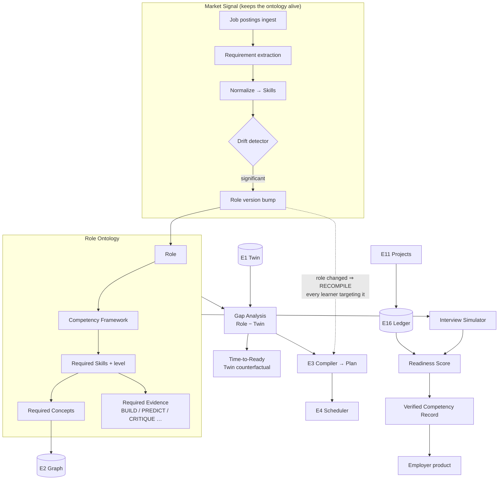
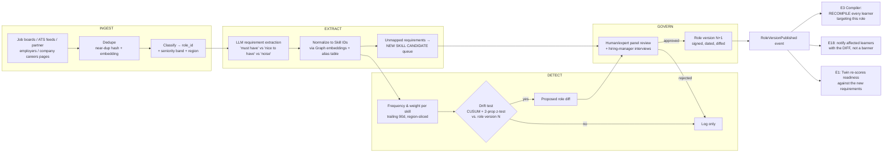
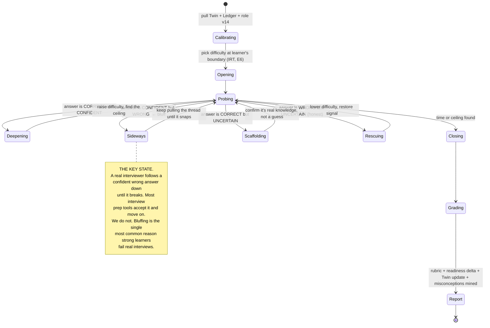
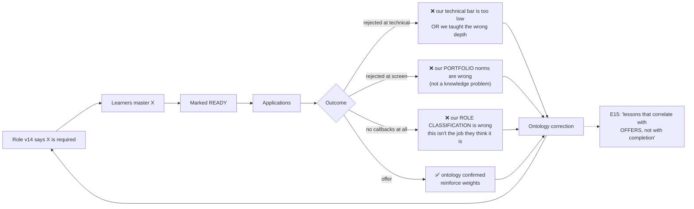

# 17 — Career Engine (E12)

> **The Objective is a build target.** "Become an AI Engineer" is not a wish — it is a **compile
> target with a link step**. E12 owns the target's definition: what a role *is*, in Concepts and
> Skills and Evidence, kept alive by the real labour market, and diffed against the Twin to produce
> the gap, the time-to-ready, and the path.

**Inventions served:** **I-4** (the role ontology is the *linker script* the Compiler links against) ·
**I-1** (gap = Role − Twin; time-to-ready is a Twin counterfactual) · **I-8** (the Ledger is the
hiring artifact — this is the money) · **I-2** (a role demands *evidence types*, not just topics) ·
**I-10** (career outcome is the true north; mastery-per-minute is how we get there fastest).

---

## 1. Position in the OS



---

## 2. Role ontology

### 2.1 The four layers

| Layer | Object | Cardinality | Owned by | Example |
|---|---|---|---|---|
| 1 | **Role** | ~400 at GA | E12 | `role_ai_engineer` |
| 2 | **Competency** | 6–12 per role | E12 | "Model evaluation & measurement" |
| 3 | **Skill** | 3–8 per competency | E2 (Graph) | `skl_rag_eval` |
| 4 | **Concept** | 5–40 per skill | E2 (Graph) | `cpt_llm_as_judge` |

A **Role** never owns Concepts directly. It owns Competencies, which require Skills at a **level**,
and Skills are Graph objects that decompose into Concepts. This indirection is what lets the market
change a role (§5) without touching the Graph, and lets the Graph deepen without touching roles.

### 2.2 Schema

```jsonc
{
  "role_id": "role_ai_engineer",
  "version": 14,                          // bumped by market drift (§5)
  "title": "AI Engineer",
  "aliases": ["ML Engineer (Applied)", "LLM Engineer", "Applied AI Engineer", "GenAI Engineer"],
  "seniority_bands": ["JUNIOR","MID","SENIOR","STAFF"],
  "target_band": "MID",                   // learner picks; changes thresholds, not structure
  "market": {
    "postings_analyzed": 18422,
    "window": "trailing_90d",
    "regions": ["IN","US","EU","REMOTE"],
    "median_comp": { "IN": "₹34L", "US": "$182k" },
    "demand_index": 1.41,                 // vs. baseline 1.0 = market average
    "trend_90d": "+0.19",
    "last_refresh": "2026-07-08T02:00:00Z"
  },

  "competencies": [
    {
      "competency_id": "cmp_ai_eval",
      "name": "Model evaluation & measurement",
      "weight": 0.18,                      // share of role readiness
      "market_frequency": 0.71,            // appears in 71% of MID postings
      "trend": "+0.22",                    // ← fastest-rising requirement in this role
      "skills": [
        { "skill_id":"skl_rag_eval",   "min_level":3, "weight":0.5,
          "required_evidence":[
            {"type":"BUILD","count":1,"min_weight":0.8},
            {"type":"CRITIQUE","count":1,"min_weight":0.7},
            {"type":"PREDICT","count":10,"min_calibration":0.65}   // ← I-3 baked into the role
          ]},
        { "skill_id":"skl_offline_online_eval", "min_level":2, "weight":0.3,
          "required_evidence":[{"type":"BUILD","count":1,"min_weight":0.7}] },
        { "skill_id":"skl_ab_testing", "min_level":2, "weight":0.2,
          "required_evidence":[{"type":"APPLY","count":6},{"type":"EXPLAIN","count":1}] }
      ]
    }
    /* … 7 more competencies … */
  ],

  "screening_signals": {                   // what actually gets you the interview
    "portfolio_artifacts": ["a system that runs","an eval harness","a written design doc"],
    "red_flags": ["notebooks only","no eval","no latency/cost numbers","cannot explain own code"]
  },

  "interview_shape": {
    "stages": [
      {"stage":"screen","type":"BEHAVIORAL","minutes":30},
      {"stage":"technical","type":"CODING+ML","minutes":60,"topics":["retrieval","evals","prompting","serving"]},
      {"stage":"system_design","type":"CASE","minutes":60,"topics":["RAG at scale","cost/latency","failure modes"]},
      {"stage":"deep_dive","type":"PORTFOLIO_DEFENSE","minutes":45,"note":"defend an artifact you built"},
      {"stage":"values","type":"BEHAVIORAL","minutes":45}
    ]
  },

  "provenance": {
    "sources":["job_postings","expert_panel","hiring_manager_interviews","ledger_outcomes"],
    "expert_reviewers":["…"],
    "outcome_feedback": { "learners_placed": 214, "median_days_to_offer_after_ready": 47 }
  }
}
```

### 2.3 Role readiness (the one number)

```
Readiness(role, learner) = Σ_c  w_c · CompetencyReadiness(c)

CompetencyReadiness(c) = Σ_s w_s · min( SkillReadiness(s) , 1 )

SkillReadiness(s) = 0.55 · KnowledgeTerm(s)
                  + 0.35 · EvidenceTerm(s)
                  + 0.10 · CalibrationTerm(s)

  KnowledgeTerm(s)  = ( Σ_{cpt ∈ s} imp_cpt · MC_cpt ) / ( Σ imp_cpt )      // Twin, decayed to today
  EvidenceTerm(s)   = fraction of required_evidence satisfied (by type, count, weight)
  CalibrationTerm(s)= clamp( (calibration_s − 0.5) / 0.35 , 0 , 1 )         // 0.5=coin flip, 0.85=excellent

READY when Readiness ≥ 0.80 AND no competency below 0.60   ← no fatal holes allowed
```

> **The `min(...,1)` and the "no competency below 0.60" clause are the point.** You cannot compensate
> for not knowing how to evaluate a model by being *very* good at prompting. Real roles have **fatal
> holes**, and the ontology models them. Averages lie; PRAXIS refuses the average.

---

## 3. Four roles, fully expanded

### 3.1 `role_ai_engineer` — **AI Engineer** (target band: MID)

| # | Competency | w | Skills (min level) | Required evidence | Market freq / trend |
|---|---|---|---|---|---|
| 1 | Programming & software craft | .14 | `skl_python_prod` (4) · `skl_testing` (3) · `skl_git_ci` (3) | BUILD ×2, CRITIQUE ×1 | .96 / +.01 |
| 2 | ML foundations | .12 | `skl_linear_algebra_applied` (3) · `skl_probability` (3) · `skl_optimization` (2) | APPLY ×20, EXPLAIN ×2 | .68 / −.09 ⬇ |
| 3 | LLM systems | .18 | `skl_prompting` (4) · `skl_rag` (4) · `skl_finetuning` (2) · `skl_agents` (3) | BUILD ×2, EXPLAIN ×1 | .89 / +.31 ⬆ |
| 4 | **Evaluation & measurement** | .18 | `skl_rag_eval` (3) · `skl_offline_online_eval` (2) · `skl_ab_testing` (2) | BUILD ×1, CRITIQUE ×1, **PREDICT ×10 @cal≥.65** | .71 / +.22 ⬆ |
| 5 | Data engineering | .10 | `skl_pipelines` (3) · `skl_vector_stores` (3) · `skl_data_quality` (2) | BUILD ×1 | .62 / +.05 |
| 6 | Serving & MLOps | .12 | `skl_inference_serving` (3) · `skl_observability` (3) · `skl_cost_latency` (3) | BUILD ×1, PREDICT ×5 (latency/cost forecasts!) | .74 / +.14 |
| 7 | Systems design | .10 | `skl_distributed_basics` (2) · `skl_api_design` (3) | EXPLAIN ×1 (design doc), CRITIQUE ×1 | .58 / +.03 |
| 8 | Safety, security & ethics | .06 | `skl_prompt_injection` (3) · `skl_pii_handling` (3) · `skl_model_risk` (2) | CRITIQUE ×2 (red-team someone's agent) | .34 / **+.28** ⬆ |

**Note the market row for competency #2:** ML foundations are **falling** in posting frequency
(−.09) while evaluation (+.22) and safety (+.28) are rising. The ontology *notices*, and §5 explains
what that does to every learner's plan.

---

### 3.2 `role_erp_consultant_architect` — **ERP Consultant / Architect** (target band: SENIOR)

| # | Competency | w | Skills (min level) | Required evidence |
|---|---|---|---|---|
| 1 | Programming & scripting | .06 | `skl_sql` (4) · `skl_scripting` (3) · `skl_api_integration` (3) | BUILD ×1 |
| 2 | Data & database | .10 | `skl_relational_modeling` (4) · `skl_query_perf` (3) · `skl_migration` (3) | BUILD ×1, CRITIQUE ×1 |
| 3 | **Accounting & controlling** | .16 | `skl_double_entry` (5) · `skl_coa_design` (4) · `skl_costing` (4) · `skl_period_close` (4) | BUILD ×2 (a real CoA + a close), EXPLAIN ×2 |
| 4 | Inventory & supply chain | .12 | `skl_valuation_methods` (4) · `skl_wh_mgmt` (3) · `skl_procure_to_pay` (4) | BUILD ×1, APPLY ×15 |
| 5 | Manufacturing | .10 | `skl_bom_routing` (4) · `skl_mrp` (3) · `skl_shopfloor` (3) | BUILD ×1 (a working MRP run) |
| 6 | Finance & compliance | .12 | `skl_order_to_cash` (4) · `skl_tax_engines` (3) · `skl_statutory_reporting` (3) · `skl_ifrs_basics` (2) | BUILD ×1, EXPLAIN ×1 |
| 7 | Cloud & integration architecture | .10 | `skl_cloud_deploy` (3) · `skl_ipaas` (3) · `skl_edi` (2) | BUILD ×1, EXPLAIN ×1 (integration design doc) |
| 8 | Security & controls | .08 | `skl_sod` (4) · `skl_rbac` (4) · `skl_audit_trail` (3) | CRITIQUE ×2 (find the SoD violation) |
| 9 | Leadership & client management | .08 | `skl_requirements_elicitation` (4) · `skl_stakeholder_mgmt` (4) · `skl_change_mgmt` (3) | EXPLAIN ×2 (recorded workshop), CRITIQUE ×1 |
| 10 | Enterprise architecture | .08 | `skl_ea_frameworks` (3) · `skl_landscape_design` (4) · `skl_build_vs_buy` (3) | EXPLAIN ×1 (a target-state architecture, defended) |

---

### 3.3 `role_data_scientist` — **Data Scientist** (target band: MID)

| # | Competency | w | Skills (min level) | Required evidence |
|---|---|---|---|---|
| 1 | Statistics & inference | .20 | `skl_hypothesis_testing` (4) · `skl_causal_inference` (3) · `skl_bayesian` (3) | APPLY ×25, **PREDICT ×15 @cal≥.70** |
| 2 | Experimentation | .16 | `skl_ab_testing` (4) · `skl_power_analysis` (4) · `skl_quasi_experiments` (3) | BUILD ×1 (an experiment platform or analysis), CRITIQUE ×2 (kill a bad experiment) |
| 3 | Modeling | .16 | `skl_supervised` (4) · `skl_feature_eng` (4) · `skl_model_validation` (4) | BUILD ×2 |
| 4 | Data wrangling | .12 | `skl_sql` (4) · `skl_pandas_spark` (3) · `skl_data_quality` (3) | BUILD ×1 |
| 5 | Communication & influence | .16 | `skl_data_storytelling` (4) · `skl_viz` (3) · `skl_exec_memo` (4) | EXPLAIN ×3 (one must be a recorded readout to a hostile stakeholder) |
| 6 | Domain & product sense | .12 | `skl_metric_design` (4) · `skl_opportunity_sizing` (3) | EXPLAIN ×1, PREDICT ×10 (forecast a metric; reality grades you) |
| 7 | Engineering hygiene | .08 | `skl_git_ci` (3) · `skl_reproducibility` (4) | BUILD ×1 |

> **The `PREDICT ×15 @cal≥.70` in competency #1 is the whole discipline.** A data scientist who cannot
> forecast and be *calibrated* is a person who runs `sklearn`. The role ontology says so, out loud,
> and the Reality Loop (I-3) is what makes the requirement enforceable rather than aspirational.

---

### 3.4 `role_product_manager` — **Product Manager** (target band: MID)

| # | Competency | w | Skills (min level) | Required evidence |
|---|---|---|---|---|
| 1 | Customer discovery | .16 | `skl_user_interviews` (4) · `skl_jtbd` (4) · `skl_synthesis` (3) | EXPLAIN ×2 (recorded interview + synthesis), CRITIQUE ×1 (tear apart a leading-question script) |
| 2 | Opportunity & prioritization | .16 | `skl_opportunity_sizing` (4) · `skl_prioritization` (3) · `skl_tradeoff_analysis` (4) | BUILD ×1 (a live spreadsheet model), EXPLAIN ×1 |
| 3 | Spec & execution | .16 | `skl_spec_writing` (4) · `skl_scoping` (4) · `skl_delivery` (3) | BUILD ×2 (specs graded by an engineer persona) |
| 4 | **Metrics & experimentation** | .18 | `skl_metric_design` (4) · `skl_ab_testing` (3) · `skl_analytics` (3) | BUILD ×1, **PREDICT ×12** (call your launch results *before* the launch), CRITIQUE ×1 |
| 5 | Technical fluency | .10 | `skl_system_literacy` (3) · `skl_api_literacy` (3) · `skl_data_literacy` (3) | EXPLAIN ×1 (explain your system's architecture to an engineer without lying) |
| 6 | Strategy & positioning | .12 | `skl_market_analysis` (3) · `skl_positioning` (3) · `skl_business_model` (3) | EXPLAIN ×1, PREDICT ×5 (competitor moves) |
| 7 | Influence & communication | .12 | `skl_written_narrative` (5) · `skl_stakeholder_mgmt` (4) · `skl_saying_no` (4) | EXPLAIN ×3, CRITIQUE ×1 |

> `skl_saying_no` at level 4 is not a joke. It is the most common reason PMs fail, it is teachable,
> and it is assessable: the simulation puts a VP in the room who wants a bad feature, and grades
> whether the learner holds the line **with evidence** rather than with either compliance or
> stubbornness.

---

### 3.5 Lighter sketches

| Role | Signature competencies (weights) | The evidence that actually matters | The thing everyone gets wrong |
|---|---|---|---|
| **Trader** | Risk & position sizing (.24) · Market microstructure (.14) · Strategy design & validation (.20) · Execution (.10) · Psychology/discipline (.16) · Quantitative methods (.16) | `PREDICT` ×**200** at calibration ≥ .60, plus a **live Reality-Loop equity curve** and a max-drawdown record. **Nothing else counts.** | They study indicators. The role is 24% risk sizing and 16% not doing the stupid thing. |
| **Lawyer (litigation)** | Legal research (.16) · Doctrinal knowledge (.18) · Written advocacy (.20) · Oral advocacy (.14) · Procedure (.14) · Client counselling (.10) · Ethics (.08) | `EXPLAIN` (submissions, rubric-graded, **zero hallucinated citations**) · `PREDICT` on real rulings (Brier) · `CRITIQUE` of opposing briefs | They argue merits when they lose on the standard of review. |
| **Doctor (internal medicine)** | Diagnostic reasoning (.24) · Knowledge base (.18) · Procedures (.12) · Management (.16) · Communication (.14) · Evidence appraisal (.10) · Ethics (.06) | `PREDICT` (Brier on ranked differentials, n ≥ 150) · `APPLY` in clinical sims · `CRITIQUE` (appraise a bad trial) | Ordering tests that cannot change management. |
| **Software Architect** | Systems design (.22) · Trade-off reasoning (.18) · Domain modeling (.14) · Operability (.14) · Security (.10) · Communication (.14) · Cost (.08) | `EXPLAIN` (design docs defended against a hostile review) · `CRITIQUE` ×5 (architecture reviews of *others'* designs — this is 60% of the job) · `PREDICT` (will this scale? we resolve it in the sim) | Designing for a scale that never arrives; no cost model. |
| **IAS Officer** | Polity & governance (.16) · Economy (.14) · Public administration (.14) · Ethics & integrity (.14) · Current affairs synthesis (.12) · Answer writing (.20) · Optional subject (.10) | `EXPLAIN` (answer-writing under a 7-minute clock, rubric-graded to the real UPSC scheme) · `PREDICT` (policy outcomes) · `CRITIQUE` (dismantle a weak model answer) | Reading endlessly; not writing under time. The role's #1 weight is **answer writing**, and PRAXIS weights it accordingly. |
| **CEO / Founder** | Judgement under uncertainty (.22) · Capital & unit economics (.16) · Hiring (.14) · Narrative & fundraising (.14) · Product sense (.14) · Focus/prioritization (.12) · Resilience (.08) | `PREDICT` on your own business (forecast the quarter; the P&L grades you) · `BUILD` (the model, the deck, the org design) · `EXPLAIN` (the board memo) · startup sim traces | Confusing motion with progress. The sim's random market shock finds this out in 3 turns. |

---

## 4. The ERP Architect ladder, rendered as a real graph

The brief's ladder — *programming → database → accounting → inventory → manufacturing → finance →
cloud → security → leadership → enterprise architecture → interview prep → real ERP projects* —
compiled into the Graph, with the Skills and the Evidence required at each rung.

```mermaid
flowchart TD
  classDef found  fill:#0b3d2e,stroke:#12b886,color:#e6fcf5
  classDef core   fill:#0b2e4d,stroke:#4dabf7,color:#e7f5ff
  classDef adv    fill:#3d2c0b,stroke:#f59f00,color:#fff9db
  classDef human  fill:#3d0b2e,stroke:#e64980,color:#fff0f6
  classDef gate   fill:#3d0b0b,stroke:#fa5252,color:#fff5f5

  R0["<b>R0 · PROGRAMMING</b><br/>skl_sql L4 · skl_scripting L3 · skl_api_integration L3<br/>─────<br/>EVIDENCE: BUILD — a working integration<br/>(pull sales orders from a REST API into staging)<br/>APPLY ×30 SQL items · CRITIQUE ×1 (find the N+1)"]:::found

  R1["<b>R1 · DATABASE</b><br/>skl_relational_modeling L4 · skl_query_perf L3 · skl_migration L3<br/>─────<br/>EVIDENCE: BUILD — normalize a real, ugly legacy schema<br/>(the client's 91-column 'ITEM_MASTER' spreadsheet)<br/>CRITIQUE ×1 — review a peer's ERD; find the missing FK"]:::found

  R2["<b>R2 · ACCOUNTING</b> ★ the rung everyone skips<br/>skl_double_entry L5 · skl_coa_design L4 · skl_costing L4 · skl_period_close L4<br/>─────<br/>EVIDENCE: BUILD ×2 — a multi-entity Chart of Accounts (Brief C)<br/>+ a full month-end close that BALANCES (audit script must pass)<br/>EXPLAIN ×2 — 'why is this a dimension, not an account?'<br/>PREDICT ×5 — what will this posting do to the trial balance? (before you post)"]:::core

  R3["<b>R3 · INVENTORY & SCM</b><br/>skl_valuation_methods L4 · skl_wh_mgmt L3 · skl_procure_to_pay L4<br/>─────<br/>EVIDENCE: BUILD — configure P2P end to end (PR→PO→GRN→Invoice→Payment)<br/>APPLY ×15 — value the same stock under FIFO / Moving Avg / Standard;<br/>explain why the P&L differs<br/>CRITIQUE ×1 — find the planted 3-way-match bypass"]:::core

  R4["<b>R4 · MANUFACTURING</b><br/>skl_bom_routing L4 · skl_mrp L3 · skl_shopfloor L3<br/>─────<br/>EVIDENCE: BUILD — a multi-level BOM + routing; run MRP;<br/>explain every planned order it generated<br/>PREDICT ×5 — what will MRP suggest if lead time slips 6 days? (then run it)"]:::core

  R5["<b>R5 · FINANCE & COMPLIANCE</b><br/>skl_order_to_cash L4 · skl_tax_engines L3 · skl_statutory_reporting L3 · skl_ifrs_basics L2<br/>─────<br/>EVIDENCE: BUILD — O2C with GST/VAT across 3 jurisdictions (Brief C's client)<br/>EXPLAIN ×1 — the intercompany elimination, to a CFO persona"]:::core

  R6["<b>R6 · CLOUD & INTEGRATION</b><br/>skl_cloud_deploy L3 · skl_ipaas L3 · skl_edi L2<br/>─────<br/>EVIDENCE: BUILD — deploy the sandbox tenant; wire an iPaaS flow<br/>with idempotency + retry + a poison queue<br/>EXPLAIN ×1 — integration architecture doc, defended"]:::adv

  R7["<b>R7 · SECURITY & CONTROLS</b><br/>skl_sod L4 · skl_rbac L4 · skl_audit_trail L3<br/>─────<br/>EVIDENCE: CRITIQUE ×2 — audit a role matrix; find the SoD violation<br/>(the user who can both create a vendor AND approve payment)<br/>BUILD ×1 — a defensible role design + the audit report"]:::adv

  R8["<b>R8 · LEADERSHIP & CLIENT</b><br/>skl_requirements_elicitation L4 · skl_stakeholder_mgmt L4 · skl_change_mgmt L3<br/>─────<br/>EVIDENCE: EXPLAIN ×2 — a RECORDED requirements workshop with an<br/>AI client who contradicts himself and wants everything<br/>CRITIQUE ×1 — review a peer's BRD; find the requirement that is a solution in disguise"]:::human

  R9["<b>R9 · ENTERPRISE ARCHITECTURE</b><br/>skl_ea_frameworks L3 · skl_landscape_design L4 · skl_build_vs_buy L3<br/>─────<br/>EVIDENCE: EXPLAIN ×1 — a target-state landscape for a 3-entity group,<br/>defended against a hostile CIO persona<br/>PREDICT ×3 — 'what breaks at 10× volume?' resolved in the sim"]:::adv

  R10["<b>R10 · INTERVIEW PREP</b><br/>skl_case_interview L4 · skl_portfolio_defense L4 · skl_behavioral L3<br/>─────<br/>EVIDENCE: 6 simulated interviews (technical / case / behavioral)<br/>Readiness ≥ 0.80 · no competency < 0.60"]:::gate

  R11["<b>R11 · REAL ERP PROJECTS</b> ★ the terminal rung<br/>─────<br/>EVIDENCE: 3 accepted end-to-end implementations in the ERP sandbox,<br/>each with a client persona who changes the scope mid-project.<br/>+ 2 CRITIQUE reviews of other learners' implementations.<br/>→ SkillCertified · Verified Competency Record"]:::gate

  R0 --> R1 --> R2 --> R3 --> R4
  R2 --> R5
  R3 --> R5
  R4 --> R5
  R1 -.->|"can start in parallel<br/>(no hard dep)"| R6
  R5 --> R6 --> R7
  R2 -.->|"SoD is meaningless<br/>without the posting model"| R7
  R7 --> R9
  R5 --> R8
  R8 --> R9
  R9 --> R10 --> R11
  R11 -.->|"lapse → recompile"| R2
```



**The dependency edges that matter (and that a human-authored roadmap gets wrong):**

| Edge | Type | Why PRAXIS enforces it |
|---|---|---|
| `R2 → R3` | `REQUIRES` | You cannot understand inventory *valuation* without double-entry. Learners who skip R2 memorize FIFO and cannot explain why the P&L moved. This is the #1 misconception in ERP consulting: **`msc_inventory_is_a_quantity`** (it is a *value*, and it lives on the balance sheet). |
| `R2 ⇢ R7` | `REQUIRES` (non-obvious) | Segregation of Duties is a statement about the *posting* model. Without R2, "SoD" is just a role matrix and the learner will approve a design that lets one human create a vendor and pay it. |
| `R1 ⇢ R6` | *no* hard dep | Cloud can be learned in parallel. A hand-authored curriculum serializes this and wastes 3 weeks. **The Compiler doesn't** (I-4). |
| `R11 ⇢ R2` | decay feedback | Certification lapses if `skl_double_entry` decays. The ladder is a **cycle**, not a line. |

---

## 5. Gap analysis, time-to-ready, and the compiled path

### 5.1 The gap

```
Gap(role, learner) = { (skill, deficit) : deficit = required_level(skill) − held_level(skill) > 0 }

held_level(skill) = level_from( SkillReadiness(skill) )   // §2.3, Twin decayed to TODAY
```

**Real output — learner `lnr_7c2a`, target `role_ai_engineer` @ MID, on 2026-07-11:**

```
╭─ GAP ANALYSIS · AI Engineer (MID) ────────────────── Readiness 0.58 ─╮
│                                                                       │
│  Competency                          Req   You    Gap   Blocking?     │
│  ─────────────────────────────────────────────────────────────────── │
│  Programming & software craft        L4    L4    ✅  —                │
│  ML foundations                      L3    L3    ✅  —                │
│  LLM systems                         L4    L3    ⚠  −1  no           │
│  Evaluation & measurement            L3    L1    ❌  −2  ★ BLOCKING   │
│  Data engineering                    L3    L2    ⚠  −1  no           │
│  Serving & MLOps                     L3    L1    ❌  −2  ★ BLOCKING   │
│  Systems design                      L2    L2    ✅  —                │
│  Safety, security & ethics           L3    L0    ❌  −3  ★ BLOCKING   │
│                                                                       │
│  ★ 3 competencies below the 0.60 floor. You are not "58% ready" —     │
│    you are NOT READY, with three fatal holes. Averages lie.           │
│                                                                       │
│  Missing evidence (not just knowledge):                               │
│    PREDICT ×10 @cal ≥ 0.65 on eval skills    → you have 0             │
│    BUILD   ×1 accepted on skl_inference_serving → you have 0          │
│    CRITIQUE ×2 on prompt-injection            → you have 0            │
│                                                                       │
│  Nearest-neighbour role you ARE ready for TODAY:                      │
│    role_ml_ops_engineer (JUNIOR) — readiness 0.81. Want the path?     │
╰───────────────────────────────────────────────────────────────────────╯
```

### 5.2 Time-to-ready (the Twin counterfactual — I-1)

E12 does not guess. It **queries the Twin** for a forward simulation, which accounts for: the learner's
measured **learning velocity** per concept family, the **decay** on concepts already held (you must
spend minutes just to *stay level*), the **evidence latency** (a `PREDICT ×10` at calibration ≥ .65
takes wall-clock time — reality has to resolve), and **project review cycles** (a rejected artifact
costs a revision loop; this learner's historical mean is 2.4 submissions per acceptance).

```
TimeToReady = argmin_T  P( Readiness(T) ≥ 0.80  ∧  min_c Readiness_c(T) ≥ 0.60 ) ≥ 0.80

subject to:  minutes/day m (from the Contract, §18)
             decay maintenance load D(t) = Σ_c ∂MC_c/∂t   ← the tax you pay to not go backwards
             evidence_latency(PREDICT) ≥ resolution horizon  ← reality's clock, not yours
```

**Real output:**

```
╭─ TIME TO READY · AI Engineer (MID) ───────────────────────────────────╮
│                                                                        │
│  At your CURRENT contract (45 min/day, 6 d/wk):                        │
│    P50: 2027-02-19   (223 days)                                        │
│    P80: 2027-04-02   (265 days)                                        │
│    ⚠  Your deadline is 2027-01-15. At 45 min/day you MISS it (P≈0.22). │
│                                                                        │
│  Counterfactuals ─────────────────────────────────────────────────────│
│    75 min/day, 6 d/wk        → P50 2026-12-28  ✅ hits deadline (P≈0.79)│
│    45 min/day, 7 d/wk        → P50 2027-01-29  ⚠  marginal (P≈0.41)    │
│    45 min/day + drop Safety  → P50 2026-12-11  ❌ but you'd fail the    │
│                                 0.60 floor. Not ready. Not offered.    │
│    Retarget: MLOps Engineer  → READY TODAY (0.81)                      │
│                                                                        │
│  Of your 45 min/day, 14 min are currently DECAY MAINTENANCE            │
│  (holding what you have). Only 31 min/day is forward progress.         │
│  This is why "just study more days" is weaker than "study longer" —    │
│  the maintenance tax is per-day, the progress is per-minute. (I-10)    │
│                                                                        │
│  ⚡ The single highest-leverage change: your evidence gap, not your     │
│     knowledge gap. Start the PREDICT ×10 clock TODAY — it needs 10     │
│     resolution cycles regardless of how fast you learn. Delaying it    │
│     by a month delays readiness by a month, no matter how hard you     │
│     study. The Scheduler has already inserted it into tomorrow.        │
╰────────────────────────────────────────────────────────────────────────╯
```

> **That last box is the Career Engine at its best.** No human career coach models *evidence latency*.
> The learner's binding constraint isn't knowledge — it's that reality takes ten weeks to grade ten
> forecasts, and every day he doesn't start that clock is a day added to the end.

### 5.3 → The Compiler

E12 emits a **link script**, not a plan. The Compiler (E3) does the planning.

```jsonc
{ "event":"RoleTargetSet", "learner":"lnr_7c2a", "role":"role_ai_engineer", "role_version":14,
  "band":"MID", "deadline":"2027-01-15",
  "required_closure": {                     // what E3 must link against
    "concepts": ["cpt_llm_as_judge","cpt_retrieval_precision","cpt_prompt_injection", "…312 more"],
    "evidence": [ {"type":"PREDICT","skill":"skl_rag_eval","count":10,"min_cal":0.65},
                  {"type":"BUILD","skill":"skl_inference_serving","count":1},
                  {"type":"CRITIQUE","skill":"skl_prompt_injection","count":2} ],
    "floors":  { "per_competency_min": 0.60 },
    "latency_constrained": ["PREDICT"]      // ← E3 must schedule these FIRST (§5.2)
  } }
```

---

## 6. Market signal — how the ontology stays alive instead of rotting

> **Every competency framework on earth is a PDF from 2019.** That is the actual reason career
> platforms are useless: the map is stale before it ships. PRAXIS treats the role ontology as a
> **continuously re-derived artifact of the live labour market**, and a change in the market
> **recompiles every learner's plan**, overnight, without a human touching anything.

### 6.1 The pipeline



### 6.2 Extraction contract

```jsonc
// one posting → structured requirements
{ "posting_id":"jp_9931","source":"partner_ats","company_size":"1000+","region":"IN",
  "classified_role":"role_ai_engineer", "band":"MID", "confidence":0.91,
  "requirements":[
    {"raw":"Experience building evaluation frameworks for LLM applications",
     "skill":"skl_rag_eval","necessity":"MUST","level_signal":3,"conf":0.88},
    {"raw":"Familiarity with prompt injection and jailbreak mitigation",
     "skill":"skl_prompt_injection","necessity":"MUST","level_signal":3,"conf":0.84},   // ← NEW as MUST
    {"raw":"PhD preferred","skill":null,"necessity":"NOISE","reason":"credential_signal_not_competency"},
    {"raw":"Rockstar ninja mindset","skill":null,"necessity":"NOISE"} ],
  "screening_signals":["portfolio of shipped systems","cost/latency numbers in the resume"] }
```

### 6.3 The drift test (when does the market actually change?)

We do **not** bump a role because one posting used a new word. A skill's requirement weight changes only
when the change is **statistically real and sustained**:

| Guard | Rule |
|---|---|
| Volume | ≥ 400 classified postings for that role/band/region in the window |
| Significance | 2-proportion z-test, trailing 90 d vs. prior 90 d, **p < 0.01** |
| Persistence | CUSUM change-point sustained ≥ 21 days (kills hype spikes) |
| Magnitude | Δ frequency ≥ 0.08 absolute, or a `NICE_TO_HAVE → MUST` flip |
| Source diversity | change present across ≥ 3 independent employers and ≥ 2 sources |
| Human gate | expert panel signs the diff. **The market proposes; humans dispose.** |

### 6.4 A real drift event, and what it does to 4,118 learners

```
╭─ ROLE VERSION DIFF · role_ai_engineer  v13 → v14 ────── published 2026-07-08 ─╮
│                                                                                │
│  ADDED (NICE_TO_HAVE → MUST)                                                   │
│   + cmp_safety_security  weight 0.02 → 0.06                                    │
│       skl_prompt_injection      L0 → L3   freq 0.11 → 0.34  (Δ+0.23, p<0.001)  │
│       skl_pii_handling          L2 → L3   freq 0.19 → 0.31  (Δ+0.12, p<0.001)  │
│       evidence: CRITIQUE ×2 (red-team an agent)  ← NEW requirement             │
│       driver: 3 large public agent incidents in Q2; 11 partner employers added │
│               explicit red-team requirements within 6 weeks of each other.     │
│                                                                                │
│  RAISED                                                                        │
│   ↑ cmp_ai_eval          weight 0.15 → 0.18                                    │
│       skl_rag_eval             L2 → L3    freq 0.58 → 0.71  (Δ+0.13, p<0.001)  │
│                                                                                │
│  LOWERED                                                                       │
│   ↓ cmp_ml_foundations   weight 0.16 → 0.12                                    │
│       skl_optimization         L3 → L2    freq 0.44 → 0.35  (Δ−0.09, p=0.004)  │
│       (the market is not asking mid-level applied engineers to hand-derive     │
│        backprop any more. We are not going to keep teaching it as if it were.) │
│                                                                                │
│  BLAST RADIUS                                                                  │
│    4,118 learners target this role.                                            │
│    → 3,902 plans recompiled overnight (E3).                                    │
│    → median plan delta: +9 days to ready (the safety rung is new work)          │
│    → 216 learners' readiness DROPPED below 0.80 and were de-certified as        │
│      "ready" — they were told, honestly, on the morning of 2026-07-09.          │
│    → 1,104 learners had `skl_optimization` REMOVED from their remaining plan:   │
│      median 4.5 hours of study returned to them. Reallocated to safety.        │
╰────────────────────────────────────────────────────────────────────────────────╯
```

**The notification 216 people got** (E18 — the diff, not a banner):

> **The job changed. So your plan changed.**
>
> Since April, 34% of mid-level AI Engineer postings now *require* prompt-injection and red-teaming
> experience — up from 11%. Eleven of the employers we track added it within six weeks of each other,
> after three public agent incidents. This isn't a trend piece; it's in the job descriptions.
>
> **What this means for you:** you were at 0.82 readiness. Against the new definition of the role,
> you are at **0.74**. You have a new hole: *Safety & security*, and it needs `CRITIQUE ×2` — you have
> to red-team someone else's agent, twice, and find real holes.
>
> **What we've already done:** we removed `skl_optimization` from your plan (the market stopped asking
> for it — that's 4.5 hours back), and we've put the first red-team task in tomorrow's session. Net
> change to your ready date: **+6 days**.
>
> You didn't get worse. The target moved. This is the only honest way to run a career plan.
> [ See the full diff ] [ See what got removed ]

> **This is the moat.** Nobody else can do this, because nobody else has (a) a compiled plan that
> *can* be recompiled, (b) a Twin to re-score against the new target, and (c) an ontology that is a
> living data structure rather than a curriculum PDF. The alternative — what every other platform
> does — is to leave 216 people believing they are ready for a job that no longer exists.

---

## 7. Interview simulation

Three tracks, all rubric-graded, all producing Evidence, all feeding the Readiness Score.

| Track | What it tests | Interviewer persona | Grading | Evidence |
|---|---|---|---|---|
| **Technical** | Live problem-solving + code that must run + follow-ups that probe depth | Senior IC for the role; goes *deeper* when you're right, *sideways* when you bluff | Rubric + automated execution + a **bluff detector** (§7.2) | `APPLY`, `BUILD` |
| **Case / System design** | Ambiguity handling, trade-offs, quantitative estimation, cost & failure modes | Staff/Principal; deliberately withholds requirements until asked | Rubric; scored on *questions asked*, not just answers given | `EXPLAIN`, `PREDICT` |
| **Behavioral** | Specificity, ownership, conflict, failure. STAR-with-teeth. | Hiring manager who asks "what would the other person say?" | Rubric; **generic-answer detector** | `EXPLAIN` |
| **Portfolio defense** | Can you defend the artifact you actually built? | Reviewer who has read your repo and your v1 rejection | Rubric + Ledger cross-check | `EXPLAIN` — and this one **cannot be faked**, which is why it exists |

### 7.1 The interview state machine



### 7.2 The bluff detector

| Signal | How measured |
|---|---|
| Confidence–competence gap | Learner's stated confidence vs. rubric correctness (this is the Twin's Dunning–Kruger delta, I-1) |
| Specificity collapse | Answer gets *vaguer* under follow-up (embedding entropy rises; concrete nouns per sentence falls) |
| Jargon density spike | Terminology up, mechanism down. Classic. |
| Latency + hedging | Long pause → high-fluency generic answer = retrieval failure masked by verbal skill |
| Non-answer to "why" | Can state *what*, cannot state *why*. Fatal in system design. |

A detected bluff is not "wrong." It is **logged as a misconception with a confidence flag** and fed to
E6 — because the dangerous knowledge is the knowledge you think you have. (I-6.)

### 7.3 A real simulated interview excerpt, with grading

*(Learner `lnr_7c2a` · `role_ai_engineer` MID · Technical track · minute 22 of 60 · interviewer
persona: Senior ML Engineer)*

```
════════════════════════════════════════════════════════════════════════════════
 PRAXIS INTERVIEW SIM · itv_0441 · Technical · role_ai_engineer v14 · MID
════════════════════════════════════════════════════════════════════════════════

INTERVIEWER  Your RAG system's answer quality dropped 8% after you doubled the
             retrieved chunks from 5 to 10. Why?

LEARNER      More context should help... maybe the model got confused? I'd probably
             tune the chunk size and re-run the eval.
             [confidence self-rated: 4/5]                        ← ⚑ flag: conf 4/5

INTERVIEWER  Let's stay here. You said "more context should help." Walk me through
             what happens inside the model when I add five more chunks.
                                                    ↳ state: SIDEWAYS (confident+wrong)

LEARNER      It has more information to draw from, so it should find the answer more
             often. Unless the extra chunks are irrelevant and add noise.

INTERVIEWER  Good — "noise." Make that mechanical. My chunks 6 through 10 are all
             topically relevant. Nothing is off-topic. Quality still drops. Now what?

LEARNER      ...Hmm. If they're all relevant then it shouldn't drop. Maybe the eval
             is wrong?                                    ← ⚑ deflection to the tool

INTERVIEWER  The eval is the one you built. Are you telling me it's wrong?

LEARNER      No — okay. Let me actually think.
             ...The answer might be in chunk 2, but now it's competing with four
             other chunks that are *about* the same thing but don't contain the
             answer. So precision@k drops even though recall@k went up. And if the
             model attends to a plausible-but-wrong chunk, it produces a confident
             wrong answer. So the retrieval got "better" by one measure and worse by
             the one that matters.                              ← ✅ THE TURN

INTERVIEWER  Yes. Now name the failure and tell me what you'd measure.

LEARNER      It's a precision/recall trade-off and I was only watching recall. I'd
             measure precision@k and — actually — I'd measure *where* the answer-
             bearing chunk lands in the ranking, because if it's at position 8 the
             model may not use it even though it's retrieved. Position matters, not
             just presence. So: MRR, and a "lost in the middle" check across k.
             [confidence self-rated: 3/5]                 ← ✅ confidence now honest

INTERVIEWER  How would you fix it without shrinking k?

LEARNER      Rerank. Retrieve 20, rerank to 5 with a cross-encoder. That keeps recall
             high in the candidate pool and precision high in the context window.
             I'd have to pay for it in latency — maybe 40-80ms — so I'd want to know
             the latency budget before I promised that.
                                    ← ✅ unprompted cost/latency awareness (role v14 §6)
════════════════════════════════════════════════════════════════════════════════
                                  GRADING
════════════════════════════════════════════════════════════════════════════════
 RUBRIC (rub_itv_ai_mid_v4)                            score   weight   note
 ───────────────────────────────────────────────────────────────────────────────
 Mechanism over vocabulary                              3/5     .25    Got there,
   1: names concepts   3: derives mechanism when pushed        but only under
   5: derives it unprompted                                     pressure.
 Handling of a wrong first answer                       4/5     .20    Deflected once
   1: doubles down  3: retreats  5: reasons out of it           ("maybe the eval is
                                                                wrong"), then owned it
                                                                and reasoned out. Good.
 Quantitative & cost awareness                          5/5     .15    Volunteered the
                                                                latency budget question.
                                                                Rare at MID. Strong.
 Depth of retrieval knowledge                           3/5     .25    Knew rerank and
                                                                lost-in-the-middle, did
                                                                not reach for it first.
 Calibration (stated confidence vs correctness)         2/5     .15    ★ Opened at 4/5
                                                                confidence on a wrong
                                                                answer. This is the
                                                                finding of the session.
 ───────────────────────────────────────────────────────────────────────────────
 WEIGHTED                                             3.35/5           PASS bar = 3.5
 VERDICT                                        ❌ NOT YET  (this stage)
════════════════════════════════════════════════════════════════════════════════
 THE ONE THING
 ───────────────────────────────────────────────────────────────────────────────
 You are not short on knowledge. You reached the correct, complete answer inside 90
 seconds of being pushed. You are short on KNOWING WHAT YOU DON'T KNOW.

 You opened at 4/5 confidence on "more context should help" — which is the exact
 misconception (msc_more_context_is_better) that your RAG eval project flagged three
 weeks ago (art_0912, finding M2). You have now hit it twice.

 In a real interview, the version of you from minute 22 does not get to minute 24.
 The interviewer writes "shallow, overconfident" and moves on. You will never know
 that you would have gotten there.

 The fix is not more RAG study. The fix is calibration:
   → say "I think X, at about 60% — let me check that" instead of asserting.
   → your Brier score on eval-domain predictions is 0.31. Target 0.18.
   → Scheduler has inserted 10 PREDICT items on retrieval behaviour this week.
       You will be asked to state a probability BEFORE you see the answer, every time.

 TWIN UPDATE
   cpt_retrieval_precision        0.58 → 0.66  ↑  (the reasoning was real)
   cpt_reranking                  0.40 → 0.52  ↑
   cpt_cost_latency_tradeoff      0.61 → 0.74  ↑  (unprompted — strong evidence)
   msc_more_context_is_better     0.62 → 0.83  ⬆  ★ 2nd confirmation. Now a priority.
   calibration(eval_domain)       0.34 → 0.31  ↓  (worse: confident and wrong)

 READINESS · AI Engineer (MID):  0.58 → 0.61
 Technical stage:  NOT YET (3.35 / 3.5).  Retake available after the calibration reps.
════════════════════════════════════════════════════════════════════════════════
```

> **Read the "THE ONE THING" block again.** No interview-prep product on earth tells you *the reason
> you will fail is not your knowledge, it is your confidence*, and then **schedules the fix**. It can
> do that only because the Twin tracks calibration as a first-class quantity (I-1) and the Reality
> Loop (I-3) makes calibration trainable.

### 7.4 Readiness score = knowledge + evidence + performance

```
InterviewReadiness(role) = Σ_stage  w_stage · clamp( mean(last 2 sims) / 5 , 0 , 1 )

OfferReadiness(role) = 0.45 · Readiness(role)            // §2.3 — knowledge + evidence + calibration
                     + 0.35 · InterviewReadiness(role)   // can you perform under pressure
                     + 0.20 · PortfolioStrength(role)    // Ledger: accepted artifacts vs. role norms

REPORT AS "READY" only when: OfferReadiness ≥ 0.80
                        AND  no competency < 0.60
                        AND  no interview stage < 3.5
                        AND  ≥ 1 portfolio-defense sim passed
```

---

## 8. Career outcomes as the true north

> **I-10 says mastery-per-minute is the north star. E12 says: mastery is the *proxy*; the outcome is
> the point.** PRAXIS is falsifiable. If people master things and don't get the jobs, our ontology is
> wrong, and we will know it, because we measure it.

### 8.1 The outcome feedback loop — the ontology's error signal



| Outcome metric | Definition | Why it's the true north |
|---|---|---|
| **Placement rate** | offers / learners marked READY, 180-day window | If we say ready and they don't get offers, **we are lying**, and this number catches us. |
| **Time-to-offer after READY** | median days | Measures whether "ready" means anything |
| **Stage-of-failure distribution** | where READY learners fail | **Directly diagnoses which competency we under-weighted** |
| **Comp delta** | offer vs. pre-PRAXIS comp | The learner's actual ROI |
| **90-day retention in role** | did they survive the job? | The only honest test of whether mastery was real |
| **Employer re-hire rate** | do employers come back for more PRAXIS candidates? | The market's verdict on the Ledger |

### 8.2 The Ledger as a hiring artifact (I-8 — this is the money)

| What a résumé says | What a PRAXIS Verified Competency Record says |
|---|---|
| "Experienced with LLM evaluation" | "Built an eval harness (3 revisions, 2 BLOCKERs in v1, both fixed). 47/50 hidden tests. **Predicted its own holdout score at 0.74 ±0.06; actual 0.71.** Verified: `sha256:4f2c…`" |
| "Strong analytical skills" | "**Brier 0.19 over 143 resolved forecasts** in the eval domain. Calibration curve attached. Better-calibrated than 88% of learners at this level." |
| "Team player, gives great feedback" | "**41 peer reviews. Detection 0.83, precision 1.00, severity calibration 0.88.** Caught a data-leakage bug that two other reviewers and the automated suite missed." |
| "Certified in X (2023)" | "Certified in X. **LAPSED 2026-04-11** — MC decayed to 0.66 and was not refreshed. Re-certifiable in ~6 hours of work." |

**Verification endpoint** (what an employer actually uses):

```http
GET /verify/vcr_9e21a?competency=cmp_ai_eval
→ 200
{
  "learner_pseudonym": "PRX-7C2A",           // learner controls identity disclosure
  "issued": "2026-11-02T10:00:00Z",
  "chain_verified": true,                     // recomputed from the append-only Ledger
  "competency": "Model evaluation & measurement",
  "claim": "Demonstrated at MID level against role_ai_engineer v14",
  "backing_evidence": [
    { "type":"BUILD",    "artifact":"sha256:4f2c…", "accepted":"2026-07-22",
      "automated":"47/50 hidden tests", "ai_review":"0 BLOCKER, 0 MAJOR",
      "peer_reviews":2, "mean_score":4.0, "revisions":3 },
    { "type":"PREDICT",  "n":143, "brier":0.19, "calibration":0.81,
      "resolved_against":"held-out production traffic + market data", "window":"2026-05..2026-10" },
    { "type":"CRITIQUE", "n":41, "detection":0.83, "severity_calibration":0.88 }
  ],
  "current_mastery": 0.86,
  "decay_status": "HELD (next refresh due 2026-12-14)",   // ← honest, live, and revocable
  "caveats": [
    "v1 of the flagship artifact contained a data-leakage bug (fixed in v2).",
    "This learner has hit the leakage failure mode twice. It is a monitored watch-item."
  ]
}
```

> The `caveats` block is deliberate and it is the reason employers will trust this. A credential that
> only ever flatters you is a credential nobody checks. **The Ledger's value comes from its
> willingness to say something bad.** (Learner-controlled visibility; but hidden ≠ erased — a record
> with suppressed caveats is *marked as suppressed*.)

### 8.3 The employer-side product

| Surface | What it does | Pricing motion |
|---|---|---|
| **Verify** | Free, public, one-click verification of any VCR a candidate sends. | Free. This is distribution. |
| **Talent search** | Query the Ledger: *"AI engineers, Brier < 0.22 on ≥ 100 eval forecasts, ≥ 2 accepted BUILDs, ready in ≤ 30 days."* Opt-in learners only. | Per-hire or subscription (§24) |
| **Role sync** | Employer uploads their real JD + interview loop → we build a **private role version** and tell them which candidates match *their* bar, not the market's | Enterprise |
| **Pipeline** | Employer sponsors a cohort against their private role → E3 compiles plans → they hire from the graduates | Enterprise (§24 — the highest-margin motion) |
| **Signal back** | Employer reports stage-of-failure for candidates → §8.1 loop → **their** role version gets sharper | Free, and it is the flywheel |

---

## 9. Events (E12 contract on the bus)

| Event | Emitted when | Consumed by |
|---|---|---|
| `RoleTargetSet` | Learner picks/changes an Objective | E3 (compile), E1, E15 |
| `GapAnalysisComputed` | Nightly + on any significant Twin change | E3, E4, E15, E18 |
| `TimeToReadyEstimated` | With every gap analysis | E14 (is the Contract sufficient?), E18 |
| `RoleVersionPublished` | Market drift approved (§6) | **E3 (mass recompile)**, E1, E18, E15 |
| `SkillRequirementAdded` / `Removed` | Within a role diff | E3, E11 (brief norms) |
| `InterviewSimStarted` / `Completed` | Sim lifecycle | E1 (misconceptions!), E6, E15, E16 |
| `ReadinessCrossedThreshold` | OfferReadiness ≥/< 0.80 | E18 (tell them), E13 (celebrate), E16 (issue VCR) |
| `VCRIssued` / `VCRVerified` | Export / employer check | E16, E15 (outcome loop), §24 |
| `OutcomeReported` | Offer / rejection / stage-of-failure | **§8.1 ontology correction**, E15 |

---

## 10. What is genuinely novel here

| Claim | Elsewhere? | PRAXIS |
|---|---|---|
| Role → skills mapping | Yes (LinkedIn Skills, competency frameworks) | — |
| Skill-gap dashboard | Yes | — |
| **A role that requires *evidence types*, not topics — including calibrated forecasts** | **No** | I-2 + I-3 |
| **Time-to-ready that models decay maintenance and *evidence latency*** | **No** | I-1 + I-4 |
| **A market drift event that RECOMPILES 3,902 plans overnight and de-certifies 216 people honestly** | **No — this is the moat** | I-4 + I-7 |
| **An interview sim that follows a confident wrong answer *down* and grades calibration** | **No** | I-6 + I-1 |
| **A credential that can LAPSE and that publishes its own caveats** | **No** | I-8 |
| **Hiring outcomes as the error signal that corrects the ontology** | **No** | I-10 |

---

## 11. Open questions

| # | Question | Current lean |
|---|---|---|
| 1 | Job-posting data rights / ToS | Partner ATS feeds + licensed aggregators + direct employer submissions. No scraping of hostile sources. Legal owns this (§22). |
| 2 | Role count vs. depth at GA | Depth beats breadth: **12 roles fully expanded** at GA (with sims + interview loops), ~400 as thin ontology for gap analysis only. Marked honestly as "thin" in the UI. |
| 3 | Regional variance (an "AI Engineer" in Bengaluru ≠ Berlin) | Role versions are region-sliced from day one. Learner picks the market they're targeting; the plan differs. |
| 4 | Gaming the VCR (learner farms easy peer reviews) | Seeded artifacts, reviewer calibration scores published on the VCR, and portfolio-defense sims that cross-check the Ledger against live performance. |
| 5 | Does de-certifying 216 people churn them? | Probably some. **We do it anyway.** A product that lets you believe you're ready when you aren't has no reason to exist. This is the category-defining refusal (CANON §0), applied to careers. |
