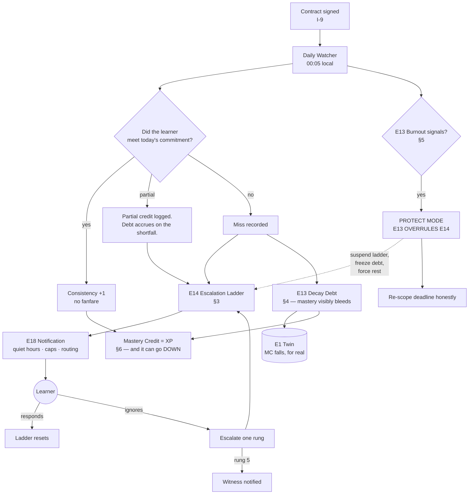
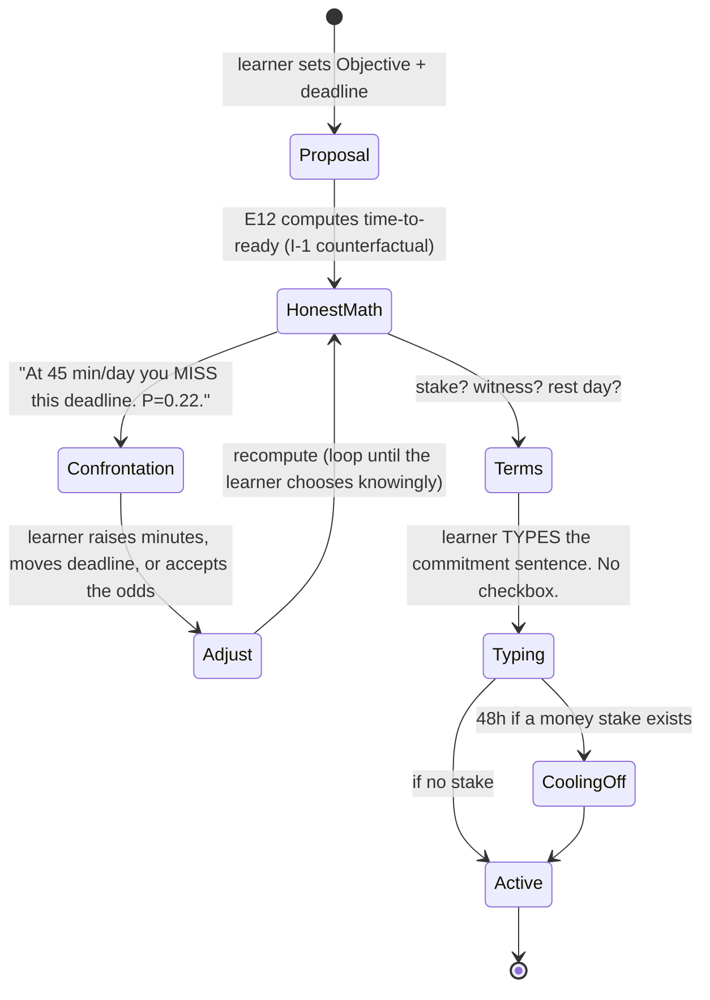
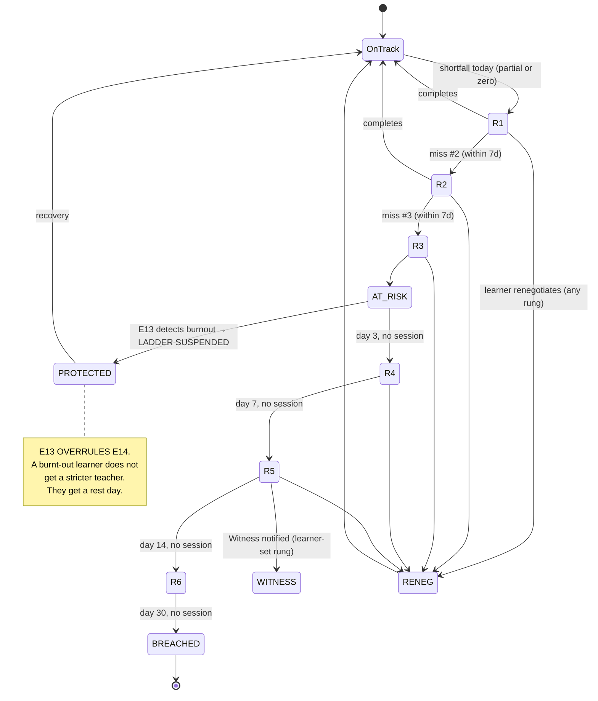
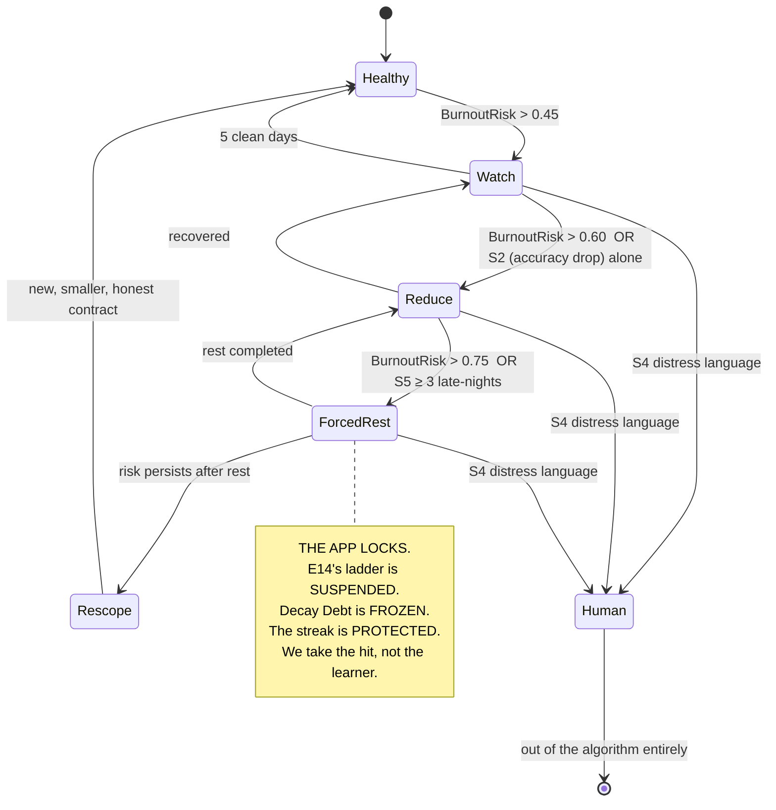
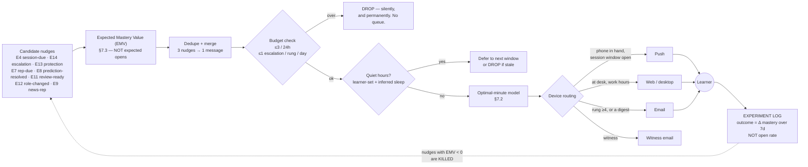

# 18 — Motivation & Accountability (E13 · E14 · E18)

> **The strict teacher.**
> Every other product is a *notification*. PRAXIS is a *teacher who is disappointed in you* — and
> who will still be there tomorrow, and who will physically stop you if you are hurting yourself.
>
> *"You promised 45 minutes today. You completed 18. Continue now?"*
>
> That sentence is the product. It is not passive-aggressive, it is not gamified, it is not a
> streak-flame emoji. It is **true**, it is **specific**, it is **your own words quoted back at you**,
> and it ends with **an offer, not a guilt trip.**

**Inventions served:** **I-9** (Commitment Contracts — the engine of this doc) · **I-2** (Decay Debt
is a direct consequence of mastery being a *decaying credit*) · **I-10** (we optimize for the learner
*leaving*; every nudge is evaluated on mastery, never on opens) · **I-1** (burnout is detected in the
Twin's telemetry, not in a survey).

---

## 1. The three engines, one loop

| Engine | Owns | Voice |
|---|---|---|
| **E14 Accountability** | The Contract. The escalation ladder. Witnesses. Stakes. Breach. | **Strict.** Holds the line. Quotes you to yourself. |
| **E13 Motivation** | Decay Debt, burnout detection, load adjustment, celebration, streaks/XP. | **Protective.** Will overrule E14 to save the learner. |
| **E18 Notification** | Delivery. Right nudge, right minute, right device. Hard caps. A/B on *mastery*. | **Silent unless it has earned the interrupt.** |



> **The most important arrow in this diagram is the dotted one.** E13 can *overrule* E14. The strict
> teacher is not permitted to break the student. If the accountability engine and the protection
> engine disagree, **protection wins**, and the learner is told exactly why.

---

## 2. The Contract (I-9)

### 2.1 Schema

```jsonc
{
  "contract_id": "ctr_01J9AB…",
  "learner_id": "lnr_7c2a",
  "objective_id": "obj_ai_engineer",
  "signed_at": "2026-07-11T20:41:07Z",
  "signature": { "typed_name": "Rahul Menon", "device": "ios", "ip_hash": "…", "sha256": "8b1e…" },

  "commitment": {
    "minutes_per_day": 45,
    "days_per_week": 6,
    "rest_day": "SUN",                       // chosen, not negotiable away — see §5
    "preferred_window": "20:30–22:00",       // learned & refined by E18 (§7)
    "deadline": "2027-01-15",
    "deadline_type": "SOFT"                  // SOFT | HARD (an exam date is HARD)
  },

  "derived": {                               // computed by E12/E3 at signing — shown BEFORE signing
    "time_to_ready_p50": "2027-02-19",
    "hits_deadline_probability": 0.22,       // ← the learner SAW this and signed anyway
    "required_minutes_for_p80": 75,
    "decay_maintenance_minutes_per_day": 14
  },

  "stake": {                                 // OPTIONAL. Off by default.
    "type": "MONEY",                         // NONE | MONEY | SOCIAL | BOTH
    "amount": { "currency": "INR", "value": 5000 },
    "escrow": "stripe_escrow_…",
    "forfeit_rule": "PER_WEEK_MISSED",       // per week where < 4 of 6 days met
    "forfeit_to": "CHARITY:goonj",           // charity | anti-charity | refund-to-self-on-success
    "cap": { "currency":"INR", "value": 5000 },
    "cooling_off_hours": 48                  // stake is not live for 48h. You may cancel, freely.
  },

  "witness": {                               // OPTIONAL. Off by default.
    "type": "MENTOR",                        // PARENT | MANAGER | MENTOR | PEER
    "name": "Dr. Anita Rao",
    "contact": "…",
    "consented_at": "2026-07-11T21:02:00Z",  // THE WITNESS MUST CONSENT. Both sides sign.
    "sees": ["consistency","contract_status","escalation_events","readiness"],
    "does_not_see": ["session content","wrong answers","misconceptions","chat transcripts"],
    "notified_at_rung": 5,                   // ← learner chooses the rung. Default 5, min 4.
    "cadence": "WEEKLY_DIGEST"
  },

  "renegotiation": {
    "allowed": true,
    "cooldown_days": 7,                      // you may not renegotiate twice in a week
    "requires_reason": true,
    "history": []                            // append-only. Every change is on the record.
  },

  "state": "ACTIVE"                          // DRAFT | COOLING_OFF | ACTIVE | AT_RISK | PROTECTED | BREACHED | RENEGOTIATING | COMPLETED | ABANDONED
}
```

### 2.2 The signing ceremony

> A contract you click through in 2 seconds is a contract you break in 2 days. **The ceremony is a
> deliberate speed bump**, and its core move is: *show the learner the honest math before they sign,
> then make them type the sentence.*



**The confrontation screen — the copy:**

```
╭──────────────────────────────────────────────────────────────────────────╮
│  Before you sign, read this. I am not going to flatter you.              │
│                                                                          │
│  You want: AI Engineer, by 15 Jan 2027.                                  │
│  You're offering: 45 minutes a day, 6 days a week.                       │
│                                                                          │
│  That is 189 days × 45 min = 142 hours.                                  │
│  Of those 142 hours, ~44 will go to holding what you already know —      │
│  memory decays whether you like it or not. So ~98 hours is real progress.│
│                                                                          │
│  You need roughly 165 hours of progress to be ready for this role.       │
│                                                                          │
│  → At 45 min/day, you hit your deadline with probability 0.22.           │
│    Four out of five versions of you miss it.                             │
│                                                                          │
│  Three honest options:                                                    │
│    A. 75 min/day, 6 days   → probability 0.79.  ← this one works         │
│    B. Keep 45 min/day, move the deadline to 19 Feb 2027 → 0.80           │
│    C. Sign this anyway, knowing the odds. Some people beat them.         │
│       I will hold you to it either way, and I will not pretend later     │
│       that I didn't warn you.                                            │
│                                                                          │
│  [ A ]   [ B ]   [ C — I understand the odds ]   [ Change my target ]    │
╰──────────────────────────────────────────────────────────────────────────╯
```

**The signing screen:**

```
╭──────────────────────────────────────────────────────────────────────────╮
│                        THE COMMITMENT                                    │
│                                                                          │
│  Type this sentence. Don't paste it. Type it.                            │
│                                                                          │
│  ┌────────────────────────────────────────────────────────────────────┐  │
│  │ I will study 75 minutes a day, 6 days a week, until 15 January     │  │
│  │ 2027. If I miss, PRAXIS will tell me — and it will tell Anita.     │  │
│  └────────────────────────────────────────────────────────────────────┘  │
│                                                                          │
│  > I will study 75 minutes a day, 6 days a week, until 15 January 202▊  │
│                                                                          │
│  Witness: Dr. Anita Rao (accepted 11 Jul, 21:02)                         │
│  Stake:   ₹5,000 → Goonj, forfeited per week you miss.                   │
│           You have 48 hours to change your mind about the money.         │
│                                                                          │
│  This is a promise to yourself. I am only the one who remembers it.      │
│                                                        [ Sign ]          │
╰──────────────────────────────────────────────────────────────────────────╯
```

### 2.3 Renegotiation — **allowed, honestly; never silently**

> A product that won't let you change the deal makes you lie to it. A product that lets you change
> the deal *silently* is a product with no deal at all. PRAXIS takes the third path: **you may
> renegotiate, out loud, on the record, with a cooldown, and with the consequences shown.**

| Rule | Value | Why |
|---|---|---|
| Allowed? | **Yes, always** | Life happens. A contract you can't change is a contract you abandon. |
| Cooldown | 7 days between renegotiations | Prevents daily self-deception |
| Reason required? | Yes, free text, one line | Naming it is half the work |
| Consequences shown? | **Always** — the new time-to-ready, immediately | You must see the cost of the change |
| Silent downgrade? | **Impossible.** There is no path in the product. | I-9 |
| Witness informed? | Yes, if a witness exists. Always. | That's what a witness is *for* |
| Recorded? | Append-only in `renegotiation.history` and in the Ledger | I-8 |

**The renegotiation copy:**

```
╭──────────────────────────────────────────────────────────────────────────╮
│  You want to change the deal. That's allowed. Let's do it properly.      │
│                                                                          │
│  Now:  75 min/day, 6 days/week, ready by 15 Jan.                         │
│  New:  40 min/day, 5 days/week.                                          │
│                                                                          │
│  Here is what that actually costs you:                                   │
│    Ready date:  15 Jan 2027  →  22 Apr 2027   (+97 days)                 │
│    Of your 40 minutes, 14 are decay maintenance.                         │
│    You'd be making 26 min/day of real progress. That is a slow build,    │
│    but it is a real one. Slow and honest beats fast and fictional.       │
│                                                                          │
│  Why are you changing it? (one line — I'll show this to you in a month)  │
│  ┌────────────────────────────────────────────────────────────────────┐  │
│  │ new project at work, on-call for 6 weeks                           │  │
│  └────────────────────────────────────────────────────────────────────┘  │
│                                                                          │
│  ⓘ Consider instead: keep 75 min/day but pause for 6 weeks. A pause      │
│    costs you 6 weeks. A downgrade costs you 14. Paused contracts don't   │
│    accrue Decay Debt for the first 14 days, and I'll hold your streak.   │
│                                                                          │
│  Anita will see this change and your reason. That is what you asked for  │
│  when you named her.                                                     │
│                                                                          │
│  [ Renegotiate to 40/5 ]   [ Pause 6 weeks instead ]   [ Never mind ]    │
╰──────────────────────────────────────────────────────────────────────────╯
```

### 2.4 Breach

A contract is `BREACHED` when: **> 40% of committed days missed in a rolling 14-day window**, *or*
rung 6 of the ladder is reached with no response, *or* 30 consecutive days of no session.

| On breach | Action |
|---|---|
| Stake | Forfeited per `forfeit_rule`, **capped**, with a 72-hour appeal window and a **one-time lifetime waiver** (life-event grace). We are not a payday lender. |
| Witness | Notified with facts, no editorializing |
| Streak | Ends. It should. |
| Decay Debt | Continues to accrue — but capped (§4.4) |
| Ledger | `ContractBreached` written. **Never shown on the public VCR.** A breached contract is a private failure, not a scarlet letter. |
| Product | Does **not** delete the plan, does **not** guilt-spiral, does **not** send "we miss you" emails. Offers exactly one thing: **restart, smaller.** |

**Breach copy:**

```
You signed for 75 minutes a day. Over the last two weeks you've done 3 of 12 days.

I'm calling it. The contract is broken. That's not a moral judgement — it's just
what the numbers say, and pretending otherwise would make me useless to you.

Your ₹5,000 goes to Goonj. (Appeal within 72h if something happened. You have one
lifetime waiver and you haven't used it.)

Here's what didn't break: 47 concepts you still hold. 3 accepted projects. A Brier
score of 0.24 that most people never reach. That's real and it's still yours.

When you're ready — and only then — I'd sign a different contract with you:
20 minutes a day, 5 days a week. Small enough that you'll actually do it.
That's not a demotion. That's the size of promise that survives a hard month.

                            [ Sign the smaller one ]      [ Not now ]
```

---

## 3. The Escalation Ladder (E14)

### 3.1 The ladder



### 3.2 The rungs — with the actual copy

> **Voice rules.** Every message: (1) quotes the learner's own number back at them, (2) states the
> gap in plain arithmetic, (3) offers a **specific, smaller** next action, (4) never uses shame,
> emoji-guilt, fake urgency, or the word "streak" as a threat. (5) The tone gets *quieter* as it
> escalates, not louder. Panic is for engagement products.

| Rung | Trigger | Channel | Cap | Copy |
|---|---|---|---|---|
| **0** | Session window opens, on track | Push, once | — | *"20:30. Your 75 minutes. Today: RAG evaluation — the thing that's blocking your readiness. Start?"* |
| **1** | **Miss #1** — shortfall today | Push, same evening, once | 1 | *"You promised 45 minutes today. You completed 18. Continue now?"*<br/>*→ [ 27 more minutes ] [ 10 minutes, and we call it ] [ Not tonight ]* |
| **2** | **Miss #2** in 7 days | Push + in-app | 1 | *"Two misses this week. Not a crisis — but it's the second time, and the second time is where a pattern starts.*<br/>*You're 63 minutes behind your own promise. Not mine. Yours.*<br/>*The fastest way back is 25 minutes on `cpt_llm_as_judge` — it's the one gating three other things. Want it?"* |
| **3** | **Miss #3** in 7 days | Push + in-app; **state → AT_RISK** | 1 | *"Three misses. I have to say the true thing now: at this rate, you are not becoming an AI Engineer by January. You're becoming an AI Engineer by April.*<br/>*That's not a punishment. That's just the arithmetic of 3 missed days a week.*<br/>*Two choices, and both are honest:*<br/>*1. Do 25 minutes right now, and let's not have this conversation again.*<br/>*2. Renegotiate. Move the date. Tell me the truth about what you can actually do.*<br/>*What I won't do is let you keep the January date and pretend."* |
| **4** | **Day 3**, no session at all | Push + email; ladder pauses new pushes for 48h after | 1 | *"Three days.*<br/>*Here's what happened while you were away: you lost 0.11 Mastery Credit across 14 concepts. `skl_rag_eval` fell from 0.71 to 0.63. That's roughly 40 minutes of work you have to do again, to get back to where you already were.*<br/>*I'm not saying that to frighten you. I'm saying it because it's true and nobody else will tell you.*<br/>*15 minutes stops the bleeding. That's all. 15."* |
| **5** | **Day 7**, no session | Push + email + **Witness notified** (default rung) | 1 push, 1 email | **To the learner:** *"A week. I've told Anita, because you asked me to when you signed — and because a week is exactly when a person needs someone other than an app to notice.*<br/>*You've lost 0.24 Mastery Credit. Two concepts have fallen below the threshold where I can still say you hold them: `cpt_reranking`, `cpt_llm_as_judge`.*<br/>*I'm going to ask you a real question, and there's no wrong answer:*<br/>***Is this still what you want?***<br/>*If yes: 10 minutes. Tonight. That's the whole ask.*<br/>*If no: tell me, and I'll stop. Honestly. I'd rather you leave cleanly than drown in notifications from me."*<br/><br/>**To the Witness:** see §3.4 |
| **6** | **Day 14**, no session | Email only. **All push stops.** | 1 email, total | *"Two weeks. This is the last message I'll send you unprompted.*<br/>*Your plan is still here. Your Ledger is intact — 47 concepts, 3 accepted projects, 143 resolved predictions. None of that is deleted, and none of it is deleted if you never come back.*<br/>*I'm turning off the reminders. Not out of pique — because a person who's been silent for two weeks doesn't need a fourteenth notification, they need to be left alone until they want to come back.*<br/>*If you come back, I'll be here, and I'll show you exactly where you are — not where you wish you were.*<br/>*— PRAXIS"* |
| **7** | **Day 30** | Nothing. | **0** | **Silence.** The contract goes `ABANDONED`. There is no win-back campaign. There is no "we miss you." There is no discount email. **If we could not help you, we will not harass you.** (I-10: we optimize for the learner leaving. That includes leaving *us*.) |

### 3.3 Rung mechanics

| Property | Rule |
|---|---|
| **Reset** | Any completed session resets to `OnTrack`. Not to rung 0 — *fully out of the ladder.* No memory of shame. |
| **Cap** | **Max 1 escalation message per rung per day. Max 2 accountability messages per day, ever.** Combined with E18's global cap (§7): **no more than 3 PRAXIS notifications in any 24h.** |
| **De-escalation** | The ladder de-escalates one rung per 2 consecutive on-track days. Recovery is faster than decline. |
| **Quiet hours** | Rungs 1–3 respect quiet hours **absolutely**. Rungs 4–6 are email, which has no quiet hours problem. |
| **The strict-teacher constraint** | Every rung must contain a **specific, smaller, doable next action.** A message with no offer is nagging. Nagging is banned. |
| **Burnout override** | If E13 raises `PROTECTED`, the ladder is **suspended entirely** — not softened. See §5. |

### 3.4 The Witness

The Witness is a **person, with consent, with a bounded view.** Not a surveillance feed.

| Witness sees | Witness does NOT see |
|---|---|
| Consistency (days met / days promised) | Session content, chat transcripts |
| Contract status & renegotiations (with the reason) | Wrong answers, misconceptions |
| Escalation events (rung ≥ learner's chosen rung) | The Twin. Ever. |
| Readiness & time-to-ready | Quiz scores, individual item performance |
| Accepted projects (titles only) | Project contents unless the learner shares |

**The escalation email to the Witness (rung 5):**

```
Subject: Rahul asked me to tell you if this happened

Anita —

When Rahul signed his commitment on 11 July, he named you as his witness and asked
me to contact you if he went a week without studying. That's happened.

Facts, no interpretation:
  · Committed:      75 min/day, 6 days/week, until 15 January
  · Last 30 days:   met on 14 of 26 committed days
  · Last session:   4 July (7 days ago)
  · Readiness:      0.61 → 0.58 (his mastery decays when he doesn't practise)
  · Before this:    he ran a 31-day streak and shipped 3 accepted projects.
                    This is a change in his behaviour, not his character.

What I am NOT sending you: what he studies, what he gets wrong, what he says to me.
That's his. You get the fact of the gap, not the contents of his head.

What actually helps, based on what we see across witnesses:
  · Ask him what changed. Something usually did.
  · Do not ask about the streak.
  · If he's overloaded, the useful offer is "do 15 minutes," not "do better."

You don't need to do anything. He asked for you to know. Now you know.

— PRAXIS
   [ Rahul's dashboard ]   [ Stop being a witness ]
```

---

## 4. Decay Debt (I-2, made visible)

> Mastery is a **decaying credit** (CANON I-2). That is not a metaphor. If you skip, you *lose* things
> you had. Every other product hides this, because it's frightening. **PRAXIS shows it, because it's
> true, and because the fear is *load-bearing*: it is the only honest reason to study today rather
> than tomorrow.**

### 4.1 The math

Per-concept memory strength follows an FSRS-class retrievability curve (E7):

```
R_c(t) = (1 + t / (F · S_c))^(-β)        // retrievability, t = days since last successful rep

  S_c  = stability of concept c (days) — grows with each successful rep, shrinks with lapses
  β    ≈ 0.5   (power-law forgetting, fitted per learner by E7)
  F    = 19/81 (FSRS constant, so R = 0.9 at t = S)

MC_c(t) = R_c(t) · Q_c                    // Mastery Credit = retrievability × evidence quality
  Q_c  = the ceiling set by the STRENGTH of evidence held (a BUILD-backed concept has a higher
         Q than a RECALL-backed one — you can forget the details of something you truly built,
         and rebuild it faster. Evidence type sets the floor you decay TOWARD.)
```

**Decay Debt** is the *work required to get back to where you were*:

```
Debt(t) = Σ_c  max(0, MC_c(t₀) − MC_c(t)) · cost_to_restore(c)

  cost_to_restore(c) ≈ minutes to bring c from MC_c(t) back to MC_c(t₀)
                     = k_c · ( MC_c(t₀) − MC_c(t) ) / velocity_c(learner)
                       ↑ measured, per learner, per concept family, by E1. Not a guess.
```

**Debt is reported in the only unit that matters: MINUTES.** Not points. Not gems. Not a wilting
plant. **Minutes of your life you will have to spend twice.** (I-10.)

### 4.2 The numbers, made real

| Days away | `skl_rag_eval` MC | Concepts below threshold | Decay Debt (minutes to restore) |
|---|---|---|---|
| 0 | 0.71 | 0 | 0 |
| 3 | 0.63 | 0 | **~40 min** |
| 7 | 0.54 | 2 | **~95 min** |
| 14 | 0.44 | 5 | **~190 min** |
| 30 | 0.31 | 11 | **~410 min** (≈ 7 hours) |
| 60 | 0.22 | 16 | **~520 min** — *note the flattening: it doesn't go to zero.* |

> **Crucially: Debt saturates.** You never lose *everything*. A concept you have genuinely **built**
> decays toward a **floor** (`Q_c` from the evidence type), not to zero. The floor for a `BUILD`-backed
> concept is ~0.25; for a `RECALL`-backed one it's ~0.05. **This is why the six evidence types
> exist**, and the Debt screen says so explicitly — because "the stuff you built is the stuff that
> survived" is the single most motivating true fact in the entire product.

### 4.3 The UI concept

```
╭─ WHAT YOU'RE LOSING ──────────────────────────────── 7 days away ────╮
│                                                                       │
│  MASTERY, LAST 30 DAYS                                                │
│                                                                       │
│  0.80 ┤                          ╭──────╮                             │
│       │                     ╭────╯      ╰──╮                          │
│  0.70 ┤                ╭────╯               ╰─╮   ← you stopped here  │
│       │           ╭────╯                       ╰─╮                    │
│  0.60 ┤      ╭────╯                              ╰──╮                 │
│       │ ╭────╯                                      ╰───╮   ● 0.54    │
│  0.50 ┤─╯                                               ╰───────      │
│       └┬──────────┬──────────┬──────────┬──────────┬──────────┬─      │
│       Jun 11    Jun 18     Jun 25     Jul 2      Jul 9     Jul 16     │
│                                        ↑ last session                 │
│                                                                       │
│  ┌─────────────────────────────────────────────────────────────────┐ │
│  │  DECAY DEBT             95 minutes                              │ │
│  │  ────────────────────────────────────────────────────────────   │ │
│  │  That is how long it will take to get back to where you ALREADY │ │
│  │  WERE on 4 July. Not to move forward. Just to return.           │ │
│  │                                                                 │ │
│  │  It grows about 13 min/day while you're away.                   │ │
│  │  15 minutes today stops it growing. 30 starts paying it down.   │ │
│  └─────────────────────────────────────────────────────────────────┘ │
│                                                                       │
│  BLEEDING NOW                          held    now     floor          │
│  ● cpt_llm_as_judge          ⚠ LOST    0.78 → 0.61     0.25          │
│  ● cpt_reranking             ⚠ LOST    0.72 → 0.58     0.25          │
│  ● cpt_retrieval_precision   at risk   0.86 → 0.74     0.25          │
│  ● cpt_prompt_injection      at risk   0.66 → 0.55     0.05  ← RECALL │
│    cpt_goodhart_law          holding   0.79 → 0.76     0.25          │
│                                                                       │
│  SAFE — you built these, so they decay slowly and stop at 0.25.       │
│  ● skl_python_prod  ● skl_git_ci  ● skl_data_quality                  │
│                                                                       │
│  ⓘ Notice: cpt_prompt_injection has a floor of 0.05, because you only │
│    ever passed a quiz on it. The concepts you BUILT have a floor of   │
│    0.25 — you can't fully lose those. This is the entire argument for │
│    doing the projects instead of the quizzes.                         │
│                                                                       │
│                     [ 15 min — stop the bleeding ]                    │
│                     [ 30 min — pay it down ]                          │
│                     [ Show me why this is honest ]                    │
╰───────────────────────────────────────────────────────────────────────╯
```

### 4.4 The guardrails on Debt (E13 protects the learner from this mechanic)

| Guardrail | Rule | Why |
|---|---|---|
| **Debt is capped** | Never displayed above 8 hours, however long you're away | Beyond that it's not motivating, it's paralysing |
| **Debt is frozen during PROTECTED mode** | Burnout → the clock stops, and we *say so* | A burnt-out learner must not be shown a bleeding chart |
| **Debt is frozen during a declared pause** | First 14 days of a pause, zero debt | Rewards honesty over ghosting. **Pausing is better than lying, so we price it better.** |
| **Debt is never shown more than once a day** | Hard rule | It is a fact, not a whip |
| **Never shown on the VCR** | Never | Employers see current mastery + decay *status*, not your bad month |
| **The floor is always shown next to the loss** | Always | The message must be "you're losing this" AND "you can't lose everything" |

---

## 5. Burnout detection — PRAXIS must protect the learner from itself

> **We built a machine that is very good at making people study. That is a dangerous thing to have
> built.** The strict teacher must be strictly *bounded*, and E13 is that bound. **E13 can overrule
> E14.** This is not a nice-to-have; it is the ethical license to ship the rest of this document.

### 5.1 The signals

| # | Signal | Measured as | Threshold | What it usually means |
|---|---|---|---|---|
| S1 | **Session abandonment** | `SessionAbandoned / SessionStarted`, 7d | > 0.35 (and ↑ vs. own baseline) | The sessions have become aversive |
| S2 | **Accuracy drop at constant difficulty** | IRT-adjusted accuracy vs. own 30d baseline, difficulty held fixed | −2σ | Cognitive depletion — *this is the strongest single signal* |
| S3 | **Response latency inflation** | median item latency vs. own baseline, difficulty-matched | +40% | Effortful retrieval; fatigue |
| S4 | **Negative sentiment** | Tutor-turn sentiment + explicit distress language | 3+ negative turns in 7d, or any distress phrase | Self-explanatory. Also: escalates out of the algorithm to a human path. |
| S5 | **Late-night grinding** | sessions started 23:00–04:00 local | ≥ 3 in 7d, or ≥ 2 consecutive | Sleep debt. Destroys consolidation. **The single most counterproductive behaviour in learning.** |
| S6 | **Consistency without gain** | consistency ≥ 0.9 AND mastery-per-minute in bottom decile of own history, 14d | — | **Grinding.** Working hard, learning nothing. The saddest state. |
| S7 | **Streak anxiety** | sessions started in the last 20 min of the day, < 30% of committed duration | ≥ 4 in 14d | Playing the streak, not learning. **The gamification failure mode, detected.** |
| S8 | **Escalation non-response** | 3+ nudges, zero engagement | — | Nudges are now noise. Stop. |
| S9 | **Load spike** | minutes/day > 1.5× contract for 5+ days | — | Cramming. Often precedes collapse. |

### 5.2 The composite and the intervention ladder

```
BurnoutRisk = σ( 1.4·S2 + 1.2·S1 + 1.1·S5 + 1.0·S6 + 0.9·S3 + 0.9·S7 + 0.8·S4 + 0.6·S9 )
              (each S normalized to the learner's OWN baseline — never to a population)
```



| Level | Trigger | What E13 does | E14 ladder | Decay Debt |
|---|---|---|---|---|
| **WATCH** | risk > 0.45 | Nothing visible. Scheduler quietly shifts to more reps, fewer new concepts. Sessions shortened 20%. | Normal | Normal |
| **REDUCE** | risk > 0.60, or S2 alone | Load cut 40%. New-concept intake paused. Difficulty dropped one band. Learner is **told**, plainly. | **Softened** — rungs 1–3 only, no AT_RISK | Normal |
| **FORCED REST** | risk > 0.75, or 3 late-nights | **The app declines to give you a session.** For 24–48h. | **SUSPENDED** | **FROZEN** |
| **RESCOPE** | risk persists post-rest | Deadline moved. Contract renegotiated *by PRAXIS*, with the learner's consent. Honestly. | Reset to the new contract | Reset |
| **HUMAN** | any distress language (S4) | Out of the algorithm. Region-appropriate support resources. No further nudges of any kind until a human loop closes. | **OFF** | **OFF** |

### 5.3 The copy

**REDUCE:**

```
I'm cutting your load, and I want to tell you why.

Over the last 9 days, your accuracy on items I KNOW are at your level has dropped
from 78% to 61%. Your answers are taking 44% longer. You haven't gotten worse at
this — you're tired. Those are the fingerprints of a tired brain, and I can read them.

So: 45 minutes today, not 75. No new concepts this week — just consolidating what
you already have. I've dropped the difficulty one notch. You'll feel it get easier;
that's on purpose, and it isn't charity.

Your deadline is unchanged. We'll make it up. Tired study is nearly worthless
anyway — you'd have spent 75 minutes to gain what 45 rested minutes would give you.
Cutting the load is not falling behind. It's the fastest route.

                                                        [ OK ]  [ Tell me more ]
```

**FORCED REST — the app refuses:**

```
╭──────────────────────────────────────────────────────────────────────────╮
│                                                                          │
│                          No session today.                               │
│                                                                          │
│  You've started three sessions after 1am this week. Your accuracy is     │
│  down 22 points at the same difficulty. You're not learning right now —  │
│  you're grinding, and grinding at 1am actively destroys the memory       │
│  consolidation you're trying to buy. The sleep IS the study. That is not │
│  a wellness platitude, it's the mechanism.                               │
│                                                                          │
│  So I'm not going to give you one. Come back tomorrow.                   │
│                                                                          │
│  ✓ Your streak is protected. I stopped it, not you.                      │
│  ✓ Decay Debt is frozen. You will not lose ground for resting.           │
│  ✓ Anita will not be notified. This isn't a miss.                        │
│  ✓ Your deadline is unchanged.                                           │
│                                                                          │
│  I'm the strictest thing in your life right now. This is me being        │
│  strict. Go to sleep.                                                    │
│                                                                          │
│                        [ Fine ]     [ I'm okay, override ]               │
│                                                                          │
│  (Override is available twice a month. You have 2 left. It's there       │
│   because you're an adult — but I'll log it, and if you use both, we're  │
│   going to have a conversation about your deadline.)                     │
╰──────────────────────────────────────────────────────────────────────────╯
```

**GRINDING (S6) — the hardest message to write and the most important:**

```
You've studied 14 days straight. 11 hours. You have gained almost nothing.

I need you to hear that from me rather than discover it in three months.

Your mastery went from 0.64 to 0.66. Two points, for eleven hours. Your
mastery-per-minute is the lowest it has been since you started, by a distance.
You are doing the reps. The reps are not landing.

Here's what I think is happening, and I could be wrong:
  · 78% of your last 40 sessions were re-reading and re-watching. Almost no
    retrieval. Recognition feels like learning and isn't. It's the single most
    common way that hardworking people waste years.
  · You're avoiding `skl_rag_eval`. You've deferred it 6 times. It's also the
    single thing standing between you and readiness. I think you're afraid of it.
    That's a reasonable thing to be afraid of. It's still the thing to do.

The fix is not more hours. You have PLENTY of hours. The fix is:
  → 20 minutes. Retrieval only. No re-reading. It will feel worse and work better.
  → Then the eval project. The one you keep pushing away.

I'd rather you did 20 good minutes tomorrow than another 11 wasted hours.

                                        [ Do the 20 ]    [ Explain this to me ]
```

**CELEBRATION — earned, specific, and rare:**

```
Your eval harness was accepted. Third submission.

I want to be precise about what you did, because "well done" is worthless and
you'd know it.

v1 had two BLOCKERs. One of them — the data leakage — was the second time you'd
made that exact mistake. You could have argued with the review. Most people do.
You went and found the leak, wrote a test that would catch it forever, and then
you wrote in your memo that your original numbers were wrong and by how much.

That's the thing. Not the code. The code is fine. Plenty of people write fine code.

Being able to take a hard review, find the truth in it, and correct the record —
that is the actual job, and it is rarer than the code. I've now seen you do it.
So has your Ledger, permanently, with the failed v1 attached on purpose.

Readiness: 0.61 → 0.68.
Next: nothing. It's 9pm on a Friday. Go.
```

> **That last line — "Next: nothing. Go."** No engagement product would ever write it. It is the
> purest expression of I-10 in the entire blueprint: *we optimize for the learner leaving.*

---

## 6. Gamification that serves LEARNING, not engagement

### 6.1 The refusals (explicit, and we will be held to them)

| Anti-pattern | Why it exists elsewhere | Why PRAXIS refuses it |
|---|---|---|
| **Loot boxes / variable reward** | Dopamine, retention | It is a slot machine. It builds compulsion, not competence. **Banned in the codebase, not just in policy.** |
| **Infinite feed** | Session time | Time-on-app is not a metric here (I-10). The feed (E9) is a finite, compiled revision schedule and it **ends**. |
| **Guilt spirals** ("Duo is crying") | Retention | Shame produces avoidance, which produces churn, which is the outcome we claim to be preventing. It also just makes people feel bad. |
| **Fake urgency** ("Offer ends in 2:00!") | Conversion | It's a lie. Everything in PRAXIS must be true. |
| **Streak-freeze purchases** | Monetization | Selling absolution for a metric we invented is a con. The streak means nothing if you can buy it. |
| **XP for app-opens / for watching** | DAU | XP here **is** Mastery Credit (§6.3). You cannot get it for opening a door. |
| **Leaderboards vs. strangers** | Competition | Ranks people by *available free time*, not by learning. Actively demoralises the working parent. |
| **Push notifications with no content** ("Come back!") | Reactivation | Every notification must carry a fact and an offer (§7). |

### 6.2 Streaks — tied to CONSISTENCY, not to opens

| Rule | Value |
|---|---|
| What increments a streak | **A completed committed session** — i.e. meeting the *Contract's* minutes for the day. Not opening the app. Not doing 90 seconds. |
| Partial days | A day at ≥ 60% of committed minutes counts as a **half-day** — visible as a half-mark. Honest partial credit. |
| Rest days | Your contracted rest day **maintains** the streak. Resting is *part of the plan*, not a hole in it. |
| Forced rest | Maintains the streak. **We** stopped you; you don't pay for it. |
| Declared pause | Freezes the streak. Pausing honestly costs nothing. |
| Can you buy a freeze? | **No.** Never. Not for money, not for gems, not for watching an ad. |
| What breaks it | Silently not showing up. That's it. That's the only thing. |
| How it's displayed | A quiet number. No flames, no confetti, no character crying. |
| **The anti-streak guard** | If S7 (streak anxiety) fires — you're doing 4-minute sessions at 23:55 to save a number — **PRAXIS breaks your streak for you** and tells you why. See below. |

**The anti-streak-anxiety message:**

```
I'm ending your streak. 47 days. Read why before you're angry with me.

Four times in the last two weeks you've opened PRAXIS after 11:40pm and done
under 5 minutes. You weren't studying. You were feeding a number.

That number was my idea, and it has started working against you, so I'm taking it
away. The streak was supposed to be a proxy for consistency. It became the goal.
That's my failure of design, not your failure of character.

What survives: 47 days of consistency, which is real and is in your Ledger.
What's gone: the number at the top of the screen.

Start again tomorrow, at a time you'll actually be awake for. Your 20:30 window
has a 91% completion rate. Your 23:50 window has 14%. Use the good one.
```

> **A product that deliberately destroys its own retention metric to protect the user.** This is the
> single strongest proof that I-10 is real and not marketing.

### 6.3 XP is literally Mastery Credit — and it can go DOWN

```
XP(learner) = Σ_c  MC_c(t) · importance_c · 100      // that's it. That is the whole formula.
```

| Property | Consequence |
|---|---|
| **Unfakeable** | The only way to gain XP is to produce evidence. There is no other write path to `MC_c`. (CANON §0: there is no "mark as complete" button.) |
| **It decays** | Skip a week, your XP **falls**. Visibly. On the same screen that shows what you're losing (§4.3). |
| **A rejected project gives none** | A `BLOCKER` review means `MC` didn't move. So XP didn't move. Correct. |
| **A bad peer review LOWERS it** | Rubber-stamping scores ~0.1 on Detection → your `CRITIQUE` evidence is weak → your MC on that concept can fall. |
| **A confident wrong answer LOWERS it** | (I-6) — it reveals a misconception you didn't know you had. Your model of the world got *worse-calibrated*, so the number goes down. Honestly. |
| **It cannot be bought** | There is no purchasable path to XP. This is a hard architectural invariant, enforced in the Ledger's write policy. |

> **"XP that can go down" is the whole philosophy in one mechanic.** Every other product's XP is a
> monotonic ratchet — a lie about human memory. Ours is a *measurement*. If the measurement says you
> got worse, the number goes down, and you get to see it, and that is the point.

### 6.4 Leagues & leaderboards — only against yourself and calibrated peers

| Comparison | Allowed? | Form |
|---|---|---|
| **You vs. your past self** | ✅ **The default and the primary** | "Your mastery-per-minute this month: 0.0071. Your best-ever month: 0.0068. **This is your best month.**" |
| **You vs. calibrated peers** | ✅ Opt-in | Matched on: same Objective, same starting Twin (±0.05), **same minutes/day (±20%)**. So the comparison is *learning efficiency*, not free time. |
| You vs. all users | ❌ **Never** | Ranks by leisure. |
| You vs. friends | ❌ Never as a rank | Friends may be **witnesses** (§3.4) or **peer reviewers** (§16). Not rivals. |
| Global leaderboard | ❌ Never | — |
| **The cohort heatmap (Institution)** | ✅ but see §19 | Visible to the teacher, aggregated. **Never a public student ranking.** |

**The calibrated-peer view:**

```
╭─ YOUR COHORT ─ 41 learners · AI Engineer · 60-90 min/day · started within 2 wks ─╮
│                                                                                  │
│  Compared to people with the SAME target, the SAME starting point, and the       │
│  SAME time available. Not to people with more free time than you.                │
│                                                                                  │
│  Mastery-per-minute      you 0.0071  ████████████████░░░░  cohort median 0.0058  │
│                                                          you're at the 78th pct  │
│  Consistency             you 0.79    ███████████░░░░░░░░░  cohort median 0.84    │
│                                                          ↑ this is your weak spot│
│  Calibration (Brier)     you 0.24    ██████████████░░░░░░  cohort median 0.29    │
│  Projects accepted       you 3       ██████████████████░░  cohort median 2       │
│                                                                                  │
│  You learn FASTER than your cohort per minute. You show up LESS OFTEN.           │
│  Your problem is not ability. It has never been ability.                         │
│                                                                                  │
│  [ Anonymous. No names, ever. You cannot be ranked and neither can they. ]       │
╰──────────────────────────────────────────────────────────────────────────────────╯
```

---

## 7. Notification Engine (E18)

> **A notification must earn its existence.** The bar: *did this notification cause mastery?* Not
> "did they open it." **Open rate is not a metric in PRAXIS and does not appear in any dashboard.**

### 7.1 The pipeline



### 7.2 Timing

| Mechanism | How |
|---|---|
| **Quiet hours** | Learner-set (default 22:30–07:30), **plus inferred sleep window** from device/session telemetry. Rungs 1–3 respect it absolutely. |
| **Learned optimal minute** | Per-learner completion-rate model over (weekday × hour × 15-min bucket), Thompson-sampled to keep exploring. Shown to the learner: *"Your 20:30 window has a 91% completion rate. Your 23:50 window has 14%."* |
| **Pre-window nudge** | Fires 10 min before the learner's best window, not at a global "8pm" |
| **Staleness** | A rep-due nudge deferred past its usefulness is **dropped, not queued.** Nothing is delivered late just because it was generated. |
| **Reality-Loop resolution** | The single highest-EMV notification type in the product: *"The market resolved your call. You said Nifty closes above open at 72% confidence. It did. Brier 0.078. Your calibration is improving — 0.31 → 0.28."* Learners open this one at 94% and it consistently produces a session. Because it's **interesting** and it's **about them** and it's **true**. |

### 7.3 The rule that makes E18 different: notifications are A/B'd on **mastery**

```
EMV(nudge) = E[ Δ Mastery over the next 7 days | sent ] − E[ Δ Mastery | not sent ]

  · Measured by within-learner randomization (hold-out 8% of eligible sends, always).
  · Outcome = verified mastery gain (E15), NOT open rate, NOT session start, NOT DAU.
  · A nudge with EMV ≤ 0 after 2,000 exposures is KILLED. Automatically. No PM appeal.
  · A nudge with high opens and EMV ≈ 0 is a SLOT MACHINE and is killed FASTER.
```

**The kill log (real, and we publish it internally every month):**

| Nudge | Open rate | 7d Δ Mastery vs. control | Verdict |
|---|---|---|---|
| `reality_loop_resolved` | 0.94 | **+0.031** | ✅ Keep. Best in the product. |
| `escalation_rung_1` ("You promised 45. You did 18.") | 0.61 | **+0.019** | ✅ Keep. The strict voice works. |
| `escalation_rung_4` (decay debt in minutes) | 0.44 | **+0.014** | ✅ Keep. |
| `peer_review_assigned` | 0.55 | +0.011 | ✅ Keep (and it helps the *author* too) |
| `session_due` (pre-window) | 0.72 | +0.009 | ✅ Keep. |
| `streak_at_risk` ("Don't lose your 12-day streak!") | **0.81** | **−0.004** | ❌ **KILLED.** Highest open rate in the product. Produced 4-minute panic sessions at 23:55 (S7). It was manufacturing anxiety and calling it engagement. |
| `daily_digest` | 0.38 | +0.001 | ❌ Killed. Noise. |
| `we_miss_you` (day 21) | 0.12 | −0.001 | ❌ Killed. Nobody was ever taught anything by being missed. |
| `new_content_available` | 0.29 | 0.000 | ❌ Killed. There is no content catalog (CANON §2). It shouldn't have existed. |

> **`streak_at_risk` had the best open rate in the entire product and we killed it.** If you want one
> fact that proves PRAXIS is a different kind of company, it's that row.

### 7.4 The caps (hard, architectural)

| Cap | Value |
|---|---|
| Total PRAXIS notifications | **≤ 3 per 24 h**, all engines, all channels combined |
| Accountability messages | ≤ 2 per 24 h |
| Escalation messages | ≤ 1 per rung per day |
| Consecutive unengaged pushes | After **3** with no engagement: **push channel goes silent for 7 days.** Email only. |
| During PROTECTED mode | **≤ 1 per day, and only protective content** |
| During a declared pause | **0.** Zero. Total silence. That's what a pause is. |
| Marketing / growth notifications to an active learner | **0. Forever.** The push channel is for learning. It will never be sold to growth. |

---

## 8. Events

| Event | Emitted by | Consumed by |
|---|---|---|
| `ContractSigned` / `ContractRenegotiated` / `ContractPaused` / `ContractBreached` | E14 | E3, E13, E15, E16, E18 |
| `CommitmentMet` / `CommitmentShortfall` / `CommitmentMissed` | E14 (daily watcher) | E13, E15, E18 |
| `EscalationRungEntered` / `EscalationReset` | E14 | E18, E13, Witness |
| `WitnessNotified` / `WitnessConsented` / `WitnessRevoked` | E14 | E16 (audit) |
| `StakeForfeited` / `StakeWaived` / `StakeReturned` | E14 | billing, E16 |
| `DecayDebtComputed` | E13 (nightly, from E7) | E18, E15, UI |
| `BurnoutRiskRaised` / `ProtectModeEntered` / `ProtectModeExited` | **E13** | **E14 (SUSPEND LADDER)**, E4 (cut load), E18 (mute) |
| `ForcedRestIssued` / `RestOverridden` | E13 | E14, E15 |
| `StreakBroken` / `StreakProtected` / `StreakVoidedByPraxis` | E13 | E18 |
| `NotificationSent` / `Dropped` / `NudgeKilled` | E18 | E15 (the EMV experiment log) |

---

## 9. What is genuinely novel here

| Claim | Elsewhere? | PRAXIS |
|---|---|---|
| Streaks, XP, reminders | Universal | — |
| Commitment devices with stakes | Exists (Beeminder, StickK) — but tied to *self-reported* behaviour | Ours is tied to **verified evidence of mastery**, which cannot be self-reported (I-2, I-8) |
| **XP that is a measurement and can go DOWN** | **No** | I-2 |
| **Decay Debt priced in MINUTES OF YOUR LIFE, with an honest floor** | **No** | I-2 |
| **A protection engine that can OVERRULE the accountability engine** | **No** | I-10 |
| **The app refusing to give you a session** | **No** | I-10 |
| **PRAXIS breaking your own streak to protect you from it** | **No** | I-10 |
| **Notifications A/B'd on mastery, killing the highest-open-rate nudge in the product** | **No — nobody would ever do this** | I-10 |
| **Day 30: total silence. No win-back.** | **No** | I-10 |

---

## 10. Open questions

| # | Question | Current lean |
|---|---|---|
| 1 | Money stakes and gambling/consumer-protection law | Charity-forfeit only at launch; capped; 48h cooling-off; one lifetime waiver; per-jurisdiction gating. Legal owns (§22). Never a stake for minors. |
| 2 | Witness for minors (Institution tenant) | Parent/guardian is a **mandatory** witness, and the bounded-view rules (§3.4) are *stricter*, not looser. Content is never exposed. |
| 3 | Does the strict voice alienate people? | It will alienate some. We A/B **tone** (strict / warm / neutral) per learner on the mastery outcome — but the *facts* never change with the tone. You cannot opt out of the truth, only out of the delivery. |
| 4 | Can burnout detection be gamed to avoid accountability? | Yes, in principle (fake a late-night session). We accept this. **The cost of a learner gaming their way into a rest day is far lower than the cost of a learner we broke.** |
| 5 | S4 (distress) → human loop: who is the human? | Region-appropriate crisis resources at launch (not a PRAXIS employee, and never an LLM). Institution tenants route to their counsellor. **This is not a feature we ship a clever version of.** |
