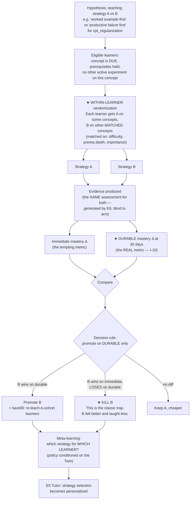
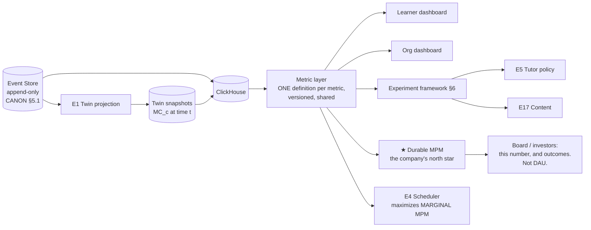

# 19 — Analytics (E15)

> **One number rules this product: MASTERY-PER-MINUTE (I-10).**
>
> Every other learning product's analytics answer the question *"is the user engaged?"* Ours answer
> a harder and more dangerous question: ***"is this working?"*** — and it is built so that the answer
> can come back **no**, to the learner's face, in the learner's own dashboard, with the receipts.
>
> Engagement is not a metric here. Time-on-app is not a metric here. **We optimize for the learner
> leaving** — with the thing they came for.

**Inventions served:** **I-10** (the north star, defined mathematically below) · **I-1** (every metric
is a projection of the Twin, which is a projection of the event log) · **I-3** (calibration and Brier
are first-class, next to mastery) · **I-2** (mastery decays, so *Forgetting Debt* is a metric) ·
**I-6** (mass failure on a concept is a signal about *our teaching*, not about the learners).

---

## 1. The north star

### 1.1 Definition

```
                    Δ Verified Mastery
MPM  =  ───────────────────────────────────────
              Minutes Invested

More precisely, over a window W:

              Σ_c  imp_c · [ MC_c(t₁) − MC_c(t₀) ]                      ← numerator: what you GAINED
MPM(W)  =   ─────────────────────────────────────────────
              Σ_s∈W  duration(s)                                        ← denominator: what it COST

where
  imp_c        = importance of concept c to the learner's Objective  (from E12's role ontology,
                 normalized so Σ imp_c = 1 over the Objective's concept closure)
  MC_c(t)      = R_c(t) · Q_c    (retrievability × evidence quality — see §3 and doc 18 §4.1)
  duration(s)  = ACTIVE seconds in session s (focus-gated; see §4 "Focus")
  t₀,t₁        = window bounds, with MC evaluated at a COMMON reference time
```

### 1.2 Three properties that make this honest and that no competitor's metric has

| Property | Statement | Consequence |
|---|---|---|
| **It is signed** | `MC_c(t₁) − MC_c(t₀)` can be **negative** | A week of decay with no reps produces **negative MPM**. The dashboard shows it. |
| **It is decay-adjusted** | Both endpoints are evaluated at the same reference time `t₁`, so the numerator is *net of forgetting* | You cannot "gain" mastery by cramming and letting it evaporate. The gain is only counted if it *survives*. |
| **It is evidence-gated** | `MC_c` only moves on an Evidence event (I-2). There is no other write path. | **MPM is unfakeable.** Watching a video for 60 minutes yields `ΔMC = 0` yields `MPM = 0`. Correctly. |

### 1.3 The variants we report

| Variant | Formula | Used for |
|---|---|---|
| **Instantaneous MPM** | over the last 7 days | The dashboard headline |
| **Durable MPM** (the real one) | numerator re-evaluated **30 days later**, denominator unchanged | *Did it stick?* This is the metric the **product** optimizes. It lags 30 days and we accept that. |
| **Objective-weighted MPM** | `imp_c` from the current role version | Learning the wrong things scores near zero even if you learned them well |
| **Marginal MPM** | `∂Mastery / ∂minute` at the current plan position | What the **Scheduler (E4)** actually maximizes when picking the next 15 minutes |
| **Counterfactual MPM** | vs. a matched baseline (see §7) | What the **product team** is graded on. Is PRAXIS better than studying alone? |

> **We report `Durable MPM` as the company's north star, not `Instantaneous`.** Instantaneous MPM is
> gameable by cramming. Durable MPM is not gameable by anything except actually teaching someone
> something. Choosing the metric with a **30-day reporting lag** over the one that looks good today is
> the single most important product decision in this document.

---

## 2. The metric tree

```mermaid
flowchart TD
  NS["★ DURABLE MASTERY-PER-MINUTE<br/>Δ surviving verified mastery ÷ minutes<br/>(I-10)"]

  NS --> A["A. MASTERY GAINED<br/>the numerator"]
  NS --> B["B. MINUTES INVESTED<br/>the denominator"]
  NS --> C["C. DURABILITY<br/>does it survive 30 days?"]

  A --> A1["Knowledge Growth<br/>Σ ΔMC over concepts"]
  A --> A2["Skill Growth<br/>Σ Δ SkillReadiness"]
  A --> A3["Evidence Quality<br/>Q_c — which of the 6 types"]
  A1 --> A11["Mastery %<br/>vs. Objective closure"]
  A1 --> A12["Weak Areas<br/>low MC × high importance"]
  A2 --> A21["Project Completion"]
  A2 --> A22["Prediction Accuracy + Brier"]

  B --> B1["Time Invested<br/>active seconds"]
  B --> B2["Focus<br/>active ÷ elapsed"]
  B --> B3["Consistency<br/>days met ÷ days promised"]
  B --> B4["Session Efficiency<br/>MC gained per session"]

  C --> C1["Forgetting Debt<br/>MC you will lose"]
  C --> C2["Revision Score<br/>are reps landing?"]
  C --> C3["Retention @30d"]

  NS --> D["D. TRUTHFULNESS<br/>do you know what you know?"]
  D --> D1["Calibration<br/>confidence vs competence"]
  D --> D2["Brier Score"]
  D --> D3["Dunning-Kruger Delta"]
  D --> D4["Quiz Accuracy<br/>(the weakest metric here,<br/>and we say so)"]

  NS --> E["E. THE POINT<br/>did it work?"]
  E --> E1["Learning ROI<br/>mastery per hour vs. goal"]
  E --> E2["Time-to-Ready<br/>vs. deadline"]
  E --> E3["★ Career Outcome<br/>offer / placement (E12 §8)"]

  style NS fill:#0b3d2e,stroke:#12b886,color:#e6fcf5
  style E3 fill:#3d2c0b,stroke:#f59f00,color:#fff9db
```



---

## 3. Every metric: formula + data source

**Notation.** `MC_c(t) = R_c(t) · Q_c` where `R_c` is FSRS-class retrievability and `Q_c` is the
evidence-quality ceiling (doc 18 §4.1). `imp_c` = importance to the Objective (E12). All metrics are
**projections of the event log** (CANON §5.1) — rebuildable from zero, which is what makes analytics
auditable and research honest.

### 3.1 Learner metrics

| # | Metric | Formula | Data source (events) | Range | Honest caveat we display |
|---|---|---|---|---|---|
| 1 | **Knowledge Growth** | `Σ_c imp_c · [MC_c(t₁) − MC_c(t₀)]`, both at ref time `t₁` | `EvidenceRecorded`, `RepCompleted`, `PredictionResolved` → E1 | −1 … +1 | Can be **negative**. Usually is, in a bad week. |
| 2 | **Skill Growth** | `Σ_s w_s · [SkillReadiness_s(t₁) − SkillReadiness_s(t₀)]` (E12 §2.3) | above + `ArtifactAccepted`, `CritiqueGraded` | −1 … +1 | Lags Knowledge Growth — evidence takes time to accumulate |
| 3 | **Mastery %** | `(Σ_{c ∈ closure} imp_c · MC_c) / (Σ imp_c)` | E1 Twin projection | 0 … 1 | **Not a completion bar.** It goes down. |
| 4 | **Confidence vs Competence (Calibration)** | `Cal = 1 − (1/n)Σ_i \|conf_i − correct_i\|` over items where the learner stated confidence | `AnswerGiven{confidence}`, `PredictionMade{confidence}` + resolution | 0 … 1 | Requires n ≥ 30 to be shown. Below that: "not enough data — and I won't guess." |
| 5 | **Dunning–Kruger Delta** | `DK = mean(conf) − mean(correct)`, per concept family | same | −1 … +1 | **Positive = overconfident.** This is the number that predicts interview failure (doc 17 §7.3). |
| 6 | **Brier Score** | `BS = (1/n) Σ (p_i − o_i)²`, `o ∈ {0,1}` | `PredictionMade` → `PredictionResolved` (E8, I-3) | 0 … 1 (**lower is better**) | 0.25 = coin-flipping. We show that line on the chart. |
| 7 | **Prediction Accuracy** | `(1/n) Σ 1[argmax p_i = o_i]` | same | 0 … 1 | **Deliberately deprioritized vs. Brier.** Being right by luck is not skill. |
| 8 | **Weak Areas** | `rank_c( imp_c · (1 − MC_c) · blocking_factor_c )` where `blocking_factor` = # of downstream concepts gated by `c` in the Graph | E1 × E2 | ranked list | Sorted by **damage**, not by lowness. A weak leaf node doesn't matter. A weak *bottleneck* does. |
| 9 | **Revision Score** | `RS = (Σ reps_done_on_time) / (Σ reps_due)` × `mean(rep_success)` | `RepDue`, `RepCompleted`, `RepLapsed` (E7) | 0 … 1 | Two ways to fail: not doing reps, or doing them and failing them. We separate the terms. |
| 10 | **Quiz Accuracy** | `correct / attempted` on `RECALL` items | `AnswerGiven` | 0 … 1 | ⚠ **We label this "the weakest metric on this page."** It's here because learners expect it. It correlates with mastery at only r≈0.41. We print that number next to it. |
| 11 | **Project Completion** | `accepted_artifacts / briefs_issued` | `ProjectBriefIssued`, `ArtifactAccepted`, `ProjectAbandoned` (E11) | 0 … 1 | Also shown: **mean revisions to acceptance** — the more interesting number. |
| 12 | **Critique Quality** | `0.40·Detection + 0.20·Precision + 0.25·SeverityCal + 0.15·Actionability` (doc 16 §6.2) | `CritiqueGraded` | 0 … 1 | Measured against seeded artifacts with planted flaws. Cannot be gamed. |
| 13 | **Consistency** | `days_met / days_committed` over 28d (half-credit for ≥60% days) | `CommitmentMet/Shortfall/Missed` (E14) | 0 … 1 | Rest days count as **met**. Forced rest counts as **met**. Pauses are excluded from the denominator. |
| 14 | **Focus** | `active_seconds / elapsed_seconds`; active = input within 90s, app foregrounded, not idle | `SessionStarted`, `InteractionTick`, `SessionIdle`, `SessionAbandoned` | 0 … 1 | Deliberately **not** used to shame. Used to make the MPM denominator honest. |
| 15 | **Time Invested** | `Σ active_seconds` | same | minutes | Broken out: **new learning / reps / projects / predictions / decay maintenance**. The last one shocks people. |
| 16 | **Learning ROI** | `MPM_durable`, and `ROI_goal = (mastery_needed − mastery_held) / (mastery_rate × days_left)` | E15 × E12 | ratio | `ROI_goal > 1` ⇒ **you will not make it.** We say so. |
| 17 | **Forgetting Debt** | `Σ_c imp_c · max(0, MC_c(now) − MC_c(now + 7d))` — mastery you will lose in the next 7 days if you do nothing, priced in **minutes to restore** | E7 decay curves × E1 velocity | minutes | Capped at 8h in display (doc 18 §4.4) |
| 18 | **Session Efficiency** | `ΔMC per session ÷ session minutes`, z-scored against the learner's own history | derived | z | This is MPM at the session grain. Powers "your 20:30 sessions are 2.1× your 23:50 sessions." |
| 19 | **Time-to-Ready** | Twin counterfactual (doc 17 §5.2) | E12 | date + P | Reported as **P50 and P80**, never a single date. A single date is a lie. |

### 3.2 The metrics we compute but treat with suspicion

| Metric | Why we compute it | Why we don't trust it | How it's displayed |
|---|---|---|---|
| Quiz Accuracy | Learners demand it; it's a cheap signal | r ≈ 0.41 with durable mastery. Easy to be good at quizzes and know nothing. | Shown, **with its correlation printed next to it** |
| Streak | Behavioural scaffold (doc 18 §6.2) | Measures showing up, not learning | Small, quiet, and **PRAXIS will break it** if it turns into anxiety |
| Time Invested | The MPM denominator | On its own, it is the **most misleading number in education**. Six hours can be worth zero. | Always shown **paired with what it bought** — never alone |
| Concepts "covered" | Nothing | It is the metric of a content company. It means nothing. | **Not shown. Anywhere.** |

---

## 4. The learner dashboard

### 4.1 The good week

```
╔══════════════════════════════════════════════════════════════════════════════╗
║  PRAXIS · Rahul Menon · AI Engineer                     Week of 6–12 Jul 2026 ║
╠══════════════════════════════════════════════════════════════════════════════╣
║                                                                              ║
║   MASTERY PER MINUTE           0.0074        ▲ 0.0061 last wk  ▲ best-ever   ║
║   ───────────────────────────────────────────────────────────────────────    ║
║   You invested 312 minutes and gained 2.31 points of verified mastery.        ║
║   That is the highest return you have ever achieved. Here is why:             ║
║   → 61% of your time was RETRIEVAL, not re-reading. Your best ratio yet.      ║
║   → You shipped a project. Projects are worth ~4× a quiz per minute spent.    ║
║                                                                              ║
╠═══════════════════════════════ WHERE YOU STAND ══════════════════════════════╣
║                                                                              ║
║   Mastery (AI Engineer closure)   ████████████████░░░░░░░░░░  0.68   ▲ 0.61   ║
║   Readiness (offer-ready)         ██████████████░░░░░░░░░░░░  0.61   ▲ 0.58   ║
║   Calibration                     ████████████████████░░░░░░  0.76   ▲ 0.71   ║
║   Brier (lower is better)         0.24  ├────●──────┼────────┤  ▼ from 0.28   ║
║                                       0.10       0.25(coin)  0.40             ║
║   Consistency (28d)               ███████████████░░░░░░░░░░░  0.79   ▼ 0.84   ║
║   Focus                           ██████████████████████░░░░  0.88   ▲ 0.83   ║
║                                                                              ║
║   ⚠ Consistency is your only metric moving the wrong way. It is also the      ║
║     only one that is entirely a choice.                                       ║
║                                                                              ║
╠═══════════════════════════ WHERE YOUR 312 MINUTES WENT ══════════════════════╣
║                                                                              ║
║   Project (RAG eval harness)   ████████████████████████████  148m   MPM .0098║
║   Retrieval reps               ███████████████░░░░░░░░░░░░░   81m   MPM .0071║
║   New concepts                 ████████░░░░░░░░░░░░░░░░░░░░   44m   MPM .0052║
║   Predictions (Reality Loop)    ███░░░░░░░░░░░░░░░░░░░░░░░░░   18m   MPM .0141 ★║
║   Decay maintenance            ████░░░░░░░░░░░░░░░░░░░░░░░░   21m   MPM  —   ║
║                                                                              ║
║   ★ Predictions are your highest-return activity by 43%, and you spend the    ║
║     least time on them. 18 minutes bought more calibration than 81 minutes of ║
║     reps bought recall. The Scheduler is increasing them next week.           ║
║                                                                              ║
║   ⓘ "Decay maintenance" = 21 minutes spent standing still. That is the tax    ║
║     you pay for the 6 days you didn't show up last month. It is not waste —   ║
║     it is interest.                                                           ║
║                                                                              ║
╠═════════════════════════════ WHAT'S BREAKING ════════════════════════════════╣
║                                                                              ║
║   WEAK AREAS  (ranked by DAMAGE — importance × gap × how much it blocks)      ║
║   1. skl_inference_serving      MC 0.21   blocks 11 concepts   ★ BOTTLENECK   ║
║   2. skl_prompt_injection       MC 0.00   blocks 4    (new: the role changed) ║
║   3. cpt_reranking              MC 0.52   blocks 3                            ║
║                                                                              ║
║   MISCONCEPTIONS BEING HUNTED                                                 ║
║   ● msc_more_context_is_better   conf 0.83  ⬆ hit twice (project + interview) ║
║     → 10 PREDICT items queued this week. You will state a probability BEFORE  ║
║       you see the answer, every time, until this dies.                        ║
║   ● msc_leakage_is_obvious       conf 0.79  ⬆ hit twice                       ║
║                                                                              ║
║   FORGETTING DEBT (next 7 days, if you do nothing)   →  38 minutes            ║
║                                                                              ║
╠═════════════════════════════════ THE POINT ══════════════════════════════════╣
║                                                                              ║
║   Time to ready (P50)     19 Feb 2027    Deadline: 15 Jan 2027                ║
║   P(hit deadline)         0.31           ▲ from 0.22                          ║
║                                                                              ║
║   You are gaining ground. You are still behind. Both are true.                ║
║   At 75 min/day instead of your current 52 average → P = 0.79.                ║
║                                                                              ║
║                                        [ Renegotiate ]  [ Do 25 minutes now ] ║
╚══════════════════════════════════════════════════════════════════════════════╝
```

### 4.2 The honesty principle — **the bad week**

> **This screen is the product.** Any analytics engine can render a good week. The test of whether an
> analytics system is honest is whether it is *permitted to render this*. Ours is required to.
>
> **Rule (architectural, not editorial):** if `MPM < 0.25 × learner's median MPM` over a 7-day window
> with ≥ 120 minutes invested, the dashboard **must** render the diagnostic screen. It is not a
> tooltip. It is not dismissible. It is the whole page. A product manager cannot A/B it away — the
> rule lives in E15 and is covered by a test.

```
╔══════════════════════════════════════════════════════════════════════════════╗
║  PRAXIS · Rahul Menon                                 Week of 22–28 Jun 2026  ║
╠══════════════════════════════════════════════════════════════════════════════╣
║                                                                              ║
║       You spent 6 hours and 14 minutes this week.                            ║
║       You gained almost nothing.                                             ║
║                                                                              ║
║       Mastery per minute:  0.0004    (your median: 0.0061)                    ║
║       Verified mastery gained:  0.15 points.                                  ║
║       Net of decay:  +0.02.                                                   ║
║                                                                              ║
║       In plain terms: after six hours of work, you know 0.02 points more      ║
║       than you did last Sunday. Six hours. I'm not going to dress that up.    ║
║                                                                              ║
║  ──────────────────────────────────────────────────────────────────────────  ║
║  HERE IS EXACTLY WHY. THERE ARE FOUR REASONS AND I CAN SHOW YOU ALL FOUR.     ║
║  ──────────────────────────────────────────────────────────────────────────  ║
║                                                                              ║
║  1. YOU RE-READ. YOU DIDN'T RETRIEVE.                            → cost: 3h10m║
║     ████████████████████████████░░░░░░  81% of your time was consuming        ║
║     (reading lessons, re-watching explanations, re-opening notes).            ║
║     19% was retrieval (being asked, and having to produce).                   ║
║                                                                              ║
║     Re-reading FEELS like learning. It produces a warm sense of familiarity   ║
║     that your brain mistakes for knowledge. It is the most common way that    ║
║     hardworking people waste years of their lives.                            ║
║     Your own data: retrieval minutes produced 0.0071 MPM this month.          ║
║                   re-reading minutes produced 0.0003 MPM. Twenty-three times  ║
║                   less, from YOUR OWN sessions. Not a study. You.             ║
║                                                                              ║
║  2. YOU STUDIED THINGS YOU ALREADY KNEW.                         → cost: 1h40m║
║     You spent 100 minutes on concepts already at MC > 0.85.                   ║
║     They were not due for review. There was nothing to gain.                  ║
║     I think you did this because they're comfortable, and because             ║
║     `skl_inference_serving` — which you have deferred 6 times — is not.       ║
║                                                                              ║
║  3. YOU STUDIED TIRED.                                            → cost: 52m ║
║     Four sessions started after 23:30. Your accuracy in those sessions: 44%.  ║
║     Your accuracy at 20:30, same difficulty: 79%.                             ║
║     Those 52 minutes bought you almost nothing AND cost you sleep, which is   ║
║     when the consolidation actually happens. They were worse than not         ║
║     studying at all. I mean that literally, not rhetorically.                 ║
║                                                                              ║
║  4. YOU ABANDONED 5 OF 11 SESSIONS.                              → cost: 32m  ║
║     Median abandonment at 3m40s. Something about starting is hard right now.  ║
║     That's worth paying attention to, and it's not a character flaw.          ║
║                                                                              ║
║  ──────────────────────────────────────────────────────────────────────────  ║
║  WHAT ACTUALLY WORKED THIS WEEK                                              ║
║     One thing. 22 minutes on Tuesday: 14 retrieval items on cpt_reranking,    ║
║     at 20:30, having slept. MPM 0.0069. That single block produced more       ║
║     mastery than the other 5 hours 52 minutes combined.                       ║
║     That is not a metaphor. It is the arithmetic.                             ║
║                                                                              ║
║  ──────────────────────────────────────────────────────────────────────────  ║
║  NEXT WEEK. THREE CHANGES. NOTHING ELSE.                                     ║
║     1. Retrieval only. I am turning OFF re-reading. If you want to look       ║
║        something up, you'll have to fail the question first. That's the deal. ║
║     2. Nothing after 22:30. I will decline to give you a session.             ║
║     3. `skl_inference_serving`, 20 minutes, tomorrow. The thing you're        ║
║        avoiding is the bottleneck. It always is.                              ║
║                                                                              ║
║     Do this and I estimate next week's MPM at ~0.0065 — sixteen times this    ║
║     week's — on FEWER hours. Around 3.5 instead of 6.2.                       ║
║                                                                              ║
║     You do not have a work-ethic problem. You put in six hours. You have an   ║
║     allocation problem, and that one I can actually fix.                      ║
║                                                                              ║
║                              [ Set up next week this way ]   [ Argue with me ]║
╚══════════════════════════════════════════════════════════════════════════════╝
```

> **`[ Argue with me ]`** opens a Tutor session where the learner can contest the diagnosis, and the
> Tutor is required to either defend it with data or concede. The analytics must be falsifiable to the
> learner's face. If we're wrong, we should be caught.

---

## 5. Cohort & organisation analytics

For `Institution` (school/university) and `Enterprise` (L&D) tenants. **Same honesty rules.**

### 5.1 The class mastery heatmap

```
╭─ CS-401 · Machine Learning · 34 learners · Week 9 ──────────────────────────────╮
│                                                                                 │
│  Concept ↓            Learners →  (sorted by class mastery, worst at top)        │
│                       ▁▁▁▁▁▁▁▁▁▁▁▁▁▁▁▁▁▁▁▁▁▁▁▁▁▁▁▁▁▁▁▁▁▁▁▁                      │
│  cpt_regularization   ░░░░░░▒░░░░░░░░▒░░░░░░░░░▒░░░░░░░░░░   0.19  ★★ SEE §5.3   │
│  cpt_bias_variance    ░░▒░░░▒▒░░▒░░░▒▒░░▒░░░▒░░▒▒░░░▒░░░░░   0.31  ★★           │
│  cpt_cross_validation ▒▒░▒▓▒▒▒▒▒▒░▒▒▓▒▒▒▒░▒▒▒▒▒▒▒▒▒▒░▒▒▒▒▒   0.54               │
│  cpt_gradient_descent ▓▓▒▓▓▓▓▒▓▓▓▓▓▓▓▓▒▓▓▓▓▓▓▒▓▓▓▓▓▓▓▓▓▓▓▓   0.78               │
│  cpt_linear_reg       ███▓███▓████████▓███████████████████   0.91               │
│                       ↑                    ↑                                     │
│                   at-risk               at-risk                                  │
│                                                                                 │
│  ░ <0.4   ▒ 0.4-0.6   ▓ 0.6-0.8   █ >0.8                                        │
│                                                                                 │
│  ★★ CURRICULUM ALERT — this is not a student problem. See below.                │
╰─────────────────────────────────────────────────────────────────────────────────╯
```

### 5.2 At-risk learners — ranked by **actionability**, not by lowness

```
Risk(learner) = 0.35·(1 − Consistency)
              + 0.25·(1 − MPM / cohort_median_MPM)
              + 0.20·Trajectory_negative        // ΔMastery/Δt < 0 over 14d
              + 0.20·(DK_delta > 0.2)           // ★ overconfident AND behind — the worst quadrant

Ranked by  Risk × Recoverability   ← because a teacher has finite hours and should spend them
                                     where they will change an outcome
```

| # | Learner | Risk | Why | The one intervention |
|---|---|---|---|---|
| 1 | S-1147 | 0.81 | Consistency 0.31; MPM 0.4× median; **DK +0.34 — thinks she's fine** | She doesn't know she's behind. **Show her the calibration chart, not the grade.** |
| 2 | S-1092 | 0.78 | Consistency 0.94 (!); MPM 0.2× median | **Grinding.** Working hardest in the class, learning least. Re-reading, not retrieving. This is the most heartbreaking row on any dashboard and it is invisible to every other LMS. |
| 3 | S-1203 | 0.74 | Trajectory −0.09/wk; 6 abandoned sessions | Something changed 3 weeks ago. **Ask him.** |
| … | | | | |
| 31 | S-1178 | 0.22 | Below cohort but rising fast, consistency 0.91 | **Leave alone.** She's fine. Don't spend your hour here. |

### 5.3 Curriculum efficacy — **mass failure is a signal about the TEACHING** (I-6)

> The most important idea in org analytics: **when 26 of 34 learners fail the same concept, the
> learners are not the problem.** Every LMS on earth reports this as "students struggling with
> regularization." PRAXIS reports it as **"our lesson on regularization is broken, and here is the
> misconception it is manufacturing."**

```
╭─ CURRICULUM ALERT ─ cpt_regularization ─────────────────────────────────────────╮
│                                                                                 │
│  26 of 34 learners (76%) hold the SAME misconception after this lesson:          │
│    msc_regularization_prevents_overfitting_by_reducing_parameters                │
│      ("L2 makes the model smaller / removes features")                           │
│                                                                                 │
│  Base rate of this misconception across all PRAXIS learners:  14%                │
│  In this class:                                               76%   (5.4×)       │
│  In OTHER classes using a different lesson variant:           11%                │
│                                                                                 │
│  ⇒ This is not a cohort of weak students. This lesson is TEACHING the error.     │
│                                                                                 │
│  DIAGNOSIS (from the Tutor transcripts, 34 learners, 211 turns):                 │
│    The lesson's opening analogy — "regularization is like trimming a bush" —     │
│    is producing a mental model of DELETION. L2 does not delete parameters;       │
│    it shrinks them toward zero without removing them. L1 does something          │
│    closer to selection, and the lesson conflates the two in paragraph 3.         │
│    Learners who never see the analogy do not form the misconception.             │
│                                                                                 │
│  EVIDENCE                                                                        │
│    · 19 of 26 affected learners used the word "remove" or "delete" unprompted    │
│      in their EXPLAIN teach-backs.                                               │
│    · The 8 unaffected learners: 6 had prior linear-algebra mastery > 0.8 and     │
│      appear to have overridden the analogy with the actual math.                 │
│                                                                                 │
│  ACTION TAKEN (automatic)                                                        │
│    · Lesson variant `reg_v3_bush_analogy` → SUSPENDED across all tenants.        │
│    · 1,431 learners across 61 classes flagged for the misconception; a targeted  │
│      CRITIQUE item (find the flaw in a worked example that "removes" features)   │
│      has been scheduled for each. (I-6)                                          │
│    · `reg_v4_shrinkage_geometry` promoted from experiment (§6) — it produced     │
│      this misconception at 6%, and 0.31 higher durable mastery per minute.       │
│                                                                                 │
│  ⓘ You did not do anything wrong. WE did. This is what the analytics are for.    │
╰─────────────────────────────────────────────────────────────────────────────────╯
```

### 5.4 Org metrics

| Metric | Formula | Who cares |
|---|---|---|
| **Class Mastery** | `mean_learners( Mastery% )` | Instructor |
| **Mastery Spread** | `σ(Mastery%)` — a widening spread means the class is splitting | Instructor. **Rising σ is the earliest warning of a class falling apart.** |
| **Curriculum Efficacy** | per-concept: `mean(ΔMC per minute)` vs. the cross-tenant baseline | Curriculum owner |
| **Misconception Concentration** | per-concept: `P(misconception \| this lesson) / P(misconception \| base rate)` | **The alert in §5.3.** > 2.0 fires. |
| **At-Risk Count** | `\|{ learners : Risk > 0.6 }\|` | Instructor, admin |
| **Cohort MPM** | `median(MPM)` — and we report the **spread**, not just the median | Admin |
| **Enterprise: Capability Coverage** | `\|{ employees at Readiness ≥ 0.8 for role r }\| / headcount_needed(r)` | CLO. **The only L&D metric that isn't theatre.** |
| **Enterprise: Training ROI** | `Δ capability coverage / (learner-hours × loaded cost)` | CFO |
| **Anti-metric: completion rate** | — | **Not computed. Not available. Not on request.** There is no completion (CANON §2). |

> **Enterprise L&D exists today to produce completion certificates for a compliance binder.** We are
> going to walk into that market with a metric that says *"47% of your engineers who 'completed' your
> Kubernetes training cannot demonstrate it"* — and that is either the fastest sale in the category or
> the hardest. We think it's the fastest, because the CLO already knows.

---

## 6. Product-side analytics: which lessons **cause** mastery

> **This is how PRAXIS gets smarter than any human teacher.** Not because the model is smart — because
> we run a **causal experiment on every teaching decision, at population scale, with mastery as the
> outcome**, and no human teacher can do that. A great teacher runs an N of 30 and a career of 40
> years. We run an N of 200,000 and a cycle time of 30 days.

### 6.1 Correlation is worthless here — and why

| Naive claim | Why it's garbage |
|---|---|
| "Learners who watch the video score higher" | The learners who watch the video are the learners who show up. Selection, not causation. |
| "Learners who do 20 reps/day master faster" | So do learners with more free time, more education, more prior knowledge. |
| "Our new lesson has 4.8 stars" | Learners **rate lessons that feel easy**. Feeling easy is *anti-correlated* with durable learning (desirable difficulty). **Ratings are actively misleading and we do not collect them.** |

### 6.2 The experimentation framework: **within-learner, mastery-outcome, crossover A/B**



### 6.3 Why **within-learner** is the whole trick

| Design | Confounds | Sample needed | Our verdict |
|---|---|---|---|
| Between-learner A/B | Prior knowledge, motivation, time available, IQ, tenant, device… | ~40,000 for a 3% effect | Standard practice. **Too noisy for education.** |
| **Within-learner crossover on matched concepts** | The learner **is their own control**. Prior knowledge, motivation, and available time are held constant *by construction*. | **~1,200** for the same effect | ✅ **This is what we do.** It is 30× more efficient, and it is only possible because the Twin (I-1) knows this learner's concepts are matched. |

> **No one else can run this experiment**, because no one else has a per-concept probabilistic model
> of each learner. This is the analytics payoff of I-1, and it compounds: every learner-minute in
> PRAXIS is a data point in a causal experiment about how humans learn.

### 6.4 A real experiment readout

```
╭─ EXPERIMENT exp_0219 · Productive failure vs. worked example ───────────────────╮
│  Concept family: math-heavy ML (regularization, bias-variance, gradient methods) │
│  Design: within-learner crossover, matched concepts. n = 1,847 learners,         │
│          8,213 concept-exposures. Blind assessment (E6 does not know the arm).   │
│                                                                                 │
│  ARM A — worked example first, then practice                                     │
│  ARM B — productive failure first (attempt before instruction), then instruction │
│                                                                                 │
│                                    Arm A      Arm B      Δ         p            │
│  ────────────────────────────────────────────────────────────────────────────   │
│  Immediate mastery (end of session) 0.71      0.63     −0.08    <0.001          │
│  Session-abandonment rate           0.09      0.21     +0.12    <0.001          │
│  Time to first correct              4.1m      9.8m     +5.7m    <0.001          │
│                                                                                 │
│  ★ DURABLE mastery @ 30 days        0.44      0.58     +0.14    <0.001          │
│  ★ DURABLE MPM                    0.0051    0.0067     +31%     <0.001          │
│  ★ Transfer (novel APPLY item)      0.38      0.59     +0.21    <0.001          │
│  ────────────────────────────────────────────────────────────────────────────   │
│                                                                                 │
│  READ THIS CAREFULLY. Arm B is WORSE on every metric a normal product would      │
│  optimize: it feels harder, takes longer, people quit more, and the immediate    │
│  score is lower. An engagement-optimizing company would kill Arm B on day 3.     │
│                                                                                 │
│  Arm B is 31% better at the only thing that matters.                             │
│                                                                                 │
│  DECISION: promote Arm B for math-heavy concepts.                                │
│                                                                                 │
│  ⚠ HETEROGENEITY — it does NOT work for everyone. Conditioned on the Twin:       │
│      · prior MC in family > 0.5   → B wins big  (+0.19 durable)                  │
│      · prior MC in family < 0.2   → ★ B LOSES   (−0.06) and abandonment hits 0.38│
│        (You cannot productively fail at something you have no purchase on. That   │
│         isn't productive failure; that's just failure.)                          │
│      · BurnoutRisk > 0.5          → B LOSES (−0.11). A tired brain needs the      │
│        worked example. E13 already knew this; now we have the number.             │
│                                                                                 │
│  → SHIPPED AS A POLICY, NOT A LESSON:                                            │
│      IF prior_MC(family) > 0.35 AND BurnoutRisk < 0.5  → productive failure       │
│      ELSE → worked example                                                        │
│    E5 (Tutor) now selects the strategy per learner, per concept, at runtime.      │
│                                                                                 │
│  ⓘ THE MITIGATION: Arm B's abandonment problem (0.21) is real. We are running     │
│    exp_0244 on framing ("this will feel hard — that's the point, and here's why") │
│    to see if we can keep the 31% and lose the quitting.                           │
╰─────────────────────────────────────────────────────────────────────────────────╯
```

> **The heterogeneity block is the future of the product.** The answer to "what is the best way to
> teach X?" is not a lesson. It is **a policy conditioned on the Twin.** Every experiment we run makes
> that policy sharper. This is a compounding advantage that a content company cannot buy, copy, or
> hire its way into — it only accrues to whoever is measuring durable mastery per minute, and today
> that is nobody.

### 6.5 Guardrails on experimentation (we are experimenting on people's education)

| Guardrail | Rule |
|---|---|
| **Never experiment on the assessment** | The bar for evidence is fixed. We experiment on *teaching*, never on *grading*. |
| **Never randomize into a known-worse arm** | Once an arm loses on durable mastery, it's dead within 24h across all tenants. |
| **Backfill** | Learners in the losing arm are **re-taught with the winner**, at no cost to their plan, and told. |
| **No dark patterns as arms** | We will not A/B guilt, urgency, or manipulation, even if it "works." Excluded at the framework level (doc 18 §6.1). |
| **Minors / Institution tenants** | Opt-in at the institution level, IRB-grade review, and never on a graded assessment. |
| **Consent & transparency** | Learners can see every experiment they're in, and their arm, and the result when it lands. **Nobody does this. We will.** |
| **The metric cannot be swapped** | The outcome variable of every teaching experiment is durable mastery. Changing it requires a CANON amendment. |

---

## 7. Is PRAXIS actually better than the alternative?

The company-level question. **Falsifiable, and we intend to publish it.**

| Comparison | Method | The honest risk |
|---|---|---|
| **PRAXIS vs. self-study** | Matched cohort on the same Objective; MPM and time-to-competence | We might not win on MPM for highly self-directed learners. If so, we should know, and say so. |
| **PRAXIS vs. a course platform** | Recruited RCT, same target, same hours; blind terminal assessment (`APPLY` + `BUILD`, never recall) | Their learners "complete." Ours produce evidence. The terminal assessment settles it. |
| **PRAXIS vs. a human tutor** | RCT vs. 1:1 human tutoring, same hours | **We probably lose at first**, on everything except cost and calibration. We publish that too. The interesting number is the *slope* — §6.4's policy engine improves every month; a human tutor does not. |
| **The Bloom benchmark** | Bloom's 2-sigma: 1:1 tutoring ≈ +2σ over classroom | Our stated 5-year target. Stated so it can be checked. |

---

## 8. Anti-metrics — what we deliberately do NOT optimize

> These are not "metrics we happen not to track." These are metrics we **refuse**, and the refusal is
> load-bearing: it is CANON §2, made operational. Optimizing any of them would make PRAXIS worse at
> the only thing it exists to do.

| Anti-metric | Why every other product optimizes it | Why we refuse | Enforcement |
|---|---|---|---|
| **DAU / MAU** | It's what boards ask for | A learner who becomes an AI Engineer and **leaves** is our greatest success. DAU punishes that. | Not on any internal dashboard. Not in any comp plan. |
| **Time-in-app** | Ad/subscription proxy | **It is the denominator of our north star.** Every other company wants it to go UP. We want it to go **DOWN** for the same mastery. It is a *cost*, not a benefit. | Inverted by construction in MPM. |
| **Session count** | Engagement | Six 4-minute panic sessions to save a streak (doc 18, S7) are worse than one 25-minute session. | We detect and *punish* this pattern. |
| **Streak length** | Retention | We will **break your streak ourselves** if it becomes anxiety (doc 18 §6.2). | E13 override. |
| **Notification open rate** | Growth | `streak_at_risk` had the best open rate in the product. It produced **negative** mastery. **We killed it.** (doc 18 §7.3) | Kill rule is automatic; no PM appeal. |
| **Lesson completion rate** | LMS orthodoxy | **There is no completion.** (CANON §0.) | The metric does not exist in the schema. There is no field. |
| **Content library size** | Marketing | There is no catalog (CANON §2). Content is synthesized on demand (E17). | Nothing to count. |
| **Learner satisfaction with a lesson** | Product instinct | Learners rate *easy* lessons highly. Easy lessons teach less (desirable difficulty). Optimizing for the smile is optimizing against the learner. | **Ratings are not collected.** We ask "did this teach you?" 30 days later — and we check. |
| **Words/videos consumed** | Content-company DNA | It is the metric of a library, not a school. | Not computed. |
| **Revenue per engaged minute** | SaaS | The moment this is a metric, we start wanting learners to take longer. | Explicitly banned from the pricing model (§24). |

**The one-line test, applied to every metric proposal:**

> *If this number went up 40% and mastery-per-minute stayed flat, would we be happy?*
> **If yes — it is an anti-metric. Kill it.**

---

## 9. Architecture

| Layer | Tech | Note |
|---|---|---|
| Source of truth | Postgres event store (CANON §5.1) | **Every metric is a projection.** Rebuildable from zero. |
| Analytics store | **ClickHouse** | Event stream materialized; MPM computed over windows |
| Twin snapshots | Postgres + Redis | `MC_c(t)` sampled nightly + on every Evidence event, so `MC(t₀)` is retrievable at any past `t` |
| Metric definitions | **One repo, one file, versioned** | A metric has exactly one definition. Learner dashboard, org dashboard, and the experiment framework read the *same* code. No "the two dashboards disagree." |
| Experiment platform | In-house (within-learner assignment needs the Twin) | Off-the-shelf A/B tools cannot do §6.3 |
| Freshness | Learner dashboard: ≤ 60s. Org: ≤ 5 min. Durable MPM: **30-day lag, by design.** | |
| Privacy | Org dashboards see **aggregates + risk flags**, never the Twin, never transcripts, never misconceptions by name without learner consent. Witness views are stricter still (doc 18 §3.4). | CANON §5.9 |



---

## 10. What is genuinely novel here

| Claim | Elsewhere? | PRAXIS |
|---|---|---|
| Learning dashboards | Universal | — |
| Time-tracking, streaks, completion | Universal | — |
| **A north-star metric whose denominator the company wants to go DOWN** | **No** | I-10 |
| **A north star with a deliberate 30-day reporting lag, chosen over the flattering same-day version** | **No** | I-10 |
| **A dashboard architecturally REQUIRED to say "you gained nothing, here's why"** | **No** | I-10 |
| **XP/mastery that can go negative and does** | **No** | I-2 |
| **Mass failure read as a defect in OUR teaching, auto-suspending the lesson across all tenants** | **No** | I-6 |
| **Within-learner causal A/B on teaching strategy, with durable mastery as the outcome** | **No — requires the Twin** | I-1 + I-10 |
| **Killing the highest-open-rate notification in the product because it produced negative mastery** | **No** | I-10 |
| **Publishing our own RCT against human tutors, expecting to lose at first** | **No** | I-10 |

---

## 11. Open questions

| # | Question | Current lean |
|---|---|---|
| 1 | Durable MPM has a 30-day lag. What do we steer by *this week*? | Instantaneous MPM as a leading indicator, **with a published correlation to durable MPM** (currently r ≈ 0.62) so nobody forgets it's a proxy. Any decision that moves them in opposite directions goes to durable. |
| 2 | `imp_c` (concept importance) comes from E12's role ontology. If the ontology is wrong, MPM is wrong. | Accepted, and it's the right coupling: E12's outcome loop (doc 17 §8.1) corrects the ontology from **hiring outcomes**. Career outcome is the ground truth that keeps MPM honest. Turtles, but the bottom turtle is real. |
| 3 | Does the "bad week" screen cause churn? | Some. We will measure it. **We will not remove it.** If the honest dashboard churns a learner, we have failed them earlier, and hiding the number would only delay it. |
| 4 | Cross-learner mastery comparability | MC is calibrated to IRT item difficulty (E6), so it's comparable *within* a concept. Cross-concept comparability is weaker; we never sum raw MC across domains without `imp_c` weights. |
| 5 | Can a learner game MPM by studying only easy concepts? | `imp_c` weighting kills it: easy-but-unimportant concepts contribute ~0 to the numerator. And the Scheduler picks the concepts, not the learner. |
| 6 | Publishing experiment results externally | Yes. Peer-reviewed where we can. It is the strongest possible proof that the category is real — **and the strongest possible check on us lying to ourselves.** |
