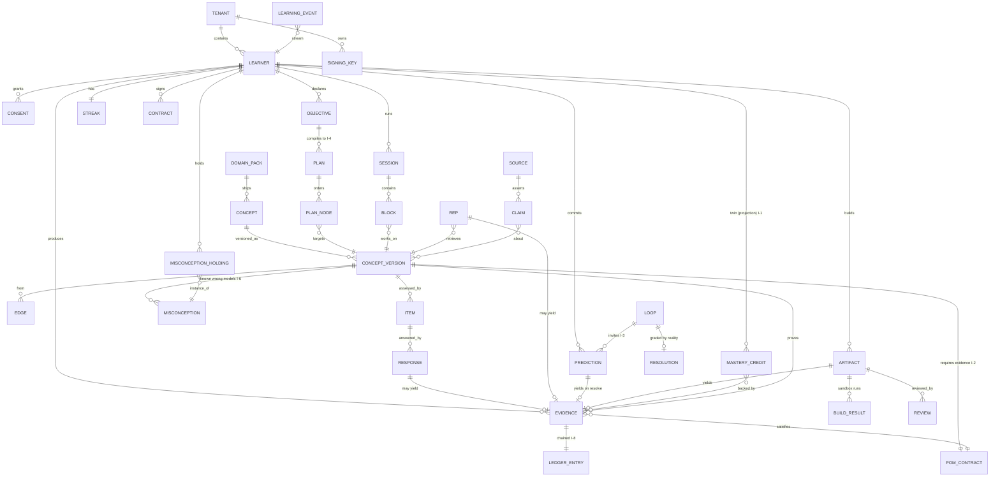

# 21 — Data Model & API

> **Obeys:** `CANON.md`. **Core follows:** `D:\claude\ARCHITECTURE_STANDARD.md`.
> **Companion:** `07-system-architecture.md` (kernel, bus, topology).

Two rules govern everything below.

1. **`mastery_credit` has no writable API.** No endpoint, no admin tool, no migration raises it.
   It moves only when the Twin projector folds an `EvidenceProduced` event. (**I-2**)
2. **Every row that claims a learner knows something points at a Ledger entry.** If the chain
   doesn't verify, the claim doesn't exist. (**I-8**)

---

## 1. Logical data model

### 1.1 Entity catalogue

| # | Entity | Owner (Engine / schema) | Cardinality | Mutability | Invention |
|---|---|---|---|---|---|
| 1 | `Tenant` | Tenancy | — | mutable | CANON §5.8 |
| 2 | `Learner` | Tenancy | 1 per human per tenant | mutable | — |
| 3 | `Consent` | Tenancy | n per learner | **append-only** (revoke = new row) | CANON §5.9 |
| 4 | `Objective` | E12 / career | n per learner | mutable | I-4 |
| 5 | `Concept` | E2 / graph | ~10⁵ global | **immutable identity** | I-4 |
| 6 | `ConceptVersion` | E2 / graph | n per concept | **immutable** | I-2 |
| 7 | `Edge` | E2 / graph (+ AGE) | ~4×10⁵ | versioned | I-4 |
| 8 | `PoMContract` | E2 / graph | 1 per ConceptVersion | **immutable** | **I-2** |
| 9 | `DomainPack` | E2 / graph | ~10² | versioned | I-4 |
| 10 | `MasteryCredit` | E1 / twin | 1 per (learner, concept) | **projection only** | **I-1, I-2** |
| 11 | `Misconception` | E2 (catalogue) + E1 (holding) | ~10⁴ catalogue | catalogue immutable; holding is projection | **I-6** |
| 12 | `Evidence` | E6/E8/E11 → evidence | ~10³ per learner/yr | **immutable** | **I-2** |
| 13 | `LedgerEntry` | E16 / ledger | 1 per Evidence | **append-only, hash-chained** | **I-8** |
| 14 | `Plan` | E3 / compiler | 1 active per objective | **disposable** | I-4 |
| 15 | `Session` | E4 / scheduler | ~300/learner/yr | mutable until closed | I-10 |
| 16 | `Item` | E6 / assessment | ~10⁶ | immutable | I-6 |
| 17 | `Response` | E6 / assessment | 1 per (item, learner, attempt) | immutable | I-2 |
| 18 | `Rep` | E7 / memory | ~10⁴ per learner/yr | immutable | I-2 |
| 19 | `Loop` | E8 / reality | ~10³ | immutable after open | **I-3** |
| 20 | `Prediction` | E8 / reality | **1 per (loop, learner)** | **immutable** | **I-3** |
| 21 | `Resolution` | E8 / reality | 1 per loop | immutable | **I-3** |
| 22 | `Artifact` | E11 / project | n per learner | immutable + build results | I-2 |
| 23 | `Review` | E11 / project | n per artifact | immutable | I-2 |
| 24 | `Contract` | E14 / accountability | 1 active per learner | versioned | **I-9** |
| 25 | `Streak` | E13 / motivation | 1 per learner | mutable | I-9 |
| 26 | `Source` | E10 / research | ~10⁵ | mutable trust score | — |
| 27 | `Claim` | E10 / research | ~10⁶ | immutable | — |
| 28 | `LearningEvent` | Kernel / kernel | **everything** | **append-only** | **I-1, I-8** |

### 1.2 ER diagram



---

## 2. SQL DDL (PostgreSQL 17)

One schema per module (`ARCHITECTURE_STANDARD.md` §1). Every tenant-owned table carries `tenant_id`
and is protected by both an EF Core global query filter **and** Postgres RLS (defence in depth).

### 2.1 Kernel — the event store

```sql
CREATE SCHEMA kernel;

-- The single source of truth. Nothing else in PRAXIS is authoritative. (I-1)
CREATE TABLE kernel.event_store (
    global_seq      bigint      GENERATED ALWAYS AS IDENTITY,
    event_id        uuid        NOT NULL,                 -- UUIDv7, time-sortable
    tenant_id       uuid        NOT NULL,
    stream_id       text        NOT NULL,                 -- 'lrn_...' | 'graph:pack_...' | 'loop_...'
    stream_seq      bigint      NOT NULL,                 -- gapless per stream
    event_type      text        NOT NULL,                 -- 'praxis.evidence.EvidenceProduced'
    event_version   smallint    NOT NULL DEFAULT 1,
    emitter         text        NOT NULL,                 -- 'E6'
    occurred_at     timestamptz NOT NULL,                 -- when the learner did it (may be offline-past)
    recorded_at     timestamptz NOT NULL DEFAULT now(),   -- when we durably saw it
    actor_type      text        NOT NULL,                 -- learner | system | adapter | witness
    actor_id        text        NOT NULL,
    causation_id    uuid,
    correlation_id  text,
    payload         jsonb       NOT NULL,                 -- envelope §07-4.1; encrypted at rest per learner key
    meta            jsonb       NOT NULL DEFAULT '{}'::jsonb,
    PRIMARY KEY (tenant_id, global_seq)
) PARTITION BY RANGE (recorded_at);

CREATE UNIQUE INDEX ux_event_stream_seq  ON kernel.event_store (tenant_id, stream_id, stream_seq);
CREATE UNIQUE INDEX ux_event_id          ON kernel.event_store (tenant_id, event_id);
CREATE INDEX ix_event_type_time          ON kernel.event_store (tenant_id, event_type, occurred_at DESC);
CREATE INDEX ix_event_payload_concept    ON kernel.event_store USING gin ((payload -> 'concept_id'));
CREATE INDEX ix_event_causation          ON kernel.event_store (tenant_id, causation_id);

-- Monthly partitions, created by pg_partman. Tiered to S3 after 24 months, still queryable.
CREATE TABLE kernel.event_store_2026_07 PARTITION OF kernel.event_store
    FOR VALUES FROM ('2026-07-01') TO ('2026-08-01');

-- Hard guarantee: the log is append-only.
CREATE RULE no_update_events AS ON UPDATE TO kernel.event_store DO INSTEAD NOTHING;
CREATE RULE no_delete_events AS ON DELETE TO kernel.event_store DO INSTEAD NOTHING;
-- (GDPR erasure = crypto-shredding the per-learner AES key in KMS, not deleting rows: the
--  envelope must survive so everyone else's ledger chain still verifies. See 07 §7.4.)

-- Transactional outbox: written in the SAME transaction as the aggregate change.
CREATE TABLE kernel.outbox (
    id            bigint      GENERATED ALWAYS AS IDENTITY PRIMARY KEY,
    event_id      uuid        NOT NULL UNIQUE,
    tenant_id     uuid        NOT NULL,
    topic         text        NOT NULL,
    partition_key text        NOT NULL,                   -- learner_id → per-learner ordering (07 §7.2)
    envelope      jsonb       NOT NULL,
    created_at    timestamptz NOT NULL DEFAULT now(),
    published_at  timestamptz,
    attempts      smallint    NOT NULL DEFAULT 0
);
CREATE INDEX ix_outbox_unpublished ON kernel.outbox (created_at) WHERE published_at IS NULL;

-- Effectively-once projection (07 §7.3).
CREATE TABLE kernel.processed_event (
    consumer     text        NOT NULL,
    event_id     uuid        NOT NULL,
    processed_at timestamptz NOT NULL DEFAULT now(),
    PRIMARY KEY (consumer, event_id)
);

CREATE TABLE kernel.projection_checkpoint (
    consumer     text        PRIMARY KEY,
    tenant_id    uuid,
    global_seq   bigint      NOT NULL,
    updated_at   timestamptz NOT NULL DEFAULT now(),
    status       text        NOT NULL DEFAULT 'RUNNING'  -- RUNNING | REBUILDING | PARKED_ON_DLQ
);
```

### 2.2 Tenancy

```sql
CREATE SCHEMA tenancy;

CREATE TYPE tenancy.tenant_kind AS ENUM ('PERSONAL','INSTITUTION','ENTERPRISE','COACH');

CREATE TABLE tenancy.tenant (
    id              uuid PRIMARY KEY DEFAULT gen_random_uuid(),
    kind            tenancy.tenant_kind NOT NULL,
    name            text NOT NULL,
    slug            citext NOT NULL UNIQUE,
    graph_overlay   text,                                  -- per-tenant concept-graph overlay (CANON §5.8)
    ledger_key_id   text NOT NULL,                         -- KMS Ed25519 key ref (I-8)
    created_at      timestamptz NOT NULL DEFAULT now(),
    updated_at      timestamptz,
    is_deleted      boolean NOT NULL DEFAULT false
);

CREATE TABLE tenancy.learner (
    id              uuid PRIMARY KEY DEFAULT gen_random_uuid(),
    tenant_id       uuid NOT NULL REFERENCES tenancy.tenant(id),
    external_sub    text NOT NULL,                          -- OIDC subject
    display_name    text NOT NULL,
    locale          text NOT NULL DEFAULT 'en',
    timezone        text NOT NULL DEFAULT 'UTC',
    dek_key_id      text NOT NULL,                          -- per-learner AES key (crypto-shredding)
    created_at      timestamptz NOT NULL DEFAULT now(),
    updated_at      timestamptz,
    is_deleted      boolean NOT NULL DEFAULT false,
    UNIQUE (tenant_id, external_sub)
);

-- Consent is append-only: revocation is a new row, never an UPDATE. (CANON §5.9)
CREATE TABLE tenancy.consent (
    id           uuid PRIMARY KEY DEFAULT gen_random_uuid(),
    tenant_id    uuid NOT NULL,
    learner_id   uuid NOT NULL REFERENCES tenancy.learner(id),
    purpose      text NOT NULL,        -- AI_TUTORING | MODEL_TRAINING | WITNESS_SHARE | RESEARCH | EMPLOYER_EXPORT
    scope        jsonb NOT NULL,       -- {"concepts":"*","evidence_types":["EXPLAIN"],"witness_id":"..."}
    state        text NOT NULL,        -- GRANTED | REVOKED
    granted_at   timestamptz NOT NULL DEFAULT now(),
    expires_at   timestamptz,
    supersedes   uuid REFERENCES tenancy.consent(id)
);
CREATE INDEX ix_consent_active ON tenancy.consent (learner_id, purpose, state, expires_at);

ALTER TABLE tenancy.learner ENABLE ROW LEVEL SECURITY;
CREATE POLICY tenant_isolation ON tenancy.learner
    USING (tenant_id = current_setting('praxis.tenant_id')::uuid);
```

### 2.3 Graph (E2) — concepts, versions, PoM contracts

```sql
CREATE SCHEMA graph;

CREATE TYPE graph.evidence_type AS ENUM
    ('RECALL','APPLY','EXPLAIN','BUILD','CRITIQUE','PREDICT');   -- CANON I-2: exactly six

CREATE TYPE graph.edge_kind AS ENUM
    ('REQUIRES','RELATES','CONTRASTS','APPLIES_TO');             -- CANON §3

CREATE TABLE graph.domain_pack (
    id            uuid PRIMARY KEY DEFAULT gen_random_uuid(),
    key           text NOT NULL UNIQUE,        -- 'ai-engineering', 'equity-markets', 'internal-medicine'
    version       text NOT NULL,               -- semver
    publisher     text NOT NULL,
    tenant_scope  uuid,                        -- NULL = global pack; else private to a tenant
    signature     bytea NOT NULL,              -- packs are signed drivers (07 §0)
    installed_at  timestamptz NOT NULL DEFAULT now()
);

CREATE TABLE graph.concept (
    id            uuid PRIMARY KEY DEFAULT gen_random_uuid(),
    pack_id       uuid NOT NULL REFERENCES graph.domain_pack(id),
    key           text NOT NULL,               -- 'backprop.chain_rule'
    display_name  text NOT NULL,
    current_version smallint NOT NULL DEFAULT 1,
    UNIQUE (pack_id, key)
);

-- Immutable. Superseding a version emits ConceptVersionSuperseded and re-maps credits (07 §4.2).
CREATE TABLE graph.concept_version (
    id             uuid PRIMARY KEY DEFAULT gen_random_uuid(),
    concept_id     uuid NOT NULL REFERENCES graph.concept(id),
    version        smallint NOT NULL,
    definition     text NOT NULL,
    bloom_level    smallint NOT NULL CHECK (bloom_level BETWEEN 1 AND 6),
    est_minutes    smallint NOT NULL,          -- median first-acquisition minutes (feeds the compiler, I-4)
    intrinsic_difficulty numeric(4,3) NOT NULL, -- FSRS prior D₀
    irt_prior_a    numeric(5,3) NOT NULL DEFAULT 1.0,   -- discrimination
    irt_prior_b    numeric(5,3) NOT NULL DEFAULT 0.0,   -- difficulty
    embedding      vector(1536) NOT NULL,      -- pgvector: joins to the Twin in ONE query (07 §6)
    supersedes     uuid REFERENCES graph.concept_version(id),
    published_at   timestamptz NOT NULL DEFAULT now(),
    UNIQUE (concept_id, version)
);
CREATE INDEX ix_cv_embedding ON graph.concept_version
    USING hnsw (embedding vector_cosine_ops) WITH (m = 16, ef_construction = 64);

CREATE TABLE graph.edge (
    id             uuid PRIMARY KEY DEFAULT gen_random_uuid(),
    from_version   uuid NOT NULL REFERENCES graph.concept_version(id),
    to_version     uuid NOT NULL REFERENCES graph.concept_version(id),
    kind           graph.edge_kind NOT NULL,
    strength       numeric(4,3) NOT NULL DEFAULT 1.0,   -- REQUIRES: how hard is the gate (compiler weight)
    rationale      text,
    proposed_by    text NOT NULL,                        -- 'author:...' | 'E10:disagreement_mining'
    confirmed_at   timestamptz,
    UNIQUE (from_version, to_version, kind)
);
CREATE INDEX ix_edge_to ON graph.edge (to_version, kind);

-- I-2: the contract that says what will be ACCEPTED as proof. Immutable, per ConceptVersion.
CREATE TABLE graph.pom_contract (
    id                 uuid PRIMARY KEY DEFAULT gen_random_uuid(),
    concept_version_id uuid NOT NULL UNIQUE REFERENCES graph.concept_version(id),
    requirements       jsonb NOT NULL,
    /* requirements shape:
       {
         "required": [
           {"evidence_type":"APPLY",  "min_count":2, "min_score":0.75, "novel_only":true},
           {"evidence_type":"EXPLAIN","min_count":1, "min_score":0.70,
            "rubric_id":"rub_explain_v2"}
         ],
         "any_of": [
           {"evidence_type":"BUILD",   "min_count":1, "min_score":0.80},
           {"evidence_type":"PREDICT", "min_count":3, "max_brier":0.20}
         ],
         "forbidden": ["RECALL_ONLY"],
         "hint_ceiling": "ANALOGY",       -- evidence produced above this rung earns NO credit (I-5)
         "mc_cap_without_apply": 0.55,    -- you cannot "know" it by reciting it (I-2)
         "decay": {"model":"fsrs-6","initial_stability_days":3.5,"target_retrievability":0.90}
       } */
    max_mc             numeric(4,3) NOT NULL DEFAULT 1.0,
    created_at         timestamptz NOT NULL DEFAULT now()
);

-- The misconception CATALOGUE (per concept). The learner's HOLDING lives in twin. (I-6)
CREATE TABLE graph.misconception (
    id                 uuid PRIMARY KEY DEFAULT gen_random_uuid(),
    concept_version_id uuid NOT NULL REFERENCES graph.concept_version(id),
    key                text NOT NULL,        -- 'confuses_correlation_with_causation'
    name               text NOT NULL,
    wrong_model        text NOT NULL,        -- the specific false belief, stated in the learner's voice
    diagnostic_signature jsonb NOT NULL,     -- answer patterns that reveal it
    remediation_strategy text NOT NULL,
    embedding          vector(1536) NOT NULL,
    UNIQUE (concept_version_id, key)
);
```

### 2.4 Twin (E1) — Mastery Credit with decay parameters (I-1, I-2)

```sql
CREATE SCHEMA twin;

-- PROJECTION. Never written by an API. Rebuildable from kernel.event_store with zero loss. (I-1)
CREATE TABLE twin.mastery_credit (
    tenant_id            uuid NOT NULL,
    learner_id           uuid NOT NULL,
    concept_id           uuid NOT NULL,
    concept_version      smallint NOT NULL,

    -- ── The credit itself ────────────────────────────────────────────────
    mc                   numeric(4,3) NOT NULL CHECK (mc BETWEEN 0 AND 1),  -- P(knows) at last_updated_at
    mc_lower             numeric(4,3) NOT NULL,   -- 90% credible interval — the Twin is PROBABILISTIC
    mc_upper             numeric(4,3) NOT NULL,
    state                text NOT NULL,           -- UNSEEN|LEARNING|HELD|LAPSING|LAPSED|PENDING_GRADING

    -- ── Decay parameters (FSRS-6; forgetting = cache invalidation, I-2/I-4) ──
    decay_model          text NOT NULL DEFAULT 'fsrs-6',
    stability_days       numeric(8,3) NOT NULL,   -- S: days until R drops to 0.90
    difficulty           numeric(4,3) NOT NULL,   -- D ∈ [1,10] normalised to [0,1]
    retrievability_at_ref numeric(4,3) NOT NULL,  -- R(t_ref) — the cached value
    ref_at               timestamptz NOT NULL,    -- t_ref; R(now) is computed, NOT stored (07 §4.4)
    last_rep_at          timestamptz,
    rep_count            integer NOT NULL DEFAULT 0,
    lapse_count          integer NOT NULL DEFAULT 0,
    due_at               timestamptz,             -- when R(t) falls to target_retrievability
    half_life_days       numeric(8,3) GENERATED ALWAYS AS (stability_days * 0.6931471805599453) STORED,

    -- ── Confidence vs. competence (Dunning–Kruger delta, I-1) ────────────
    stated_confidence    numeric(4,3),            -- mean of ConfidenceStated
    confidence_gap       numeric(5,3),            -- stated_confidence − mc. Positive = overconfident.
    brier_concept        numeric(5,4),            -- calibration on THIS concept (I-3)

    -- ── Evidence ledger backing this credit (I-2, I-8) ───────────────────
    evidence_counts      jsonb NOT NULL DEFAULT '{}'::jsonb,  -- {"APPLY":3,"EXPLAIN":1,"BUILD":1}
    strongest_evidence_id uuid,
    last_driver_event_id uuid NOT NULL,           -- idempotent, deterministic fold (07 §7.3)
    contract_satisfied   boolean NOT NULL DEFAULT false,      -- PoM contract met?
    hint_discount_applied numeric(4,3) NOT NULL DEFAULT 0,    -- I-5: you didn't do it alone

    last_updated_at      timestamptz NOT NULL DEFAULT now(),
    PRIMARY KEY (tenant_id, learner_id, concept_id)
) PARTITION BY HASH (learner_id);
CREATE INDEX ix_mc_due   ON twin.mastery_credit (tenant_id, learner_id, due_at)
    WHERE state IN ('HELD','LAPSING');
CREATE INDEX ix_mc_weak  ON twin.mastery_credit (tenant_id, learner_id, mc)
    WHERE mc < 0.6;

-- R(t) is a FUNCTION, not a column. Decay never emits events. (07 §4.4)
CREATE OR REPLACE FUNCTION twin.retrievability(
    stability_days numeric, ref_at timestamptz, at_time timestamptz DEFAULT now()
) RETURNS numeric LANGUAGE sql IMMUTABLE AS $$
    -- FSRS-6 forgetting curve: R(t) = (1 + F * t/S)^C,  F = 19/81, C = -0.5
    SELECT GREATEST(0.0, LEAST(1.0,
        POWER(1 + (19.0/81.0) * (EXTRACT(EPOCH FROM (at_time - ref_at))/86400.0)
                  / NULLIF(stability_days,0), -0.5)))::numeric(5,4);
$$;

-- The live view the Scheduler reads. Decay applied at READ time.
CREATE VIEW twin.mastery_credit_live AS
SELECT mc.*,
       twin.retrievability(mc.stability_days, mc.ref_at, now())                     AS retrievability_now,
       (mc.mc * twin.retrievability(mc.stability_days, mc.ref_at, now()))::numeric(5,4) AS mc_now
FROM twin.mastery_credit mc;

-- The learner's HOLDING of a catalogued misconception. (I-6)
CREATE TABLE twin.misconception_holding (
    tenant_id         uuid NOT NULL,
    learner_id        uuid NOT NULL,
    misconception_id  uuid NOT NULL,
    concept_id        uuid NOT NULL,
    confidence        numeric(4,3) NOT NULL,   -- P(learner holds this wrong model)
    first_detected_at timestamptz NOT NULL,
    last_confirmed_at timestamptz NOT NULL,
    confirming_evidence_ids uuid[] NOT NULL,
    disconfirming_evidence_ids uuid[] NOT NULL DEFAULT '{}',
    targeted_item_count integer NOT NULL DEFAULT 0,   -- items generated to hunt it (I-6)
    state             text NOT NULL,            -- SUSPECTED | CONFIRMED | RETIRED
    PRIMARY KEY (tenant_id, learner_id, misconception_id)
);

CREATE TABLE twin.calibration_window (
    tenant_id     uuid NOT NULL,
    learner_id    uuid NOT NULL,
    window        text NOT NULL,               -- '30d' | '90d' | 'all' | 'domain:equity-markets'
    n             integer NOT NULL,
    brier         numeric(6,5) NOT NULL,       -- I-3: first-class metric, next to Mastery
    log_score     numeric(8,5) NOT NULL,
    overconfidence_delta numeric(5,3) NOT NULL, -- mean(stated) − mean(correct)
    reliability_curve jsonb NOT NULL,           -- [{"bin":0.6,"predicted":0.6,"observed":0.42,"n":31}]
    computed_at   timestamptz NOT NULL DEFAULT now(),
    PRIMARY KEY (tenant_id, learner_id, window)
);
```

### 2.5 Evidence + Ledger — the hash chain (I-8)

```sql
CREATE SCHEMA evidence;

CREATE TABLE evidence.evidence (
    id                 uuid PRIMARY KEY,                 -- UUIDv7
    tenant_id          uuid NOT NULL,
    learner_id         uuid NOT NULL,
    concept_id         uuid NOT NULL,
    concept_version    smallint NOT NULL,
    pom_contract_id    uuid NOT NULL REFERENCES graph.pom_contract(id),
    evidence_type      graph.evidence_type NOT NULL,

    -- provenance: exactly one of these is non-null
    response_id        uuid,      -- from an Item      (RECALL | APPLY | CRITIQUE)
    explanation_id     uuid,      -- from a teach-back (EXPLAIN)
    artifact_id        uuid,      -- from a Project    (BUILD)
    prediction_id      uuid,      -- from a Loop       (PREDICT)  ← reality graded this (I-3)
    source_event_id    uuid NOT NULL,

    produced_at        timestamptz NOT NULL,             -- learner's clock (offline-safe)
    recorded_at        timestamptz NOT NULL DEFAULT now(),

    -- grading
    grader             text NOT NULL,                    -- RULE | SANDBOX | ADAPTER | MODEL | PEER | MENTOR
    grader_ref         text,                             -- model id / sandbox run / adapter id
    rubric_id          uuid,
    rubric_scores      jsonb,
    score              numeric(5,4) NOT NULL CHECK (score BETWEEN 0 AND 1),
    grader_confidence  numeric(4,3),
    human_spot_checked boolean NOT NULL DEFAULT false,

    -- integrity (I-2 + I-5)
    hints_used         jsonb NOT NULL DEFAULT '[]'::jsonb,   -- [{"rung":"PROBE","cost":2}]
    hint_discount      numeric(4,3) NOT NULL DEFAULT 0,
    novel_item         boolean NOT NULL,                     -- APPLY must be never-seen
    plagiarism_score   numeric(4,3),
    proctoring         text NOT NULL DEFAULT 'NONE',         -- NONE | CAMERA | LOCKDOWN | LIVE_MENTOR

    -- artifact
    artifact_uri       text,                                 -- s3://...
    artifact_sha256    bytea,

    -- effect on the Twin (recorded for explainability, I-1)
    mc_before          numeric(4,3) NOT NULL,
    mc_after           numeric(4,3) NOT NULL,

    status             text NOT NULL DEFAULT 'ACCEPTED',     -- ACCEPTED | PENDING_GRADING | REJECTED
    reject_reason      text,

    CONSTRAINT one_provenance CHECK (
        num_nonnulls(response_id, explanation_id, artifact_id, prediction_id) = 1)
);
CREATE INDEX ix_ev_learner_concept ON evidence.evidence (tenant_id, learner_id, concept_id, produced_at DESC);
CREATE RULE no_update_evidence AS ON UPDATE TO evidence.evidence DO INSTEAD NOTHING;

CREATE SCHEMA ledger;

-- I-8. Append-only, hash-chained, signed. One entry per accepted Evidence. Single writer per tenant.
CREATE TABLE ledger.ledger_entry (
    tenant_id     uuid   NOT NULL,
    seq           bigint NOT NULL,                 -- dense, gapless, per tenant
    entry_id      uuid   NOT NULL,
    learner_id    uuid   NOT NULL,
    evidence_id   uuid   NOT NULL REFERENCES evidence.evidence(id),

    prev_hash     bytea  NOT NULL,                 -- 32 bytes; genesis = sha256('praxis:genesis:'||tenant_id)
    content_hash  bytea  NOT NULL,                 -- sha256(JCS-canonical(evidence claim JSON))
    entry_hash    bytea  NOT NULL,                 -- sha256(prev_hash || content_hash || seq_be64 || recorded_at_be64)

    signature     bytea  NOT NULL,                 -- Ed25519 over entry_hash
    key_id        text   NOT NULL,                 -- KMS key version; rotation is recorded as a KeyRotation entry
    alg           text   NOT NULL DEFAULT 'Ed25519',

    recorded_at   timestamptz NOT NULL DEFAULT now(),
    PRIMARY KEY (tenant_id, seq)
);
CREATE UNIQUE INDEX ux_ledger_entry_hash ON ledger.ledger_entry (tenant_id, entry_hash);
CREATE UNIQUE INDEX ux_ledger_evidence   ON ledger.ledger_entry (evidence_id);
CREATE INDEX ix_ledger_learner           ON ledger.ledger_entry (tenant_id, learner_id, seq);
CREATE RULE no_update_ledger AS ON UPDATE TO ledger.ledger_entry DO INSTEAD NOTHING;
CREATE RULE no_delete_ledger AS ON DELETE TO ledger.ledger_entry DO INSTEAD NOTHING;

-- Serialise the chain: the appender takes this lock for the tenant, reads MAX(seq), links, commits.
-- pg_advisory_xact_lock(hashtext('ledger:' || tenant_id)) — strong consistency, 07 §8.

-- Anchoring: every 24h the tenant's chain head is published, so PRAXIS cannot rewrite history
-- even with full DB access. (I-8 — this is what makes it a MOAT and not a log table.)
CREATE TABLE ledger.anchor (
    tenant_id    uuid NOT NULL,
    anchored_at  timestamptz NOT NULL DEFAULT now(),
    head_seq     bigint NOT NULL,
    head_hash    bytea  NOT NULL,
    method       text   NOT NULL,   -- RFC3161_TSA | SIGSTORE_RECOR | OTS_BITCOIN
    receipt      jsonb  NOT NULL,   -- timestamp-authority token / transparency-log inclusion proof
    PRIMARY KEY (tenant_id, anchored_at)
);

-- A signed, revocable export. Content-addressed in S3 so it verifies with PRAXIS offline. (I-8)
CREATE TABLE ledger.export (
    id            uuid PRIMARY KEY DEFAULT gen_random_uuid(),
    tenant_id     uuid NOT NULL,
    learner_id    uuid NOT NULL,
    scope         jsonb NOT NULL,           -- {"concepts":["cpt_..."],"since":"2025-01-01","min_mc":0.7}
    s3_uri        text NOT NULL,            -- s3://praxis-exports/{sha256}.jsonl
    merkle_root   bytea NOT NULL,           -- root over the included entry_hashes
    signature     bytea NOT NULL,
    key_id        text NOT NULL,
    verify_token  text NOT NULL UNIQUE,     -- the shareable, revocable handle
    created_at    timestamptz NOT NULL DEFAULT now(),
    expires_at    timestamptz,
    revoked_at    timestamptz               -- learner OWNS the record: they can pull the link (CANON §5.9)
);
```

**Chain construction (the exact bytes):**

```
content_hash = SHA256( JCS( {
    "evidence_id","learner_id","concept_id","concept_version","evidence_type",
    "pom_contract_id","produced_at","grader","score","rubric_scores",
    "hints_used","novel_item","artifact_sha256"
} ) )                                              -- RFC 8785 canonical JSON

entry_hash   = SHA256( prev_hash ‖ content_hash ‖ uint64_be(seq) ‖ uint64_be(unix_ms(recorded_at)) )
signature    = Ed25519_sign( tenant_key, entry_hash )
```

A verifier needs only: the export JSONL, the tenant's public key, and (optionally) the anchor
receipt. It re-hashes every line, checks each `prev_hash` links, recomputes the Merkle root, checks
the signature, and checks the head against the anchor. **No call to PRAXIS is required.** That is
what "verifiable" means (I-8) — anything less is just a nice PDF.

### 2.6 Compiler, Scheduler, Assessment, Memory, Reality, Project, Accountability

```sql
CREATE SCHEMA compiler;

-- The Plan is EPHEMERAL and always regenerable. (CANON §3, I-4)
CREATE TABLE compiler.plan (
    id                  uuid PRIMARY KEY DEFAULT gen_random_uuid(),
    tenant_id           uuid NOT NULL,
    learner_id          uuid NOT NULL,
    objective_id        uuid NOT NULL,
    compiled_at         timestamptz NOT NULL DEFAULT now(),
    superseded_at       timestamptz,
    trigger             text NOT NULL,      -- NIGHTLY | EVIDENCE | LAPSE | CONSTRAINT_CHANGE | GRAPH_CHANGE
    constraints         jsonb NOT NULL,     -- {"minutes_per_day":45,"days_per_week":6,"deadline":"2027-03-01"}
    cache_hit_concepts  integer NOT NULL,   -- concepts the Twin already holds — THE CACHE (I-4)
    invalidated_concepts integer NOT NULL,  -- decayed below threshold — CACHE INVALIDATION (I-4)
    critical_path_minutes integer NOT NULL,
    predicted_ready_date date NOT NULL,
    predicted_mpm       numeric(6,4) NOT NULL,   -- forecast mastery-per-minute (I-10)
    compile_trace       jsonb NOT NULL       -- why this order: the plan must EXPLAIN itself
);

CREATE TABLE compiler.plan_node (
    plan_id            uuid NOT NULL REFERENCES compiler.plan(id) ON DELETE CASCADE,
    ordinal            integer NOT NULL,
    concept_id         uuid NOT NULL,
    concept_version    smallint NOT NULL,
    action             text NOT NULL,       -- LEARN | REP | APPLY | BUILD | PREDICT | REMEDIATE
    est_minutes        smallint NOT NULL,
    reason             text NOT NULL,       -- 'prereq of cpt_transformer_attention (REQUIRES, w=0.9)'
    earliest_start     date NOT NULL,
    latest_start       date NOT NULL,       -- slack: the compiler exposes float, like a real build
    PRIMARY KEY (plan_id, ordinal)
);

CREATE SCHEMA scheduler;

CREATE TABLE scheduler.session (
    id                uuid PRIMARY KEY DEFAULT gen_random_uuid(),
    tenant_id         uuid NOT NULL,
    learner_id        uuid NOT NULL,
    plan_id           uuid,
    planned_minutes   smallint NOT NULL CHECK (planned_minutes IN (5,10,15,25,45)),
    started_at        timestamptz NOT NULL DEFAULT now(),
    ended_at          timestamptz,
    outcome           text,                 -- COMPLETED | ABANDONED | EXPIRED
    actual_seconds    integer,
    mc_gained         numeric(6,4),         -- Σ Δmc across concepts touched
    mpm               numeric(8,5),         -- mc_gained / (actual_seconds/60)  ← I-10, THE metric
    evidence_count    smallint NOT NULL DEFAULT 0
);

CREATE TABLE scheduler.block (
    session_id      uuid NOT NULL REFERENCES scheduler.session(id) ON DELETE CASCADE,
    ordinal         smallint NOT NULL,
    kind            text NOT NULL,          -- NEW | REP | LOOP | PROJECT | REMEDIATE | TEACH_BACK
    concept_id      uuid,
    ref_id          uuid,                   -- item_id | loop_id | brief_id
    budget_seconds  smallint NOT NULL,
    entered_at      timestamptz,
    exited_at       timestamptz,
    produced_evidence_id uuid,              -- NULL = no evidence produced in this block
    PRIMARY KEY (session_id, ordinal)
);

CREATE SCHEMA assessment;

CREATE TABLE assessment.item (
    id                  uuid PRIMARY KEY DEFAULT gen_random_uuid(),
    tenant_id           uuid,                 -- NULL = global item bank
    concept_id          uuid NOT NULL,
    concept_version     smallint NOT NULL,
    evidence_type       graph.evidence_type NOT NULL,
    modality            text NOT NULL,        -- text | image | audio | code | chart
    stem                text NOT NULL,
    solution            text NOT NULL,        -- NEVER enters a tutor context below rung FULL (I-5)
    solution_ngrams     text[] NOT NULL,      -- Output Guard leak detector source
    rubric_id           uuid,
    distractors         jsonb,                -- [{"text":"...","diagnoses_misconception_id":"..."}]  I-6
    targets_misconception_id uuid,            -- I-6: this item exists to hunt YOUR error
    irt_a               numeric(5,3) NOT NULL DEFAULT 1.0,
    irt_b               numeric(5,3) NOT NULL DEFAULT 0.0,
    irt_c               numeric(4,3) NOT NULL DEFAULT 0.0,
    p_value             numeric(4,3),         -- observed proportion correct (refits nightly)
    exposure_count      integer NOT NULL DEFAULT 0,
    novelty_hash        text NOT NULL,        -- dedupe: APPLY items must be NEVER-SEEN by this learner
    generated_by        text NOT NULL,        -- 'ai-assess:sonnet-4.7' | 'author:...'
    created_at          timestamptz NOT NULL DEFAULT now()
);
CREATE INDEX ix_item_select ON assessment.item (concept_id, evidence_type, irt_b);
CREATE UNIQUE INDEX ux_item_novelty ON assessment.item (concept_id, novelty_hash);

CREATE TABLE assessment.response (
    id               uuid PRIMARY KEY DEFAULT gen_random_uuid(),
    tenant_id        uuid NOT NULL,
    learner_id       uuid NOT NULL,
    item_id          uuid NOT NULL REFERENCES assessment.item(id),
    session_id       uuid,
    attempt          smallint NOT NULL DEFAULT 1,
    body             jsonb NOT NULL,
    stated_confidence numeric(4,3),           -- captured BEFORE grading → calibration (I-1, I-3)
    correct          boolean,
    partial_credit   numeric(5,4),
    rubric_scores    jsonb,
    latency_ms       integer NOT NULL,
    hints_used       jsonb NOT NULL DEFAULT '[]'::jsonb,
    theta_before     numeric(5,3),            -- IRT ability estimate
    theta_after      numeric(5,3),
    se_after         numeric(5,3),
    graded_at        timestamptz,
    grader           text,
    submitted_at     timestamptz NOT NULL DEFAULT now(),
    UNIQUE (learner_id, item_id, attempt)
);

CREATE SCHEMA memory;

CREATE TABLE memory.rep (
    id             uuid PRIMARY KEY DEFAULT gen_random_uuid(),
    tenant_id      uuid NOT NULL,
    learner_id     uuid NOT NULL,
    concept_id     uuid NOT NULL,
    scheduled_for  timestamptz NOT NULL,
    performed_at   timestamptz,
    grade          text,                    -- AGAIN | HARD | GOOD | EASY
    via            text,                    -- DRILL | NEWS | LOOP | PROJECT | TEACH_BACK  ← I-7
    latency_ms     integer,
    stability_before numeric(8,3),
    stability_after  numeric(8,3),
    retrievability_at_rep numeric(4,3),     -- how close to forgotten it was (the desirable difficulty)
    evidence_id    uuid,
    overdue_hours  numeric(8,2)
);
CREATE INDEX ix_rep_due ON memory.rep (tenant_id, learner_id, scheduled_for) WHERE performed_at IS NULL;

CREATE SCHEMA reality;

-- I-3. The crown jewel. Reality is the examiner.
CREATE TABLE reality.loop (
    id                uuid PRIMARY KEY DEFAULT gen_random_uuid(),
    tenant_id         uuid,                 -- NULL = global loop (a market close is global)
    domain            text NOT NULL,        -- equity-markets | software | medicine | law | business
    question          text NOT NULL,        -- 'Will NVDA close above $X on 2026-07-18?'
    claim_schema      jsonb NOT NULL,       -- what a valid prediction looks like
    concept_ids       uuid[] NOT NULL,      -- concepts this loop exercises
    opened_at         timestamptz NOT NULL DEFAULT now(),
    closes_at         timestamptz NOT NULL, -- last moment a prediction may be committed
    resolves_at       timestamptz NOT NULL, -- when reality speaks
    resolution_source jsonb NOT NULL,       -- {"adapter":"market.polygon","symbol":"NVDA","field":"close"}
    difficulty        numeric(4,3),
    state             text NOT NULL DEFAULT 'OPEN'   -- OPEN | CLOSED | RESOLVED | VOID
);

CREATE TABLE reality.prediction (
    id             uuid PRIMARY KEY DEFAULT gen_random_uuid(),
    tenant_id      uuid NOT NULL,
    learner_id     uuid NOT NULL,
    loop_id        uuid NOT NULL REFERENCES reality.loop(id),
    claim          jsonb NOT NULL,
    probability    numeric(5,4) NOT NULL CHECK (probability > 0 AND probability < 1),
    rationale      text NOT NULL,           -- reality grades the CLAIM; PRAXIS grades the REASONING
    staked_concept_ids uuid[] NOT NULL,
    committed_at   timestamptz NOT NULL DEFAULT now(),
    -- a prediction is a COMMITMENT: one per learner per loop, before closes_at. Enforced in-txn.
    UNIQUE (loop_id, learner_id)
);

CREATE TABLE reality.resolution (
    loop_id       uuid PRIMARY KEY REFERENCES reality.loop(id),
    outcome       jsonb NOT NULL,
    resolved_at   timestamptz NOT NULL DEFAULT now(),
    source_ref    text NOT NULL,            -- the exact URL/tick/filing/judgment that decided it
    source_hash   bytea NOT NULL,           -- we archive the ground truth, immutably
    adapter       text NOT NULL,
    void_reason   text
);

CREATE TABLE reality.prediction_score (
    prediction_id uuid PRIMARY KEY REFERENCES reality.prediction(id),
    correct       boolean NOT NULL,
    brier         numeric(6,5) NOT NULL,    -- (p − o)²   ← I-3, first-class next to Mastery
    log_score     numeric(8,5) NOT NULL,
    rationale_score numeric(4,3),           -- model-graded: was the REASONING right, even if lucky?
    evidence_id   uuid,                     -- PREDICT evidence, chained into the Ledger
    scored_at     timestamptz NOT NULL DEFAULT now()
);

CREATE SCHEMA project;

CREATE TABLE project.artifact (
    id             uuid PRIMARY KEY DEFAULT gen_random_uuid(),
    tenant_id      uuid NOT NULL,
    learner_id     uuid NOT NULL,
    brief_id       uuid NOT NULL,
    kind           text NOT NULL,           -- REPO | DOC | MODEL | DESIGN | NOTEBOOK
    s3_uri         text NOT NULL,
    sha256         bytea NOT NULL,
    concept_ids    uuid[] NOT NULL,
    submitted_at   timestamptz NOT NULL DEFAULT now()
);

-- BUILD evidence is graded by CODE, not by a model. Works even when the AI plane is down. (07 §9 L2)
CREATE TABLE project.build_result (
    id            uuid PRIMARY KEY DEFAULT gen_random_uuid(),
    artifact_id   uuid NOT NULL REFERENCES project.artifact(id),
    sandbox_run_id text NOT NULL,
    tests_passed  smallint NOT NULL,
    tests_total   smallint NOT NULL,
    hidden_tests_passed smallint NOT NULL,   -- the learner has NEVER seen these
    hidden_tests_total  smallint NOT NULL,
    coverage      numeric(4,3),
    runtime_ms    integer,
    exit_code     smallint NOT NULL,
    logs_s3_uri   text NOT NULL,
    ran_at        timestamptz NOT NULL DEFAULT now()
);

CREATE TABLE project.review (
    id            uuid PRIMARY KEY DEFAULT gen_random_uuid(),
    artifact_id   uuid NOT NULL REFERENCES project.artifact(id),
    reviewer_kind text NOT NULL,             -- MODEL | PEER | MENTOR
    reviewer_id   text,
    rubric_id     uuid NOT NULL,
    scores        jsonb NOT NULL,
    score         numeric(5,4) NOT NULL,
    comments      text,
    review_quality_score numeric(4,3),       -- peers are graded on their reviews → CRITIQUE credit (I-2)
    created_at    timestamptz NOT NULL DEFAULT now()
);

CREATE SCHEMA accountability;

-- I-9. Accountability with teeth.
CREATE TABLE accountability.contract (
    id              uuid PRIMARY KEY DEFAULT gen_random_uuid(),
    tenant_id       uuid NOT NULL,
    learner_id      uuid NOT NULL,
    objective_id    uuid NOT NULL,
    minutes_per_day smallint NOT NULL,
    days_per_week   smallint NOT NULL CHECK (days_per_week BETWEEN 1 AND 7),
    deadline        date NOT NULL,
    stake_amount    numeric(10,2),
    stake_currency  char(3),
    stake_beneficiary text,                  -- charity | anti-charity | escrow-return
    witness_id      uuid,
    witness_scope   jsonb,                   -- what the witness may see. Learner-controlled. (CANON §5.9)
    escalation_ladder jsonb NOT NULL,        -- [{"missed":1,"action":"NUDGE"},{"missed":3,"action":"WITNESS"}]
    signed_at       timestamptz NOT NULL DEFAULT now(),
    signature_ip_hash bytea NOT NULL,
    state           text NOT NULL DEFAULT 'ACTIVE',   -- ACTIVE | BREACHED | RENEGOTIATED | FULFILLED | VOID
    supersedes      uuid REFERENCES accountability.contract(id)
);

CREATE SCHEMA motivation;

CREATE TABLE motivation.streak (
    tenant_id     uuid NOT NULL,
    learner_id    uuid NOT NULL,
    current_len   smallint NOT NULL DEFAULT 0,
    longest_len   smallint NOT NULL DEFAULT 0,
    freezes_left  smallint NOT NULL DEFAULT 2,
    debt_minutes  integer NOT NULL DEFAULT 0,   -- owed, not punished — a debt you can pay down
    last_active_on date,
    burnout_score numeric(4,3) NOT NULL DEFAULT 0,
    PRIMARY KEY (tenant_id, learner_id)
);

CREATE SCHEMA research;

CREATE TABLE research.source (
    id            uuid PRIMARY KEY DEFAULT gen_random_uuid(),
    url           text NOT NULL UNIQUE,
    publisher     text,
    kind          text NOT NULL,             -- PAPER | DOC | NEWS | BOOK | STANDARD | FILING | BLOG
    trust         numeric(4,3) NOT NULL,
    trust_dimensions jsonb NOT NULL,         -- {"track_record":0.8,"transparency":0.7,"conflict":0.2}
    last_scored_at timestamptz NOT NULL DEFAULT now()
);

CREATE TABLE research.claim (
    id            uuid PRIMARY KEY DEFAULT gen_random_uuid(),
    source_id     uuid NOT NULL REFERENCES research.source(id),
    text          text NOT NULL,
    kind          text NOT NULL,             -- FACT | OPINION | PREDICTION | CONTESTED
    concept_ids   uuid[] NOT NULL,
    embedding     vector(1536) NOT NULL,
    contradicts   uuid[] NOT NULL DEFAULT '{}',   -- other claim ids → DisagreementSurfaced
    extracted_at  timestamptz NOT NULL DEFAULT now()
);
```

### 2.7 Graph model (Apache AGE)

Relational tables above are the system of record; AGE is the **traversal index**, written by the same
transaction that writes `graph.concept_version` / `graph.edge`. Rebuildable from Postgres.

```cypher
// Node types
(:Concept        {id, key, pack, display_name, current_version})
(:ConceptVersion {id, concept_id, version, bloom, est_minutes, intrinsic_difficulty, published_at})
(:Objective      {id, key, display_name, domain})          // 'AI Engineer'
(:Role           {id, key, title, market_demand, median_comp})
(:Misconception  {id, key, name, concept_version_id})
(:DomainPack     {id, key, version, publisher})
(:Skill          {id, key, name})                          // composite: concepts + demonstrated application

// Edge types (CANON §3 — exactly these four on the concept DAG, plus ontology edges)
(:ConceptVersion)-[:REQUIRES   {strength, rationale}]->(:ConceptVersion)
(:ConceptVersion)-[:RELATES    {strength}]->(:ConceptVersion)
(:ConceptVersion)-[:CONTRASTS  {axis}]->(:ConceptVersion)   // 'these two are confusable' → CRITIQUE items
(:ConceptVersion)-[:APPLIES_TO {domain}]->(:ConceptVersion)
(:Misconception)-[:DIAGNOSES]->(:ConceptVersion)
(:Skill)-[:COMPOSED_OF {weight}]->(:ConceptVersion)
(:Role)-[:DEMANDS {importance, seniority}]->(:Skill)
(:Objective)-[:TARGETS]->(:Role)
(:DomainPack)-[:SHIPS]->(:Concept)
(:ConceptVersion)-[:SUPERSEDES]->(:ConceptVersion)
```

**The compiler's core query (I-4)** — shortest path to competence, using the Twin as the cache:

```sql
-- Frontier: concepts on the critical path to the objective that the Twin does NOT hold.
-- The join between graph traversal and Twin state happens in ONE query because AGE and the
-- Twin live in the same Postgres. (07 §6 — this is why we did not buy a separate graph DB.)
WITH target AS (
  SELECT * FROM cypher('praxis_graph', $$
      MATCH (o:Objective {key:'ai-engineer'})-[:TARGETS]->(:Role)-[:DEMANDS]->(s:Skill)
            -[:COMPOSED_OF]->(cv:ConceptVersion)
      MATCH p = (pre:ConceptVersion)-[:REQUIRES*0..8]->(cv)
      RETURN DISTINCT pre.id AS cv_id, min(length(p)) AS depth, cv.id AS goal_id
  $$) AS t(cv_id agtype, depth agtype, goal_id agtype)
)
SELECT  t.cv_id,
        t.depth,
        COALESCE(l.mc_now, 0)               AS mc_now,     -- cache lookup
        COALESCE(l.retrievability_now, 0)   AS r_now,
        cv.est_minutes,
        CASE
          WHEN l.mc_now IS NULL          THEN 'MISS'       -- never learned
          WHEN l.mc_now < 0.60           THEN 'INVALIDATED'-- decayed out of cache (I-2)
          ELSE                                'HIT'        -- cache hit: SKIP IT
        END AS cache_state
FROM target t
JOIN graph.concept_version cv           ON cv.id = (t.cv_id #>> '{}')::uuid
LEFT JOIN twin.mastery_credit_live l    ON l.concept_id = cv.concept_id
                                       AND l.learner_id = $1
ORDER BY t.depth, cv.est_minutes;
```

---

## 3. API

### 3.1 Principles

| Principle | Rule |
|---|---|
| Versioned, resource-oriented | `https://api.praxis.dev/v1/...`. Breaking change ⇒ `/v2`. Additive fields are never breaking. |
| Envelope | `ARCHITECTURE_STANDARD.md` §2 `ApiResponse<T>` on every response: `{success, message, data, errors, timestamp}` |
| Errors | RFC 9457 `application/problem+json` **inside** the envelope's `errors`, plus the mapped status. Mapping is exactly `Result<T> → ToApiResponse()`. |
| Auth | OAuth 2.1 + PKCE; `Authorization: Bearer`. Scopes mirror permissions: `{module}.{resource}.{action}`. |
| Tenancy | Tenant resolved from the token, **never** from a path or header the client controls. |
| Idempotency | Every `POST` that produces evidence or money accepts `Idempotency-Key`. |
| Streaming | SSE for tutor turns. WebSocket only for the live whiteboard. |
| Pagination | Cursor: `?cursor=&limit=` → `{items, next_cursor}`. |
| **No mastery writes** | There is **no** `PUT /v1/twin/concepts/{id}` and there never will be. (**I-2**) |

### 3.2 API surface

| Area | Method & path | Purpose | Auth scope | Invention |
|---|---|---|---|---|
| Objective | `POST /v1/objectives` | Declare the build target | `career.objectives.create` | I-4 |
| Compile | `POST /v1/plans:compile` | Compile Objective+Twin+Constraints → Plan | `compiler.plans.compile` | **I-4** |
| Compile | `GET /v1/plans/current` | Current plan + compile trace | `compiler.plans.view` | I-4 |
| Compile | `POST /v1/plans:simulate` | Counterfactual: *"what if I skip linear algebra?"* | `compiler.plans.simulate` | **I-1, I-4** |
| Twin | `GET /v1/twin` | Twin snapshot (decay applied at read) | `twin.twin.view` | **I-1** |
| Twin | `GET /v1/twin/concepts/{id}/explain` | *Why do you think I know this?* → the evidence chain | `twin.twin.view` | **I-1, I-8** |
| Twin | `POST /v1/twin:query` | Counterfactual query in natural language | `twin.twin.query` | **I-1** |
| Twin | `GET /v1/twin/misconceptions` | Your personal Misconception Library | `twin.twin.view` | **I-6** |
| Session | `POST /v1/sessions` | Start a bounded block (5/10/15/25/45 min) | `scheduler.sessions.create` | I-10 |
| Session | `GET /v1/sessions/{id}/next` | *What do I do in the next 15 minutes?* | `scheduler.sessions.view` | **I-10** |
| Session | `POST /v1/sessions/{id}:complete` | Close; returns Mastery-per-Minute, honestly | `scheduler.sessions.update` | **I-10** |
| Tutor | `POST /v1/tutor/turns` **(SSE)** | Streaming Socratic turn under the Answer Budget | `tutor.turns.create` | **I-5** |
| Tutor | `POST /v1/tutor/hints` | Buy the next rung. May be **denied**. | `tutor.hints.create` | **I-5** |
| Tutor | `POST /v1/tutor/explanations` | Feynman teach-back (audio/text) → `EXPLAIN` evidence | `tutor.explanations.create` | I-2 |
| Assessment | `POST /v1/probes` | Start an adaptive, failure-seeking probe | `assessment.probes.create` | **I-6** |
| Assessment | `GET /v1/probes/{id}/next-item` | Next item at the ability boundary | `assessment.probes.view` | I-6 |
| Assessment | `POST /v1/responses` | Answer an item (+ stated confidence) | `assessment.responses.create` | I-1, I-3 |
| Evidence | `POST /v1/evidence` | Submit evidence. **The only door to mastery.** | `evidence.evidence.create` | **I-2, I-8** |
| Evidence | `GET /v1/evidence/{id}` | Retrieve with its ledger link | `evidence.evidence.view` | I-8 |
| Memory | `GET /v1/reps/due` | Due reps (decay-driven) | `memory.reps.view` | I-2 |
| Reality | `GET /v1/loops` | Open loops for your concepts | `reality.loops.view` | **I-3** |
| Reality | `POST /v1/loops/{id}/predictions` | **Commit** a falsifiable prediction | `reality.predictions.create` | **I-3** |
| Reality | `GET /v1/loops/{id}` | Loop + your prediction + resolution + Brier | `reality.loops.view` | **I-3** |
| Reality | `GET /v1/calibration` | Your Brier + reliability curve | `twin.calibration.view` | **I-3** |
| Project | `POST /v1/artifacts` | Submit a `BUILD` artifact → sandbox | `project.artifacts.create` | I-2 |
| Project | `GET /v1/artifacts/{id}/build` | Hidden-test results | `project.artifacts.view` | I-2 |
| News | `GET /v1/feed` | Feed = revision schedule in a news app's clothes | `news.feed.view` | **I-7** |
| Accountability | `POST /v1/contracts` | Sign a commitment contract | `accountability.contracts.create` | **I-9** |
| Analytics | `GET /v1/analytics/mastery-per-minute` | The north star, including when it's bad | `analytics.mastery.view` | **I-10** |
| Ledger | `POST /v1/ledger/exports` | Mint a Verified Competency Record | `ledger.exports.create` | **I-8** |
| Ledger | `DELETE /v1/ledger/exports/{id}` | Revoke the link. **The learner owns it.** | `ledger.exports.delete` | **I-8** |
| **Verify** | `GET /v1/verify/{token}` | **Public, unauthenticated.** Third-party verification. | — | **I-8** |
| **Verify** | `POST /v1/verify:offline` | Verify a pasted export against a published key | — | **I-8** |
| Sync | `POST /v1/events:sync` | Offline event replay from mobile | `kernel.events.sync` | 07 §9 L5 |
| Consent | `POST /v1/consent` / `DELETE /v1/consent/{id}` | Per-purpose, revocable | `tenancy.consent.*` | CANON §5.9 |
| Privacy | `POST /v1/me:export` / `DELETE /v1/me/twin` | Your Twin is yours | `tenancy.me.*` | CANON §5.9 |

---

### 3.3 Key endpoints — real requests & responses

#### (1) Compile a plan — `POST /v1/plans:compile` · **I-4**

```http
POST /v1/plans:compile
Authorization: Bearer eyJ...
Idempotency-Key: 0198f3c2-1a4e-7c31-9a2b-4f0a2c6b7d10
Content-Type: application/json

{
  "objective_id": "obj_01J4A_ai_engineer",
  "constraints": {
    "minutes_per_day": 45,
    "days_per_week": 6,
    "deadline": "2027-03-01",
    "device_mix": { "mobile": 0.6, "desktop": 0.4 }
  },
  "trigger": "MANUAL"
}
```

```json
{
  "success": true,
  "message": "Compiled. 41 of 128 concepts served from cache; 7 invalidated by decay.",
  "data": {
    "plan_id": "pln_01J4KX7Q2",
    "objective_id": "obj_01J4A_ai_engineer",
    "compiled_at": "2026-07-11T02:04:11Z",
    "trigger": "MANUAL",
    "cache": {
      "total_concepts": 128,
      "cache_hit": 41,
      "cache_miss": 80,
      "invalidated_by_decay": 7,
      "invalidated_concepts": [
        { "concept_id": "cpt_eigendecomposition", "mc_now": 0.42, "was": 0.81,
          "last_rep_at": "2026-04-02T10:11:00Z", "days_since": 100 }
      ]
    },
    "critical_path_minutes": 5820,
    "predicted_ready_date": "2027-02-14",
    "predicted_mastery_per_minute": 0.0021,
    "slack_days": 15,
    "next_7_days": [
      { "date": "2026-07-11", "minutes": 45, "nodes": [
          { "ordinal": 1, "concept_id": "cpt_eigendecomposition", "action": "REP",
            "est_minutes": 6,
            "reason": "Decayed to R=0.52. REQUIRES-gate for cpt_pca (strength 0.9) which is on the critical path." },
          { "ordinal": 2, "concept_id": "cpt_backprop_chain_rule", "action": "LEARN",
            "est_minutes": 22, "reason": "Depth-3 prereq of cpt_transformer_attention." },
          { "ordinal": 3, "concept_id": "cpt_backprop_chain_rule", "action": "APPLY",
            "est_minutes": 17,
            "reason": "PoM contract pom_backprop_v3 requires 2× APPLY (novel) at ≥0.75. You have 0." }
      ]}
    ],
    "compile_trace_url": "/v1/plans/pln_01J4KX7Q2/trace"
  },
  "timestamp": "2026-07-11T02:04:12Z"
}
```

#### (2) Counterfactual Twin query — `POST /v1/twin:query` · **I-1**

```http
POST /v1/twin:query
{
  "question": "If I study 30 minutes a day, when am I job-ready as an AI engineer? What breaks if I skip linear algebra?",
  "objective_id": "obj_01J4A_ai_engineer"
}
```

```json
{
  "success": true,
  "data": {
    "answer": "At 30 min/day you are job-ready on 2027-06-08 — 114 days later than at 45 min/day. Skipping linear algebra does not block you immediately: it blocks 3 concepts, and those 3 gate 19 more.",
    "simulations": [
      { "scenario": "30 min/day, 6 days/week", "ready_date": "2027-06-08",
        "predicted_mpm": 0.0018, "confidence": 0.71,
        "why_slower": "Sessions below 35 min lose the APPLY block; APPLY is where MC actually moves." },
      { "scenario": "45 min/day (current contract)", "ready_date": "2027-02-14",
        "predicted_mpm": 0.0021, "confidence": 0.78 }
    ],
    "skip_impact": {
      "skipped": "cpt_linear_algebra_core",
      "immediately_blocked": ["cpt_pca", "cpt_svd", "cpt_attention_qkv_projection"],
      "transitively_blocked": 19,
      "objective_reachable": false,
      "explanation": "cpt_attention_qkv_projection REQUIRES cpt_linear_algebra_core at strength 0.94. Every transformer concept sits behind it. There is no route to the objective that avoids it.",
      "cheapest_detour": null
    },
    "twin_as_of": "2026-07-11T09:14:02Z",
    "based_on_events": 48211
  }
}
```

#### (3) What do I do next? — `GET /v1/sessions/{id}/next` · **I-10**

```json
{
  "success": true,
  "data": {
    "session_id": "sess_01J4KZ",
    "block": {
      "ordinal": 2,
      "kind": "REMEDIATE",
      "budget_seconds": 420,
      "concept_id": "cpt_bayes_posterior",
      "why_this_now": "You hold misconception msc_base_rate_neglect (confidence 0.81, confirmed by 3 responses). It gates 4 downstream concepts on your critical path. Remediating it is worth ~0.0048 MC/min — the highest-value 7 minutes available to you right now.",
      "item": {
        "item_id": "itm_01J4M2",
        "evidence_type": "CRITIQUE",
        "stem": "A test is 99% accurate. 1 in 10,000 people have the disease. Marcus tests positive and writes: 'There is a 99% chance I have it.' Find the flaw and state the actual posterior.",
        "targets_misconception_id": "msc_base_rate_neglect",
        "requires_confidence_statement": true
      }
    },
    "session_mpm_so_far": 0.0031,
    "answer_budget": { "concept_id": "cpt_bayes_posterior", "remaining": 6, "of": 10 }
  }
}
```

#### (4) The tutor's streaming turn — `POST /v1/tutor/turns` (SSE) · **I-5**

```http
POST /v1/tutor/turns
Accept: text/event-stream

{
  "session_id": "sess_01J4KZ",
  "concept_id": "cpt_bayes_posterior",
  "utterance": "I think it's 99% because the test is 99% accurate?",
  "modality": "text"
}
```

```
event: turn.started
data: {"turn_id":"trn_01J4M4","rung":"NONE","budget_remaining":6}

event: token
data: {"t":"Hold that thought. "}

event: token
data: {"t":"Out of 10,000 people, how many actually have the disease?"}

event: turn.probe
data: {"expects":"learner_production","concept_id":"cpt_bayes_posterior"}

event: turn.completed
data: {"turn_id":"trn_01J4M4","tokens":38,"rung_used":"NONE","budget_remaining":6,
       "cost_usd":0.00021,"attributed_to_learner_minute":true,
       "guard":{"solution_leak_checks":38,"blocked":0}}
```

**Denial is a first-class response.** The tutor is *structurally* unable to answer:

```
event: turn.hint_denied
data: {"rung_asked":"FULL","reason":"BUDGET_EXHAUSTED","budget_remaining":0,
       "message":"You've spent this concept's budget. The next move is yours: say what you think the answer is, even if you're unsure. I'll tell you if you're right.",
       "forced_next":"LEARNER_PRODUCTION"}
```

#### (5) Buy a hint rung — `POST /v1/tutor/hints` · **I-5**

```http
POST /v1/tutor/hints
{ "session_id": "sess_01J4KZ", "concept_id": "cpt_bayes_posterior", "rung": "ANALOGY" }
```

```json
{
  "success": true,
  "data": {
    "grant_id": "hg_01J4M5",
    "rung": "ANALOGY",
    "cost": 2,
    "budget_remaining": 4,
    "budget_of": 10,
    "expires_in_seconds": 60,
    "consequence": "Evidence produced on this concept in this session now carries a 10% hint discount. Your Mastery Credit will reflect that you did not get here alone."
  }
}
```

```json
// 409 Conflict — the kernel refused. The model was never asked.
{
  "success": false,
  "message": "Hint denied.",
  "errors": [{
    "type": "https://praxis.dev/problems/budget-exhausted",
    "title": "Answer budget exhausted",
    "status": 409,
    "detail": "This concept's answer budget is spent (10/10). PRAXIS will not give you the answer. Produce something — a guess, a partial, a wrong answer — and it will grade that.",
    "concept_id": "cpt_bayes_posterior",
    "budget_resets_at": "2026-07-12T00:00:00Z"
  }]
}
```

#### (6) Submit evidence — `POST /v1/evidence` · **I-2, I-8**

```http
POST /v1/evidence
Idempotency-Key: ev-req-01J4M7
{
  "concept_id": "cpt_bayes_posterior",
  "evidence_type": "EXPLAIN",
  "session_id": "sess_01J4KZ",
  "payload": {
    "modality": "audio",
    "upload_id": "upl_01J4M6",
    "duration_seconds": 96,
    "transcript": "The test being 99% accurate isn't the same as a 99% chance of having it. Out of 10,000 people, 1 has it and the test catches them. But 1% of the other 9,999 — about 100 people — also test positive. So Marcus is one of about 101 positives, and only 1 of those is real. So it's about 1%."
  },
  "stated_confidence": 0.85
}
```

```json
{
  "success": true,
  "message": "Evidence accepted and chained.",
  "data": {
    "evidence_id": "ev_01J4M8",
    "concept_id": "cpt_bayes_posterior",
    "evidence_type": "EXPLAIN",
    "status": "ACCEPTED",
    "grading": {
      "grader": "MODEL",
      "grader_ref": "opus-4.8",
      "rubric_id": "rub_explain_v2",
      "scores": { "completeness": 0.90, "causal_chain": 0.95, "jargon_free": 0.85, "no_gaps": 0.80 },
      "score": 0.885,
      "grader_confidence": 0.91,
      "gaps": ["Did not name the base rate explicitly, though you used it correctly."]
    },
    "integrity": { "hints_used": [{"rung":"ANALOGY","cost":2}], "hint_discount": 0.10, "novel_item": true },
    "twin_effect": {
      "mc_before": 0.31, "mc_after": 0.68,
      "stability_days": 8.4, "due_at": "2026-07-19T09:00:00Z",
      "contract_satisfied": false,
      "still_required": [{ "evidence_type": "APPLY", "have": 0, "need": 2, "min_score": 0.75, "novel_only": true }],
      "confidence_gap": -0.035,
      "note": "You said 0.85, you scored 0.885. Well calibrated."
    },
    "misconception_effect": {
      "retired": ["msc_base_rate_neglect"],
      "reason": "Disconfirmed by explicit base-rate reasoning in this teach-back."
    },
    "ledger": {
      "entry_id": "led_01J4M9",
      "seq": 4471,
      "entry_hash": "b3f1c4e2a91d5d7a6c0f8b2e4d9a1c3f5e7b9d1a3c5f7e9b1d3a5c7f9e1b3d5a7",
      "prev_hash": "a1c3f5e7b9d1a3c5f7e9b1d3a5c7f9e1b3d5a7b3f1c4e2a91d5d7a6c0f8b2e4d",
      "signature": "MEUCIQD...",
      "key_id": "kms://praxis/t_9f2c/ed25519/3"
    }
  },
  "timestamp": "2026-07-11T09:14:03Z"
}
```

#### (7) *Why do you think I know this?* — `GET /v1/twin/concepts/{id}/explain` · **I-1, I-8**

```json
{
  "success": true,
  "data": {
    "concept_id": "cpt_bayes_posterior",
    "mc_now": 0.63,
    "mc_at_last_evidence": 0.68,
    "credible_interval": [0.54, 0.74],
    "state": "HELD",
    "decay": {
      "model": "fsrs-6",
      "stability_days": 8.4,
      "difficulty": 0.41,
      "retrievability_now": 0.93,
      "half_life_days": 5.8,
      "due_at": "2026-07-19T09:00:00Z",
      "projection": [
        { "date": "2026-07-19", "mc": 0.61 },
        { "date": "2026-08-11", "mc": 0.44 },
        { "date": "2026-09-11", "mc": 0.31, "note": "Below the PoM threshold. Cache invalidated." }
      ]
    },
    "backed_by": [
      { "evidence_id": "ev_01J4M8", "type": "EXPLAIN", "score": 0.885, "hint_discount": 0.10,
        "produced_at": "2026-07-11T09:14:02Z", "ledger_seq": 4471, "contribution_to_mc": 0.37 },
      { "evidence_id": "ev_01J3Z1", "type": "RECALL", "score": 0.80,
        "produced_at": "2026-07-04T20:02:00Z", "ledger_seq": 4102, "contribution_to_mc": 0.09,
        "note": "RECALL is the weakest evidence type. It is capped at mc 0.55 alone." }
    ],
    "contract": {
      "pom_contract_id": "pom_bayes_v2",
      "satisfied": false,
      "still_required": [{ "evidence_type": "APPLY", "have": 0, "need": 2, "novel_only": true }]
    },
    "confidence_gap": 0.14,
    "confidence_note": "Across 11 items on this concept you stated a mean confidence of 0.77 and scored 0.63. You are overconfident here by 0.14.",
    "derived_from_events": [
      { "event_id": "0198f3c2-...", "type": "AnswerGraded", "at": "2026-07-04T20:02:00Z" },
      { "event_id": "0198f4a1-...", "type": "ExplanationGraded", "at": "2026-07-11T09:14:02Z" }
    ]
  }
}
```

#### (8) Commit a prediction — `POST /v1/loops/{id}/predictions` · **I-3**

```http
POST /v1/loops/lop_01J4NV/predictions
Idempotency-Key: pred-01J4NW
{
  "claim": { "direction": "ABOVE", "level": 4.35, "instrument": "US10Y", "at": "2026-07-31T20:00:00Z" },
  "probability": 0.62,
  "rationale": "Core PCE surprised +0.2pp and the Sep cut is now priced at 38% vs 61% a week ago. Term premium is doing the work here, not the policy path — the long end should stay bid-less into month-end supply.",
  "staked_concept_ids": ["cpt_term_premium", "cpt_rate_expectations", "cpt_bond_pricing"]
}
```

```json
{
  "success": true,
  "message": "Locked. Reality grades this on 2026-07-31 at 20:00 UTC.",
  "data": {
    "prediction_id": "prd_01J4NX",
    "loop_id": "lop_01J4NV",
    "probability": 0.62,
    "committed_at": "2026-07-11T09:20:44Z",
    "immutable": true,
    "resolution": {
      "resolves_at": "2026-07-31T20:00:00Z",
      "adapter": "market.treasury.fred",
      "source": "FRED series DGS10, close print",
      "note": "PRAXIS does not control this source and cannot influence the outcome. That is the point."
    },
    "if_you_are_right": { "brier": 0.1444, "mc_effect": "+0.06 across 3 staked concepts" },
    "if_you_are_wrong": { "brier": 0.3844, "mc_effect": "−0.03; calibration penalty; misconception mining runs on your rationale" }
  }
}
```

#### (9) Resolution — `GET /v1/loops/{id}` after reality speaks · **I-3**

```json
{
  "success": true,
  "data": {
    "loop_id": "lop_01J4NV",
    "state": "RESOLVED",
    "question": "Will the US 10-year yield close above 4.35% on 2026-07-31?",
    "resolution": {
      "outcome": { "value": 4.29, "above": false },
      "resolved_at": "2026-07-31T20:00:03Z",
      "source_ref": "https://fred.stlouisfed.org/series/DGS10#2026-07-31",
      "source_hash": "sha256:7d1a...",
      "adapter": "market.treasury.fred"
    },
    "your_prediction": {
      "probability": 0.62, "correct": false,
      "brier": 0.3844, "log_score": -0.9676,
      "rationale_score": 0.71,
      "rationale_note": "Your term-premium reasoning was sound and the mechanism you named was real. You were wrong on magnitude, not on direction of the mechanism. Partial credit on reasoning; none on the call."
    },
    "twin_effect": {
      "calibration": { "brier_30d_before": 0.198, "brier_30d_after": 0.214,
                       "overconfidence_delta": 0.09,
                       "note": "You are systematically overconfident on rates. On 14 rate calls at stated 0.6–0.7, you have been right 43% of the time." },
      "mastery": [
        { "concept_id": "cpt_term_premium", "mc_before": 0.71, "mc_after": 0.66 }
      ],
      "misconceptions_mined": [
        { "misconception_id": "msc_conflates_supply_with_term_premium", "confidence": 0.64, "state": "SUSPECTED",
          "source": "your rationale text" }
      ]
    },
    "evidence_id": "ev_01J5QA",
    "ledger_seq": 4590
  }
}
```

#### (10) Mastery-per-Minute — `GET /v1/analytics/mastery-per-minute` · **I-10**

The endpoint is required to be honest, including when the number is bad.

```json
{
  "success": true,
  "data": {
    "window": "30d",
    "as_of": "2026-07-11T09:25:00Z",
    "freshness_seconds": 22,
    "mastery_per_minute": 0.0019,
    "minutes_invested": 1180,
    "verified_mc_gained": 2.24,
    "trend": "DOWN",
    "trend_delta": -0.0004,
    "verdict": "Your Mastery-per-Minute fell 17% this month. You spent 1,180 minutes and gained 2.24 verified Mastery Credits.",
    "honest_diagnosis": [
      { "cause": "REP_DEBT", "impact_pct": 48,
        "detail": "41% of your minutes went to re-learning 7 concepts that decayed. You are paying interest on concepts you learned in April and never refreshed.",
        "fix": "6 minutes of reps per day would have prevented all 7 lapses." },
      { "cause": "PASSIVE_TIME", "impact_pct": 31,
        "detail": "You spent 366 minutes in tutor dialogue and produced evidence in only 41% of sessions. Reading is not learning here.",
        "fix": "Sessions that end in a teach-back gain 2.6× the MC per minute." },
      { "cause": "HINT_DISCOUNT", "impact_pct": 21,
        "detail": "Average hint discount 0.14. You are buying answers you could have produced." }
    ],
    "counterfactual": {
      "if_you_had_repped_daily": { "mastery_per_minute": 0.0031, "minutes_saved": 340 }
    },
    "leaving_forecast": {
      "objective": "AI Engineer",
      "estimated_days_to_ready": 218,
      "note": "We optimize for you leaving. At your current MPM, that is 2027-02-14."
    }
  }
}
```

#### (11) Mint a Verified Competency Record — `POST /v1/ledger/exports` · **I-8**

```http
POST /v1/ledger/exports
{
  "scope": {
    "concepts": "objective:obj_01J4A_ai_engineer",
    "since": "2025-01-01",
    "min_mc": 0.70,
    "include": ["evidence_summaries", "calibration", "artifacts"],
    "redact": ["audio_transcripts", "misconceptions"]
  },
  "expires_at": "2027-01-11T00:00:00Z"
}
```

```json
{
  "success": true,
  "data": {
    "export_id": "exp_01J4P2",
    "verify_url": "https://verify.praxis.dev/v1/verify/vt_8Kd2p9QmZ4",
    "verify_token": "vt_8Kd2p9QmZ4",
    "s3_uri": "s3://praxis-exports/9f86d081884c7d659a2feaa0c55ad015a3bf4f1b2b0b822cd15d6c15b0f00a08.jsonl",
    "merkle_root": "9f86d081884c7d659a2feaa0c55ad015a3bf4f1b2b0b822cd15d6c15b0f00a08",
    "signature": "MEUCIQCx...",
    "key_id": "kms://praxis/t_9f2c/ed25519/3",
    "public_key_url": "https://verify.praxis.dev/.well-known/praxis-keys.json",
    "anchor": {
      "method": "SIGSTORE_RECOR",
      "log_index": 88412094,
      "anchored_at": "2026-07-11T00:00:00Z",
      "note": "PRAXIS cannot rewrite this record even with full database access."
    },
    "entries": 187,
    "expires_at": "2027-01-11T00:00:00Z",
    "revocable": true
  }
}
```

#### (12) Third-party verification — `GET /v1/verify/{token}` · **I-8** (public, no auth)

This is the endpoint that makes the résumé *verifiable* rather than *claimed*. An employer calls it.

```json
{
  "success": true,
  "data": {
    "verification": {
      "chain_valid": true,
      "signature_valid": true,
      "anchor_valid": true,
      "entries_verified": 187,
      "first_entry_at": "2025-03-02T18:04:11Z",
      "last_entry_at": "2026-07-11T09:14:02Z",
      "issued_by": "PRAXIS · tenant t_9f2c",
      "revoked": false,
      "verified_at": "2026-11-04T14:22:09Z"
    },
    "subject": { "display_name": "M. Silwal", "learner_ref": "lrn_pub_01J4A" },
    "claims": [
      {
        "claim": "Demonstrably diagnosed 41 novel clinical cases at 0.79 calibration.",
        "concept_cluster": "internal-medicine.differential-diagnosis",
        "evidence": { "PREDICT": 41, "EXPLAIN": 9, "CRITIQUE": 6 },
        "novel_items_only": true,
        "brier": 0.153,
        "calibration": 0.79,
        "mean_hint_discount": 0.04,
        "period": "2025-05-01 → 2026-07-01",
        "ledger_seqs": [2211, 2237, "…"],
        "verifiable": true
      },
      {
        "claim": "Built 6 artifacts passing hidden test suites; mean hidden-test pass rate 94%.",
        "concept_cluster": "ai-engineering.model-serving",
        "evidence": { "BUILD": 6 },
        "detail": [
          { "artifact_id": "art_01J2K", "hidden_tests": "47/50", "runtime_ms": 812,
            "graded_by": "SANDBOX", "note": "graded by executing code, not by a model" }
        ],
        "verifiable": true
      },
      {
        "claim": "Holds 63 concepts at MC ≥ 0.70 as of 2026-07-11, with stated decay.",
        "note": "Mastery is a DECAYING credit. 11 of these 63 fall below 0.70 by 2026-10-01 without refresh.",
        "verifiable": true
      }
    ],
    "what_this_does_not_claim": [
      "That the learner will perform well in an interview.",
      "That mastery held today is held tomorrow — see the decay projection.",
      "Anything about concepts outside the exported scope."
    ],
    "verify_yourself": {
      "download": "https://verify.praxis.dev/v1/exports/exp_01J4P2.jsonl",
      "public_key": "https://verify.praxis.dev/.well-known/praxis-keys.json",
      "verifier_source": "https://github.com/praxis/verify (Apache-2.0, 340 LOC, no network calls)",
      "note": "Do not trust us. Re-hash the chain yourself."
    }
  }
}
```

#### (13) Offline verification — `POST /v1/verify:offline` · **I-8**

Accepts a pasted export; returns the same verdict without ever touching the PRAXIS database. Provided
only for convenience — the same computation runs in a 340-LOC open-source binary.

```http
POST /v1/verify:offline
Content-Type: application/x-ndjson

{"seq":4471,"prev_hash":"a1c3...","content_hash":"c2b8...","entry_hash":"b3f1...","signature":"MEUC...","key_id":"kms://praxis/t_9f2c/ed25519/3","claim":{...}}
{"seq":4472,...}
```

```json
{
  "success": true,
  "data": {
    "chain_valid": true,
    "broken_at": null,
    "signature_valid": true,
    "key_id": "kms://praxis/t_9f2c/ed25519/3",
    "key_status": "ACTIVE",
    "merkle_root": "9f86d081...",
    "anchor_check": { "method": "SIGSTORE_RECOR", "log_index": 88412094, "inclusion_proof_valid": true },
    "entries": 187
  }
}
```

```json
// A tampered export
{
  "success": false,
  "message": "Chain broken.",
  "errors": [{
    "type": "https://praxis.dev/problems/ledger-chain-broken",
    "title": "Ledger chain does not verify",
    "status": 422,
    "detail": "Entry seq=4483 declares prev_hash=b3f1c4… but the hash of entry seq=4482 is 7e2a91…. This export has been altered.",
    "broken_at_seq": 4483
  }]
}
```

#### (14) The feed — `GET /v1/feed` · **I-7**

```json
{
  "success": true,
  "data": { "items": [
    {
      "feed_item_id": "fd_01J4Q1",
      "news_item_id": "nws_01J4PZ",
      "headline": "ECB holds; Lagarde signals data-dependence into September",
      "source": { "id": "src_reuters", "trust": 0.86, "kind": "NEWS" },
      "routing": "REP",
      "why": "This exercises cpt_rate_expectations (mc 0.72, R=0.61, due in 2 days) and cpt_forward_guidance (mc 0.68). Reading it counts as a rep.",
      "concepts": ["cpt_rate_expectations", "cpt_forward_guidance"],
      "ends_in": {
        "kind": "PREDICTION",
        "loop_id": "lop_01J4Q2",
        "question": "Will the ECB cut at the September meeting?",
        "resolves_at": "2026-09-11T12:45:00Z",
        "note": "Every article ends in a question or a prediction."
      }
    },
    {
      "feed_item_id": "fd_01J4Q3",
      "headline": "Anthropic publishes interpretability results on feature superposition",
      "routing": "DEFER",
      "why": "You lack 2 prerequisites. Reading this now would be consumption, not learning.",
      "missing_prereqs": [
        { "concept_id": "cpt_sparse_autoencoders", "mc": 0.11, "est_minutes": 34 },
        { "concept_id": "cpt_polysemanticity",     "mc": 0.00, "est_minutes": 18 }
      ],
      "ladder": { "action": "ADD_TO_PLAN", "adds_minutes": 52, "then_unlocks": 3 }
    },
    {
      "feed_item_id": "fd_01J4Q4",
      "headline": "Novel transformer variant halves KV-cache memory",
      "routing": "TEACH",
      "why": "You hold every prerequisite (min mc 0.74). This is new, in-reach, and on your critical path.",
      "lesson_id": "lsn_01J4Q5",
      "est_minutes": 11,
      "grounded_in": ["src_arxiv_2607_01234", "src_hf_blog"],
      "ends_in": { "kind": "EXPLAIN", "prompt": "Teach back why KV-cache memory scales with sequence length, and what this paper changes." }
    }
  ]}
}
```

#### (15) Offline sync — `POST /v1/events:sync` · 07 §9 L5

```http
POST /v1/events:sync
{
  "device_id": "dev_01J3M",
  "lease_id": "lse_01J4R0",
  "events": [
    { "event_id": "0198f5aa-...", "event_type": "praxis.memory.RepPerformed",
      "occurred_at": "2026-07-11T06:02:11Z",
      "payload": { "concept_id": "cpt_eigendecomposition", "grade": "GOOD", "latency_ms": 4200, "via": "DRILL" } },
    { "event_id": "0198f5ab-...", "event_type": "praxis.tutor.HintGranted",
      "occurred_at": "2026-07-11T06:05:40Z",
      "payload": { "concept_id": "cpt_pca", "rung": "PROBE", "cost": 2, "offline_lease": "lse_01J4R0" } },
    { "event_id": "0198f5ac-...", "event_type": "praxis.evidence.EvidenceProduced",
      "occurred_at": "2026-07-11T06:09:02Z",
      "payload": { "concept_id": "cpt_pca", "evidence_type": "APPLY", "response_id": "rsp_local_01", "score": 0.9 } }
  ]
}
```

```json
{
  "success": true,
  "message": "3 accepted, 0 rejected. Ledger chained in occurred_at order.",
  "data": {
    "accepted": 3,
    "duplicates_ignored": 1,
    "rejected": [],
    "lease_reconciliation": {
      "lease_id": "lse_01J4R0",
      "hints_leased": 4, "hints_spent": 1, "overspend": 0,
      "note": "Offline hint spend reconciled against the signed lease. Overspend would be applied retroactively as a hint discount on the affected evidence."
    },
    "twin_refolded_from": "2026-07-11T06:02:11Z",
    "ledger_seqs": [4472]
  }
}
```

---

### 3.4 Webhooks

Signed with `X-Praxis-Signature: t=<unix>,v1=<hmac-sha256(secret, t.body)>`. At-least-once, with the
`event_id` for idempotency. Retries: 5 attempts, exponential backoff to 24 h, then DLQ + email.

| Event | Fires when | Typical subscriber | Invention |
|---|---|---|---|
| `loop.resolved` | Reality graded a prediction | Learner's client, org dashboard | **I-3** |
| `evidence.appended` | Evidence chained into the Ledger | Employer integration, LMS bridge | **I-8** |
| `evidence.rejected` | Plagiarism / sandbox fail / hint ceiling | Learner, mentor | I-2 |
| `contract.breached` | Missed days exceeded a rung | **Witness**, learner | **I-9** |
| `contract.fulfilled` | Objective reached before deadline | Witness, payments (stake return) | I-9 |
| `plan.recompiled` | Nightly or on `PlanInvalidated` | Client cache invalidation | I-4 |
| `concept.lapsed` | A held concept decayed below threshold | Notification engine | **I-2** |
| `misconception.detected` | Failure-seeking assessment found a wrong model | Mentor, learner | **I-6** |
| `burnout.suspected` | Motivation engine tripped | Witness (if consented), learner | I-9 |
| `ledger.export.verified` | A third party verified an export | Learner — *"Acme just verified your record"* | **I-8** |
| `ledger.export.revoked` | Learner pulled the link | Any subscriber holding the token | I-8 |
| `objective.ready` | Twin says the objective is met | Learner, career engine, witness | **I-10** |

```json
{
  "webhook_id": "whk_01J4S1",
  "event_id": "0198f611-...",
  "type": "loop.resolved",
  "created_at": "2026-07-31T20:00:04Z",
  "tenant_id": "t_9f2c",
  "data": {
    "loop_id": "lop_01J4NV",
    "learner_id": "lrn_01H8X7",
    "prediction_id": "prd_01J4NX",
    "correct": false,
    "brier": 0.3844,
    "source_ref": "https://fred.stlouisfed.org/series/DGS10#2026-07-31",
    "evidence_id": "ev_01J5QA",
    "ledger_seq": 4590
  }
}
```

### 3.5 Error model

`Result<T>` → HTTP is the single mapping from `ARCHITECTURE_STANDARD.md` §7. `errors[]` carries
RFC 9457 problem objects.

| `ResultStatus` | HTTP | `type` prefix | Example |
|---|---|---|---|
| `Success` | 200 / 201 | — | — |
| `Invalid` | 400 | `/problems/validation` | `probability must be in (0,1) — a prediction of 0 or 1 is not a forecast` |
| `Unauthorized` | 401 | `/problems/unauthorized` | token expired |
| `Forbidden` | 403 | `/problems/consent-missing` | AI tutoring requested without `AI_TUTORING` consent |
| `NotFound` | 404 | `/problems/not-found` | concept version not found |
| `Conflict` | 409 | `/problems/*` | `budget-exhausted`, `prediction-already-committed`, `loop-already-resolved` |
| — | 422 | `/problems/ledger-chain-broken` | tampered export |
| — | 429 | `/problems/rate-limited` | `Retry-After` header |
| exception | 500 | `/problems/internal` | correlation id only; never a stack trace |
| L6 degradation | 503 | `/problems/evidence-capture-offline` | **"We will not fabricate mastery."** (07 §9) |

```json
{
  "success": false,
  "message": "Evidence capture is offline.",
  "errors": [{
    "type": "https://praxis.dev/problems/evidence-capture-offline",
    "title": "Evidence capture is temporarily unavailable",
    "status": 503,
    "detail": "PRAXIS cannot record evidence right now. Your Twin, plan and Ledger remain readable. We will not grant mastery without evidence, so this endpoint fails rather than degrades.",
    "retry_after_seconds": 45,
    "still_available": ["/v1/twin", "/v1/plans/current", "/v1/ledger/exports", "/v1/verify/{token}"]
  }],
  "timestamp": "2026-07-11T09:31:00Z"
}
```

---

## 4. Traceability

| Data / API decision | Invention |
|---|---|
| `kernel.event_store` append-only + `RULE ... DO INSTEAD NOTHING`; Twin as a projection | **I-1** |
| `twin.mastery_credit` has no `POST`/`PUT`; `graph.pom_contract.requirements`; `mc_cap_without_apply` | **I-2** |
| `reality.loop` / `prediction` (unique per learner, immutable) / `resolution` with `source_hash`; Brier as a column | **I-3** |
| `compiler.plan` with `cache_hit_concepts` / `invalidated_concepts`; plans are disposable | **I-4** |
| `POST /v1/tutor/hints` can return **409 denied**; `hint_discount` on every Evidence row; `item.solution_ngrams` | **I-5** |
| `graph.misconception` catalogue + `twin.misconception_holding`; `item.targets_misconception_id` | **I-6** |
| `GET /v1/feed` returns `TEACH \| DEFER \| REP` with `missing_prereqs` and always `ends_in` | **I-7** |
| `ledger.ledger_entry` hash chain + Ed25519 + `ledger.anchor`; public `/v1/verify/{token}`; 340-LOC offline verifier | **I-8** |
| `accountability.contract` with stake, witness, escalation ladder; `contract.breached` webhook | **I-9** |
| `scheduler.session.mpm`; `/v1/analytics/mastery-per-minute` with `honest_diagnosis` and `leaving_forecast` | **I-10** |
