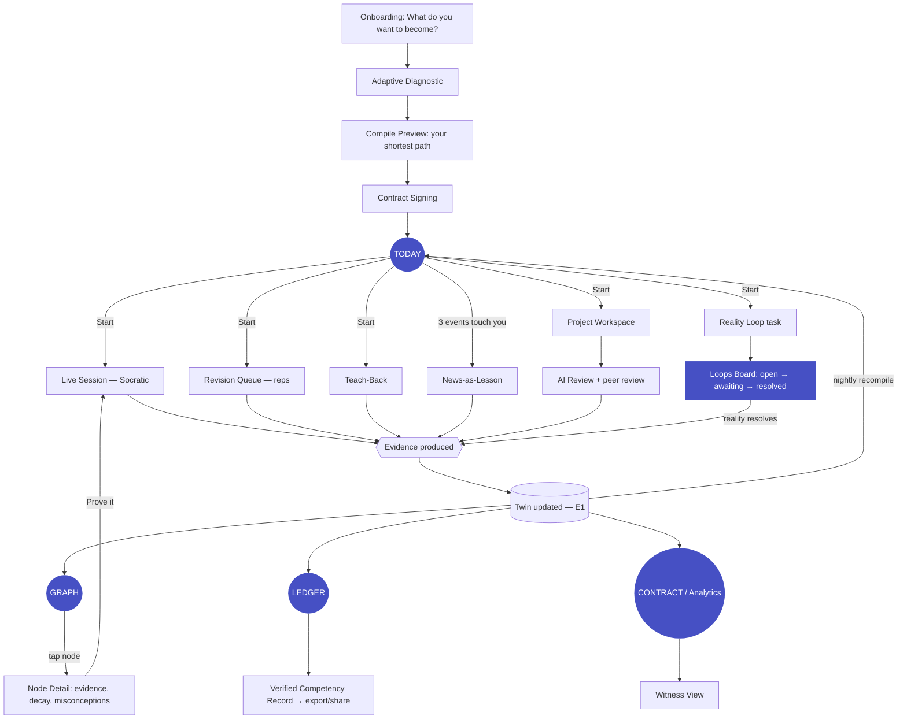
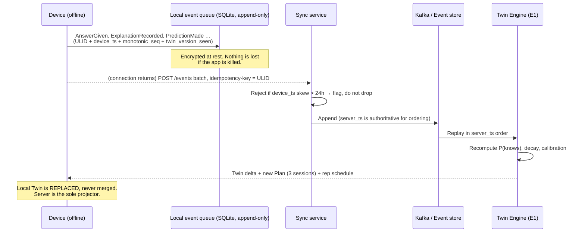

# 23 — UX: Web, Mobile, Offline, i18n

> Obeys `CANON.md`. Every screen, token and interaction below names the Invention (I-1..I-10)
> and Engine (E1..E18) it serves. If a surface serves none, it is not in this document.

---

## 1. The Interaction Thesis

### 1.1 The refusal, restated as an interface law

CANON §0: *"There is no 'mark as complete' button in the entire product."*
The UX corollary is stronger and it is the spine of this document:

> **PRAXIS has no catalog, no feed, no search-the-library, no "browse courses", no infinite
> scroll, no recommended-for-you rail, and no completion percentage on a course.
> Because none of those things exist as objects in the domain model, none of them can exist
> as pixels.**

Content browsers are shaped like their business model: they sell optionality, so they show you
a wall of options, and the wall *is* the product. PRAXIS sells **verified mastery per minute**
(I-10), so the interface must show you **one thing to do, now**. Optionality is the enemy: every
second spent choosing is a second of Mastery-per-Minute burned to zero.

### 1.2 The single question

Every PRAXIS session begins with the OS answering one question on the learner's behalf:

> **"What do I do in the next 15 minutes?"**

Not "what could I do." Not "here are 6 recommendations." **One card. One action. One verb.**
The Scheduler (E4) already decided — merging new learning vs. reps vs. open Loops vs. project
work against the Twin (E1) and the Plan (E3). Presenting the decision *back* to the learner as a
menu would be an admission that the Scheduler failed.

| Consumer-app instinct | PRAXIS instead | Why (Invention) |
|---|---|---|
| Home = feed of things you *could* do | Home = **the one thing you will do**, with a Start button | I-10 — choosing is not learning |
| "Continue watching" | "Continue *proving*" — the open evidence obligation | I-2 — evidence, not consumption |
| Progress bar to 100% | **Decaying Mastery Credit** that can go *down* overnight | I-2 — mastery bleeds |
| Streak confetti | Contract status: **ahead / on-pace / in debt** | I-9 — a teacher, not a slot machine |
| "You've learned 12 lessons!" | "You gained **0.0 MC** this week. Here is why." | I-10 — honesty over dopamine |
| Search the course library | Search **your own Graph** (E2) | There is no library |
| Recommendations engine | **Compiler** (I-4) — a plan, not a suggestion |

### 1.3 The emotional job

The product's persona is **a serious, calm, slightly demanding teacher** — the one whose
approval is worth something *because* it is hard to get. Concretely:

| Emotional beat | Interface expression | Anti-pattern rejected |
|---|---|---|
| Calm | Generous whitespace, one focal element per screen, no motion without cause | Ambient animation, floating blobs |
| Serious | Data-grade typography, tabular numerals, real numbers with real units | Rounded candy shapes, mascots, emoji |
| Demanding | The Hint Ladder shows a **price**; the Graph shows **decay**; Analytics shows **zero** | "Great job!" toasts, participation trophies |
| Trustworthy | Every claim in the UI is traceable to an Evidence item you can open | Vague "insights" with no provenance |
| Warm, not cuddly | The tutor's voice is patient and human; the *scorekeeping* is cold | Gamified pets, streak flames, coins |

**Design system search result, and its rejection (documented on purpose).** The generic design
intelligence for the query *"education … learning"* returns: pattern *FAQ/Documentation*, style
*Vibrant & Block-based*, typography **Baloo 2 / Comic Neue**, mood *"kids, education, playful,
colorful"*. That is the industry's reflex, and it is the exact reflex PRAXIS was built to reject.
We take instead the two tracks the same system surfaces for **data-dense, high-trust,
professional** products — *Financial Trust (IBM Plex, "excellent for data")* and
*Modern Dark / OLED (no pure black, hairline borders, restrained accent)* — and combine them with
an academic reading serif for lesson prose. PRAXIS should feel like **Bloomberg Terminal designed
by a university press**, not like Duolingo.

---

## 2. Design Direction

### 2.1 Visual language, named

**"Instrument."** The interface of a precision instrument that happens to teach.
Four principles:

| # | Principle | Rule |
|---|---|---|
| 1 | **One focal object per screen** | Exactly one primary CTA. Everything else is subordinate by size, weight and contrast — never by color alone. |
| 2 | **Numbers are first-class citizens** | MC, Brier, minutes, decay days, calibration — rendered in tabular monospaced figures, never rounded away, never hidden behind a smiley face. |
| 3 | **Motion only means state change** | Nothing moves for delight. Decay, mastery, resolution and cost are the only things allowed to animate. |
| 4 | **Density earns trust; emptiness earns focus** | Analysis surfaces (Graph, Ledger, Analytics) are dense. Action surfaces (Today, Session) are near-empty. |

### 2.2 Typography

| Role | Family | Why |
|---|---|---|
| **UI / headings / labels** | **IBM Plex Sans** (400/500/600) | Institutional, data-legible, wide Latin + Cyrillic + Devanagari-adjacent coverage; reads as *instrument*, not *toy*. |
| **Lesson prose / teach-back transcripts / news** | **Source Serif 4** (400/600) | Reading is a *different mode* than operating. Long-form synthesis from E17 renders in serif at 18–19px/1.7 — a textbook, not a chat bubble. |
| **All numerics, code, graph labels, Ledger hashes** | **JetBrains Mono** (400/500, `font-variant-numeric: tabular-nums`) | Numbers must not jitter as they tick. Ledger hashes must be verifiable by eye. |
| **Non-Latin** | Noto Sans / Noto Serif family per script (see §9) | Same optical weights, same scale, one system. |

**Type scale** (1.250 major-third, clamped for fluid desktop):

| Token | px | Use |
|---|---|---|
| `--fs-3xs` | 11 | Ledger hash, axis ticks |
| `--fs-2xs` | 12 | Metadata, timestamps |
| `--fs-xs` | 13 | Labels, table cells |
| `--fs-sm` | 14 | Secondary UI |
| `--fs-base` | 16 | UI body (mobile min) |
| `--fs-md` | 18 | **Lesson prose** |
| `--fs-lg` | 22 | Card headline |
| `--fs-xl` | 28 | Screen title |
| `--fs-2xl` | 36 | The Today verb |
| `--fs-3xl` | 48 | Diagnostic / Contract moments |
| `--fs-display` | 64 | Onboarding "become" |

Line-height: 1.2 (display) · 1.45 (UI) · **1.7 (prose)**. Measure: 62–72ch prose, 35–60ch mobile.

### 2.3 Color system

Neutral-dominant. **Color is reserved for meaning** — and the meanings are the domain's:
mastery, decay, misconception, calibration, locked. There is no decorative color anywhere.

| Semantic ramp | Meaning | Invention |
|---|---|---|
| **Signal (indigo)** | The single action. Only the primary CTA and current node wear it. | I-10 |
| **Mastery (jade)** | `MC ≥ 0.80` — held, lit | I-2 |
| **Decay (amber)** | MC falling toward threshold — *dimming* | I-2 / I-7 |
| **Breach (rose)** | Misconception, failed contract, Brier > 0.35 | I-6 / I-9 |
| **Calibration (violet)** | Reality Loop, prediction, Brier | I-3 |
| **Locked (graphite)** | Prerequisite not held. Greyed, un-enterable. | I-4 |

Every semantic color is paired with an **icon and a text label** — never color alone (WCAG 1.4.1).
A dimming node also **shrinks and loses its ring**, so decay is legible to a monochrome user.

### 2.4 Motion

| Token | Duration | Curve | Where |
|---|---|---|---|
| `--motion-instant` | 90ms | `ease-out` | Press feedback, hint-ladder rung reveal |
| `--motion-fast` | 160ms | `cubic-bezier(.16,1,.3,1)` | Hover, focus, toggles |
| `--motion-base` | 240ms | `cubic-bezier(.16,1,.3,1)` | Card enter, sheet, route change |
| `--motion-exit` | 150ms | `ease-in` | Exit = ~65% of enter |
| `--motion-decay` | **1200ms** | `ease-in-out` | Graph node dimming (the signature) |
| `--motion-resolve` | **900ms** | spring (damping .8) | Reality Loop resolution flip |

`prefers-reduced-motion: reduce` → all of the above collapse to ≤1ms **except** decay and
resolve, which become **instant state swaps with a text delta** ("−0.14 MC since Tuesday").
The information is never lost; only the animation is.

### 2.5 Density, spacing, elevation

4px base grid. Two density modes: **Focus** (Today, Session, Teach-Back — 24/32/48 rhythm) and
**Instrument** (Graph, Ledger, Analytics, Loops — 8/12/16 rhythm, 32px table rows).

Elevation is **hairline-first**: surfaces separate by 1px border + background delta, not shadow.
Shadow appears only on genuinely floating layers (sheet, popover, hint card).

### 2.6 Design tokens (CSS variables — authoritative)

```css
/* ============================================================
   PRAXIS Design Tokens — "Instrument"
   Layer 1: primitives  ·  Layer 2: semantics  ·  Layer 3: components
   ============================================================ */

/* ---------- Layer 1: PRIMITIVES (never used directly in components) ---------- */
:root {
  /* Graphite — the substrate */
  --g-0:#FFFFFF; --g-25:#FBFCFD; --g-50:#F6F8FA; --g-100:#EDF0F3; --g-200:#DDE2E8;
  --g-300:#C3CAD3; --g-400:#98A2AF; --g-500:#6B7684; --g-600:#4C5661; --g-700:#39414A;
  --g-800:#252B32; --g-850:#1B2026; --g-900:#12161A; --g-950:#0B0E11; --g-1000:#06080A;

  /* Signal (indigo) — the one action */
  --s-50:#EEF0FF; --s-100:#DCE0FF; --s-200:#BAC2FF; --s-300:#949FFA; --s-400:#7480F0;
  --s-500:#5A66E0; --s-600:#4650C4; --s-700:#373F9E; --s-800:#2A3079; --s-900:#1E2258;

  /* Mastery (jade) — held knowledge */
  --m-50:#E8F6F0; --m-100:#CBEBDF; --m-200:#98D8C0; --m-300:#5FC0A0; --m-400:#2FA582;
  --m-500:#178A69; --m-600:#0F6E53; --m-700:#0B563F; --m-800:#08402F; --m-900:#052B1F;

  /* Decay (amber) — bleeding knowledge */
  --d-50:#FDF3E3; --d-100:#FAE4C0; --d-200:#F3C97F; --d-300:#E8AB43; --d-400:#D18F1C;
  --d-500:#AE7412; --d-600:#8B5B0D; --d-700:#6B450A; --d-800:#4D3107; --d-900:#331F04;

  /* Breach (rose) — misconception / broken contract */
  --b-50:#FDEDEE; --b-100:#FAD6D9; --b-200:#F3ACB3; --b-300:#E87C88; --b-400:#D6505F;
  --b-500:#B93546; --b-600:#962636; --b-700:#741B29; --b-800:#54121D; --b-900:#380B13;

  /* Calibration (violet) — the Reality Loop */
  --c-50:#F3EDFC; --c-100:#E5D7F8; --c-200:#CBB0F0; --c-300:#AC85E4; --c-400:#8E62D2;
  --c-500:#7448B8; --c-600:#5C3697; --c-700:#472875; --c-800:#341C57; --c-900:#22123A;

  /* Type */
  --font-ui:'IBM Plex Sans','Noto Sans',system-ui,sans-serif;
  --font-prose:'Source Serif 4','Noto Serif',Georgia,serif;
  --font-mono:'JetBrains Mono','Noto Sans Mono',ui-monospace,monospace;

  --fs-3xs:11px; --fs-2xs:12px; --fs-xs:13px; --fs-sm:14px; --fs-base:16px;
  --fs-md:18px;  --fs-lg:22px;  --fs-xl:28px; --fs-2xl:36px; --fs-3xl:48px;
  --fs-display:clamp(40px,6vw,64px);

  --lh-tight:1.2; --lh-ui:1.45; --lh-prose:1.7;
  --fw-regular:400; --fw-medium:500; --fw-semibold:600;
  --tracking-label:.04em;

  /* Space — 4px grid */
  --sp-1:4px;  --sp-2:8px;  --sp-3:12px; --sp-4:16px; --sp-5:20px; --sp-6:24px;
  --sp-8:32px; --sp-10:40px; --sp-12:48px; --sp-16:64px; --sp-20:80px; --sp-24:96px;

  /* Radius — restrained. This is an instrument, not a pillow. */
  --r-xs:2px; --r-sm:4px; --r-md:6px; --r-lg:10px; --r-xl:14px; --r-full:9999px;

  /* Motion */
  --motion-instant:90ms; --motion-fast:160ms; --motion-base:240ms; --motion-exit:150ms;
  --motion-decay:1200ms; --motion-resolve:900ms;
  --ease-out:cubic-bezier(.16,1,.3,1);
  --ease-in:cubic-bezier(.4,0,1,1);
  --ease-decay:cubic-bezier(.4,0,.6,1);

  /* Z-scale */
  --z-base:0; --z-sticky:10; --z-nav:20; --z-sheet:40; --z-popover:60;
  --z-modal:100; --z-toast:1000;

  /* Layout */
  --measure-prose:68ch; --container:1280px; --today-card-max:640px;
  --tap-min:44px; /* iOS */  --tap-min-md:48px; /* Android */
}

/* ---------- Layer 2: SEMANTICS — LIGHT (default) ---------- */
:root, [data-theme="light"] {
  color-scheme: light;

  --bg-canvas:var(--g-50);
  --bg-surface:var(--g-0);
  --bg-surface-raised:var(--g-0);
  --bg-surface-sunken:var(--g-100);
  --bg-inset:var(--g-100);
  --bg-scrim:rgb(6 8 10 / .55);

  --fg-primary:var(--g-900);      /* 15.9:1 on surface */
  --fg-secondary:var(--g-600);    /* 7.4:1  */
  --fg-tertiary:var(--g-500);     /* 4.9:1  — the floor for body */
  --fg-disabled:var(--g-400);     /* non-text only */
  --fg-on-signal:var(--g-0);

  --border-subtle:var(--g-200);
  --border-default:var(--g-300);
  --border-strong:var(--g-400);

  --signal:var(--s-600);
  --signal-hover:var(--s-700);
  --signal-fg:var(--g-0);
  --signal-soft:var(--s-50);
  --signal-ring:var(--s-400);

  --mastery:var(--m-600);   --mastery-soft:var(--m-50);   --mastery-ring:var(--m-300);
  --decay:var(--d-600);     --decay-soft:var(--d-50);     --decay-ring:var(--d-300);
  --breach:var(--b-600);    --breach-soft:var(--b-50);    --breach-ring:var(--b-300);
  --calib:var(--c-600);     --calib-soft:var(--c-50);     --calib-ring:var(--c-300);
  --locked:var(--g-400);    --locked-soft:var(--g-100);

  --focus-ring:0 0 0 2px var(--bg-surface), 0 0 0 4px var(--signal-ring);

  --elev-0:none;
  --elev-1:0 1px 2px rgb(6 8 10 / .05);
  --elev-2:0 4px 12px -2px rgb(6 8 10 / .08), 0 2px 4px -2px rgb(6 8 10 / .04);
  --elev-3:0 12px 32px -8px rgb(6 8 10 / .14), 0 4px 8px -4px rgb(6 8 10 / .06);

  /* Graph node luminance ramp — MC 1.0 → 0.0 (see §5) */
  --node-lit:var(--m-500);
  --node-fading:var(--d-400);
  --node-cold:var(--g-300);
  --node-locked:var(--g-200);
  --node-breach:var(--b-400);
  --edge:var(--g-300);
  --edge-active:var(--s-400);
}

/* ---------- Layer 2: SEMANTICS — DARK ---------- */
[data-theme="dark"] {
  color-scheme: dark;

  /* No pure #000: OLED smear + halation on hairlines. */
  --bg-canvas:var(--g-950);
  --bg-surface:var(--g-900);
  --bg-surface-raised:var(--g-850);
  --bg-surface-sunken:var(--g-1000);
  --bg-inset:var(--g-850);
  --bg-scrim:rgb(6 8 10 / .72);

  --fg-primary:#E9EDF1;     /* 14.2:1 on --g-900 */
  --fg-secondary:#A9B3BE;   /* 7.6:1  */
  --fg-tertiary:#7D8894;    /* 4.6:1  */
  --fg-disabled:var(--g-600);
  --fg-on-signal:#0B0E11;

  --border-subtle:rgb(255 255 255 / .08);
  --border-default:rgb(255 255 255 / .14);
  --border-strong:rgb(255 255 255 / .24);

  --signal:var(--s-300);    --signal-hover:var(--s-200);
  --signal-fg:var(--g-950); --signal-soft:rgb(148 159 250 / .12);
  --signal-ring:var(--s-400);

  --mastery:var(--m-300);   --mastery-soft:rgb(95 192 160 / .12);  --mastery-ring:var(--m-400);
  --decay:var(--d-300);     --decay-soft:rgb(232 171 67 / .12);    --decay-ring:var(--d-400);
  --breach:var(--b-300);    --breach-soft:rgb(232 124 136 / .12);  --breach-ring:var(--b-400);
  --calib:var(--c-300);     --calib-soft:rgb(172 133 228 / .12);   --calib-ring:var(--c-400);
  --locked:var(--g-600);    --locked-soft:rgb(255 255 255 / .04);

  --focus-ring:0 0 0 2px var(--bg-surface), 0 0 0 4px var(--signal-ring);

  --elev-1:0 1px 2px rgb(0 0 0 / .4);
  --elev-2:0 4px 14px -2px rgb(0 0 0 / .5);
  --elev-3:0 16px 40px -10px rgb(0 0 0 / .65);

  --node-lit:var(--m-300);
  --node-fading:var(--d-300);
  --node-cold:var(--g-700);
  --node-locked:var(--g-800);
  --node-breach:var(--b-300);
  --edge:var(--g-700);
  --edge-active:var(--s-300);
}

/* ---------- Layer 3: COMPONENT TOKENS ---------- */
:root {
  --today-card-pad:var(--sp-8);
  --today-card-radius:var(--r-xl);
  --today-verb-size:var(--fs-2xl);

  --hint-rung-h:44px;
  --hint-cost-font:var(--font-mono);

  --node-r-min:6px;      /* MC 0.0 */
  --node-r-max:16px;     /* MC 1.0 — decay literally shrinks the node */
  --node-ring-w:2px;
  --node-glow-max:0 0 12px 0;   /* only on MC ≥ .90; never on locked */

  --table-row-h:32px;
  --ledger-hash-font:var(--font-mono);
}

/* ---------- Reduced motion ---------- */
@media (prefers-reduced-motion: reduce) {
  *,*::before,*::after {
    animation-duration:.01ms !important; animation-iteration-count:1 !important;
    transition-duration:.01ms !important; scroll-behavior:auto !important;
  }
  /* Decay & resolution remain *legible* — they become instant + captioned. */
  .node[data-decaying]::after { content:attr(data-decay-delta); }
}

/* ---------- Forced colors / high contrast ---------- */
@media (forced-colors: active) {
  .node { forced-color-adjust:none; border:2px solid CanvasText; }
  .node[data-state="locked"] { border-style:dashed; }
  .node[data-state="decaying"] { border-style:dotted; }
}
```

**Contrast audit (WCAG 2.2 AA, verified pairs):**

| Pair | Light | Dark | Req |
|---|---|---|---|
| `--fg-primary` on `--bg-surface` | 15.9:1 | 14.2:1 | ≥4.5 ✓ |
| `--fg-secondary` on `--bg-surface` | 7.4:1 | 7.6:1 | ≥4.5 ✓ |
| `--fg-tertiary` on `--bg-surface` | 4.9:1 | 4.6:1 | ≥4.5 ✓ |
| `--signal-fg` on `--signal` | 6.8:1 | 9.1:1 | ≥4.5 ✓ |
| `--mastery` on `--bg-surface` | 4.7:1 | 6.9:1 | ≥4.5 ✓ |
| `--decay` on `--bg-surface` | 4.6:1 | 7.8:1 | ≥4.5 ✓ |
| `--breach` on `--bg-surface` | 5.9:1 | 6.4:1 | ≥4.5 ✓ |
| Graph node vs canvas (non-text) | ≥3.2:1 | ≥3.4:1 | ≥3.0 ✓ |

---

## 3. Navigation

Five destinations. Not six. Everything else is reached *through* them.

| Destination | Answers | Engine |
|---|---|---|
| **Today** | "What do I do now?" | E4 |
| **Graph** | "What is in my mind?" | E1, E2 |
| **Loops** | "What did I predict, and was I right?" | E8 |
| **Ledger** | "What have I actually proven?" | E16 |
| **Contract** | "Am I keeping my word?" | E9, E14, E15 |

The **News feed (E9)** is *not* a destination — it is a *source of sessions*. It is reachable
from Today ("3 events touch your Graph today") and is finite (§4.15). Projects (E11) live inside
Today and the Ledger. Analytics (E15) lives inside Contract. Revision (E7) is generated *into*
Today, never browsed.



Web: sidebar ≥1024px, top bar + drawer below. Mobile: bottom nav, 5 items, icon **+ label**,
active state by weight + indicator (never color alone). Back always restores scroll and filter
state; every screen is deep-linkable (`praxis://graph/node/bayes-theorem`).

---

## 4. Screen Inventory

### 4.1 Onboarding — "What do you want to become?"

Serves **I-4** (the Objective is the build target). One question. No account wall yet. No
"pick your interests" grid — a grid is a catalog.

```
┌────────────────────────────────────────────────────────────────────────┐
│                                                          [ EN ▾ ] [☾]  │
│                                                                        │
│                                                                        │
│            What do you want to become?                                 │
│            ─────────────────────────────────────────────────────       │
│            ┃ an AI engineer who can ship a RAG system_          ┃      │
│            ─────────────────────────────────────────────────────       │
│            Say it in your own words. Not a course. A person.           │
│                                                                        │
│            Others became:  · a swing trader with positive expectancy   │
│                            · an ICU nurse who can read an ABG          │
│                            · a founder who can read a 10-K             │
│                                                                        │
│                                                                        │
│                    ┌──────────────────────────────┐                    │
│                    │        Compile my path  →    │   ← the only CTA   │
│                    └──────────────────────────────┘                    │
│                                                                        │
│            PRAXIS has no courses. It compiles a path from what         │
│            you already know to what you want to be.                    │
└────────────────────────────────────────────────────────────────────────┘
```

- **Input**: free text, voice-enabled (mic icon inside the field). E12 (Career Engine) resolves
  the utterance to a role ontology node; ambiguity is resolved by **one** disambiguating question,
  never a taxonomy tree.
- **Examples are text, not cards** — a card grid would read as a catalog. They rotate; they are
  not tappable shortcuts to a course, because there are no courses.
- After submit: a 4–8s **compile animation** — the DAG assembling itself. This is the only
  "delightful" moment in the product, and it is delightful because it is *true*: the Compiler
  (E3) is genuinely running.
- Empty/error: if E12 can't resolve the Objective ("I want to be happy"), PRAXIS says so plainly
  and asks for a *capability*, not a feeling.

### 4.2 Adaptive Diagnostic

Serves **I-6** (failure-seeking) and **I-1** (Twin cold-start). This is not a placement quiz that
flatters you. It is a **boundary hunt**, and the UI says so.

```
┌────────────────────────────────────────────────────────────────────────┐
│  Diagnostic · finding the edge of what you know        item 14  ~6 min │
│  ████████████░░░░░░░░  information gained: 71%     [ I don't know ]    │
├────────────────────────────────────────────────────────────────────────┤
│                                                                        │
│   A model achieves 0.94 accuracy on a dataset where 94% of labels      │
│   are class A. Your colleague ships it. What breaks?                   │
│                                                                        │
│   ┌──────────────────────────────────────────────────────────────┐     │
│   │ Type or say your answer…                             [ 🎤 ]  │     │
│   └──────────────────────────────────────────────────────────────┘     │
│                                                                        │
│   How sure are you?                                                    │
│   Guessing ──────●────────────────── Certain          72%              │
│   ^ this number is scored too. Overconfidence costs you.               │
│                                                                        │
│                                              [ Submit ]                │
├────────────────────────────────────────────────────────────────────────┤
│  Difficulty is adapting to you. There is no score to beat.             │
└────────────────────────────────────────────────────────────────────────┘
```

- **"I don't know" is a first-class button**, weighted equally with Submit. It is *informative*
  (E6/IRT) and it is *cheap*. Guessing is expensive. This is the first lesson.
- The **confidence slider is mandatory** — it seeds the Dunning–Kruger delta in the Twin (I-1)
  and the Brier baseline (I-3).
- Progress bar measures **information gained**, not items completed. It can jump. It sometimes
  finishes at item 9 and sometimes at item 31.
- Result screen: **"Here's what you already hold" (cache hits, jade) / "Here's what you think you
  hold but don't" (breach, rose) / "Here's what's missing" (locked, grey).** The middle bucket is
  shown *first*. It is the most valuable thing PRAXIS will ever tell a new user.

### 4.3 Contract Signing

Serves **I-9**. A ceremony, deliberately. It is the only modal in the product that cannot be
dismissed by tapping the scrim.

```
┌────────────────────────────────────────────────────────────────────────┐
│  Your compile                                                          │
│                                                                        │
│  Objective   AI Engineer — able to ship a production RAG system        │
│  Graph       218 concepts · 47 already held · 12 held-but-wrong        │
│  Critical    Linear algebra → Embeddings → Retrieval → Eval → Serving  │
│  path                                                                  │
│                                                                        │
│  ── The contract ──────────────────────────────────────────────────    │
│                                                                        │
│    I will study    [ 45 ] minutes/day   on [M][T][W][T][F][·][S]       │
│    I will be job-ready by     [ 2027-03-14 ]                           │
│                                                                        │
│    ┌────────────────────────────────────────────────────────────┐      │
│    │  At 45 min/day × 6 days, PRAXIS projects you reach         │      │
│    │  competence on 2027-03-02  (±19 days, 80% CI).             │      │
│    │  At 20 min/day you do not reach it before 2027-09.         │      │
│    │  ── this is a projection from your Twin, not a promise ──  │      │
│    └────────────────────────────────────────────────────────────┘      │
│                                                                        │
│    Stakes (optional)   ( ) none   (•) $40 to charity if I break it     │
│    Witness (optional)  [ manager@acme.com          ] sees my dashboard │
│                                                                        │
│    ☐ I understand PRAXIS will tell me when I am failing, and will      │
│      not record anything as learned that I did not prove.              │
│                                                                        │
│                      [ Sign the contract ]                             │
└────────────────────────────────────────────────────────────────────────┘
```

The counterfactual box is the **Twin being queried live** (I-1). Dragging the minutes stepper
re-projects the date in <300ms (cached compile, E3). This is the moment the learner *feels* the
Twin exist.

### 4.4 Today — the single-card home

Serves **I-10, I-4, E4**. **The most important screen in the product.**
Exactly one card. Exactly one verb. Everything else is a thin status rail.

```
┌────────────────────────────────────────────────────────────────────────┐
│  PRAXIS                          Day 34 · on pace · 41 min today  [☾]  │
├────────────────────────────────────────────────────────────────────────┤
│                                                                        │
│                                                                        │
│      ┌──────────────────────────────────────────────────────────┐      │
│      │  NEXT 15 MINUTES                            ⏱ 15:00      │      │
│      │                                                          │      │
│      │  Repair a misconception                                  │      │  ← --fs-2xl
│      │                                                          │      │
│      │  You believe cosine similarity is scale-invariant in a   │      │
│      │  way it is not. It cost you two wrong answers on         │      │
│      │  Tuesday and it will break your reranker.                │      │
│      │                                                          │      │
│      │  ┌──────────────────────────────────────────────────┐    │      │
│      │  │  Concept   Vector similarity metrics             │    │      │
│      │  │  Your MC   0.31 ▼ (was 0.58 on Nov 2)            │    │      │
│      │  │  Evidence  CRITIQUE — find the flaw in a wrong   │    │      │
│      │  │            worked example                        │    │      │
│      │  │  Why now   blocks 6 downstream concepts          │    │      │
│      │  └──────────────────────────────────────────────────┘    │      │
│      │                                                          │      │
│      │      ┏━━━━━━━━━━━━━━━━━━━━━━━━━━━━━━━━━━━━━━━━━┓         │      │
│      │      ┃            Start  →                     ┃         │      │
│      │      ┗━━━━━━━━━━━━━━━━━━━━━━━━━━━━━━━━━━━━━━━━━┛         │      │
│      │                                                          │      │
│      │      Not now  ·  Why this?  ·  I only have 5 min         │      │
│      └──────────────────────────────────────────────────────────┘      │
│                                                                        │
│  ── after this ────────────────────────────────────────────────────    │
│   ▸ 4 reps due (6 min)   ▸ 1 Loop resolves tomorrow   ▸ 3 news events  │
│     touch your Graph                                                   │
│                                                                        │
├────────────────────────────────────────────────────────────────────────┤
│  [Today]   [Graph]   [Loops]   [Ledger]   [Contract]                   │
└────────────────────────────────────────────────────────────────────────┘
```

Rules, non-negotiable:

| Rule | Rationale |
|---|---|
| **One card. Never two.** The "after this" rail is *text*, not cards, and is not tappable into a menu. | I-10 — the Scheduler decided. |
| **"Why this?" is always present** and opens the Scheduler's actual reasoning (blocked-downstream count, decay pressure, contract debt, Loop deadline). | Trust. A black-box teacher is a tyrant. |
| **"Not now"** is allowed exactly 2×/day, then the Accountability Engine (E14) escalates instead of re-rolling. | I-9 — a teacher, not a slot machine. |
| **"I only have 5 min"** recompiles to the highest-MC-per-minute 5-min atom (usually reps). | I-10 |
| **Session done → the card does not immediately refill.** It shows what you gained, then: *"That's the highest-value thing you can do today. Come back tomorrow."* | I-10 — **we optimize for the learner leaving.** |
| No streak flame. No confetti. No XP. | I-9 vs. engagement-farming. |

**Today's five possible verbs** (the Scheduler picks exactly one): *Learn something new* ·
*Repair a misconception* · *Refresh what's fading* · *Prove it* (teach-back / build / critique) ·
*Face reality* (open or resolve a Loop).

### 4.5 Live Session — Socratic tutor, voice-first, Hint Ladder as cost

Serves **I-5** (the Answer Budget — *enforced in the UI as a visible price*), E5.

```
┌────────────────────────────────────────────────────────────────────────┐
│  ← Vector similarity metrics            ⏱ 09:12 left      [end session]│
├──────────────────────────────────────────┬─────────────────────────────┤
│                                          │  ANSWER BUDGET              │
│  TUTOR                                   │  ████████░░  8 / 10         │
│  Here is a claim a colleague made:       │                             │
│  "Cosine similarity ignores magnitude,   │  ── Hint Ladder ──          │
│  so normalising my embeddings before     │                             │
│  storing them is pointless."             │  ┌───────────────────────┐  │
│                                          │  │ 1 ORIENT       −1 🔓  │  │
│  What breaks?                            │  │   "Where in the       │  │
│                                          │  │    pipeline does      │  │
│  ┌────────────────────────────────────┐  │  │    magnitude re-enter?"│ │
│  │ YOU (voice)                        │  │  └───────────────────────┘  │
│  │ ▁▂▅▇▆▃▁▂▅▇█▅▂▁  "uh… nothing? if   │  │  ┌───────────────────────┐  │
│  │ it's normalised then cosine and    │  │  │ 2 PROBE        −2 🔒  │  │
│  │ dot product are the same…"         │  │  ├───────────────────────┤  │
│  └────────────────────────────────────┘  │  │ 3 ANALOGY      −2 🔒  │  │
│                                          │  ├───────────────────────┤  │
│  TUTOR                                   │  │ 4 PARTIAL      −3 🔒  │  │
│  Good — you found the equivalence.       │  ├───────────────────────┤  │
│  Now: your ANN index uses inner product. │  │ 5 FULL ANSWER  −5 🔒  │  │
│  You skip normalisation. Walk me through │  │   ⚠ ends the session  │  │
│  what the index returns for a document   │  │   with NO evidence    │  │
│  that is simply *longer*.                │  │   recorded.           │  │
│                                          │  └───────────────────────┘  │
│                                          │                             │
│  ┏━━━━━━━━━━━━━━━━━━━━━━━━━━━━━━━━━━━━┓  │  Budget resets when you     │
│  ┃  🎤  Hold to speak    ⌨ type       ┃  │  hold the concept.          │
│  ┗━━━━━━━━━━━━━━━━━━━━━━━━━━━━━━━━━━━━┛  │  Spent budget lowers the MC │
│                                          │  this session can award.    │
└──────────────────────────────────────────┴─────────────────────────────┘
```

The Hint Ladder is the product's thesis rendered as an interface:

| Rung | Cost | Effect on this session's max MC award |
|---|---|---|
| 1 ORIENT | −1 | 1.00 → 0.94 |
| 2 PROBE | −2 | → 0.82 |
| 3 ANALOGY | −2 | → 0.70 |
| 4 PARTIAL | −3 | → 0.52 |
| 5 FULL ANSWER | −5 | **→ 0.00 — no Evidence is written to the Ledger.** |

- Rungs are **locked in order**. You cannot jump to FULL. The lock icons are real; the buttons
  are `aria-disabled` with an explanation, not silently dead.
- Taking the full answer **is allowed** — PRAXIS is not a jailer — but it is honest: the session
  produces **no Evidence** (I-2), the concept stays un-held, and it will come back tomorrow. The
  UI says exactly that, calmly, before you tap.
- **Voice-first**: the mic is the primary input on every viewport. The waveform is a real
  amplitude render (learner is *speaking*, i.e. *producing* — I-5). Typing is the secondary path.
- **The session cannot end until the learner has said or built something.** Closing early emits
  `SessionAbandoned` and the tutor asks one question: "What stopped you?" — the answer is routed
  to the Motivation Engine (E13), not to a churn dashboard.

### 4.6 Teach-Back (Feynman)

Serves **I-2** (`EXPLAIN`), E6 rubric grading.

```
┌────────────────────────────────────────────────────────────────────────┐
│  Teach it back                                     Backpropagation     │
├────────────────────────────────────────────────────────────────────────┤
│  Explain backpropagation to a smart 15-year-old who knows the chain    │
│  rule but has never seen a neural network. 90 seconds. Go.             │
│                                                                        │
│              ┌──────────────────────────────────────┐                  │
│              │   ▁▃▅▇█▇▅▃▁▂▄▆█▆▄▂▁▃▅▇█▇▅▃▁          │                  │
│              │            0:47 / 1:30               │                  │
│              │        ● RECORDING                   │                  │
│              └──────────────────────────────────────┘                  │
│                          [ ■ Stop ]   [ ⟲ Restart ]                    │
│                                                                        │
│  ✎ Whiteboard (optional — drawings are Evidence too)                   │
│  ┌──────────────────────────────────────────────────────────────────┐  │
│  │       x →[w1]→ h →[w2]→ ŷ    ∂L/∂w1 = ∂L/∂ŷ · ∂ŷ/∂h · ∂h/∂w1     │  │
│  └──────────────────────────────────────────────────────────────────┘  │
└────────────────────────────────────────────────────────────────────────┘

── RESULT (after grading, ~8s) ─────────────────────────────────────────
┌────────────────────────────────────────────────────────────────────────┐
│  EXPLAIN evidence                             MC awarded: 0.62  ▲+0.62 │
│                                                                        │
│  Rubric                                                                │
│  ┌────────────────────────────────┬───────┬──────────────────────────┐ │
│  │ Correctness of mechanism       │  4/5  │ chain rule applied right │ │
│  │ Causal, not just procedural    │  2/5  │ you said WHAT, not WHY   │ │
│  │ Named the failure mode         │  0/5  │ never mentioned vanishing│ │
│  │ Audience-appropriate           │  5/5  │ no jargon leaked         │ │
│  │ No borrowed phrasing           │  4/5  │ 0:31–0:38 is textbook    │ │
│  └────────────────────────────────┴───────┴──────────────────────────┘ │
│                                                                        │
│  ⚑ Misconception detected → added to your library                      │
│     "Gradients flow backward because the loss travels backward."       │
│     They don't travel. Nothing travels. It's a derivative.             │
│     → scheduled for repair on Thursday                                 │
│                                                                        │
│  ▶ Replay your recording at 0:31, where the wheels came off.           │
└────────────────────────────────────────────────────────────────────────┘
```

Rubric cells link to the **exact timestamp** in your own audio. Hearing yourself be wrong is the
single highest-yield feedback surface in the product. The **Misconception** is *named*, not
scored — CANON §3 requires named wrong models, not a percentage.

### 4.7 The Reality Loop board

Serves **I-3** — the crown jewel. Three columns, one truth: **reality has not answered yet.**

```
┌────────────────────────────────────────────────────────────────────────┐
│  LOOPS                Brier 0.184 ▼ (better)  ·  Calibration: 71%      │
│                       [ all ] [ markets ] [ code ] [ clinical ]        │
├──────────────────┬──────────────────────┬──────────────────────────────┤
│  OPEN            │  AWAITING RESOLUTION │  RESOLVED                    │
│  (you must act)  │  (reality is working)│  (reality has spoken)        │
├──────────────────┼──────────────────────┼──────────────────────────────┤
│ ┌──────────────┐ │ ┌──────────────────┐ │ ┌──────────────────────────┐ │
│ │ NIFTY 15-min │ │ │ HDFC — long       │ │ │ INFY — short       ✗    │ │
│ │ Mark the     │ │ │ entry 1,642       │ │ │ predicted −2.1%          │ │
│ │ chart.       │ │ │ conf 68%          │ │ │ actual    +0.8%          │ │
│ │ Closes in    │ │ │ ⏳ resolves at     │ │ │ Brier 0.462  ▲ worse     │ │
│ │ 04:12:09     │ │ │    close, 3h 20m  │ │ │ ── your thesis said      │ │
│ │              │ │ │                   │ │ │ "breakout failure" but   │ │
│ │ [ Open ]     │ │ │ You cannot edit   │ │ │ you ignored the earnings │ │
│ └──────────────┘ │ │ this. It is       │ │ │ date. Misconception:     │ │
│ ┌──────────────┐ │ │ signed and        │ │ │ "technical levels        │ │
│ │ CASE #4471   │ │ │ timestamped.      │ │ │ dominate event risk"     │ │
│ │ 58F, dyspnea │ │ └──────────────────┘ │ │ → repair scheduled       │ │
│ │ Predict Dx + │ │ ┌──────────────────┐ │ └──────────────────────────┘ │
│ │ confidence   │ │ │ Q3 revenue call   │ │ ┌──────────────────────────┐ │
│ │ Truth in 6d  │ │ │ ⏳ filing in 11d   │ │ │ CASE #4390 — PE     ✓    │ │
│ │ [ Open ]     │ │ └──────────────────┘ │ │ │ conf 74% · Brier 0.068   │ │
│ └──────────────┘ │                      │ │ │ + Evidence → Ledger      │ │
│                  │                      │ │ └──────────────────────────┘ │
├──────────────────┴──────────────────────┴──────────────────────────────┤
│  CALIBRATION CURVE          ideal ╱                                     │
│  1.0 ┤                        ╱                                         │
│      │                    ●  ╱   you are overconfident above 70%:       │
│  .5  ┤            ● ●    ╱        when you say 90%, you are right 68%.  │
│      │      ● ●      ╱                                                  │
│   0  ┼──●──●──────────────────────────                                  │
│      0        .5             1.0  (stated confidence)                   │
└────────────────────────────────────────────────────────────────────────┘
```

- **"Awaiting resolution" cards are read-only and visibly locked.** You signed it. Reality is the
  examiner and it cannot be lobbied. This is the emotional core of I-3.
- Resolution arrives as a **push notification and a motion event**: the card *flips*
  (`--motion-resolve`, 900ms spring) from violet (calibration) to jade or rose. It is the one
  moment PRAXIS allows drama, because reality earned it.
- Brier is shown raw, always, with a plain-language gloss underneath. `Brier 0.462` means nothing
  to a human on day 1; *"you were confidently wrong"* does.
- A resolved-wrong Loop **always** produces a named Misconception and a scheduled repair. Being
  wrong is not punished; being wrong *and not updating* is.

### 4.8 Chart-marking canvas (the trading Loop)

Serves **I-3**, E8. The learner must **commit in ink** before the market moves.

```
┌────────────────────────────────────────────────────────────────────────┐
│  NIFTY 50 · 15m · as of 2027-01-14 09:45 IST      ⚠ FORWARD DATA HIDDEN│
├────────────────────────────────────────────────────────────────────────┤
│  Tools: [ ⟋ trend ] [ ▭ zone ] [ ⌁ entry ] [ ⊗ stop ] [ ◎ target ]     │
│         [ ✎ note ] [ ↶ undo ]                                          │
│                                                                        │
│    22,400 ┤                                    ╱▔▔╲                    │
│           │                          ╱▔╲    ╱▔╯    ╰╮                  │
│    22,200 ┤ ▭▭▭▭▭▭▭▭▭▭▭ resistance ▭▭▭▭▭▭▭▭▭▭▭▭▭▭▭▭▭▭▭  ← you drew    │
│           │        ╱▔╲    ╱▔╲   ╱                                      │
│    22,000 ┤   ╱▔▔╲╯   ╰──╯   ╰─╯          ◎ target 22,340              │
│           │ ╱                              ⌁ entry  22,180             │
│    21,800 ┤                                ⊗ stop   22,090             │
│           └──────────────────────────────────┃──────────────────────   │
│             09:15      10:00      11:00      ┃  ← NOW. Nothing right   │
│                                              ┃     of this line exists.│
│                                                                        │
│  ── Commit ────────────────────────────────────────────────────────    │
│  Direction  (•) Long  ( ) Short  ( ) No trade — this is a valid answer │
│  Thesis     ┃ Range compression at resistance with rising volume;   ┃  │
│  (required) ┃ expect breakout retest. Invalidated below 22,090.     ┃  │
│  Confidence Guessing ────────●──────── Certain   64%                   │
│  R:R        1 : 1.78  (auto-computed from your marks)                 │
│                                                                        │
│  ┏━━━━━━━━━━━━━━━━━━━━━━━━━━━━━━━━━━━━━━━━━━━━━━━━━━━━━━━━━━━━━━━━┓    │
│  ┃  Sign & submit — the market grades this at 15:30 IST           ┃    │
│  ┗━━━━━━━━━━━━━━━━━━━━━━━━━━━━━━━━━━━━━━━━━━━━━━━━━━━━━━━━━━━━━━━━┛    │
│  Once signed, it is immutable and hashed into your Ledger.             │
└────────────────────────────────────────────────────────────────────────┘
```

- **"No trade" is a first-class, scorable answer.** In markets, restraint is a competence. Any UI
  that forces a directional call teaches gambling.
- The **thesis is mandatory and free-text**. Without it, resolution can only grade the *outcome*,
  not the *reasoning* — and PRAXIS grades reasoning (E8 + E6 rubric on the thesis, separately from
  the Brier on the outcome). You can be **right for the wrong reason**, and PRAXIS will say so.
- The right-of-now region is not merely blank — it is **cryptographically unavailable** to the
  client. Anti-lookahead is an architecture property, not a UI convention.

### 4.9 The Graph — *your mind, rendered* (the signature screen)

Serves **I-1, I-2, I-4**. This is the screen people will screenshot.

```
┌────────────────────────────────────────────────────────────────────────┐
│  YOUR GRAPH        218 concepts · 61 held · 14 fading · 9 broken       │
│  [ 🔍 search your mind ]      view: ( ) all  (•) reachable  ( ) target │
├────────────────────────────────────────────────────────────────────────┤
│                                                                        │
│                          ● Transformers                                │
│                         ╱ ╲        (locked — 2 prereqs missing)        │
│              ◯ Attention   ◯ Positional enc.                           │
│              ╱      ╲                                                  │
│      ●Softmax        ◐ Dot product          ✦ Backprop                 │
│        │             (fading — 3d to threshold)  (lit, MC .91)         │
│      ●Exponentials        │                    ╱  │                    │
│        │                  │              ●Chain rule                   │
│      ✦Logarithms      ✖ Cosine similarity      │                       │
│      (lit, MC .94)      (BROKEN — misconception) ●Derivatives          │
│                                                                        │
│   ┌──── LEGEND ────────────────────────────────────────────────────┐   │
│   │ ✦ lit     MC ≥ .90   large, jade, faint ring                   │   │
│   │ ● held    MC ≥ .70   solid jade                                │   │
│   │ ◐ fading  MC ↓       amber, shrinking, ring dissolving         │   │
│   │ ✖ broken  misconception present — rose, hard outline           │   │
│   │ ◯ locked  prereq unmet — graphite, dashed, un-tappable         │   │
│   └────────────────────────────────────────────────────────────────┘   │
│                                                                        │
│  ⚠ 14 concepts are dimming. Left alone, you lose "Dot product"         │
│    on Thursday, and "Attention" becomes unreachable.   [ Refresh now ] │
└────────────────────────────────────────────────────────────────────────┘

── NODE DETAIL (tap a node) ───────────────────────────────────────────
┌────────────────────────────────────────────────────────────────────────┐
│  Cosine similarity                              MC 0.31 ▼   ✖ BROKEN   │
│  ┌──────────────────────────────────────────────────────────────────┐  │
│  │ MC over time                                                     │  │
│  │ 1.0 ┤      ╭─╮                                                    │  │
│  │     │     ╱   ╰╮                                                  │  │
│  │ 0.5 ┤   ╱      ╰──╮___                                            │  │
│  │     │ ╱             ╰────╮___  ← forgetting curve, projected      │  │
│  │  0  ┼──────────────────────────╰──── threshold breach: Thu        │  │
│  │     Nov 2   Nov 9   Nov 16   Nov 23   Nov 30                      │  │
│  └──────────────────────────────────────────────────────────────────┘  │
│                                                                        │
│  EVIDENCE (4)                                                          │
│   ✓ RECALL     Nov 2   correct, 4.1s, conf 80%          → Ledger #8812 │
│   ✓ APPLY      Nov 3   correct, novel item              → Ledger #8830 │
│   ✗ APPLY      Nov 9   WRONG — scale invariance         → Ledger #9014 │
│   ✗ CRITIQUE   Nov 9   missed the flaw                  → Ledger #9015 │
│                                                                        │
│  MISCONCEPTION                                                         │
│   "Normalising is pointless if I use cosine."  → repairs the same day  │
│   it broke your reranker. First seen Nov 9.                            │
│                                                                        │
│  BLOCKS 6 concepts:  Reranking · ANN indexes · Hybrid search · …       │
│                                                                        │
│  PoM CONTRACT to hold this concept                                     │
│   ☑ RECALL   ☐ APPLY (2 novel)   ☐ CRITIQUE   ☐ EXPLAIN                │
│                                                                        │
│                          [ Prove it now → ]                            │
└────────────────────────────────────────────────────────────────────────┘
```

### 4.10 Revision queue

Serves **I-2, E7**. Not a screen you *browse* — a screen the Scheduler *hands* you. Reps are
5–90 seconds each, full-bleed, one at a time, keyboard/voice/one-thumb.

```
┌────────────────────────────────────────────────────────────────────────┐
│  Reps · 4 of 11                                    ⏱ 3:40 remaining    │
│  ●●●●○○○○○○○                                                           │
├────────────────────────────────────────────────────────────────────────┤
│                                                                        │
│         Why does layer normalisation not depend on batch size?         │
│                                                                        │
│              ┌───────────────────────────────────┐                     │
│              │  🎤 say it   ·   ⌨ type   ·  ⎵ show│                    │
│              └───────────────────────────────────┘                     │
│                                                                        │
│  ── after you answer ──                                                │
│  How did that feel?   [ Again ] [ Hard ] [ Good ] [ Easy ]             │
│  next rep:              10 min   1 day   4 days   9 days               │
│  ^ FSRS interval shown BEFORE you choose. No hidden mechanics.         │
└────────────────────────────────────────────────────────────────────────┘
```

Showing the resulting interval **before** the grade is chosen is deliberate: PRAXIS never hides
its scheduler. A learner who understands the machine cooperates with it.

### 4.11 Project workspace + AI review

Serves **I-2** (`BUILD`), E11.

```
┌────────────────────────────────────────────────────────────────────────┐
│  PROJECT · Ship a RAG system that beats BM25 on your own corpus        │
│  Brief · Workspace · Review · Portfolio                       Day 3/7  │
├──────────────────────────────┬─────────────────────────────────────────┤
│  ACCEPTANCE (hidden tests)   │  SUBMIT                                 │
│  ☑ Ingests 500 docs          │  ┌───────────────────────────────────┐  │
│  ☑ p95 retrieval < 200ms     │  │ repo  github.com/you/rag-eval     │  │
│  ☐ nDCG@10 > BM25 baseline   │  │ ⇪ or drop a .zip / notebook       │  │
│  ☐ Eval harness reproducible │  └───────────────────────────────────┘  │
│  ☐ Failure analysis written  │       [ Run the hidden tests ]          │
│                              │                                         │
│  You do NOT get to see the   │  ── RUN #4 ──────────────────────────   │
│  test corpus. That is the    │  ✓ build            2.1s                │
│  point.                      │  ✓ ingest 500 docs  41s                 │
│                              │  ✓ p95 187ms                            │
│                              │  ✗ nDCG@10 0.412 vs BM25 0.437          │
│                              │    You lose on short keyword queries.   │
├──────────────────────────────┴─────────────────────────────────────────┤
│  AI REVIEW (E11) — this is a review, not a fix. It will not write      │
│  your code. (I-5)                                                      │
│                                                                        │
│  ▸ Your chunker splits mid-sentence at 512 tokens. Three of your five  │
│    worst queries fail on chunks that begin with "…therefore".          │
│    → Concept touched: Chunking strategy (your MC 0.44, fading)         │
│  ▸ You never implemented hybrid retrieval, though your Graph says you  │
│    hold it (MC 0.81). Why? — answer this to keep the credit.           │
│  ▸ Your eval has no confidence intervals. nDCG 0.412 vs 0.437 on 50    │
│    queries is not a difference. Concept: Statistical significance —    │
│    LOCKED. Prerequisite ladder queued.                                 │
│                                                                        │
│  Evidence written on pass: BUILD → Ledger, signed, with test output.   │
└────────────────────────────────────────────────────────────────────────┘
```

The AI review **names the Graph node behind every critique** and updates the Twin. A code review
that doesn't move the Twin is just a linter.

### 4.12 The Ledger / Verified Competency Record

Serves **I-8** — the moat and the money.

```
┌────────────────────────────────────────────────────────────────────────┐
│  LEDGER          1,847 evidence items · chain intact ✓ · last root:    │
│                  a4f9…c21b (verify)                       [ Export ⇩ ] │
│  [ all ] [ RECALL ] [ APPLY ] [ EXPLAIN ] [ BUILD ] [ CRITIQUE ] [PRED]│
├────────────────────────────────────────────────────────────────────────┤
│  #9014  2026-11-09 14:02:11Z   APPLY     Cosine similarity      ✗      │
│         novel item · 41s · conf 80% · result WRONG                     │
│         hash 7c1e…9a04   prev 0b83…ff12                    [ verify ]  │
│  #9015  2026-11-09 14:06:40Z   CRITIQUE  Cosine similarity      ✗      │
│  #9106  2026-11-11 08:31:02Z   PREDICT   INFY short             ✗      │
│         Brier 0.462 · resolved by NSE close 2026-11-11     [ source ]  │
│  #9220  2026-11-14 19:12:55Z   BUILD     RAG eval harness       ✓      │
│         hidden tests 6/6 · artifact s3://…/run-9220.tar.gz [ artifact ]│
│  #9221  2026-11-14 19:13:02Z   EXPLAIN   Backprop               ◐      │
│         rubric 15/25 · audio 1:27                          [ listen ]  │
├────────────────────────────────────────────────────────────────────────┤
│  VERIFIED COMPETENCY RECORD                            [ Share link ]  │
│  ┌──────────────────────────────────────────────────────────────────┐  │
│  │  Priya Sharma — AI Engineer track                                │  │
│  │                                                                  │  │
│  │  Demonstrated, novel-item accuracy   84%   (n=312, 90d window)   │  │
│  │  Calibration (Brier)                 0.184 (n=47 predictions)    │  │
│  │  Artifacts that passed hidden tests  6                           │  │
│  │  Teach-backs above rubric threshold  22                          │  │
│  │  Concepts currently held (MC ≥ .70)  61 / 218                    │  │
│  │  ⚠ 14 concepts are currently decaying. This record is LIVE.      │  │
│  │                                                                  │  │
│  │  Every line above is independently verifiable. A recruiter can   │  │
│  │  click any claim and see the signed evidence that produced it.   │  │
│  │  praxis.to/v/priya-sharma          [ QR ]   [ Copy verify key ]  │  │
│  └──────────────────────────────────────────────────────────────────┘  │
│  You control what is shared, per-item. Default: nothing.               │
└────────────────────────────────────────────────────────────────────────┘
```

**The decay disclosure is non-negotiable.** A Verified Competency Record that hides decay would be
a diploma — the exact artifact PRAXIS exists to replace. The record says *what is true today*.

### 4.13 Analytics — including the honest "you gained nothing" state

Serves **I-10**. The state below is the most important state in the entire product, because it is
the one every other company in the category is structurally incapable of shipping.

```
┌────────────────────────────────────────────────────────────────────────┐
│  THIS WEEK                                            Nov 8 – Nov 14   │
├────────────────────────────────────────────────────────────────────────┤
│                                                                        │
│      You invested 3h 42m.                                              │
│      You gained 0.0 Mastery Credit.                                    │  ← --fs-2xl
│                                                                        │
│      MASTERY-PER-MINUTE      0.000 MC/min      (your median: 0.011)    │
│                                                                        │
│      This is not a bug and it is not your fault. Here is why:          │
│                                                                        │
│      ▸ 2h 51m of your time went to sessions you abandoned before       │
│        producing evidence. Nothing you did not finish counts.          │
│      ▸ You took the FULL ANSWER rung 6 times. Those sessions wrote     │
│        no evidence, by design.                                         │
│      ▸ Meanwhile 14 concepts decayed. Your net position is −0.9 MC.    │
│                                                                        │
│      ┌──────────────────────────────────────────────────────────────┐  │
│      │  NET MASTERY (gained − decayed)                              │  │
│      │  +2 ┤                                                        │  │
│      │     │  ▇▇   ▇▇▇                                              │  │
│      │   0 ┼──▇▇───▇▇▇──────────────────▁▁▁────────────────────     │  │
│      │     │                        ▇▇▇ │▇▇│  ← this week           │  │
│      │  −2 ┤                        ▇▇▇ │▇▇│                        │  │
│      │      W40  W41  W42  W43  W44  W45  W46                       │  │
│      └──────────────────────────────────────────────────────────────┘  │
│                                                                        │
│      THE ONE THING THAT WOULD FIX THIS                                 │
│      Finish one session. Any session. Producing one piece of evidence  │
│      is worth more than three hours of reading.                        │
│                                                                        │
│                          [ Start a 5-minute session ]                  │
├────────────────────────────────────────────────────────────────────────┤
│  Calibration 0.184 ▼   Consistency 4/6 days   Contract: 2 days in debt │
└────────────────────────────────────────────────────────────────────────┘
```

Design notes:
- **No red alarm, no shaming iconography.** The tone is a good teacher's: *factual, specific,
  and immediately followed by the smallest possible next step.*
- The default period is **the week**, not "all time" — all-time charts always go up and are
  therefore a lie.
- `Time on app` appears **nowhere** in this product. Ever. (CANON I-10.)

### 4.14 Accountability — contract status & Witness view

Serves **I-9**, E14.

```
── LEARNER VIEW ────────────────────────────────────────────────────────
┌────────────────────────────────────────────────────────────────────────┐
│  CONTRACT              signed 2026-10-08 · AI Engineer by 2027-03-14   │
├────────────────────────────────────────────────────────────────────────┤
│  Committed  45 min/day · 6 days/week      Stake  $40 → GiveDirectly    │
│  Witness    manager@acme.com (sees the dashboard, not your answers)    │
│                                                                        │
│  M  T  W  T  F  S  S      Debt:  −68 min                               │
│  ✓  ✓  ✗  ✓  ✗  ·  ·      Pay it back:  22 min/day for 3 days, or one  │
│  ▲ this week              68-min block on Saturday.  [ Schedule it ]   │
│                                                                        │
│  ── Escalation ladder (where you are) ─────────────────────────────    │
│    1 ✓ silent          — nothing said                                  │
│    2 ✓ nudge           — "you have 12 minutes free at 21:00"           │
│    3 ▶ direct          — YOU ARE HERE. This screen.                    │
│    4 ○ witness alerted — Fri 09:00 if debt > 90 min                    │
│    5 ○ stake released  — 3 consecutive missed weeks                    │
│    6 ○ contract renegotiated — PRAXIS proposes a smaller promise       │
│                                                                        │
│  Step 6 is not a punishment. If you cannot keep this contract, the     │
│  contract is wrong. [ Renegotiate now ] — projected date moves to      │
│  2027-05-02 at 25 min/day. That is honest, and it still works.         │
└────────────────────────────────────────────────────────────────────────┘

── WITNESS VIEW (manager / parent / coach) ─────────────────────────────
┌────────────────────────────────────────────────────────────────────────┐
│  Priya Sharma — AI Engineer track            You are a WITNESS.        │
│  ┌──────────────────────────────────────────────────────────────────┐  │
│  │ You can see: consistency, contract status, verified milestones,  │  │
│  │              projected readiness date.                           │  │
│  │ You CANNOT see: her answers, her recordings, her misconceptions, │  │
│  │              her Twin, or anything she got wrong.                │  │
│  │ She can revoke this in one tap.                                  │  │
│  └──────────────────────────────────────────────────────────────────┘  │
│  Consistency   ████████░░  4/6 days      Contract   ⚠ 68 min in debt   │
│  Verified      6 artifacts · 22 teach-backs · 47 predictions           │
│  Projected     job-ready 2027-03-02  (was 2027-02-24 last week ▼)      │
│                                                                        │
│  [ Send one message ]   ← rate-limited to 1/week. You are a witness,   │
│                            not a manager of her attention.             │
└────────────────────────────────────────────────────────────────────────┘
```

The witness's *inability to see failure* is a feature. A learner who can be punished for a wrong
answer will stop giving honest ones, and the Twin (I-1) dies.

### 4.15 News-as-lesson feed — **finite, with a bottom**

Serves **I-7**. The anti-feed. It ends. On purpose.

```
┌────────────────────────────────────────────────────────────────────────┐
│  TODAY'S EVENTS THAT TOUCH YOUR GRAPH                    3 · 14 min    │
│  This is not a feed. It ends. There is nothing below the last item.    │
├────────────────────────────────────────────────────────────────────────┤
│  ┌──────────────────────────────────────────────────────────────────┐  │
│  │ ● TEACHES YOU SOMETHING NEW                              ~6 min  │  │
│  │ RBI holds repo at 6.25%, signals liquidity easing                │  │
│  │                                                                  │  │
│  │ Concepts: Policy rate · Liquidity ops · Yield curve (locked ⚠)   │  │
│  │ You hold 2 of 3 prerequisites. PRAXIS will teach the third       │  │
│  │ inline (Duration, 4 min) rather than defer this.                 │  │
│  │                                     [ Learn from this event → ]  │  │
│  └──────────────────────────────────────────────────────────────────┘  │
│  ┌──────────────────────────────────────────────────────────────────┐  │
│  │ ◐ THIS IS A REP — you already hold these                 ~2 min  │  │
│  │ OpenAI ships a 1M-context model; long-context evals contested    │  │
│  │ Concepts: Attention complexity (MC .78, fading) · Eval design    │  │
│  │                                          [ Use it as a rep → ]   │  │
│  └──────────────────────────────────────────────────────────────────┘  │
│  ┌──────────────────────────────────────────────────────────────────┐  │
│  │ ○ DEFERRED — you are not ready for this yet                      │  │
│  │ Fed's QT taper and the reverse-repo floor                        │  │
│  │ Missing: Central bank balance sheet · Money multiplier           │  │
│  │ PRAXIS will surface this again in ~3 weeks, once you hold them.  │  │
│  │ It is not hidden from you. It is just not useful yet.            │  │
│  │                                    [ Ladder to it anyway (11m) ] │  │
│  └──────────────────────────────────────────────────────────────────┘  │
├────────────────────────────────────────────────────────────────────────┤
│                                                                        │
│              ─────────  That's everything.  ─────────                  │
│         3 events touched your Graph today. There is no more.           │
│         Nothing loads if you keep scrolling. Go build something.       │
│                                                                        │
└────────────────────────────────────────────────────────────────────────┘
```

Every item ends in **a question or a prediction** (CANON I-7) — reading an article writes no
Evidence. The **hard bottom** is enforced client-side *and* server-side: the endpoint returns
`items ≤ 5` and no cursor. There is no pagination token to exploit.

### 4.16 Misconception Library (secondary, reached from Graph & Ledger)

Serves **I-6**. A named list of the specific wrong models you hold, each with: first-seen date,
what it has cost you (wrong answers, failed Loops, broken builds), repair status, and the
concepts it contaminates. It is uncomfortable to look at. That is correct.

---

## 5. The Signature Interaction — the Graph as a living mind, with visible decay

Nothing else in learning software does this: **the interface degrades when you do.**

### 5.1 The encoding

Mastery Credit maps to **four simultaneous visual channels** so it survives colorblindness,
monochrome, and forced-colors mode:

| Channel | MC 1.0 | MC 0.5 | MC 0.0 | Locked |
|---|---|---|---|---|
| **Radius** | 16px | 11px | 6px | 8px |
| **Fill** | `--node-lit` (jade) | `--node-fading` (amber) | `--node-cold` (grey) | `--node-locked` |
| **Ring** | 2px solid, faint glow ≥.90 | 2px, 50% dash gaps | none | 1px dashed |
| **Opacity** | 1.00 | 0.72 | 0.42 | 0.30 |
| **Label** | full weight 500 | weight 400 | weight 400, `--fg-tertiary` | italic, "locked" |

A node with an active Misconception ignores the ramp entirely and renders **rose with a hard
2px outline and an `✖` glyph** — a break is not a shade of decay, it is a different kind of thing.

### 5.2 The decay animation (`--motion-decay`, 1200ms)

Decay is **not** a nightly cron that silently rewrites a number. It is *witnessed*.

1. **On open**, the Graph renders at the Twin's state **as of your last visit**.
2. Then, over 1200ms with `--ease-decay`, every node that has decayed since **animates to its
   current state**: radius shrinks, opacity drops, the ring's dash gaps widen until it dissolves.
   Nodes that crossed the threshold *while you were away* emit a single soft pulse and drop to
   grey. The learner literally watches the last three days of forgetting happen in one second.
3. A caption fades in: **"14 concepts dimmed while you were away. 1 fell below threshold."**
4. Edges downstream of a fallen node **fade from `--edge-active` to `--edge`**, and any node they
   fed becomes `locked`. The reachability frontier visibly *recedes*. This is the emotional
   payload: forgetting doesn't just lose you a fact, **it takes territory back.**

`prefers-reduced-motion`: no animation; instead the changed nodes render in their new state with
a persistent delta badge (`−0.14`) and the same caption. Screen readers get an `aria-live="polite"`
announcement of the same sentence.

### 5.3 The mastery animation (the counter-motion)

When Evidence is written and MC rises, the reverse happens — but **quietly**. The node grows,
brightens, and the ring closes. Newly unlocked downstream nodes fade from `locked` grey to
`cold` and become tappable, staggered 40ms apart along the DAG's topological order, so you see
the frontier *advance* in the direction the Compiler intended.

**No confetti. No sound. No badge.** The reward is that the map got bigger. If that is not
enough, PRAXIS is not the product for that person, and we are at peace with that.

### 5.4 Feedback & interaction detail

| Interaction | Behavior |
|---|---|
| Hover / focus node | Ring thickens 2→3px, `--motion-fast`. Prereq chain upstream highlights `--edge-active`. Downstream blocked nodes get a subtle rose tint. |
| Tap node | Node Detail sheet (§4.9). Shared-element transition: the node scales into the sheet's header dot. |
| Tap locked node | **It does not open.** It shakes 4px, once, 90ms, and a tooltip names the missing prerequisites with a "Ladder to it" CTA. Refusal, made legible. |
| Pinch / scroll | Semantic zoom: >0.6× shows concept labels; <0.6× collapses to **domain clusters** with an aggregate MC ring. A 218-node graph is unreadable at full detail and we don't pretend otherwise. |
| Search your mind | Fuzzy search over concept names + your own teach-back transcripts. Results fly the camera to the node. |
| Time scrubber | Drag to replay your Graph over the last 90 days. Watch mastery bloom and bleed. This is the single best retention artifact the product has, and it is honest. |
| Keyboard | Full DAG traversal: `↑` prereqs, `↓` dependents, `←/→` siblings, `Enter` open, `/` search. The Graph is fully operable without a mouse (WCAG 2.1.1). |
| Screen reader | The Graph exposes a parallel **tree view** (`role="tree"`), ordered topologically, announcing "Cosine similarity, mastery 0.31, decaying, broken by 1 misconception, blocks 6 concepts." A force-directed canvas alone is inaccessible; the tree is not a fallback, it is a peer. |

### 5.5 Rendering

WebGL/Canvas (`regl` or `pixi`) for >150 nodes; SVG below that. 60fps budget; layout (force-directed,
pre-solved server-side and cached per Twin version) never runs on the main thread. Mobile renders a
**radial ego-graph** around the current concept, 2 hops, not the full DAG — a 218-node force graph on
a 390px screen is a hairball, and shipping a hairball to prove you have a graph is vanity.

---

## 6. Mobile (Flutter)

Mobile is **not the web app squeezed**. It is the *voice-first, one-thumb, five-minute* surface —
and it is where most of the reps and most of the Loops actually happen.

### 6.1 Principles

| # | Principle | Implementation |
|---|---|---|
| 1 | **Voice-first** | Every session can be completed with the phone at your ear, screen dark. Mic is the primary control on Session, Teach-Back, Reps. |
| 2 | **One-thumb** | All primary controls live in the bottom 40% of the screen. Nothing critical above the fold-line. Bottom nav ≤5 with labels. |
| 3 | **Five-minute atom** | The Scheduler (E4) can always emit a 5-minute plan. It is never "come back when you have 30 minutes." |
| 4 | **Interruption-safe** | A session survives a phone call, an app switch, a dead battery. State is checkpointed after every turn. |
| 5 | **Never a browser** | No catalog, no feed, no scroll-to-discover. Same refusal as web. |

### 6.2 The five-minute session

```
┌───────────────────────┐   ┌───────────────────────┐   ┌───────────────────────┐
│  ⏱ 5:00               │   │        ⏱ 3:12         │   │  ⏱ 0:00               │
│                       │   │                       │   │                       │
│  NEXT 5 MINUTES       │   │  ┌─────────────────┐  │   │  +0.18 MC             │
│                       │   │  │                 │  │   │                       │
│  Refresh 4 fading     │   │  │   ▁▃▅▇█▇▅▃▁     │  │   │  3 concepts refreshed │
│  concepts             │   │  │                 │  │   │  1 still fading —     │
│                       │   │  │  listening…     │  │   │  it'll come back      │
│  Attention · Softmax  │   │  └─────────────────┘  │   │  Thursday.            │
│  Dot product · LayerN │   │                       │   │                       │
│                       │   │  "Why doesn't layer   │   │  That's the highest-  │
│  ┌─────────────────┐  │   │   norm depend on      │   │  value 5 minutes you  │
│  │  🎧 Hands-free  │  │   │   batch size?"        │   │  had today.           │
│  └─────────────────┘  │   │                       │   │                       │
│  ┌─────────────────┐  │   │  ┌─────┐  ┌────────┐  │   │  [ Done ]             │
│  │ ▶  Start        │  │   │  │ ⏸  │  │  Skip  │  │   │  ← not "Continue"     │
│  └─────────────────┘  │   │  └─────┘  └────────┘  │   │                       │
└───────────────────────┘   └───────────────────────┘   └───────────────────────┘
      thumb zone ↑                 thumb zone ↑
```

**Hands-free mode** is the killer surface: earbuds in, phone in pocket, walking. The tutor speaks,
the learner speaks, VAD (voice activity detection) handles turn-taking, and the Hint Ladder is
requested by *saying* "hint" — with the tutor stating the cost aloud before spending it
("That's a probe. It'll cost you two. Want it?"). The Answer Budget survives the loss of the
screen, because it is a **policy layer, not a UI affordance** (I-5).

### 6.3 Notifications (E18)

Three kinds. Only three. All of them are **the Scheduler talking**, never marketing.

| Type | Example | Rule |
|---|---|---|
| **Decay warning** | "You lose *Dot product* on Thursday. 4 minutes fixes it." | Max 1/day. Fires only when a threshold breach is <72h out. |
| **Loop resolution** | "The market graded you. INFY: you were confidently wrong. Brier 0.462." | Fires the instant reality resolves. Never batched — the sting is the lesson. |
| **Contract escalation** | "You're 68 minutes in debt. 22 min/day for 3 days clears it." | Ladder-governed (§4.14). Escalates in *directness*, never in *frequency*. |

**Forbidden by policy:** re-engagement pushes, "we miss you", streak-saver panic, "3 people in
your cohort just…". If the learner does not need us today, we do not contact them. (I-10.)

Quiet hours are per-learner and default to the Contract's stated study window. A notification
that arrives outside the window is a bug.

### 6.4 Home-screen widget — "your next 10 minutes"

```
┌──────────────────────────────┐   ┌───────────────────────────────────────┐
│ PRAXIS            10 min     │   │ PRAXIS                                │
│ ──────────────────────────── │   │ ─────────────────────────────────────│
│ Repair a misconception       │   │ ⚠ 14 concepts dimming                │
│ Cosine similarity            │   │ ●●●●◐◐◐◐○○○○○○  ← mini decay strip    │
│                              │   │                                       │
│ MC 0.31 ▼  blocks 6          │   │ Next 10 min: Repair "Cosine           │
│                              │   │ similarity" — blocks 6 concepts       │
│         [ Start ]            │   │                                       │
└──────────────────────────────┘   │   [ Start ]      [ 5 min instead ]    │
     small (2×2)                    └───────────────────────────────────────┘
                                              medium (4×2)
```

The widget is a **write surface, not a read surface**: tapping Start opens directly into the
session, no home screen in between. Refreshed on Twin update (max 4×/day, iOS budget-aware).
The decay strip is the only "ambient" data in the product and it exists to make forgetting
*visible on the lock screen*.

### 6.5 Platform fit

| Concern | Flutter approach |
|---|---|
| Gestures | System back / predictive back honored. No horizontal swipe on the Graph canvas conflicting with edge-back — canvas pan requires a 12px drag threshold and releases the edge gutter. |
| Haptics | `Impact.light` on rung unlock (a cost was paid), `Impact.medium` on Evidence written, `notificationError` on Loop resolved-wrong. Nowhere else. |
| Safe areas | All CTAs above the gesture bar; the Session mic button is inset 24px from the bottom safe area. |
| Dynamic Type | Full support to 200%; the Today card reflows, never truncates. Numbers stay tabular. |
| Rendering | Graph via Flutter `CustomPainter` + `Impeller`; audio via `record` + platform VAD; on-device model via `onnxruntime` / `llama.cpp` FFI (§7.4). |

---

## 7. Offline

Offline is not a degraded mode bolted on. For the target markets (India, Nepal, SEA, LATAM),
**offline is the commute**, and the commute is when learning actually happens.

### 7.1 What works offline

| Capability | Offline? | How |
|---|---|---|
| **Today's card** | ✅ Full | Scheduler precomputes and pushes the next **3 sessions** (~2 days of plan) on every sync. |
| **Reps / revision queue** | ✅ Full | Items + FSRS state cached. Grading is local (exact-match, MCQ, cloze); free-text reps queue for server grading. |
| **Live Session (Socratic)** | ◐ Degraded | On-device small model (§7.4). Answer Budget enforced **locally** — the policy layer ships in the client. |
| **Teach-Back recording** | ✅ Capture | Audio recorded, VAD-trimmed, stored locally. **Rubric grading requires the cloud** and is queued. Learner sees "awaiting grading", not a fake score. |
| **Chart-marking / drawings** | ✅ Full | Chart data for open Loops is pre-cached (the candles up to `now` are fixed). Marks + thesis + confidence are signed locally and queued. |
| **Reading (lessons, news)** | ✅ Full | Last-synced lesson bodies + today's ≤5 news items cached. |
| **Graph** | ✅ Read + local decay | Full DAG + Twin snapshot cached (218 nodes ≈ 240KB). **Decay is computed locally from the forgetting curve** — it does not need the server to know you are forgetting. |
| **Ledger** | ✅ Read | Cached, read-only. New Evidence is appended to a **local pending chain** and merged on sync. |
| **Project hidden tests** | ❌ | Requires the server. Stated plainly: "Hidden tests need a connection. Your code is saved." |
| **Loop resolution** | ❌ | Reality resolves server-side. Obviously. |
| **Nightly recompile** | ❌ | Client uses the last compiled Plan; if it goes stale (>72h), the UI says so. |
| **Analytics** | ◐ | Last-synced week only. No fabricated numbers. |

### 7.2 Sync & conflict model

The event-sourced kernel (CANON §5.1) makes this tractable: **the client is an event producer,
never a state mutator.** There is nothing to merge, because the client never edits shared state —
it appends immutable Learning Events with a client-generated ULID and a device clock.



**Conflict rules — stated, not hand-waved:**

| Situation | Resolution |
|---|---|
| Same event synced twice (retry) | Idempotent on ULID. Second write is a no-op. |
| Two devices, both offline, both do reps on concept `c` | **Both events are kept.** They are evidence, not state. The Twin projects over both; two retrievals of `c` in a day is simply two reps. There is no conflict because there is no overwrite. |
| Local Twin says MC 0.62, server says 0.48 | **Server wins, always.** The local Twin is a *cache of a projection*, marked `stale` in the UI while offline. On sync it is discarded and replaced. |
| Device clock is wrong / tampered | `server_ts` orders the log. `device_ts` is retained for forensics. Skew >24h flags the batch for review and **excludes those events from the Ledger's signed chain** until reviewed. |
| Prediction submitted offline, market already moved | The **signature carries `device_ts` + the last-synced market tick hash**. If the learner's device saw data past the cutoff, the Loop is **voided, not graded** — never silently accepted. Anti-lookahead beats convenience. |
| Local pending Ledger chain vs. server chain | Local entries are *provisional* (visibly marked ⧗). On sync they are re-hashed into the server chain in `server_ts` order and become final. Provisional entries are never exportable in a Verified Competency Record. |
| Offline for 30 days | On reconnect, the client shows the decay it *predicted* being reconciled against the decay the server *computed*. If they differ materially, the UI says so and the Twin is replaced. Honesty over silent correction. |

### 7.3 Storage budget (mobile)

| Asset | Size |
|---|---|
| Graph DAG + Twin snapshot | ~240 KB |
| 3 precomputed sessions + items | ~600 KB |
| 30-day rep queue | ~200 KB |
| Cached lesson bodies + news | ~2 MB |
| Chart data for open Loops | ~1.5 MB |
| Teach-back audio (queued, Opus 24kbps) | ~180 KB/min |
| **On-device tutor model (quantised)** | **~1.2 GB (opt-in download, Wi-Fi only)** |
| **Total without model** | **< 8 MB** |

The 8MB floor matters: PRAXIS must be usable on a 2GB Android phone on a 2G fallback. The
on-device model is **optional**, and the product is honest that it is a downgrade.

### 7.4 The on-device tutor — and its honest limits

| Property | Cloud tutor (E5) | On-device tutor |
|---|---|---|
| Model | Sonnet/Haiku-class, routed | ~3–4B quantised (Q4), on-device |
| Socratic quality | Full — probes, analogies, misconception-aware | **Noticeably worse.** Shallower probes, generic analogies. |
| Answer Budget (I-5) | Enforced server-side | **Enforced client-side, same policy code.** Cannot be bypassed by going offline. |
| Misconception mining (I-6) | Yes, live | **No.** Transcript is queued; mining happens on sync. |
| Rubric grading (EXPLAIN) | Yes | **No.** Never faked. UI shows "awaiting grading". |
| Evidence written | Immediately, signed | **Provisional (⧗).** Confirmed or revised on sync. |
| Latency | 400–900ms/turn | 200–600ms/turn (faster, actually) |
| Cost | ~$0.004/learner-min | $0 |

**What we tell the learner, in the product, in plain words:**

> **Offline tutor.** This is a smaller teacher. It will ask you good questions but it will miss
> things, and it cannot grade your explanations. Anything you do here is marked *provisional*
> until you're back online. It will not lie to you about what you've proven.

That paragraph ships. It is a competitive advantage to be the only company willing to write it.

---

## 8. Accessibility (WCAG 2.2 AA)

PRAXIS's users include people who learn *because* mainstream education failed them. Accessibility
is not compliance here; it is the market.

| WCAG 2.2 criterion | How PRAXIS satisfies it |
|---|---|
| **1.4.1 Use of Color** | Every semantic (mastery/decay/breach/locked) carries **shape + size + glyph + label** in addition to hue. The Graph is legible in greyscale — see §5.1. |
| **1.4.3 Contrast (Min)** | Full audit in §2.6. All text ≥4.5:1, large ≥3:1, in **both** themes. |
| **1.4.11 Non-text Contrast** | Graph nodes, rings, chart series, focus rings all ≥3:1 vs. adjacent. |
| **1.4.4 / 1.4.10 Resize & Reflow** | 200% zoom / 320px reflow with no horizontal scroll and no truncation. The Today card is the stress test and it reflows. |
| **1.4.12 Text Spacing** | No fixed-height text containers anywhere. |
| **2.1.1 / 2.1.2 Keyboard** | 100% of the product, including the Graph canvas (§5.4) and the chart-marking canvas (arrow-key nudging of marks, `Enter` to place). No traps. |
| **2.2.1 Timing Adjustable** | Session timers are **advisory, never enforced**. Nothing expires. The "15 minutes" is a promise from us, not a deadline for you. |
| **2.2.2 Pause/Stop/Hide** | The decay animation auto-plays once, ≤1.2s, and can be disabled. Nothing else moves. |
| **2.3.1 Three Flashes** | Nothing flashes. The Loop resolution flip is a single 900ms transform. |
| **2.4.3 Focus Order** | DOM order = visual order. Route change moves focus to `<main>` and announces the screen. |
| **2.4.7 / 2.4.11 Focus Visible & Not Obscured** | 4px `--focus-ring` with a 2px offset; sticky bars reserve inset so focused elements are never hidden behind them (a 2.2 addition, commonly failed). |
| **2.5.7 Dragging Movements** | **Every drag has a non-drag equivalent.** Chart marks: place by keyboard/tap-coordinates. Graph pan: arrow keys. Rep grading: buttons, never swipe-only. (2.2 addition.) |
| **2.5.8 Target Size (Min)** | ≥24×24 CSS px everywhere; ≥44×44 on all mobile primary controls. Graph nodes have an invisible 44px hit area regardless of rendered radius. |
| **3.2.6 Consistent Help** | "Why this?" and Help are in the same place on every screen. (2.2 addition.) |
| **3.3.7 Redundant Entry** | Onboarding never re-asks. (2.2 addition.) |
| **3.3.8 Accessible Authentication** | Passkeys/OAuth; no cognitive-function test to log in — never a puzzle CAPTCHA. (2.2 addition.) |
| **4.1.3 Status Messages** | `aria-live="polite"` for: MC changes, decay caption, sync status, budget spend. `role="alert"` for Loop resolution. |

**Beyond AA, because of who we serve:**

- **Dyslexia**: an optional switch to a hyper-legible face (Atkinson Hyperlegible) with increased
  tracking and 1.9 line-height — applied to prose only, tokens do the rest.
- **ADHD**: "Focus mode" strips the Today screen to the card alone; the Session hides the timer.
- **Deaf/HoH**: **every** voice interaction has a full text path. Teach-back can be *typed*; the
  rubric grades text and audio identically. Voice is the default, never the requirement.
- **Blind/low-vision**: the Graph's tree view (§5.4) is a first-class peer surface, and the whole
  Socratic session is natively audio — PRAXIS is, unusually, *better* for a blind learner than any
  video-based competitor, and we should say so.
- **Cognitive load**: one focal object per screen is itself an accessibility feature.

---

## 9. i18n / l10n

### 9.1 The mechanical part (table stakes)

| Concern | Approach |
|---|---|
| Strings | ICU MessageFormat, plural/gender-aware. No string concatenation, ever. |
| RTL (ar, he, ur, fa) | Full logical-property CSS (`margin-inline-start`, `inset-inline`). **The Graph mirrors** (DAG flows right→left) and progress/timelines mirror. **Charts and code blocks do NOT mirror** — a candlestick chart's time axis is LTR in every culture, and code is LTR. This distinction is where most products get it wrong. |
| Non-Latin scripts | Noto family per script. Devanagari/Bengali/Thai need **+15% line-height** (`--lh-ui: 1.6`) or diacritics clip. Arabic needs +8% font-size to match Latin optical size. These are per-locale token overrides, not per-component hacks. |
| Numerals | Locale-aware, but **domain numerals stay Western Arabic** (a Brier score of 0.184 is 0.184 in Hindi UI). Dates ISO-8601 in the Ledger, localized in the UI. |
| Text expansion | German +35%, Tamil +40%. No fixed-width buttons. The Today verb is the stress case; it wraps to 2 lines. |
| Voice | ASR + TTS per locale (Hindi, Nepali, Bahasa, Tagalog, Vietnamese, Arabic, Spanish, Portuguese). Code-switching-tolerant ASR is mandatory (§9.2). |

### 9.2 The hard problem: **teach in the learner's language, keep the terms in English**

This is the real i18n problem for India, Nepal, and SEA, and nobody has solved it in an education
product. A Hindi-speaking learner in Pune does **not** want:

> ❌ "प्रतिगामी प्रसार" *(a literal Hindi translation of "backpropagation")*

Because the job interview, the documentation, the codebase, the paper, and the colleague all say
**"backpropagation."** Translating the term *destroys its economic value*. But teaching the
*explanation* in English costs comprehension and doubles cognitive load.

**PRAXIS's model: the concept is bilingual by construction.**

Every Concept node in the Graph (E2) carries:

```json
{
  "concept_id": "backpropagation",
  "canonical_term": { "text": "backpropagation", "lang": "en", "locked": true },
  "term_locale": {
    "hi": { "gloss": "बैकप्रोपैगेशन", "script": "deva",
            "policy": "TRANSLITERATE",
            "explain_in": "hi", "term_stays": "en" },
    "ne": { "gloss": "ब्याकप्रोपगेसन", "policy": "TRANSLITERATE" },
    "ar": { "gloss": "الانتشار العكسي", "policy": "TRANSLATE_WITH_EN_PAREN" },
    "es": { "gloss": "retropropagación", "policy": "TRANSLATE" }
  },
  "term_policy_default": "KEEP_EN"
}
```

Three policies, chosen **per term per locale**, not per language:

| Policy | When | Example (hi) |
|---|---|---|
| `KEEP_EN` | The term is the *interface to the industry*: APIs, libraries, exam syllabi, job posts. | "इसे **gradient descent** कहते हैं…" |
| `TRANSLITERATE` | The term must be *sayable* in-language but is still English. | "**बैकप्रोपैगेशन** (backpropagation)" — spoken as the English word in Devanagari. |
| `TRANSLATE` | The term has a genuine, used, native equivalent (mostly in medicine, law, civics — where the *local* system is the domain). | Indian constitutional law: "अनुच्छेद 370" not "Article 370". |

The default for AI/software/markets is **`KEEP_EN` for terms, learner's language for everything
else** — which produces the register educated Indians actually speak:

> **Tutor (Hindi mode):** "अच्छा — तो आपने **chain rule** सही लगाया। अब बताइए, अगर **gradient**
> हर layer में multiply होता है और हर term 1 से छोटा है, तो 20 layers के बाद क्या होगा?"

That is Hinglish, and Hinglish is not a compromise — **it is the actual professional language of
the actual learner.** Any product that forces a choice between "all Hindi" and "all English" has
misunderstood its user.

**Consequences that must be built, not bolted on:**

| Requirement | Implementation |
|---|---|
| **ASR must survive code-switching** | The learner will *say* "gradient chhota ho jaata hai." A monolingual Hindi ASR transcribes garbage. We require a code-switching-tolerant ASR, and we **grade against the canonical English term**, not the transcript surface form. A learner who says "backprop" in a Hindi sentence gets full credit. |
| **Grading is term-normalized** | E6's rubric matches on `concept_id`, resolved through `term_locale` + transliteration + common abbreviations ("backprop", "BP", "बैकप्रॉप"). Answer correctness must never depend on spelling an English word in a foreign script. |
| **TTS must switch mid-sentence** | Hindi TTS pronouncing "backpropagation" with Hindi phonotactics is comically wrong and destroys trust. The synthesis pipeline emits SSML with per-span `xml:lang` so the English term is spoken in English inside a Hindi sentence. This is the single hardest engineering item in this document. |
| **The Ledger is always canonical** | Evidence records `concept_id` + `canonical_term`. A Verified Competency Record is **always exported in English terms**, whatever language the learning happened in — because the employer reading it is reading in English. The learner learned in Nepali and gets a record the world can read. That is the whole promise. |
| **Content is generated, not translated** | E17 synthesizes the lesson *in* the target language against the same Graph node. We never machine-translate an English lesson into Hindi — the analogies, the examples, the units, the currency, and the misconceptions are **locale-specific** (a Hindi lesson on options pricing uses NIFTY, not SPX). Translation is a content-catalog concept, and we don't have a content catalog. |

**Launch locale sequence:** `en-IN` → `hi-IN` (+Hinglish) → `en-US` → `ne-NP` → `id-ID` → `es-419`
→ `ar` (first RTL, forces the layout work) → `pt-BR` → `vi-VN`. RTL is deliberately scheduled
*early enough to hurt* — if it lands late it never lands.

---

## 10. Traceability

| Screen / surface | Invention | Engine |
|---|---|---|
| Onboarding "become" | I-4 | E3, E12 |
| Adaptive Diagnostic | I-6, I-1 | E6, E1 |
| Contract Signing | I-9, I-1 (counterfactual) | E14, E1, E3 |
| **Today (single card)** | **I-10, I-4** | **E4** |
| Live Session + Hint Ladder | **I-5** | E5 |
| Teach-Back | I-2 (`EXPLAIN`), I-6 | E6 |
| Reality Loop board | **I-3** | E8 |
| Chart-marking canvas | I-3 | E8 |
| **The Graph (decay visible)** | **I-1, I-2, I-4** | **E1, E2** |
| Revision queue | I-2 | E7 |
| Project workspace + AI review | I-2 (`BUILD`), I-5 | E11 |
| Ledger / Verified Competency Record | **I-8** | E16 |
| Analytics ("you gained nothing") | **I-10** | E15 |
| Accountability / Witness | I-9 | E14, E13 |
| News-as-lesson (finite) | I-7 | E9, E10 |
| Misconception Library | I-6 | E6, E1 |
| Offline + on-device tutor | I-5 (policy client-side) | E5, E7 |
| i18n bilingual concept model | I-8 (canonical Ledger) | E2, E17 |

---

## 11. What we will not build

| Not building | Why |
|---|---|
| A course catalog / search-the-library | There is no content object to browse (CANON §2). |
| An infinite feed | I-7 — the feed has a bottom. |
| Streaks with flames, XP, coins, leaderboards, avatars | I-9/I-10 — engagement is not a metric. |
| "Mark as complete" | It does not exist in the domain model. |
| Social/community feed | Peer *review* exists (E11). A timeline does not. |
| Dark patterns for retention | We optimize for the learner leaving. |
| A "recommended for you" rail | The Compiler already decided. A rail is an admission it didn't. |
