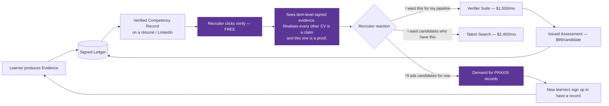
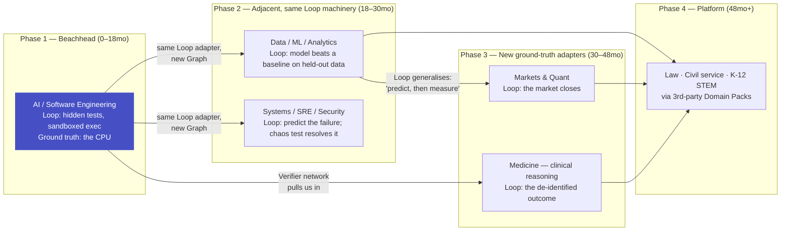

# 24 — Monetization & Go-To-Market

> Obeys `CANON.md`. Pricing exists to protect the Inventions, not to maximize seats.
> The single constraint on every decision below: **CANON I-10 — we optimize for the learner
> leaving.** A business model that requires the learner to *stay* is disqualified.

---

## 1. The monetization constraint

Every incumbent's business model requires **time-on-app**. Ours cannot.

| Model | What it forces the product to do | Verdict |
|---|---|---|
| Ads | Maximize sessions, minimize learning-per-session | ❌ Structurally incompatible with I-10 |
| Course sales (Udemy) | Sell optionality; catalog breadth is the asset | ❌ There is no catalog (CANON §2) |
| Certificate upsell (Coursera) | Sell completion; completion must be attainable | ❌ There is no completion (CANON §0) |
| Engagement subscription (Duolingo) | Streaks retain; retention is the metric | ❌ Engagement is not a metric (I-10) |
| **Metered capability** | Charge for the *scarce input* (AI reasoning minutes) and the *durable output* (the verified Ledger). Both scale with value delivered, neither with time wasted. | ✅ |

**So PRAXIS charges for two things, and only two:**

1. **AI-minutes** — the scarce, genuinely costly input (Tutor, grading, Reality Loop resolution).
2. **The Ledger** — the durable, verifiable output (I-8), sold to the party that needs to *trust*
   it: employers, institutions, regulators.

A learner who reaches competence in 4 months instead of 14 pays us *less*. Good. They also
produce a Verified Competency Record that a hiring team pays us to verify, and they tell people.
**The Ledger is how we get paid for making learning fast.**

---

## 2. Pricing

### 2.1 Personal

| | **Free** | **Pro** | **Pro+** |
|---|---|---|---|
| **Price** | $0 | **$19/mo** · $180/yr | **$39/mo** · $372/yr |
| **India / Nepal / SEA (PPP)** | $0 | ₹499/mo | ₹999/mo |
| **AI-minutes / month** | **60** | **600** (~20 min/day) | **1,500** (~50 min/day) |
| Objectives (I-4) | 1 | 3 | Unlimited |
| Cognitive Twin (I-1) | ✅ full | ✅ | ✅ + counterfactual queries |
| The Graph (I-1/I-2) | ✅ full, with decay | ✅ | ✅ + time scrubber |
| Socratic Tutor (I-5) | ✅ (within AI-minutes) | ✅ | ✅ + Opus-class routing on hard concepts |
| Reps / FSRS (E7) | ✅ **unlimited, forever** | ✅ | ✅ |
| Adaptive Diagnostic (I-6) | ✅ 1 / 90 days | ✅ unlimited | ✅ |
| Teach-Back rubric grading (I-2) | 2 / month | 20 / month | Unlimited |
| **Reality Loops (I-3)** | ❌ | 5 open / month | ✅ **Unlimited + all domain adapters** |
| Projects with hidden tests (I-2 `BUILD`) | 1 / quarter | 3 / month | ✅ **Unlimited** |
| News-as-Curriculum (I-7) | ✅ 3 events/day | ✅ 5/day | ✅ 5/day |
| Commitment Contract + Witness (I-9) | ✅ | ✅ | ✅ + stakes |
| **Verified Competency Record (I-8)** | ✅ **always free to export, forever** | ✅ | ✅ + custom domains |
| Offline + on-device tutor | ✅ | ✅ | ✅ |
| Data export / deletion | ✅ | ✅ | ✅ |

**Why the free tier is genuinely useful and still safe:**

- **Reps are free forever.** Spaced repetition is cheap (precomputed items, local grading — see
  §3.4) and it is the thing that *keeps* mastery alive. Charging for retention would make PRAXIS
  a product that profits from forgetting. Never.
- **The Graph and the Twin are free.** They are the *demonstration* of the thesis. A free user who
  watches 14 nodes dim on a Tuesday morning understands what PRAXIS is in three seconds. That
  moment is worth more than any landing page.
- **The cap is AI-minutes, not features.** 60 minutes/month is ~2 real tutoring sessions. Enough
  to feel the Answer Budget bite and to produce real Evidence. Not enough to reach an Objective.
  The wall the learner hits is the *right* wall: *"you are learning, and you have run out of
  teacher."*
- **Free COGS = ~$0.41/user/month** (§3). At 780k free users that is $125k/mo — a real number,
  and the single biggest line item we must defend. Defence: routing, precomputation, on-device
  offload (§3.4). If blended AI cost per minute ever exceeds $0.010, the free tier drops to 30
  minutes. That is the pressure valve, and it is stated publicly.

**What Pro+ is really selling:** the **Reality Loop (I-3)**. Loops are the most expensive thing we
run (market data licences, clinical case libraries, sandboxed execution, resolution pipelines) and
the most valuable thing we own. They are the reason Pro+ exists as a tier at all.

### 2.2 Coach

For the 1:many mentor — the trading mentor with 40 students, the interview coach, the private
tutor. This is the highest-margin self-serve tier and the best distribution channel we have.

| | **Coach** |
|---|---|
| **Price** | **$99/mo** base, includes **10 learner seats** · **$8/seat/mo** thereafter |
| Coach dashboard | Every learner's Twin, Graph, Contract status, Brier curve |
| Cohort Reality Loops | Issue the same Loop to all 40 students; see the calibration distribution |
| Custom Graph overlay | Add/reweight concepts; author your own PoM Contracts |
| Custom Domain Pack (light) | Own concepts, own items, own rubrics — scoped to the coach's tenant |
| Ledger co-signature | Evidence graded under the coach's rubric is **counter-signed** by them. Their reputation becomes collateral. |
| White-label | +$150/mo |

**Why this matters more than the revenue:** a coach with 40 students is a **40-seat land** with
a zero-dollar CAC and an authority figure enforcing the Contract (I-9). Coaches are the fastest
path to 100k learners in the beachhead, and their Ledger counter-signatures are the seed of the
verification network (§5).

### 2.3 Institution (school / university)

| | **Institution** |
|---|---|
| **Price** | **$8/seat/mo** annual, min 200 seats · **$7** at 2,000+ · **$6** at 10,000+ |
| PPP (India/SEA) | **₹180/seat/mo** (~$2.15) — this is a volume market, priced as one |
| Included AI-minutes | 400/seat/mo (school-day usage is bursty, not daily) |
| Faculty | Cohort Graph (where the *class* is decaying), misconception heat-map across the cohort, per-student Twin |
| Curriculum | Institution Graph overlay: map the university's syllabus onto the global Graph; the Compiler respects it |
| Integrations | LTI 1.3, SIS roster sync, SSO (SAML/OIDC), gradebook export |
| **Outcome reporting** | Cohort Mastery-per-Minute, delayed-retention curves, calibration by cohort — the numbers accreditors ask for and nobody can currently produce |
| Data | FERPA/DPDP-compliant; institution is processor, learner owns the Twin |

**The wedge into institutions is not the LMS.** We do not replace Canvas or Moodle and we never
say we will. We sit *beside* them and answer the one question the LMS structurally cannot:
**"Did they actually learn it, and do they still know it in March?"** The LMS knows who watched
the video. The Ledger knows who can do the thing.

### 2.4 Enterprise L&D

| | **Enterprise** |
|---|---|
| **Price** | **$22/seat/mo** annual, min 250 seats · volume tiers to $16 |
| Included AI-minutes | 300/seat/mo |
| Skills ontology | Map the company's role architecture to the Graph (E12). "Our staff engineers must hold these 61 concepts." |
| **Outcomes reporting** | The product: *"Your 340 engineers gained 2,140 verified concepts this quarter. Your Kubernetes competence is decaying at 4%/month and 71 people will fall below threshold before the migration."* |
| Verified internal mobility | Ledger-backed internal job matching |
| Compliance training | Concepts with **decay-aware recertification** — not an annual click-through |
| Deployment | VPC / private cloud option; BYO model endpoint; data residency (EU, IN) |

**The enterprise pitch, in one sentence:** *"You spend $1,400/head/year on L&D and your only
metric is completion. We will tell you, per person, per concept, what they can actually do — and
what they have already forgotten."* No L&D buyer has ever been able to answer the second half of
that sentence. That is the whole sale.

### 2.5 The Verifier (the wedge)

**This is the most strategically important product in this document, and it is not sold to
learners.**

Employers, universities and licensing bodies need to know whether a claim of competence is true.
Today they run a 6-hour interview loop, or they trust a certificate that means nothing. The
Ledger (I-8) is a cryptographically signed, item-level, *decay-aware* record of demonstrated
capability. It is the only artifact of its kind.

| Product | Price | Rationale |
|---|---|---|
| **Verify one record** | **FREE, forever, no account** | Every recruiter who clicks `praxis.to/v/priya-sharma` and sees signed evidence becomes a distribution event. **Free verification is the growth loop.** Charging for it would strangle the network at birth. |
| **Verifier Suite** (hiring team) | **$1,500/mo** (up to 25 seats) | Bulk verify · filter a pipeline by demonstrated evidence ("novel-item accuracy > 80% in distributed systems, calibration Brier < 0.20") · decay alerts on candidates · ATS integration (Greenhouse, Lever) |
| **Issued Assessment** | **$99 / candidate** | The employer issues *their own* hidden-test project or Reality Loop through PRAXIS. Candidate does it once; the result is signed into their Ledger and portable to every other employer. **This kills the take-home-test treadmill** and the candidate keeps the asset. |
| **Talent Search** (consenting learners only) | **$2,400/mo** | Search the graph of *demonstrated* capability. Learners opt in, per-field, and are paid a referral bonus on hire. Default: **opted out.** |
| **Institutional Verifier** (licensing body, university admissions) | **from $40k/yr** | Bulk attestation, custom PoM Contracts, audit trail, regulatory-grade export |

**The wedge mechanic:**

Every learner who puts a Verified Competency Record on a CV is a **free salesperson to an
employer**, and every employer who asks for one is a **free salesperson to 200 learners.** This
is the only two-sided loop in the education category that does not depend on content.

---

## 3. Unit economics

### 3.1 The COGS is AI cost per learner-minute. Nothing else is close.

| Cost component | Naive cost | Optimized cost | How |
|---|---|---|---|
| **Tutor turn** (E5) — Socratic dialogue | $0.0030/turn | **$0.0013/turn** | Prompt caching on the ~2.4k-token stable prefix (policy + concept + Graph slice) at 10% of input price; only the Twin delta + last 3 turns are fresh |
| Turns per learner-minute | ~1.2 | 1.2 | Learner is thinking/speaking most of the minute |
| → **Tutor / learner-minute** | $0.0036 | **$0.0016** | |
| **ASR** (voice in) | $0.0060/min | **$0.0010/min** | On-device VAD + on-device ASR on mobile (Flutter, ~$0); cloud ASR only on web and only on the spoken span |
| **TTS** (voice out) | $0.0150/min audio × 35% duty | **$0.0018/min** | Streaming TTS at a cheap tier; **cache the ~400 most common tutor phrases** ("Say more." / "What breaks?" / "That's a probe — it costs two."), which are ~30% of all spoken tokens |
| → **Voice / learner-minute** | $0.0090 | **$0.0028** | Voice is *more expensive than the LLM*. Most teams miss this. |
| **Retrieval / embeddings** (E10) | $0.0004/min | $0.0001/min | pgvector, cached per concept, not per learner |
| **Item generation** (E6) | $0.02/item | **~$0.0000** | **Precomputed once, served to every learner.** IRT-calibrated item bank is a shared asset. Only *misconception-targeted* items are learner-specific (~3/week). |
| **Misconception-targeted items** | — | $0.0003/min amortized | ~3 items/week × $0.02 ÷ 600 min/mo |
| **Rubric grading** (EXPLAIN, E6) | $0.12/teach-back (Opus-class) | **$0.024** (Sonnet-class + cached rubric) | Opus-class only for disputed/borderline grades (~8%) |
| → **Grading / learner-minute** | $0.0040 | **$0.0008** | 20 teach-backs/mo ÷ 600 min |
| **Nightly recompile** (E3) | $0.30/learner/night (LLM) | **$0.0001/learner/night** | **The Compiler is a solver, not a prompt.** Shortest-path-to-competence over a DAG with decay costs is Dijkstra with a time-varying weight function. The LLM is used *only* to construct a novel Objective's subgraph — once per Objective, cached, shared. **This is the single biggest cost decision in the architecture.** |
| **Reality Loop resolution** (E8) | $0.004/loop | $0.004/loop | Market data licence + resolution job. Ground truth is *free* — reality does not charge for grading. |
| **Infra** (Postgres, Kafka, ClickHouse, S3, egress) | — | **$0.0006/min** | |
| **BLENDED COGS / learner-minute** | **$0.0176** | **$0.0060 (launch) → $0.0035 (100k) → $0.0020 (1M)** | |

**The $0.0020 floor at 1M** comes from three things that only become available at scale:
(a) a **distilled tutor** fine-tuned on our own graded transcripts (Sonnet-class quality at
Haiku-class price), (b) **on-device offload** of ASR and of ~40% of low-difficulty tutor turns,
(c) an item bank so large that generation approaches zero marginal cost.

### 3.2 Gross margin per tier

| Tier | Price/mo | AI-min included | Actual median use | AI COGS @ $0.006 | Other COGS | **Total COGS** | **Gross margin** |
|---|---|---|---|---|---|---|---|
| **Free** | $0.00 | 60 | 58 | $0.35 | $0.06 | **$0.41** | **−$0.41** (CAC line) |
| **Pro** | $19.00 | 600 | 410 (68% util) | $2.46 | $0.30 | **$2.76** | **85.5%** |
| **Pro+** | $39.00 | 1,500 | 980 (65%) | $5.88 | $2.10¹ | **$7.98** | **79.5%** |
| **Coach** (10 seats) | $99.00 | 10 × 600 | 10 × 300 | $18.00 | $1.50 | **$19.50** | **80.3%** |
| **Institution** | $8.00/seat | 400 | 190 (48%)² | $1.14 | $0.55³ | **$1.69** | **78.9%** |
| **Enterprise** | $22.00/seat | 300 | 165 (55%) | $0.99 | $1.40³ | **$2.39** | **89.1%** |
| **Verifier Suite** | $1,500 | — | — | $0.00 | $180⁴ | **$180** | **88.0%** |

¹ Reality Loop data licences + sandboxed project execution.
² Institutional utilisation is *always* lower than sold. This is the margin, and we should not
pretend otherwise: **we are partially selling capacity that will not be used.** We disclose the
utilisation number to the buyer, because a buyer who discovers it themselves churns.
³ Customer success, deployment, SSO/SIS integration, amortized.
⁴ ATS integration + support. Verification compute is negligible (it's a signature check).

**Contribution margin after S&M/CS** (the number that actually matters):

| Tier | GM | S&M + CS | **Contribution** | CAC | **Payback** |
|---|---|---|---|---|---|
| Pro | 85.5% | 14% | **71%** | $42 | **3.1 mo** |
| Pro+ | 79.5% | 12% | **68%** | $61 | **2.3 mo** |
| Coach | 80.3% | 18% | **62%** | $310 | **5.1 mo** |
| Institution | 78.9% | 31% | **48%** | $9,400 / account | **14 mo** |
| Enterprise | 89.1% | 38% | **51%** | $38,000 / account | **11 mo** |
| Verifier | 88.0% | 26% | **62%** | $4,100 | **4.4 mo** |

### 3.3 The model at 10k / 100k / 1M learners

Blended AI cost per learner-minute falls with scale: **$0.0060 → $0.0035 → $0.0020**.

| | **10,000 learners** (Phase 1) | **100,000 learners** (Phase 2) | **1,000,000 learners** (Phase 3) |
|---|---|---|---|
| **Blended AI $/learner-min** | $0.0060 | $0.0035 | $0.0020 |
| Free users | 8,000 | 80,000 | 780,000 |
| Free COGS | $3,280/mo | $20,800/mo | **$124,800/mo** |
| Pro (conv.) | 1,600 (16%) | 15,000 (15%) | 140,000 (14%) |
| Pro revenue | $30,400 | $285,000 | $2,660,000 |
| Pro+ | 350 | 4,000 | 45,000 |
| Pro+ revenue | $13,650 | $156,000 | $1,755,000 |
| Coach accounts | 50 | 600 | 5,000 |
| Coach revenue | $4,950 | $59,400 | $495,000 |
| Institution seats | — | 12,000 | 250,000 |
| Institution revenue | — | $96,000 | $1,750,000 |
| Enterprise seats | — | — | 60,000 |
| Enterprise revenue | — | — | $1,320,000 |
| Verifier teams | — | 40 | 900 |
| Verifier revenue | — | $60,000 | $1,350,000 |
| **MRR** | **$49,000** | **$656,400** | **$9,330,000** |
| **ARR** | **$588k** | **$7.9M** | **$112M** |
| Total COGS | $14,690 | $118,800 | $973,300 |
| **Gross margin** | **70.0%** | **81.9%** | **89.6%** |
| ARPU (all users) | $4.90 | $6.56 | $9.33 |
| ARPPU (paying) | $24.50 | $32.10 | $37.20 |
| **Free-tier COGS as % of revenue** | **6.7%** | **3.2%** | **1.3%** |

**Read this table honestly:**

- At 10k, **we lose money on gross margin after S&M.** 70% GM with a beachhead sales motion is a
  Phase-1 number, not a business. This is fine and expected — Phase 1 is buying the efficacy data
  (§7), not a P&L.
- The margin story is **entirely** a function of driving AI cost per minute from $0.006 to $0.002.
  If that fails, PRAXIS is a 65%-GM business, which is a mediocre software business, and we should
  say so in board meetings rather than discover it.
- **Free-tier COGS is the number to watch, weekly.** If free-user AI-minute consumption creeps
  from 58 to 90, the free tier costs $190k/mo at 1M and the whole model tightens. The AI-minute
  cap is not a growth-hack lever; **it is a solvency control.**

### 3.4 The five levers that protect the margin

| # | Lever | Mechanism | Saving |
|---|---|---|---|
| 1 | **Routing** | Haiku-class for 78% of tutor turns (orient, probe, acknowledge); Sonnet-class for analogy generation and rubric grading; Opus-class *only* for novel-Objective graph compilation and disputed grades (<2% of calls). A **difficulty classifier** (a 200ms local model) picks the tier per turn. | **−58%** on tutor cost |
| 2 | **Prompt caching** | The stable prefix (Answer-Budget policy + concept definition + Graph neighbourhood + PoM Contract) is ~2.4k tokens and is *identical across all learners on that concept*. Cache it at the provider; pay 10% on cache reads. | **−55%** on tutor input |
| 3 | **Precomputation** | The IRT-calibrated item bank, lesson bodies, worked examples, and *distractors* are generated **once per concept**, not once per learner. A concept costs ~$2.40 to author with AI, forever, across every learner who ever touches it. At 1M learners that is $0.0000024 each. **Content is a fixed cost, not a variable cost — this is the inversion the whole category has missed.** | **−94%** on content |
| 4 | **Deterministic engines** | The Compiler (E3), Scheduler (E4) and Memory (E7) engines are **algorithms, not prompts**. Dijkstra with decay-weighted edges; FSRS; IRT. An LLM in the scheduling loop would cost $0.30/learner/night and be *worse*. | **−99.9%** on planning |
| 5 | **On-device offload** | Mobile ASR, VAD, embeddings, rep grading, and (opt-in) a distilled 3–4B tutor for low-difficulty turns. Pushes ~30–40% of AI-minutes to $0. Also the offline story (doc 23 §7). | **−30%** blended |

**One more lever we will not pull:** shrinking session quality to save money. If the tutor gets
worse, the evidence gets weaker, the Ledger gets less trustworthy, and the moat dissolves.
**The Ledger's value is downstream of grading quality. Never cheapen grading.**

---

## 4. GTM: the beachhead

### 4.1 We do not launch "learn anything"

A horizontal launch would be fatal, for a specific reason: **the Reality Loop (I-3) does not
generalise cheaply.** Every domain needs a *ground-truth adapter* — a pipeline that takes a
learner's falsifiable prediction and resolves it against what actually happened. Markets need a
data licence. Medicine needs a de-identified case library with outcomes. Law needs a judgment
feed. Each one is months of work and a legal review.

A horizontal PRAXIS would either (a) ship no Reality Loop and be a nice Socratic tutor with a
graph — copyable in a quarter — or (b) ship a shallow Loop in twelve domains and be credible in
none. **Pick one. Make it undeniable.**

### 4.2 The four candidates, scored

| Criterion (weight) | **AI / software engineering** | Trading / markets | Medical exam prep | Civil-service exam prep |
|---|---|---|---|---|
| **Reality Loop resolution latency** (25%) | **Seconds.** Code runs against hidden tests. Predict the output, the latency, the failure mode — graded instantly. | Hours–days (market close) | **Months** (exam date) | **Once a year.** Fatal. |
| **Ground-truth cost** (15%) | **$0.** A sandbox. Reality is a CPU. | Data licences ($) | Case libraries + IRB ($$$) | Past papers (free but stale) |
| **Outcome measurability** (15%) | Job offer, promotion, PR merged, interview pass. Clean. | **P&L is luck-dominated.** A profitable quarter proves nothing. | Exam score. Clean but slow. | Rank. Clean but annual. |
| **Willingness to pay** (15%) | **High.** Devs already pay $20–60/mo for Copilot, Cursor, ChatGPT. | High but adversely selected | **Very high** ($1–3k/yr in US/IN) | Moderate, price-sensitive |
| **Regulatory exposure** (10%) | **None.** | **Severe** — investment-advice regimes (SEBI, FCA, SEC) | Severe (clinical claims) | Low |
| **Cold-start Graph cost** (10%) | Low — public curricula, open syllabi, and the domain *is* our team's | Medium | **High** — needs clinicians | Medium |
| **Audience tolerance for a demanding product** (10%) | **High.** Engineers respect a tool that tells them they're wrong. | Medium (many want a signal service) | High (exam pressure) | High |
| **Brand adjacency** | Credible, technical, defensible | **Adjacent to get-rich-quick scams. Brand poison at launch.** | Serious | Serious but commoditised |
| **SCORE** | **8.7 / 10** | 5.9 | 6.4 | 4.8 |

### 4.3 The recommendation: **AI / software engineering — specifically, "become an AI engineer"**

**The argument, in five lines:**

1. **The Reality Loop resolves in seconds, and that is everything.** The #1 risk to this entire
   product (doc 25, R-4) is that a Reality Loop that resolves in weeks *breaks the learning
   feedback loop* — you cannot repair a misconception with a signal that arrives in November.
   In software, **the compiler is reality.** Hidden tests, sandboxed execution, benchmark scores,
   latency measurements: falsifiable predictions with instant, free, deterministic ground truth.
   No other domain offers this. **We should launch where our crown jewel is *fastest*, not where
   it is most theatrical.**
2. **Ground truth is free and infinite.** A CPU grades an artifact. We do not license it, we do
   not IRB it, we do not wait for a filing.
3. **The buyer already pays.** A developer paying $20/mo for an AI that *writes code for them* is
   one conversation away from understanding why an AI that **refuses** to (I-5) is worth more.
   Our positioning against ChatGPT/Copilot writes itself: *"They make you faster today. They make
   you weaker in a year. We do the opposite, and we can prove it."*
4. **Outcomes are visible and shareable.** A Verified Competency Record with 6 artifacts that
   passed hidden tests, 312 novel items at 84%, and a Brier of 0.184 is *legible to a hiring
   manager on sight.* The Verifier wedge (§2.5) has its sharpest edge in tech hiring, which is
   also the market most disillusioned with take-home tests and LeetCode.
5. **We are the users.** The Graph, the misconception library, and the PoM Contracts for this
   domain can be authored by the founding team at high quality, immediately. Every other beachhead
   requires hiring domain experts before we know whether the product works.

**And the honest counter-argument, addressed:** trading is the *better demo*. Watching the market
grade you tomorrow morning is the most viscerally convincing 20 seconds in this product, and it
will get us press. So: **we build the markets Reality Loop as a public demo in Phase 1 — a single,
free, unauthenticated "mark this chart, come back tomorrow" experience — and we do not build a
trading business.** The demo sells the thesis; the beachhead pays the bills. Do not confuse them.

### 4.4 The expansion sequence

| Phase | Domain | Why next | New machinery required |
|---|---|---|---|
| 1 | **AI / software engineering** | Fastest Loop, free ground truth, we are the users | Sandbox, hidden-test harness, code Graph |
| 2a | **Data / ML** | Same Loop adapter (`run it and measure`), overlapping Graph, same buyer | Held-out dataset infra |
| 2b | **Systems / SRE / security** | Same adapter; "predict which config fails" is a native PREDICT item | Chaos/fault injection harness |
| 3a | **Markets & quant** | The Loop is *ready* (built as the Phase-1 demo). Now monetise Pro+. | Market data licence, compliance review, "not investment advice" regime |
| 3b | **Medicine (clinical reasoning, not exam cram)** | The Verifier network pulls us in — hospitals want decay-aware competence. Highest-value Ledger in the world. | De-identified outcome case library, IRB, clinical advisory board |
| 4 | **Law, civil service, K-12** | Via **third-party Domain Packs** (doc 25, Phase 4). We stop authoring Graphs and start certifying them. | Domain Pack SDK, Graph review/certification, revenue share |

**Expansion trigger (must be quantitative, not vibes):** *do not open domain N+1 until domain N
has 25,000 monthly-active learners, a published delayed-retention effect size ≥ 0.4 (§7), and
gross margin ≥ 75%.* Expansion before proof is how education companies die.

### 4.5 Phase-1 channel plan (concrete)

| Channel | Motion | Target |
|---|---|---|
| **The Graph screenshot** | The decaying-graph screen (doc 23 §5) is the most shareable artifact in edtech. Ship a **public "share your Graph"** card. | Organic, HN/X |
| **The Loop demo** | Free, no-signup: *"Mark this chart. The market grades you tomorrow."* Then: *"Now imagine this, but for your code."* | Top-of-funnel, press |
| **"The Answer Budget" essay** | The strongest idea we have and the most contrarian. Publish it as a *position*, not a blog post: **AI tutors that answer make you weaker, and here is the retention data.** | Credibility |
| **Coaches (§2.2)** | 50 AI/interview coaches × 40 students = 2,000 seats with authority-enforced Contracts | Fastest to 10k |
| **Bootcamps & CS departments** | They are being annihilated by ChatGPT-assisted cheating. **We are the only product that can prove a student learned it.** This is an urgent, funded pain. | Institution land |
| **The Verifier free tier** | Every VCR link is a recruiter impression | Two-sided loop |
| **The efficacy study (§7)** | The paper *is* the marketing | Enterprise + institution |

---

## 5. Why this cannot be copied

Anyone can ship a Socratic prompt in a weekend. Here is what they cannot ship.

| # | Moat | What it is | Time-to-replicate | Why it compounds |
|---|---|---|---|---|
| 1 | **The Twin data (I-1)** | Not "usage data." A per-learner, per-concept, longitudinal record of `P(knows)`, decay rate, calibration, and *named misconceptions* — grounded in produced evidence, not clicks. Nobody else has an evidence-grounded forgetting curve at concept granularity, because nobody else refuses to record un-evidenced learning. | **3–4 years**, and only if you make the same refusal on day one. You cannot retrofit evidence onto a completion log. | Every learner improves the decay model, the item difficulty calibration, and the misconception library **for every other learner in that concept.** |
| 2 | **The self-healing Graph (I-4/E2)** | The Graph learns from failure: when 4,000 learners who hold `A` and `B` still fail `C`, a missing prerequisite `D` is *inferred and inserted*. Prerequisite edges are **discovered from evidence**, not authored by a curriculum designer. | **Requires the evidence stream.** Cannot be bought, scraped, or LLM-generated — an LLM will happily invent a prerequisite DAG that is wrong in exactly the ways that matter. | The Graph gets *more correct* with volume. A competitor's hand-authored graph gets more stale. |
| 3 | **The verified Ledger track record (I-8)** | Verification is a *network*, not a feature. A Ledger is worth what employers believe it is worth, and that belief is built one verified hire at a time. | **5+ years and a cold-start problem we will have already solved.** | Classic two-sided network effect: more learners with records → more employers who check → more employers who *ask* for records → more learners. |
| 4 | **The outcome evidence (§7)** | A preregistered, published, delayed-retention RCT showing PRAXIS beats a course-based control at 8 weeks. | **You cannot fake a longitudinal study.** A competitor announcing "we're better" in 2028 needs to run the study, which takes a year, on a product they only just built. | Every institution and enterprise buyer asks for evidence. We will be the only ones with any. |
| 5 | **Reality Loop ground-truth adapters (I-3)** | Per-domain pipelines: sandboxed execution, market data licences, de-identified clinical outcomes with follow-up, judgment feeds. Each is a legal + data + engineering project. | **2+ years per hard domain.** The medical one may take 3. | Each adapter is reusable across every learner and every institution in that domain — a fixed cost that amortizes to zero. |

**The honest bear case on the moat:** an incumbent with 100M users (Duolingo, Coursera) could bolt
on a Socratic tutor and a graph in ~12 months. What they **cannot** do is delete the "mark as
complete" button — their entire business, their entire content library, and their entire
engagement-optimized funnel depends on it. **Our moat is not technology. It is a refusal they
cannot afford to make.** (See doc 25, R-9.)

---

## 6. Positioning

| | **Optimizes for** | **Its unit of value** | **Its failure mode** | **What PRAXIS does instead** |
|---|---|---|---|---|
| **Coursera / edX** | Enrollments → completions → certificates | A completed course | 4–6% completion; a certificate that signals nothing because completion required nothing | **No completion. No certificate.** A signed, item-level, decay-aware Ledger (I-8) that a third party can verify. |
| **Udemy / Skillshare** | Catalog breadth; hours of video sold | A purchased course | You buy the course, feel productive, and never open it. The sale *is* the product. | **No catalog.** Content is synthesized on demand (E17) against a compiled path (I-4). There is nothing to buy and forget. |
| **Duolingo** | DAU, streaks, session count | A day of engagement | Brilliant at consistency, structurally incapable of proving competence. 5 years of streaks ≠ B2 fluency. | **Engagement is not a metric (I-10).** Streaks serve the Contract (I-9), never retention. We optimize for the learner *leaving*. |
| **Khanmigo / school AI tutors** | Curriculum coverage, teacher trust, safety | A guided lesson within a fixed syllabus | Excellent, but it is a **tutor for a curriculum someone else wrote.** No Twin, no decay model, no evidence ledger, no reality. | The curriculum is **compiled** from *your* Objective and *your* Twin (I-4). And the tutor is under a policy layer that **cannot give the answer** (I-5). |
| **ChatGPT / Claude / Copilot** | Answering. Task completion. Productivity *today*. | A solved problem | **It solves the problem instead of you.** Measured productivity up; measured capability down. The most effective de-skilling machine ever built, and it is free. | **Structurally forbidden from answering** (I-5). The Hint Ladder charges you for every rung. The AI's job is to make the human produce. |
| **Anki / RemNote** | Retention of what you chose to memorize | A retained card | You have to author the cards, know what to memorize, and it has no idea what you *don't know that you don't know*. | The Twin (I-1) + Failure-Seeking Assessment (I-6) find the boundary of your knowledge *for* you, and the reps are generated, not authored. |
| **A human tutor (the real benchmark)** | The learner's understanding | An hour of attention | $40–120/hr, doesn't scale, forgets what you struggled with last month, and cannot grade you against reality. | The same Socratic pressure at $19/mo, with **perfect memory of every misconception you have ever held** and **reality as the examiner** (I-3). |

**The one-line positioning:**

> Every AI product makes you more productive today.
> **PRAXIS is the only one that makes you more capable in a year — and it can prove it.**

---

## 7. The proof obligation

**We are making an empirical claim.** *"Evidence-based, decay-aware, answer-refusing learning
produces more durable competence than course-based learning."* That claim is either true or it is
not, and a company that will not test it is selling a vibe.

**Therefore: PRAXIS commits, publicly and in writing, to running and publishing a preregistered
randomised controlled trial of its own efficacy — and to publishing it whether or not it works.**

This is not CSR. **It is the marketing plan, the enterprise sales asset, and moat #4.**

### 7.1 Study design

| | |
|---|---|
| **Question** | Does PRAXIS produce greater *durable, transferable* competence per hour invested than course-based or chatbot-based learning? |
| **Design** | 3-arm, parallel, randomised, preregistered (OSF), 12-week intervention + **8-week delayed retention** + 6-month follow-up |
| **Population** | n = 660 (220/arm), adults with ≥1yr programming experience, no prior ML production experience. Recruited across US, India, Nigeria, Brazil (external validity matters; a Stanford-only sample would be dishonest). |
| **Arms** | **A: PRAXIS** (full product) · **B: Course control** — a top-rated, well-reviewed AI-engineering course (Coursera/DeepLearning.AI-class) + the same time budget · **C: Chatbot control** — a frontier LLM with an explicit "tutor me" system prompt and the same time budget. **Arm C is the arm that matters.** It is the one the world will actually compare us to. |
| **Dose** | All arms: **45 min/day, 6 days/week, 12 weeks** (~54 hours). Time-on-task is *measured*, not self-reported, and is a covariate. |
| **PRIMARY endpoint** | **Delayed transfer test at week 20** (8 weeks after the intervention ends, *with no access to any tool*): 40 novel, never-seen items requiring application, blind double-graded by two independent PhD-level graders (Cohen's κ reported). **We chose delayed transfer, not immediate recall, on purpose: immediate recall is where cramming wins and where our competitors would beat us.** |
| **SECONDARY** | (1) **Build task**: ship a working RAG system against hidden tests, graded by pass rate. (2) **Calibration**: Brier score on 30 forecasting items. (3) **Retention at 6 months.** (4) **Mastery-per-Minute** (I-10). (5) Dropout rate — *and we expect ours to be worse* (§7.3). |
| **Powering** | 80% power to detect **d = 0.40** at α = 0.05, two-tailed, with 15% attrition. |
| **Blinding** | Graders blind to arm. Items authored by an independent third party who does not see the PRAXIS Graph. |
| **Preregistration** | Full protocol, hypotheses, exclusion criteria and analysis plan filed on OSF **before enrolment**. No HARKing, no p-hacking, no post-hoc endpoint switching. |
| **Publication** | arXiv + submission to *Learning at Scale* / *AIED* / *Journal of Educational Psychology*. **Anonymized data, all 40 transfer items, and the grading rubrics released.** Anyone can re-run our analysis. |
| **Cost** | **~$420k** (participant incentives $198k, independent item authoring $45k, grading $86k, statistical consultancy $40k, arms B & C licences $16k, ops $35k) |
| **Timeline** | Enrol month 12 → intervention months 13–15 → primary endpoint month 17 → **publish month 19** |

### 7.2 The commitment that makes it credible

> **We will publish the result if PRAXIS loses.**
> The preregistration will be public before we know the answer. If Arm C — a plain chatbot with a
> good prompt — matches us on delayed transfer, that is a finding the world deserves, and it
> means our thesis is wrong and we should stop.

Publishing a negative result would end the company. **That is exactly why the commitment is
worth something,** and why no incumbent will make it.

### 7.3 What we expect, including the parts that hurt

| Endpoint | Prediction | Confidence |
|---|---|---|
| Delayed transfer (week 20) vs. **course** control | **d ≈ 0.55–0.75.** Course learners will have consumed more content and retained less. | 75% |
| Delayed transfer vs. **chatbot** control | **d ≈ 0.35–0.50.** Smaller, and this is the honest one. A well-prompted chatbot is a *good tutor*. Our edge is the Answer Budget (I-5) + reps (E7) + the Loop (I-3), and it should show up in *delayed* transfer, not immediate. | 55% |
| Immediate post-test (week 12) | **Near-parity, possibly a loss.** Cramming wins immediate tests. We will report this loudly rather than bury it. | 70% |
| Calibration (Brier) | **Large win, d > 0.8.** No other arm ever asks the learner for a confidence estimate or scores it. | 85% |
| **Dropout** | **PRAXIS will be worse.** We tell people they're failing; that is unpleasant, and some will quit. We will report our dropout rate next to our effect size and let buyers decide. | 80% |

That last row is the one that proves the study is real. A company that reports only the endpoints
it wins is running a marketing exercise, and buyers can smell it.

### 7.4 Continuous evidence, not one paper

The event-sourced kernel (CANON §5.1) means **the product is a permanent, running experiment.**
Ship, and keep shipping:

- A **public efficacy dashboard**: aggregate delayed-retention curves, Mastery-per-Minute
  distribution, calibration improvement, Ledger→hire conversion — updated quarterly, from the
  event log, with confidence intervals.
- **Ongoing A/B on pedagogy, not on conversion.** We A/B the Hint Ladder's cost curve, the rep
  intervals, the rubric thresholds. We do **not** A/B the checkout flow into a dark pattern.
- **Publish the failures too.** When a Domain Pack shows no effect, say so and pull it.

**This is the marketing.** Not a pitch deck. A number, replicated, that nobody else can produce.
