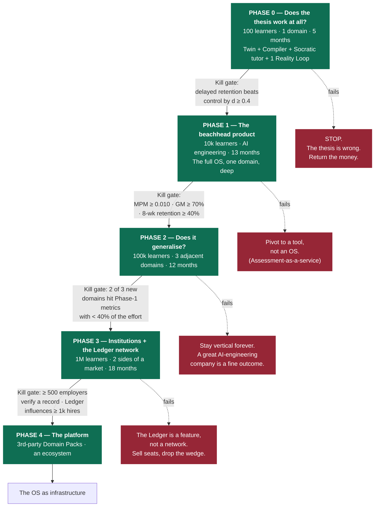

# 25 — Roadmap

> Obeys `CANON.md`. This document is written to be *falsified*. Every phase names the thesis it
> tests, the single metric that must move, and **the result that would make us stop.**
> A roadmap without kill criteria is a wish list.

---

## 0. The sequencing principle

We are not building a product and then finding out if it works. We are running **five experiments
in series**, each one gated on the previous one being true.

---

## 1. Phase 0 — Proof of Concept

**"Can we make the Twin + Compiler + Socratic tutor + one Reality Loop actually work for 100
learners?"**

| | |
|---|---|
| **Duration** | 5 months |
| **Learners** | **100**, hand-recruited, in one domain, in one cohort, with a randomised control arm of 100 |
| **Domain** | AI engineering (beachhead — doc 24 §4.3), narrowed to **one Objective**: *"Ship a RAG system that beats BM25 on your own corpus."* One Objective. Not a track. Not a curriculum. **One.** |
| **Team** | **9 people.** 2 backend (.NET, event-sourced kernel), 2 AI/ML (Python plane, tutor policy, IRT/FSRS), 1 full-stack (Next.js), 1 learning scientist (**the most important hire in the company**), 1 designer, 1 domain expert (AI engineer, authors the Graph), 1 founder/PM. **No sales. No marketing. No mobile.** |
| **Burn** | ~$1.4M |

### 1.1 The thesis being tested

> **A learner who is never given the answer, whose knowledge is modeled probabilistically and
> decays, and who is graded by reality, will retain and transfer more — 8 weeks later — than a
> learner who took a good course, at the same time investment.**

Everything else in CANON is downstream of this sentence being true.

### 1.2 What ships

| Ships | Explicitly does NOT ship |
|---|---|
| **E1 Twin** — `P(knows)`, FSRS-class decay, calibration, misconception set. 180 concepts. | Counterfactual Twin queries ("what if I skip linalg") |
| **E2 Graph** — 180 concepts, hand-authored by the domain expert + learning scientist, versioned | Self-healing / edge inference (needs volume) |
| **E3 Compiler** — Dijkstra over the decay-weighted DAG. **A solver, not a prompt** (doc 24 §3.4). | Multi-objective compile, deadline optimisation |
| **E4 Scheduler** — "what do I do in the next 15 minutes" → **the Today card** | 5-min atoms, mobile scheduling |
| **E5 Tutor** — Socratic dialogue + **the Answer Budget policy layer** (I-5). Text-first; voice on web only. | Personality adaptation, multi-modal |
| **E6 Assessment** — adaptive diagnostic (IRT), rubric-graded teach-back, misconception mining | Auto item generation at scale (bank is hand-seeded, ~900 items) |
| **E7 Memory** — FSRS, rep scheduling | Twin-informed interval personalisation |
| **E8 Reality Engine** — **the code Loop only**: hidden tests, sandboxed execution, `PREDICT` items on program behaviour, Brier scoring | Markets, medicine, law |
| **E16 Ledger** — append-only, signed, exportable | The Verifier product, employer-side anything |
| Web only (Next.js). Today · Session · Teach-Back · Graph · Ledger · Analytics. | **Mobile. Offline. i18n. Institutions. Payments.** |
| **The instrumented event log** (CANON §5.1) — because the RCT depends on it | |

**We deliberately ship no payment system in Phase 0.** If we are charging, we are optimising for
conversion instead of truth.

### 1.3 The metric that must move

**Delayed transfer at week 20** (8 weeks after the 12-week intervention ends), PRAXIS arm vs.
course-based control arm, on 40 novel blind-graded items. (Full design: doc 24 §7.)

| Metric | Target |
|---|---|
| **PRIMARY — delayed transfer effect size** | **d ≥ 0.40** vs. course control |
| Secondary — calibration (Brier) | PRAXIS arm improves ≥ 0.10 absolute; control does not move |
| Secondary — build task pass rate (hidden tests) | ≥ 55% vs. ≤ 30% control |
| Guardrail — **completion of the 12-week protocol** | ≥ 50% (we expect worse than control; see R-3) |
| Guardrail — rubric grader agreement (E6 vs. human) | **Cohen's κ ≥ 0.75** (see R-1 — if this fails, nothing else matters) |

### 1.4 Kill criteria — what would make us stop

| Result | Decision |
|---|---|
| **d < 0.2 on delayed transfer** | **STOP. The thesis is wrong.** Return the capital. Publish the null result (doc 24 §7.2). This is not a pivot trigger; it is a *shutdown* trigger, and we say so before we know the answer. |
| **d between 0.2 and 0.4** | The thesis is *directionally* right but the product is not worth the friction. **One 3-month re-roll of the pedagogy, then re-test.** No second re-roll. |
| **Rubric grading κ < 0.6** | **Pause everything.** The Ledger is worthless if the grading is noise. Fix grading or the company has no moat. (R-1.) |
| **Protocol completion < 25%** | The product is unusable, regardless of what it does for the 25% who survive it. (R-3.) |
| **AI COGS > $0.020/learner-minute with no credible path to $0.006** | The business does not exist at any price. (R-5.) |

---

## 2. Phase 1 — The beachhead product

**"Can we build a business on one domain, and does the OS hold up outside a supervised cohort?"**

| | |
|---|---|
| **Duration** | 13 months |
| **Learners** | **10,000** monthly active · ~2,000 paying (doc 24 §3.3) |
| **ARR** | **$588k** — this is not a business yet, and we will not pretend it is |
| **Team** | **26.** Eng 14 (5 backend, 4 AI/ML, 3 web, 2 mobile) · Learning science 2 · Design 2 · Domain/Graph authors 2 · Data/analytics 1 · GTM 3 (1 growth, 1 coach/community, 1 institution AE) · Ops/finance 2 |
| **Burn** | ~$6.5M |

### 2.1 The thesis being tested

> **Learners will pay for a product that refuses to give them the answer, tells them they are
> failing, and shows them their knowledge rotting — and they will keep coming back.**

Phase 0 proved it *works*. Phase 1 tests whether anyone *wants* it. These are different questions
and conflating them has killed more edtech companies than bad pedagogy.

### 2.2 What ships

| Area | Ships |
|---|---|
| **Product** | Full 15-screen surface (doc 23): Onboarding · Diagnostic · Contract · Today · Session · Teach-Back · Loops · Graph · Reps · Projects · Ledger · Analytics · Accountability/Witness · News · Misconceptions |
| **Mobile (Flutter)** | Voice-first sessions, hands-free mode, 5-minute atoms, widget, notifications (doc 23 §6). **Mobile is where the reps happen; without it, consistency dies.** |
| **Offline** | Cached sessions, reps, teach-back capture, provisional Ledger, local decay computation (doc 23 §7). Non-negotiable for India/SEA. |
| **Engines added** | E9 News (finite feed) · E11 Projects + AI review · E13 Motivation · E14 Accountability + stakes/witness · E15 Analytics · E17 Content synthesis · E18 Notifications |
| **Reality Loops** | Code Loop (deep) + **the public markets demo** (doc 24 §4.3) — free, unauthenticated, "mark this chart, come back tomorrow." The demo, not the business. |
| **Graph** | 600 concepts, and the **first self-healing pass**: infer missing prerequisites from cohort failure patterns (needs ≥3k learners on a concept) |
| **Monetization** | Free / Pro / Pro+ / Coach. **No enterprise sales motion yet.** |
| **The RCT** | Enrolled month 12, published month 19 (doc 24 §7). Phase 1 *funds* it; Phase 2 *sells* on it. |
| **i18n** | `en-IN` + `hi-IN` with the bilingual concept model (doc 23 §9.2). India is not a "later market"; it is where the beachhead's second-largest cohort of AI engineers is. |

### 2.3 The metric that must move

**Mastery-per-Minute (I-10).** The north star, and — critically — **it is a metric that goes down
if we cheat.** A product optimising for engagement cannot move MPM.

| Metric | Target | Why this one |
|---|---|---|
| **Median Mastery-per-Minute** | **≥ 0.010 MC/min** | The whole OS is a machine for maximising this |
| **8-week learner retention** | **≥ 40%** | The scary one. Do people tolerate a demanding teacher? |
| **Evidence per active learner / week** | **≥ 6 items** | If they're not producing, they're not learning (I-2) |
| Free → Pro conversion | ≥ 6% | |
| **Gross margin** | **≥ 70%** | Below this the model is dead (doc 24 §3.3) |
| Blended AI $/learner-minute | ≤ $0.006 | |
| Loop participation (Pro+) | ≥ 55% open ≥1 Loop/month | If nobody uses the crown jewel, the crown jewel is a demo |

### 2.4 Kill criteria

| Result | Decision |
|---|---|
| **8-week retention < 20%** | The product is too punishing to survive contact with volunteers. **Pivot to the tool, not the OS**: sell the Assessment + Ledger engine (E6+E16) as an API to bootcamps and employers who *already have* a captive, motivated audience. This is a real, smaller, still-good business — and we should take it rather than lie to ourselves. (R-3, R-8.) |
| **MPM below 0.010 with no improvement over 2 quarters** | The Compiler and Scheduler are not actually optimising anything. The "OS" framing is decoration. Same pivot. |
| **Gross margin < 60% at 10k learners with no credible path** | Kill the free tier before killing the company (doc 24 §2.1). If that doesn't fix it, we are a services business, not a software one. |
| **Loop participation < 20%** | The Reality Loop is a *demo*, not a *product*. That is a devastating finding — I-3 is the crown jewel — and it should trigger a hard re-examination of CANON, not a quiet feature deprecation. |

---

## 3. Phase 2 — Multi-domain

**"Does the OS generalise, or did we just build a very good AI-engineering tutor?"**

| | |
|---|---|
| **Duration** | 12 months |
| **Learners** | **100,000** MAU · ARR **$7.9M** (doc 24 §3.3) |
| **Domains** | AI/SWE (mature) + **Data/ML** + **Systems/SRE/Security** + **Markets & Quant** |
| **Team** | **58.** Eng 26 · Learning science 4 · Design 4 · **Domain/Graph authors 8** (this is the scaling question) · Data 3 · GTM 9 · Ops 4 |
| **Burn** | ~$16M |

### 3.1 The thesis being tested

> **A new domain costs us less than 40% of what the first one cost — because the Twin, the
> Compiler, the tutor policy, the assessment engine and the Loop machinery are domain-agnostic,
> and only the Graph and the ground-truth adapter are new.**

**This is the single most important economic question in the company.** If domain #2 costs the
same as domain #1, PRAXIS is not an OS — it is a content company with a good tutor, and content
companies do not have 89% gross margins.

### 3.2 What ships

| Ships | Note |
|---|---|
| **Domain Pack v1 (internal)** — a formal, versioned bundle: Graph subgraph + PoM Contracts + item bank + rubrics + misconception library + Loop adapter | The artifact that makes Phase 4 possible. **Build it internally in Phase 2 or you will never have it.** |
| **Self-healing Graph (E2)** at scale — prerequisite inference from cohort failure, concept splitting/merging, difficulty recalibration | Moat #2 (doc 24 §5) comes online here |
| **Markets Reality Loop** as a real product (Pro+) | With compliance: "not investment advice", no signals, no P&L leaderboard. **We teach reasoning, we do not run a tip service.** (R-6.) |
| **Distilled tutor model** — fine-tuned on our own graded transcripts | The path from $0.006 → $0.0035/learner-min (doc 24 §3.4) |
| **Institution pilot** — 6 universities/bootcamps, LTI 1.3, cohort Graph, misconception heat-map | Land, do not expand yet |
| **The RCT is published** (month 19 of the company) | Becomes the enterprise sales asset |
| i18n: `ne-NP`, `id-ID`, `es-419`, **`ar` (first RTL)** | RTL early, because late RTL never lands (doc 23 §9.1) |

### 3.3 The metric that must move

| Metric | Target |
|---|---|
| **Cost to launch domain N** | **< 40% of domain 1** (measured in eng-weeks + $ of Graph authoring) |
| **MPM in new domains** | Within **20%** of the beachhead's MPM by month 6 of each domain |
| Gross margin | **≥ 80%** |
| Blended AI $/learner-min | ≤ $0.0035 |
| Cross-domain learners (≥2 Objectives) | ≥ 18% — evidence the *Twin*, not the content, is the product |

### 3.4 Kill criteria

| Result | Decision |
|---|---|
| **Domain N costs > 70% of domain 1** | **Stop expanding. Stay vertical forever.** A dominant, profitable AI-engineering Mastery OS is an excellent company. Chasing horizontal breadth we cannot afford is how we become Coursera with extra steps. |
| **New-domain MPM is 40%+ below beachhead** | The engines are not domain-agnostic; we over-fit to code. Fix the engines or stay vertical. |
| **Markets Loop draws regulatory action in any tier-1 market** | Kill the markets domain immediately. It is 6% of revenue and 100% of our legal risk. (R-6.) |

---

## 4. Phase 3 — Institutions, Enterprise, and the Ledger network

**"Is the Ledger a network, or just a feature?"**

| | |
|---|---|
| **Duration** | 18 months |
| **Learners** | **1,000,000** MAU · ARR **$112M** (doc 24 §3.3) |
| **Team** | **170.** Eng 62 · Learning science 8 · Design 9 · Domain 14 · Data/research 8 · **GTM 48** (enterprise AE, institution AE, CS, SE) · Trust/legal/compliance 7 · Ops/finance 14 |

### 4.1 The thesis being tested

> **Employers will change their hiring behaviour because of a Verified Competency Record.**

Not "employers will click a link." **Change behaviour**: ask for a record, skip a take-home,
shortlist on demonstrated calibration, pay for the Verifier Suite. If that does not happen, moat
#3 (doc 24 §5) does not exist and PRAXIS is a very good subscription product with an 8-year
lifespan instead of a category.

### 4.2 What ships

| Ships |
|---|
| **The Verifier product** (doc 24 §2.5): free single-record verification · Verifier Suite ($1,500/mo) · **Issued Assessment ($99/candidate — kills the take-home treadmill)** · Talent Search (opt-in, learner-paid referral) |
| **Institution at scale**: LTI 1.3, SIS sync, SSO, cohort analytics, faculty Graph overlays, accreditation-grade outcome reports |
| **Enterprise L&D**: role→skill ontology (E12), decay-aware recertification, VPC deployment, data residency (EU/IN), BYO model endpoint |
| **Medicine (clinical reasoning)** — the hardest and highest-value ground-truth adapter: de-identified cases with real outcomes, clinical advisory board, IRB. **Not exam cram.** (R-6: heavy compliance gate.) |
| **The public efficacy dashboard** (doc 24 §7.4) — live, quarterly, from the event log |
| **Ledger portability standard** — open spec, W3C Verifiable Credentials-compatible. **We publish the format and invite competitors to adopt it.** A standard we control but do not own is worth more than a silo. |

### 4.3 The metric that must move

| Metric | Target |
|---|---|
| **Employers who verify ≥1 record** | **≥ 500** |
| **Hires materially influenced by a Ledger record** (self-reported by the employer, audited sample) | **≥ 1,000** |
| Issued Assessments run | ≥ 8,000 |
| Verifier Suite accounts | ≥ 900 |
| Enterprise net revenue retention | ≥ 118% |
| Gross margin | ≥ 88% |

### 4.4 Kill criteria

| Result | Decision |
|---|---|
| **< 100 employers verify a record in 12 months** | **The Ledger is a feature, not a network.** Stop investing in the Verifier. Sell seats. Cut the trust/standards team. Accept a good SaaS business and stop telling the network-effect story to investors. |
| **Institution CAC payback > 30 months** | The institutional motion is a distraction. Institutions move slowly and buy on procurement, not efficacy — even *with* an RCT. Refocus on prosumer + enterprise. |
| **Medicine adapter cannot clear IRB/legal in 12 months** | Cut it. It is the highest-value Ledger in the world and it is not worth an existential regulatory event. |

---

## 5. Phase 4 — The platform

**"Can other people build Domain Packs better than we can — and will they?"**

| | |
|---|---|
| **When** | Only after Phase 3's kill gate passes |
| **Thesis** | **We stop authoring Graphs and start *certifying* them.** A cardiology professor, a bar-exam coach, a semiconductor company's principal engineer knows their domain better than we ever will. Give them the OS. |

### 5.1 What ships

| | |
|---|---|
| **Domain Pack SDK** | Graph authoring · PoM Contract DSL · item bank + IRT calibration harness · rubric authoring + grader eval set · **Reality Loop adapter interface** (the hard part: `predict(x) → resolve(x, t+Δ) → ground_truth`) |
| **Certification** | A Domain Pack is not published until its **grader agreement (κ ≥ 0.75)**, **item calibration**, and **Graph prerequisite validity** pass our review. **We are the FDA of learning content, and that is the business.** |
| **Marketplace** | Revenue share: 70/30 to the author. **Ranked by measured learner outcomes (MPM, delayed retention), never by popularity or by payment.** A pack whose learners don't learn gets delisted — publicly, with the data. |
| **Ledger federation** | Third-party graders (a university, a professional body) can counter-sign Evidence into the learner's Ledger with their own key. |
| **Twin API** (learner-authorised, revocable, per-purpose) | An IDE that knows you don't hold `async cancellation` and quizzes you when you hit it. A hospital's rota system that knows your ABG-reading competence is 3 weeks from decaying below threshold. |

### 5.2 The metric

| Metric | Target |
|---|---|
| Third-party Domain Packs published | ≥ 200 |
| **% of learner-minutes on third-party packs** | **≥ 30%** — the definition of a platform |
| Packs delisted for poor measured outcomes | **> 0.** If we never delist one, our certification is theatre. |

---

## 6. The top 10 risks — brutally

Ordered by how likely they are to kill us, not by how uncomfortable they are to say.

### R-1 — AI grading isn't good enough
**The risk.** The entire product rests on the claim that a machine can look at a 90-second spoken
explanation, or a novel code artifact, or a trading thesis, and *correctly* decide whether the
human understands. If rubric grading is noisy, the Twin is noise, the Graph is noise, the Ledger
is worthless, and every moat evaporates at once. **This is not one risk among ten. It is the
risk.**
**Why it's real.** LLM-as-judge on open-ended explanations typically lands at κ 0.55–0.70 against
expert humans. We need **≥ 0.75**, sustained, across domains, and it must not drift with a model
upgrade.
**Mitigation.**
- **A golden set per concept**, human-double-graded, ≥ 60 items, versioned. Every model change is
  regression-tested against it. **A grader that regresses does not ship, even if it is cheaper.**
- **Grade with an ensemble + abstention.** Borderline scores (the middle 15% of the rubric
  distribution) are escalated to an Opus-class grader, then to a human queue. **Abstention is a
  first-class output.** "I'm not sure this counts as proof" is an honest answer and it is written
  to the Ledger as `pending`, never as `passed`.
- **Weight the six evidence types by gradeability.** `BUILD` (runs or doesn't) and `PREDICT`
  (reality resolves it) are **objectively graded** and carry the most MC. `EXPLAIN` is the most
  subjective and carries the least. **The Ledger's most valuable claims rest on the least
  subjective evidence, by design.** This is why I-3 exists.
- **Publish grader agreement publicly**, per domain, in the efficacy dashboard. If it's 0.68 in
  medicine, we say 0.68 in medicine.
**Kill criterion.** κ < 0.6 in the beachhead domain → the company stops and fixes this before
anything else.

### R-2 — The Graph is expensive to build
**The risk.** 180 concepts hand-authored in Phase 0 is fine. 600 in Phase 1 is a grind. 12
domains × 800 concepts, each with prerequisites, PoM Contracts, item banks, misconception
libraries and rubrics, is a **content company**, and content companies have 40% margins and no
moat. LLM-generated graphs are confidently, subtly wrong — and a wrong prerequisite edge doesn't
error, it just quietly wastes a learner's month.
**Mitigation.**
- **LLM proposes, expert disposes, evidence decides.** An LLM drafts the DAG from public curricula
  (fast, cheap, 70% right). A domain expert prunes it (slow, expensive, gets to 90%). Then the
  **self-healing loop** (moat #2) gets it to 98%: when learners who hold `A,B` still fail `C` at a
  rate the model can't explain, a missing prerequisite is *inferred*. The Graph is corrected by
  reality, which is the only thing that has ever corrected a curriculum.
- **Measure it as a unit cost** and put it on the Phase-2 kill gate: cost per concept must fall
  from ~$310 (Phase 0, hand-authored) to **< $80** by Phase 2.
- **Phase 4 is the structural answer**: stop authoring, start certifying (§5).

### R-3 — Learners hate being told "no"
**The risk.** The Answer Budget (I-5) refuses to help. The Graph shows your knowledge rotting.
Analytics says "you gained nothing this week." The Contract says you're 68 minutes in debt.
**This is a product designed to make you feel bad, and people do not pay to feel bad.** Duolingo
built a $10B company by making learning feel *good*.
**Why it's the most underrated risk here.** It won't show up as churn. It'll show up as *nobody
ever finishing onboarding*.
**Mitigation.**
- **Be demanding about the standard, warm about the person.** The tone spec in doc 23 §1.3 is a
  product requirement, not a style guide. "You gained nothing this week" is always immediately
  followed by *the single smallest next step*, never by a judgment.
- **Self-select hard, on purpose.** The onboarding says what this is: *"PRAXIS will tell you when
  you are failing."* We want the person who reads that and leans in. Our TAM is smaller than
  Duolingo's and we should stop pretending otherwise in every document we write.
- **The Motivation Engine (E13) is not decoration.** Burnout detection, load reduction, contract
  renegotiation (doc 23 §4.14, step 6). **A learner who cannot keep the contract gets a smaller
  contract, not a punishment.**
- **The win must be real and visible.** The one dopamine we permit is the Graph *advancing* — the
  frontier moving, nodes unlocking. It is honest, it is earned, and it is enough for the person we
  are building for.
**Kill criterion.** 8-week retention < 20% in Phase 1 → pivot to selling the engines to captive
audiences (§2.4).

### R-4 — The Reality Loop's resolution delay breaks the feedback loop
**The risk.** I-3 is the crown jewel, but a prediction that resolves in 3 weeks provides a
learning signal 3 weeks after the misconception formed — by which time the misconception has
contaminated six other concepts and the learner has forgotten the reasoning. **In medicine and
business the delay can be months.** A feedback loop that slow is barely a feedback loop.
**Mitigation.**
- **This is precisely why the beachhead is software** (doc 24 §4.3): **the code Loop resolves in
  seconds.** We launch where the crown jewel is fastest, not where it is most cinematic.
- **Decouple thesis-grading from outcome-grading.** The *reasoning* (E6 rubric on the thesis) is
  graded **immediately**; only the *outcome* (Brier) waits for reality. The learner gets a signal
  in 30 seconds and a verdict in 3 weeks. **You can be right for the wrong reason, and we tell you
  so on the same day.**
- **Backtest Loops for practice, live Loops for the Ledger.** Historical, blinded scenarios give
  instant resolution and unlimited volume; they are excellent practice but **carry less MC and are
  marked differently in the Ledger**, because a backtest can be gamed and reality cannot.
- **Interleave.** A learner always has 5–20 Loops open at different horizons. Something resolves
  nearly every day.

### R-5 — Unit economics
**The risk.** The model in doc 24 §3.3 only works if blended AI cost falls **$0.006 → $0.002 per
learner-minute**. If frontier model prices don't fall, or if voice (which is *more expensive than
the LLM* — doc 24 §3.1) stays costly, or if free users consume 90 minutes instead of 58, we are a
65%-margin business.
**Mitigation.** The five levers (doc 24 §3.4), in priority order: **deterministic engines** (the
Compiler is Dijkstra, not a prompt — this alone saves $0.30/learner/night), **precomputation**
(content is a fixed cost, not a variable one — the inversion the whole category missed),
**routing**, **caching**, **on-device offload**. Plus: the AI-minute cap is a **solvency control**,
reviewed weekly, and we will cut the free tier from 60 to 30 minutes without sentiment if the
number moves.
**What we will not do:** cheapen grading to save money. The Ledger's value is downstream of
grading quality (R-1). Everything else is negotiable; that is not.

### R-6 — Regulatory exposure in medicine, finance, and law
**The risk.** A markets Reality Loop that produces buy/sell reasoning looks like investment advice
(SEBI/FCA/SEC). A clinical Loop that outputs a diagnosis looks like a medical device (FDA SaMD,
EU MDR). A law Loop looks like unauthorised practice. Any one of these can produce an existential
event for a Series-A company.
**Mitigation.**
- **Sequencing is the mitigation.** The beachhead (software) has **zero** regulatory exposure.
  Markets arrives in Phase 2 with compliance built in; medicine not before Phase 3 with a clinical
  advisory board and IRB.
- **Structural boundaries, not disclaimers.** The Loop grades the *learner*, never the *world*. We
  produce **no signal, no recommendation, no diagnosis, no ranking, no leaderboard of P&L.** The
  output is always a score on a human's reasoning. A disclaimer is a lawyer's hope; an
  architectural refusal is a defence.
- **Data**: de-identified clinical cases only, under DUA, with an ethics board. **Never** live
  patient data. **Never** a real diagnosis.
- **Kill switch**: any tier-1 regulatory contact in markets → the domain is suspended within 72h.
  It is 6% of revenue and 100% of the risk.

### R-7 — Cold start
**The risk.** The Twin needs evidence to be useful. The Graph needs failure data to self-heal. The
item bank needs response data to calibrate IRT. The Ledger needs employers to be worth anything.
The Verifier needs learners with records. **Every moat we have requires volume we don't have.**
On day one, PRAXIS is a Socratic chatbot with a nice graph — and that *is* copyable in a quarter.
**Mitigation.**
- **The Diagnostic (I-6) is the cold-start weapon.** It produces a rich Twin in 12 minutes, on day
  one, before any content. The "here's what you *think* you know but don't" screen (doc 23 §4.2)
  delivers a wow moment with **zero** accumulated data.
- **Seed IRT from an LLM prior + calibrate fast.** Item difficulty starts as a model estimate and
  converges after ~200 responses. Precomputation (doc 24 §3.4) means the bank is shared across all
  learners, so calibration is a *company-level* asset that warms up in weeks, not a per-learner one.
- **Verifier cold start: make verification free forever** (doc 24 §2.5). The chicken is the
  learner's CV, and the egg is the recruiter's click, and the click must cost zero.
- **Concentrate.** 10,000 learners in **one** domain produces a self-healing Graph. 10,000 spread
  over twelve produces nothing. This is the real reason for the beachhead.

### R-8 — Motivation is the bottleneck, not content
**The risk.** The world does not lack good explanations of backpropagation. It lacks people who
sit down and do the work. If the true bottleneck is *will*, then a better compiler, a better
graph, and a better tutor move a variable that was never binding — and Duolingo, which solved
*only* the motivation problem, wins.
**This is the most intellectually serious objection to PRAXIS and it deserves more than a
mitigation bullet.** It may simply be true.
**Our answer.**
- We **agree** motivation is the bottleneck. We disagree about the *cause*. People quit because
  the work feels pointless — because they cannot see progress, cannot tell if it's working, and
  have no evidence they're getting better. **Visible, verified progress is a motivational
  technology**, and it is the one nobody has built. The Graph advancing, the Brier falling, the
  Ledger filling: that is the motivation engine, and it is *made of truth* rather than of streaks.
- I-9 (Contracts, stakes, witness) and E13 (burnout detection) are the explicit motivational
  machinery, and they are **first-class engines, not features**.
- **The Verifier is the deepest motivation of all**: the work leads to a *job*. Extrinsic, real,
  and the thing every learner actually wants.
- **But we hold this loosely.** If Phase 1 shows retention is dominated by motivation and
  unmoved by pedagogy quality, the honest response is to *say so publicly* and rebuild around it.

### R-9 — Incumbents bolt on AI
**The risk.** Coursera ships "AI Coach". Duolingo ships a graph. Khan ships Khanmigo (already
did, and it's good). They have 100M users, distribution, brand, and content libraries.
**Mitigation.** They cannot delete the "mark as complete" button.
- Coursera's revenue **is** certificates. A certificate that requires *decaying, evidenced
  mastery* is unsellable — it would fail most of the people who currently buy it.
- Duolingo's revenue **is** engagement. A product that optimizes for the learner *leaving* (I-10)
  destroys their core metric.
- ChatGPT's product **is** answering. The Answer Budget (I-5) is the negation of their value prop.
- **Our moat is not technology. It is a refusal they cannot afford to make** (doc 24 §5).
- Practically: **move fast on the Ledger network** (moat #3), because it is the only moat with a
  true network effect, and network effects are the only thing that has ever stopped an incumbent.

### R-10 — "People say they want mastery but buy convenience"
**The risk.** The stated preference is "I want to truly understand." The revealed preference is
Copilot autocomplete and a 2-hour cert. **Stated-preference markets are graveyards.** We may be
building a product for the person our customer *wishes* they were.
**Mitigation.**
- **Sell to the moment the convenience bill comes due.** Nobody buys "mastery." People buy: *"I
  failed the system-design round."* *"I've shipped with Copilot for two years and I can't debug my
  own code."* *"My team can't review AI-written PRs because nobody understands them."* **The
  positioning is not aspiration — it is remediation of a specific, humiliating, recent failure.**
- **Make the outcome the product.** Nobody buys mastery; everybody buys a job. The Verified
  Competency Record (I-8) converts an intrinsic good into an extrinsic, purchasable one.
- **The Verifier changes the demand curve.** When employers *ask for a record*, convenience stops
  being an option. This is the strategic reason the Verifier is not a monetization afterthought
  but the wedge (doc 24 §2.5): **it is how we escape the stated-preference trap.**
- **And the honest hedge:** our TAM is the top decile of intrinsically-motivated learners plus
  everyone facing a real competence bill. That is millions of people, not hundreds of millions.
  **We should build a $500M business honestly rather than a $10B business dishonestly.**

---

## 7. What we will deliberately NOT build

Every one of these is a thing a reasonable person will ask for, repeatedly, and the answer is no.

| Not building | Why | Which Invention forbids it |
|---|---|---|
| A course catalog / content library / "browse" | Content is a means, generated on demand (E17). A catalog is an asset we'd have to defend, and it would immediately become the product. | CANON §2 |
| "Mark as complete" | It does not exist in the domain model. | CANON §0 |
| An infinite feed | The feed has a bottom. | I-7 |
| Streaks with flames, XP, coins, gems, leaderboards, avatars, pets | Engagement is not a metric. | I-10 |
| A social network / timeline / following | Peer *review* on artifacts (E11) is learning. A timeline is not. | I-10 |
| Certificates of completion | We sell a Ledger, not a diploma. Shipping a certificate would destroy the Ledger's meaning in one quarter. | I-8 |
| A generic chatbot mode ("just ask me anything") | The most requested feature we will ever refuse. It is the negation of I-5, and one exception would end the Answer Budget forever. | **I-5** |
| Video production / a studio / instructors | We are not a media company. | CANON §2 |
| An LMS (assignments, gradebooks, attendance) | We sit beside Canvas. We do not replace it. | — |
| K-12 in Phase 1–3 | Child safety, procurement cycles, and a completely different Motivation Engine. It is a different company. | — |
| A trading signal service / P&L leaderboard | We grade reasoning, not returns. Also: R-6. | I-3 |
| Blockchain for the Ledger | Signed hash chain + published Merkle roots + open verification. **A blockchain adds cost, latency and no trust we don't already have.** We will be asked this every month. The answer is no. | I-8 |
| Our own foundation model | We are a policy layer, a graph, and an evidence chain. We route across model vendors and distil for cost. Training a frontier model is somebody else's $2B problem. | CANON §5.6 |
| A "generate my whole roadmap with AI" one-shot | A roadmap is compiled from a Twin, not prompted. Without the Twin it's a listicle. | I-4 |

---

## 8. The five-year view: the OS as infrastructure

If Phases 0–4 all clear their gates, PRAXIS stops being an app and becomes three pieces of
infrastructure that do not currently exist in the world.

### 8.1 A portable, verifiable, lifelong learner record

Today, the artifacts of human capability are: a degree (a claim about 4 years, 20 years ago), a
CV (an unverified assertion), and an interview (a 6-hour sample with terrible reliability).

The Ledger (I-8) replaces all three with something strictly better: **an append-only,
cryptographically signed, item-level, decay-aware record of everything a person has ever
demonstrably done** — portable across employers, across countries, across decades, and **owned by
the human, not the institution.**

The end state is not "PRAXIS has a credential." It is: **an open standard, which PRAXIS authored,
that any grader can write to and any verifier can read** — federated, W3C-VC-compatible, with
PRAXIS as the largest and most trusted issuer but not the only one. **A standard we control but do
not own is worth more than a walled garden**, because a walled garden is a credential and the
world already has too many of those.

### 8.2 The personalized textbook

When the Twin (I-1) knows exactly what you hold, at what confidence, with what misconceptions, and
the Graph (E2) knows how every concept depends on every other, then a book can be **compiled for
one reader** — starting exactly at the edge of what they know, using analogies drawn from what
they already hold, skipping what they've mastered, and dwelling precisely where they break.

Not "a textbook with a chatbot in it." **A textbook that has never existed before and will never
exist again, written for one person on one Tuesday, and thrown away.** Content as an ephemeral
compile artifact rather than an asset — the natural conclusion of E17, and the thing that finally
makes the publishing industry's business model obsolete rather than merely uncomfortable.

### 8.3 The AI that knows what humanity is failing to learn

This is the most consequential thing in this document and it is a **byproduct**.

With tens of millions of Twins, PRAXIS holds something nobody has ever had: a **live, empirical
map of human misunderstanding, at concept granularity, at population scale.**

- *Which concepts does everyone get wrong, everywhere, no matter how well they're taught?*
- *Which prerequisites are missing from every curriculum on Earth?* (The self-healing Graph finds
  them by watching people fail.)
- *Which explanations actually work — measured by delayed retention, not by ratings?*
- *Where is the world's capability decaying fastest?* (In 2031, is the world *forgetting* how to
  write memory-safe C?)
- *What is the marginal value of an hour of instruction, per concept, per population?*

This is a **science of learning with an n of millions and a ground truth of produced evidence**,
where the field currently runs studies with n=60 undergraduates and a post-test on Friday.

**It is also the most dangerous data object in the world**, and CANON §5.9 is the reason it must
be handled the way it is: the Twin is learner-owned, exportable, deletable, never sold, and never
used to train shared models without explicit, revocable, per-purpose consent. **The population map
is built from consented, aggregated, differentially-private statistics — never from individual
Twins.** A company that violates this once has ended the product, permanently and correctly.

**The five-year sentence:**

> PRAXIS becomes the layer between a human being and what they are capable of —
> a compiler for the mind, a test suite for competence, and a ledger the world can trust.
> **And the first thing it will tell us is how badly we have all been teaching.**
