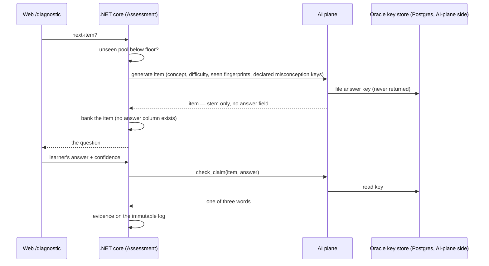

# Item bank wiring — design

**Date:** 2026-07-16 · **Status:** approved by the operator · **Origin:** the M13.1 deferral
("wiring item generation→bank so the diagnostic runs is post-Phase-0, tracked with the M13.1
deferral").

## Goal

The adaptive diagnostic runs end to end for a real learner: when PRAXIS needs a question it does
not have, it writes one, banks it, and can always mark it — **even after the AI plane restarts**.

## What already exists (verified 2026-07-16)

- **AI plane:** `ItemGenerator.generate()` (`ai/src/praxis_ai/items.py`) produces an `Item` with
  no answer field; the `AnswerKey` goes to the oracle's store. A route exists
  (`routes/assessment.py`).
- **.NET:** `IAiPlane.GenerateItemAsync` + `AiPlaneClient` implementation; the `BankedItem`
  entity and its `assessment` table (`AssessmentDbContext.Items`); the `NextItem` diagnostic
  slice that selects from the bank and **refuses to invent an item** when the pool is empty.
- **Missing:** nothing ever calls generate-and-persist, so the pool is always empty in practice
  and the diagnostic cannot run end to end (recorded at M13.3).

## The integrity gap this design must fix

`InMemoryAnswerKeyStore` (`ai/src/praxis_ai/oracle.py`) holds generated answer keys **in process
memory only**. If items are banked durably in Postgres but keys evaporate on an AI-plane restart,
a banked item becomes permanently unmarkable — a learner would spend real effort on it and PRAXIS
would have nothing to say back. Wiring the happy path without fixing this would be dishonest.

## Design

### 1. Durable answer keys (AI plane)

A Postgres-backed answer-key store on the AI plane, in storage the .NET core never touches
(its own schema/tables, owned and migrated by the AI plane). Keys are written at generation time
and read by `check_claim`. Written-then-restarted-then-read must work.

Refusals preserved:
- The key is **never returned** over any route — the existing answer-field sweeps (Python and
  .NET) must stay green.
- A `check_claim` on an unknown item keeps its existing refusal semantics: unmarkable means
  nothing is written about the learner.

### 2. The banking slice (.NET Assessment)

A vertical slice — its own **command** (`EnsureConceptPool`), because `NextItem` is a query and
queries do not write (one handler = one use case = one `SaveChangesAsync`). The diagnostic flow
invokes it when a session starts and again between items when the pool runs thin:

- If the learner's **unseen** pool for the concept is below the floor (**5 items**), call
  `GenerateItemAsync` enough times to top it up, passing:
  - the concept's summary (from the Graph seam, as the tutor already does),
  - a difficulty target from the concept's prior,
  - the learner's already-seen **fingerprints**,
  - the concept's **declared misconception keys**, so distractors target the named wrong
    beliefs (`BankedItem.TargetsMisconception` gets a real value where the generator returns
    one that matches a declared key; free-text slugs that match nothing are stored as null —
    never invented into the declared library).
- Persist each returned item as a `BankedItem` row — stem, fingerprint, evidence type,
  difficulty prior, `TargetsMisconception`. **There is no answer column, and none is added**
  (`SchemaTests` continues to enforce this against `information_schema`).
- Items are **shared across learners** after banking. Per-learner novelty stays honest via
  fingerprints/`Responses`; over-exposure is bounded by the existing Sympson–Hetter counter.
- Generation failure (AI plane down, non-novel after retries, key-store down) → the existing
  honest refusal from `NextItem`. Nothing invented, nothing written about the learner.

### 3. End-to-end proof

One learner drives `/diagnostic` through the real host from an **empty** bank:
start → item generated and banked → answer submitted → oracle marks it → evidence lands on the
immutable log → the Twin moves. This closes the gap recorded in M13.3 ("the item-driven
diagnostic cannot run end to end").

## Sequence

## Behaviors checklist

- [ ] Empty bank + new learner → a real generated item, not a refusal
- [ ] The answer never enters the .NET process (schema sweep + leaking-fake test cover the new path)
- [ ] Keys survive an AI-plane restart — yesterday's banked item still marks today
- [ ] A learner is never re-served an item they have seen
- [ ] Generation failure → honest refusal; nothing invented, nothing written about the learner
- [ ] Generated distractors may target declared misconception keys; unknown slugs are stored as null

## Out of scope (deliberately)

- **Family calibration persistence** — `ItemFamily` stays a pure domain type on cold priors;
  persisting and calibrating families needs cohort data that does not exist yet.
- **Bulk pre-seeding (~900 items)** — rejected: upfront LLM spend on items nobody may see,
  against the fresh-per-need design. On-demand top-up grows the bank exactly where learners are.
- **Content expansion (more concepts/packs)** — separate future work; recorded at M13.1.

## Error handling

| Failure | Behavior |
|---|---|
| AI plane unreachable | `NextItem` refuses honestly (existing path); session shows the honest error |
| Generator non-novel after retries | Same refusal; nothing shown twice, nothing invented |
| Key store down at generation | Generation fails atomically — no item banked without its key |
| Key missing at marking | Oracle refuses; nothing written about the learner |

## Testing

- **.NET handler tests** — top-up triggers below the floor and not above it; banked rows carry no
  answer; failure paths write nothing (fake `IAiPlane`).
- **Integration through the real host** — the leaking-fake adversary proves no answer crosses;
  the end-to-end diagnostic journey from an empty bank.
- **AI-plane tests** — the Postgres key store round-trips; a *new store instance over the same
  database* (restart simulation) still resolves the key; the surface guard confirms no route
  returns a key.
- **Gate** — `scripts/verify.ps1`, every stage.
