# The fixed-key reading item — a passage, four choices, and a key the core cannot reach (design)

Date: 2026-07-26 · Status: approved by user (session, after clickable prototype)
Prototype shown: `scratchpad/reading-item-prototype.html` — answering state (passage pane + four
radio options + confidence slider + tutor drawer), the wrong-answer verdict naming
`keyword-match-wins` **without revealing which option was right**, and the right-answer verdict
refusing to over-credit a four-way guess.

Milestone: **M17**. The Listening English pack, pencilled in as M17 by the M16 spec, moves to
**M18** — it needs audio infrastructure and is unaffected by this work.

## Why this exists

The M16 spec claimed "**No engine changes.** The diagnostic, generator, misconception hunter, tutor
and memory all operate on this pack unchanged — that is the entire point of packs." For the writing
pack that was true. For reading it is **false**, and the pack itself says why:

> `packs/english-reading/pack.yaml:27-32` — Apply, for reading, means: a NEVER-SEEN passage answered
> against a FIXED KEY (multiple choice, true/false/not-given, span selection, ordering) —
> deterministic, unfakeable, and the key is never in the tutor's context (C-5).

None of that exists. An item in PRAXIS today is **one string** (`BankedItem.Stem`) answered with
**free prose** (`SubmitAnswer.Command.Claim`) and marked by **a model's judgement**
(`oracle.check` → a Claude call). There is no passage field, no options field, no fixed key, no
deterministic marking, and no radio button anywhere in `web/`. The Reading English pack therefore
describes a kind of evidence the product cannot produce, show, or mark.

This milestone makes that kind of evidence real. It is not a reading feature bolted on — it is the
item model growing the shape the Evidence Ceiling (C-4) always implied: **an Apply item whose
correctness is a fact, not an opinion.**

## Goal

A learner can be served a reading-comprehension item — a short passage they have never seen plus
four choices — pick one, and be marked **by comparing two integers**, with the correct index living
in a database the .NET process cannot reach. A wrong choice names the reading habit that produced
it, because the pack declared that habit before the learner existed.

## Scope

Ships:

- **The item grows a shape.** `assessment.items` gains `Format`, `Passage`, `Options`. It does
  **not** gain the key, and `SchemaTests` grows three new banned words to keep it that way.
- **The key grows an index.** `praxis_oracle.answer_keys` gains `correct_option` and
  `option_misconceptions` (which declared wrong belief each distractor catches).
- **Deterministic marking.** For a fixed-key item the oracle compares integers: no model call, no
  cost, no judgement, and `Partial` is unreachable.
- **The answer channel grows a selection.** `SubmitAnswer` accepts `SelectedOption` alongside
  `Claim`; exactly one, and it must match the item's format.
- **The generator writes passages.** The AI plane asks for a passage, a question, four options, the
  correct index, and a declared misconception key per distractor. The index comes back to nobody.
- **The screen.** `/diagnostic` renders a passage pane and real radio inputs when the item has
  options; the existing textarea stays for everything else.
- **The tutor gets the passage and never the options** — and stops being handed the placeholder
  strings it gets today.
- **The pack declares the format.** `format: multiple-choice` on Apply proof clauses, gated by the
  pack validator and `EnglishReadingPackTests`.

Out of scope, deferred **by name** rather than silently:

- **Span selection and ordering** (two of the four Apply forms the pack's comment block names) —
  each is a distinct interaction with its own marking and its own accessibility problem.
- **True/False/Not-Given** — structurally nothing new (a three-option multiple choice), but v1 fixes
  the option count at four.

  Those three become **M19 — the other reading forms**. The pack's comment block is corrected in
  this milestone to say which forms exist today, so the file stops describing a product that is not
  there.
- **The onboarding→objective→diagnostic wiring, and sign-in.** Picking "Reading English" still
  reaches nothing, and the console still sends no bearer token. That is an older, separate gap
  (**M20**), and it means this milestone is verified through tests and the API, not by clicking
  through a browser. Stated plainly so nobody mistakes green tests for a reachable feature.
- The concept map's hardcoded `ai-engineering` domain. Also M20.

## How it works

```mermaid
flowchart TB
  subgraph pack["packs/english-reading/pack.yaml"]
    P["apply: format: multiple-choice<br/>+ declared misconceptions"]
  end

  subgraph ai["AI plane · Python · holds the key"]
    G["ItemGenerator<br/>passage · question · 4 options<br/>correct index · a declared belief<br/>per distractor"]
    O["Oracle.check<br/>correct_option == selected?<br/><b>no model call</b>"]
  end

  subgraph core["praxis DB · the .NET core reads this"]
    B["items<br/>Format · Passage · Options<br/>Guessing = 1/N<br/><b>no index, no key</b>"]
  end

  subgraph vault["praxis_oracle DB · unreachable from .NET"]
    K["answer_keys<br/>correct_option<br/>option_misconceptions"]
  end

  P --> G
  G -->|"passage + options"| B
  G -->|"the key — one way, never back"| K
  B --> UI["/diagnostic<br/>passage pane | question + radios"]
  UI -->|"selectedOption: 1 · 85% sure"| S["SubmitAnswer"]
  S -->|"CheckClaim(SelectedOption)"| O
  K --> O
  O -->|"correct/wrong + declared belief key"| S
  S --> E["event log → Twin projection"]
  UI -.->|"start a session on this item"| T["Tutor<br/>ConceptSummary · Stem · Passage<br/><b>no Options field exists</b>"]

  style K fill:#2a1e1e,stroke:#d03b3b
  style O fill:#1a1d21,stroke:#e3b341
  style T fill:#1a1d21,stroke:#e3b341
```

## The data model

**`assessment.items`** (migration `AddItemFormat`):

| column | type | why |
|---|---|---|
| `Format` | int, NOT NULL, default 0 | `Prose` (0) — everything banked today · `MultipleChoice` (1). |
| `Passage` | text NULL, max 8 000 | The text under study. **Not a secret** — the learner reads it. |
| `Options` | jsonb NULL | Ordered list of option texts. **Not secret** — they are on screen. Read whole, never queried into, so jsonb rather than a child table. |

`Guessing` already exists and is documented as "Non-zero on multiple choice, because a coin has a θ
too." It has been `0.0` on every item ever banked. A fixed-key item is banked with `1.0 / N`.

**`praxis_oracle.answer_keys`** (`ensure_schema` gains idempotent `ALTER TABLE … ADD COLUMN IF NOT
EXISTS`):

| column | type | why |
|---|---|---|
| `correct_option` | int NULL | The index. NULL for prose items, which are still model-marked. |
| `option_misconceptions` | jsonb NOT NULL default `{}` | Option index → **declared** misconception key. A distractor with no belief behind it is just noise. |

The split is the whole design: **everything the learner sees is in `praxis`; the one thing they must
not see is in `praxis_oracle`.** Postgres does not do cross-database queries and the core's
connection string points only at `praxis`, so C-5 stays a fact about the deployment.

## Marking

`Oracle.check` gains one branch, taken before any model client is touched:

- Key has a `correct_option` → require a `selected_option`; the verdict is `CORRECT` if they are
  equal and `WRONG` otherwise; the misconception is `option_misconceptions[selected]`, validated
  against `key.misconceptions` by the **same airlock** that guards prose marking. Cost is zero.
- Key has a `correct_option` but the request carries prose (or vice versa) → refuse, loudly. PRAXIS
  does not guess at a format mismatch, and it especially does not fall back to a model — that would
  turn a deterministic item into an opinion without anybody noticing.
- No `correct_option` → today's path, unchanged.

`Partial` cannot occur on a fixed-key item, and nothing pretends otherwise.

## Generation

`GenerateItemRequest` gains `Format`. `EnsureConceptPool` reads it from the concept
(`IConceptIntel.ApplyFormat`, sourced from the pack) instead of assuming prose.

The generator's system prompt, for `multiple_choice`, requires: a self-contained passage of 80–150
words; one question answerable **only** from the passage; exactly four options, one correct; and for
each of the three distractors, the key of a declared wrong belief it is built to catch. The reply
carries `correct` (an index) — which is stripped from the `Item` on the way out, exactly as `answer`
is today. `Item` has no field it could sit in.

Two guards move with it:

- **The airlock widens.** Distractor misconception keys are validated against the caller's declared
  set, same as `targets`. Invented keys are logged and discarded.
- **Novelty covers the passage.** `fingerprint_of` hashes passage + question when a passage exists,
  and the stem alone when it does not — so banked prose fingerprints are byte-identical to today's
  and nothing already banked is orphaned.

## The tutor

Two placeholders die here. `TakeHint.cs:169-170` and `StreamHint.cs:153-154` currently send
`ConceptSummary: session.ConceptId.ToString()` — a raw GUID — and `ItemStem: "the current problem"`.
A Socratic tutor working from a GUID and a placeholder is not a tutor, and on a reading passage it
would be worthless.

- `TutorTurnRequest` gains **`Passage`** (nullable). It does **not** gain `Options`, and a test
  asserts the type has no member matching `option|choice|distractor` — the same discipline that
  keeps `Answer` off `BankedItem`.
- `SessionLifecycle.Start` accepts an optional `ItemId`, stored on the session. When bound, the hint
  path loads that item and sends its real `Stem` and `Passage`. When not bound, behaviour is
  unchanged.
- `ConceptSummary` becomes the concept's real summary via the `IConceptIntel` seam the Assessment
  module already uses.

**Why the passage is safe and the options are not.** The passage is on the learner's screen; a hint
that points at it ("what does *however* in sentence two reverse?") is teaching. The four options are
a closed set containing the answer — a model that can see them can eliminate them, and "it's not B
or D" *is* the answer delivered slowly. The refusal is enforced by the absence of a field, not by an
instruction in a prompt.

## The screen

`/diagnostic` branches on the item's shape:

- **Passage pane** — serif, 16.5px, line-height 1.75, capped at 66ch, in its own scroll container so
  a long passage never makes the page scroll sideways. Whitespace between paragraphs preserved.
- **Options** — real `<input type="radio">` in a `<fieldset>` with a `<legend>`, so arrow-key
  navigation, screen-reader grouping and form semantics come from the platform. 48px minimum target,
  visible focus ring, selected state carries a filled key glyph as well as colour.
- **Submit** disabled until a choice exists. You cannot be marked on nothing.
- **Confidence slider unchanged.** Still stated before the outcome is known; C-6 is untouched.
- **The verdict never names the right option.** It reports the outcome, the confidence gap, and the
  named belief the distractor caught, and says out loud that the key was never here to reveal.

The existing textarea path is untouched for prose items.

## Verification

Every claim below is a test, not a paragraph.

- `SchemaTests` — `Forbidden` grows `correct_option`, `correct_index`, `key_index` (substring
  matches, so the existing `items.TimesCorrect` — a count of attempts, not a key — stays legal); a
  new test asserts `items` carries `Passage` and `Options`, and that no column on `items` *equals*
  `CorrectOption`, `CorrectIndex` or `Key`.
- Oracle — a fixed-key check with the right index is `CORRECT`; a wrong index is `WRONG` and returns
  the distractor's declared key; a key outside the declared set is discarded; **the model client is
  never called** (asserted against a client that throws if touched); a format mismatch refuses.
- Generator — four options come back, the index does not, and the `Item` type has no field for it;
  a distractor key outside the declared set is dropped; passage+question fingerprinting collides on
  a repeated passage and leaves prose fingerprints unchanged.
- Banking — a four-option item is banked with `Guessing == 0.25`.
- `SubmitAnswer` — a selection on a fixed-key item marks and appends `AnswerGiven`; prose on a
  fixed-key item is refused; a selection out of range is refused; the named belief appends
  `MisconceptionDetected` with the chosen option text as evidence.
- Tutor — the assembled request carries passage and real stem; the type carries no options member;
  the jailbreak suite is re-run against both the buffered turn and the **stream**, since a stream has
  no schema.
- Pack — `format: multiple-choice` parses; a fixed-key Apply clause on a concept declaring no
  misconceptions is **rejected at load** (distractors with nothing to catch are decoration);
  `EnglishReadingPackTests` pins the format on all fifteen concepts.
- Web — passage renders with paragraphs intact; four radios render; submit is disabled until a pick;
  the verdict never contains the correct option's text; prose items still render the textarea.
- End to end — extend `ItemBankE2ETests`: empty bank → pool generates a fixed-key item → next-item
  serves passage + options → answer with the wrong index → `WRONG` + the declared belief on the log,
  and the adversarial request/response sweep confirms no index crossed the wire in either direction.
- `scripts/verify.ps1` green across all three stacks.

## Decisions taken (overridable)

- **Four options, fixed, in v1.** Not configurable per concept until there is a reason.
- **One passage, one question.** Bundling several questions under one passage is how real reading
  tests work and would be cheaper, but responses to items sharing a passage are not independent, and
  the IRT estimator assumes they are. Correlated evidence quietly inflates confidence, which is the
  one thing this product must not do.
- **Options are jsonb on the item, not a child table.** They are read whole and never queried into.
- **The learner is never shown the correct option**, on any screen, ever. They get the named belief
  and the next item hunts it. This is the M17 decision most likely to be questioned later; it is the
  product working, and it was approved on the prototype.
- **Prose items keep model marking.** Nothing already banked changes behaviour or is re-graded.
